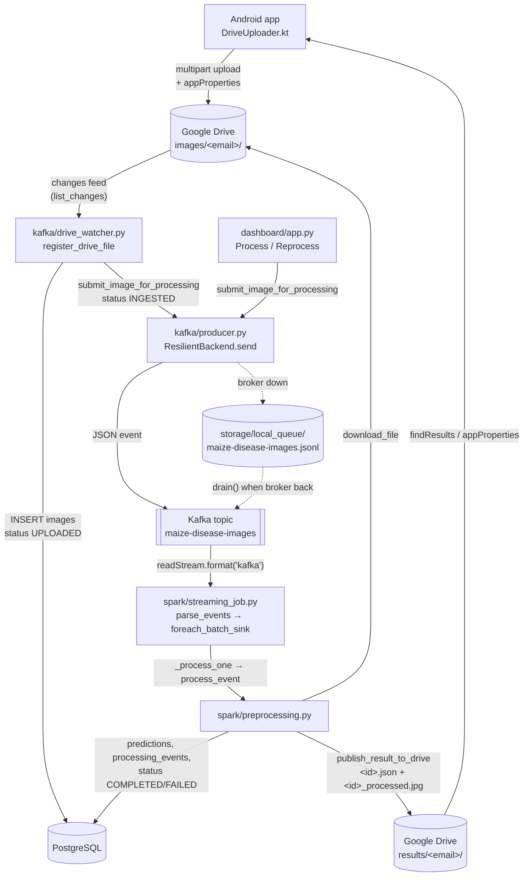
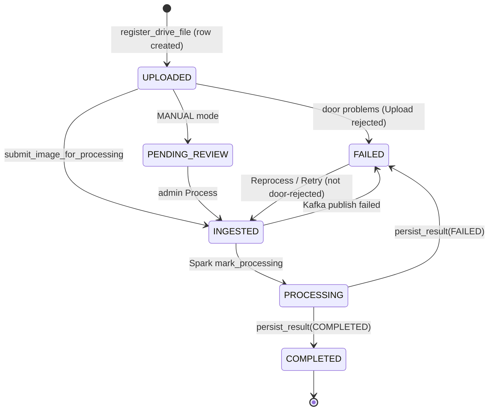
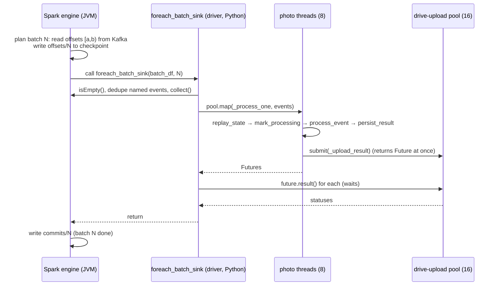
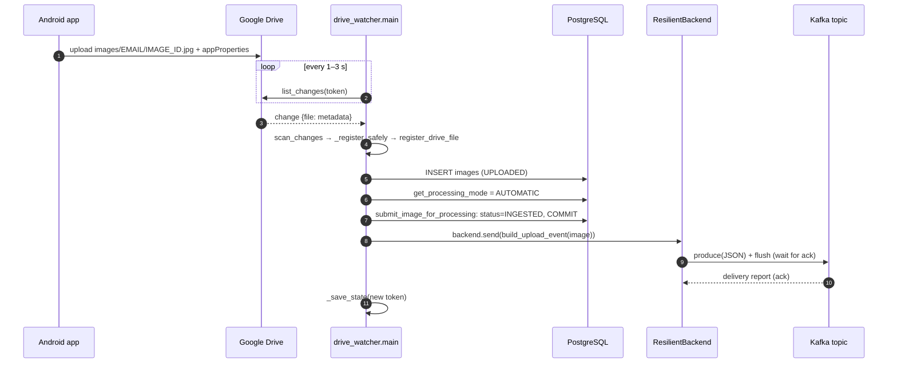
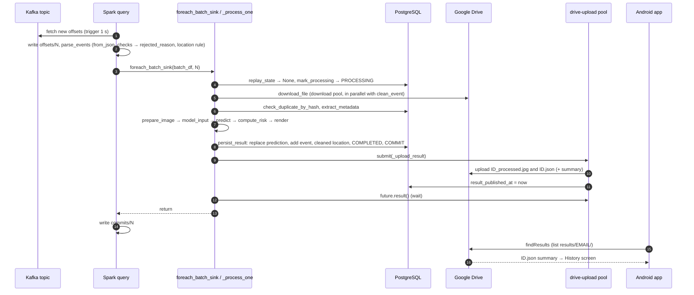

# Google Drive, Apache Kafka and Apache Spark: a Code-by-Code Explanation of the Crop Disease Early Warning System (Image System)

*Source of truth: the `main` branch at commit `2f28f1c` (2026-10-24). Line numbers refer to that commit. No source file was changed to write this document.*

*Changes since the first edition (commit `950cc56`, 2026-10-23), all reflected below:*

- *Spark does **all** the image preprocessing: `spark/preprocessing.model_input` resizes, centre-crops and normalises the photo, and the CNN (`ml/inference.predict`) only classifies the tensor it is given (III.2.11a).*
- *Invalid events are no longer dropped by `parse_events`: they carry a `rejected_reason` and are recorded as FAILED (an EIP Invalid Message Channel, III.1.4, III.1.7).*
- *The Drive watcher stores the location as the phone sent it; Spark cleans it (`parse_events`, `clean_event`) and `persist_result` writes the cleaned value. The watcher's informational duplicate notice (`_find_duplicate`) was removed; Spark's `check_duplicate_by_hash` is the duplicate check (I.7).*
- *`spark/batch_analytics.py` now computes **every** figure the dashboard shows and keeps them current with `--watch` (III.5).*
- *Clean-up: `ResilientBackend.active_name`, `storage/requeue_stuck._event_from_image` (it now calls `pipeline_submit.build_upload_event`), the REST-era `image_storage.save_image`, and the mail outbox setting were removed.*

---

## How to read this document

Each code block is explained under ten headings:

| # | Heading | What it answers |
|---|---|---|
| 1 | **Original code** | The exact code, with its file and line numbers |
| 2 | **Purpose** | Why the block exists |
| 3 | **Line by line** | What each meaningful statement does |
| 4 | **Execution** | What Python does, step by step, when the block runs |
| 5 | **Inputs → outputs** | Data that comes in, and what is returned or changed |
| 6 | **Concepts** | Unfamiliar terms in plain language |
| 7 | **Example** | A realistic run from this project's workflow |
| 8 | **Dependencies** | Other functions, files, libraries, tables, topics or Drive folders it touches |
| 9 | **Failure behaviour** | What happens with missing files, bad messages, network errors, duplicates and so on |
| 10 | **Academic explanation** | A short answer to give if a professor asks what the block does and why |

For very small blocks (a three-line helper, say), headings with nothing new to say are folded into one line so the text stays readable. Long functions are split into their logical sections (A, B, C …) and each section gets its own explanation.

The running example used throughout is one photo:

| Field | Example value |
|---|---|
| Farmer | `maria.soares@gmail.com` (database `user_id` `7c1e…`, a UUID) |
| Phone-generated `image_id` | `3f2a9c1e-5b7d-4e2a-9f10-8c6d2b4a1e77` |
| Drive file id of the upload | `1AbCdEfGhIjKlMnOpQrStUvWxYz012345` |
| Location typed in the app | `" viqueque "` |
| Drive folders | `CropDiseaseEWS/images/maria.soares@gmail.com/` and `CropDiseaseEWS/results/maria.soares@gmail.com/` |

### Files covered

| File | Lines | Technology | Role |
|---|---|---|---|
| `config/settings.py` | 240 | all three | Every configuration value (topic name, broker, Drive folder ids, Spark tuning) |
| `scripts/drive_authorize.py` | 80 | Drive | One-time OAuth consent and folder creation |
| `scripts/drive_share_user.py` | 46 | Drive | Gives a farmer their two private folders |
| `storage/drive_client.py` | 532 | Drive | The **only** module that calls the Google Drive REST API |
| `storage/image_storage.py` | 140 | Drive / Spark | The `gdrive:<id>` path convention, downloading, the local photo copy |
| `kafka/drive_watcher.py` | 415 | Drive → Kafka | Detects new uploads, registers them, publishes the Kafka event |
| `kafka/config.py` | 31 | Kafka | Re-exports Kafka settings; broker reachability check |
| `kafka/producer.py` | 275 | Kafka | Producer back-ends: real Kafka, local file queue, and the resilient switch between them |
| `storage/pipeline_submit.py` | 87 | Kafka | Builds the event, sets the status to INGESTED and publishes |
| `kafka/monitor.py` | 236 | Kafka | Read-only live console consumer |
| `docker-compose.yml` | — | Kafka | The single-node KRaft broker |
| `spark/streaming_job.py` | 345 | Spark | The Structured Streaming query: read, parse, foreachBatch |
| `spark/preprocessing.py` | 943 | Spark / Drive | Validation, download, EXIF, image preprocessing for the CNN, CNN, risk, database, result upload to Drive |
| `spark/live_log.py` | 89 | Spark | Console lines for each batch and photo |
| `spark/batch_analytics.py` | 307 | Spark | The batch (JDBC) job that computes every dashboard figure, once or continuously (`--watch`) |
| `storage/requeue_stuck.py` | 279 | Kafka / Spark | Recovery: re-publish or process stranded images |
| `storage/reset.py` (parts) | — | all three | Factory reset: topic, checkpoints, Drive files, watcher bookmark |
| `dashboard/app.py`, `dashboard/image_management_page.py` (parts) | — | Kafka | Process / Reprocess / Retry buttons |

Android (Kotlin) code, `ml/inference.py`, `storage/exif_utils.py` and `ml/render.py` are only described where they connect to Drive, Kafka or Spark.

### The architecture in one picture



The phone never talks to a server of this project. It only talks to Google Drive. Everything on the right of Drive runs on the laptop.

---

# PART I — Google Drive, Code by Code

Google Drive does three jobs here:

1. **Ingestion.** The farmer's phone uploads the photo into `images/<email>/`.
2. **Storage of record.** The original photo stays in Drive. The database only stores `gdrive:<file id>`.
3. **Result delivery.** Spark writes `<image_id>.json` and `<image_id>_processed.jpg` into `results/<email>/`, and the phone reads them from there.

## I.1 Drive configuration — `config/settings.py` lines 211–240

### Original code

```python
# ============================================================================
# Google Drive (Android -> Drive -> Kafka -> Spark -> Drive -> Android)
# ============================================================================
# One CENTRAL Google account stores every image and result. Its OAuth token
# lives only on this laptop/server (created once by
# `python scripts/drive_authorize.py`) and is never shipped to Android.
GOOGLE_DRIVE_CLIENT_SECRET_FILE = Path(os.getenv(
    "GOOGLE_DRIVE_CLIENT_SECRET_FILE", str(BASE_DIR / "storage" / "google_client_secret.json")))
GOOGLE_DRIVE_TOKEN_FILE = Path(os.getenv(
    "GOOGLE_DRIVE_TOKEN_FILE", str(BASE_DIR / "storage" / "google_drive_token.json")))
GOOGLE_DRIVE_FOLDERS_FILE = Path(os.getenv(
    "GOOGLE_DRIVE_FOLDERS_FILE", str(BASE_DIR / "storage" / "google_drive_folders.json")))
GOOGLE_DRIVE_ROOT_FOLDER_NAME = os.getenv("GOOGLE_DRIVE_ROOT_FOLDER_NAME", "CropDiseaseEWS")


def _drive_folder_id(env_name: str, key: str) -> str:
    """Folder IDs come from the environment/.env if set, otherwise from the
    JSON file scripts/drive_authorize.py writes."""
    value = os.getenv(env_name, "")
    if value:
        return value
    try:
        import json
        return json.loads(GOOGLE_DRIVE_FOLDERS_FILE.read_text()).get(key, "")
    except (OSError, ValueError):
        return ""


GOOGLE_DRIVE_IMAGES_FOLDER_ID = _drive_folder_id("GOOGLE_DRIVE_IMAGES_FOLDER_ID", "images_folder_id")
GOOGLE_DRIVE_RESULTS_FOLDER_ID = _drive_folder_id("GOOGLE_DRIVE_RESULTS_FOLDER_ID", "results_folder_id")
```

### Purpose
Says where the three Drive files live on the laptop: the OAuth client secret, the OAuth token and the folder-id file. It also works out the ids of the two root folders, `images` and `results`, that every other Drive call depends on.

### Line by line
- `GOOGLE_DRIVE_CLIENT_SECRET_FILE`: the "Desktop app" OAuth client JSON downloaded from Google Cloud Console. `os.getenv(name, default)` lets `.env` override the default `storage/google_client_secret.json`. `Path(...)` turns the string into a `pathlib.Path`.
- `GOOGLE_DRIVE_TOKEN_FILE`: where `drive_authorize.py` saves the refresh token, `storage/google_drive_token.json`.
- `GOOGLE_DRIVE_FOLDERS_FILE`: the JSON file that records the folder ids `drive_authorize.py` created.
- `GOOGLE_DRIVE_ROOT_FOLDER_NAME`: the name of the top folder in the central account, `CropDiseaseEWS`.
- `_drive_folder_id(env_name, key)`:
  - `value = os.getenv(env_name, "")`: an environment variable or `.env` entry has priority.
  - `if value: return value`: an empty string counts as "not set".
  - Otherwise it reads `GOOGLE_DRIVE_FOLDERS_FILE`, parses it with `json.loads` and returns `.get(key, "")`.
  - `except (OSError, ValueError)`: a missing file (`OSError`) or broken JSON (`ValueError`; `json.JSONDecodeError` is a subclass of it) gives `""` instead of crashing the import.
- The last two lines run **once, at import time**, and fix the two folder ids for the life of the process.

### Execution
When any module first runs `import config.settings`, Python runs the module top to bottom. `load_dotenv` (line 25) has already copied `.env` into `os.environ`, so `os.getenv` sees it. `_drive_folder_id` is called twice, and the module-level constants are bound to strings.

### Inputs → outputs
Inputs are the environment variables, `.env`, and `storage/google_drive_folders.json`. The outputs are module constants. An empty string means "Drive not configured".

### Concepts
- **OAuth client secret:** identifies the *application* to Google. It is not a user password.
- **Refresh token:** a long-lived credential that lets the laptop get new short-lived access tokens without asking the user again.

### Example
After `drive_authorize.py` has run, `google_drive_folders.json` contains `{"root_folder_id": "0Ab…", "images_folder_id": "1Img…", "results_folder_id": "1Res…"}`, so `GOOGLE_DRIVE_IMAGES_FOLDER_ID == "1Img…"`.

### Dependencies
Used by `storage/drive_client.py` (`images_folder_id()`, `results_folder_id()`, `is_configured()`, `_authed_session()`) and written by `scripts/drive_authorize.py`.

### Failure behaviour
There is no exception at import. An empty id is turned into `DriveNotConfigured` later, in `drive_client.images_folder_id()`. The Drive watcher's `main()` catches that and exits with code 1 and a clear message.

### Academic explanation
> "Configuration follows the twelve-factor pattern: environment variables override defaults, and the folder ids are generated once by a setup script and stored in a JSON file, so no secret or id is hard-coded in source. Failing softly at import and loudly at first use means modules that don't need Drive, such as the analytics, can still be imported on a machine where Drive isn't set up."

---

## I.2 One-time authorisation — `scripts/drive_authorize.py`

### Original code (lines 39–76)

```python
def main() -> int:
    secret = Path(GOOGLE_DRIVE_CLIENT_SECRET_FILE)
    if not secret.exists():
        print(f"OAuth client file not found: {secret}")
        print("Create a 'Desktop app' OAuth client in Google Cloud Console, download its JSON")
        print("and save it at that path (see README 'Google Drive setup').")
        return 1

    from google_auth_oauthlib.flow import InstalledAppFlow
    from storage import drive_client

    flow = InstalledAppFlow.from_client_secrets_file(str(secret), drive_client.SCOPES)
    creds = flow.run_local_server(port=0, access_type="offline", prompt="consent")

    token_path = Path(GOOGLE_DRIVE_TOKEN_FILE)
    token_path.parent.mkdir(parents=True, exist_ok=True)
    token_path.write_text(creds.to_json())
    print(f"Saved OAuth token to {token_path}")

    # drive_client caches no session yet, so it will pick up the new token.
    root_id = drive_client.ensure_folder(GOOGLE_DRIVE_ROOT_FOLDER_NAME)
    images_id = drive_client.ensure_folder("images", root_id)
    results_id = drive_client.ensure_folder("results", root_id)

    folders = {
        "root_folder_id": root_id,
        "images_folder_id": images_id,
        "results_folder_id": results_id,
    }
    Path(GOOGLE_DRIVE_FOLDERS_FILE).write_text(json.dumps(folders, indent=2))
    ...
    return 0
```

### Purpose
This is the single interactive step that connects the laptop to the **central** Google account. It creates the folder tree `CropDiseaseEWS/images` and `CropDiseaseEWS/results`.

### Line by line
- `if not secret.exists(): … return 1`: without the client JSON, Google cannot identify the application, so the script stops with instructions and a non-zero exit code.
- `InstalledAppFlow.from_client_secrets_file(str(secret), drive_client.SCOPES)`: builds the OAuth "installed application" flow, asking for the scope `https://www.googleapis.com/auth/drive` (full Drive).
- `flow.run_local_server(port=0, access_type="offline", prompt="consent")`:
  - `port=0` lets the operating system choose a free local port for Google's redirect.
  - `access_type="offline"` asks Google for a **refresh token**, not only an access token.
  - `prompt="consent"` forces the consent screen, so a refresh token is returned even if consent was given before.
  - The call opens the browser and **blocks** until the user approves.
- `token_path.write_text(creds.to_json())`: saves the client id, client secret, refresh token and scopes as JSON.
- Three `ensure_folder` calls find or create the root folder and its two children (see I.3.15). They are idempotent: running the script again reuses the same folders.
- `json.dumps(folders, indent=2)` writes the ids for `config/settings._drive_folder_id` to read.

### Execution
Synchronous. The browser step waits for the human. Each `ensure_folder` is one search request, plus one create request when the folder doesn't exist yet.

### Inputs → outputs
Input is the client-secret file and the user's consent in the browser. Outputs are `google_drive_token.json`, `google_drive_folders.json`, and two or three folders in the central Drive.

### Concepts
- **Scope:** the permission the app asks for. `drive.file` would only see files this app created. The farmers' photos are created by *the farmers' own accounts*, so the laptop needs full `drive`.

### Dependencies
`storage/drive_client.SCOPES`, `drive_client.ensure_folder`, and `config/settings`. After the first `ensure_folder` call, `drive_client._authed_session()` reads the freshly written token.

### Failure behaviour
A missing client file returns 1. A refused consent raises from `google_auth_oauthlib`, so the script crashes with a traceback and no token is written. A Drive API error in `ensure_folder` raises `DriveError`; the token is already saved, and running the script again is safe.

### Academic explanation
> "Credentials are created once, by a human, on the server. The token never leaves the laptop and is never put into the Android app. Each farmer authenticates with their own Google account on the phone, so the system holds no farmer passwords."

---

## I.3 The Drive client — `storage/drive_client.py`

This module is "the ONLY place in the project that talks to Google Drive" (docstring line 3). It calls the Drive REST API v3 directly through `google.auth.transport.requests.AuthorizedSession`, which is a `requests.Session` that adds and refreshes the OAuth bearer token. It does not use the larger `googleapiclient` library.

### I.3.1 Constants — lines 39–57

```python
from config.settings import (
    GOOGLE_DRIVE_TOKEN_FILE,
    GOOGLE_DRIVE_IMAGES_FOLDER_ID,
    GOOGLE_DRIVE_RESULTS_FOLDER_ID,
)

SCOPES = ["https://www.googleapis.com/auth/drive"]
DRIVE_API = "https://www.googleapis.com/drive/v3"
UPLOAD_API = "https://www.googleapis.com/upload/drive/v3"
FOLDER_MIME_TYPE = "application/vnd.google-apps.folder"

FILE_METADATA_FIELDS = (
    "id,name,mimeType,size,parents,appProperties,md5Checksum,sha256Checksum,"
    "trashed,createdTime,owners(emailAddress,displayName)"
)

# Drive file IDs are URL-safe base64-ish strings. Validating them before they
# go into a URL or a search query prevents path/query injection.
_DRIVE_ID_RE = re.compile(r"^[A-Za-z0-9_-]{10,200}$")
```

- **Purpose:** fixed values that every request uses.
- **Line by line:**
  - `SCOPES`: full Drive access (see I.2).
  - `DRIVE_API` is the metadata endpoint. `UPLOAD_API` is a different host path that Drive requires when file *content* is sent.
  - `FOLDER_MIME_TYPE`: in Drive a folder is a file with this special MIME type. The code tests it to tell folders from photos.
  - `FILE_METADATA_FIELDS`: the Drive `fields` *partial-response* mask. Drive returns only these attributes. They are exactly what the watcher needs: `appProperties` (the phone's tags), `sha256Checksum` (the duplicate fingerprint), `createdTime` (Google's upload time), `owners` (who really uploaded the file) and `parents` (which farmer folder it is in).
  - `_DRIVE_ID_RE`: allows only letters, digits, `_` and `-`, 10–200 characters.
- **Concept, injection:** ids are put into URLs (`/files/{id}`) and query strings (`'{id}' in parents`). An id containing `'`, `/` or `?` could change the meaning of the request. The regex rejects such input before any request is sent.
- **Academic explanation:** "Ask Drive only for the fields you need, and treat every id as untrusted input."

### I.3.2 Exceptions and id validation — lines 60–100

```python
class DriveNotConfigured(Exception):
    """The OAuth token file or folder IDs are missing — run scripts/drive_authorize.py."""


class DriveError(Exception):
    """A Google Drive API call failed."""

    def __init__(self, message: str, status_code: Optional[int] = None):
        super().__init__(message)
        self.status_code = status_code


def is_valid_drive_id(value: Optional[str]) -> bool:
    return bool(value) and bool(_DRIVE_ID_RE.match(value))


def _require_valid_id(value: str, what: str = "Drive file id") -> str:
    if not is_valid_drive_id(value):
        raise DriveError(f"Invalid {what}: {value!r}", status_code=400)
    return value


def images_folder_id() -> str:
    if not GOOGLE_DRIVE_IMAGES_FOLDER_ID:
        raise DriveNotConfigured("GOOGLE_DRIVE_IMAGES_FOLDER_ID is not set — run scripts/drive_authorize.py")
    return GOOGLE_DRIVE_IMAGES_FOLDER_ID


def results_folder_id() -> str:
    if not GOOGLE_DRIVE_RESULTS_FOLDER_ID:
        raise DriveNotConfigured("GOOGLE_DRIVE_RESULTS_FOLDER_ID is not set — run scripts/drive_authorize.py")
    return GOOGLE_DRIVE_RESULTS_FOLDER_ID


def is_configured() -> bool:
    from pathlib import Path
    return (
        Path(GOOGLE_DRIVE_TOKEN_FILE).exists()
        and bool(GOOGLE_DRIVE_IMAGES_FOLDER_ID)
        and bool(GOOGLE_DRIVE_RESULTS_FOLDER_ID)
    )
```

- **Purpose:** two kinds of failure. `DriveNotConfigured` means "setup has not been done"; it is permanent until a human runs the setup script. `DriveError` means "a call failed", and it keeps the HTTP `status_code` so callers can react to it (for example, `storage/reset.py` treats a 403 on trashing a file as "not the owner").
- **Line by line:**
  - `super().__init__(message)` keeps the normal `str(e)`.
  - `bool(value) and bool(...match(value))` treats `None` and `""` as invalid without calling the regex on `None`.
  - `_require_valid_id` returns the value, so it can be used inline: `chunk = [_require_valid_id(pid, …) for pid in …]`. A bad id is reported as HTTP-like 400.
  - `images_folder_id()` and `results_folder_id()` are accessor functions. They raise only when called, which is the "fail at first use" behaviour from I.1.
  - `is_configured()` is a non-raising check used by status pages.
- **Failure behaviour:** `kafka/drive_watcher.main` catches `DriveNotConfigured` and exits with 1. `spark/preprocessing._clean_drive_event` turns both exceptions into `InvalidEvent` ("Image file not found in Google Drive").
- **Academic explanation:** "Separating configuration errors from runtime errors lets the long-running watcher stop on the first, which no retry can fix, and keep retrying the second, which usually fixes itself."

### I.3.3 The authenticated session — lines 106–127

```python
_session = None


def _authed_session():
    """Lazily builds one AuthorizedSession from the stored OAuth token.
    google-auth refreshes the short-lived access token automatically using
    the stored refresh token."""
    global _session
    if _session is not None:
        return _session
    from pathlib import Path
    if not Path(GOOGLE_DRIVE_TOKEN_FILE).exists():
        raise DriveNotConfigured(
            f"Google Drive token file not found at {GOOGLE_DRIVE_TOKEN_FILE} — "
            f"run `python scripts/drive_authorize.py` once on this machine."
        )
    from google.oauth2.credentials import Credentials
    from google.auth.transport.requests import AuthorizedSession

    creds = Credentials.from_authorized_user_file(str(GOOGLE_DRIVE_TOKEN_FILE), SCOPES)
    _session = AuthorizedSession(creds)
    return _session
```

- **Purpose:** one HTTP session per process. It reuses TCP/TLS connections and handles token refresh by itself.
- **Line by line:**
  - `global _session` lets the function assign the module-level variable.
  - The early `return` is the cache. After the first call no file I/O happens again.
  - The token-file check gives a readable `DriveNotConfigured` instead of a `FileNotFoundError` from inside google-auth.
  - `Credentials.from_authorized_user_file(path, SCOPES)` loads the refresh token, client id and client secret.
  - `AuthorizedSession(creds)` is a subclass of `requests.Session`. Before each request it checks whether the access token has expired (about one hour) and, if so, calls Google's token endpoint with the refresh token. On a `401` it refreshes and retries once.
- **Execution:** lazy. The first Drive call in a process (watcher, Spark or dashboard) creates the session.
- **Concept, lazy initialisation:** the object is created the first time it is needed, not at import time.
- **Failure behaviour:** a missing token raises `DriveNotConfigured`. A revoked refresh token makes google-auth raise `RefreshError` on the first request. The watcher's generic `except Exception` logs "scan failed, retrying" and keeps looping, and Spark records the photo as FAILED.
- **Thread safety (an honest note):** two threads making the very first call at the same moment could each build a session. Both are valid, so nothing breaks; one is simply thrown away. `requests` sessions are commonly shared between threads for this kind of I/O.
- **Academic explanation:** "Credentials are loaded once, lazily, and refreshed by the official Google library. The application code never handles access tokens."

### I.3.4 Response check and query escaping — lines 130–140

```python
def _check(resp, action: str):
    if resp.status_code >= 400:
        raise DriveError(
            f"Google Drive {action} failed: HTTP {resp.status_code} {resp.text[:300]}",
            status_code=resp.status_code,
        )
    return resp


def _escape_query_value(value: str) -> str:
    return value.replace("\\", "\\\\").replace("'", "\\'")
```

- `_check` turns any 4xx/5xx into a `DriveError` that carries the status and the first 300 characters of Google's JSON error body (enough to diagnose, not enough to flood the log). It returns `resp` so calls can be chained.
- `_escape_query_value`: Drive's search language puts strings in single quotes. The backslash is escaped **first**, and then the quote. Doing it in the other order would double-escape the backslash that was just added in front of the quote.
- **Example:** a location or file name `O'Neil` becomes `O\'Neil` inside `name = '…'`.
- **Academic explanation:** "All Drive errors go through one choke point, and all user-influenced strings are escaped before being placed in a Drive query: the same idea as parameterised SQL."

### I.3.5 Retry policy constants — lines 146–155

```python
_GET_ATTEMPTS = 3
_GET_TIMEOUT = (15, 60)  # (connect, read) seconds
_REQUEST_TIMEOUT = (15, 60)   # every other call (uploads, searches, shares)
_UPLOAD_ATTEMPTS = 3          # uploads retried after a timeout / dropped connection
# "Slow down" answers from Google — retried with exponential backoff, as
# https://developers.google.com/workspace/drive/api/guides/limits says to.
_RATE_LIMIT_ATTEMPTS = 6           # waits ~1, 2, 4, 8, 16 s (+ jitter), ~30 s in all
_RATE_LIMIT_REASONS = ("rateLimitExceeded", "userRateLimitExceeded")
_RETRY_STATUSES = (429, 500, 502, 503, 504)
_sleep = __import__("time").sleep  # tests replace this
```

- A timeout tuple in `requests` is `(connect, read)`: 15 s to open the TCP connection, then 60 s of *silence* allowed between bytes. It is not a limit on the total transfer time.
- There are **two separate retry layers**:
  1. `_request`, for **HTTP answers** that mean "busy" (429, 5xx, rate-limit 403): up to 6 attempts.
  2. `_get_with_retry` and `upload_bytes`, for **network exceptions** (connection dropped, timeout): up to 3 attempts.
- `_sleep = __import__("time").sleep` is a module-level alias, so a test can replace `drive_client._sleep` with a no-op and not wait 30 seconds.
- **Academic explanation:** "Transport errors and server back-pressure are different failures and are retried separately. Back-pressure follows Google's documented exponential backoff."

### I.3.6 `_should_back_off` — lines 158–167

```python
def _should_back_off(resp) -> bool:
    if resp.status_code in _RETRY_STATUSES:
        return True
    if resp.status_code == 403:  # a 403 is also "no permission" — only retry the rate-limit kind
        try:
            errors = (resp.json().get("error") or {}).get("errors") or []
        except ValueError:
            return False
        return any(e.get("reason") in _RATE_LIMIT_REASONS for e in errors)
    return False
```

- **Purpose:** decides whether a failed response is temporary.
- **Line by line:**
  - 429 (Too Many Requests) and 500/502/503/504 are always retried.
  - 403 is ambiguous. Drive uses it both for "you don't have permission", which is permanent, and for "rate limit exceeded", which is temporary. The code parses Google's error body `{"error": {"errors": [{"reason": "userRateLimitExceeded", …}]}}`.
  - `(… or {})` and `or []` protect against `None` at each level.
  - `except ValueError`: a body that isn't JSON means "don't retry".
- **Example:** a burst of 1,000 photos makes Drive answer `403 userRateLimitExceeded`. This function returns True and `_request` waits about 1 s, then 2 s, and so on. A 403 `insufficientFilePermissions` (a farmer folder no longer shared) returns False and fails immediately.
- **Academic explanation:** "Retrying a permission error would waste about 30 seconds per photo and still fail, so only the rate-limit kind of 403 is retried."

### I.3.7 `_request` — the single entry point for every Drive call (lines 170–189)

```python
def _request(method: str, url: str, **kwargs):
    import random
    kwargs.setdefault("timeout", _REQUEST_TIMEOUT)
    for attempt in range(1, _RATE_LIMIT_ATTEMPTS + 1):
        resp = getattr(_authed_session(), method.lower())(url, **kwargs)
        if attempt == _RATE_LIMIT_ATTEMPTS or not _should_back_off(resp):
            return resp
        wait = 2 ** (attempt - 1) + random.random()
        print(f"[drive_client] Google Drive answered HTTP {resp.status_code} (busy/rate limit); "
              f"retrying in {wait:.1f}s")
        _sleep(wait)
```

- **Purpose:** every Drive HTTP call passes through here, so all of them get the timeout and the backoff.
- **Line by line:**
  - `kwargs.setdefault("timeout", …)` adds a timeout unless the caller already gave one. The docstring explains why: an upload whose connection Google left open "waited forever, and stalled the whole Spark batch."
  - `getattr(_authed_session(), method.lower())` turns `"GET"` into `session.get`, `"PATCH"` into `session.patch`, and so on. It is a dynamic method lookup.
  - `**kwargs` forwards `params=`, `json=`, `data=`, `headers=` and `timeout=` unchanged.
  - `if attempt == _RATE_LIMIT_ATTEMPTS or not _should_back_off(resp): return resp`: it returns on success, on a permanent error, or on the last attempt. It **does not raise**. Callers pass the result to `_check()`.
  - `wait = 2 ** (attempt - 1) + random.random()`: waits of 1, 2, 4, 8 and 16 s, plus up to 1 s of random **jitter**.
- **Execution:** synchronous and blocking in the calling thread. In Spark this is a worker thread of the photo pool or the upload pool, so the other photos carry on in parallel.
- **Concept, jitter:** if eight threads were throttled at the same moment, waiting exactly 1 s would make them all retry at the same moment again. Random jitter spreads them out.
- **Failure behaviour:** network exceptions (`ConnectionError`, `Timeout`) are **not** caught here. They go up to `_get_with_retry` or `upload_bytes`. After 6 "busy" answers the last error response is returned and `_check` raises `DriveError`.
- **Academic explanation:** "A single wrapper enforces timeouts and Google's recommended exponential backoff with jitter for every Drive call. Under a large burst, photos are delayed instead of failing."

### I.3.8 `_get_with_retry` — lines 192–211

```python
def _get_with_retry(url: str, params: dict):
    import requests
    for attempt in range(1, _GET_ATTEMPTS + 1):
        try:
            resp = _request("GET", url, params=params, timeout=_GET_TIMEOUT)
            resp.content  # force the full body read inside the retry loop
            return resp
        except (requests.exceptions.ConnectionError,
                requests.exceptions.ChunkedEncodingError,
                requests.exceptions.Timeout) as e:
            if attempt == _GET_ATTEMPTS:
                raise
            print(f"[drive_client] GET attempt {attempt} failed ({e}); retrying")
            _sleep(2 * attempt)
```

- **Purpose:** retry **downloads and metadata reads** after network drops.
- **Line by line:**
  - `resp.content` is accessed only for its side effect. `requests` downloads the body when `.content` is first read. Reading it *inside* the `try` means a connection that breaks half-way through a 5 MB photo (`ChunkedEncodingError` or an "IncompleteRead") is caught and retried here, and doesn't surface later in the caller.
  - `ChunkedEncodingError` is raised when the body ends early.
  - `raise` with no argument re-raises the original exception on the third failure.
  - `_sleep(2 * attempt)` waits 2 s and then 4 s (linear).
- **Why GET only:** the docstring says "a POST whose answer got lost may have been applied, and repeating it would create a second file." GET is **idempotent**: repeating it changes nothing.
- **Failure behaviour:** after 3 network failures the exception goes up. `load_image_bytes` only converts `DriveError` into `FileNotFoundError`, so a `requests` exception reaches `_process_one`'s generic `except Exception`, and the photo is marked FAILED with the error text.
- **Academic explanation:** "Only idempotent reads are retried blindly. Writes get their own retry logic that first checks whether the earlier attempt actually succeeded."

### I.3.9 `get_file_metadata` and `download_file` — lines 214–225

```python
def get_file_metadata(file_id: str) -> dict:
    _require_valid_id(file_id)
    resp = _get_with_retry(f"{DRIVE_API}/files/{file_id}", {"fields": FILE_METADATA_FIELDS})
    _check(resp, f"get metadata for {file_id}")
    return resp.json()


def download_file(file_id: str) -> bytes:
    _require_valid_id(file_id)
    resp = _get_with_retry(f"{DRIVE_API}/files/{file_id}", {"alt": "media"})
    _check(resp, f"download {file_id}")
    return resp.content
```

- Same endpoint, `GET /drive/v3/files/{id}`, used two ways. With `fields=…` it returns JSON metadata. With `alt=media` it returns the **raw file bytes**.
- **Inputs → outputs:** a Drive file id comes in. Out comes a dict like `{"id": "...", "appProperties": {"image_id": "3f2a…"}, "trashed": false, …}`, or `bytes` (the original JPEG with its EXIF).
- **Callers:** `get_file_metadata` is called by `spark/preprocessing._clean_drive_event`, only when `SPARK_RECHECK_DRIVE_FILE=true` or when the event was not registered by the watcher. `download_file` is called by `storage/image_storage.load_image_bytes`, which Spark runs in the `_DOWNLOADS` thread pool.
- **Failure behaviour:** 404 (file deleted) becomes `DriveError(status_code=404)`, and `load_image_bytes` re-raises it as `FileNotFoundError`. An invalid id raises `DriveError(400)` before any network call.

### I.3.10 `find_file_in_folder` — lines 228–248

```python
def find_file_in_folder(name: str, parent_id: str) -> Optional[dict]:
    _require_valid_id(parent_id, "parent folder id")
    q = (
        f"name = '{_escape_query_value(name)}' and "
        f"'{parent_id}' in parents and trashed = false"
    )
    resp = _request(
        "GET", f"{DRIVE_API}/files",
        params={
            "q": q,
            "spaces": "drive",
            "orderBy": "modifiedTime desc",
            "pageSize": 1,
            "fields": "files(id,name,appProperties)",
        },
    )
    _check(resp, f"search for {name}")
    files = resp.json().get("files", [])
    return files[0] if files else None
```

- **Purpose:** "does a file with this exact name already exist in this folder?" It is used before writing a result (so the result is overwritten, not duplicated) and to find a farmer's `<email>` folder.
- **Line by line:**
  - The `q` string is Drive's search language. Three conditions: same name, direct child of the folder, not in the trash.
  - `orderBy: modifiedTime desc` and `pageSize: 1`: if duplicates already exist, the newest one is chosen.
  - `spaces: drive` searches the normal Drive space, not the hidden app-data space.
- **Note:** this uses `_request`, not `_get_with_retry`, so rate limits are retried but a network drop is not retried *here*. The upload retry loop in `upload_bytes` covers it when this is called from there.
- **Concept, search-index delay:** `files.list` with `q` uses Drive's search index, which can lag behind a write by a few seconds. That is one reason the watcher prefers the **changes feed** (I.3.17).

### I.3.11 `_multipart_body` — lines 251–260

```python
def _multipart_body(metadata: dict, payload: bytes, mime_type: str = "application/json"):
    boundary = f"=====crop-ews-{uuid.uuid4().hex}"
    body = (
        f"--{boundary}\r\n"
        "Content-Type: application/json; charset=UTF-8\r\n\r\n"
        f"{json.dumps(metadata)}\r\n"
        f"--{boundary}\r\n"
        f"Content-Type: {mime_type}\r\n\r\n"
    ).encode("utf-8") + payload + f"\r\n--{boundary}--\r\n".encode("utf-8")
    return body, f"multipart/related; boundary={boundary}"
```

- **Purpose:** builds a Drive **multipart upload** body by hand. Part 1 is the JSON metadata (name, parents, appProperties) and part 2 is the file bytes, so a file and its metadata are created in **one** HTTP request.
- **Line by line:**
  - `boundary` is a random separator. A fresh `uuid4` makes it practically impossible for the separator to appear inside the JPEG bytes.
  - `\r\n` (CRLF) line endings are required by the MIME standard (RFC 2046).
  - The text parts are encoded to UTF-8 bytes and then **concatenated with the raw `payload` bytes**, so binary JPEG data is never decoded as text.
  - `--{boundary}--` with two trailing dashes closes the body.
  - The return value is the body plus the `Content-Type` header value that announces the boundary.
- **Concept:** `multipart/related` is the MIME type Drive expects for `uploadType=multipart`. Drive recommends it for files under 5 MB, which covers the result JSON and the 600 px processed JPEG.

### I.3.12 `_short_app_properties` — lines 263–274

```python
def _short_app_properties(app_properties: dict) -> dict:
    out = {}
    for k, v in app_properties.items():
        if v is None:
            continue
        value = str(v)
        while len((k + value).encode("utf-8")) > 124:
            value = value[:-1]
        out[k] = value
    return out
```

- **Purpose:** Drive limits each custom property to **124 bytes for key plus value**. Breaking that limit makes the whole upload fail with HTTP 400. This function trims instead.
- **Line by line:** `None` values are dropped (Drive would treat `null` as "delete this property"). `str(v)` turns floats such as `0.873` into text. The `while` loop removes one character at a time, measuring in **UTF-8 bytes**, not characters, because "Viqueque – Ossu" contains a multi-byte dash.
- **Example:** `error_message` is already cut to 80 characters by the caller. A long location such as `"Baucau, Venilale, Uma Ana Ulu, near the school…"` is trimmed until `len("location" + value) <= 124`.
- **Academic explanation:** "A cosmetic field must never be able to make the delivery of a diagnosis fail, so values are shortened to fit the documented limit."

### I.3.13 `upload_bytes` — retry wrapper (lines 277–300)

```python
def upload_bytes(name: str, payload: bytes, mime_type: str, parent_id: str, app_properties: dict,
                 may_exist: bool = True, existing_id: str = None) -> str:
    import requests
    for attempt in range(1, _UPLOAD_ATTEMPTS + 1):
        try:
            # A retry always searches first: the timed-out attempt may have
            # created the file anyway, and must not get a twin.
            return _upload_once(name, payload, mime_type, parent_id, app_properties,
                                may_exist or attempt > 1, existing_id)
        except (requests.exceptions.ConnectionError, requests.exceptions.Timeout,
                requests.exceptions.ChunkedEncodingError) as e:
            if attempt == _UPLOAD_ATTEMPTS:
                raise
            print(f"[drive_client] upload of {name} failed ({e}); retrying")
            _sleep(2 * attempt)
```

- **Purpose:** **create or overwrite** a file, retrying network failures *without* creating duplicates.
- **Key line:** `may_exist or attempt > 1`. On the first attempt the caller may say "this file certainly doesn't exist yet" (`may_exist=False`) to save a search request. On a **retry** a search is always done first, because the earlier attempt may have reached Google and created the file even though the response was lost (a timeout after the server had already committed the write).
- **Parameters:**
  - `existing_id`: when the caller already knows the file id (from `_ResultFolderIndex`, I.6.2), the search is skipped completely and the file is updated in place.
  - `app_properties`: the searchable key/value tags.
- **Concept, idempotent write:** an operation that can safely be repeated. A POST create is not idempotent. Turning "retry a create" into "search, then PATCH if found" makes it idempotent in practice.
- **Failure behaviour:** HTTP errors from `_check` (`DriveError`) are **not** retried here; they go to the caller. Network errors are retried 3 times and then raised. In Spark the caller is `publish_result_to_drive_safely`, which catches everything and logs.

### I.3.14 `_upload_once` and `upload_json` — lines 303–336

```python
def _upload_once(name, payload, mime_type, parent_id, app_properties, may_exist, existing_id=None):
    props = _short_app_properties(app_properties)
    if existing_id:                       # the caller already knows the file: update it directly
        existing = {"id": _require_valid_id(existing_id)}
    else:
        existing = find_file_in_folder(name, parent_id) if may_exist else None

    if existing:
        body, content_type = _multipart_body({"appProperties": props}, payload, mime_type)
        resp = _request(
            "PATCH", f"{UPLOAD_API}/files/{existing['id']}?uploadType=multipart&fields=id",
            headers={"Content-Type": content_type},
            data=body,
        )
        _check(resp, f"update {name}")
        return resp.json()["id"]

    metadata = {"name": name, "mimeType": mime_type, "parents": [parent_id], "appProperties": props}
    body, content_type = _multipart_body(metadata, payload, mime_type)
    resp = _request(
        "POST", f"{UPLOAD_API}/files?uploadType=multipart&fields=id",
        headers={"Content-Type": content_type},
        data=body,
    )
    _check(resp, f"create {name}")
    return resp.json()["id"]


def upload_json(name: str, data: dict, parent_id: str, app_properties: dict, may_exist: bool = True,
                existing_id: str = None) -> str:
    payload = json.dumps(data, indent=2, default=str).encode("utf-8")
    return upload_bytes(name, payload, "application/json", parent_id, app_properties, may_exist, existing_id)
```

- **Section A, finding the target:** there are three cases. If `existing_id` is known, it is used directly. If the file may exist, `find_file_in_folder` searches for it. If the file certainly doesn't exist, `existing = None`.
- **Section B, update (`PATCH`):** the metadata part contains **only** `appProperties`. The name and parent stay as they are. The content is replaced. `fields=id` asks Drive to return only the id.
- **Section C, create (`POST`):** the metadata includes `name`, `mimeType`, `parents: [parent_id]` (which places the file in the farmer's results folder) and `appProperties`.
- `upload_json`: `json.dumps(..., indent=2, default=str)`. `default=str` turns values JSON can't encode, such as `datetime`, into strings, so serialising a payload can never crash.
- **Example:** the first result for photo `3f2a…` POSTs `3f2a….json` into `results/maria…/`. A Reprocess of the same photo later PATCHes the same file id, so the phone sees the result update in place.
- **Academic explanation:** "Writes are upserts keyed on (folder, file name). Combined with the database's delete-then-insert of the prediction, re-processing an image gives exactly one result in both places."

### I.3.15 Change feed: `get_start_page_token` and `list_changes` — lines 339–365

```python
def get_start_page_token() -> str:
    resp = _request("GET", f"{DRIVE_API}/changes/startPageToken", params={"fields": "startPageToken"})
    _check(resp, "get changes start token")
    return resp.json()["startPageToken"]


def list_changes(page_token: str) -> tuple:
    changes = []
    while True:
        resp = _request("GET", f"{DRIVE_API}/changes", params={
            "pageToken": page_token, "pageSize": 1000, "spaces": "drive", "includeRemoved": "false",
            "fields": f"nextPageToken,newStartPageToken,changes(fileId,removed,file({FILE_METADATA_FIELDS}))",
        })
        _check(resp, "list changes")
        body = resp.json()
        changes.extend(body.get("changes", []))
        if body.get("newStartPageToken"):
            return changes, body["newStartPageToken"]
        page_token = body["nextPageToken"]
```

- **Purpose:** this is how new uploads are **detected**. Drive keeps a per-account change log. A *page token* is a bookmark into it.
- **Line by line:**
  - `get_start_page_token()` returns a bookmark meaning "now". Changes after this point will be listed.
  - `list_changes(token)` loops over pages:
    - `pageSize: 1000` returns up to 1,000 changes per request.
    - `includeRemoved: false` leaves out deletions.
    - The `fields` mask asks for the full metadata of each changed file, so **no second request per file** is needed.
    - Drive puts `nextPageToken` on every page except the last, and `newStartPageToken` **only on the last page**. Seeing `newStartPageToken` means "you have caught up; save this bookmark for next time".
- **Why the changes feed works for farmer uploads:** each farmer's `images/<email>/` folder is *owned by the central account* and only shared with the farmer. A file added to a folder the account owns shows up in that account's change feed, even though the farmer's account owns the file itself.
- **Inputs → outputs:** in goes the saved bookmark. Out comes `(list of {fileId, removed, file:{…}}, new bookmark)`.
- **Failure behaviour:** an HTTP error raises `DriveError`. The watcher catches it ("scan failed, retrying") and **does not save** the new bookmark, so the next loop asks again from the same position. Nothing is lost.
- **Concept, cursor-based polling:** the client keeps a cursor and asks only for "what's new since the cursor". The cost is the same whether there are 5 farmers or 5,000.
- **Academic explanation:** "Detection uses Drive's change log. Each poll is one request no matter how many farmers there are, and it does not depend on the search index, which can lag behind recent writes."

### I.3.16 Folder listing: `list_subfolders` and `list_files_in_folders` — lines 368–410

```python
def list_subfolders(parent_id: str) -> list:
    _require_valid_id(parent_id, "parent folder id")
    q = f"'{parent_id}' in parents and mimeType = '{FOLDER_MIME_TYPE}' and trashed = false"
    out, page_token = [], None
    while True:
        params = {"q": q, "spaces": "drive", "pageSize": 100,
                  "fields": "nextPageToken,files(id,name,appProperties)"}
        if page_token:
            params["pageToken"] = page_token
        resp = _request("GET", f"{DRIVE_API}/files", params=params)
        _check(resp, "list subfolders")
        body = resp.json()
        out.extend(body.get("files", []))
        page_token = body.get("nextPageToken")
        if not page_token:
            return out


def list_files_in_folders(parent_ids: list, created_after: Optional[str] = None) -> list:
    files = []
    for i in range(0, len(parent_ids), 20):
        chunk = [_require_valid_id(pid, "folder id") for pid in parent_ids[i:i + 20]]
        parents_q = " or ".join(f"'{pid}' in parents" for pid in chunk)
        q = f"({parents_q}) and mimeType != '{FOLDER_MIME_TYPE}' and trashed = false"
        if created_after:
            q += f" and createdTime > '{_escape_query_value(created_after)}'"
        page_token = None
        while True:
            params = {"q": q, "spaces": "drive", "orderBy": "createdTime", "pageSize": 100,
                      "fields": f"nextPageToken,files({FILE_METADATA_FIELDS})"}
            if page_token:
                params["pageToken"] = page_token
            resp = _request("GET", f"{DRIVE_API}/files", params=params)
            _check(resp, "list user folders")
            body = resp.json()
            files.extend(body.get("files", []))
            page_token = body.get("nextPageToken")
            if not page_token:
                break
    return sorted(files, key=lambda f: f.get("createdTime", ""))
```

- **`list_subfolders`:** every folder directly inside `images/`. Each folder's `name` is a farmer's email. Paging follows `nextPageToken` until there is none.
- **`list_files_in_folders`:**
  - `range(0, len(parent_ids), 20)` handles 20 folders per query. Long `or` chains make Drive queries slow or rejected, so 20 is a safe chunk size.
  - `mimeType != folder` leaves out subfolders.
  - `createdTime > '…'` is the optional time filter used by `scan_once`. RFC 3339 timestamps compare correctly as strings in Drive's query language.
  - The final `sorted(..., key=createdTime)` puts files from all chunks into upload order, oldest first.
- **Callers:** `kafka/drive_watcher.scan_once` (the safety-net scan), `_ResultFolderIndex._index` (to list a results folder once), and `storage/reset.clear_drive_files`.
- **Academic explanation:** "The folder search is the fallback detection path. It is batched (20 folders per query) and paged (100 files per page) so it scales with the number of farmers and files."

### I.3.17 Per-farmer folders: `user_folder_id` and `_find_or_create_user_folder` — lines 413–452

```python
USER_IMAGES_KIND = "user_images"
USER_RESULTS_KIND = "user_results"
_user_folder_cache: dict = {}
_user_folder_lock = threading.Lock()


def user_folder_id(email: str, kind: str, create: bool = False, share_role: Optional[str] = None) -> Optional[str]:
    email = (email or "").strip().lower()
    key = (email, kind)
    if key in _user_folder_cache:
        return _user_folder_cache[key]
    # Spark processes several photos at once (spark/streaming_job.py); two
    # photos of a new farmer must not both create a results folder.
    with _user_folder_lock:
        if key in _user_folder_cache:
            return _user_folder_cache[key]
        return _find_or_create_user_folder(email, kind, key, create, share_role)


def _find_or_create_user_folder(email, kind, key, create, share_role):
    root = images_folder_id() if kind == USER_IMAGES_KIND else results_folder_id()
    found = find_file_in_folder(email, root)
    if found is None and not create:
        return None
    if found:
        folder_id = found["id"]
    else:
        folder_id = ensure_folder(email, root, {"kind": kind, "user_email": email})
        if share_role:
            share_with(folder_id, email, share_role)
    _user_folder_cache[key] = folder_id
    return folder_id
```

- **Purpose:** turns `(farmer email, "user_results")` into a Drive folder id, creating and sharing the folder if needed. It is used by `publish_result_to_drive`.
- **Line by line:**
  - Emails are normalised (`strip().lower()`), so `Maria@Gmail.com` and `maria@gmail.com` map to the same folder.
  - **Double-checked locking:** a fast check without the lock, then the lock, then a second check. Eight Spark threads finishing photos of a *new* farmer at the same moment create **one** folder, not eight.
  - `_find_or_create_user_folder` searches by name in the right root. With `create=True` and no folder found, `ensure_folder` creates it tagged `{"kind": ..., "user_email": ...}`. The Android app finds its folders by these tags (`DriveRest.myFolders`). `share_with(..., "reader")` then gives only that farmer read access.
  - Successful lookups are cached for the life of the process. A "not found" with `create=False` is **not** cached, so a later call can still find a folder created afterwards.
- **Failure behaviour:** Drive errors raise `DriveError` to the caller (Spark's `publish_result_to_drive_safely` logs it). If the folder is deleted in Drive while the process is running, the cached id is stale and uploads fail with 404 until the process restarts. This is a limitation.
- **Academic explanation:** "Each farmer gets a private folder pair. Creating it is serialised with a lock and cached, so concurrent Spark threads neither duplicate folders nor repeat look-ups."

### I.3.18 `register_farmer`, `share_with`, `ensure_folder`, `account_info` — lines 455–532

```python
def register_farmer(email: str) -> dict:
    email = (email or "").strip().lower()
    images = user_folder_id(email, USER_IMAGES_KIND, create=True)
    results = user_folder_id(email, USER_RESULTS_KIND, create=True)
    share_with(images, email, "writer")
    share_with(results, email, "reader")
    return {"email": email, "images_folder_id": images, "results_folder_id": results}

def share_with(file_id: str, email: str, role: str) -> None:
    _require_valid_id(file_id, "folder id")
    if role not in ("reader", "writer"):
        raise DriveError(f"Invalid role: {role}")
    resp = _request(
        "POST", f"{DRIVE_API}/files/{file_id}/permissions",
        params={"sendNotificationEmail": "false", "fields": "id"},
        json={"type": "user", "role": role, "emailAddress": email},
    )
    _check(resp, f"share {file_id} with {email}")

def ensure_folder(name: str, parent_id: Optional[str] = None, app_properties: Optional[dict] = None) -> str:
    q = (
        f"name = '{_escape_query_value(name)}' and mimeType = '{FOLDER_MIME_TYPE}' "
        f"and trashed = false"
    )
    if parent_id:
        _require_valid_id(parent_id, "parent folder id")
        q += f" and '{parent_id}' in parents"
    resp = _request("GET", f"{DRIVE_API}/files", params={"q": q, "fields": "files(id,name)", "pageSize": 1})
    _check(resp, f"search folder {name}")
    files = resp.json().get("files", [])
    if files:
        return files[0]["id"]
    body = {"name": name, "mimeType": FOLDER_MIME_TYPE}
    if parent_id:
        body["parents"] = [parent_id]
    if app_properties:
        body["appProperties"] = _short_app_properties(app_properties)
    resp = _request("POST", f"{DRIVE_API}/files?fields=id", json=body)
    _check(resp, f"create folder {name}")
    return resp.json()["id"]
```

- **`register_farmer`** is the Drive half of farmer registration, called by `scripts/drive_share_user.py` and the dashboard's "Register farmer" button. The images folder is shared as **writer** (the farmer can upload into it) and the results folder as **reader** (the farmer can only read). Sharing is done explicitly here rather than through `share_role`, so running it again also repairs a missing permission. Adding a permission that already exists is harmless in Drive.
- **`share_with`** creates a Drive *permission* (`POST /files/{id}/permissions`). `sendNotificationEmail=false` stops Google from emailing the farmer. The role whitelist stops a typo such as `"owner"` from handing over ownership.
- **`ensure_folder`** follows the find-or-create pattern. A folder is created with `POST /files` and **no content**, so `DRIVE_API` is used, not the upload endpoint. It is idempotent: running it again returns the same folder.
- **`account_info`** (`GET /about`) and **`google_cloud_project_id`** (which reads the client file) are only used by the dashboard's status display.
- **Security consequence:** the parent folders `images/` and `results/` are not shared with anyone, so a farmer can only ever see their own two folders.

---

## I.4 `scripts/drive_share_user.py` — farmer registration from the command line

```python
def main(emails) -> int:
    if not emails:
        print(__doc__)
        return 1
    for email in emails:
        email = drive_client.register_farmer(email)["email"]
        print(f"{email}: images/{email}/ (upload) and results/{email}/ (read) — shared only with {email}")
    project = drive_client.google_cloud_project_id()
    print("\nAlso add each email as a TEST USER in Google Cloud (required while the app is in Testing):")
    ...
```

- Calls `register_farmer` for each email given on the command line (`sys.argv[1:]`), then reminds the admin that, while the OAuth app is in Google's "Testing" state, each farmer must also be added as a test user in Google Cloud Console. That step cannot be automated through the API.
- **Failure behaviour:** a `DriveError` stops the loop with a traceback. Emails already processed keep their folders, and running the script again is safe.

---

## I.5 Upload side (Android) — how the photo and its tags reach Drive

*File: `android_app/app/src/main/java/com/cropdisease/app/DriveUploader.kt`, `fun upload` (lines 45–99), and `DriveRest.kt` `uploadImage` (line 107). Kotlin, summarised here because the watcher depends on what it writes.*

```kotlin
val properties = mutableMapOf(
    "image_id" to item.imageId,
    "original_filename" to item.displayName.take(80),
)
item.location?.let { properties["location"] = it.take(100) }
if (item.gpsLat != null && item.gpsLon != null) {
    properties["gps_lat"] = String.format(Locale.US, "%.6f", item.gpsLat)
    properties["gps_lon"] = String.format(Locale.US, "%.6f", item.gpsLon)
    item.gpsAccM?.let { properties["gps_acc_m"] = String.format(Locale.US, "%.0f", it) }
}
...
val driveFileId = (if (attempt > 1) DriveRest.findImage(apiClient, token, folders.imagesId, item.imageId) else null)
    ?: DriveRest.uploadImage(uploadClient, token, folders.imagesId, bytes, item.mimeType, item.imageId, properties)
```

- The phone creates `image_id` (a UUID) **before** uploading and writes it into the Drive file's `appProperties`, together with `original_filename`, `location`, `gps_lat`/`gps_lon` and, set elsewhere in the app, `captured_at_client`. These are the "phone's tags" that `register_drive_file` reads.
- The file is named `<image_id>.jpg` inside the farmer's `images/<email>/` folder, which is why the watcher checks `name.startswith(image_id)`.
- The phone's retry mirrors the laptop's: on attempt 2 or later it first calls `findImage` to check whether the previous attempt actually arrived, so **the phone does not create duplicate Drive files** when only the response was lost.
- `Locale.US` forces a `.` decimal point. With a Portuguese locale `%.6f` would produce `-8,556`, which Python's `float()` in `_device_gps` would reject.

---

## I.6 Storage helpers that bridge Drive and Spark — `storage/image_storage.py`

### I.6.1 The `gdrive:` path convention — lines 69–96

```python
DRIVE_PATH_PREFIX = "gdrive:"


def is_drive_path(stored: str) -> bool:
    return bool(stored) and stored.startswith(DRIVE_PATH_PREFIX)


def to_drive_path(drive_file_id: str) -> str:
    return f"{DRIVE_PATH_PREFIX}{drive_file_id}"


def drive_file_id_from_path(stored: str) -> str:
    if not is_drive_path(stored):
        raise ValueError(f"Not a Google Drive image path: {stored!r}")
    return stored[len(DRIVE_PATH_PREFIX):]


def load_image_bytes(stored: str) -> bytes:
    if is_drive_path(stored):
        from storage import drive_client
        try:
            return drive_client.download_file(drive_file_id_from_path(stored))
        except drive_client.DriveError as e:
            raise FileNotFoundError(f"{stored} ({e})") from e
    return resolve_image_path(stored).read_bytes()
```

- **Purpose:** a Drive photo is recorded in the existing `images.image_path` column as `gdrive:<file id>`. No schema change was needed, and old local-disk rows keep working.
- **Line by line:**
  - `is_drive_path`: `bool(stored)` guards against `None`.
  - `to_drive_path` / `drive_file_id_from_path` convert in both directions. Slicing `[len(prefix):]` strips the prefix.
  - `load_image_bytes` is a *polymorphic* reader: Drive download for `gdrive:` paths, local file otherwise. `DriveError` is turned into `FileNotFoundError` so callers handle one exception type for "photo not available". `raise … from e` keeps the original cause in the traceback.
- **Example:** `"gdrive:1AbCdEfGhIjKlMnOpQrStUvWxYz012345"` is downloaded through `GET /files/1AbC…?alt=media`.
- **Dependencies:** `kafka/drive_watcher.register_drive_file` (writes `to_drive_path`), `pipeline_submit.build_upload_event` (puts `drive_file_id` in the event) and `spark/preprocessing.process_event` (submits `load_image_bytes` to the download pool).
- **Academic explanation:** "Kafka never carries image bytes. It carries a *reference*, the Drive file id, which keeps messages small (about 300 bytes) and keeps one copy of the image as the source of truth."

### I.6.2 The permanent local copy — lines 103–140

```python
_SAFE_ID_RE = re.compile(r"^[A-Za-z0-9_-]{1,64}$")


def _local_copy_base(user_id, image_id):
    if not (user_id and image_id and _SAFE_ID_RE.match(str(user_id)) and _SAFE_ID_RE.match(str(image_id))):
        return None
    return Path(DOWNLOADED_PHOTOS_DIR) / str(user_id) / str(image_id)


def downloaded_photo_path(user_id, image_id):
    base = _local_copy_base(user_id, image_id)
    if base is None:
        return None
    for ext in (".jpg", ".png"):
        path = base.with_name(base.name + ext)
        if path.is_file():
            return path
    return None


def store_downloaded_photo(user_id: str, image_id: str, original_bytes: bytes) -> Path:
    ext = ".png" if original_bytes.startswith(b"\x89PNG") else ".jpg"
    base = _local_copy_base(user_id, image_id)
    if base is None:
        raise ValueError(f"unsafe user_id/image_id for a local copy: {user_id!r}/{image_id!r}")
    target = base.with_name(base.name + ext)
    target.parent.mkdir(parents=True, exist_ok=True)
    tmp = target.with_name(target.name + ".tmp")
    tmp.write_bytes(original_bytes)
    tmp.replace(target)
    return target
```

- **Purpose:** after the first download, Spark keeps the photo byte-for-byte at `storage/downloaded_photos/<user_id>/<image_id>.jpg`. A Reprocess, or a replay after a factory reset, then reads it from disk instead of downloading it again.
- **Line by line:**
  - `_SAFE_ID_RE` rejects `..`, `/` and `\`, so a crafted id cannot write outside `DOWNLOADED_PHOTOS_DIR` (path traversal). The comment explains why a plain regex is used instead of `Path.resolve()`: on Windows, `resolve()` racing a folder being created by another thread gave false "unsafe" results.
  - `base.with_name(base.name + ext)` adds the extension without treating the dots inside a UUID as an extension.
  - `original_bytes.startswith(b"\x89PNG")` is PNG detection by "magic number" (the file signature).
  - **Atomic write:** the bytes go to `…jpg.tmp` first and then `tmp.replace(target)`, an atomic rename on the same disk. A crash mid-write leaves only a `.tmp` file, which `downloaded_photo_path` never returns.
- **Failure behaviour:** `store_downloaded_photo` raises. Its caller, `spark/preprocessing.save_downloaded_photo`, catches and logs, so the diagnosis carries on.
- **Academic explanation:** "A write-once local cache with atomic renames. It removes repeat downloads without ever exposing a half-written file."

---

## I.7 Upload detection and registration — `kafka/drive_watcher.py`

This process is the **bridge from Google Drive into Kafka**. It is started by `run_all.py` in its own console window `EWS-DriveWatcher` with `python -m kafka.drive_watcher`.

### I.7.1 Imports and tuning constants — lines 33–72

```python
sys.path.insert(0, str(Path(__file__).resolve().parent.parent))

from config.settings import (  # noqa: E402
    BASE_DIR, KAFKA_TOPIC, MAX_IMAGE_SIZE, ALLOWED_IMAGE_CONTENT_TYPES,
)
from storage import drive_client  # noqa: E402
from storage.database import (  # noqa: E402
    SessionLocal, init_db, Image, User, Role, UserStatus, ProcessingStatus, ProcessingMode,
    RejectedEvent, get_processing_mode, now_utc,
)
from storage.pipeline_submit import submit_image_for_processing, UPLOAD_REJECTED_PREFIX  # noqa: E402
from storage.image_storage import to_drive_path  # noqa: E402
from storage.auth import hash_password, normalize_email  # noqa: E402
# A refused upload never reaches Spark: its FAILED result is written to Drive
# the way Spark writes one.
from spark.preprocessing import publish_result_to_drive_safely  # noqa: E402

POLL_SECONDS = float(os.getenv("DRIVE_WATCH_INTERVAL_SECONDS", "1"))        # while uploads arrive
IDLE_POLL_SECONDS = float(os.getenv("DRIVE_WATCH_IDLE_SECONDS", "3"))       # slowest, when quiet
FULL_SCAN_SECONDS = float(os.getenv("DRIVE_WATCH_FULL_SCAN_SECONDS", "600"))  # safety-net folder search
STATE_FILE = Path(os.getenv("DRIVE_WATCHER_STATE_FILE", str(BASE_DIR / "storage" / "drive_watcher_state.json")))
OVERLAP = timedelta(minutes=2)

_UUID_RE = re.compile(r"^[0-9a-f]{8}-[0-9a-f]{4}-[0-9a-f]{4}-[0-9a-f]{4}-[0-9a-f]{12}$")
```

- `sys.path.insert(0, project root)` lets `python kafka/drive_watcher.py` also find the `config`, `storage` and `spark` packages. `# noqa: E402` silences the linter warning about imports placed after code.
- **Name-collision note:** the project's own package is called `kafka/`. That is why the producer uses `confluent_kafka` and not `kafka-python`, whose import name `kafka` would clash (explained in `kafka/producer.py`).
- **Timing constants:**
  - `POLL_SECONDS = 1`: the poll interval while uploads are arriving.
  - `IDLE_POLL_SECONDS = 3`: the slowest interval when it is quiet.
  - `FULL_SCAN_SECONDS = 600`: the safety-net folder search every 10 minutes.
  - The module docstring (lines 7–8) gives the same 1 s / 3 s.
- `publish_result_to_drive_safely` is imported at the top: the watcher writes the FAILED result of a refused upload to Drive with the very function Spark uses (I.7.4, I.8.4). Importing `spark.preprocessing` does **not** load torch: `ml.inference` imports torch only inside its functions.
- `STATE_FILE`, `storage/drive_watcher_state.json`, holds two bookmarks: `changes_page_token` (for the change feed) and `last_created_time` (for the folder scan).
- `OVERLAP = 2 minutes`: the folder scan looks 2 minutes further back than the last file it saw, to allow for search-index delay. Files seen twice are skipped by `image_id`.
- `_UUID_RE` accepts only a lower-case UUID. A file **not** uploaded by the app has no valid `image_id` and is rejected.

### I.7.2 Small helpers — lines 75–95

```python
def _device_gps(props: dict):
    try:
        lat, lon = float(props["gps_lat"]), float(props["gps_lon"])
    except (KeyError, TypeError, ValueError):
        return None
    if not (-90 <= lat <= 90 and -180 <= lon <= 180) or (lat == 0 and lon == 0):
        return None
    return lat, lon


def _parse_time(value):
    if not value:
        return None
    try:
        return datetime.fromisoformat(str(value).replace("Z", "+00:00"))
    except ValueError:
        return None
```

- There is no location helper any more: the watcher stores the location **as the phone sent it**, and Spark cleans it (III.1.4, III.2.3). One rule in one place, so a place is always grouped the same way.
- `_device_gps`: the phone's GPS comes from the client and is untrusted, so it is parsed defensively. `KeyError` means the property is missing, `TypeError` means it is `None`, `ValueError` means it isn't a number. Out-of-range values and `(0, 0)` ("Null Island", a typical "no fix" value) are rejected.
- `_parse_time`: before Python 3.11, `datetime.fromisoformat` did not accept a trailing `Z`, so `Z` is replaced by `+00:00`. Bad input returns `None` (not an exception), because a bad timestamp must not reject the photo.

### I.7.3 `_get_or_create_user` — lines 98–122

```python
def _get_or_create_user(session, email: str, display_name: str):
    email = normalize_email(email)
    user = session.query(User).filter(User.email == email).first()
    if user is not None:
        return user
    user = User(
        username=email,
        full_name=display_name or email,
        email=email,
        password_hash=hash_password(secrets.token_urlsafe(32)),
        role=Role.USER,
        status=UserStatus.ACTIVE,
        email_verified=True,  # verified by Google sign-in
    )
    session.add(user)
    session.commit()
    print(f"[drive_watcher] New user from Google Drive: {email}")
    return user

get_or_create_farmer = _get_or_create_user
```

- **Purpose:** the first upload from a Google account creates its database user automatically. The admin already approved that farmer by sharing a folder with them.
- **Line by line:**
  - `normalize_email` lower-cases and trims.
  - A `SELECT … WHERE email = ? LIMIT 1` looks for an existing user.
  - `password_hash=hash_password(secrets.token_urlsafe(32))` stores a hash of a random 256-bit password that is never shown to anyone, so the account cannot be used to log in to the dashboard.
  - `email_verified=True`: Google has already verified the identity.
  - `get_or_create_farmer` is a public alias used by the dashboard.
- **Failure behaviour:** if the email already exists as another account's `username`, a unique constraint fails with `IntegrityError` on `commit()`. It propagates to `_register_safely` (I.7.7), which logs a `RejectedEvent`.

### I.7.4 `_publish_failure` — lines 125–130

```python
def _publish_failure(image_id: str) -> None:
    """Writes the FAILED result to Drive /results so the phone shows why."""
    with SessionLocal() as s:
        img = s.get(Image, image_id)
        message = img.error_message if img else None
    publish_result_to_drive_safely({"image_id": image_id}, ProcessingStatus.FAILED, message)
```

- `_publish_failure`: when an upload is refused at the door (inactive account, wrong folder, wrong type), the farmer still gets a FAILED result file in Drive explaining why, written by Spark's own `publish_result_to_drive_safely` (I.8.4).
- The watcher has **no** duplicate check of its own. An earlier `_find_duplicate` only printed a line; it was removed. The duplicate rule is Spark's `check_duplicate_by_hash` (III.2.6), which compares per farmer and uses the `content_hash` the watcher stores.

### I.7.5 `register_drive_file` — the core of ingestion (lines 133–234)

This is the most important Drive-side function. It is split into sections.

#### Section A — read the Drive metadata (lines 138–145)

```python
    file_id = meta.get("id", "")
    props = meta.get("appProperties") or {}
    image_id = props.get("image_id", "")
    owners = meta.get("owners") or []
    owner_email = owners[0].get("emailAddress") if owners else None
    owner_name = owners[0].get("displayName") if owners else None

    session = SessionLocal()
```

- `meta` is one file's metadata from `list_changes` or `list_files_in_folders`.
- **Trust model:** `image_id`, location and capture time come from the **phone** (`appProperties`), which is client-controlled. The **uploader's identity** comes from `owners`, which **Google** fills in from the authenticated account that created the file. A farmer cannot fake it.
- `or {}` and `or []` turn a missing field or `None` into an empty container.
- `SessionLocal()` opens a SQLAlchemy session, closed in the `finally` at line 234.

#### Section B — identity checks that prevent creating any row (lines 147–167)

```python
        existing = session.get(Image, image_id) if image_id else None
        if existing is not None:
            if existing.image_path == to_drive_path(file_id):
                return {"image_id": image_id, "status": "already_registered"}
            reason = f"image_id {image_id} already belongs to another file"
        elif not _UUID_RE.match(image_id or ""):
            reason = "file has no valid image_id (not uploaded by the Android app)"
        elif not owner_email:
            reason = "could not determine the uploader's Google account"
        else:
            reason = None

        if reason:
            already = session.query(RejectedEvent).filter(RejectedEvent.raw_event.contains(file_id)).first()
            if already is None:
                session.add(RejectedEvent(image_id=image_id or None,
                                          raw_event=json.dumps(meta, default=str), reason=reason))
                session.commit()
                print(f"[drive_watcher] Rejected Drive file {file_id}: {reason}")
            return {"image_id": image_id or None, "status": "rejected"}
```

- **Duplicate-event handling, first layer:** `session.get(Image, image_id)` looks the image up by primary key.
  - Same `image_id` **and** same Drive file means this file was seen before (the change feed and the full scan overlap, or the 2-minute window). The result is `"already_registered"` and **nothing happens**. That makes registration **idempotent**.
  - Same `image_id` but a **different** file means a collision or a forged tag. The file is rejected, and the existing image is not overwritten.
- No valid UUID means a file the farmer dropped in manually through the Drive website, or anything else not made by the app.
- No owner email is a defensive check.
- **Rejected without a row:** without a valid `image_id` no `Image` row can be made (it is the primary key), so the file is logged in the `rejected_events` table. `RejectedEvent.raw_event.contains(file_id)` becomes SQL `LIKE '%<file_id>%'`, so a file is logged **only once**, even though the safety-net scan sees it again every 10 minutes.
- **Output:** `{"status": "rejected"}`. No Kafka event is sent and the farmer gets no result (there is no `image_id` to name the result after).

#### Section C — the user (line 169)

```python
        user = _get_or_create_user(session, owner_email, owner_name)
```
This finds or creates the database user for the **Google-verified** owner (I.7.3).

#### Section D — business checks (lines 171–184)

```python
        problems = []
        if user.status != UserStatus.ACTIVE or getattr(user, "is_deleted", False):
            problems.append("your account is not active — contact the administrator")
        if folder_email is not None and normalize_email(folder_email) != normalize_email(owner_email):
            problems.append("photo was not uploaded into your own folder")
        if not (meta.get("name") or "").startswith(image_id):
            problems.append("file name does not match its image_id")
        if (meta.get("mimeType") or "").lower() not in ALLOWED_IMAGE_CONTENT_TYPES:
            problems.append(f"unsupported image type {meta.get('mimeType')}")
        size = int(meta.get("size") or 0)
        if size <= 0:
            problems.append("empty file")
        elif size > MAX_IMAGE_SIZE:
            problems.append(f"file exceeds max size of {MAX_IMAGE_SIZE} bytes")
```

- All problems are **collected** into a list, not stopped at the first one, so the farmer sees every reason at once.
- An admin-deactivated account is blocked here. `getattr(user, "is_deleted", False)` tolerates a model version without that column.
- **Folder ownership:** `folder_email` is the *name of the folder* the file is in. If Maria's account somehow wrote into João's folder, the folder email and owner email differ and the upload is rejected, so one farmer's photo can never be filed under another's.
- MIME type must be in `{"image/jpeg", "image/png"}`. Size must be above 0 and at most 15 MB (`MAX_IMAGE_SIZE`). Drive reports `size` as a **string**, hence `int(...)`.

#### Section E — create the `Image` row (lines 186–208)

```python
        captured_at = _parse_time(props.get("captured_at_client"))
        uploaded_at = _parse_time(meta.get("createdTime")) or now_utc()  # Google's clock, not the phone's
        content_hash = meta.get("sha256Checksum")
        device_gps = _device_gps(props)

        image = Image(
            image_id=image_id,
            location=props.get("location"),     # as the phone sent it; Spark cleans it
            user_id=user.user_id,
            original_filename=props.get("original_filename") or meta.get("name"),
            image_path=to_drive_path(file_id),
            source="android_drive_upload",
            content_hash=content_hash,
            captured_at=captured_at,
            captured_at_source="client_trusted" if captured_at else None,
            uploaded_at=uploaded_at,
            gps_latitude=device_gps[0] if device_gps else None,
            gps_longitude=device_gps[1] if device_gps else None,
            gps_source="device" if device_gps else None,
            status=ProcessingStatus.UPLOADED,
        )
        session.add(image)
        session.commit()
```

- `uploaded_at` comes from **Google's** `createdTime`, a trusted server clock, not the phone's clock, which may be wrong.
- `captured_at` from the phone is labelled `captured_at_source="client_trusted"`, so later code and reports know where it came from. Spark may fill it from EXIF if it is empty (III.2.10).
- `content_hash` is Drive's SHA-256 of the file. Google computes it at no cost to us, and Spark's duplicate check reuses it.
- `image_path = "gdrive:<file id>"` (I.6.1). `source="android_drive_upload"` is checked later by Spark's `_registered_by_watcher`.
- `status=UPLOADED`: the row exists and nothing has been published yet.
- `location` is stored **as the phone sent it** (for example `" viqueque "`). Spark's cleaning stage normalises it and `persist_result` writes the cleaned value back (III.2.17 Section B); the analytics job applies the same rule to photos Spark never processed (III.5).
- **Note:** the row is committed **even if `problems` is non-empty**, so a rejected photo is visible in the dashboard with its reason.

#### Section F — rejected upload: mark FAILED and tell the farmer (lines 210–217)

```python
        if problems:
            image.status = ProcessingStatus.FAILED
            image.error_message = UPLOAD_REJECTED_PREFIX + "; ".join(problems)
            session.commit()
            print(f"[drive_watcher] {image_id} rejected: {image.error_message}")
            session.close()
            _publish_failure(image_id)
            return {"image_id": image_id, "status": "failed"}
```

- `UPLOAD_REJECTED_PREFIX = "Upload rejected: "` (defined in `pipeline_submit.py`) marks a *door* rejection. Because of it, the dashboard hides "Reprocess", and `submit_image_for_processing` refuses with `NotResubmittable`, so the admin cannot push a refused upload around the checks.
- `session.close()` is called before `_publish_failure` so no database connection is held during a slow Drive upload. Closing again in `finally` is harmless.
- Nothing is sent to Kafka.

#### Section G — duplicates

The watcher does not look for duplicates (the old notice was removed). Spark checks the stored `content_hash` against the farmer's earlier photos (III.2.6).

#### Section H — MANUAL mode (lines 219–223)

```python
        if get_processing_mode(session) == ProcessingMode.MANUAL:
            image.status = ProcessingStatus.PENDING_REVIEW
            session.commit()
            print(f"[drive_watcher] {image_id} held for manual review")
            return {"image_id": image_id, "status": "pending_review"}
```
The processing mode is read from the `system_settings` table on **every** file, so a switch on the dashboard takes effect immediately without restarting the watcher. In MANUAL mode the image is held and **no Kafka event is sent** until an admin clicks *Process*.

#### Section I — AUTOMATIC mode: publish to Kafka (lines 225–234)

```python
        try:
            submit_image_for_processing(session, image, backend=backend)
            print(f"[drive_watcher] new photo {image_id[:8]} from {owner_email} "
                  f"({image.location or 'no location'}) -> Kafka topic '{KAFKA_TOPIC}' (Drive file {file_id})")
            return {"image_id": image_id, "status": "registered"}
        except Exception as e:  # submit_image_for_processing already marked it FAILED
            print(f"[drive_watcher] {image_id} could not be published to Kafka: {e}")
            return {"image_id": image_id, "status": "failed"}
    finally:
        session.close()
```

- **This is the hand-off from Drive to Kafka.** `submit_image_for_processing` (II.5.3) sets INGESTED, commits, and calls `backend.send(event)`.
- `backend` is the watcher's long-lived `ResilientBackend` (II.4.6), passed in so one producer connection is reused.
- On failure the image is already FAILED with "Kafka publish failed: …". The watcher only logs and returns `"failed"`. Section B makes sure the next scan does not register the file again, and the recovery path is `requeue_stuck --include-failed` (II.8).

**Function summary:**

| Input | Output (`status`) | Database effect | Kafka effect | Drive effect |
|---|---|---|---|---|
| Already known file | `already_registered` | none | none | none |
| No/invalid `image_id`, or no owner | `rejected` | 1 `rejected_events` row, once | none | none |
| Door problems | `failed` | `images` row FAILED "Upload rejected: …" | none | FAILED result JSON |
| MANUAL mode | `pending_review` | `images` row PENDING_REVIEW | none | none |
| AUTOMATIC, publish OK | `registered` | `images` row INGESTED | 1 event | none yet |
| AUTOMATIC, publish failed | `failed` | `images` row FAILED "Kafka publish failed" | none | none |

**Academic explanation:**
> "`register_drive_file` is the system's admission controller. It derives identity from Google, not from the client. It is idempotent on (image_id, Drive file id). It records every refusal either as a rejected event or as a FAILED image the farmer can see. Only a fully validated photo becomes a Kafka event, and the event carries a reference, not the image itself."

### I.7.6 Execution of a single registration (step by step)

1. `meta` arrives from `scan_changes` together with `folder_email="maria.soares@gmail.com"`.
2. `SELECT images WHERE image_id='3f2a…'` finds no row.
3. The UUID regex passes, and the owner email `maria.soares@gmail.com` is present.
4. `SELECT users WHERE email=…` finds Maria (ACTIVE).
5. All checks pass, so `problems == []`.
6. `INSERT images (… status='UPLOADED', location='Viqueque', image_path='gdrive:1AbC…')`, then COMMIT.
7. `SELECT system_settings` returns AUTOMATIC.
8. `submit_image_for_processing`: `UPDATE images SET status='INGESTED', ingested_at=now()`, COMMIT, then `backend.send({...})`.
9. It returns `{"image_id": "3f2a…", "status": "registered"}`.

### I.7.7 `_register_safely` — lines 237–257

```python
def _register_safely(meta: dict, backend, folder_email) -> dict:
    try:
        return register_drive_file(meta, backend=backend, folder_email=folder_email)
    except Exception as e:  # noqa: BLE001 - this file only
        file_id = meta.get("id", "")
        image_id = (meta.get("appProperties") or {}).get("image_id") or None
        reason = f"could not register: {type(e).__name__}: {str(e).splitlines()[0][:300]}"
        print(f"[drive_watcher] Skipped Drive file {file_id}: {reason}")
        try:
            with SessionLocal() as s:
                if s.query(RejectedEvent).filter(RejectedEvent.raw_event.contains(file_id)).first() is None:
                    s.add(RejectedEvent(image_id=image_id, raw_event=json.dumps(meta, default=str), reason=reason))
                    s.commit()
        except Exception as log_error:  # noqa: BLE001 - e.g. the database itself is down
            print(f"[drive_watcher] Could not record the skipped file {file_id}: {log_error}")
        return {"image_id": image_id, "status": "error"}
```

- **Purpose:** **failure isolation**. One bad file must not stop the whole scan. The docstring records the bug this fixed: an `IntegrityError` used to abort the scan, so the change-feed bookmark never moved and *no farmer's photo was ever registered again*.
- `str(e).splitlines()[0][:300]` keeps only the first line of a long SQLAlchemy error, at most 300 characters.
- A second, nested `try` covers the case where the database itself is down.
- **Trade-off:** `scan_changes` saves the new change-feed bookmark even when a file returns `"error"`, so the change feed will not show that file again. What recovers it is the **10-minute safety-net scan**: `scan_once` keeps its *own* bookmark (`last_created_time`, only moved by `scan_once`), so its next run lists the file again and calls `register_drive_file` again. After a *temporary* error (database briefly down), the file is then registered normally, up to 10 minutes late. After a *permanent* error (for example the `IntegrityError` above), it fails again every 10 minutes. The `RejectedEvent` check makes sure it is still logged only once.

### I.7.8 Bookmark state — lines 260–269

```python
def _load_state() -> dict:
    try:
        return json.loads(STATE_FILE.read_text())
    except (OSError, ValueError):
        return {}


def _save_state(state: dict) -> None:
    STATE_FILE.parent.mkdir(parents=True, exist_ok=True)
    STATE_FILE.write_text(json.dumps(state))
```
A missing or corrupt file means "no bookmark" (`{}`). `write_text` is **not atomic**: a crash mid-write leaves invalid JSON, which the next `_load_state` reads as `{}`. That triggers a fresh bookmark and a full scan. Already-registered files are skipped, so the result is safe, only slower.

### I.7.9 `scan_once` — the safety-net folder scan (lines 272–298)

```python
def scan_once(backend=None) -> list:
    state = _load_state()
    created_after = None
    last = _parse_time(state.get("last_created_time"))
    if last is not None:
        created_after = (last - OVERLAP).astimezone(timezone.utc).strftime("%Y-%m-%dT%H:%M:%S")

    user_folders = {
        f["id"]: f["name"]
        for f in drive_client.list_subfolders(drive_client.images_folder_id())
    }
    if not user_folders:
        return []
    files = drive_client.list_files_in_folders(list(user_folders), created_after=created_after)
    outcomes = []
    for meta in files:
        parent = next((p for p in meta.get("parents") or [] if p in user_folders), None)
        outcomes.append(_register_safely(meta, backend, user_folders.get(parent)))

    newest = max((f.get("createdTime") for f in files if f.get("createdTime")), default=None)
    if newest and (last is None or _parse_time(newest) > last):
        state["last_created_time"] = newest
        _save_state(state)
    return outcomes
```

- **Line by line:**
  - `created_after` is the last `createdTime` minus 2 minutes, formatted for the Drive query. With no state, `created_after = None`, which means "every file ever".
  - The dict comprehension `{folder_id: email}` maps every farmer folder.
  - `next((p for p in parents if p in user_folders), None)` uses a generator expression to find which farmer folder the file is in. That folder's email is passed as `folder_email` for the ownership check.
  - `max(..., default=None)` finds the newest `createdTime` seen. The bookmark only ever moves **forward**.
- **When it runs:** (a) inside `start_change_feed` at start-up, to catch up on anything uploaded while the watcher was off; (b) every `FULL_SCAN_SECONDS` (600 s) as a safety net; (c) `--once`.
- **Academic explanation:** "A low-frequency reconciliation scan backs up the event-driven change feed. Overlapping time windows plus idempotent registration give at-least-once *detection* with no duplicate *registration*."

### I.7.10 `NoBookmark`, `scan_changes`, `start_change_feed` — lines 301–348

```python
class NoBookmark(RuntimeError):
    """The state file has no change-feed bookmark ..."""


def scan_changes(user_folders: dict, backend=None) -> list:
    state = _load_state()
    token = state.get("changes_page_token")
    if not token:
        raise NoBookmark("no change-feed bookmark yet — start_change_feed() first")
    changes, new_token = drive_client.list_changes(token)
    images_root = drive_client.images_folder_id()
    outcomes = []
    for change in changes:
        meta = change.get("file") or {}
        if change.get("removed") or not meta or meta.get("trashed"):
            continue
        parents = meta.get("parents") or []
        if meta.get("mimeType") == drive_client.FOLDER_MIME_TYPE:
            if images_root in parents:                       # a newly registered farmer
                user_folders[meta["id"]] = meta.get("name")
            continue
        parent = next((p for p in parents if p in user_folders), None)
        if parent is None:                                   # our own results, other files
            continue
        outcomes.append(_register_safely(meta, backend, user_folders[parent]))
    state["changes_page_token"] = new_token
    _save_state(state)
    return outcomes


def start_change_feed(backend=None) -> dict:
    state = _load_state()
    if not state.get("changes_page_token"):
        state["changes_page_token"] = drive_client.get_start_page_token()
        _save_state(state)
    scan_once(backend=backend)
    return {f["id"]: f["name"] for f in drive_client.list_subfolders(drive_client.images_folder_id())}
```

- **`scan_changes`, line by line:**
  - No token raises `NoBookmark`. `main()` treats this as a signal to start again (for example after a factory reset deleted the state file).
  - `list_changes(token)` is **one** request for up to 1,000 changes across *all* farmers.
  - Removed, empty or trashed entries are skipped.
  - **A new folder under `images/`** is a newly registered farmer. It is added to `user_folders` **in place**, because dicts are mutable and the caller's dict changes too. Their photos are then recognised from the next change onwards, without restarting.
  - **Files outside any farmer images folder** are skipped. This filters out Spark's own result uploads (`results/…/…json`), which also appear in the central account's change feed.
  - The new token is saved **after** the loop. If `list_changes` raises, the old token is kept and the same changes are fetched again. If a crash happens after some registrations but before `_save_state`, those changes are fetched again too, and they come back as `already_registered`: **at-least-once processing, made safe by idempotence**.
- **`start_change_feed`:** the order matters. **Bookmark first, then full scan.** If it scanned first and bookmarked afterwards, a photo uploaded between the two would be missed by both. In this order such a photo is at worst seen twice, which is safe.
- **Concept, at-least-once vs exactly-once:** at-least-once means "never lost, maybe repeated". Repetition is handled by making the receiver *idempotent* (doing it twice has the same effect as doing it once).

### I.7.11 `next_interval` and `main` — the watcher loop (lines 351–415)

```python
def next_interval(current: float, found_new: bool) -> float:
    if found_new:
        return POLL_SECONDS
    return min(IDLE_POLL_SECONDS, current * 1.5)


def main() -> int:
    p = argparse.ArgumentParser(description=__doc__, formatter_class=argparse.RawDescriptionHelpFormatter)
    p.add_argument("--once", action="store_true", help="scan once and exit")
    args = p.parse_args()

    init_db()
    from kafka.producer import get_backend
    backend = get_backend(KAFKA_TOPIC)
    if args.once:
        try:
            print(f"[drive_watcher] {scan_once(backend=backend)}")
            return 0
        except drive_client.DriveNotConfigured as e:
            print(f"[drive_watcher] {e}")
            return 1
    ...
    user_folders, interval, last_full_scan = None, POLL_SECONDS, time.monotonic()
    while True:
        found_new = False
        try:
            if hasattr(backend, "drain"):
                backend.drain()
            if user_folders is None:
                user_folders = start_change_feed(backend=backend)
                last_full_scan = time.monotonic()
            outcomes = scan_changes(user_folders, backend=backend)
            if time.monotonic() - last_full_scan >= FULL_SCAN_SECONDS:
                outcomes += scan_once(backend=backend)
                last_full_scan = time.monotonic()
            new = [o for o in outcomes if o["status"] != "already_registered"]
            found_new = bool(new)
            if new:
                print(f"[drive_watcher] {len(new)} new file(s): {new}")
        except drive_client.DriveNotConfigured as e:
            print(f"[drive_watcher] {e}")
            return 1
        except NoBookmark:
            print("[drive_watcher] Bookmark gone (factory reset?) — registering every photo in Drive again")
            user_folders, found_new = None, True
        except Exception as e:  # network hiccup etc. — keep watching
            print(f"[drive_watcher] scan failed, retrying: {e}")
        interval = next_interval(interval, found_new)
        time.sleep(interval)
```

- **`next_interval`:** **adaptive polling**. After any new file it returns to 1 s. When quiet it grows by ×1.5 (1, 1.5, 2.25, then 3) and stays at the 3 s cap. This keeps latency low during a burst and costs about 20 requests per minute at night. One change-feed request costs about 100 quota units of Google's 325,000 units per minute.
- **`main`, section by section:**
  1. `argparse` handles the `--once` flag.
  2. `init_db()` makes sure the tables and columns exist.
  3. `get_backend(KAFKA_TOPIC)` creates **one** producer back-end for the whole life of the process. With `KAFKA_USE_LOCAL_FALLBACK=true` (the default) this is a `ResilientBackend`. The import is inside the function so `--help` works without `confluent_kafka` installed.
  4. In the loop, `backend.drain()` runs on every pass: events that fell into the local file queue while Kafka was down are forwarded as soon as the broker returns, *even if no new photo arrives*. `hasattr` keeps it compatible with a plain `KafkaBackend`, which has no `drain`.
  5. `user_folders is None` on the first pass, or after `NoBookmark`, so it calls `start_change_feed`.
  6. `scan_changes` is called every pass, and `scan_once` every 10 minutes.
  7. `new` counts only real events, so the interval adapts to genuine activity.
  8. **Exception policy:**
     - `DriveNotConfigured`: **exit** (code 1). Retrying cannot fix it.
     - `NoBookmark`: **reset** (`user_folders=None`). The next pass re-bookmarks and does a full scan.
     - Anything else (network, Google 5xx after backoff, a database blip): **log and keep looping**. The bookmark was not saved, so nothing is lost.
  9. `time.sleep(interval)` blocks the single thread. The watcher is entirely synchronous and single-threaded.
- **Academic explanation:** "The watcher is a single-threaded polling producer with adaptive back-off. It separates fatal errors, which stop it, from transient ones, which it retries, and it moves its Drive cursor forward only after a successful pass. So on restart or error it re-reads rather than loses changes, and duplicates are absorbed by idempotent registration."

---

## I.8 Result delivery to Google Drive — `spark/preprocessing.py` lines 752–943

These functions run **inside the Spark job** (in the `drive-upload` thread pool, III.1.6), but they are Drive code, so they are explained here.

### I.8.1 `_prediction_to_dict` — lines 755–768

```python
def _prediction_to_dict(p: Prediction) -> dict:
    return {
        "prediction_id": p.prediction_id, "image_id": p.image_id,
        "predicted_class": p.predicted_class, "prediction_confidence": p.prediction_confidence,
        ...
        "risk_score": p.risk_score, "risk_level": p.risk_level.value if p.risk_level else None,
        "is_uncertain": p.is_uncertain,
        "model_version": p.model_version,
        "predicted_at": p.predicted_at.isoformat() if p.predicted_at else None,
        "processing_latency_ms": p.processing_latency_ms,
    }
```
This turns an ORM row into plain JSON types. `risk_level` is a Python `Enum`, so `.value` gives `"HIGH"`. Datetimes become ISO-8601 strings. The keys are exactly what the Android `DriveRest.kt` parser expects: this is the **contract** between laptop and phone.

### I.8.2 `publish_result_to_drive` — lines 771–868

#### Section A — read the stored result from the database (lines 783–832)

```python
    image_id = event.get("image_id")
    session = SessionLocal()
    test_folder = None
    try:
        image = session.get(Image, image_id) if image_id else None
        if image is None:
            return None
        if image.source == SCALE_TEST_SOURCE:
            item = session.get(ScaleTestItem, image_id)
            run = session.get(ScaleTestRun, item.run_id) if item else None
            if run is None or not run.publish_results or not run.drive_results_folder_id:
                return None
            test_folder = run.drive_results_folder_id
            drive_image_file_id = item.source_drive_file_id
        elif not is_drive_path(image.image_path):
            return None
        else:
            drive_image_file_id = drive_file_id_from_path(image.image_path)
        prediction = (
            session.query(Prediction).filter(Prediction.image_id == image_id)
            .order_by(Prediction.predicted_at.desc()).first()
        )
        owner = session.get(User, image.user_id)
        owner_email = owner.email if owner else ""
        payload = { ... "status": status.value, "error_message": error_message,
            "prediction": _prediction_to_dict(prediction) if (prediction and status == ProcessingStatus.COMPLETED) else None,
            "processed_at": datetime.now(timezone.utc).isoformat(),
        }
    finally:
        session.close()
```

- **Design choice:** the result file is built **from what `persist_result` just stored in the database**, not from the in-memory result, so the Drive file and the database cannot disagree.
- Unknown image, or a legacy local-disk image, returns `None`: nothing to deliver.
- A **scalability-test image** is written only into the test run's own folder, never a farmer's.
- `order_by(predicted_at.desc()).first()` is defensive: it picks the newest prediction even if legacy duplicates exist.
- The payload includes the location, capture/upload times in UTC and in Timor-Leste local time (`format_local`), GPS, camera, status, error and the prediction.
- `prediction` is included only when status is COMPLETED. For a FAILED photo the app shows `error_message`.
- The session is closed **before** the Drive network calls, so no database connection is held during uploads.

#### Section B — choose the folder and upload the processed image (lines 834–843)

```python
    folder = test_folder or drive_client.user_folder_id(
        owner_email, drive_client.USER_RESULTS_KIND, create=True, share_role="reader"
    )
    if processed_image and status == ProcessingStatus.COMPLETED:
        name = f"{image_id}_processed.jpg"
        payload["processed_file_id"] = _RESULT_FILES.remember(folder, name, drive_client.upload_bytes(
            name, processed_image, "image/jpeg", folder,
            {"image_id": image_id, "user_email": owner_email, "kind": "processed"},
            may_exist=False, existing_id=_RESULT_FILES.existing(folder, name),
        ))
```
- `user_folder_id(..., create=True, share_role="reader")` creates and shares `results/<email>/` on a farmer's first result if `register_farmer` was never run.
- The marked-up JPEG (`ml/render.render_processed_image`, with the CNN heat-map) is uploaded **first**, so its file id can go inside the JSON (`processed_file_id`) and the app can download it directly.
- `existing_id=_RESULT_FILES.existing(folder, name)`: if the file is already in Drive it is updated (PATCH), otherwise it is created (POST). `may_exist=False` because the index already answered the question.

#### Section C — the summary in `appProperties`, and the JSON upload (lines 844–868)

```python
    pred = payload["prediction"] or {}
    summary = {
        "image_id": image_id, "user_id": payload["user_id"], "user_email": owner_email,
        "kind": "result", "status": status.value,
        "drive_image_file_id": payload["drive_image_file_id"],
        "processed_file_id": payload["processed_file_id"] or "",
        "location": payload["location"] or "", "uploaded_at": payload["uploaded_at"] or "",
        "predicted_class": pred.get("predicted_class") or "",
        "prediction_confidence": pred.get("prediction_confidence") if pred else "",
        "risk_level": pred.get("risk_level") or "",
        "risk_score": pred.get("risk_score") if pred else "",
        "error_message": (error_message or "")[:80],
    }
    name = f"{image_id}.json"
    file_id = _RESULT_FILES.remember(folder, name, drive_client.upload_json(
        name, payload, folder, summary, may_exist=False, existing_id=_RESULT_FILES.existing(folder, name)))
    _mark_result_published(image_id)
    return file_id
```
- **Why `appProperties`:** the Android History screen lists **all** results with **one** `files.list` request that reads only `appProperties`. It does not download every JSON file. Each value is trimmed to fit 124 bytes (I.3.12).
- The upload is done last. Only after it succeeds does `_mark_result_published` set `images.result_published_at = now()`. This column is the "delivered" flag that `replay_state` and `requeue_stuck` check.
- **Order matters:** if the JSON upload raises, `result_published_at` stays NULL, so the photo counts as "result not delivered" and recovery re-sends it.

### I.8.3 `_ResultFolderIndex` — lines 871–919

```python
class _ResultFolderIndex:
    def __init__(self):
        self._folders = {}
        self._lock = threading.Lock()
        self._loading = {}

    def _index(self, folder: str) -> dict:
        with self._lock:
            if folder in self._folders:
                return self._folders[folder]
            loading = self._loading.setdefault(folder, threading.Lock())
        with loading:                          # one listing per folder, even with 8 threads
            with self._lock:
                if folder in self._folders:
                    return self._folders[folder]
            names = {}
            for f in drive_client.list_files_in_folders([folder]):    # oldest first: newest copy wins
                names[f["name"]] = f["id"]
            with self._lock:
                self._folders[folder] = names
            return names

    def existing(self, folder: str, name: str):
        return self._index(folder).get(name)

    def remember(self, folder: str, name: str, file_id: str) -> str:
        with self._lock:
            self._folders.setdefault(folder, {})[name] = file_id
        return file_id

    def clear(self):
        with self._lock:
            self._folders.clear()


_RESULT_FILES = _ResultFolderIndex()
```

- **Purpose:** a per-process cache of `{folder: {file name: file id}}`, so "does `<id>.json` already exist?" costs **zero** requests after one listing of each folder.
- **Why it exists:** the docstring records an incident. A database guess ("first attempt, so it can't be in Drive yet") was wrong after a factory reset, and **1,163 duplicate result files** were created on 2026-10-09.
- **Locking, line by line:**
  - `_lock` protects the dictionaries and is held only briefly.
  - `_loading[folder]` is a **per-folder lock**. If eight threads need the same new folder, one lists it and the other seven wait on *that* folder's lock, while threads working on other folders are not blocked. This avoids holding the global lock during a slow network call.
  - The re-check inside `loading` is double-checked locking again.
  - `list_files_in_folders` returns files oldest first, so when duplicates exist, writing into the dict in that order leaves the **newest** id under each name.
  - `remember` records ids after a create, so a later update finds them.
- **Validity assumption (from the docstring):** only Spark writes into these folders, and the factory reset (which trashes them) runs while Spark is stopped, so the cache cannot go stale behind Spark's back. The reset markers are written by `storage/reset.py`, but they use a different name, `_reset_marker.json`.

### I.8.4 `_mark_result_published` and `publish_result_to_drive_safely` — lines 922–943

```python
def _mark_result_published(image_id: str) -> None:
    session = SessionLocal()
    try:
        image = session.get(Image, image_id)
        if image is not None:
            image.result_published_at = datetime.now(timezone.utc)
            session.commit()
    finally:
        session.close()


def publish_result_to_drive_safely(event: dict, status: ProcessingStatus, error_message: str = None,
                                   processed_image: bytes = None):
    try:
        return publish_result_to_drive(event, status, error_message, processed_image)
    except Exception as e:
        print(f"[preprocessing] Could not write result to Google Drive for {event.get('image_id')}: {e}")
        return None
```
- The "safe" wrapper **never raises**. The diagnosis is already in the database (and visible on the dashboard). A Drive outage must not mark a correct diagnosis FAILED or crash the Spark batch.
- It returns the JSON file id on success and `None` on failure. `spark/streaming_job._upload_result` uses that to print "delivered" or "NOT delivered".
- **Academic explanation:** "Delivery is decoupled from diagnosis. The database is the system of record, Drive is the delivery channel, and a `result_published_at` flag makes undelivered results detectable and re-sendable."

---

## I.9 Drive in the factory reset — `storage/reset.py`

| Function | What it does to Drive | Why |
|---|---|---|
| `clear_drive_files()` (lines 136–175) | Lists every farmer `images/` and `results/` folder and PATCHes each file with `{"trashed": true}`. On **403** (the farmer owns the photo, and only the owner can trash it), it removes the file from the folder instead with `removeParents`. | A clean start. The farmer-owned photos can't be deleted by the central account, but detaching them hides them from the watcher and the app. |
| `write_reset_markers()` (lines 184–196) | Uploads `_reset_marker.json` with `{"reset_at": …}` into every results folder. | The Android app (`DriveRest.resetMarker`) sees a new `reset_at` and clears its saved history. |
| `_clear_watcher_bookmark()` (lines 291–303) | Deletes `storage/drive_watcher_state.json`. | The running watcher gets `NoBookmark`, makes a new bookmark and **re-registers every photo still in Drive**. Spark then processes them from their local copies (I.6.2). |

---

# PART II — Apache Kafka, Code by Code

Kafka is the **durable buffer** between ingestion (the Drive watcher, the dashboard) and processing (Spark). There is one production topic, `maize-disease-images`. The Python side only **produces** to it. **Spark** consumes it through its own Kafka connector, and `kafka/monitor.py` reads it for display only.

## II.1 The broker — `docker-compose.yml`, service `kafka`

### Original code
```yaml
  kafka:
    image: apache/kafka:3.7.0
    container_name: crop-disease-ews-kafka
    restart: unless-stopped
    ports:
      - "9092:9092"
    environment:
      # Single-node KRaft mode (no separate Zookeeper container needed).
      KAFKA_NODE_ID: 1
      KAFKA_PROCESS_ROLES: broker,controller
      KAFKA_LISTENERS: PLAINTEXT://:29092,CONTROLLER://:29093,PLAINTEXT_HOST://:9092
      KAFKA_ADVERTISED_LISTENERS: PLAINTEXT://kafka:29092,PLAINTEXT_HOST://localhost:9092
      KAFKA_CONTROLLER_LISTENER_NAMES: CONTROLLER
      KAFKA_LISTENER_SECURITY_PROTOCOL_MAP: CONTROLLER:PLAINTEXT,PLAINTEXT:PLAINTEXT,PLAINTEXT_HOST:PLAINTEXT
      KAFKA_CONTROLLER_QUORUM_VOTERS: 1@kafka:29093
      KAFKA_OFFSETS_TOPIC_REPLICATION_FACTOR: 1
      CLUSTER_ID: "MkU3OEVBNTcwNTJENDM2Qk"
      KAFKA_LOG_DIRS: /var/lib/kafka/data
    user: root
    volumes:
      - kafka_data:/var/lib/kafka/data
```

### Purpose
Runs one real Apache Kafka 3.7 broker on the laptop, reachable at `localhost:9092`.

### Line by line
- `image: apache/kafka:3.7.0`: the official Apache image, pinned to a version.
- `restart: unless-stopped`: Docker restarts the broker after a crash or a reboot.
- `KAFKA_PROCESS_ROLES: broker,controller`: **KRaft** mode. One process is both the data broker and the metadata controller, so there is no ZooKeeper.
- Three **listeners**:
  - `PLAINTEXT://:29092` for clients *inside* the Docker network.
  - `CONTROLLER://:29093` for the KRaft controller quorum.
  - `PLAINTEXT_HOST://:9092` for clients on the *host* (the Python processes and Spark).
- `KAFKA_ADVERTISED_LISTENERS`: the addresses the broker *tells clients to use* after the first connection. Host clients are told `localhost:9092`. A wrong value here is a classic Kafka mistake: the bootstrap connection succeeds and every later request fails.
- `KAFKA_CONTROLLER_QUORUM_VOTERS: 1@kafka:29093`: a single-voter quorum.
- `KAFKA_OFFSETS_TOPIC_REPLICATION_FACTOR: 1`: the internal `__consumer_offsets` topic gets one replica. The default of 3 is impossible on one broker.
- `CLUSTER_ID`: KRaft needs a fixed cluster id to format its storage.
- `volumes: kafka_data:/var/lib/kafka/data`: a named volume, so **topic data survives `docker compose down`** and restarts.

### What is *not* configured (so broker defaults apply)
| Setting | Default in Kafka 3.7 | Consequence here |
|---|---|---|
| `auto.create.topics.enable` | `true` | `maize-disease-images` is created on the first produce or metadata request |
| `num.partitions` | `1` | **one partition**, so all events are totally ordered |
| `default.replication.factor` | `1` | one copy, so a lost disk means lost messages |
| `log.retention.hours` | `168` (7 days) | events older than 7 days are deleted |

### Execution
`run_all.py` (lines 236–251) checks port 9092. If nothing is listening it runs `docker compose up -d kafka`, then waits up to 60 s for the port (`wait_for_port(9092, 60)`).

### Failure behaviour
If the broker is down, Python producers fall back to the local file queue (II.4). Spark's Kafka source cannot read, so the streaming query fails and its console shows the error (see III.1.8).

### Academic explanation
> "A single-node KRaft broker is enough for a capstone running on one laptop. The design does not depend on that: topic, partitions and replication are broker settings, and moving to a three-broker cluster changes configuration, not code. I state honestly that, as deployed, there is no replication."

---

## II.2 Kafka settings — `config/settings.py` lines 59–68

```python
KAFKA_BOOTSTRAP_SERVERS = os.getenv("KAFKA_BOOTSTRAP_SERVERS", "localhost:9092")
KAFKA_TOPIC = os.getenv("KAFKA_TOPIC", "maize-disease-images")
KAFKA_USE_LOCAL_FALLBACK = os.getenv("KAFKA_USE_LOCAL_FALLBACK", "true").lower() == "true"
LOCAL_QUEUE_DIR = Path(os.getenv("LOCAL_QUEUE_DIR", str(BASE_DIR / "storage" / "local_queue")))
```
- `KAFKA_BOOTSTRAP_SERVERS`: the comma-separated broker list a client contacts first.
- `KAFKA_TOPIC`: the single production topic name, used by **both** the producer and Spark, so they cannot disagree.
- `KAFKA_USE_LOCAL_FALLBACK`: `"true"` turns on the file-queue fallback. `.lower() == "true"` turns the environment string into a bool. The docker-compose comment suggests setting it to `false` in a real demo, "so a broker outage is loud instead of silent".
- `LOCAL_QUEUE_DIR`: where the fallback file lives, `storage/local_queue/maize-disease-images.jsonl`.
- Spark-side Kafka tuning (`SPARK_MAX_EVENTS_PER_BATCH`, `SPARK_TRIGGER_SECONDS`) is covered in Part III.

---

## II.3 `kafka/config.py` — single source and reachability check

### Original code
```python
from config.settings import (  # noqa: F401 - re-exported
    KAFKA_BOOTSTRAP_SERVERS,
    KAFKA_TOPIC,
    KAFKA_USE_LOCAL_FALLBACK,
    LOCAL_QUEUE_DIR,
)


def bootstrap_address() -> tuple:
    first = KAFKA_BOOTSTRAP_SERVERS.split(",")[0].strip()
    first = first.split("://", 1)[-1]                       # PLAINTEXT://host:port
    host, _, port = first.rpartition(":")
    if not host:                                            # no port given
        return first or "localhost", 9092
    return host.strip("[]"), int(port)


def broker_reachable(timeout: float = 1.0) -> bool:
    import socket
    host, port = bootstrap_address()
    try:
        with socket.create_connection((host, port), timeout=timeout):
            return True
    except OSError:
        return False
```

### Line by line
- The re-export lets producer and Spark code write `from kafka.config import KAFKA_TOPIC`. `# noqa: F401` tells the linter the "unused" import is deliberate.
- `bootstrap_address()`:
  - `split(",")[0]` takes the first broker.
  - `split("://", 1)[-1]` removes an optional `PLAINTEXT://` prefix.
  - `rpartition(":")` splits at the **last** colon, so an IPv6 address like `[::1]:9092` still works. `strip("[]")` removes the brackets.
  - No colon gives an empty `host`, so it falls back to `(first, 9092)`.
- `broker_reachable()` makes a raw **TCP connect**. It doesn't speak the Kafka protocol; it just checks "is something listening?". The `with` block closes the socket at once. `OSError` covers refused, unreachable and timed-out connections.
- **Docstring history:** status checks used to test `localhost:9092` whatever the setting said. Now they follow `KAFKA_BOOTSTRAP_SERVERS`.
- **Used by:** `kafka/monitor.run` (waits for the broker), and status and scalability code.

---

## II.4 The producer — `kafka/producer.py`

### II.4.1 Module set-up — lines 16–44

```python
import json
import os
import threading
import time
import uuid

from kafka.config import KAFKA_BOOTSTRAP_SERVERS, KAFKA_USE_LOCAL_FALLBACK, LOCAL_QUEUE_DIR

LOCAL_QUEUE_DIR.mkdir(parents=True, exist_ok=True)

_APPEND_LOCK = threading.Lock()


def _parse_lines(lines):
    messages, bad = [], []
    for line in lines:
        if not line.strip():
            continue
        try:
            messages.append(json.loads(line))
        except ValueError:
            bad.append(line)
    return messages, bad
```
- **Library choice (docstring):** `confluent-kafka`, a Python wrapper around the C library **librdkafka**. `kafka-python` would clash with this project's own `kafka/` package.
- `LOCAL_QUEUE_DIR.mkdir(...)` runs at import time, so the fallback folder always exists.
- `_APPEND_LOCK` makes sure only one thread appends to the queue file at a time, so lines cannot interleave.
- `_parse_lines` turns a JSON-Lines file (one JSON object per line) into `(messages, bad)`. A line cut short by a crash goes into `bad` and does not make the whole file unreadable. Blank lines are skipped.

### II.4.2 `KafkaBackend.__init__` — lines 47–54

```python
class KafkaBackend:
    def __init__(self, topic: str):
        from confluent_kafka import Producer
        self.topic = topic
        self._producer = Producer({"bootstrap.servers": KAFKA_BOOTSTRAP_SERVERS})
        # Fail fast if the broker is unreachable rather than silently
        # queuing forever — lets get_backend() fall back cleanly.
        self._producer.list_topics(timeout=3)
```
- `Producer({...})` creates a librdkafka producer. Only `bootstrap.servers` is set, so every other setting is the **librdkafka default**:

| Setting | librdkafka default | Meaning for this project |
|---|---|---|
| `acks` | `all` (`-1`) | the broker acknowledges only after the write is in the in-sync replicas (one replica here) |
| `enable.idempotence` | `false` | the producer's internal retries *could* create a duplicate after a network glitch (rare; handled downstream) |
| `message.timeout.ms` | 300000 (5 min) | how long librdkafka keeps retrying a message internally |
| `linger.ms` | 5 | waits up to 5 ms to batch messages |
| partitioner | `consistent_random` | no key is given, so a random partition (there is only one) |

- `list_topics(timeout=3)` is a **metadata request**. If no broker answers within 3 s it raises `KafkaException`, so the constructor fails and `ResilientBackend._connect` knows Kafka is down. Without it, `Producer()` would succeed even with no broker, because librdkafka connects lazily, and messages would queue silently.

### II.4.3 `KafkaBackend.send` — synchronous, confirmed delivery (lines 56–83)

```python
    def send(self, message: dict):
        from confluent_kafka import KafkaException
        errors = []

        def _on_delivery(err, _msg):
            if err is not None:
                errors.append(err)

        self._producer.produce(
            self.topic,
            json.dumps(message).encode("utf-8"),
            callback=_on_delivery,
        )
        remaining = self._producer.flush(timeout=10)
        if remaining > 0:
            raise KafkaException(
                f"Kafka delivery not acknowledged within 10s "
                f"({remaining} message(s) still queued) — broker unreachable?"
            )
        if errors:
            raise KafkaException(f"Kafka delivery failed: {errors[0]}")
```

**Purpose:** publish **one** event and only return once the broker has **acknowledged** it.

**Line by line:**
- `errors = []` plus the closure `_on_delivery`: a delivery report callback. librdkafka calls it with `err=None` on success, or a `KafkaError` on failure. A closure is used because the callback runs later, during `flush()`, and has to report back to *this* call.
- `produce(topic, value, callback=...)`:
  - **Serialisation:** `json.dumps(message)` turns the dict into a JSON string, and `.encode("utf-8")` turns that into bytes. Kafka stores bytes and doesn't know about JSON.
  - **No key** is given, so the record key is `null`.
  - `produce()` is **asynchronous**. It only puts the record into librdkafka's in-memory queue and returns at once. A background C thread sends it.
- `flush(timeout=10)` **blocks** until the queue is empty (all records sent and acknowledged, or failed), or 10 s pass. Delivery callbacks run *inside* `flush`. It returns the number of messages **still** waiting.
- `remaining > 0` means no acknowledgement within 10 s, so it raises.
- `errors` non-empty means the broker refused the record (for example, the message is too large), so it raises.

**Execution: what runs now, what waits, what happens in the background:**
1. Now: serialise, and append to librdkafka's queue.
2. Background (librdkafka thread): open or reuse the TCP connection, send a ProduceRequest, receive a ProduceResponse.
3. Waits: `flush` blocks the caller's thread (the watcher's main loop, or a Streamlit request on the dashboard).
4. Delivery callback: runs in the caller's thread, inside `flush`.

**Why it matters (from the source comment):** without checking the callback, "a broker that goes down after get_backend() succeeded makes send() return cleanly while the event is never delivered — which is exactly how uploads end up marked INGESTED but never processed."

**Inputs → outputs:** an event dict comes in. It returns `None` on confirmed delivery, or raises `KafkaException`.

**Failure behaviour:** the exception goes to `ResilientBackend.send`, which falls back to the file, or, with a plain `KafkaBackend`, to `submit_image_for_processing`, which marks the image FAILED.

**One caveat to state honestly:** if `flush` times out, the record is *still* in librdkafka's queue and could still be delivered later (librdkafka keeps trying until `message.timeout.ms`). `ResilientBackend` then *also* writes it to the file. That can produce a **duplicate event**, which Spark absorbs (Part III, duplicate handling).

**Academic explanation:**
> "Kafka producers are asynchronous by design. I turn `send` into a confirmed, synchronous publish by waiting for the delivery report, so the database never says INGESTED for an event the broker didn't accept. I trade throughput for correctness, which is the right trade at the rate farmers upload photos."

### II.4.4 `KafkaBackend.send_many` — lines 85–113

```python
    def send_many(self, messages: list, timeout: float = 120) -> dict:
        failed = {}
        acked = set()

        def _callback(index):
            def _on_delivery(err, _msg):
                if err is not None:
                    failed[index] = str(err)
                else:
                    acked.add(index)
            return _on_delivery

        for index, message in enumerate(messages):
            payload = json.dumps(message).encode("utf-8")
            while True:
                try:
                    self._producer.produce(self.topic, payload, callback=_callback(index))
                    break
                except BufferError:          # local send queue full: let it drain
                    self._producer.poll(0.5)
            self._producer.poll(0)
        self._producer.flush(timeout=timeout)
        for index in range(len(messages)):
            if index not in acked and index not in failed:
                failed[index] = f"not acknowledged within {timeout:.0f}s"
        return failed
```
- **Used only by** `scalability/run.py`, for the isolated test topic, so thousands of events can be sent with **one** flush.
- `_callback(index)` is a *factory* that captures `index` per message (avoiding the classic late-binding closure bug in loops).
- `BufferError` is raised by librdkafka's queue when it is full (`queue.buffering.max.messages`). `poll(0.5)` serves delivery callbacks and frees space, then it retries.
- `poll(0)` after each produce serves callbacks without blocking, which keeps memory bounded.
- It returns `{index: error}`. An empty dict means every event was acknowledged.

### II.4.5 `LocalFileBackend` — lines 116–128

```python
class LocalFileBackend:
    def __init__(self, topic: str):
        self.path = LOCAL_QUEUE_DIR / f"{topic}.jsonl"

    def send(self, message: dict):
        line = json.dumps(message) + "\n"
        with _APPEND_LOCK, open(self.path, "a") as f:
            f.write(line)
```
- **Purpose:** a stand-in for the topic when no broker is reachable. **It is not a simulation:** it records real upload events durably.
- `open(path, "a")` is append mode: each event is one line at the end of the file. `with _APPEND_LOCK, open(...)` takes the lock and opens the file in one statement and releases both at the end.
- **Spark does not read this file.** Events reach Spark only after `ResilientBackend.drain()` forwards them to Kafka.
- **Durability caveat:** there is no `fsync`, so a power cut within the operating system's write-back window could lose the last lines. A normal process crash cannot, because the data is already in the OS page cache.

### II.4.6 `ResilientBackend` — choosing Kafka or the file on every send (lines 131–186)

#### Section A — constructor and state (lines 144–151)
```python
    RETRY_SECONDS = 30

    def __init__(self, topic: str):
        self.topic = topic
        self._local = LocalFileBackend(topic)
        self._kafka = None
        self._next_attempt = 0.0
        self._connect()
```
- `_kafka = None` means "not connected". `_next_attempt` is a `time.monotonic()` deadline for the next connection attempt. The constructor tries once straight away.
- **The bug this fixed (docstring):** long-running publishers used to choose a back-end **once at start-up**. If Kafka happened to be down at that moment, *every later upload* went to the file for the process's whole life, and "those images were never analysed."

#### Section B — `_connect` and `_lost_kafka` (lines 153–171)
```python
    def _connect(self):
        if self._kafka is not None:
            return self._kafka
        if time.monotonic() < self._next_attempt:
            return None
        try:
            self._kafka = KafkaBackend(self.topic)
            print(f"[kafka.producer] Connected to Kafka at {KAFKA_BOOTSTRAP_SERVERS}")
        except Exception as e:
            self._next_attempt = time.monotonic() + self.RETRY_SECONDS
            print(f"[kafka.producer] Kafka unavailable ({e}); using local file-queue fallback "
                  f"(will retry in {self.RETRY_SECONDS}s). Spark does NOT read this queue — start "
                  f"the broker at {KAFKA_BOOTSTRAP_SERVERS} and the backlog is forwarded automatically.")
        return self._kafka

    def _lost_kafka(self, e: Exception):
        print(f"[kafka.producer] Kafka send failed ({e}); falling back to local file queue.")
        self._kafka = None
        self._next_attempt = time.monotonic() + self.RETRY_SECONDS
```
- A **circuit breaker** in miniature. After a failure, no connection is tried for 30 s, so each upload doesn't wait out the 3 s `list_topics` timeout while the broker is down.
- `time.monotonic()` is a clock that never goes backwards (unlike wall-clock time, which NTP or daylight-saving can change), so it is the right clock for timeouts.

#### Section C — `send` (lines 173–186)
```python
    def send(self, message: dict):
        kafka = self._connect()
        if kafka is not None:
            self.drain()  # older queued events go first
            if self._kafka is kafka:
                try:
                    kafka.send(message)
                    return
                except Exception as e:
                    self._lost_kafka(e)
        self._local.send(message)
```
- **Order:** connect (or skip if within the 30 s back-off). If connected, **first drain the backlog**, so older events go to Kafka before the new one and arrival order is kept as far as possible. Then send the new event.
- `if self._kafka is kafka`: `drain()` may have found Kafka dead and called `_lost_kafka`, which sets `self._kafka = None`. This identity check sees that and goes straight to the file, without waiting out another 10 s timeout on a dead connection.
- Any failure falls back to `self._local.send(message)`. The function **never** raises because Kafka is down. It only raises if the *file* write fails (disk full, for example).

**Decision table:**

| Broker state | Effect of `send(event)` |
|---|---|
| Up | drain backlog → Kafka; event → Kafka |
| Down, within 30 s of last failure | event → file (no connect attempt) |
| Down, back-off expired | 3 s connect attempt fails → event → file |
| Goes down during `kafka.send` | up to 10 s flush timeout → `_lost_kafka` → event → file |

#### Section D — claiming the queue file: `_claim_files` (lines 188–216)
```python
    ORPHAN_CLAIM_SECONDS = 600

    def _claim_files(self) -> list:
        path = self._local.path
        sources = [path] if path.exists() else []
        cutoff = time.time() - self.ORPHAN_CLAIM_SECONDS
        for old in sorted(path.parent.glob(f"{path.name}.draining-*")):
            try:
                if old.stat().st_mtime < cutoff:
                    sources.append(old)
            except OSError:
                continue
        claimed = []
        for src in sources:
            dst = path.with_name(f"{path.name}.draining-{uuid.uuid4().hex}")
            try:
                os.replace(src, dst)
                os.utime(dst)          # claim time, for the orphan check above
            except OSError:
                continue
            claimed.append(dst)
        return claimed
```
- **Problem solved:** the **Drive watcher** and the **dashboard** are *separate processes* that may both have fallen back to the same file. Without coordination, both would forward the same backlog, producing duplicates.
- **The rename is the lock.** `os.replace(src, dst)` is atomic, and only one process can rename a given file. The loser gets `OSError` (file not found) and skips it.
- The new name `…jsonl.draining-<uuid>` is unique per claim. After the rename, new `send()` calls create a *fresh* `…jsonl`, so producers never write into a file that is being drained.
- **Orphan recovery:** a `.draining-*` file older than 600 s belongs to a process that crashed mid-drain. It is reclaimed (renamed again) and forwarded. `os.utime(dst)` sets the modification time to "now" as the claim timestamp.
- **Concept:** this is a classic file-system mutual-exclusion technique. It needs no lock server.

#### Section E — `drain` (lines 218–268)
```python
    def drain(self) -> int:
        kafka = self._connect()
        if kafka is None:
            return 0
        claimed = self._claim_files()
        sent = 0
        for i, path in enumerate(claimed):
            try:
                with open(path) as f:
                    messages, bad = _parse_lines(f)
            except OSError as e:
                print(f"[kafka.producer] Could not read {path.name}: {e}")
                continue
            if bad:
                with _APPEND_LOCK, open(self._local.path.with_suffix(".corrupt"), "a") as f:
                    f.writelines(line if line.endswith("\n") else line + "\n" for line in bad)
                print(...)
            done = 0
            try:
                for m in messages:
                    kafka.send(m)
                    done += 1
            except Exception as e:
                for m in messages[done:]:
                    self._local.send(m)
                for rest in claimed[i + 1:]:
                    with open(rest) as f:
                        for m in _parse_lines(f)[0]:
                            self._local.send(m)
                    rest.unlink()
                path.unlink()
                sent += done
                self._lost_kafka(e)
                break
            path.unlink()
            sent += done
        if sent:
            print(f"[kafka.producer] Forwarded {sent} queued event(s) from {self._local.path.name} to Kafka.")
        return sent
```
- **Line by line:**
  - Kafka down returns 0 at once (cheap enough to call every loop).
  - Each claimed file is parsed. **Corrupt lines** are moved to `maize-disease-images.corrupt` for a human to inspect, so one bad line can never block the rest (a "poison message" isolated).
  - Each message is sent with the synchronous `kafka.send` (II.4.3), so each one is **confirmed** before the next.
  - **On failure part-way through:** the unsent rest of *this* file (`messages[done:]`) and *every* claimed file not yet read are **appended back** to the live queue, and the claimed files are deleted. Then `_lost_kafka`.
  - A file is deleted (`unlink`) **only after** its events were delivered or put back.
- **Delivery semantics:** at-least-once. If the process crashes after `kafka.send(m)` but before `path.unlink()`, the orphan recovery later re-sends events that were already delivered. The source says so: "at worst some are delivered twice, which Spark tolerates: a COMPLETED image is skipped."
- **Who calls it:** `ResilientBackend.send` (before each new event) and `kafka/drive_watcher.main` (every loop).

#### Section F — `get_backend` (lines 271–275)
```python
def get_backend(topic: str):
    if KAFKA_USE_LOCAL_FALLBACK:
        return ResilientBackend(topic)
    else:
        return KafkaBackend(topic)
```
A factory function. With the fallback disabled, a plain `KafkaBackend` is returned: its constructor **raises** if the broker is down, which is the "loud" mode.

**Academic explanation for II.4 as a whole:**
> "The producer layer gives three guarantees: an event is either acknowledged by Kafka or written to a local durable queue; the queue is forwarded automatically, oldest first, once the broker is back; and two processes sharing the queue never forward it twice, thanks to atomic-rename claiming. Delivery is at-least-once. Exactly-once is not claimed, and duplicates are absorbed by idempotent processing in Spark."

---

## II.5 Event creation and publishing — `storage/pipeline_submit.py`

### II.5.1 `build_upload_event` — the event structure (lines 22–37)

```python
def build_upload_event(image) -> dict:
    return {
        "image_id": image.image_id,
        "user_id": image.user_id,
        "location": image.location,
        "image_path": image.image_path,
        "drive_file_id": drive_file_id_from_path(image.image_path) if is_drive_path(image.image_path) else None,
        "captured_at": image.captured_at.isoformat() if image.captured_at else None,
        "uploaded_at": image.uploaded_at.isoformat() if image.uploaded_at else None,
    }
```

**The event schema (the message value, JSON, UTF-8):**

| Field | Type | Example | Source | Used by Spark for |
|---|---|---|---|---|
| `image_id` | UUID string | `3f2a9c1e-…` | phone (`appProperties`) | the primary key of everything; dedupe |
| `user_id` | UUID string | `7c1e…` | database user found from the Google owner | owner check, duplicate check, folder |
| `location` | string or null | `Viqueque` | phone, normalised | analytics |
| `image_path` | string | `gdrive:1AbC…` | watcher | where to read the photo |
| `drive_file_id` | string or null | `1AbC…` | derived | cross-check with `image_path` |
| `captured_at` | ISO-8601 or null | `2026-10-24T01:12:09+00:00` | phone | validation (not in the future) |
| `uploaded_at` | ISO-8601 | `2026-10-24T01:12:30.512000+00:00` | Google `createdTime` | required field |

An example message (about 330 bytes):
```json
{"image_id": "3f2a9c1e-5b7d-4e2a-9f10-8c6d2b4a1e77", "user_id": "7c1e0b3a-...", "location": " viqueque ",
 "image_path": "gdrive:1AbCdEfGhIjKlMnOpQrStUvWxYz012345", "drive_file_id": "1AbCdEfGhIjKlMnOpQrStUvWxYz012345",
 "captured_at": null, "uploaded_at": "2026-10-24T01:12:30.512000+00:00"}
```

- **Rebuilt from the database row**, not passed through from Drive, so the dashboard's Process button, `requeue_stuck` and the watcher all publish **identical** events: they all call this one function (II.8).
- `location` is still the raw text the phone sent (`" viqueque "`): the watcher stores it as it came, and Spark cleans it (III.1.4).
- `.isoformat()` makes the timestamps text that Spark's `to_timestamp` and Python's `fromisoformat` can both read.
- **No image bytes** (the claim-check pattern): the event carries a *reference* to the data, not the data.

### II.5.2 Door-rejection guard — lines 40–52

```python
UPLOAD_REJECTED_PREFIX = "Upload rejected: "


class NotResubmittable(ValueError):
    """The image was refused at upload time; ..."""


def is_upload_rejected(image) -> bool:
    return (image.status == ProcessingStatus.FAILED
            and (image.error_message or "").startswith(UPLOAD_REJECTED_PREFIX))
```
A FAILED image whose message starts with "Upload rejected: " was refused by the watcher's security checks (I.7.5 F). It can never be published. `NotResubmittable` subclasses `ValueError`, so generic handlers still catch it.

### II.5.3 `submit_image_for_processing` — lines 55–87

```python
def submit_image_for_processing(session, image, backend=None) -> None:
    if is_upload_rejected(image):
        raise NotResubmittable(f"{image.error_message} — this upload can't be processed")
    backend = backend or get_backend(KAFKA_TOPIC)
    if image.status in (ProcessingStatus.UPLOADED, ProcessingStatus.PENDING_REVIEW,
                        ProcessingStatus.FAILED):
        image.status = ProcessingStatus.INGESTED
        image.error_message = None
    image.ingested_at = now_utc()
    session.commit()
    try:
        backend.send(build_upload_event(image))
    except Exception as e:
        image.status = ProcessingStatus.FAILED
        image.error_message = f"Kafka publish failed: {e}"
        session.commit()
        raise
```

**Purpose:** the **one** function that puts an image into the pipeline. It is called by the Drive watcher (AUTOMATIC mode), the dashboard's *Process*, *Process all*, *Reprocess* and mode switch, and Image Management's *Retry*.

**Line by line:**
1. A door-rejected image raises `NotResubmittable`, and nothing changes.
2. `backend or get_backend(...)`: the watcher passes its long-lived backend. The dashboard creates one per call (a new `ResilientBackend`, which does a 3 s connect attempt).
3. **Status transition before publishing:** UPLOADED, PENDING_REVIEW or FAILED become **INGESTED**, and `error_message` is cleared. A COMPLETED image keeps COMPLETED here (no current caller publishes one, since the Reprocess button is only shown for FAILED or PENDING_REVIEW).
4. `ingested_at = now_utc()`: the start of the latency measurement (`persist_result` later computes predicted_at minus ingested_at).
5. `session.commit()` happens **before** `send`. This ordering is deliberate. If the commit came after the send, Spark could finish the photo (COMPLETED) *before* this commit landed, and the commit would then **overwrite COMPLETED with INGESTED**, a race that leaves a finished photo looking stuck forever.
6. `backend.send(event)` is synchronous and confirmed (II.4.3), or falls back to the file (II.4.6).
7. On an exception the image becomes FAILED "Kafka publish failed: …", the change is committed, and the exception is **re-raised** so the caller can show it (dashboard `st.error`, watcher log).

**State diagram:**


**Failure behaviour:**

| Situation | Result |
|---|---|
| Broker down, fallback on | event goes to the file and the image **stays INGESTED** until drain forwards it |
| Broker down, fallback off | `KafkaBackend()` raises in `get_backend` *before* the status change; with the watcher's backend, `send` raises and the image becomes FAILED "Kafka publish failed" |
| Database down at the first commit | raises; nothing published |
| Database down at the FAILED commit | the original Kafka error is lost behind a database error; the image stays INGESTED (found later by `requeue_stuck`) |

**Academic explanation:**
> "Writing to the database and publishing to Kafka can't be one atomic transaction (that would need a two-phase commit or a transactional outbox). I order the two writes so that every failure leaves a state that can be detected and recovered: commit INGESTED first, then publish. A publish failure is recorded as FAILED, and an event that never arrives leaves an INGESTED row that `requeue_stuck` finds."

---

## II.6 Offsets, consumer groups and who reads the topic

| Reader | How it reads | Where its position is stored | Commits Kafka offsets? |
|---|---|---|---|
| **Spark streaming job** (`spark/streaming_job.py`) | Spark's built-in Kafka source (`spark-sql-kafka-0-10`), with partitions assigned directly | **Spark checkpoint** `storage/spark_checkpoints/maize-disease-images/offsets/` | **No.** Spark does not use consumer-group offsets for progress. |
| **Kafka monitor** (`kafka/monitor.py`) | `confluent_kafka.Consumer` with `incremental_assign` (no group membership) | nowhere (`enable.auto.commit: False`) | No |
| **Scalability test** (separate topic `maize-disease-images-scalability-test`) | its own Spark query or consumer group `scalability-test` | its own checkpoint or group | outside this document's scope |

**What the code requests vs what the frameworks guarantee:**

| Aspect | Requested in code | Guaranteed |
|---|---|---|
| Producer delivery | `flush()` + delivery callback | the broker acknowledged (with `acks=all` by default): the record is in the log. Not idempotent, so a rare internal retry can duplicate. |
| Ordering | no key, single partition (broker default) | total order *within the partition*. More partitions would give no ordering across them. |
| Retention | nothing set | 7 days (broker default). An event not consumed within that is lost from Kafka; the INGESTED row stays and `requeue_stuck` can re-publish it. |
| Consumption | `checkpointLocation` + `foreachBatch` | **at-least-once** into `foreachBatch`. A crash after the batch's work but before the commit is written replays the batch. |

---

## II.7 The read-only monitor — `kafka/monitor.py`

### II.7.1 `consumer_config` — lines 155–165
```python
def consumer_config(from_start: bool) -> dict:
    return {
        "bootstrap.servers": KAFKA_BOOTSTRAP_SERVERS,
        "group.id": GROUP_ID,
        "enable.auto.commit": False,
        "auto.offset.reset": "earliest" if from_start else "latest",
        "topic.metadata.refresh.interval.ms": 5000,
    }
```
- `group.id = "ews-kafka-monitor"`: librdkafka requires a group id, but because partitions are *assigned* (not subscribed) and nothing is committed, the group never stores a position.
- `auto.offset.reset`: where to start when there is no stored offset, `latest` by default ("new events from now on").
- `topic.metadata.refresh.interval.ms = 5000` notices a topic created after start-up (the test topic) within 5 s instead of the default 5 minutes.

### II.7.2 `Assigner.refresh` — lines 116–152
```python
    def refresh(self) -> list:
        from confluent_kafka import TopicPartition, OFFSET_BEGINNING, OFFSET_END
        try:
            meta = self.consumer.list_topics(timeout=2)
        except Exception:  # noqa: BLE001 - try again next time
            return []
        new = []
        for topic in self.topics:
            info = meta.topics.get(topic)
            if info is None or info.error is not None:
                continue
            start = OFFSET_BEGINNING if (self.from_start or not self.first_check) else OFFSET_END
            for partition in info.partitions:
                if (topic, partition) not in self.assigned:
                    self.assigned.add((topic, partition))
                    new.append(TopicPartition(topic, partition, start))
        self.first_check = False
        if new:
            self.consumer.incremental_assign(new)
        return new
```
- **Direct assignment** (`incremental_assign`) instead of `subscribe()`: no group coordinator, no rebalance pause, no committed position. The monitor therefore "can't move, slow down or take away any event" (docstring).
- `OFFSET_END` (only new events) for topics that exist at start-up. `OFFSET_BEGINNING` for a topic that appears later, because "all of it is new".
- `info.error is not None` means the topic is unknown, so it is skipped and retried later.

### II.7.3 `describe` and the poll loop — lines 41–57, 168–221
```python
def describe(value: bytes, partition: int, offset: int) -> str:
    try:
        event = json.loads(value)
    except (TypeError, ValueError):
        return f"p{partition} offset {offset}: unreadable message ({len(value or b'')} bytes)"
    ...
    return (f"p{partition} offset {offset}: photo {(event.get('image_id') or '?')[:8]} "
            f"from {farmer_label(event.get('user_id'))} ({event.get('location') or 'no location'}), "
            f"uploaded {uploaded}, {source} -> waiting for Spark")
```
```python
    while not broker_reachable():
        _say(f"Kafka broker not reachable at {KAFKA_BOOTSTRAP_SERVERS}; retrying in 5 s")
        time.sleep(5)
    ...
    try:
        while True:
            msg = consumer.poll(0.25)
            ...
            if msg is None:
                ...
                continue
            if msg.error():
                code = msg.error().code()
                if code not in (KafkaError._PARTITION_EOF, KafkaError.UNKNOWN_TOPIC_OR_PART):
                    _say(f"Kafka error: {msg.error()}")
                continue
            ...
            seen += 1
            _say(describe(msg.value(), msg.partition(), msg.offset()))
    except KeyboardInterrupt:
        return 0
    finally:
        consumer.close()
```
- **Deserialisation:** `json.loads(bytes)`. A message that isn't JSON prints "unreadable message" and does not crash the monitor. This is how a *poison message* would show up.
- `consumer.poll(0.25)` waits up to 250 ms for one record. `None` means nothing arrived (a quiet-minute line is printed every 60 s).
- `_PARTITION_EOF` ("reached the end") and `UNKNOWN_TOPIC_OR_PART` are normal states and are ignored.
- **Example console line:** `[kafka 10:12:31] p0 offset 1532: photo 3f2a9c1e from maria.soares@gmail.com (Viqueque), uploaded 24/10/2026 10:12, Drive file -> waiting for Spark`
- `finally: consumer.close()` leaves the group cleanly.
- **Academic explanation:** "Observability without interference: the monitor is a consumer that never joins a group and never commits, so it can't steal partitions from or change the position of the real consumer."

---

## II.8 Re-publishing stranded events — `storage/requeue_stuck.py`

### II.8.1 The event — `build_upload_event` (line 55, the import)
`requeue_stuck` imports `pipeline_submit.build_upload_event` (II.5.1) and builds every re-published event with it, so a re-published event is identical to the original. (It used to keep its own copy, `_event_from_image`; the 2026-10-24 clean-up removed it.)

### II.8.2 `find_stuck` — lines 60–109
```python
STUCK_STATUSES = {ProcessingStatus.INGESTED, ProcessingStatus.UPLOADED, ProcessingStatus.PROCESSING}

_RETRYABLE_FAILURE_MARKERS = (
    "Kafka publish failed",
    "Image file not found on disk",
    "Image file missing on disk",
    "Image file not found in Google Drive",
)
...
def find_stuck(session, older_than_seconds: int, include_failed: bool, ignore_age: bool):
    cutoff = now_utc() - timedelta(seconds=older_than_seconds)
    eligible = [Image.status.in_(STUCK_STATUSES), result_not_delivered()]
    if include_failed:
        eligible.append(and_(Image.status == ProcessingStatus.FAILED,
                             or_(*[Image.error_message.like(m + "%") for m in _RETRYABLE_FAILURE_MARKERS])))
    rows = session.query(Image).filter(_not_scale_test(), or_(*eligible)).all()
    out = []
    for img in rows:
        if not ignore_age:
            if img.status == ProcessingStatus.COMPLETED:
                stamp = img.processed_at or img.ingested_at
            else:
                stamp = img.ingested_at or img.uploaded_at or img.created_at
            stamp_cmp = stamp.replace(tzinfo=cutoff.tzinfo) if stamp and stamp.tzinfo is None else stamp
            if stamp_cmp and stamp_cmp > cutoff:
                continue
        out.append(img)
    return out
```
- **"Stuck" means:** a non-terminal status, or COMPLETED with `result_published_at IS NULL` on a `gdrive:` photo (`result_not_delivered()`), or, with `--include-failed`, FAILED with a *transport* error prefix (not a model error).
- The SQL is built with SQLAlchemy: `or_(*eligible)` is `WHERE (status IN (...) OR (...))`, and `like(m + "%")` is a prefix match.
- **Age filter:** by default only rows older than 120 s, so photos that are simply still in flight are not re-sent. For COMPLETED rows the clock is `processed_at`, because their Drive upload may still be running.
- `stamp.replace(tzinfo=...)`: SQLite returns timezone-naive datetimes; this makes the comparison valid.
- `count_owed` (lines 112–118) uses the same query for the dashboard's System Status counters.

### II.8.3 `republish` — lines 154–181
```python
    backend = get_backend(KAFKA_TOPIC)
    done = 0
    for img in images:
        try:
            if not is_drive_path(img.image_path):  # Drive files are checked by Spark
                resolve_image_path(img.image_path)
        except FileNotFoundError:
            print(f"  SKIP {img.image_id}: image file missing at {img.image_path} -> marking FAILED")
            with SessionLocal() as s:
                _mark_failed(s, img.image_id, f"Image file missing on disk at re-queue time: {img.image_path}")
            continue
        backend.send(build_upload_event(img))
        print(f"  re-published  {img.image_id}")
        done += 1
```
- For local images, a missing file means FAILED instead of re-publishing a doomed event. Drive files are checked by Spark.
- `backend.send` publishes **directly**. Unlike `submit_image_for_processing`, it does **not** reset the status, so a FAILED row re-published with `--include-failed` stays FAILED in the database until Spark's `mark_processing` sets PROCESSING. That is harmless, because `replay_state` only skips COMPLETED and PENDING_REVIEW.
- **Re-sending is safe:** `persist_result` replaces the prediction (delete-then-insert), and the Drive upload overwrites the same files.

The `--inline` mode, which processes the image **without Kafka or Spark**, is covered in III.4.

---

## II.9 Clearing the topic — `storage/reset.py` `clear_kafka_topic` (lines 106–133)

```python
        admin = AdminClient({"bootstrap.servers": KAFKA_BOOTSTRAP_SERVERS})
        topic = admin.list_topics(timeout=10).topics.get(KAFKA_TOPIC)
        partitions = len(topic.partitions) if topic and topic.partitions else 1
        if topic is not None:
            admin.delete_topics([KAFKA_TOPIC], operation_timeout=timeout)[KAFKA_TOPIC].result()
        deadline = time.monotonic() + timeout
        while True:
            try:
                admin.create_topics([NewTopic(KAFKA_TOPIC, partitions, 1)])[KAFKA_TOPIC].result()
                return f"topic '{KAFKA_TOPIC}' emptied ({partitions} partition(s))"
            except KafkaException:
                if time.monotonic() > deadline:
                    raise
                time.sleep(1)
    except Exception as e:
        return f"FAILED: {e} (is the Kafka broker running?)"
```
- `AdminClient` methods return a dict of **futures**. `.result()` blocks until the broker confirms.
- **Delete, then re-create** with the same partition count and replication 1. Kafka deletes topics asynchronously, so `create_topics` can fail with "marked for deletion". The loop retries every second for up to 30 s.
- **Why it is needed:** the reset also clears Spark's checkpoint, and with no checkpoint Spark starts from `startingOffsets = "earliest"`. Without emptying the topic, Spark would **replay every old message**.
- It never raises (it returns a status string), so a stopped broker doesn't block the rest of the reset.

---

# PART III — Apache Spark, Code by Code

Spark runs as **one long-lived Structured Streaming query** (`python -m spark.streaming_job`, console window `EWS-Spark`). It reads the Kafka topic, cleans the events with DataFrame operations, and hands every micro-batch to a Python function (`foreachBatch`). That function runs download, EXIF extraction, CNN inference, database writes and the Drive result upload for each photo.

A second, separate **batch** Spark job (`spark/batch_analytics.py`) aggregates the database through JDBC.

## III.1 `spark/streaming_job.py`

### III.1.1 Windows Hadoop shim and imports — lines 45–78

```python
import os
import time
from concurrent.futures import ThreadPoolExecutor
from datetime import datetime, timezone
from pathlib import Path

if os.name == "nt" and "HADOOP_HOME" not in os.environ:
    os.environ["HADOOP_HOME"] = r"C:\hadoop"
    _hadoop_bin = r"C:\hadoop\bin"
    if _hadoop_bin not in os.environ.get("PATH", ""):
        os.environ["PATH"] += os.pathsep + _hadoop_bin

from pyspark.sql import SparkSession
from pyspark.sql.functions import (
    col, concat, current_timestamp, from_json, initcap, lit, regexp_replace, to_timestamp, trim, when,
)
from pyspark.sql.types import StructType, StructField, StringType

from kafka.config import KAFKA_BOOTSTRAP_SERVERS, KAFKA_TOPIC
from config.settings import (
    SPARK_CHECKPOINT_ROOT, SPARK_MAX_EVENTS_PER_BATCH, SPARK_TRIGGER_SECONDS, SPARK_PARALLEL_PHOTOS,
    SPARK_DRIVE_UPLOAD_WORKERS,
)
from spark.preprocessing import (
    process_event, persist_result, mark_processing, InvalidEvent, publish_result_to_drive_safely,
    replay_state,
)
from storage.database import ProcessingStatus, init_db
from storage.image_storage import is_drive_path
from spark import live_log
```

**Purpose.** This block prepares the environment before any Spark object exists.

**Line by line.**
- `os.name == "nt"` is true only on Windows. Spark's local file system goes through Hadoop's `RawLocalFileSystem`, and on Windows that needs `winutils.exe` from `%HADOOP_HOME%\bin`. Writing the checkpoint fails without it. The shim is applied only when `HADOOP_HOME` is not already set, so a real configuration is never overridden.
- `os.pathsep` is `;` on Windows.
- These environment variables must be set **before** `from pyspark.sql import SparkSession`, because the JVM that pyspark launches inherits the environment of the Python process.
- `from_json`, `initcap`, `trim`, `to_timestamp` and `current_timestamp` are Spark SQL column functions. They run inside the JVM, not in Python.

**Dependencies.** The heavy lifting is imported from `spark/preprocessing.py`. Importing it also imports `ml.inference` (PyTorch) and `storage.database` (SQLAlchemy).

### III.1.2 Checkpoint location and event schema — lines 80–93

```python
CHECKPOINT_DIR = str(SPARK_CHECKPOINT_ROOT / KAFKA_TOPIC)

EVENT_SCHEMA = StructType([
    StructField("image_id", StringType()),
    StructField("user_id", StringType()),
    StructField("location", StringType()),
    StructField("image_path", StringType()),
    StructField("drive_file_id", StringType()),   # Google Drive file id (None for legacy local images)
    StructField("captured_at", StringType()),
    StructField("uploaded_at", StringType()),
    # Only on scalability-test events published here before the test got its
    # own topic (2026-10-10); _process_one skips them. Null for every upload.
    StructField("run_id", StringType()),
])
```

- The checkpoint path is `storage/spark_checkpoints/maize-disease-images`. Spark stores the following there:
  - `offsets/<batchId>`: which Kafka offsets each micro-batch **will** read. This is the write-ahead log.
  - `commits/<batchId>`: written **after** a batch has finished successfully.
  - `metadata`: the query id.
  - `sources/0/0`: the starting offsets.
- `EVENT_SCHEMA` is the **explicit schema** for the JSON in the Kafka value. Every field is a `StringType`, and timestamps are parsed later with `to_timestamp`. Fields that are missing from the JSON become `null`, and unknown fields are ignored. That makes the job tolerant of older and newer event versions.
- `run_id` is kept only so that old scalability-test events left in this topic can be recognised and skipped.

**Concept: schema-on-read.** Kafka stores raw bytes. The consumer applies a schema while it reads. Spark cannot infer a schema from a stream, so it has to be given one.

### III.1.3 `build_spark` — lines 96–111

```python
def build_spark():
    return (
        SparkSession.builder
        .appName("ImageSystem-CropDiseaseEWS")
        .config("spark.jars.packages", "org.apache.spark:spark-sql-kafka-0-10_2.12:3.5.0")
        .config("spark.sql.streaming.checkpointFileManagerClass",
                "org.apache.spark.sql.execution.streaming.FileSystemBasedCheckpointFileManager")
        .getOrCreate()
    )
```

**Line by line.**
- `SparkSession.builder … getOrCreate()` starts the JVM, the Spark driver and a SparkContext, or returns the session that already exists.
- `.appName(...)` is the name shown in the Spark UI (`http://localhost:4040`).
- `spark.jars.packages` tells Spark to download the **Kafka connector** `spark-sql-kafka-0-10` for Scala 2.12 and Spark 3.5.0 from Maven Central (into the Ivy cache `~/.ivy2`) the first time the job runs. Without this jar, `format("kafka")` fails with "Failed to find data source: kafka".
- `checkpointFileManagerClass`: the Spark 3.x default (`FileContextBasedCheckpointFileManager`) does atomic temp-file-plus-rename writes, and on Windows local disk these "intermittently fail with FileNotFoundException: …/offsets does not exist". That error terminated the query. The older `FileSystemBasedCheckpointFileManager` works on Windows.
- **No `.master(...)`.** Run as `python -m spark.streaming_job` (as `run_all.py` does), pip-installed pyspark defaults to **`local[*]`**: one JVM on this laptop, with one executor thread per CPU core. The docstring says so honestly: "Runs in Spark local mode on this laptop; an actual multi-node cluster has not been exercised."

**Failure behaviour.**
- No internet on the first run: the package cannot be resolved and start-up fails.
- No Java installed: pyspark raises "Java gateway process exited".

### III.1.4 `parse_events` — distributed parsing and cleaning (lines 114–168)

```python
def parse_events(raw):
    parsed = raw.select(
        from_json(col("value").cast("string"), EVENT_SCHEMA).alias("data"),
        col("value").cast("string").alias("raw_value"),
    ).select("data.*", "raw_value")

    def missing(field):
        return col(field).isNull() | (col(field) == "")

    rejected_reason = when(lit(False), lit(None))
    for field in ("image_id", "user_id", "image_path", "uploaded_at"):
        rejected_reason = rejected_reason.when(missing(field), lit(f"Missing required field: {field}"))
    rejected_reason = rejected_reason.when(
        to_timestamp(col("captured_at")) > current_timestamp(),
        concat(lit("captured_at is in the future: "), col("captured_at")),
    )

    return (
        parsed
        .withColumn("location", initcap(regexp_replace(trim(col("location")), r"\s+", " ")))
        .withColumn("rejected_reason", rejected_reason)
        # the raw record is only kept for a rejected event (rejected_events.raw_event)
        .withColumn("raw_value", when(col("rejected_reason").isNotNull(), col("raw_value")))
    )
```

**Purpose.** These are the Spark SQL transformations that turn raw Kafka records into clean, typed upload events, and mark the ones that fail a check instead of dropping them.

**Input.** `raw` is the streaming DataFrame from the Kafka source. Its fixed columns are `key` (binary), `value` (binary), `topic`, `partition`, `offset`, `timestamp` and `timestampType`.

**Section A, deserialisation:**
- `col("value").cast("string")` turns the UTF-8 bytes into a string.
- `from_json(..., EVENT_SCHEMA)` parses that string into a struct. **Malformed JSON gives a `null` struct.** In Spark 3.x the default mode is `PERMISSIVE`, so the query does not crash.
- `.alias("data")` followed by `.select("data.*", "raw_value")` flattens the struct into eight top-level columns and keeps the record's text as `raw_value`.

**Section B, the checks as one `CASE WHEN` expression:**
- `when(lit(False), lit(None))` is an empty start: a `CASE` whose first branch never matches. Each `.when(...)` adds one `WHEN … THEN …` branch.
- A missing or empty `image_id`, `user_id`, `image_path` or `uploaded_at` gives `"Missing required field: <name>"`. A malformed message ends up with every column null, so it gets `"Missing required field: image_id"`.
- `to_timestamp(captured_at) > current_timestamp()` gives `"captured_at is in the future: <value>"`. An unparseable value becomes `null`, and `null > now` is not true, so it passes here; Python's `clean_event` rejects it later (III.2.7). `current_timestamp()` is fixed **once per micro-batch**.
- The first matching branch wins, so an event gets **one** reason; a valid event gets `null`.

**Section C, normalisation:**
- `trim` strips the outer spaces, `regexp_replace(..., r"\s+", " ")` collapses inner runs of whitespace, and `initcap` capitalises each word: `" viqueque  town "` becomes `"Viqueque Town"`.
- This is the system's location rule. The watcher stores the location as the phone sent it, `clean_event` applies the same rule in Python (III.2.3), and `persist_result` writes the cleaned value to `images.location` (III.2.17 Section B).

**Section D, the Invalid Message Channel (EIP):**
- An event that fails a check is **not filtered out**. It flows on with `rejected_reason` set, and `_process_one` records it as FAILED with that reason (III.1.7). The farmer gets the FAILED result in Drive.
- `raw_value` is kept **only** for a rejected event: it is what `rejected_events.raw_event` stores when the event is too broken to name an image (the dead-letter table).
- Why: an earlier version filtered such rows out. A photo whose phone clock ran ahead (a future `captured_at`) then stayed INGESTED for ever, and `requeue_stuck` only re-sent it to be dropped again.

**Execution: lazy, then incremental.** Calling `parse_events` computes nothing. It only builds a **logical plan**. When the query starts, Spark's Catalyst optimiser compiles the plan, and on each trigger it runs the plan over **only the new Kafka offsets**. That is the incremental-execution model of Structured Streaming.

**Concepts.**
- *Transformation vs action:* `select`, `filter` and `withColumn` are lazy transformations. Work only happens when an action runs, here inside `foreachBatch`.
- *Nothing is dropped here.* Every record reaches the sink: a valid one is processed, a rejected one is recorded as FAILED (or in `rejected_events` when it names no image).

**Docstring note on duplicates.** An earlier version used streaming `dropDuplicates("image_id")` here. Without a watermark, Spark keeps every `image_id` in its **state store forever**, which means memory that grows without limit. Worse, it **silently dropped a genuine Reprocess** of an image it had seen before, so that image "stayed INGESTED for good". Deduplication was therefore moved into `foreach_batch_sink` (per batch) and the database (`replay_state`).

**Defence in depth.** `spark/preprocessing.clean_event` checks the same rules again in Python, for paths that bypass this DataFrame (`requeue_stuck --inline`, tests).

**Academic explanation.**
> "Validation that can be expressed declaratively is pushed into Spark SQL, so it runs in the JVM in a distributed and optimised way, before any per-row Python code. Rules that need I/O, such as database or Drive look-ups, run per row in the sink."

### III.1.5 `foreach_batch_sink` — lines 171–203

```python
def foreach_batch_sink(batch_df, batch_id):
    if batch_df.isEmpty():
        return
    # Stateless dedupe of THIS micro-batch only (see parse_events).
    # Records with no image_id (rejected ones) are kept apart: dropDuplicates
    # would fold them all into one and only one would reach rejected_events.
    named = col("image_id").isNotNull() & (col("image_id") != "")
    deduped = batch_df.filter(named).dropDuplicates(["image_id"]).unionByName(batch_df.filter(~named))
    events = [row.asDict() for row in deduped.collect()]
    started = time.monotonic()
    live_log.batch_started(batch_id, len(events))
    if len(events) <= 1 or SPARK_PARALLEL_PHOTOS <= 1:
        uploads = [_process_one(event) for event in events]
    else:
        with ThreadPoolExecutor(max_workers=min(SPARK_PARALLEL_PHOTOS, len(events))) as pool:
            uploads = list(pool.map(_process_one, events))
    statuses = [upload.result() if upload is not None else None for upload in uploads]
    live_log.batch_committed(batch_id, ok=statuses.count(ProcessingStatus.COMPLETED),
                             failed=statuses.count(ProcessingStatus.FAILED), skipped=statuses.count(None),
                             seconds=time.monotonic() - started)
```

**Purpose.** Spark calls this function once per micro-batch, with a **static** DataFrame holding that batch's rows. It is the bridge from Spark's JVM world into the Python ML and database code.

**Line by line.**
- `batch_df.isEmpty()` is an action that runs in the JVM (Spark 3.3 and later). Spark only starts a micro-batch when Kafka has new offsets; a quiet trigger costs one offset request and doesn't call this function. The check stays as a cheap guard; `parse_events` no longer filters records out, so a batch that has records is never empty. The comment explains why `batch_df.rdd` is avoided: it would start Python worker processes and caused "Python worker crashed" failures on Windows.
- `dropDuplicates(["image_id"])` is a **stateless** dedupe within this batch only. Two copies of the same event in one batch, for example after a drain re-send, become one. No state is kept between batches, so a later genuine Reprocess still gets through.
- Records **without** an `image_id` (rejected, malformed ones) are deduplicated separately: `filter(named)` takes the named ones, and `unionByName(batch_df.filter(~named))` adds the nameless ones back unchanged. Otherwise `dropDuplicates` would fold every nameless record into one, and only one would reach `rejected_events`.
- `.collect()` is an action. It runs the plan and **brings the rows to the driver** as `Row` objects, and `.asDict()` turns each into a plain `dict`. This is safe because a batch is at most `SPARK_MAX_EVENTS_PER_BATCH = 100` small events of about 300 bytes each.
- `live_log.batch_started` prints, for example, `[kafka] batch 57: 3 photo event(s) received from Kafka`.
- **Parallelism:** with more than one event, a `ThreadPoolExecutor` with `min(8, n)` threads runs `_process_one` on several photos at once. `pool.map` returns results **in input order** and blocks until all are done. The `with` block waits for the pool to shut down.
  - *Threads, not processes:* most of a photo's time is network waiting (Drive download and upload), and the GIL is released during I/O. The CNN forward pass in PyTorch also releases the GIL.
  - Because of `dropDuplicates`, no two threads ever get the same `image_id`.
- `uploads` is a list of `Future`s from the background Drive-upload pool (III.1.6), or `None` for skipped events.
- `upload.result()` **blocks until each photo's Drive upload has finished**. This is the most important line for reliability. Spark writes the batch's `commits/<batchId>` entry only after this function returns. The batch is therefore committed only when every result is **in the database and has been attempted on Drive**.
- `batch_committed` prints the counts. Strictly, this line is printed just *before* Spark writes the commit file.

**Execution timeline for one trigger:**


**Failure behaviour.**
- An exception from any `_process_one` call propagates through `pool.map`, so `foreach_batch_sink` raises. Spark then marks the **query as failed** and `awaitTermination()` raises. Because `commits/N` was never written, the restarted job **re-runs batch N** (at-least-once). The photos of that batch that had already finished are then skipped as `"completed"`.
- `_process_one` is designed not to raise, but database errors in `replay_state` or `mark_processing`, which sit outside its `try`, are an exception to that (see III.1.7).

**Academic explanation.**
> "`foreachBatch` is the documented way to apply arbitrary side effects, here ML inference and database writes, to a stream. I collect each small batch to the driver, process its photos concurrently with threads because the work is I/O-bound, and block until every side effect has finished. Spark's batch commit therefore only happens after the work is durable, and a crash causes a replay, not a loss."

### III.1.6 Background Drive uploads: `_UPLOADS` and `_upload_result` — lines 206–217

```python
_UPLOADS = ThreadPoolExecutor(max_workers=max(1, SPARK_DRIVE_UPLOAD_WORKERS), thread_name_prefix="drive-upload")


def _upload_result(event, status, error, processed_image):
    started = time.monotonic()
    file_id = publish_result_to_drive_safely(event, status, error, processed_image=processed_image)
    if is_drive_path(event.get("image_path") or ""):
        live_log.result_delivered(event, file_id is not None, time.monotonic() - started)
    return status
```

- `_UPLOADS` is created at **import time** and lives for the whole process. It has 16 workers by default. The settings comment records the measurements: 4 workers gave 0.73 photos/s, 8 gave 0.95, 16 gave 1.71 and 32 gave 2.23, and 16 was chosen to stay under Google's write limits.
- **Why a separate pool:** a photo thread hands off its two Drive uploads (JSON and processed JPEG, which take about one to two seconds) and goes straight on to the next photo's CNN work. This is **pipelining**.
- `_upload_result` never raises, because the "safely" wrapper catches everything (I.8.4). It returns `status`, so the batch line can count COMPLETED and FAILED.
- `live_log.result_delivered` prints either "result + processed image delivered to …'s Drive (1.42s)" or "result NOT delivered — python -m storage.requeue_stuck re-sends it".

### III.1.7 `_process_one` — one photo end to end (lines 220–291)

#### Section A — scalability-test guard (lines 226–232)
```python
    if event.get("run_id"):
        print(f"[streaming_job] {event.get('image_id')} is a scalability-test event "
              f"(run {event.get('run_id')}), skipping")
        return None
```
Old test events that may still be in the production topic are never treated as farmer photos.

#### Section A2 — the rejected reason from `parse_events` (lines 233–237)
```python
    # Set by parse_events' cleaning stage; the raw record only for a rejected event.
    rejected_reason = event.pop("rejected_reason", None)
    raw_value = event.pop("raw_value", None)
    if rejected_reason and not event.get("image_id"):
        event["raw_value"] = raw_value       # rejected_events.raw_event keeps what Kafka carried
```
- `event.pop` removes the two helper columns, so the event passed on has only the upload fields.
- A rejected event that names no image keeps its raw Kafka text as `raw_value`, which `persist_result` stores in `rejected_events.raw_event` (III.2.17 Section A).

#### Section B — replay and duplicate check against the database (lines 238–250)
```python
    state = replay_state(event.get("image_id"))      # one lookup instead of three
    if state == "held":
        print(f"[streaming_job] {event.get('image_id')} is held for manual review, skipping old event")
        return None
    if state == "completed":
        print(f"[streaming_job] {event.get('image_id')} already COMPLETED, skipping replayed event")
        return None
    if state == "result_missing":
        print(f"[streaming_job] {event.get('image_id')} COMPLETED but not in Drive yet, processing again")
```
- `replay_state` (III.2.15) makes **one** primary-key lookup.
- `"held"`: the image is PENDING_REVIEW, so this is an *old* event, for example from a topic replay. An admin's *Process* always sets INGESTED before publishing. Processing it now would bypass MANUAL mode, so it is skipped.
- `"completed"`: **this is duplicate-event handling.** A replayed or duplicated event for a finished image does nothing. Because the check reads the database, a genuine *Reprocess* still passes: `submit_image_for_processing` set its status to INGESTED.
- `"result_missing"`: the image is COMPLETED but `result_published_at` is NULL, so it is processed again to deliver the result. That is safe, because saving the prediction is idempotent.

#### Section C — Spark-side timestamps and the PROCESSING flag (lines 255–261)
```python
    kafka_received_at = datetime.now(timezone.utc)
    photo_started = time.monotonic()
    image_id = event.get("image_id")
    if image_id:
        mark_processing(image_id)
    spark_started_at = datetime.now(timezone.utc)
    result, status, error = None, ProcessingStatus.FAILED, None
```
- `kafka_received_at` is the moment this photo's thread starts in the sink. It is not the broker's own record timestamp (Kafka's `timestamp` column is available but not used). It is a close approximation, and it is honestly described in the comment.
- `mark_processing` sets the status to **PROCESSING**, so the dashboard shows the photo as in flight.
- The defaults (`status = FAILED`) mean the photo counts as failed unless it is explicitly marked a success.
- *Failure note:* `replay_state` and `mark_processing` sit **outside** the `try` below. If PostgreSQL is down, they raise, the batch fails and the query stops. On restart the batch is replayed. This "fail the batch" behaviour is arguably right, since nothing could be recorded anyway, but it contradicts the "Never raises" docstring.

#### Section D — processing and the outcome handlers (lines 262–287)
```python
    try:
        if rejected_reason:
            raise InvalidEvent(rejected_reason)
        result = process_event(event)
        persist_result(
            event, result, ProcessingStatus.COMPLETED,
            kafka_received_at=kafka_received_at, spark_started_at=spark_started_at,
        )
        status = ProcessingStatus.COMPLETED
    except InvalidEvent as e:
        print(f"[streaming_job] Invalid event, skipping: {e}")
        error = str(e)
        persist_result(
            event, None, ProcessingStatus.FAILED, error_message=str(e),
            kafka_received_at=kafka_received_at, spark_started_at=spark_started_at,
        )
    except Exception as e:
        print(f"[streaming_job] Processing failed for {event.get('image_id')}: {e}")
        error = str(e)
        try:
            persist_result(
                event, None, ProcessingStatus.FAILED, error_message=str(e),
                kafka_received_at=kafka_received_at, spark_started_at=spark_started_at,
            )
        except Exception as db_error:  # noqa: BLE001 - don't take the other photos down with it
            print(f"[streaming_job] Could not record the failure for {image_id}: {db_error}")
```
- **Success path:** `process_event` (III.2.13) produces the result dict, and `persist_result` (III.2.16) writes the prediction and processing event and sets COMPLETED.
- `if rejected_reason: raise InvalidEvent(rejected_reason)`: an event `parse_events` rejected goes straight to the `InvalidEvent` branch, the same handling as a check that fails in Python.
- **`InvalidEvent`** (including `DuplicateImage`): a *data* problem, such as a missing field, a future `captured_at`, an unknown user, a Drive file not found or trashed, or a duplicate photo. The image is recorded as FAILED with the reason; an event that names no image becomes a `rejected_events` row.
- **Any other exception:** a *system* problem, such as `ModelNotAvailable`, a network error after retries, or an unreadable image. It is recorded as FAILED, and a second failure while recording is only logged ("don't take the other photos down with it").
- *Asymmetry:* in the `InvalidEvent` branch, `persist_result` is **not** wrapped in its own `try`. A database error there would propagate and fail the batch.
- **No retry inside Spark.** A failed photo stays FAILED until an admin presses Reprocess or Retry, or until `requeue_stuck --include-failed` (for transport errors) runs. Because the Kafka offset is still committed, the event is **not** consumed again. That makes the database, not Kafka, the source of truth for recovery.

#### Section E — logging and handing off the Drive upload (lines 289–291)
```python
    live_log.photo_done(event, status.value, result, error, time.monotonic() - photo_started)
    processed = result.get("processed_image_jpeg") if result else None
    return _UPLOADS.submit(_upload_result, event, status, error, processed)
```
- This prints the per-photo line, for example `[photo] 3f2a9c1e maria.soares@gmail.com Viqueque -> common_rust 97.41% risk HIGH (download 1.83s preprocess 0.09s cnn 0.21s render 0.12s total 2.61s)`.
- `_UPLOADS.submit(...)` returns a `Future` **immediately**. The upload runs in the background, and the sink later waits for it (III.1.5).
- A FAILED photo is also uploaded. Its result JSON has `status: FAILED` and the error message, so the farmer's phone shows why it failed.

### III.1.8 `_warm_up_model` and `run` — lines 294–345

```python
def _warm_up_model() -> None:
    from io import BytesIO
    from PIL import Image as PILImage
    from ml import inference
    from spark.preprocessing import model_input
    buf = BytesIO()
    PILImage.new("RGB", (256, 256), (60, 140, 50)).save(buf, format="JPEG")
    x = model_input(buf.getvalue())
    inference.predict(x)
    inference.disease_heatmap(x)


def run():
    Path(CHECKPOINT_DIR).mkdir(parents=True, exist_ok=True)
    init_db()   # adds any new columns (e.g. the EXIF metadata ones) before the first write
    _warm_up_model()

    spark = build_spark()
    spark.sparkContext.setLogLevel("WARN")

    raw = (
        spark.readStream.format("kafka")
        .option("kafka.bootstrap.servers", KAFKA_BOOTSTRAP_SERVERS)
        .option("subscribe", KAFKA_TOPIC)
        .option("startingOffsets", "earliest")
        .option("maxOffsetsPerTrigger", SPARK_MAX_EVENTS_PER_BATCH)
        .load()
    )
    parsed = parse_events(raw)

    query = (
        parsed.writeStream
        .foreachBatch(foreach_batch_sink)
        .outputMode("append")
        .trigger(processingTime=f"{SPARK_TRIGGER_SECONDS} seconds")
        .option("checkpointLocation", CHECKPOINT_DIR)
        .start()
    )
    query.awaitTermination()
```

**`_warm_up_model`.** It builds a synthetic green 256×256 JPEG in memory, prepares it with Spark's `model_input` (III.2.11a), exactly as a real photo is prepared, and runs the tensor through `predict` and `disease_heatmap` once. This loads the checkpoint, initialises CUDA if there is a GPU, and runs the first slow forward pass, so the **first farmer doesn't wait** for start-up. It also imports torch *before* pandas and pyarrow, which works around a Windows DLL-order bug (WinError 1114). If there is no model file, `predict` raises `ModelNotAvailable` and the job stops at start-up (fail fast).

**`run()`, step by step.**
1. `mkdir(CHECKPOINT_DIR)`: creating the root folder up front avoids the Windows lazy-creation failure.
2. `init_db()` creates any missing tables or columns before the first write.
3. Model warm-up.
4. `build_spark()`. Then `setLogLevel("WARN")` hides Spark's verbose INFO logs, so the `live_log` lines are readable.
5. **The source** (`readStream.format("kafka")`):
   - `kafka.bootstrap.servers` sets the broker. Options with the `kafka.` prefix are passed to the underlying Kafka consumer.
   - `subscribe` names the topic, `maize-disease-images`.
   - `startingOffsets = "earliest"`: **used only when there is no checkpoint**, on the very first start or after a reset. With a checkpoint, Spark always resumes from the stored offsets and this option is ignored.
   - `maxOffsetsPerTrigger = 100`: at most 100 events per micro-batch. A backlog of 5,000 uploads becomes 50 small batches, each of which commits. Progress is visible, and a crash replays at most 100 events.
   - `failOnDataLoss` is not set, so it defaults to `true`. If the offsets in the checkpoint no longer exist in Kafka (deleted by retention, or the topic re-created), the query **fails** instead of silently skipping. This is why the factory reset clears the checkpoint *and* the topic together.
   - The Spark Kafka source manages its own consumer (with a generated group id `spark-kafka-source-…`) and **assigns partitions itself**. It does not commit offsets to Kafka.
6. `parse_events(raw)` adds the cleaning plan.
7. **The sink**:
   - `foreachBatch(foreach_batch_sink)` sends each batch to Python.
   - `outputMode("append")`: only new rows; correct for a stateless query.
   - `trigger(processingTime="1 seconds")`: a new micro-batch is started every second (or as soon as the previous one ends, if it took longer).
   - `checkpointLocation` is set.
   - `.start()` starts the query on a **background thread inside the JVM** and returns a `StreamingQuery` handle at once.
8. `query.awaitTermination()` blocks the main Python thread until the query stops or fails. A failure is raised here as a `StreamingQueryException`, and the process exits. `run_all.py` runs Spark inside a `cmd /k` window, so the traceback stays visible. **There is no automatic restart.** The operator restarts the job, or runs `run_all.py` again.

**What happens on each trigger (the micro-batch protocol):**
1. The driver asks Kafka for the latest offsets and decides the range for batch N (at most 100 records).
2. It writes `offsets/N` (the write-ahead log).
3. It runs the plan (Kafka read → `from_json` → filters) and calls `foreach_batch_sink(df, N)`.
4. When the call returns, it writes `commits/N`.
5. On restart: if `offsets/N` exists but `commits/N` does not, batch N is **re-run with the same offsets**.

**What the code requests vs what Spark guarantees.**

| Requested | Guaranteed by Spark |
|---|---|
| `checkpointLocation` | Progress survives restarts. No offset is skipped. |
| `foreachBatch` with side effects | **At-least-once** execution of the function per batch. Exactly-once holds only if the function is idempotent, which is why `replay_state` and the delete-then-insert in `persist_result` exist. |
| `maxOffsetsPerTrigger` | An upper bound on rows per batch, not a lower bound. |
| `processingTime` trigger | A best-effort schedule. A slow batch delays the next one. Batches never overlap. |

**Academic explanation.**
> "The job is a micro-batch Structured Streaming query: a Kafka source with a write-ahead offset log in the checkpoint, declarative cleaning, and a foreachBatch sink. Spark guarantees that every Kafka record reaches the sink at least once. I make the side effects idempotent, so the end-to-end effect is effectively exactly once per image."

---

## III.2 `spark/preprocessing.py` — per-event processing

### III.2.1 Module header, imports and constants — lines 1–56

```python
REQUIRED_EVENT_FIELDS = ["image_id", "user_id", "image_path", "uploaded_at"]

# Photo downloads running alongside their metadata check (process_event).
# Network waits only, so a few more than SPARK_PARALLEL_PHOTOS is fine.
_DOWNLOADS = ThreadPoolExecutor(max_workers=16, thread_name_prefix="drive-download")
```
- The module only depends on SQLAlchemy, PIL, torch and the Drive client, and **not** on pyspark. It can therefore be unit-tested and called **outside Spark** (`requeue_stuck --inline`). The docstring explains why model calls happen in the driver: "Spark's Python UDFs can't easily call out to torch/PIL per-row inside the JVM-side DataFrame execution".
- `REQUIRED_EVENT_FIELDS` is the Python mirror of the required-field checks in `parse_events` (III.1.4).
- `_DOWNLOADS` is a 16-thread pool for Drive downloads. It is larger than the 8 photo threads because these threads only wait on the network.

### III.2.2 Time helpers: `_as_aware_utc` and `_parse_timestamp` — lines 59–83
```python
def _as_aware_utc(dt):
    if dt is None:
        return None
    if dt.tzinfo is None:
        return dt.replace(tzinfo=timezone.utc)
    return dt


def _parse_timestamp(value, field_name: str):
    if value is None or value == "":
        return None
    try:
        dt = datetime.fromisoformat(str(value).replace("Z", "+00:00"))
    except ValueError:
        raise InvalidEvent(f"Invalid {field_name}: not a valid ISO-8601 timestamp ({value!r})")
    return _as_aware_utc(dt)
```
- A *naive* datetime has no timezone. SQLite returns naive values even though the code stores UTC, so `_as_aware_utc` attaches UTC, which is correct because everything is written in UTC. PostgreSQL (`TIMESTAMPTZ`) keeps the timezone.
- `_parse_timestamp` **raises** `InvalidEvent` for a bad string instead of letting it through. Unlike the watcher's lenient `_parse_time`, event validation here is strict.

### III.2.3 `normalize_location` — lines 86–94
This is the Python version of `parse_events`' `initcap(regexp_replace(trim(...), "\s+", " "))`: strip, collapse inner whitespace, capitalise each word (`str.title()`). `clean_event` applies it to every event (line 201), so a path that bypasses the DataFrame (`requeue_stuck --inline`, a test) stores the same location. The watcher no longer has its own copy of the rule.

### III.2.4 Exception classes — lines 97–104
```python
class InvalidEvent(Exception):
    pass


class DuplicateImage(InvalidEvent):
    """The photo's bytes are identical to an earlier photo from the same user ..."""
```
`DuplicateImage` is a **subclass** of `InvalidEvent`, so every existing `except InvalidEvent` handler (in `_process_one` and `requeue_stuck`) treats a duplicate as a rejected event without any extra code.

### III.2.5 Duplicate-check state — lines 107–116
```python
SKIP_DUPLICATE_PHOTOS = True
_DUPLICATE_LOCK = threading.Lock()
_ACCEPTED_IMAGE_IDS = set()
```
- `SKIP_DUPLICATE_PHOTOS` is a single switch to turn the feature off.
- `_DUPLICATE_LOCK` makes "store the hash, then look for a copy" **atomic** across the 8 photo threads.
- `_ACCEPTED_IMAGE_IDS` holds the photos that **passed** the check in this process, so two copies of the same photo in one batch can't reject each other.
- *Limitation:* the set is in memory and grows for the life of the process, by one UUID per photo. That is a few MB per 100k photos. It is acceptable, but it is unbounded.

### III.2.6 `check_duplicate_by_hash` — lines 119–180

```python
def check_duplicate_by_hash(event: dict, original_bytes: bytes) -> None:
    if not SKIP_DUPLICATE_PHOTOS:
        return
    session = None
    _DUPLICATE_LOCK.acquire()
    try:
        session = SessionLocal()
        image = session.get(Image, event["image_id"])
        if image is None:
            return
        if session.query(Prediction.prediction_id).filter(
                Prediction.image_id == image.image_id).first() is not None:
            return
        digest = image.content_hash or hashlib.sha256(original_bytes).hexdigest()
        if not image.content_hash:
            image.content_hash = digest
            session.commit()
        copies = (
            session.query(Image.image_id, Image.status)
            .filter(
                Image.user_id == event["user_id"],
                Image.content_hash == digest,
                Image.image_id != event["image_id"],
                Image.status.in_([ProcessingStatus.COMPLETED, ProcessingStatus.PROCESSING]),
            )
            .order_by(Image.uploaded_at, Image.image_id)
            .all()
        )
        earlier = next((c for c in copies if c.status == ProcessingStatus.COMPLETED
                        or c.image_id in _ACCEPTED_IMAGE_IDS), None)
        if earlier is None:
            _ACCEPTED_IMAGE_IDS.add(event["image_id"])
    except Exception as e:  # noqa: BLE001
        print(f"[preprocessing] Duplicate check skipped for {event.get('image_id')}: {e}")
        if session is not None:
            try:
                session.rollback()
            except Exception:  # noqa: BLE001
                pass
        return
    finally:
        if session is not None:
            session.close()
        _DUPLICATE_LOCK.release()
    if earlier:
        raise DuplicateImage(f"Duplicate photo: identical to {earlier.image_id}")
```

**Purpose.** This is *content*-level duplicate detection. A farmer who uploads the **same photo twice** (same bytes, different `image_id`) gets the second copy rejected as "Duplicate photo: identical to …". This is different from a *duplicate event*, which is the same `image_id` delivered twice and is handled by `replay_state`.

**Line by line.**
- `acquire()` before `try` and `release()` in `finally` make a critical section that is always released, even on errors.
- With no image row there is nothing to protect.
- If a prediction already exists, this image is being *reprocessed* (or the model re-run), so it is never rejected afterwards.
- `digest`: the hash stored by the watcher (Drive's `sha256Checksum`) is reused, or SHA-256 is computed over the downloaded bytes. Both are SHA-256 of the same bytes, so they compare correctly.
- `copies`: same **user**, same hash, a different `image_id`, and status COMPLETED or PROCESSING. The scope is per farmer: two farmers who send the same picture are both processed.
- `earlier` is a COMPLETED copy, or a PROCESSING copy that **this process accepted**. A PROCESSING copy that was not accepted, for example a stale row from a crashed run, does not count.
- If there is no earlier copy, the photo is accepted.
- **Fail-open:** any error (for example the database is unreachable) is only logged, and the photo continues. The duplicate check is never allowed to break a diagnosis.
- The `raise` happens **after** the `finally`, so the lock is already released when the exception propagates.

**Example.** Maria uploads `IMG_2041.jpg` at 10:00 (`image_id` A), and her phone re-sends it at 10:05 as `image_id` B. A is COMPLETED. When B arrives, the hash matches A and A is COMPLETED, so `DuplicateImage("Duplicate photo: identical to A")` is raised. B becomes FAILED, and her phone shows the reason.

**Academic explanation.**
> "There are two different duplicate problems. A *redelivered event* is solved by idempotency keyed on image_id. A *re-uploaded photo* is solved by content addressing with SHA-256, scoped to the farmer and serialised with a lock, so concurrent copies can't both pass or both fail."

### III.2.7 `clean_event` — per-row validation (lines 183–232)

```python
def clean_event(event: dict) -> dict:
    for key in REQUIRED_EVENT_FIELDS:
        if not event.get(key):
            raise InvalidEvent(f"Missing required field: {key}")

    uploaded_at = _parse_timestamp(event.get("uploaded_at"), "uploaded_at")
    captured_at = _parse_timestamp(event.get("captured_at"), "captured_at")

    now = datetime.now(timezone.utc)
    if uploaded_at is not None and uploaded_at > now:
        raise InvalidEvent(f"uploaded_at is in the future: {uploaded_at.isoformat()}")
    if captured_at is not None and captured_at > now:
        raise InvalidEvent(f"captured_at is in the future: {captured_at.isoformat()}")

    event["uploaded_at"] = uploaded_at.isoformat() if uploaded_at else event.get("uploaded_at")
    event["captured_at"] = captured_at.isoformat() if captured_at else None
    event["location"] = normalize_location(event.get("location"))

    session = SessionLocal()
    try:
        if session.get(User, event["user_id"]) is None:
            raise InvalidEvent(f"Unknown user_id: {event['user_id']}")
    finally:
        session.close()

    if is_drive_path(event["image_path"]):
        return _clean_drive_event(event)
    ... (local-disk checks)
```

- **Section A, required fields:** `if not event.get(key)` treats `None` and `""` the same way.
- **Section B, timestamps:** parsed strictly, and future times are rejected. Compared with the Spark filter, `uploaded_at` is also checked here.
- **Section C, normalisation:** the event dict is updated *in place* and also returned.
- **Section D, referential check:** the `user_id` must exist in `users`, so an event for a deleted or unknown user is rejected.
- **Section E, storage-specific checks:** Drive paths go to `_clean_drive_event`. Local paths (the legacy path) are resolved, must stay inside `IMAGE_STORAGE_PATH` (path traversal is blocked with `relative_to`, which raises `ValueError` outside it), and the file name must contain the `image_id`.

### III.2.8 `_clean_drive_event` and `_registered_by_watcher` — lines 235–276

```python
def _clean_drive_event(event: dict) -> dict:
    file_id = drive_file_id_from_path(event["image_path"])
    if event.get("drive_file_id") and event["drive_file_id"] != file_id:
        raise InvalidEvent("drive_file_id does not match image_path")
    event["drive_file_id"] = file_id
    if not SPARK_RECHECK_DRIVE_FILE and _registered_by_watcher(event):
        return event
    try:
        meta = drive_client.get_file_metadata(file_id)
    except (drive_client.DriveError, drive_client.DriveNotConfigured) as e:
        raise InvalidEvent(f"Image file not found in Google Drive: {file_id} ({e})")
    if meta.get("trashed"):
        raise InvalidEvent(f"Image file was deleted from Google Drive: {file_id}")
    if (meta.get("appProperties") or {}).get("image_id") != event["image_id"]:
        raise InvalidEvent(
            f"Google Drive file {file_id} is not tagged with image_id {event['image_id']!r}"
        )
    return event


def _registered_by_watcher(event: dict) -> bool:
    session = SessionLocal()
    try:
        image = session.get(Image, event["image_id"])
        return (image is not None and image.source == "android_drive_upload"
                and image.image_path == event["image_path"] and image.user_id == event["user_id"])
    finally:
        session.close()
```

- **Consistency check:** the two Drive-id fields in the event must agree.
- **Trust shortcut:** if the database confirms that the watcher registered *this exact* `(image_id, Drive file, user)`, the Drive metadata request is skipped. It cost about 0.5 s per photo, and up to 2 minutes when Google throttled. The event alone is never trusted: an event pointing at any other file gets the full check.
- **Full check** (when `SPARK_RECHECK_DRIVE_FILE=true`, or for an event the watcher didn't register):
  - the file must exist,
  - it must not be trashed,
  - and its `appProperties.image_id` must match.

  This stops a forged Kafka event from pointing Spark at an arbitrary Drive file of the central account.
- **Failure behaviour:** every problem becomes `InvalidEvent`, and the photo is marked FAILED with the reason. The message prefix "Image file not found in Google Drive" is one of `requeue_stuck`'s *retryable* markers.

### III.2.9 Image retrieval, inside `process_event` (see III.2.13 Section A)
The download is **started concurrently** with validation. See below.

### III.2.10 `extract_metadata` — the EXIF stage (lines 279–318)

```python
_GPS_COLUMNS = ("gps_latitude", "gps_longitude", "gps_altitude_m")
_METADATA_COLUMNS = ("camera_make", "camera_model", "image_width", "image_height")


def extract_metadata(event: dict, image_bytes: bytes) -> dict:
    meta = extract_image_metadata(image_bytes)
    session = SessionLocal()
    try:
        image = session.get(Image, event["image_id"])
        if image is not None:
            for name in _METADATA_COLUMNS:
                setattr(image, name, meta[name])
            if meta["gps_latitude"] is not None and meta["gps_longitude"] is not None:
                for name in _GPS_COLUMNS:
                    setattr(image, name, meta[name])
                image.gps_source = "exif"
            elif image.gps_source != "device":
                for name in _GPS_COLUMNS:
                    setattr(image, name, None)
                image.gps_source = None
            if image.captured_at is None and meta["captured_at"] is not None:
                image.captured_at = meta["captured_at"]
                image.captured_at_source = meta["captured_at_source"]
                event["captured_at"] = meta["captured_at"].isoformat()
            session.commit()
    finally:
        session.close()
    return meta
```
- `extract_image_metadata` (in `storage/exif_utils.py`) reads `DateTimeOriginal` (with `OffsetTimeOriginal`, or Timor-Leste time UTC+9 if that is missing), the GPS block, the camera make and model, and the upright size. Missing values are `None` and are never guessed.
- `setattr(image, name, value)` sets ORM attributes dynamically by column name.
- **GPS priority:** EXIF GPS wins, because it is where the photo was taken. Without EXIF GPS, the phone's position (`gps_source="device"`, set by the watcher) is kept. Otherwise the GPS fields are cleared.
- `captured_at` is only filled if nothing set it before, and the event is updated as well.
- **It must run on the original bytes**, because `prepare_image` re-encodes the photo without EXIF.

### III.2.11 `prepare_image` — the one downscale (lines 392–412)

```python
def prepare_image(image_bytes: bytes) -> bytes:
    from io import BytesIO
    from PIL import Image as PILImage, ImageOps
    try:
        img = PILImage.open(BytesIO(image_bytes))
        img.draft("RGB", (ANALYSIS_MAX_PX, ANALYSIS_MAX_PX))
        img = ImageOps.exif_transpose(img).convert("RGB")
    except Exception:  # noqa: BLE001
        return image_bytes
    img.thumbnail((ANALYSIS_MAX_PX, ANALYSIS_MAX_PX))
    buf = BytesIO()
    img.save(buf, format="JPEG", quality=95)
    return buf.getvalue()
```
- `img.draft("RGB", (1280, 1280))` puts PIL's JPEG decoder in *draft mode*. It decodes directly at a reduced scale (1/2, 1/4 or 1/8 in the DCT domain), so a 12 MP photo is never fully decoded.
- `exif_transpose` applies the EXIF orientation, so the photo is upright. `.convert("RGB")` handles PNGs with alpha, and greyscale images.
- `thumbnail` keeps the aspect ratio with the longer side at most 1280 px. `quality=95` re-encodes the JPEG with very little loss.
- An unreadable image is returned unchanged, and the next step (`model_input`) then fails on it with a clear error.
- This is the **one** downscale every later step starts from: the CNN input (III.2.11a), the farmer's marked-up image and the labelling copy.

### III.2.11a `model_input` — Spark's preprocessing for the CNN (lines 321–391)

```python
def model_input(original_bytes: bytes, prepared_bytes: bytes = None):
    from torchvision import transforms
    spec = input_spec()
    size = spec["img_size"]
    img = _prepared_rgb(original_bytes, prepared_bytes)
    to_model = transforms.Compose([
        transforms.Resize(size),
        transforms.CenterCrop(size),
        transforms.ToTensor(),
        transforms.Normalize(mean=spec["mean"], std=spec["std"]),
    ])
    return to_model(img)

...

def _prepared_rgb(original_bytes, prepared_bytes=None):
    """prepare_image()'s copy of the photo, decoded as upright RGB."""
    from io import BytesIO
    from PIL import Image as PILImage, ImageOps
    data = prepared_bytes if prepared_bytes is not None else prepare_image(original_bytes)
    return ImageOps.exif_transpose(PILImage.open(BytesIO(data)).convert("RGB"))
```

**Purpose.** All of the image preprocessing happens in Spark. This function turns the prepared photo into exactly the tensor the CNN expects; `ml/inference.predict` only checks its shape and classifies it.

**Line by line.**
- `input_spec()` returns the deployed checkpoint's `img_size` (224), `mean` and `std`. A retrained model with other values is followed without a code change.
- `_prepared_rgb` decodes `prepare_image`'s copy (passed in by `process_event`, so the photo is not prepared twice) as upright RGB.
- `Resize(size)` scales the **shorter** side to 224 px and keeps the aspect ratio. `CenterCrop(size)` cuts the centre 224 × 224 square.
- `ToTensor()` gives a float `(3, 224, 224)` tensor in [0, 1]; `Normalize` subtracts the mean and divides by the standard deviation per channel.

**Why a centre crop.** Measured on 2026-10-24: on the model's held-out test split (646 photos) the crop scored 95.67 % against 94.74 % for squeezing the photo to 224 × 224; on 78 real field photos 78.2 % against 70.5 %. Squeezing a wide field photo distorts the leaf. The cost: the edges of a non-square photo are left out, so the leaf should be in the middle of the picture.

**Helpers next to it.**
- `model_input_preview` (lines 352–359) is the same resize and crop **without** the normalisation, as a viewable PIL image. Only the scalability test's before/after pictures use it.
- `heatmap_on_photo` (lines 362–381) places the CNN's Grad-CAM map, which covers the 224 × 224 square, back on the whole photo: stretched over the centre square the CNN saw, 0 on the cropped-off edges.

**Failure behaviour.** An unreadable image raises from PIL here; `_process_one` records the photo as FAILED (III.1.7).

**Academic explanation.**
> "Spark owns the preprocessing: it decodes, orients, resizes, crops and normalises each photo with the parameters stored in the model checkpoint, and the CNN only classifies. The crop was chosen by measurement, because it scored higher than squeezing on both the test split and real field photos."

### III.2.12 `compute_risk` — the rule-based risk level (lines 415–437)

```python
def compute_risk(features: dict, is_uncertain: bool = False) -> tuple:
    score = round(min(max(features.get("lesion_score") or 0.0, 0.0), 1.0), 3)

    if score >= RISK_THRESHOLDS["high"]:
        level = "HIGH"
    elif score >= RISK_THRESHOLDS["medium"]:
        level = "MEDIUM"
    else:
        level = "LOW"

    if is_uncertain and level == "HIGH":
        level = "MEDIUM"

    return score, level
```
- `lesion_score = 1 − P(healthy)` comes from `ml/inference._result_from_probs`. It is the probability that the leaf has *any* disease.
- The value is clamped to [0, 1] and rounded to 3 decimals.
- The thresholds come from `config/settings.RISK_THRESHOLDS`: **HIGH ≥ 0.6, MEDIUM ≥ 0.3**. Both can be overridden in the environment.
- If the CNN's top-class confidence is below 0.5 (`is_uncertain`), HIGH is capped to MEDIUM, so an unreliable reading never raises a HIGH alert.
- **Example:** P(healthy) = 0.03 gives a score of 0.97, which is HIGH. P(healthy) = 0.55 gives 0.45, which is MEDIUM. If the top class is "common_rust" at only 0.41 confidence, the class becomes "uncertain" and the score of 0.62 would be HIGH, but it is capped to MEDIUM.
- **Academic explanation:** "Classification (what disease) and risk (how worried should we be) are separated. Risk is a transparent threshold on P(diseased), not the top-class confidence. A confident 'healthy' must be low risk, even though the model is very confident."

### III.2.13 `process_event` — the per-photo pipeline (lines 440–541)

#### Section A — timing helper and concurrent download (lines 455–476)
```python
    timings = {}
    clock = time.perf_counter()

    def lap(name):
        nonlocal clock
        now = time.perf_counter()
        timings[name] = round(now - clock, 4)
        clock = now

    download = None
    local_copy = None
    if is_drive_path(event.get("image_path") or ""):
        local_copy = downloaded_photo_path(event.get("user_id"), event.get("image_id"))
        if local_copy is None:
            download = _DOWNLOADS.submit(load_image_bytes, event["image_path"])
    try:
        event = clean_event(event)
    except Exception:
        if download is not None:
            download.cancel()
        raise
    lap("validate_s")
```
- `lap` is a closure. `nonlocal clock` lets it update the enclosing variable. Each call records the seconds since the previous lap. These timings are only measured, and they change nothing.
- **Local copy first:** if `storage/downloaded_photos/<user>/<image>.jpg` exists (after a Reprocess, a reset replay or a demo), there is no download at all.
- Otherwise the **download is submitted to the pool before validation**. The roughly 2 s download overlaps with `clean_event`'s database (and possibly Drive) checks.
- If validation fails, `download.cancel()` cancels it if it hasn't started yet. A download that is already running finishes and its bytes are thrown away. The bytes are never *used* before validation has passed.

#### Section B — read the bytes (lines 479–489)
```python
    scale_run = scale_test_run_for(event)

    prediction_started_at = datetime.now(timezone.utc)
    if local_copy is not None:
        original_bytes = local_copy.read_bytes()
    elif download is not None:
        original_bytes = download.result()
        save_downloaded_photo(event["user_id"], event["image_id"], original_bytes)
    else:
        original_bytes = Path(event["image_path"]).read_bytes()
    lap("read_s")
```
- `scale_test_run_for` is decided by the database (III.2.14). It is `None` for every farmer photo.
- `download.result()` **blocks until the bytes have arrived**, or re-raises the download's exception (`FileNotFoundError` from a Drive 404, or a `requests` error). That goes to `_process_one`'s generic handler, and the photo becomes FAILED.
- After a download, a permanent local copy is saved (I.6.2).

#### Section C — duplicate check, metadata and preprocessing (lines 490–496)
```python
    if scale_run is None:
        check_duplicate_by_hash(event, original_bytes)
    extract_metadata(event, original_bytes)
    lap("metadata_s")
    image_bytes = prepare_image(original_bytes)
    cnn_input = model_input(original_bytes, image_bytes)   # Spark's preprocessing for the CNN
    lap("preprocess_s")
```
The order matters. The duplicate check comes **before** any expensive work. EXIF is read from the **original** bytes. Then the photo is downscaled once, and `model_input` turns that copy into the CNN's tensor (III.2.11a). `preprocess_s` covers both.

#### Section D — CNN inference (lines 497–505)
```python
    features = run_model(cnn_input)
    lap("cnn_s")
    used = features.get("inference") or {}
    timings["cnn_batch_size"] = used.get("batch_size")
    timings["cnn_precision"] = used.get("precision")
    timings["cnn_input_s"] = used.get("input_s")
    timings["cnn_forward_s"] = used.get("forward_s")
    if scale_run is None:
        save_for_review(event["image_id"], image_bytes)
```
- `run_model` is `ml.inference.predict` (imported as `run_model`). It does the following:
  - loads the SEResNet-18 checkpoint (`architecture: se_resnet18`, cached, and reloaded automatically if the file changes),
  - checks that the tensor it was given has the shape `(3, 224, 224)` (wrongly prepared input is refused, never classified) and runs the forward pass on the GPU if there is one, otherwise the CPU. It does **no** image preprocessing itself; `cnn_input_s` is now only that check,
  - applies softmax, takes the top class, computes `lesion_score = 1 − P(healthy)`, and sets the class to "uncertain" if confidence < 0.5.
- With `MODEL_BATCH_SIZE > 1`, the 8 photo threads share one batched GPU forward pass (`_GpuBatcher`). The default is 1, one photo per pass.
- `save_for_review` copies the photo to the training project's `data/review/` folder for the admin's "Label photos" page (III.2.14).
- **Failure:** with no checkpoint, `ModelNotAvailable` is raised, and the photo is FAILED. The docstring says explicitly: "callers must NOT substitute a fake prediction".

#### Section E — risk and the result dict (lines 507–528)
```python
    is_uncertain = features.get("is_uncertain", False)
    risk_score, risk_level = compute_risk(features, is_uncertain=is_uncertain)

    predicted_at = datetime.now(timezone.utc)

    result = {
        "image_id": event["image_id"],
        "predicted_class": features.get("predicted_class"),
        "prediction_confidence": features.get("predicted_class_confidence"),
        "lesion_score": features.get("lesion_score"),
        "discoloration_pct": features.get("discoloration_pct"),
        "texture_irregularity": features.get("texture_irregularity"),
        "leaf_area_affected_pct": features.get("leaf_area_affected_pct"),
        "risk_score": risk_score,
        "risk_level": risk_level,
        "is_uncertain": is_uncertain,
        "model_version": get_model_version(),
        "predicted_at": predicted_at,
        "prediction_started_at": prediction_started_at,
        "timings": timings,
    }
    lap("risk_s")
```
`discoloration_pct`, `texture_irregularity` and `leaf_area_affected_pct` are always `None` now. They used to be pixel heuristics, which have been removed, and the database columns are kept for old rows. `model_version` identifies which checkpoint produced the result.

#### Section F — the marked-up image for the farmer (lines 529–541)
```python
    wants_processed_image = (scale_run.publish_results if scale_run is not None
                             else is_drive_path(event["image_path"]))
    if wants_processed_image:
        try:
            heatmap = heatmap_on_photo(disease_heatmap(cnn_input), image_bytes) if not is_uncertain else None
            result["processed_image_jpeg"] = render_processed_image(image_bytes, result, heatmap)
        except Exception as e:
            print(f"[preprocessing] Could not draw processed image for {event['image_id']}: {e}")
        lap("render_s")
    return result
```
- Only Drive photos get a processed image, because only they have a phone to show it on. The disease heat-map is skipped when the result is uncertain.
- `disease_heatmap(cnn_input)` computes Grad-CAM on the same tensor the CNN classified, and `heatmap_on_photo` places that map on the photo (III.2.11a).
- A drawing error is logged and **does not fail the diagnosis**. The result then simply has no `processed_image_jpeg`.

**`process_event` example (timings from the console line):** validate 0.004 s → read (download) 1.83 s → metadata 0.03 s → preprocess 0.09 s → CNN 0.21 s → risk 0.0001 s → render 0.12 s.

**Academic explanation.**
> "Each photo goes through a fixed pipeline: validate, retrieve, fingerprint, read EXIF, downscale, prepare the CNN input, classify, assess risk, render. I/O is overlapped with validation, the original is touched once, and every optional step (review copy, heat-map, local cache) is fail-safe, so only a real validation or model failure can fail a diagnosis."

### III.2.14 Small helpers: `scale_test_run_for`, `save_downloaded_photo`, `save_for_review` — lines 544–593
- `scale_test_run_for(event)`: the run is decided by the **database** (a `ScaleTestItem` row with a matching `run_id`), not by the event. A stray `run_id` in an event can't change how a farmer's photo is handled. `session.expunge(run)` detaches the ORM object, so it can be used after the session closes.
- `save_downloaded_photo`: controlled by `SAVE_DOWNLOADED_PHOTOS`. It catches every error, so it **never fails the diagnosis**.
- `save_for_review`: writes `REVIEW_DIR/<image_id>.jpg` through a `.tmp` file and an atomic `replace`. The photo is re-encoded **without EXIF**, so the farmer's GPS location never ends up in the training data (a privacy measure). It never fails the diagnosis.

### III.2.15 `replay_state` — lines 596–624

```python
def replay_state(image_id: str):
    if not image_id:
        return None
    session = SessionLocal()
    try:
        image = session.get(Image, image_id)
        if image is None:
            return None
        if image.status == ProcessingStatus.PENDING_REVIEW:
            return "held"
        if image.status == ProcessingStatus.COMPLETED:
            if is_drive_path(image.image_path) and image.result_published_at is None:
                return "result_missing"
            return "completed"
        return None
    finally:
        session.close()
```
**Decision table:**

| Database status | `result_published_at` | Returns | `_process_one` does |
|---|---|---|---|
| no row | — | `None` | processes it; `persist_result` writes a RejectedEvent |
| PENDING_REVIEW | — | `"held"` | skip |
| COMPLETED (Drive photo) | NULL | `"result_missing"` | processes again and delivers the result |
| COMPLETED | set | `"completed"` | skip (duplicate or replayed event) |
| UPLOADED / INGESTED / PROCESSING / FAILED | — | `None` | process |

*Subtle point:* a FAILED image that receives an old replayed event (for example after a checkpoint loss) **will be processed again**. That is harmless, and if anything useful, but it means "FAILED" is not a terminal state for replays.

This is a **primary-key lookup of about 3 ms**. It replaced streaming `dropDuplicates` (III.1.4).

### III.2.16 `mark_processing` — lines 627–639
This sets status PROCESSING in a short transaction. It is best effort: an unknown `image_id` does nothing.

### III.2.17 `persist_result` — the database write (lines 642–749)

#### Section A — unknown image becomes a RejectedEvent (lines 675–686)
```python
    session = SessionLocal()
    try:
        image_id = event.get("image_id")
        image = session.get(Image, image_id) if image_id else None
        if image is None:
            session.add(RejectedEvent(
                image_id=image_id,
                raw_event=json.dumps(event, default=str),
                reason=error_message or "No matching Image row for this image_id",
            ))
            session.commit()
            return
```
An event for an image that doesn't exist (deleted by a reset, or a forged event) leaves an auditable trace in `rejected_events`, instead of only a print.

#### Section B — update the image row (lines 688–701)
```python
        now = datetime.now(timezone.utc)
        kafka_received_at = _as_aware_utc(kafka_received_at) or now
        spark_started_at = _as_aware_utc(spark_started_at) or now
        spark_completed_at = datetime.now(timezone.utc)

        if image.ingested_at is None:
            image.ingested_at = now
        if "location" in event:
            # Spark's cleaned location (parse_events / clean_event); the Drive
            # watcher stores it as the phone sent it.
            image.location = event["location"]
        image.processed_at = now
        image.status = status
        image.error_message = error_message
```
The status becomes COMPLETED or FAILED. `error_message` is cleared on success (`None`). The location the watcher stored as typed (`" viqueque "`) is replaced by Spark's cleaned value (`"Viqueque"`).

#### Section C — idempotent prediction write (lines 703–731)
```python
        if result is not None:
            latency_ms = None
            ingested_at = _as_aware_utc(image.ingested_at)
            if ingested_at:
                latency_ms = int((result["predicted_at"] - ingested_at).total_seconds() * 1000)

            session.query(Prediction).filter(Prediction.image_id == image_id).delete()

            prediction = Prediction(
                image_id=image_id,
                predicted_class=result["predicted_class"],
                ...
                predicted_at=result["predicted_at"],
                processing_latency_ms=latency_ms,
            )
            session.add(prediction)
            if result["risk_level"] == "HIGH":
                print(f"[ALERT] image={image_id} location={event.get('location')} "
                      f"risk={result['risk_score']} class={result['predicted_class']}")
```
- `processing_latency_ms` is predicted_at minus ingested_at: the end-to-end time from "published to Kafka" to "diagnosed".
- **Delete-then-insert:** any existing prediction for this image is deleted, and then the new one is inserted, **in the same transaction**. A replay or a Reprocess therefore leaves exactly one prediction row. This is the **idempotent sink** that turns Spark's at-least-once delivery into an effectively-once result.
- A HIGH risk prints an `[ALERT]` line on the Spark console. The dashboard's *Risk Alerts* page reads the database.

#### Section D — the append-only audit row, and commit (lines 733–749)
```python
        total_latency_ms = int((spark_completed_at - kafka_received_at).total_seconds() * 1000)

        session.add(ProcessingEvent(
            image_id=image_id,
            api_published_at=image.ingested_at,
            kafka_received_at=kafka_received_at,
            spark_started_at=spark_started_at,
            spark_completed_at=spark_completed_at,
            prediction_started_at=result.get("prediction_started_at") if result else None,
            prediction_completed_at=result["predicted_at"] if result else None,
            total_latency_ms=total_latency_ms,
            status=status,
            error_message=error_message,
        ))
        session.commit()
    finally:
        session.close()
```
- Every **attempt** adds a `processing_events` row, including replays. This is deliberate: "a replay is itself another processing attempt worth recording." The table serves for both performance analysis and auditing.
- **One `commit()`** makes the status update, the prediction replacement and the audit row atomic: all or nothing.
- `finally: session.close()` returns the connection to the pool. If the commit fails, the session is closed without a commit, which effectively rolls back.

**Academic explanation.**
> "The sink is idempotent on image_id for the result and append-only for the audit trail, and it writes both in one transaction. That is the standard way to get effectively-once results from an at-least-once stream processor without Spark's transactional sinks."

---

## III.3 `spark/live_log.py` — the real-time console

```python
ENABLED = os.getenv("SPARK_LIVE_LOG", "true").strip().lower() not in ("0", "false", "no", "off")
_LOCK = threading.Lock()


def say(line: str) -> None:
    if not ENABLED:
        return
    text = f"[spark {datetime.now().strftime('%H:%M:%S')}] {line}\n"
    with _LOCK:
        try:
            sys.stdout.write(text)
            sys.stdout.flush()
        except (UnicodeEncodeError, OSError):
            pass


@lru_cache(maxsize=4096)
def farmer_label(user_id: str) -> str:
    if not user_id:
        return "?"
    try:
        from storage.database import SessionLocal, User
        with SessionLocal() as s:
            user = s.get(User, user_id)
            return (user.email or user.username) if user else user_id[:8]
    except Exception:  # noqa: BLE001 - display only
        return user_id[:8]
```
- Each line is **one locked write**, so lines from the 8 photo threads and 16 upload threads never interleave.
- `UnicodeEncodeError` (a Windows console that can't show "—") and `OSError` (the console is gone) are ignored. Logging can never break processing.
- `@lru_cache(maxsize=4096)` memoises the email lookup: one database query per farmer, then it comes from memory. It is also used by `kafka/monitor.describe`.
- `photo_line` formats the verdict, confidence and per-stage timings, and `batch_started`, `result_delivered` and `batch_committed` print the other line types (shown in III.1.5–1.7).

---

## III.4 Spark-less processing — `storage/requeue_stuck.process_inline` (lines 198–218)

```python
    for img in images:
        event = build_upload_event(img)
        try:
            result = process_event(event)
            persist_result(event, result, ProcessingStatus.COMPLETED)
            publish_result_to_drive_safely(
                event, ProcessingStatus.COMPLETED, processed_image=result.get("processed_image_jpeg"),
            )
            ...
        except InvalidEvent as e:
            persist_result(event, None, ProcessingStatus.FAILED, error_message=str(e))
            publish_result_to_drive_safely(event, ProcessingStatus.FAILED, str(e))
        except Exception as e:
            persist_result(event, None, ProcessingStatus.FAILED, error_message=str(e))
            publish_result_to_drive_safely(event, ProcessingStatus.FAILED, str(e))
```
- This runs the **same** `process_event`, `persist_result` and `publish_result_to_drive_safely` functions as the Spark sink, but sequentially, in this process, without Kafka or Spark.
- It is used when events are genuinely gone from Kafka (topic wiped or retention expired).
- Differences from the streaming path: no `replay_state` check, no `mark_processing`, no parallelism, and the Spark-side timestamps default to "now". The location is still cleaned, by `clean_event` inside `process_event` (III.2.7), so `persist_result` stores the same value Spark would.
- It shows the design point: the processing logic is **independent of Spark**, and Spark provides transport, scheduling and fault tolerance.

---

## III.5 Spark batch job: the dashboard's analytics — `spark/batch_analytics.py`

### III.5.1 `jdbc_url_and_properties` — lines 44–67
```python
_POSTGRES_URL_RE = re.compile(r"postgresql\+psycopg2://(?:([^:]+):([^@]*)@)?([^/]+)/(.+)")

def jdbc_url_and_properties() -> tuple:
    match = _POSTGRES_URL_RE.match(DATABASE_URL)
    if not match:
        raise RuntimeError("spark/batch_analytics.py requires PostgreSQL ...")
    user, password, host_port, dbname = match.groups()
    jdbc_url = f"jdbc:postgresql://{host_port}/{dbname}"
    properties = {"driver": "org.postgresql.Driver"}
    if user:
        properties["user"] = user
    if password is not None:
        properties["password"] = password
    return jdbc_url, properties
```
- This converts the SQLAlchemy URL into a JDBC URL and a properties dict.
- `(?:…)?` is an optional, non-capturing group for `user:password@`.
- It refuses to run against SQLite, because no SQLite JDBC driver is shipped, and it raises a clear error instead of falling back silently.

### III.5.2 Inputs — `_IMAGES_SQL`, `_PREDICTIONS_SQL`, `_USERS_SQL`, `read_inputs` (lines 89–101)
```python
_IMAGES_SQL = f"""(SELECT image_id, user_id, location, CAST(status AS VARCHAR(32)) AS status,
                          captured_at, uploaded_at, ingested_at, processed_at
                   FROM images WHERE source <> '{SCALE_TEST_SOURCE}') AS i"""
_PREDICTIONS_SQL = """(SELECT prediction_id, image_id, predicted_class, risk_score,
                              CAST(risk_level AS VARCHAR(16)) AS risk_level,
                              predicted_at, processing_latency_ms
                       FROM predictions) AS p"""
_USERS_SQL = "(SELECT user_id, is_deleted FROM users) AS u"


def read_inputs(spark, jdbc_url, properties) -> tuple:
    return tuple(spark.read.jdbc(jdbc_url, sql, properties=properties)
                 for sql in (_IMAGES_SQL, _PREDICTIONS_SQL, _USERS_SQL))
```
- `spark.read.jdbc` accepts a **sub-query** in place of a table name (`(SELECT …) AS i`), so PostgreSQL sends only the columns the analytics need. E-mails and password hashes are never read.
- `source <> 'scalability_test'` leaves the scalability test's images out in the database already.
- The enum columns are cast to text, so Spark sees plain strings.

### III.5.3 `_local_day`, `_location` and `photos_with_latest_prediction` — lines 105–129
```python
def _local_day(column):
    from pyspark.sql.functions import col, expr, to_date
    return to_date(col(column) + expr(f"INTERVAL {int(LOCAL_TZ_OFFSET_HOURS)} HOURS"))


def _location():
    from pyspark.sql.functions import coalesce, col, initcap, lit, regexp_replace, trim, when
    loc = initcap(regexp_replace(trim(coalesce(col("location"), lit(""))), r"\s+", " "))
    return when(loc == "", lit(UNKNOWN_LOCATION)).otherwise(loc)


def photos_with_latest_prediction(images, predictions):
    from pyspark.sql import Window
    from pyspark.sql.functions import col, row_number
    newest = Window.partitionBy("image_id").orderBy(col("predicted_at").desc_nulls_last(),
                                                    col("prediction_id").desc())
    latest = (predictions.withColumn("_rn", row_number().over(newest))
              .filter(col("_rn") == 1).drop("_rn", "prediction_id"))
    return images.join(latest, "image_id", "left")
```
- `_local_day`: the session time zone is UTC (`build_spark`), so 9 hours are added before `to_date`. A photo taken at 07:30 in Dili on 25 October counts on the 25th, not on the UTC 24th.
- `_location`: the streaming job's location rule (III.1.4), applied again here, so a photo Spark never processed (a refused upload, a photo held for review) groups with the rest. A blank becomes `"Unknown location"`.
- `photos_with_latest_prediction`: a **window function**. `row_number()` over each image's predictions, newest `predicted_at` first (ties broken by the larger `prediction_id`), keeps exactly one prediction per image. The **left join** keeps images that have no prediction yet (pending or failed).

### III.5.4 `compute` — every dashboard figure as a DataFrame (lines 132–211)
```python
    distribution = (photos.filter(has_class).groupBy("predicted_class")
                    .agg(F.count("*").alias("photos")))
    ...
    totals = photos.agg(
        F.count("*").alias("total_images"),
        count_if(has_class & is_healthy).alias("total_healthy"),
        count_if(has_class & ~is_healthy & ~is_uncertain).alias("total_diseased"),
        ...
        count_if(recent).alias("submissions_24h"),
        F.countDistinct(F.when(recent, F.col("user_id"))).alias("active_farmers_24h"),
        F.bround(F.avg("processing_latency_ms"), 1).alias("avg_processing_latency_ms"),
        ...
    )
    ...
    tables = {
        "analytics_summary": summary,
        "analytics_disease_distribution": distribution,
        "analytics_risk_distribution": risk,
        "analytics_high_risk_by_location": high_by_location,
        "analytics_disease_trend": trend,
        "analytics_disease_daily": daily,
        "batch_location_daily_summary": location_daily,
    }
    return {name: df.withColumn("generated_at", now) for name, df in tables.items()}
```
- `count_if(cond)` is `sum(when(cond, 1).otherwise(0))`: conditional counting in one pass. `"uncertain"` counts as neither healthy nor diseased.
- `analytics_summary` is one row: the headline counts, the last-24-hours figures (`recent` compares `uploaded_at` with `current_timestamp() - 24 h`), the average pipeline timings, the number of active users (`crossJoin` with a one-row users aggregate) and the most-detected disease (a left join, so no rows gives `null`).
- `groupBy … agg` is a **wide transformation**: Spark shuffles rows by key across partitions. Each of the seven tables is one such aggregation.
- `compute` is pure DataFrame work, so it can be checked against local data without a database.

### III.5.5 `write_tables`, `refresh` and `run` — lines 215–247
```python
def write_tables(tables: dict, jdbc_url, properties) -> None:
    for name, df in tables.items():
        (df.write.mode("overwrite").option("truncate", "true")
         .jdbc(jdbc_url, name, properties=properties))


def refresh(spark) -> float:
    started = time.monotonic()
    jdbc_url, properties = jdbc_url_and_properties()
    images, predictions, users = read_inputs(spark, jdbc_url, properties)
    photos = photos_with_latest_prediction(images, predictions).cache()
    try:
        write_tables(compute(photos, users), jdbc_url, properties)
    finally:
        photos.unpersist()
    return time.monotonic() - started
```
- `mode("overwrite")` with `truncate=true` empties each table and refills it, but keeps the table itself (its types, keys and the Tableau login's grants) as `init_db()` created it. A full recompute: simple and idempotent.
- `.cache()` keeps the joined photos in memory, because all seven tables are computed from them; `unpersist()` frees it afterwards.
- `run()` computes once (`python -m spark.batch_analytics`). It fails fast on SQLite before starting a JVM, and stops the SparkSession only if it created it.

### III.5.6 `data_signature` and `watch` — keeping the figures current (lines 251–293)
```python
def watch() -> int:
    ...
    spark = build_spark()
    last_signature, last_run = None, 0.0
    try:
        while True:
            try:
                signature = data_signature()
                stale = time.monotonic() - last_run >= ANALYTICS_MAX_AGE_SECONDS
                if signature != last_signature or stale:
                    seconds = refresh(spark)
                    last_signature, last_run = signature, time.monotonic()
                    ...
            except Exception as e:  # noqa: BLE001 - database or Spark hiccup: try again next round
                print(f"[spark-analytics] recompute failed, retrying: {e}", flush=True)
            time.sleep(ANALYTICS_CHECK_SECONDS)
    except KeyboardInterrupt:
        return 0
    finally:
        spark.stop()
```
- `run_all.py` starts this as the **EWS-SparkAnalytics** window (`python -m spark.batch_analytics --watch`).
- `data_signature()` is a cheap SQLAlchemy query: the counts and newest timestamps of images and predictions, and the user counts. It changes whenever a photo, prediction, status or user changes.
- Every `ANALYTICS_CHECK_SECONDS` (30 s) the loop compares the signature. It recomputes when something changed, or at least every `ANALYTICS_MAX_AGE_SECONDS` (600 s), because the "last 24 h" figures move with time even when nothing new arrives.
- One SparkSession is kept for the whole run, so a recompute doesn't pay JVM start-up.
- A failed recompute (database restarting, a Spark error) is logged and tried again next round; the dashboard keeps showing the previous figures meanwhile.

**The dashboard side.** `spark/analytics.py` only **reads** these tables (`SELECT * FROM analytics_…`). The dashboard never runs Spark itself, which keeps page loads fast, and a table Spark has not filled yet reads as empty, never as invented numbers. Tableau reads the same tables.

**Academic explanation.**
> "The architecture covers both streaming and batch processing: streaming for per-image, low-latency diagnosis, and a Spark batch job for every aggregate figure. It reads PostgreSQL over JDBC, computes the figures with DataFrame aggregations and a window function, and writes them back as tables that the dashboard and Tableau read. A small watch loop recomputes them when the data changes, so the figures stay current without the dashboard ever running Spark."

---

# PART IV — Integration and Execution Trace

## IV.1 Processes and threads at run time

`python run_all.py` starts these processes (`run_all.py` lines 236–334):

| Process / window | Command | Threads that matter |
|---|---|---|
| Kafka broker (Docker) | `docker compose up -d kafka` | — |
| PostgreSQL (Docker) | `docker compose up -d` | — |
| `EWS-DriveWatcher` | `python -m kafka.drive_watcher` | 1 main loop, plus librdkafka's background thread |
| `EWS-Spark` | `python -m spark.streaming_job` | the JVM (the query's micro-batch thread), the Python driver thread running `foreach_batch_sink`, up to 8 photo threads, 16 `drive-download` threads, 16 `drive-upload` threads |
| `EWS-KafkaMonitor` | `python -m kafka.monitor` | 1 poll loop |
| `EWS-SparkAnalytics` | `python -m spark.batch_analytics --watch` | its own JVM; 1 watch loop that recomputes the analytics tables when the data changes (III.5.6) |
| Dashboard | `streamlit run dashboard/app.py` | one script run per browser interaction; creates a `ResilientBackend` per Process/Reprocess click |

## IV.2 The full sequence, from upload to delivery

The sequence is split in two at Kafka: **(a) ingestion**, from the phone to the topic, and **(b) processing and delivery**, from the topic back to the phone.

### (a) Ingestion: phone → Drive → watcher → Kafka



### (b) Processing and delivery: Kafka → Spark → database / Drive → phone



### Function hand-off chain (who calls whom)

| # | Calling function (file) | Called function (file) | Data passed |
|---|---|---|---|
| 1 | `DriveUploader.upload` (Android) | `DriveRest.uploadImage` (Android) | bytes + `appProperties` |
| 2 | `drive_watcher.main` | `start_change_feed` → `scan_once`; then `scan_changes` | — |
| 3 | `scan_changes` | `drive_client.list_changes` | page token |
| 4 | `scan_changes` | `_register_safely` → `register_drive_file` | Drive metadata dict + folder email |
| 5 | `register_drive_file` | `submit_image_for_processing` (`storage/pipeline_submit.py`) | ORM `Image`, backend |
| 6 | `submit_image_for_processing` | `build_upload_event`, then `ResilientBackend.send` (`kafka/producer.py`) | event dict |
| 7 | `ResilientBackend.send` | `drain()`, then `KafkaBackend.send` → `Producer.produce` + `flush` | JSON bytes |
| 8 | Spark engine (JVM) | `foreach_batch_sink` (`spark/streaming_job.py`) | static micro-batch DataFrame |
| 9 | `foreach_batch_sink` | `_process_one` (in the thread pool) | event dict |
| 10 | `_process_one` | `replay_state`, `mark_processing`, `process_event`, `persist_result` (`spark/preprocessing.py`) | event, result |
| 11 | `process_event` | `load_image_bytes` → `drive_client.download_file`; `clean_event`; `check_duplicate_by_hash`; `extract_metadata`; `prepare_image`; `model_input`; `ml.inference.predict`; `compute_risk`; `render_processed_image` | bytes → CNN tensor → features → result |
| 12 | `_process_one` | `_UPLOADS.submit(_upload_result)` | event, status, processed JPEG |
| 13 | `_upload_result` | `publish_result_to_drive_safely` → `publish_result_to_drive` → `drive_client.upload_bytes` / `upload_json`; `_mark_result_published` | payload |
| 14 | Android `DriveRest.findResults` | Drive `files.list` on `results/<email>/` | `image_id`s |
| 15 | `batch_analytics.watch` (EWS-SparkAnalytics) | `data_signature`, then `refresh` → `read_inputs` (JDBC) → `compute` → `write_tables` | the analytics tables the dashboard reads |

---

## IV.3 The eleven scenarios

### Scenario 1 — A farmer uploads a new image to Google Drive
**Code path:** Android `DriveUploader.upload` → `DriveRest.uploadImage` (multipart POST to `images/<email>/`).
- The phone has already generated `image_id`. The file name is `<image_id>.jpg`, and `appProperties` holds `image_id`, `original_filename`, `location`, `gps_lat/lon` and the client capture time.
- **The laptop is not involved.** Google records the `owners` field (Maria's account), `createdTime` and `sha256Checksum` itself.
- On a lost response the phone retries, first checking with `DriveRest.findImage` whether the file already arrived, so there are no duplicate Drive files.

### Scenario 2 — The system detects the new image and publishes an event
**Code path:** `drive_watcher.main` loop → `scan_changes` → `drive_client.list_changes` → `_register_safely` → `register_drive_file` (Sections A–I) → `submit_image_for_processing` → `ResilientBackend.send`.
- Detection latency is one poll interval (1 s when active, up to 3 s when idle) plus Google's change-feed delay.
- The event is published **only** after the identity checks (Section B) and business checks (Section D) pass and the mode is AUTOMATIC.
- `images.status` goes UPLOADED → INGESTED. INGESTED is committed *before* the send.

### Scenario 3 — Kafka receives and transports the event
**Code path:** `KafkaBackend.send`: `produce` (queued in librdkafka) → background send → broker append to partition 0 of `maize-disease-images` → acknowledgement → delivery callback inside `flush(10)`.
- The broker stores the record durably on the `kafka_data` volume for 7 days (default retention).
- `kafka/monitor.py`, if running, prints `p0 offset N: photo 3f2a… from maria… -> waiting for Spark`. It is a read-only observer.

### Scenario 4 — Spark consumes the event and starts processing
**Code path:** the trigger (every 1 s) → the Kafka source fetches offsets up to `maxOffsetsPerTrigger=100` → `offsets/N` is written → `parse_events` plan → `foreach_batch_sink(batch_df, N)` → per-batch dedupe of named events (nameless rejected ones kept apart) → `collect()` → `ThreadPoolExecutor.map(_process_one)` → `replay_state` (returns `None`) → `mark_processing` (status PROCESSING).

### Scenario 5 — The image is downloaded or loaded from the local copy
**Code path:** `process_event` Section A/B: `downloaded_photo_path` → if a local copy exists, `read_bytes()`. Otherwise `_DOWNLOADS.submit(load_image_bytes)` → `drive_client.download_file` → `_get_with_retry` → `_request` (GET `alt=media`) → `download.result()` → `save_downloaded_photo` → `store_downloaded_photo` (atomic write to `storage/downloaded_photos/<user>/<image>.jpg`).
- A first-time photo is downloaded. A Reprocess, or a replay after a reset, uses the local copy, so it needs no network.

### Scenario 6 — Preprocessing and CNN inference
**Code path:** `check_duplicate_by_hash` → `extract_metadata` (EXIF from the original bytes, written to `images`) → `prepare_image` (draft decode, orientation fix, ≤1280 px) → `model_input` (Spark's CNN preprocessing: shorter side to 224 px, centre 224 × 224 crop, normalise) → `ml.inference.predict` (SEResNet-18 on that tensor, softmax; no preprocessing of its own) → `save_for_review` → `compute_risk` (HIGH ≥ 0.6, MEDIUM ≥ 0.3, uncertain capped) → `disease_heatmap` + `heatmap_on_photo` + `render_processed_image` (Drive photos only).

### Scenario 7 — The prediction is stored and delivered to the farmer
**Code path:**
- *Stored:* `persist_result` → `DELETE predictions WHERE image_id=…` → `INSERT predictions` → `UPDATE images SET status=COMPLETED, location=<cleaned>, processed_at, error_message=NULL` → `INSERT processing_events` → one `COMMIT`.
- *Delivered:* `_UPLOADS.submit(_upload_result)` → `publish_result_to_drive_safely` → `publish_result_to_drive`. That reads the database row back, uploads `<id>_processed.jpg` and then `<id>.json` (with its `appProperties` summary) to `results/<email>/`, through `_ResultFolderIndex` (update or create), and finally runs `_mark_result_published`.
- *Batch commit:* `foreach_batch_sink` waits for `upload.result()`, returns, and Spark writes `commits/N`.
- *Phone:* `DriveRest.findResults` lists `results/<email>/` and reads `appProperties`. The history screen shows class, confidence and risk, and downloads the JSON and processed image on demand.

### Scenario 8 — An upload or processing operation fails

| Where it fails | Code that catches it | Resulting state | Farmer sees | Recovery |
|---|---|---|---|---|
| Phone can't reach Drive | `DriveUploader.upload` retry loop; `Outcome.Transient` | still in the phone's `UploadQueue` | "waiting to upload" | `UploadWorker` retries later |
| File not from the app (no UUID) | `register_drive_file` Section B | `rejected_events` row | nothing | none (by design) |
| Inactive account, wrong folder, wrong type or size | Section D/F | `images` FAILED "Upload rejected: …" | FAILED result in Drive | not resubmittable (`NotResubmittable`) |
| Registration exception (for example `IntegrityError`) | `_register_safely` | `rejected_events` row; feed bookmark moves on | nothing | 10-minute `scan_once` retries |
| Drive API error during the watcher scan | `main` `except Exception` | bookmark not saved | — | next loop re-reads |
| Kafka down (fallback on) | `ResilientBackend.send` | INGESTED; event in `local_queue/*.jsonl` | "processing" | automatic `drain()` when the broker is back |
| Kafka down (fallback off / watcher's `KafkaBackend`) | `submit_image_for_processing` | FAILED "Kafka publish failed: …" | — | `requeue_stuck --include-failed`, or dashboard Reprocess |
| Malformed JSON or missing field in Kafka | `parse_events` sets `rejected_reason` → `_process_one` raises `InvalidEvent` | FAILED "Missing required field: …"; with no `image_id`, a `rejected_events` row keeping the raw record | FAILED result (when the image is known) | none needed: the reason is recorded |
| Phone clock ahead (future `captured_at`) | `parse_events` / `clean_event` | FAILED "captured_at is in the future: …" | FAILED result | fix the phone's clock and upload again |
| Drive file deleted or not tagged | `_clean_drive_event` → `InvalidEvent` | FAILED "Image file not found in Google Drive …" | FAILED result | `requeue_stuck --include-failed` |
| Download network error after 3 tries | `_process_one` generic `except` | FAILED with the exception text | FAILED result | Reprocess / Retry |
| Same photo uploaded twice | `check_duplicate_by_hash` → `DuplicateImage` | FAILED "Duplicate photo: identical to …" | FAILED result | intended |
| No model checkpoint | `ModelNotAvailable` at warm-up | Spark does not start | — | install the model |
| Database down inside `_process_one` (before `try`) | not caught → batch fails → query stops | batch N not committed | — | restart Spark; batch N replayed |
| Drive down while delivering the result | `publish_result_to_drive_safely` | COMPLETED, `result_published_at` NULL | (no result yet) | the next replay (`"result_missing"`) or `requeue_stuck` |

### Scenario 9 — A duplicate event is received

| Duplicate kind | Where it is absorbed | Code |
|---|---|---|
| The watcher sees the same Drive file twice (feed + scan, or the overlap window) | before Kafka | `register_drive_file` Section B → `"already_registered"` |
| The same event twice in one micro-batch (drain re-send, or a producer retry) | Spark sink | `batch_df.dropDuplicates(["image_id"])` |
| The event again in a later batch, image already finished | Spark sink | `replay_state` → `"completed"` → skip |
| A replay of a batch whose photos were part-way through | database | `persist_result` delete-then-insert (one prediction); `processing_events` keeps both attempts |
| The result written again | Drive | `_ResultFolderIndex` + PATCH update of the same file id |
| A different `image_id` with the same bytes | content check | `check_duplicate_by_hash` → `DuplicateImage` |

**Kafka itself does not de-duplicate.** The producer is not idempotent, and Spark's guarantee is at-least-once. De-duplication is entirely the application's job, keyed on `image_id`.

### Scenario 10 — An administrator reprocesses an existing image
**Code paths:**
- *Overview page* (`dashboard/app.py` lines 612–626): **Reprocess** is shown only for FAILED or PENDING_REVIEW images that were not door-rejected → `submit_image_for_processing(session, img)`.
- *Image Management* `_retry` (`dashboard/image_management_page.py` lines 244–258): re-reads the row, and only acts if it is still FAILED → `submit_image_for_processing`.
- *Pending Review* page (lines 642–720): **Process** / **Process all** → `submit_image_for_processing`. The sidebar's switch to AUTOMATIC → `_switch_to_automatic_and_drain` (lines 236–254) does the same for every held image.

**What happens:** status FAILED or PENDING_REVIEW → INGESTED (the error is cleared) → COMMIT → a new event → Spark: `replay_state` returns `None` (the status is INGESTED, not COMPLETED), so it is processed. `check_duplicate_by_hash` lets it through if a prediction already exists. The photo is read from the **local copy**. `persist_result` replaces the prediction, and the Drive files are **updated in place**.

**Not supported:** reprocessing a **COMPLETED** image from the dashboard. There is no button for it, and if an event for it arrives, `replay_state` skips it. Re-running the model on finished images is therefore not an implemented feature of the streaming path.

### Scenario 11 — The system restarts while events or images are unfinished

| Component restarted | What survives | How work resumes |
|---|---|---|
| **Drive watcher** | `drive_watcher_state.json` (change token + `last_created_time`) | `start_change_feed` keeps the token, then `scan_once` catches up from `last_created_time − 2 min`; already-known files are skipped |
| **Local file queue** | `storage/local_queue/*.jsonl` and `.draining-*` files | the first `send()` or `drain()` forwards them; claims older than 600 s are recovered |
| **Kafka broker** | the topic log on the `kafka_data` volume | producers reconnect after the 30 s back-off; Spark resumes |
| **Spark job** | the checkpoint `offsets/` + `commits/` | an uncommitted batch N is re-run with the same offsets; finished photos are skipped (`"completed"`), undelivered ones re-delivered (`"result_missing"`), others processed again |
| **Spark killed mid-photo** | the image at PROCESSING | replayed with batch N; if the event is gone (topic cleared), `requeue_stuck` finds PROCESSING rows older than 120 s |
| **Topic wiped while the checkpoint remains** | — | `failOnDataLoss=true` stops the query; this is why the factory reset clears both, and `requeue_stuck` re-publishes INGESTED rows |

---

## IV.4 Complete execution trace: image upload to prediction delivery (one photo, AUTOMATIC mode)

| t (s) | Process / thread | File : function | Action | State after |
|---|---|---|---|---|
| 0.0 | Phone | `DriveUploader.upload` | multipart POST `3f2a….jpg` to `images/maria…/` | Drive file `1AbC…` |
| ≈1.5 | Watcher main | `drive_watcher.main` → `scan_changes` | `GET /changes?pageToken=…` returns 1 change | — |
| 1.5 | Watcher main | `register_drive_file` | checks pass; `INSERT images` | UPLOADED |
| 1.6 | Watcher main | `get_processing_mode` | AUTOMATIC | — |
| 1.6 | Watcher main | `submit_image_for_processing` | `UPDATE … INGESTED`, COMMIT | INGESTED |
| 1.6 | Watcher main + librdkafka | `KafkaBackend.send` | `produce` + `flush` → ack | event at offset 1532 |
| 1.7 | Watcher main | `_save_state` | new change token saved | — |
| ≤2.7 | Spark JVM | Kafka source | trigger: offsets 1532–1533 → `offsets/57` | — |
| 2.7 | Spark driver | `foreach_batch_sink` | `collect()` → 1 event; `[kafka] batch 57: 1 photo event(s)` | — |
| 2.7 | Spark driver | `_process_one` → `replay_state` / `mark_processing` | | PROCESSING |
| 2.7 | `drive-download` thread | `load_image_bytes` → `download_file` | GET `alt=media` (≈1.8 s) | — |
| 2.7 | Spark driver | `clean_event` / `_registered_by_watcher` | validation passes (no Drive call) | — |
| 4.5 | Spark driver | `save_downloaded_photo`, `check_duplicate_by_hash`, `extract_metadata` | local copy, hash, EXIF written | — |
| 4.6 | Spark driver | `prepare_image` → `model_input` → `predict` → `compute_risk` | common_rust 0.974, lesion 0.97, HIGH | — |
| 4.9 | Spark driver | `render_processed_image` | marked-up JPEG | — |
| 4.9 | Spark driver | `persist_result` | prediction + audit row; `[ALERT] …` | **COMPLETED** |
| 4.9 | `drive-upload` thread | `publish_result_to_drive` | PATCH or POST `3f2a…_processed.jpg`, then `3f2a….json` | files in `results/maria…/` |
| 6.3 | `drive-upload` thread | `_mark_result_published` | `result_published_at = now` | delivered |
| 6.3 | Spark driver | `foreach_batch_sink` | `upload.result()` returns; `batch 57 committed: 1 ok` | — |
| 6.3 | Spark JVM | — | `commits/57` written | Kafka progress durable |
| next refresh | Phone | `DriveRest.findResults` | lists `results/maria…/` | farmer sees "Common rust — HIGH" |

*(The timings are typical values from the live console's stage timings, not guarantees.)*

---

## IV.5 Function-by-function index

### Google Drive

| Function / class | File : line | One-line role |
|---|---|---|
| `_drive_folder_id` | `config/settings.py:226` | folder id from the environment or `google_drive_folders.json` |
| `main` | `scripts/drive_authorize.py:39` | OAuth consent, token file, root folders |
| `main` | `scripts/drive_share_user.py:31` | register farmers from the command line |
| `DriveNotConfigured`, `DriveError` | `storage/drive_client.py:60,64` | setup vs runtime errors |
| `is_valid_drive_id`, `_require_valid_id` | `drive_client.py:72,76` | id whitelist (injection guard) |
| `images_folder_id`, `results_folder_id`, `is_configured` | `drive_client.py:82,88,94` | configuration accessors |
| `_authed_session` | `drive_client.py:109` | lazy OAuth `AuthorizedSession` |
| `_check`, `_escape_query_value` | `drive_client.py:130,139` | error mapping; query escaping |
| `_should_back_off` | `drive_client.py:158` | which responses are temporary |
| `_request` | `drive_client.py:170` | every call: timeout + exponential backoff |
| `_get_with_retry` | `drive_client.py:192` | GET retry on network drops |
| `get_file_metadata`, `download_file` | `drive_client.py:214,221` | metadata / bytes of a file |
| `find_file_in_folder` | `drive_client.py:228` | does this name exist in this folder |
| `_multipart_body`, `_short_app_properties` | `drive_client.py:251,263` | upload body; 124-byte limit |
| `upload_bytes`, `_upload_once`, `upload_json` | `drive_client.py:277,303,331` | create-or-update, no duplicates |
| `get_start_page_token`, `list_changes` | `drive_client.py:339,347` | change-feed bookmark and read |
| `list_subfolders`, `list_files_in_folders` | `drive_client.py:368,387` | folder search (safety net) |
| `user_folder_id`, `_find_or_create_user_folder` | `drive_client.py:423,440` | per-farmer folder, cached and locked |
| `register_farmer`, `share_with`, `ensure_folder` | `drive_client.py:455,497,511` | folders + permissions |
| `is_drive_path`, `to_drive_path`, `drive_file_id_from_path`, `load_image_bytes` | `storage/image_storage.py:72,76,80,86` | the `gdrive:` reference |
| `downloaded_photo_path`, `store_downloaded_photo` | `image_storage.py:112,126` | permanent local copy |
| `register_drive_file` | `kafka/drive_watcher.py:133` | admission control + hand-off to Kafka |
| `_register_safely` | `drive_watcher.py:237` | per-file failure isolation |
| `scan_once`, `scan_changes`, `start_change_feed` | `drive_watcher.py:272,307,338` | detection |
| `next_interval`, `main` | `drive_watcher.py:351,360` | adaptive polling loop |
| `publish_result_to_drive` | `spark/preprocessing.py:771` | write result JSON + image to the farmer |
| `_ResultFolderIndex` | `preprocessing.py:871` | name → id cache per results folder |
| `_mark_result_published`, `publish_result_to_drive_safely` | `preprocessing.py:922,934` | delivered flag; never-raise wrapper |
| `clear_drive_files`, `write_reset_markers`, `_clear_watcher_bookmark` | `storage/reset.py:136,184,291` | factory reset on Drive |

### Kafka

| Function / class | File : line | One-line role |
|---|---|---|
| `kafka` service | `docker-compose.yml` | single-node KRaft broker on `localhost:9092` |
| `KAFKA_*` settings | `config/settings.py:65–68` | broker, topic, fallback |
| `bootstrap_address`, `broker_reachable` | `kafka/config.py:12,24` | TCP reachability check |
| `_parse_lines` | `kafka/producer.py:32` | JSONL parse with corrupt-line isolation |
| `KafkaBackend.__init__` / `send` / `send_many` | `producer.py:48,56,85` | confirmed publish |
| `LocalFileBackend` | `producer.py:116` | durable fallback queue |
| `ResilientBackend._connect` / `_lost_kafka` / `send` | `producer.py:153,168,173` | choose Kafka or file on each send |
| `ResilientBackend._claim_files` / `drain` | `producer.py:192,218` | forward the backlog once, safely |
| `get_backend` | `producer.py:271` | factory |
| `build_upload_event` | `storage/pipeline_submit.py:22` | **the event schema** |
| `is_upload_rejected`, `NotResubmittable` | `pipeline_submit.py:50,45` | refuse door-rejected uploads |
| `submit_image_for_processing` | `pipeline_submit.py:55` | INGESTED + publish (all callers) |
| `consumer_config`, `Assigner`, `describe`, `run` | `kafka/monitor.py:155,116,41,168` | read-only live view |
| `find_stuck`, `republish`, `process_inline` | `storage/requeue_stuck.py:88,154,184` | re-publish stranded images, or process them without Spark |
| `clear_kafka_topic` | `storage/reset.py:106` | delete + recreate the topic |

### Spark

| Function / class | File : line | One-line role |
|---|---|---|
| `CHECKPOINT_DIR`, `EVENT_SCHEMA` | `spark/streaming_job.py:80,82` | checkpoint path; JSON schema |
| `build_spark` | `streaming_job.py:96` | session + Kafka connector + Windows-safe checkpoint manager |
| `parse_events` | `streaming_job.py:114` | `from_json`, checks → `rejected_reason`, location rule (Spark SQL) |
| `foreach_batch_sink` | `streaming_job.py:171` | batch → threads → wait for uploads → commit |
| `_UPLOADS`, `_upload_result` | `streaming_job.py:207,210` | background Drive delivery |
| `_process_one` | `streaming_job.py:220` | one photo: replay check → process → persist → hand off |
| `_warm_up_model`, `run` | `streaming_job.py:294,311` | start-up and the query definition |
| `InvalidEvent`, `DuplicateImage` | `spark/preprocessing.py:97,101` | rejection types |
| `check_duplicate_by_hash` | `preprocessing.py:119` | same farmer, same bytes → reject |
| `clean_event`, `_clean_drive_event`, `_registered_by_watcher` | `preprocessing.py:183,235,265` | per-row validation |
| `extract_metadata`, `prepare_image` | `preprocessing.py:283,392` | EXIF; one downscale |
| `model_input`, `model_input_preview`, `heatmap_on_photo` | `preprocessing.py:321,352,362` | Spark's CNN preprocessing (resize, centre crop, normalise); its viewable picture; Grad-CAM back on the photo |
| `compute_risk` | `preprocessing.py:415` | LOW / MEDIUM / HIGH rule |
| `process_event` | `preprocessing.py:440` | the per-photo pipeline |
| `replay_state`, `mark_processing` | `preprocessing.py:596,627` | idempotency gate; PROCESSING flag |
| `persist_result` | `preprocessing.py:642` | atomic, idempotent database write |
| `say`, `farmer_label`, `photo_line`, … | `spark/live_log.py` | console output |
| `process_inline` | `storage/requeue_stuck.py:184` | the same logic without Spark |
| `jdbc_url_and_properties`, `read_inputs`, `photos_with_latest_prediction` | `spark/batch_analytics.py:47,99,120` | JDBC connection; the three inputs; one row per image with its latest prediction |
| `compute`, `write_tables`, `refresh`, `run`, `watch` | `batch_analytics.py:132,215,223,236,265` | every dashboard figure; write the analytics tables; compute once or keep them current |

---

## IV.6 The most important design decisions

1. **Drive as the only phone-facing interface.** There is no public API server, no open port and no farmer passwords. Google handles authentication, storage, sharing and transport security. *Cost:* Drive API quotas and latency (Drive round trips are the slowest stage), and dependence on Google.
2. **Identity from Drive's `owners` field, not from the client.** The phone's tags are trusted only for descriptive fields. Who uploaded is decided by Google, and the folder-owner check stops cross-farmer filing.
3. **The change feed for detection, plus a periodic folder scan as a safety net.** One request per poll whatever the number of farmers, no search-index lag, and at-least-once detection with idempotent registration.
4. **The claim-check pattern on Kafka.** Events carry `gdrive:<id>`, not bytes. Messages stay about 300 bytes, and there is one copy of each photo.
5. **Confirmed, synchronous produce, with a durable local fallback.** The database is never INGESTED for an event the broker hasn't acknowledged (or that isn't in the file queue). The fallback is decided on every send and drained automatically.
6. **Commit INGESTED before publishing.** This prevents the race where Spark finishes first and the late commit overwrites COMPLETED.
7. **Structured Streaming with a checkpoint and `foreachBatch`.** Spark supplies offset management, fault tolerance and batching. Python supplies ML and side effects. The batch is committed only after its results are written and their uploads attempted.
8. **Idempotency over deduplication state.** The database-backed `replay_state` and delete-then-insert replaced the unbounded `dropDuplicates` state that silently dropped real Reprocesses.
9. **Threads inside the driver, overlapping I/O.** 8 photo threads, 16 download threads and 16 upload threads, measured and tuned (`config/settings.py` comments).
10. **Delivery separated from diagnosis.** A Drive outage never fails a correct diagnosis. `result_published_at` makes undelivered results detectable and re-sendable.
11. **No fake results.** No model means a loud failure (`ModelNotAvailable`). The risk level is a transparent threshold rule.
12. **Spark owns the preprocessing; the CNN only classifies.** `model_input` resizes, centre-crops and normalises with the values stored in the checkpoint, so preprocessing lives in one place and follows a retrained model. The crop was chosen by measurement (III.2.11a).
13. **Invalid events are recorded, not dropped** (EIP Invalid Message Channel). `parse_events` marks them with a reason, and they become FAILED rows or `rejected_events` rows, so every event leaves a trace.
14. **Analytics computed by Spark, read by the dashboard.** The EWS-SparkAnalytics service recomputes the analytics tables when the data changes; the dashboard and Tableau only read them.

## IV.7 Limitations (stated honestly)

| # | Limitation | Where in the code | Effect |
|---|---|---|---|
| 1 | Spark runs in **local mode** on one machine; no cluster was exercised | `build_spark` (no master), docstring | horizontal scaling is not demonstrated |
| 2 | **One partition, replication 1** (broker defaults) | `docker-compose.yml` | no broker fault tolerance; total ordering, but no consumer parallelism beyond one partition |
| 3 | Producer is **not idempotent**; a flush timeout can be followed by both a late delivery and a file write | `KafkaBackend.send`, `ResilientBackend.send` | occasional duplicate events, absorbed by Spark |
| 4 | **No dead-letter topic.** Invalid events are recorded in the database (FAILED, or `rejected_events` with the raw record), not in a Kafka topic | `parse_events`, `_process_one` | they can't be replayed from Kafka; the reason is visible in the dashboard instead |
| 5 | FAILED photos are **not retried automatically** | `_process_one` | an admin action or `requeue_stuck` is needed |
| 6 | Database errors before the `try` in `_process_one` (and in the `InvalidEvent` branch) **fail the whole batch and stop the query**; there is no auto-restart | `_process_one`, `run` | needs a manual restart; the batch is replayed safely |
| 7 | All per-photo work runs in the **driver** (`collect()`), not on executors | `foreach_batch_sink` | Spark distributes the parsing, not the inference |
| 8 | Watcher state file written **non-atomically** | `_save_state` | a crash mid-write causes a full rescan (safe, but slow) |
| 9 | The folder cache `_user_folder_cache` and `_ResultFolderIndex` are **never invalidated** while the process runs | `drive_client`, `preprocessing` | a folder deleted by hand causes 404s until restart |
| 10 | `_ACCEPTED_IMAGE_IDS` **grows without limit** | `preprocessing.py:116` | small memory growth per photo |
| 11 | `kafka_received_at` is **sink time**, not the broker timestamp | `_process_one` | latency figures slightly under-count the queue wait |
| 12 | The **centre crop** leaves out the edges of a non-square photo | `model_input` | a leaf at the edge of a wide photo is partly cut off; the farmer should frame the leaf in the middle |
| 13 | The analytics are **recomputed in full**, not incrementally, after a change is seen (checked every 30 s), through one JDBC connection | `batch_analytics.watch`, `refresh` | dashboard figures can lag by up to a check interval plus one recompute; the cost grows with the data |
| 14 | A COMPLETED image **cannot be re-run** through the streaming path | `replay_state`, dashboard buttons | model upgrades don't re-score old photos automatically |

---

## IV.8 Difficult professor-style questions, with answers based on the code

**Q1. Is your pipeline exactly-once?**
> No, and I don't claim it is. Kafka delivery from my producer is at-least-once (no idempotent producer, and the file fallback can re-send). Spark's checkpoint gives at-least-once execution of `foreachBatch`. I make the **effect** exactly once per `image_id`: `replay_state` skips COMPLETED images, `persist_result` deletes and re-inserts the prediction in one transaction, and the Drive result is updated in place. The audit table `processing_events` deliberately records every attempt, so replays are visible.

**Q2. Where are Kafka offsets committed? Do you use consumer groups?**
> Spark does not commit offsets to Kafka. Its Kafka source assigns partitions itself, and it records the offset range of each micro-batch in `storage/spark_checkpoints/maize-disease-images/offsets/N`, with completion in `commits/N`. On restart it resumes from there. `startingOffsets="earliest"` only applies when there is no checkpoint. The monitor uses a group id only because librdkafka requires one; it assigns partitions directly and never commits.

**Q3. Why not send the image itself through Kafka?**
> Photos are 2–12 MB. Kafka's default maximum message size is about 1 MB, and putting large binaries into a log multiplies storage and replication cost. I use the claim-check pattern: the event carries `image_path = "gdrive:<file id>"`, and Spark fetches the bytes from Drive (or from its local copy).

**Q4. Why is Spark needed if the CNN runs in Python threads in the driver anyway?**
> Spark provides the streaming *infrastructure*: Kafka offset tracking, the checkpoint write-ahead log, bounded micro-batches (`maxOffsetsPerTrigger=100`), triggers, replay on failure, and declarative validation in Spark SQL (`parse_events`). The per-image work (Drive I/O, PyTorch) can't run inside JVM DataFrame operations, so `foreachBatch` is the documented pattern for it. I'm honest that inference is not distributed across executors in my deployment.

**Q5. What happens if Kafka is down when a farmer uploads?**
> `ResilientBackend.send` can't connect (3 s metadata timeout), so the event is appended to `storage/local_queue/maize-disease-images.jsonl` and the image stays INGESTED. Every watcher loop calls `drain()`, and once the broker answers, the backlog is forwarded oldest first, before any new event. The file is claimed by an atomic rename, so the dashboard and the watcher never forward it twice. If fallback is disabled, the image is marked FAILED "Kafka publish failed".

**Q6. Why commit INGESTED before publishing instead of after?**
> If I published first and committed afterwards, Spark could finish the photo (COMPLETED) before my commit landed, and my commit would overwrite COMPLETED with INGESTED. Committing first means the only possible failure is "INGESTED but not published", which I detect and handle: the publish failure is caught and marked FAILED, and `requeue_stuck` finds INGESTED rows.

**Q7. You removed `dropDuplicates` from the stream. Isn't that worse?**
> A streaming `dropDuplicates` without a watermark keeps every `image_id` in state forever (memory that grows without limit) and silently dropped a real Reprocess of a known image, which then stayed INGESTED. I now de-duplicate statelessly within each batch, and against the database across batches, so a Reprocess (status reset to INGESTED) passes, while a replay of a COMPLETED image is skipped.

**Q8. How do you stop a farmer from uploading as somebody else, or a forged Kafka event from reading any Drive file?**
> The uploader is taken from Drive's `owners` field, which Google sets from the authenticated account. The photo must be inside the folder named after that same email. The file name must start with its `image_id`, which must be a UUID. In Spark, `_registered_by_watcher` trusts an event only if the database already has exactly that `image_id`, Drive file and user. Otherwise `_clean_drive_event` asks Drive and requires the file's `appProperties.image_id` to match.

**Q9. What if the Drive upload of the result fails after the prediction is saved?**
> `publish_result_to_drive_safely` logs it and returns `None`. The image stays COMPLETED with `result_published_at` NULL. Because the batch only commits after the upload *attempt*, a crash before it causes a replay, where `replay_state` returns `"result_missing"` and the photo is redone. For a plain Drive outage, `requeue_stuck` selects those rows (`result_not_delivered()`) and re-sends them. The dashboard's System Status counts them.

**Q10. Why threads and not Spark parallelism or multiprocessing?**
> Most of a photo's time is network waiting on Google Drive, and the GIL is released during I/O and during PyTorch's forward pass. Threads share one loaded model and one Drive session. The values (8 photo threads, 16 upload workers) were measured: for example, upload workers 4 → 16 raised throughput from 0.73 to 1.71 photos/s.

**Q11. How does the system know about a new farmer without a restart?**
> The change feed also shows folder creations. When `scan_changes` sees a folder whose parent is `images/`, it adds it to `user_folders` in place, so that farmer's photos are recognised from the next change on. On the result side, `user_folder_id(..., create=True)` creates and shares `results/<email>/` on first use, with a lock so parallel threads don't create two.

**Q12. What does the checkpoint *not* protect you from?**
> Losing the Kafka data behind it. If the topic is deleted or its retention expires while the checkpoint still points at the old offsets, `failOnDataLoss=true` stops the query. That's why the factory reset clears the checkpoint *and* recreates the topic, and why `requeue_stuck` can rebuild events from the database, which is the system of record.

**Q13. Is the risk level a model output?**
> Partly. The input is the model's probability that the leaf is diseased, `1 − P(healthy)`. The level is a transparent rule: HIGH ≥ 0.6, MEDIUM ≥ 0.3 (configurable), capped at MEDIUM when the top-class confidence is below 0.5. It is deliberately not the top-class confidence: a confident "healthy" must be low risk.

**Q14. How would you scale this to many thousands of farmers?**
> Detection already costs one Drive request per poll whatever the farmer count. On the Kafka side I'd add partitions (keyed by `user_id` to keep per-farmer order) and replication 3 on a multi-broker cluster. Spark would run on a cluster, with inference moved to executors (for example `mapInPandas` with a model loaded per executor) or to a GPU inference service. The Drive write quota would become the limit, which is why uploads already use backoff and a bounded worker pool.

**Q15. Where exactly does a Kafka event turn back into a Python dict?**
> In `foreach_batch_sink`: Spark's `from_json` (in the JVM) has already turned the bytes into typed columns in `parse_events`, and the per-batch dedupe followed by `.collect()` brings the rows to the driver, where `row.asDict()` gives the dict that `_process_one` and `process_event` work on.

---

*End of document.*
