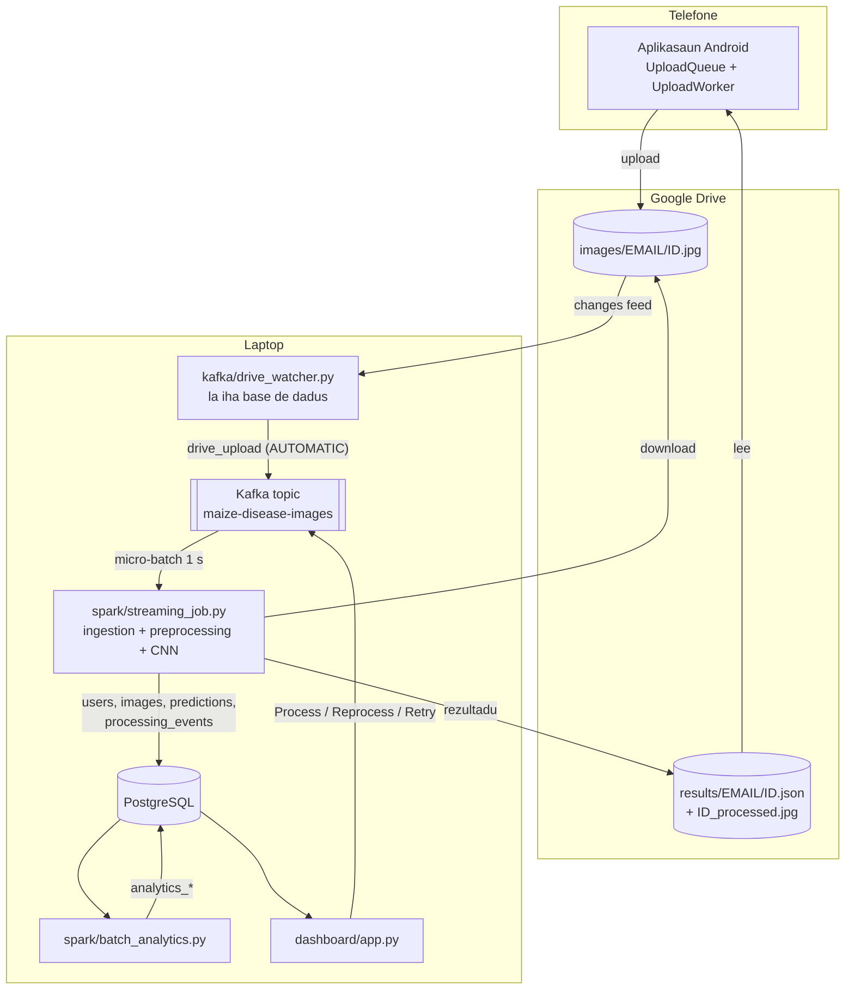
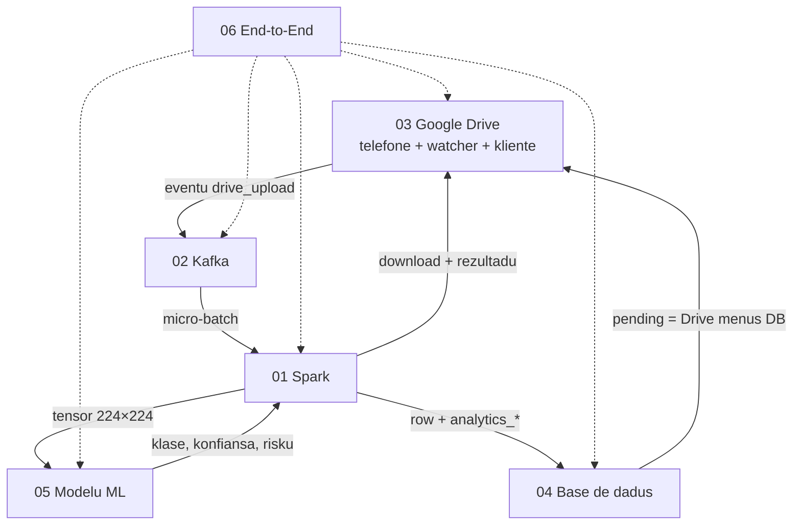

# README — Dokumentasaun Téknika Crop Disease EWS

*Sistema Crop Disease Early Warning System (EWS) — vizaun jerál, objetivu kada modulu no relasaun entre modulu sira. Fonte úniku: kódigu iha repozitóriu (commit `9ed46d4` + ajusta deep test, 2026-10-24). Kódigu iha dokumentu ne'e mak kópia husi arkivu loloos, ho númeru liña.*

## A. Introdusaun no Objetivu

**Problema.** Agrikultór batar (*maize*) iha Timor-Leste presiza hatene lalais se tahan batar iha moras, molok moras ne'e habelar ba to'os tomak. Espesialista la iha besik tempu hotu.

**Solusaun.** Agrikultór foti fotografia tahan ho aplikasaun Android. Fotografia ba Google Drive. Iha laptop, sistema deteta fotografia foun, haruka eventu liu Kafka, no Spark prosesa: kontrola, prepara imajen, CNN **SEResNet-18** klasifika ba klase 4 (`healthy`, `common_rust`, `gray_leaf_spot`, `northern_leaf_blight`), kalkula nível risku (LOW / MEDIUM / HIGH), rai iha PostgreSQL no haruka rezultadu fali ba Drive. Aplikasaun lee rezultadu husi Drive. Administradór haree buat hotu iha dashboard Streamlit.

**Dokumentu ne'e.** README mak pontu hahú. Nia esplika sistema tomak iha pájina uitoan no hatudu modulu ida-idak (01–06) ko'alia kona-ba saida, oinsá modulu sira liga malu, no ordem lee. Modulu ida-idak *independente*: kódigu ne'ebé modulu rua uza, esplika iha rua hotu, husi nia parte rasik.

| Dokumentu | Pájina | Ko'alia kona-ba |
|---|---|---|
| `README.pdf` | — | Vizaun jerál, mapa modulu, relasaun |
| `01_spark_module.pdf` | 65 | Spark Structured Streaming, parse JSON, limpeza, *ingestion*, preprocessing, analítika batch JDBC |
| `02_kafka_module.pdf` | 40 | Broker, produtór, serializasaun, partisaun, *consumer group*, payload, fila lokál |
| `03_google_drive_module.pdf` | 60 | OAuth, kliente API Drive, watcher, upload/rezultadu, kódigu Android Drive |
| `04_database_erd_dfd_module.pdf` | 38 | Skema PostgreSQL, ERD Mermaid, DFD Kontestu no Nível 1 |
| `05_machine_learning_model_module.pdf` | 83 | SEResNet-18, Albumentations, normalizasaun, matemátika (Softmax, Loss, métrika), treinu, inferénsia, risku |
| `06_end_to_end_integration_module.pdf` | 38 | Fluxu tomak, ciclu vida status, sequence diagram, kolaborasaun objetu |

## B. Arkivu Fonte Loloos

Repozitóriu `crop_disease_image_system` (Python, 13 561 liña iha arkivu `.py` ne'ebé git rastreia) no aplikasaun `android_app/` (Kotlin). Projetu treinu modelu mak repozitóriu seluk, `crop_disease_ews` (Modulu 05).

| Pasta | Arkivu prinsipál (liña) | Papél | Modulu |
|---|---|---|---|
| `kafka/` | `drive_watcher.py` (320), `producer.py` (275), `monitor.py` (240), `config.py` | Deteta upload Drive; publika eventu; haree topic | 02, 03 |
| `spark/` | `streaming_job.py` (387), `ingestion.py` (127), `preprocessing.py` (937), `batch_analytics.py` (308), `analytics.py` (163), `live_log.py` (89) | Rejista no prosesa fotografia; kalkula analítika | 01 |
| `ml/` | `inference.py` (461), `se_resnet.py` (69), `render.py` (66) | Karrega modelu, predisaun, heatmap, imajen marka | 05 |
| `storage/` | `database.py` (744), `drive_client.py` (546), `pipeline_submit.py` (87), `requeue_stuck.py` (315), `reset.py` (336), `processing_mode.py` (48), `farmers.py` | Base de dadus, kliente Drive, haruka fali, rekuperasaun, modu | 02, 03, 04 |
| `dashboard/` | `app.py` (1 140), `image_management_page.py` (336), `training_page.py` (502), `labelling_page.py` (157), `model_ops.py` (168) | Dashboard administradór (Streamlit) | 05, 06 |
| `config/` | `settings.py` (240), `localtime.py` (47) | Konfigurasaun hotu (husi `.env`), oras Timor | hotu |
| `scripts/` | `drive_authorize.py` (80), seluk | OAuth dala ida, ferramenta | 03 |
| `scalability/` | `run.py` (1 054), seluk | Teste eskala (izoladu, topic rasik) | — |
| `android_app/` | `DriveAuth.kt`, `DriveUploader.kt`, `DriveRest.kt`, `UploadQueue.kt`, `UploadWorker.kt` | Aplikasaun agrikultór | 03, 06 |
| raiz | `run_all.py` (374), `docker-compose.yml` | Hahú sistema tomak; Kafka + PostgreSQL | 02, 04, 06 |

**Teknolojia (husi `requirements.txt` no `docker-compose.yml`):** Python, `confluent-kafka`, `pyspark`, `sqlalchemy` + `psycopg2-binary`, `torch` + `torchvision`, `Pillow`, `numpy`, `pandas`, `streamlit`, `plotly`, `bcrypt`, `google-auth` + `google-auth-oauthlib`; imajen Docker `apache/kafka:3.7.0` (KRaft, la iha Zookeeper) no `postgres:16`.

`scalability/` (teste eskala) la parte husi fluxu prinsipál no la iha modulu rasik: nia uza topic Kafka seluk (`maize-disease-images-scalability-test`) no la muda dadus sistema.

## C. Arkitetura no Fluxu Ezekusaun

### C.1 Sistema tomak

### C.2 Pasu fotografia ida (rezumu)

1. **Telefone** (Modulu 03, 06): `UploadQueue` rai fotografia ho `image_id` (UUID); `UploadWorker` haruka ba `images/<email>/<image_id>.jpg` iha Drive ho `appProperties` (GPS, oras).
2. **Drive watcher** (Modulu 03, 02): `list_changes` kada 1–3 s; arkivu foun → `build_drive_event` → eventu `drive_upload` ba Kafka. Watcher **la ko'alia ho PostgreSQL**. Iha modu MANUAL nia la publika buat ida; dashboard *Pending Review* lista "fotografia Drive menus row base de dadus" no botaun Process publika eventu hanesan.
3. **Kafka** (Modulu 02): transporta eventu JSON. Se broker mate, `ResilientBackend` rai eventu iha `storage/local_queue/` no haruka fali depois.
4. **Spark** (Modulu 01): `parse_events` (`from_json`, *Invalid Message Channel* ba eventu aat) → `foreach_batch_sink` → `register_upload` (agrikultór, kontrola upload, duplikadu, row `INGESTED`) → `process_event`: download, `clean_event`, duplikadu SHA-256, EXIF, `model_input`, CNN, risku, `persist_result` (`COMPLETED`/`FAILED`), rezultadu ba Drive.
5. **Modelu** (Modulu 05): SEResNet-18 ho input 224 × 224, normalizasaun ImageNet, Softmax; risku husi $1 - P(\text{healthy})$: HIGH ≥ 0.6, MEDIUM ≥ 0.3.
6. **Base de dadus** (Modulu 04): sistema rejistu; `batch_analytics --watch` kalkula númeru dashboard ba tabela `analytics_*`.
7. **Telefone fali**: `DriveRest.resultsSince` lee `results/<email>/` no hatudu iha ekran History.

## D. Esplikasaun Kódigu: Ponte Hahú Sistema

Kódigu detalladu iha modulu 01–06. README hatudu de'it pontu entrada ida — `run_all.py` — tanba nia hatudu komponente hotu no ordem hahú. (Esplikasaun kompletu `run_all.py` iha Modulu 06, D.1.)

{{code run_all.py 1-31}}

- Liña 1–2: *docstring* modulu — "launcher" ida ba sistema tomak.
- Liña 4–10: komponente 5 ne'ebé nia hahú, kada ida iha janela konsola rasik: broker Kafka (Docker, `localhost:9092`), Spark streaming, Spark analítika (`--watch`), dashboard Streamlit (`http://localhost:8501`) no Drive watcher. PostgreSQL mós hahú husi `docker compose`. Antes hotu, nia inisializa base de dadus.
- Liña 12–14: telefone ko'alia ho Google Drive de'it; watcher mak lori upload ba Kafka. Watcher la hahú se `scripts/drive_authorize.py` seidauk halai dala ida (OAuth, Modulu 03).
- Liña 16–17: la iha servidór ida husi projetu ne'e ne'ebé telefone tenke to'o, entaun la presiza enderesu públiku, ngrok ka *port forwarding*. Ne'e mós razaun seguransa: Kafka no PostgreSQL loke ba `127.0.0.1` de'it.
- Liña 19–20: konfigurasaun (ezemplu `BOOTSTRAP_ADMIN_PASSWORD`, `PYSPARK_PYTHON`) mai husi arkivu `.env`, lee husi `config/settings.py`. Segredu la hakerek iha kódigu.
- Liña 22–31: ezemplu komandu — sistema tomak, hahú la ho komponente ida (`--no-kafka`, `--no-spark`, `--no-analytics`, `--no-drive`), *factory reset* uluk (`--reset`, rai utilizadór no admin) no hapara buat hotu (`--stop`).

## E. Análize OOP (Vizaun Jerál)

Sistema ne'e mistura OOP no funsaun. Modulu ida-idak iha análize OOP kompletu iha nia seksaun E; tabela ne'e hatudu pontu prinsipál de'it.

| Konseitu | Iha ne'ebé (ezemplu) | Modulu |
|---|---|---|
| Klase / objetu / `__init__` | `KafkaBackend`, `LocalFileBackend`, `ResilientBackend` iha `kafka/producer.py` | 02 |
| Herança | `DuplicateImage(InvalidEvent)`, `UploadRejected(InvalidEvent)`; klase ORM hotu husi `Base` (SQLAlchemy) | 01, 04 |
| Polimorfizmu | Backend tolu ho métodu `send` hanesan; `get_backend` hili ida | 02 |
| Enkapsulamentu | Métodu privadu `_connect`, `_lost_kafka`, `_claim_files` iha `ResilientBackend` | 02 |
| Kompozisaun | `ResilientBackend` iha `KafkaBackend` + `LocalFileBackend` laran; `SEResNet18` uza `SEBlock` | 02, 05 |
| Abstrasaun | `storage/drive_client.py` subar API Drive REST; ORM subar SQL | 03, 04 |
| Padraun dezeñu | *Strategy* + *Factory* (`get_backend`), *Invalid Message Channel* no *Idempotent Receiver* (Spark) | 01, 02 |
| Kotlin (telefone) | `UploadWorker : CoroutineWorker`, `object DriveRest`, `data class` | 03, 06 |

Spark rasik (`streaming_job.py`, `preprocessing.py`) liuliu funsaun: DataFrame no *closure* `foreachBatch`, la'ós hierarkia klase.

## F. Integrasaun: Relasaun Entre Modulu

### F.1 Mapa dependénsia modulu

### F.2 Kontratu entre modulu

| Husi → Ba | Kontratu (saida mak liu) | Iha ne'ebé esplika |
|---|---|---|
| Telefone → Drive | `images/<email>/<image_id>.jpg` + `appProperties` | 03 D.10 |
| Drive watcher → Kafka | JSON `kind: drive_upload` (`image_id`, `image_path`, `owner_email`, oras, GPS) | 02 D.5, 03 D.6 |
| Dashboard → Kafka | `drive_upload` (Pending Review) ka `submit` (Reprocess/Retry) | 02 D.4, 06 D.5 |
| Kafka → Spark | `readStream.format("kafka")`, `from_json` ho skema string | 01 D.1, 02 D.6 |
| Spark → Modelu | tensor `[1, 3, 224, 224]` normalizadu | 01 D.2, 05 D.10–D.12 |
| Spark → PostgreSQL | `users`, `images`, `predictions`, `processing_events`, `rejected_events`; JDBC ba `analytics_*` | 01 D.2–D.3, 04 D.2 |
| Spark → Drive | `results/<email>/<image_id>.json` + `_processed.jpg` | 01 D.2, 03 D.7 |
| Drive → Telefone | `resultsSince` / `findResults` | 03 D.11 |

### F.3 Ordem lee rekomendada

1. **README** (ida ne'e) — mapa.
2. **06 End-to-End** — haree fluxu tomak uluk.
3. **03 Google Drive** → **02 Kafka** → **01 Spark** — tuir dalan fotografia.
4. **05 Modelu ML** — oinsá klasifikasaun no risku servisu.
5. **04 Base de dadus** — ERD no DFD ba dadus hotu.

## G. Tratamentu Erru no Konfiabilidade (Vizaun Jerál)

| Falla | Resposta sistema | Modulu |
|---|---|---|
| Kafka mate | Eventu ba fila lokál `storage/local_queue/*.jsonl`; `drain()` haruka fali | 02 |
| Spark mate iha klaran batch | *Checkpoint* halai fali batch; `replay_state` skip fotografia COMPLETED (*idempotent*) | 01 |
| Eventu JSON aat | *Invalid Message Channel* → tabela `rejected_events`; batch kontinua | 01, 02 |
| Fotografia dala rua | `register_upload` (`image_id`) no SHA-256 → FAILED "Duplicate photo" | 01 |
| Agrikultór foun ho fotografia barak dala ida | `get_or_create_farmer` kaer `IntegrityError` no lee konta ne'ebé thread seluk kria | 01, 04 |
| Drive la to'o | Erru rejista; `requeue_stuck` haruka fali; rezultadu ho `result_published_at` mamuk haruka fali | 03, 06 |
| Laptop la iha internet | Telefone rai iha `UploadQueue` no koko fali (WorkManager) | 06 |

**Limitasaun ne'ebé dokumentu hatudu loloos:** sistema halai iha laptop ida (broker Kafka ida, partisaun ida); modelu treinu ho fotografia dataset (akurásia teste 94.58 %), maibé fotografia to'os real hatudu akurásia ki'ik liu; nível risku mak regra (*rule*), la'ós output modelu ida. Detalle iha seksaun G kada modulu.

**Seguransa:** Kafka no PostgreSQL loke ba `127.0.0.1` de'it; segredu iha `.env`; dokumentu hotu redaktá *password*/*token* (`***`) iha kódigu ne'ebé hatudu.

## H. Rezumu no Pergunta Akadémiku

**Rezumu.** EWS mak *pipeline* streaming: telefone → Google Drive → watcher *stateless* → Kafka → Spark (gatekeeper ida de'it ne'ebé hakerek base de dadus) → CNN SEResNet-18 → PostgreSQL + rezultadu iha Drive → telefone. Modulu 01–06 esplika kada parte ho kódigu loloos no númeru liña.

**P1. Tanba sa telefone la ko'alia direta ho servidór?**
> Projetu la iha servidór públiku. Google Drive mak "kaixa korreiu": telefone hakerek iha `images/`, lee husi `results/`. Ne'e evita enderesu públiku no loke porta, no fotografia iha kópia durável iha Drive (Modulu 03).

**P2. Tanba sa uza Kafka entre watcher no Spark?**
> Kafka separa produtór no konsumidór: se Spark mate, eventu hela iha topic no Spark kontinua husi nia *checkpoint*. Watcher no dashboard publika iha formatu hanesan (Modulu 02).

**P3. Tanba sa watcher la iha base de dadus?**
> Dezeñu 2026-10-24: Spark mak hakerek-na'in ida de'it ba `images`. Kópia durável fotografia iha Drive, entaun "pending" mak Drive menus base de dadus — la presiza row antes Spark (Modulu 01 D.6, 06 A).

**P4. Oinsá sistema garante fotografia ida la prosesa dala rua?**
> Nível tolu: `register_upload` haree `image_id`/`image_path`; `replay_state` skip row COMPLETED bainhira batch halai fali; SHA-256 husi konteúdu deteta fotografia hanesan ho naran seluk (Modulu 01 G).

**P5. Saida mak Spark halo ne'ebé Python simples la halo?**
> Structured Streaming fó *micro-batch*, *offset checkpoint* ho Kafka no `from_json` ho skema; job batch analítika uza DataFrame no JDBC ba PostgreSQL (Modulu 01 D.1, D.3).

**P6. Tanba sa SEResNet-18?**
> ResNet-18 ho bloku *Squeeze-and-Excitation* ne'ebé fó pezu ba kanál. Modelu ki'ik (halai iha laptop, GPU RTX 3050 ka CPU) no akurásia teste 94.58 % (Modulu 05).
