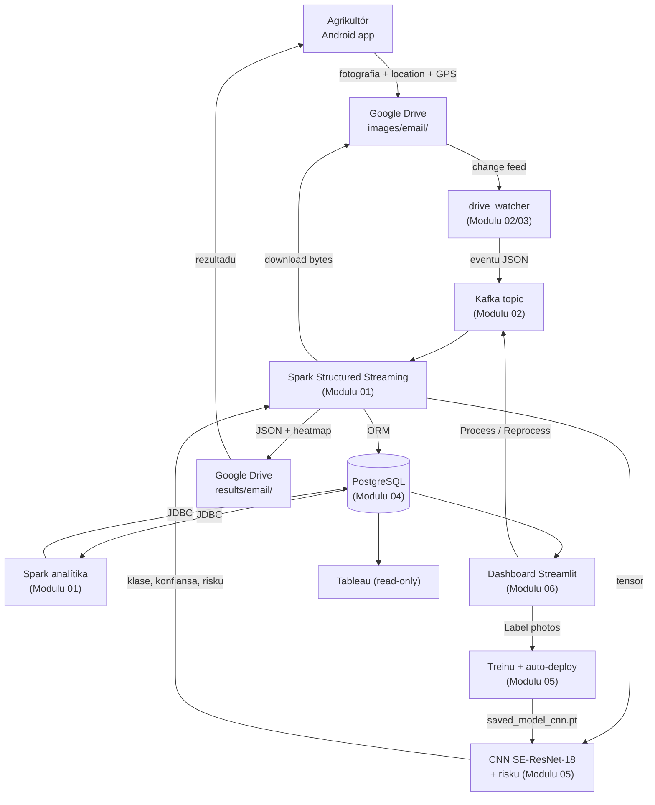

# README — Dokumentasaun Téknika Sistema EWS

*Crop Disease Early Warning System (EWS) ba moras tahan batar iha Timor-Leste. Dokumentu ne'e mak pontu hahú: hatudu sistema tomak, modulu 6, no relasaun entre sira, ba estudante Enjeñaria Informátika ne'ebé foin hahú aprende Python. Fonte úniku: kódigu iha repozitóriu (branch `main`, commit `302818f`) no projetu treinu `crop_disease_ews`.*

{{coverage run_all.py 1-13}}

> **Etiketa iha dokumentu hotu:** *Implementadu* (kódigu halo duni), *Inferidu* (dedús husi kódigu), *Teoria* (esplikasaun jerál), *Ezemplu ilustrativu* (valór hili atu esplika). Bainhira funsionalidade la iha: "Not implemented in the current codebase."

## A. Introdusaun no Objetivu

### A.1 Saida mak sistema EWS

Agrikultór foti fotografia tahan batar ho telemóvel Android. Aplikasaun haruka fotografia ba Google Drive. Iha laptop, sistema deteta fotografia foun, Apache Kafka lori eventu, Apache Spark prepara imajen, CNN **SE-ResNet-18** klasifika (healthy, northern leaf blight, common rust, gray leaf spot), regra kalkula risku (LOW/MEDIUM/HIGH), PostgreSQL rai rezultadu, no rezultadu ho imajen *heatmap* fila ba telemóvel liuhusi Drive. Dashboard (Streamlit) no Tableau hatudu analítika ne'ebé Spark kalkula.

### A.2 Problema ne'ebé sistema rezolve

- Agrikultór iha área rurál la iha espesialista moras besik → diagnóstiku automátiku iha segundu balun.
- Rede la estável → fila upload iha telemóvel, retry iha nível hotu, Kafka + fila lokál.
- Autoridade presiza haree situasaun moras tuir fatin no tempu → analítika Spark (risku aas tuir fatin, tendénsia loron-loron).
- Modelu tenke di'ak liu ho tempu → admin label fotografia → treinu foun → auto-deploy.

### A.3 Dokumentu sira

| # | Dokumentu | Tópiku | Kódigu prinsipál |
|---|---|---|---|
| 0 | `README.pdf` | Vizaun jerál (dokumentu ne'e) | `run_all.py` 1–13 |
| 1 | `01_spark_module.pdf` | Apache Spark: streaming (Kafka → parsing JSON → validasaun → preprocessing → CNN → rai), analítika batch (JDBC read/write, agregasaun) | `spark/*.py` |
| 2 | `02_kafka_module.pdf` | Apache Kafka: serializasaun/deserializasaun JSON, produtór, fila lokál, partition, consumer group, payload, monitor | `kafka/*.py`, `storage/pipeline_submit.py`, `docker-compose.yml` |
| 3 | `03_google_drive_module.pdf` | Google Drive: OAuth, cliente API, retry, pasta agrikultór, download, entrega rezultadu, reset, aplikasaun Android (Kotlin) | `storage/drive_client.py`, `kafka/drive_watcher.py`, `storage/results.py`, `DriveAuth/DriveUploader/DriveRest.kt` |
| 4 | `04_database_erd_dfd_module.pdf` | PostgreSQL: modelu ORM, esquema SQL, view, Tableau, ERD, DFD kontestu + nível 1 | `storage/database.py`, `storage/schema.sql` |
| 5 | `05_machine_learning_model_module.pdf` | SE-ResNet-18: dadus, Albumentations, ekuasaun (softmax, cross-entropy, métrika), treinu, avaliasaun, inferénsia, Grad-CAM, regra risku | projetu treinu + `ml/*.py` |
| 6 | `06_end_to_end_integration_module.pdf` | Fluxu tomak: `run_all.py`, fila upload Android, dashboard (MANUAL/Process/Reprocess/Retry), diagrama sekuénsia | `run_all.py`, `UploadQueue/UploadWorker.kt`, `dashboard/app.py` |

Kada modulu iha estrutura hanesan: **A** Introdusaun · **B** Arkivu fonte · **C** Arkitetura no fluxu (diagrama Mermaid) · **D** Kódigu-ba-kódigu (kada bloku tuir pasu 9) · **E** Analize OOP · **F** Integrasaun · **G** Tratamentu erru · **H** Sumáriu no pergunta akadémiku.

### A.4 Orden lee ba principiante

1. **README** (ne'e) — vizaun jerál.
2. **Modulu 01 (Spark)** — seksaun A.3 hanorin fundamentu Python hotu (variavel, tipu, dict, funsaun, klase, `self`, `__init__`, exception, `with`, thread, decorator...). Lee uluk.
3. **Modulu 02 (Kafka)** — JSON, arkivu, atributu klase, duck typing, closure factory.
4. **Modulu 03 (Drive)** — HTTP, OAuth, `global`, `super()`, Kotlin báziku.
5. **Modulu 04 (Base de dadus)** — ORM, SQL, mixin, ERD/DFD.
6. **Modulu 05 (ML)** — NumPy, tensor, `nn.Module`, Dataset, matemátika.
7. **Modulu 06 (Fim-ba-fim)** — Streamlit, WorkManager, oinsá hotu liga.

Kada modulu mós lee mesak: konseitu ne'ebé hanorin iha modulu anterior hetan lembransa badak.

## B. Arkivu Fonte Loloos (mapa repozitóriu)

| Pasta / arkivu | Konteúdu | Modulu |
|---|---|---|
| `run_all.py` | Lansadór sistema | 06 |
| `config/settings.py` | Konfigurasaun hotu (variavel ambiente) | hotu |
| `kafka/` | `producer.py`, `config.py`, `drive_watcher.py`, `monitor.py` | 02, 03 |
| `spark/` | `streaming_job.py`, `preprocessing.py`, `batch_analytics.py`, `live_log.py`, `analytics_reader.py`, `session.py` | 01 |
| `ml/` | `inference.py`, `se_resnet.py`, `risk.py`, `render.py` | 05 |
| `storage/` | `database.py`, `schema.sql`, `init_db.py`, `drive_client.py`, `image_storage.py`, `results.py`, `uploads.py`, `pipeline_submit.py`, `processing_mode.py`, `drive_inventory.py`, `farmers.py`, `reset.py`... | 03, 04 |
| `dashboard/` | `app.py`, `model_ops.py`, `image_management_page.py`... | 05, 06 |
| `scripts/` | `drive_authorize.py`, `drive_share_user.py` | 03 |
| `android_app/.../app/` | `DriveAuth.kt`, `DriveUploader.kt`, `DriveRest.kt`, `UploadQueue.kt`, `UploadWorker.kt`... | 03, 06 |
| `docker-compose.yml` | Kafka 3.7.0 (KRaft) + PostgreSQL 16 | 02, 04 |
| `crop_disease_ews/` (projetu separadu) | `dataset.py`, `augment.py`, `model.py`, `train.py`, `predict.py`, `gradcam.py` | 05 |

**Teknolojia:** Python 3, Apache Spark 3.5 (PySpark), Apache Kafka 3.7 (confluent-kafka), PostgreSQL 16 (SQLAlchemy, JDBC), PyTorch + torchvision, Albumentations, OpenCV, Pillow, Streamlit, Google Drive REST API v3, Android (Kotlin, WorkManager, OkHttp), Docker.

## C. Arkitetura no Fluxu Ezekusaun

### C.1 Diagrama sistema

### C.2 Relasaun entre modulu

| Husi | Ba | Saida mak liga | Dokumentu |
|---|---|---|---|
| 03 Drive (watcher) | 02 Kafka | Eventu `drive_upload` | 02 C.3, 03 D.5 |
| 02 Kafka | 01 Spark | `value` JSON → `EVENT_SCHEMA` | 01 D.2.3–D.2.4 |
| 01 Spark | 03 Drive | Download fotografia, entrega rezultadu | 03 D.4, D.7 |
| 01 Spark | 05 ML | `model_input` → `predict`, `compute_risk` | 05 D.10–D.13 |
| 01 Spark | 04 BD | `register_upload`, `persist_result`, JDBC analítika | 04 C.6 |
| 04 BD | 06 Dashboard | View, `analytics_*` | 04 D.2.15–16 |
| 06 Dashboard | 02 Kafka | Eventu `submit`, Process | 06 D.4–D.5 |
| 06 Dashboard | 05 ML | Label → treinu → deploy | 05 D.8 |

### C.3 Oinsá hahú sistema

**1. Kódigu orijinál**

{{code run_all.py 1-13}}

**2. Objetivu**

Docstring `run_all.py` esplika oinsá hahú no hapara sistema tomak ho komando ida.

**3. Fundamentu Python**

Docstring modulu (`"""..."""`) mak testu dokumentasaun iha arkivu nia leten; Python rai nia iha `__doc__`. `run_all.py` uza nia hanesan testu ajuda `--help` (`argparse.ArgumentParser(description=__doc__)`).

**4. Esplikasaun liña-ba-liña**

- **Liña 1–3** — Hahú sistema imajen tomak, kada parte iha janela rasik: Kafka (Docker), Spark streaming, Spark analítika, dashboard no Drive watcher.
- **Liña 4** — Konfigurasaun mai husi `.env`.
- **Liña 5** — Liña mamuk iha docstring.
- **Liña 6** — `python run_all.py` — hahú hotu.
- **Liña 7** — `--no-kafka` — broker halai ona iha fatin seluk.
- **Liña 8** — `--no-spark` — salta Spark (no analítika).
- **Liña 9** — `--no-analytics` — salta analítika Spark de'it.
- **Liña 10** — `--no-drive` — salta Drive watcher.
- **Liña 11** — `--reset` — factory reset uluk (mantein utilizadór).
- **Liña 12** — `--stop` — hapara buat hotu ne'ebé nia hahú.
- **Liña 13** — Remata docstring.

**5. Walkthrough ezekusaun**

`python run_all.py` → Docker Kafka + PostgreSQL → `init_db` → janela `EWS-Spark`, `EWS-SparkAnalytics`, `EWS-KafkaMonitor`, `EWS-Dashboard`, `EWS-DriveWatcher` → "Up. Open: Dashboard http://localhost:8501". `python run_all.py --stop` → hapara hotu.

**6. Tipu dadus**

`__doc__`: `str`.

**7. Ligasaun OOP**

Not implemented in the current codebase (docstring).

**8. Impaktu integrasaun**

Komando ida ne'e hahú komponente husi Modulu 01, 02, 03 no 06 (detallu: Modulu 06 D.1).

**9. Checkpoint ba principiante**

**P:** Komando saida mak hapara sistema?
**R:** `python run_all.py --stop`.

### C.4 Trasu badak: fotografia ida

1. Telemóvel: `UploadQueue.enqueue` → `UploadWorker` → `DriveUploader` → Drive `images/<email>/<image_id>.jpg` (Modulu 06, 03).
2. Laptop: `drive_watcher.scan_changes` → `build_drive_event` → Kafka (Modulu 02/03).
3. Spark: `parse_events` → `foreach_batch_sink` → `_process_one` → `register_upload` → `mark_processing` (Modulu 01, 04).
4. Spark: download → `extract_metadata` → `prepare_image` → `model_input` (Modulu 01, 03).
5. CNN: `predict` → klase + `lesion_score`; `compute_risk` → LOW/MEDIUM/HIGH; Grad-CAM (Modulu 05).
6. `persist_result` (PostgreSQL) → `publish_result_to_drive` (Drive `results/<email>/`) (Modulu 04, 03).
7. Telemóvel `resultsSince`/`myHistory` → agrikultór haree rezultadu (Modulu 03).
8. `batch_analytics.watch` → `analytics_*` → dashboard/Tableau (Modulu 01, 04).

## D. Kódigu-ba-Kódigu

README ne'e iha bloku kódigu ida (`run_all.py` 1–13, haree C.3). Esplikasaun kódigu hotu iha Modulu 01–06 seksaun D.

## E. Analize OOP (vizaun jerál)

| Konseitu | Iha ne'ebé (ezemplu) | Modulu |
|---|---|---|
| Klase + `__init__` + `self` | `SparkTable`, `KafkaBackend`, `ResilientBackend`, `_ResultFolderIndex`, `PlantDiseaseDataset`, `DiseasePredictor`, `GradCAM`, `_GpuBatcher` | 01, 02, 03, 05 |
| Herança | `InvalidEvent(Exception)`, `DriveError(Exception)`, modelu ORM `(Base)`, `SEResNet18(nn.Module)`, `UploadQueue : SQLiteOpenHelper`, `UploadWorker : Worker` | 01–06 |
| Herança múltipla / mixin | `AnalyticsSummary(_SparkOutput, Base)`; enum `(str, Enum)` | 04 |
| Polimorfizmu | `forward` override; backend `send` (duck typing); `sealed class Outcome` + `when` | 02, 03, 05 |
| Enkapsulamentu | konvensaun `_` (Python), `private` (Kotlin) | hotu |
| Komposisaun | `ResilientBackend` na'in `LocalFileBackend`; `Image` cascade `Prediction`; `SEResNet18` na'in `SEBlock` | 02, 04, 05 |
| Atributu klase | `ResilientBackend.RETRY_SECONDS`, `__tablename__`, membru enum | 02, 04 |
| Singleton | `object` Kotlin, `UploadQueue.get`, `_session`, `getOrCreate()` | 01, 03, 06 |
| Padraun seluk | Builder, Factory, Observer/hook, Producer–Consumer, Retry/backoff, Upsert idempotent | 01–06 |
| Klase abstrata/interface rasik | Not implemented in the current codebase. | — |

## F. Integrasaun

Haree C.1–C.2 no kada modulu seksaun F. Kontratu dadus importante:

- **Eventu Kafka**: naran chave `build_drive_event`/`build_upload_event` = `EVENT_SCHEMA` Spark (Modulu 01/02).
- **Drive**: naran arkivu `<image_id>.jpg/.json/_processed.jpg`, chave `appProperties` (Modulu 03).
- **Modelu**: `state_dict` + `architecture` + `class_names` + `img_size/mean/std` (Modulu 05).
- **BD**: modelu ORM = tabela; `LATEST_PREDICTION_CTE` (Modulu 04).

## G. Tratamentu Erru no Konfiabilidade (vizaun jerál)

| Kamada | Mekanizmu | Modulu |
|---|---|---|
| Telemóvel | Fila SQLite, WorkManager, retry 4, `findImage` | 03, 06 |
| Drive | Backoff 429/5xx, network retry, upsert | 03 |
| Kafka | Ack + `flush`, fila lokál, `drain`, lock troka naran | 02 |
| Spark | Checkpoint, `rejected_reason`, `replay_state`, commit depois upload, `_auto_resend` | 01 |
| CNN | `ModelNotAvailable`, uncertain, OOM → batch ki'ik, hot-reload | 05 |
| BD | FK/UNIQUE/CHECK, `pool_pre_ping`, staging + transasaun | 04 |
| Operasaun | `run_all` guarda PID, saúde Spark, fotografia hein | 06 |

Limitasaun prinsipál: komputadór ida (Spark driver-side), konta Drive sentrál ida, nó Kafka ida, la iha autentikasaun Kafka (port localhost de'it), preprocessing treinu vs sistema la hanesan kompletu (squeeze vs crop), dokumentasaun Tetun presiza revizaun falante nativu.

## H. Sumáriu no Pergunta Akadémiku

### H.1 Sumáriu

EWS mak pipeline dadus distribuidu: Android → Google Drive → watcher → Kafka → Spark (preprocessing) → CNN SE-ResNet-18 (klasifikasaun) → regra risku → PostgreSQL + Drive → Android; Spark batch → analítika → dashboard/Tableau; label admin → treinu → auto-deploy. Komponente kada ida iha responsabilidade rasik no konfiabilidade iha nível hotu.

### H.2 Pergunta no resposta

**P1. Tanba sá sistema uza Kafka entre Drive no Spark?**
R: Separa produtór (watcher, dashboard) husi konsumidór (Spark); eventu la lakon (disku + checkpoint); fila lokál bainhira Kafka mate (Modulu 02).

**P2. Komponente ida ne'ebé mak halo preprocessing imajen?**
R: Spark (`spark/preprocessing.py`: `prepare_image`, `model_input`); CNN só klasifika (Modulu 01, 05).

**P3. Oinsá Spark hakerek ba PostgreSQL?**
R: Streaming: SQLAlchemy ORM (`persist_result`). Analítika: JDBC `spark.read.jdbc` no `df.write.mode("append").jdbc` ba tabela `_staging`, depois transasaun troka (Modulu 01 D.4.7).

**P4. Saida mak rezultadu teste modelu?**
R: `results/classification_report.txt` (2026-10-03): akurásia 0.95, weighted F1 0.95, imajen teste 646; Gray_Leaf_Spot F1 0.86 (Modulu 05 B).

**P5. Oinsá telemóvel no laptop ko'alia la ho server publiku?**
R: Liuhusi pasta Google Drive partilla: telemóvel upload ba `images/<email>/` no lee `results/<email>/`; laptop uza change feed no API Drive (Modulu 03).
