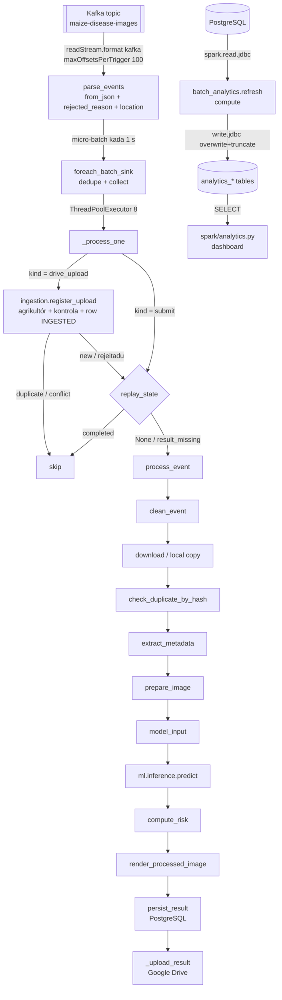
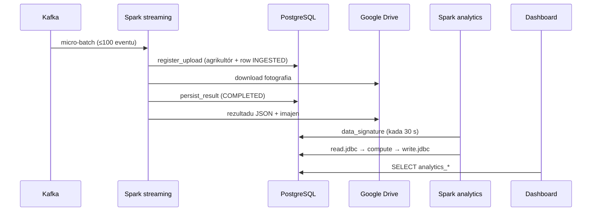

# 01 — Modulu Apache Spark & Streaming

*Sistema Crop Disease Early Warning System (EWS) — dokumentasaun téknika ba modulu Spark. Fonte úniku: kódigu iha repozitóriu (commit `9ed46d4` + ajusta deep test, 2026-10-24). Kódigu hotu iha dokumentu ne'e mak kópia husi arkivu loloos, ho númeru liña.*

{{coverage spark/streaming_job.py 1-388}}
{{coverage spark/ingestion.py 1-127}}
{{coverage spark/preprocessing.py 1-937}}
{{coverage spark/batch_analytics.py 1-308}}
{{coverage spark/live_log.py 1-89}}
{{coverage spark/analytics.py 1-163}}

## A. Introdusaun no Objetivu

Modulu Spark mak "motór" ne'ebé prosesa dadus iha sistema EWS. Nia halo serbisu rua:

1. **Streaming (tempu-real).** Spark Structured Streaming lee eventu sira husi Kafka topic `maize-disease-images`. Eventu ida = fotografia ida husi agrikultór ida. Ba eventu ida-idak, Spark halo *parsing* JSON, **rejista** fotografia foun iha base de dadus (agrikultór, kontrola upload, duplikadu — `spark/ingestion.py`), *data cleaning* no validasaun, foti imajen husi Google Drive, lee EXIF, prepara imajen ba CNN, halo *inference*, kalkula risku, no hakerek rezultadu ba PostgreSQL. Depois rezultadu ba fali Google Drive agrikultór nian.
2. **Batch (analítika).** Spark lee tabela PostgreSQL liuhusi JDBC, kalkula númeru hotu ne'ebé dashboard hatudu (distribuisaun moras, risku, trend kada munisípiu), no hakerek fali sira ba tabela analítika.

**Problema ne'ebé modulu ne'e rezolve:** agrikultór haruka fotografia barak iha tempu hanesan, no fotografia sira tenke prosesa ho seguru: la bele lakon, la bele duplika, no erru ida la bele estraga fotografia seluk. Spark fó *offset management*, *checkpoint*, *micro-batch* no *replay* bainhira sistema mate, no Python fó modelu ML no hakerek ba base de dadus.

**Saida mak la iha iha modulu ne'e:** Spark la halai iha *cluster*. Kódigu hakerek: "Runs in Spark **local mode** on this laptop; an actual multi-node cluster has not been exercised." *Inference* la fahe ba *executor*; nia halai iha *driver*.

## B. Arkivu Fonte Loloos

| Arkivu | Liña | Klase / funsaun prinsipál | Papél |
|---|---|---|---|
| `spark/streaming_job.py` | 388 | `build_spark`, `parse_events`, `foreach_batch_sink`, `_process_one`, `_upload_result`, `_warm_up_model`, `run` | Query Structured Streaming: lee Kafka, parse, cleaning, `foreachBatch` |
| `spark/ingestion.py` | 127 | `UploadRejected`, `register_upload` | *Ingestion*: fotografia foun husi Drive sai row `images` (Drive watcher la iha base de dadus) |
| `spark/preprocessing.py` | 937 | `InvalidEvent`, `DuplicateImage`, `check_duplicate_by_hash`, `clean_event`, `extract_metadata`, `model_input`, `prepare_image`, `compute_risk`, `process_event`, `replay_state`, `mark_processing`, `persist_result`, `publish_result_to_drive`, `_ResultFolderIndex` | Prosesu ba eventu ida: validasaun, imajen, CNN, risku, PostgreSQL, rezultadu ba Drive |
| `spark/batch_analytics.py` | 308 | `jdbc_url_and_properties`, `read_inputs`, `photos_with_latest_prediction`, `compute`, `write_tables`, `refresh`, `run`, `watch` | Job batch Spark: analítika hotu dashboard nian, JDBC lee no hakerek |
| `spark/live_log.py` | 89 | `say`, `farmer_label`, `photo_line`, `batch_started`, `batch_committed`, … | Liña konsola ba janela EWS-Spark |
| `spark/analytics.py` | 163 | `images_with_predictions`, `kpi_summary`, `disease_distribution`, … | Dashboard lee tabela ne'ebé Spark hakerek |

*Nota:* `spark/preprocessing.py` liña 746–937 (hakerek rezultadu ba Google Drive) esplika iha modulu rua. Iha ne'e (D.2.22–D.2.25) husi parte Spark: bainhira nia bolu no tanba sa batch hein. Iha **03_google_drive_module.pdf** husi parte Drive: pasta, upload no retry. Kada PDF bele lee mesak.

**Dependénsia sira:**

- `pyspark` (Spark 3.5), pakote `org.apache.spark:spark-sql-kafka-0-10_2.12:3.5.0` (konektór Kafka) no `org.postgresql:postgresql:42.7.3` (driver JDBC), sira rua download husi Maven Central dala uluk.
- `config/settings.py`: `SPARK_CHECKPOINT_ROOT`, `SPARK_MAX_EVENTS_PER_BATCH` (100), `SPARK_TRIGGER_SECONDS` (1), `SPARK_PARALLEL_PHOTOS` (8), `SPARK_DRIVE_UPLOAD_WORKERS` (16), `ANALYSIS_MAX_PX` (1280), `RISK_THRESHOLDS`, `ANALYTICS_CHECK_SECONDS` (30), `ANALYTICS_MAX_AGE_SECONDS` (600).
- `storage/database.py` (SQLAlchemy: `Image`, `Prediction`, `ProcessingEvent`, `RejectedEvent`, `User`), `storage/farmers.py` (`get_or_create_farmer`), `storage/pipeline_submit.py` (`UPLOAD_REJECTED_PREFIX`), `kafka/drive_watcher.py` (`_UUID_RE`, `_parse_time`), `storage/image_storage.py`, `storage/drive_client.py`, `storage/exif_utils.py`, `ml/inference.py`, `ml/render.py`.

## C. Arkitetura no Fluxu Ezekusaun

**Input:** rekord Kafka (JSON bytes). Tipu rua (`kind`): `drive_upload` — fotografia foun, ho metadata Drive (`image_id`, `owner_email`, `folder_email`, `file_name`, `mime_type`, `size_bytes`, `content_hash`, GPS, `image_path`, `captured_at`, `uploaded_at`); no `submit` — fotografia ne'ebé iha ona base de dadus haruka fali (Reprocess, `requeue_stuck`), ho `user_id`.
**Prosesu:** parse → rejista (`drive_upload` de'it) → validasaun → foti imajen → EXIF → prepara imajen → CNN → risku → hakerek.
**Output:** row foun iha `images` (fotografia foun), row iha `predictions`, `processing_events`, update ba `images`, rezultadu iha Google Drive, no tabela `analytics_*` ba dashboard.

**Garantia entrega:** Spark checkpoint fó *at-least-once* ba `foreachBatch`. Sistema halo efeitu sai *exactly-once* kada `image_id` liuhusi `replay_state` (base de dadus) no `persist_result` (delete-then-insert).

## D. Esplikasaun Kódigu ba Kódigu

### D.1 `spark/streaming_job.py`

#### D.1.1 Docstring módulu (liña 1–46)

{{code spark/streaming_job.py 1-46}}

- Docstring ne'e deskreve *pipeline* tomak: Kafka → Read Stream → Parse JSON → **Register a new upload** → Validate → Retrieve Image → Metadata → Image Preprocessing → CNN + Risk → PostgreSQL → Google Drive.
- Liña 9–10: pasu "Register a new upload" — agrikultór, kontrola upload, skip duplikadu no row uluk iha base de dadus (`spark/ingestion.register_upload`, D.6). Drive watcher la iha base de dadus; Spark mak kria row.
- Liña 23–33 esplika *checkpointing*: restart kontinua husi *offset* ikus ne'ebé *commit* tiha ona. Nia mós hateten ho onestu katak garantia mak *at-least-once*, no `persist_result` mak halo *replay* la duplika `Prediction` (delete-then-insert). `ProcessingEvent` mak *audit log* ne'ebé la dedupe.
- Liña 35–38 hatudu oinsá halai ho `spark-submit`; iha laptop ne'e `run_all.py` halai `python -m spark.streaming_job`.
- Liña 44–45: deklarasaun onestu katak Spark halai iha *local mode*.

#### D.1.2 Import no *shim* Hadoop ba Windows (liña 47–61)

{{code spark/streaming_job.py 47-61}}

- Liña 47–51: import biblioteka padraun. `ThreadPoolExecutor` ba *thread pool*, `datetime`/`timezone` ba timestamp UTC, `Path` ba dalan arkivu.
- Liña 57: kondisaun `os.name == "nt"` katak "Windows", no `"HADOOP_HOME" not in os.environ` katak seidauk iha konfigurasaun. Hadoop (ne'ebé Spark uza ba *filesystem* lokál) presiza `winutils.exe` iha Windows.
- Liña 58: define `HADOOP_HOME` ba `C:\hadoop`. String `r"..."` (raw) katak `\` la sai *escape*.
- Liña 59–61: aumenta `C:\hadoop\bin` ba `PATH` se seidauk iha. `os.pathsep` mak `;` iha Windows.
- **Efeitu:** blokú ne'e tenke halai *molok* import `pyspark`, tanba JVM le'e variavel sira ne'e bainhira nia hahú.

#### D.1.3 Import Spark no projetu (liña 63–81)

{{code spark/streaming_job.py 63-81}}

- Liña 63: `SparkSession` mak pontu tama ba Spark SQL / Structured Streaming.
- Liña 64–66: funsaun koluna Spark SQL: `coalesce` (valór uluk ne'ebé la `null`), `col` (referénsia koluna), `from_json` (parse JSON), `when`/`lit` (CASE WHEN no valór fiksu), `trim`/`regexp_replace`/`initcap` (limpa testu), `to_timestamp`/`current_timestamp` (tempu), `concat` (kombina testu).
- Liña 67: tipu sira ba *schema*: `StructType`, `StructField`, `StringType`.
- Liña 69: `KAFKA_BOOTSTRAP_SERVERS` (`localhost:9092`) no `KAFKA_TOPIC` (`maize-disease-images`) husi `kafka/config.py`.
- Liña 70–73: konfigurasaun Spark husi `config/settings.py` (haree seksaun B).
- Liña 74–77: funsaun prosesu husi `spark/preprocessing.py` (D.2) no `publish_result_to_drive_safely` (Drive).
- Liña 78–80: `ProcessingStatus` (enum status), `init_db` (kria/atualiza tabela), `is_drive_path` (kontrola `gdrive:`), no `live_log` (D.4).
- Liña 81: `register_upload` husi `spark/ingestion.py` (D.6) — pasu *ingestion*.

#### D.1.4 Dalan *checkpoint*, `EVENT_SCHEMA` no `DRIVE_UPLOAD` (liña 83–114)

{{code spark/streaming_job.py 83-114}}

- Liña 83: `CHECKPOINT_DIR` = `storage/spark_checkpoints/maize-disease-images`. Iha ne'e Spark hakerek `offsets/N` (saida mak batch N sei lee) no `commits/N` (batch N remata ona).
- Liña 85–112: *schema* JSON eventu nian. Koluna 19, hotu `StringType`.
  - Liña 86–90: `kind` — `"drive_upload"` (fotografia foun, husi metadata Drive; `kafka/drive_watcher.build_drive_event`) ka `"submit"` (fotografia ne'ebé iha ona base de dadus haruka fali; `storage/pipeline_submit.build_upload_event`). Eventu tuan la iha `kind` → trata hanesan `submit`.
  - Liña 91–97: koluna komún: `image_id`, `user_id` (`submit` de'it; ba `drive_upload` *ingestion* mak buka), `location`, `image_path`, `drive_file_id`, `captured_at`, `uploaded_at`.
  - Liña 98–108: `drive_upload` de'it — saida watcher lee husi metadata arkivu Drive: `file_name`, `mime_type`, `size_bytes`, `owner_email`/`owner_name` (na'in arkivu = agrikultór), `folder_email` (pasta ne'ebé arkivu iha), `original_filename`, `content_hash` (SHA-256 husi Drive), `device_gps_lat`/`device_gps_lon` (GPS telefone).
  - Liña 109–111: `run_id` de'it ba eventu teste eskalabilidade antigu; `_process_one` skip sira.
  - Tanba sa hotu *string*? Timestamp no númeru valida depois (`to_timestamp`, `clean_event`, `register_upload`), nune'e valór aat la halo *query* mate.
- Liña 114: `DRIVE_UPLOAD = "drive_upload"` — konstante ida, uza iha `parse_events` no `_process_one`.

#### D.1.5 `build_spark` (liña 117–132)

{{code spark/streaming_job.py 117-132}}

- **Objetivu:** kria (ka foti) `SparkSession` ida.
- Liña 119: `SparkSession.builder` — padraun *Builder*.
- Liña 120: `appName` — naran iha Spark UI (`http://localhost:4040`).
- Liña 121: `spark.jars.packages` — Spark download konektór Kafka (Scala 2.12, Spark 3.5.0) husi Maven Central. La iha ida ne'e, `format("kafka")` sei falla.
- Liña 129–130: `checkpointFileManagerClass` = `FileSystemBasedCheckpointFileManager`. Komentáriu liña 122–128 esplika: manager padraun Spark 3.x dala ruma falla iha disku lokál Windows ("`offsets does not exist`") no hapara *query*.
- Liña 131: `getOrCreate()` — kria sesaun foun ka fó fali sesaun ne'ebé iha ona. La iha `.master(...)`, entaun pyspark uza `local[*]` (JVM ida, *thread* ida kada CPU).
- **Valór retorna:** `SparkSession`. **Efeitu sekundáriu:** hahú JVM.

#### D.1.6 `parse_events` — docstring (liña 135–167)

{{code spark/streaming_job.py 135-167}}

- **Parámetru:** `raw` — *streaming DataFrame* husi Kafka. Koluna fiksu: `key`, `value` (binary), `topic`, `partition`, `offset`, `timestamp`, `timestampType`.
- Docstring esplika regra tolu:
  1. Kontrola *required fields* (`owner_email` ba `drive_upload`, `user_id` ba `submit`), `captured_at` tenke timestamp loloos no la iha futuru, no normaliza `location`. Hotu halo ho Spark SQL (iha JVM), la'ós Python kada row.
  2. **EIP Invalid Message Channel** (liña 146–153): eventu ne'ebé falla la hasai (filter); nia kontinua ho `rejected_reason`. Uluk filter halakon eventu, no fotografia ho relójiu telefone iha futuru hela INGESTED ba nafatin.
  3. `dropDuplicates` la uza iha stream (liña 160–164), tanba la iha *watermark* nia rai `image_id` hotu iha *state* ba nafatin no halakon Reprocess loloos.
- Liña 155–158: `clean_event` repete regra hanesan kada row, ba dalan ne'ebé la liu DataFrame (`storage.requeue_stuck --inline`).

#### D.1.7 `parse_events` — kódigu (liña 168–196)

{{code spark/streaming_job.py 168-196}}

- Liña 168–171: `col("value").cast("string")` troka bytes UTF-8 ba testu. `from_json(..., EVENT_SCHEMA)` parse ba *struct*; JSON aat fó *struct* `null` (modu `PERMISSIVE`), *query* la mate. `.alias("data")` no `.select("data.*", "raw_value")` halo koluna 19 sai koluna normál, no rai testu orijinál iha `raw_value`.
- Liña 173–174: funsaun ki'ik `missing(field)` fó espresaun Spark: koluna `null` **ka** testu mamuk.
- Liña 178: `is_upload` — `kind` hanesan `"drive_upload"`. `coalesce(kind, "")` halo eventu tuan (la iha `kind`) sai `""`, entaun `submit`.
- Liña 179: `when(lit(False), lit(None))` — hahú `CASE` mamuk (kondisaun uluk nunka loos).
- Liña 180–181: ba koluna obrigatóriu 3 (`image_id`, `image_path`, `uploaded_at`), aumenta `WHEN missing THEN "Missing required field: <naran>"`. *f-string* ne'e halai iha Python dala ida de'it bainhira plan harii, la'ós kada row.
- Liña 182–184: koluna obrigatóriu depende ba tipu: `drive_upload` presiza `owner_email` (ema ne'ebé upload); `submit` presiza `user_id`.
- Liña 185–188: se `to_timestamp(captured_at) > current_timestamp()`, razaun = `"captured_at is in the future: <valór>"`. `current_timestamp()` fiksu ba micro-batch ida.
- Liña 190–196 (valór retorna):
  - Liña 192: `location` = `initcap(regexp_replace(trim(location), "\s+", " "))`. Ezemplu: `" viqueque  town "` → `"Viqueque Town"`.
  - Liña 193: aumenta koluna `rejected_reason` (`null` ba eventu di'ak).
  - Liña 195: `raw_value` rai de'it ba eventu rejeitadu (ba `rejected_events.raw_event`).
- **Ezekusaun:** funsaun ne'e la kalkula buat ida — nia harii *logical plan*. Catalyst optimiser kompila plan, no kada *trigger* nia halai de'it ba *offset* foun Kafka nian (*incremental execution*).

#### D.1.8 `foreach_batch_sink` (liña 199–231)

{{code spark/streaming_job.py 199-231}}

- **Objetivu:** Spark bolu funsaun ne'e dala ida kada micro-batch, ho DataFrame *estátiku* (`batch_df`) no númeru batch (`batch_id`).
- Liña 205–206: `isEmpty()` halai iha JVM (Spark 3.3+). Komentáriu liña 200–204: `batch_df.rdd` sei kria *Python worker* no dala barak "Python worker crashed" iha Windows.
- Liña 210: espresaun `named` = `image_id` la `null` no la mamuk.
- Liña 211: dedupe *stateless* iha batch ida ne'e de'it: row ho naran → `dropDuplicates(["image_id"])`; row la ho naran (rejeitadu) → hatama fali la muda ho `unionByName`. Se lae, `dropDuplicates` sei kombina row la ho naran hotu sai ida.
- Liña 212: `.collect()` (aksaun) lori row sira ba *driver*; `row.asDict()` troka ba `dict`. Seguru tanba batch máximu 100 eventu ki'ik (~300 bytes).
- Liña 213–214: rai tempu hahú no hakerek liña konsola `[kafka] batch N: n photo event(s)`.
- Liña 217–221: eventu ida ka `SPARK_PARALLEL_PHOTOS <= 1` → halai ida-idak. Se lae, `ThreadPoolExecutor` ho `min(8, n)` *thread*; `pool.map` fó rezultadu tuir orden no hein to'o hotu remata.
- Liña 228: `upload.result()` **hein** to'o upload Drive ida-idak remata. Spark hakerek `commits/N` de'it depois funsaun ne'e fila; entaun batch commit de'it bainhira rezultadu iha base de dadus **no** tenta tiha ona ba Drive.
- Liña 229–231: liña konsola ho total `ok`, `failed`, `skipped` no segundu.
- **Esesaun:** se `_process_one` hasai esesaun, `pool.map` hasai fali, query falla, `commits/N` la hakerek, no restart halai fali batch N (*at-least-once*).

#### D.1.9 Upload ba Drive iha *background* (liña 234–245)

{{code spark/streaming_job.py 234-245}}

- Liña 235: `_UPLOADS` — *thread pool* ho `SPARK_DRIVE_UPLOAD_WORKERS` (16) *thread* naran `drive-upload`. Variavel módulu (*singleton*), kria dala ida.
- Liña 238–245 `_upload_result`: bolu `publish_result_to_drive_safely` (Drive module), sukat tempu, no hakerek liña `[drive]` se fotografia mai husi Drive. **Nunka hasai esesaun**; fila `status` ba kontajen batch.
- **Tanba sa background:** *thread* fotografia bele hahú fotografia tuir mai, la presiza hein Google.

#### D.1.10 `_process_one` — guarda no eventu rejeitadu (liña 248–265)

{{code spark/streaming_job.py 248-265}}

- **Parámetru:** `event` (`dict`). **Valór retorna:** `Future` husi `_UPLOADS`, ka `None` bainhira skip.
- Liña 254–260: eventu ho `run_id` mak teste eskalabilidade antigu; skip, nunka trata hanesan fotografia agrikultór.
- Liña 262–263: `event.pop(...)` hasai koluna ajuda rua husi `parse_events`.
- Liña 264–265: eventu rejeitadu ne'ebé la iha `image_id` rai testu Kafka orijinál iha `raw_value`, ne'ebé `persist_result` hakerek ba `rejected_events.raw_event`.

#### D.1.11 `_process_one` — *ingestion* fotografia foun (liña 266–284)

{{code spark/streaming_job.py 266-284}}

- Liña 266–267: eventu `drive_upload` ne'ebé iha `image_id`, `image_path` no `owner_email` → rejista (D.6). Koluna tolu ne'e mak `register_upload` presiza.
- Komentáriu liña 268–274: upload rejeitadu hetan row no falla iha okos ho razaun. Ne'e mós ba eventu ne'ebé `parse_events` rejeita tanba nia **konteúdu** (ezemplu `captured_at` iha futuru): se la iha row, fotografia sei hela iha Pending Review no iha `requeue_stuck --from-drive` ba nafatin (sira buka "fotografia Drive ne'ebé la iha row"). Eventu ne'ebé falta koluna ba rejista de'it mak ba `rejected_events` mesak.
- Liña 275–278: `register_upload` fila `"new"`, `"duplicate"` ka `"conflict"`. `InvalidEvent` (inklui `UploadRejected`) → trata hanesan `"new"` maibé ho `rejected_reason` = razaun, nune'e okos sei hakerek FAILED.
- Liña 279–284: `"duplicate"` (arkivu Drive ne'e rejista ona — *change feed* no *safety-net scan* bele haruka dala rua) ka `"conflict"` (`image_id` ne'e pertense ba arkivu seluk; rai iha `rejected_events`) → hakerek konsola no skip (`None`).
- *Nota:* erru base de dadus iha `register_upload` (ezemplu PostgreSQL mate) la kaer iha ne'e: batch falla, no restart halai fali eventu husi *checkpoint* — fotografia la lakon.

#### D.1.11b `_process_one` — kontrola *replay* no timestamp (liña 285–303)

{{code spark/streaming_job.py 285-303}}

- Liña 285: `replay_state` (D.2.18) — *lookup* ida iha base de dadus.
- Liña 286–288: `"completed"` — fotografia iha rezultadu ona; eventu duplikadu ka *replay* la halo buat ida. Ne'e mak *duplicate handling*.
- Liña 289–292: `"result_missing"` — COMPLETED maibé rezultadu seidauk to'o Drive; prosesa fali (seguru, tanba hakerek prediction mak *idempotent*).
- Liña 297: `kafka_received_at` — tempu fotografia to'o *sink* (la'ós timestamp *broker*).
- Liña 298: `photo_started` ba durasaun total.
- Liña 300–301: `mark_processing` muda status ba PROCESSING (dashboard hatudu "iha prosesu").
- Liña 302–303: `spark_started_at`; valór *default* `status = FAILED` — fotografia konta falla to'o prova katak susesu.
- *Nota limitasaun:* `replay_state` no `mark_processing` iha liur husi `try`; se PostgreSQL mate, batch falla no query hapara (restart halo *replay*).

#### D.1.12 `_process_one` — prosesu no rezultadu (liña 304–333)

{{code spark/streaming_job.py 304-333}}

- Liña 305–306: eventu ne'ebé `parse_events` rejeita → `raise InvalidEvent(rejected_reason)`, ba direta *branch* `InvalidEvent`.
- Liña 307: `process_event` (D.2.14) — prosesu tomak fotografia ida.
- Liña 308–312: `persist_result` ho COMPLETED, depois `status = COMPLETED`.
- Liña 313–319: `InvalidEvent` (inklui `DuplicateImage`) — problema *dadus*; hakerek FAILED ho razaun.
- Liña 320–329: esesaun seluk (ezemplu `ModelNotAvailable`, erru rede) — problema *sistema*; hakerek FAILED. Se hakerek ne'e mós falla (liña 328–329), nia hakerek de'it iha konsola, atu la halo fotografia seluk mate.
- Liña 331: liña konsola `[photo]` (D.4).
- Liña 332–333: foti `processed_image_jpeg` (se iha) no haruka upload ba `_UPLOADS`; fila `Future`.

#### D.1.13 `_warm_up_model` (liña 336–350)

{{code spark/streaming_job.py 336-350}}

- Kria imajen JPEG verde 256×256 iha memória (liña 346–347), prepara ho `model_input` (liña 348), no halai `predict` no `disease_heatmap` dala ida (liña 349–350).
- **Objetivu:** load *checkpoint* CNN, hahú CUDA (se iha GPU), no halai *forward pass* neineik dala uluk — agrikultór uluk la presiza hein. Nia mós import `torch` molok `pandas`/`pyarrow`, tanba iha Windows `torch` falla se import depois (WinError 1114).
- Se la iha modelu, `ModelNotAvailable` hapara Spark iha hahú (*fail fast*).

#### D.1.14 `run` — definisaun *query* (liña 353–388)

{{code spark/streaming_job.py 353-388}}

- Liña 357: kria pasta *checkpoint* uluk (Spark kria sub-pasta ho neineik, no ne'e mak falla iha Windows).
- Liña 358: `init_db()` aumenta koluna foun molok hakerek dala uluk.
- Liña 359: *warm-up* modelu (D.1.13).
- Liña 361–362: `build_spark()` no nível log `WARN`.
- Liña 364–373: **fonte Kafka**:
  - `format("kafka")`, `kafka.bootstrap.servers`, `subscribe` topic.
  - `startingOffsets = "earliest"` — uza de'it bainhira *checkpoint* seidauk iha; depois Spark kontinua husi *checkpoint*.
  - `maxOffsetsPerTrigger = 100` — batch ida máximu eventu 100, nune'e upload rihun ida sai batch ki'ik barak.
- Liña 374: `parse_events(raw)` (D.1.6–D.1.7).
- Liña 376–383: **sink**: `writeStream.foreachBatch(foreach_batch_sink)`, `outputMode("append")`, `trigger(processingTime="1.0 seconds")`, `checkpointLocation`, `start()`.
- Liña 384: `awaitTermination()` — hein to'o query hapara (ka hasai esesaun).
- Liña 387–388: halai `run()` bainhira arkivu halai direta.

### D.2 `spark/preprocessing.py`

Arkivu ne'e la depende ba `pyspark`. Tanba ne'e nia bele halai iha liur Spark (ezemplu `storage/requeue_stuck --inline`) no bele teste ho fasil. Spark bolu nia funsaun sira husi `_process_one`.

#### D.2.1 Docstring no import (liña 1–56)

{{code spark/preprocessing.py 1-56}}

- Liña 1–8: módulu halo *data cleaning*, validasaun, foti imajen, prepara imajen ba CNN (`model_input`), *inference* no risku ba eventu Kafka ida. Liña 5–8 esplika tanba sa modelu halai iha *driver* `foreachBatch`: Python UDF Spark la bele bolu torch/PIL ho di'ak iha JVM.
- Liña 10–15: fluxu Google Drive: imajen `gdrive:<file id>` download husi Drive, EXIF lee iha ne'e, no rezultadu hakerek ba `/results`.
- Liña 17–21: distinsaun importante: **CNN** fó `predicted_class` no `prediction_confidence` (moras saida); **risku** mak regra ho *threshold* ba P(moras), la'ós konfiansa klase.
- Liña 24–31: biblioteka padraun: `hashlib` (SHA-256), `json`, `re` (regex), `threading` (lock), `time`.
- Liña 33–36: konfigurasaun: `RISK_THRESHOLDS` (high 0.6, medium 0.3), `IMAGE_STORAGE_PATH`, `REVIEW_DIR`, `SAVE_PHOTOS_FOR_REVIEW`, `ANALYSIS_MAX_PX` (1280), `SAVE_DOWNLOADED_PHOTOS`, `SPARK_RECHECK_DRIVE_FILE` (false).
- Liña 38–49: funsaun husi módulu seluk: dalan imajen, EXIF, *render*, Drive, CNN (`predict` ho naran `run_model`, `model_version`, `disease_heatmap`, `input_spec`), no modelu SQLAlchemy.
- Liña 52: `REQUIRED_EVENT_FIELDS` — koluna haat obrigatóriu, hanesan iha `parse_events`.
- Liña 56: `_DOWNLOADS` — *thread pool* 16 ba download Drive. Boot liu *thread* fotografia 8 tanba sira hein rede de'it.

#### D.2.2 Ajuda tempu: `_as_aware_utc` no `_parse_timestamp` (liña 59–83)

{{code spark/preprocessing.py 59-83}}

- `_as_aware_utc(dt)`: SQLite lakon `tzinfo`; valór *naive* hetan fali UTC (`dt.replace(tzinfo=timezone.utc)`). `None` fila `None`. PostgreSQL rai `TIMESTAMPTZ` loloos.
- `_parse_timestamp(value, field_name)`: `None` ka `""` → `None`. Se lae, `fromisoformat` (troka `Z` ba `+00:00`). Testu aat → `InvalidEvent("Invalid captured_at: not a valid ISO-8601 timestamp ...")`. Ne'e mak *schema validation* ba timestamp: la troka valór aat ho silénsiu.

#### D.2.3 `normalize_location` (liña 84–94)

{{code spark/preprocessing.py 84-94}}

- Versaun Python husi regra `parse_events`: `strip()`, `re.sub(r"\s+", " ", ...)` (espasu barak sai ida), `.title()` (letra boot iha liafuan ida-idak). Mamuk → `None`.
- Liña 87–90 (docstring): ba dalan ne'ebé la liu DataFrame — *unit test* no `storage.requeue_stuck --inline`.
- `clean_event` uza nia (liña 201), nune'e dalan ne'ebé la liu DataFrame mós rai lokalizasaun hanesan.

#### D.2.4 Esesaun no estadu duplikadu (liña 95–116)

{{code spark/preprocessing.py 95-116}}

- `InvalidEvent(Exception)`: problema dadus eventu nian. **Herança:** `DuplicateImage(InvalidEvent)` — *subclass*, nune'e `except InvalidEvent` hotu kaer mós duplikadu (*polymorphism* iha `except`).
- `SKIP_DUPLICATE_PHOTOS = True`: interruptor ba kontrola duplikadu.
- `_DUPLICATE_LOCK` (`threading.Lock`) halo "rai *fingerprint* + buka kópia" sai pasu ida, nune'e kópia rua iha *thread* rua la bele liu hotu.
- `_ACCEPTED_IMAGE_IDS` (`set`): fotografia ne'ebé liu kontrola iha prosesu ne'e. *Limitasaun:* nia sai boot ba nafatin (memória ki'ik kada fotografia).

#### D.2.5 `check_duplicate_by_hash` — hahú no *fingerprint* (liña 119–149)

{{code spark/preprocessing.py 119-149}}

- **Parámetru:** `event` (`dict`), `original_bytes` (bytes orijinál fotografia). **Valór retorna:** `None`; hasai `DuplicateImage` bainhira duplikadu.
- Liña 132–133: se interruptor off, fila.
- Liña 135: kaer *lock* (bloke *thread* seluk).
- Liña 137–140: buka row `Image`; la iha → fila (persist_result trata kazu ne'e).
- Liña 141–143: se fotografia iha ona `Prediction` (Reprocess), nunka rejeita.
- Liña 146: `digest` = hash ne'ebé rai ona, ka SHA-256 foun husi bytes (`hexdigest()` = testu 64 karakter).
- Liña 147–149: rai hash foun iha `images.content_hash` no `commit`.

#### D.2.6 `check_duplicate_by_hash` — buka kópia (liña 150–180)

{{code spark/preprocessing.py 150-180}}

- Liña 152–162: *query* SQLAlchemy: agrikultór hanesan (`user_id`), hash hanesan, `image_id` seluk, status COMPLETED ka PROCESSING; orden tuir `uploaded_at` (uluk liu mak primeiru).
- Liña 163–164: `earlier` = kópia uluk ne'ebé COMPLETED, ka ne'ebé *thread* seluk aseita ona (`_ACCEPTED_IMAGE_IDS`). `next(..., None)` fó primeiru ka `None`.
- Liña 165–166: la iha kópia → aseita fotografia ne'e.
- Liña 167–174: erru seluk (ezemplu base de dadus mate) → hakerek iha konsola, `rollback`, no fila. Kontrola duplikadu **nunka** estraga diagnóstiku.
- Liña 175–178: `finally`: taka sesaun no husik *lock* — sempre, maske iha esesaun.
- Liña 179–180: *depois* husik *lock*, hasai `DuplicateImage("Duplicate photo: identical to <id>")`.

#### D.2.7 `clean_event` — validasaun eventu (liña 183–209)

{{code spark/preprocessing.py 183-209}}

- **Objetivu:** *data cleaning* no validasaun kada row iha Python (repete regra `parse_events` ba dalan ne'ebé la liu DataFrame).
- Liña 186–188: koluna obrigatóriu hotu tenke iha valór; se lae `InvalidEvent("Missing required field: ...")`.
- Liña 190–191: parse `uploaded_at` no `captured_at` (D.2.2).
- Liña 193–197: timestamp rua la bele iha futuru.
- Liña 199–201: hakerek fali valór normalizadu ba `event`: ISO-8601, no `location` limpu.
- Liña 203–208: `user_id` tenke iha tabela `users`; se lae `InvalidEvent("Unknown user_id: ...")`. `finally` taka sesaun.

#### D.2.8 `clean_event` — dalan imajen (liña 210–232)

{{code spark/preprocessing.py 210-232}}

- Liña 210–211: imajen Drive → `_clean_drive_event` (D.2.9).
- Liña 213–218: imajen lokál (dezeñu antigu): `resolve_image_path` buka arkivu; la iha → `InvalidEvent`.
- Liña 220–223: **seguransa**: dalan tenke iha laran `IMAGE_STORAGE_PATH` (`relative_to` hasai `ValueError` se lae) — prevene *path traversal*.
- Liña 225–229: naran arkivu tenke iha `image_id`.
- Liña 231–232: rai dalan loloos no fila `event`.

#### D.2.9 `_clean_drive_event` no `_registered_from_drive` (liña 235–276)

{{code spark/preprocessing.py 235-276}}

- Liña 241–244: `drive_file_id` husi `image_path` tenke hanesan ho koluna `drive_file_id`.
- Liña 245–251: se `SPARK_RECHECK_DRIVE_FILE` false **no** `spark/ingestion` rejista ona arkivu ne'e husi nia metadata Drive (funsaun daruak iha seksaun ne'e), la husu Drive fali (poupa ~0.5 s kada fotografia, to'o 2 min bainhira Google limita batch boot).
- Liña 252–255: husu metadata Drive; erru → `InvalidEvent("Image file not found in Google Drive ...")`.
- Liña 256–257: arkivu iha lixu (*trashed*) → `InvalidEvent`.
- Liña 258–261: `appProperties.image_id` tenke hanesan ho eventu — eventu Kafka la bele aponta ba arkivu Drive arbitráriu.
- `_registered_from_drive` (liña 265–276): `True` de'it se row `Image` iha `source == "android_drive_upload"`, `image_path` hanesan no `user_id` hanesan. Eventu mesak nunka hetan konfiansa: eventu ne'ebé aponta ba arkivu seluk hetan kontrola Drive tomak.

#### D.2.10 `extract_metadata` — EXIF (liña 279–318)

{{code spark/preprocessing.py 279-318}}

- Liña 279–280: tuple koluna GPS no koluna kámara/tamañu.
- Liña 296: `extract_image_metadata` lee EXIF husi bytes **orijinál** (tenke molok `prepare_image`, ne'ebé hasai EXIF).
- Liña 301–302: rai `camera_make`, `camera_model`, `image_width`, `image_height` (`setattr` ho naran koluna).
- Liña 303–306: EXIF iha GPS → rai GPS no `gps_source = "exif"`.
- Liña 307–310: la iha GPS EXIF no la'ós GPS telefone (`"device"`) → hamamuk GPS.
- Liña 311–314: `captured_at` hakerek de'it se seidauk iha; mós atualiza `event`.
- **Valór retorna:** `meta` (`dict`). **Efeitu sekundáriu:** update row `images`.

#### D.2.11 `model_input` — prepara imajen ba CNN (liña 321–351)

{{code spark/preprocessing.py 321-351}}

- **Objetivu:** Spark halo *preprocessing* imajen hotu; CNN klasifika de'it.
- Liña 340–341: `spec = input_spec()` — `img_size` (224), `mean` [0.485, 0.456, 0.406], `std` [0.229, 0.224, 0.225] husi *checkpoint*.
- Liña 342: `_prepared_rgb` fó imajen RGB loos-loos husi `prepare_image`.
- Liña 343–349: `transforms.Compose`:
  1. `Resize(224)` — lados badak sai 224 px, proporsaun la muda.
  2. `CenterCrop(224)` — kuadradu 224×224 iha klaran.
  3. `ToTensor()` — tensor float `(3, 224, 224)` iha [0, 1].
  4. `Normalize(mean, std)` — kada kanál: x' = (x − mean) / std.
- Liña 330–335 (docstring): tanba sa *centre crop*: iha *test split* (646) 95.67% kontra 94.74% ba *squeeze*; iha fotografia natureza 78 nian 78.2% kontra 70.5%.
- **Valór retorna:** tensor float32 `(3, S, S)`.

#### D.2.12 Ajuda imajen: `model_input_preview`, `heatmap_on_photo`, `_prepared_rgb` (liña 352–391)

{{code spark/preprocessing.py 352-391}}

- `model_input_preview`: `Resize` + `CenterCrop` la ho normalizasaun, hanesan imajen PIL ne'ebé ema bele haree (teste eskalabilidade de'it).
- `heatmap_on_photo`: Grad-CAM husi CNN (mapa ba kuadradu 224) tau fali iha fotografia tomak: `F.interpolate` (*bilinear*) ba tamañu kuadradu, divide ho máximu, no tau iha klaran; borda sai 0. `None` fila `None`.
- `_prepared_rgb`: uza `prepared_bytes` se iha, se lae bolu `prepare_image`; dekode ho `exif_transpose` no `RGB`.

#### D.2.13 `prepare_image` no `compute_risk` (liña 392–438)

{{code spark/preprocessing.py 392-438}}

- `prepare_image` (liña 392–412):
  - Liña 405: `draft("RGB", (1280, 1280))` — dekoder JPEG lee direta iha eskala ki'ik (1/2, 1/4, 1/8), fotografia 12 MP la dekode tomak.
  - Liña 406: `exif_transpose` (fotografia loos) no `convert("RGB")`.
  - Liña 407–408: imajen la bele lee → fila bytes orijinál; pasu tuir mai mak rejeita.
  - Liña 409–412: `thumbnail` (lados naruk ≤ 1280, proporsaun la muda) no rai JPEG kualidade 95.
- `compute_risk` (liña 415–437):
  - Liña 425: `score` = `lesion_score` (= 1 − P(healthy)) limita ba [0, 1] no arredonda ba 3 desimál.
  - Liña 427–432: `HIGH` se ≥ 0.6, `MEDIUM` se ≥ 0.3, `LOW` se lae.
  - Liña 434–435: rezultadu *uncertain* (konfiansa < 0.5) nunka HIGH — maximu MEDIUM.
  - **Valór retorna:** `(score, level)`.

#### D.2.14 `process_event` — hahú no download paralelu (liña 440–476)

{{code spark/preprocessing.py 440-476}}

- **Objetivu:** prosesu tomak fotografia ida. Nunka fó predisaun falsu (liña 445–447).
- Liña 455–462: `timings` no funsaun interna `lap(name)` (`nonlocal clock`) sukat segundu kada pasu.
- Liña 464–469: fotografia Drive: se iha kópia lokál → uza; se lae, hahú download iha `_DOWNLOADS` **agora**, paralelu ho validasaun.
- Liña 470–475: `clean_event`; se falla, kansela download no hasai fali esesaun.
- Liña 476: `lap("validate_s")`.

#### D.2.15 `process_event` — lee bytes, EXIF, prepara, CNN (liña 477–505)

{{code spark/preprocessing.py 477-505}}

- Liña 479: `scale_test_run_for` — `None` ba fotografia agrikultór hotu.
- Liña 482–488: bytes husi kópia lokál, download (`download.result()` hein), ka disku. Depois download, rai kópia permanente (`save_downloaded_photo`).
- Liña 490–491: kontrola duplikadu *molok* serbisu todan.
- Liña 492: EXIF husi bytes orijinál.
- Liña 494–495: `prepare_image` (dekode dala ida) no `model_input` (tensor CNN).
- Liña 497: `run_model(cnn_input)` = `ml.inference.predict`: kontrola *shape* `(3, 224, 224)`, *forward pass* iha GPU (se iha), *softmax*, klase.
- Liña 499–503: rai informasaun *inference* iha `timings`.
- Liña 504–505: kópia ba "Label photos" (laran `save_for_review`).

#### D.2.16 `process_event` — risku, rezultadu, imajen marka (liña 506–541)

{{code spark/preprocessing.py 506-541}}

- Liña 507–508: `is_uncertain` no `compute_risk`.
- Liña 512–527: `result` — `dict` ne'ebé `persist_result` hakerek. `discoloration_pct`, `texture_irregularity`, `leaf_area_affected_pct` sempre `None` agora (heurístika pixel hasai tiha ona).
- Liña 529–540: imajen marka ba agrikultór de'it ba fotografia Drive: Grad-CAM (se la *uncertain*) + `render_processed_image`. Erru desenhu la falla diagnóstiku.
- **Valór retorna:** `result`.

#### D.2.17 Ajuda: `scale_test_run_for`, `save_downloaded_photo`, `save_for_review` (liña 544–593)

{{code spark/preprocessing.py 544-593}}

- `scale_test_run_for`: base de dadus mak deside (row `ScaleTestItem` ho `run_id` hanesan), la'ós eventu mesak. `session.expunge(run)` halo objetu bele uza depois sesaun taka.
- `save_downloaded_photo`: rai kópia lokál; erru hakerek de'it.
- `save_for_review`: rai kópia JPEG **la ho EXIF** iha `REVIEW_DIR` (GPS agrikultór la tama dadus treinu). Hakerek ba `.tmp` uluk, depois `replace` (atómiku).

#### D.2.18 `replay_state` no `mark_processing` (liña 596–633)

{{code spark/preprocessing.py 596-633}}

- `replay_state(image_id)` (liña 596–618) — *lookup* ida (~3 ms iha PostgreSQL Docker):
  - Liña 605–606: la iha `image_id` → `None` (prosesa; okos sei rai `rejected_events`).
  - Liña 609–611: row la iha → `None` (prosesa).
  - Liña 612–615: COMPLETED → `"result_missing"` se fotografia Drive no `result_published_at` mamuk (rezultadu seidauk to'o Drive); se lae `"completed"` (skip).
  - Liña 616: status seluk (INGESTED, PROCESSING, FAILED) → `None`. Reprocess muda FAILED ba INGESTED molok publika, entaun nia liu.
- `mark_processing(image_id)` (liña 621–633) — muda status ba PROCESSING; `image_id` la iha → la halo buat ida.

#### D.2.19 `persist_result` — asinatura no row la iha (liña 636–681)

{{code spark/preprocessing.py 636-681}}

- **Parámetru:** `event`, `result` (`dict` ka `None`), `status` (`ProcessingStatus`), `error_message`; *keyword-only* (`*`) `kafka_received_at`, `spark_started_at`.
- Liña 671–680: `image_id` la iha tabela `images` → hakerek `RejectedEvent` (ho `raw_event` JSON no `reason`) — ne'e mak tabela *dead-letter*. `json.dumps(..., default=str)` troka `datetime` ba testu.

#### D.2.20 `persist_result` — update imajen no `Prediction` (liña 682–725)

{{code spark/preprocessing.py 682-725}}

- Liña 682–685: timestamp UTC; `_as_aware_utc(...) or now`.
- Liña 687–695: update `images`: `ingested_at` (se mamuk), `location` limpu husi Spark, `processed_at`, `status`, `error_message`.
  - Liña 689–692: `location` husi eventu (ne'ebé `parse_events`/`clean_event` limpa ona). Row ne'ebé rejista molok regra limpeza mós sai loos.
- Liña 698–701: `processing_latency_ms` = `predicted_at − ingested_at` iha milisegundu.
- Liña 705: **delete-then-insert** — hamoos `Prediction` antigu ba `image_id` ne'e. Ne'e halo *replay* sai *idempotent*.
- Liña 707–722: `Prediction` foun.
- Liña 723–725: risku HIGH → liña konsola `[ALERT]`.

#### D.2.21 `persist_result` — *audit* no commit (liña 727–745)

{{code spark/preprocessing.py 727-745}}

- Liña 727: latênsia total (`spark_completed_at − kafka_received_at`).
- Liña 729–740: `ProcessingEvent` — *audit log* *append-only*: tentativa hotu rai (la dedupe).
- Liña 741: `commit()` dala ida — update imajen, prediction no audit sai transasaun ida (*atomic*).
- Liña 742–743: `finally` taka sesaun.

#### D.2.22 Rezultadu ba Google Drive — husi parte Spark (liña 746–763)

{{code spark/preprocessing.py 746-763}}

Seksaun D.2.22–D.2.25 esplika kódigu Drive husi **parte Spark**: bainhira Spark bolu nia, no tanba sa batch hein. Detalle Drive (pasta, upload, retry) iha **03_google_drive_module.pdf**.

- **Bainhira bolu:** `_process_one` haruka `_upload_result` ba `_UPLOADS` (D.1.12); `_upload_result` bolu `publish_result_to_drive_safely` (D.2.25). `foreach_batch_sink` hein `upload.result()` molok fila (D.1.8), entaun batch commit de'it depois Spark **tenta** entrega rezultadu.
- `_prediction_to_dict(p)`: troka row `Prediction` ba `dict` ho formatu ne'ebé aplikasaun Android lee (`DriveRest.kt`). `risk_level.value` troka enum ba testu; `predicted_at.isoformat()` troka `datetime` ba testu ISO-8601.

#### D.2.23 `publish_result_to_drive` — lee rezultadu husi base de dadus (liña 765–826)

{{code spark/preprocessing.py 765-826}}

- **Parámetru:** `event`, `status`, `error_message`, `processed_image` (JPEG ka `None`). **Valór retorna:** id arkivu JSON iha Drive, ka `None` (imajen la'ós Drive).
- Liña 781–783: row `Image` la iha → `None`.
- Liña 784–792: imajen teste eskalabilidade → de'it se run ne'e publika rezultadu, iha nia pasta rasik; nunka iha pasta agrikultór.
- Liña 793–796: imajen lokál (la'ós `gdrive:`) → `None`; se lae foti id arkivu Drive.
- Liña 797–800: prediction foun liu (`order_by(predicted_at.desc()).first()`).
- Liña 801–802: email na'in fotografia.
- Liña 803–824: `payload` = rezultadu tomak **husi base de dadus** (la'ós husi memória), nune'e Drive no base de dadus hanesan. Inklui hora Timor-Leste (`format_local`), GPS, kámara, `status`, `error_message`, no `prediction` de'it se COMPLETED.
- Liña 825–826: taka sesaun *molok* upload (la kaer koneksaun base de dadus durante rede neineik).

#### D.2.24 `publish_result_to_drive` — upload no marka entrega (liña 828–862)

{{code spark/preprocessing.py 828-862}}

- Liña 828–830: pasta `results/<email>/` agrikultór nian (kria no fahe ho `reader` se seidauk iha).
- Liña 831–837: COMPLETED ho imajen → upload `<image_id>_processed.jpg`. `existing_id` husi `_RESULT_FILES` — se arkivu iha ona, **update iha fatin** (la kria duplikadu).
- Liña 838–857: `summary` ki'ik ba Drive `appProperties`: aplikasaun lista rezultadu hotu ho pedidu Drive ida, la download JSON ida-idak. `error_message` limita 80 karakter.
- Liña 858–860: upload `<image_id>.json`.
- Liña 861: `_mark_result_published` — `images.result_published_at = now`. Se la to'o iha ne'e, `replay_state` fó `"result_missing"` no Spark prosesa fali.

#### D.2.25 `_ResultFolderIndex`, `_mark_result_published`, `publish_result_to_drive_safely` (liña 865–937)

{{code spark/preprocessing.py 865-937}}

- **Klase `_ResultFolderIndex`** (liña 865–910) — klase OOP loloos iha modulu ne'e:
  - `__init__` (liña 879–882): atributu `_folders` (`{folder: {naran: id}}`), `_lock`, `_loading` (*lock* ida kada pasta).
  - `_index(folder)` (liña 884–898): lista arkivu pasta ida **dala ida** kada prosesu Spark, maske *thread* 8 husu hamutuk (*double-checked locking*). Arkivu tuan uluk, entaun kópia foun liu manán.
  - `existing(folder, name)`: id arkivu ka `None`. `remember(...)`: rai id foun depois upload. `clear()`: hamoos *cache*.
  - Docstring (liña 872–877): klase ne'e troka "tebak" antigu ne'ebé kria arkivu rezultadu duplikadu 1,163 iha 2026-10-09 depois *factory reset*.
- Liña 913: `_RESULT_FILES` — objetu ida ba módulu tomak (*singleton*).
- `_mark_result_published` (liña 916–925): update `result_published_at`.
- `publish_result_to_drive_safely` (liña 928–937): *wrapper* ne'ebé **nunka hasai esesaun**. Drive mate → hakerek iha konsola no fila `None`; rezultadu seguru ona iha base de dadus, no `requeue_stuck` ka *replay* haruka fali.
- **Tanba sa ne'e importante ba Spark:** diagnóstiku loloos nunka falla tanba Drive mate. `result_published_at` halo rezultadu ne'ebé seidauk entrega bele deteta no haruka fali.

### D.3 `spark/batch_analytics.py` — job batch analítika

#### D.3.1 Docstring (liña 1–31)

{{code spark/batch_analytics.py 1-31}}

- Job batch Spark ne'e mak "metade batch" husi objetivu 7 manuál DIT; `streaming_job.py` mak metade streaming.
- Nia lee `images`, `predictions` no `users` husi PostgreSQL ho `spark.read.jdbc`, kalkula númeru dashboard hotu ho operasaun DataFrame, no hakerek ba tabela 7 (liña 9–15).
- Liña 17–20: definisaun: imajen teste eskalabilidade la konta; imajen ida konta dala ida ho nia *prediction* foun liu; lokalizasaun mamuk = "Unknown location"; loron = loron Timor-Leste.
- Liña 22–25: presiza PostgreSQL (SQLite la iha driver JDBC).
- Liña 27–30: halai dala ida, ka `--watch` (servisu `EWS-SparkAnalytics` iha `run_all.py`).

#### D.3.2 Import no konstante (liña 33–45)

{{code spark/batch_analytics.py 33-45}}

- `DATABASE_URL`, `LOCAL_TZ_OFFSET_HOURS` (9), `ANALYTICS_CHECK_SECONDS` (30), `ANALYTICS_MAX_AGE_SECONDS` (600).
- `UNKNOWN_LOCATION`, `SCALE_TEST_SOURCE` (`"scalability_test"`).
- `_POSTGRES_URL_RE`: regex ba URL SQLAlchemy. `(?:([^:]+):([^@]*)@)?` = grupu opsionál `user:password@`; `([^/]+)` = host:port; `(.+)` = naran base de dadus.

#### D.3.3 `jdbc_url_and_properties` (liña 47–67)

{{code spark/batch_analytics.py 47-67}}

- Troka URL SQLAlchemy ba URL JDBC `jdbc:postgresql://host:port/db` no `properties` `{driver, user, password}`.
- URL la'ós PostgreSQL → `RuntimeError` klaru (la troka ba SQLite ho silénsiu).
- **Seguransa:** password mai husi variavel ambiente (`DATABASE_URL`), la hakerek iha kódigu, no la imprime.

#### D.3.4 `build_spark` (liña 70–83)

{{code spark/batch_analytics.py 70-83}}

- `spark.jars.packages = org.postgresql:postgresql:42.7.3` — driver JDBC PostgreSQL.
- `spark.sql.session.timeZone = UTC` — timestamp hanesan *instant*; loron Timor kalkula ho `_local_day`.
- `spark.ui.showConsoleProgress = false` — la iha barra progresu iha konsola. Nível log `WARN`.

#### D.3.5 Input: sub-query JDBC no `read_inputs` (liña 86–101)

{{code spark/batch_analytics.py 86-101}}

- `spark.read.jdbc` simu **sub-query** `(SELECT ...) AS i` hanesan naran tabela; PostgreSQL haruka koluna presiza de'it. Email no hash password nunka lee (liña 87–88).
- `source <> 'scalability_test'` hasai imajen teste iha base de dadus.
- `CAST(status AS VARCHAR(32))` — enum sai testu.
- `read_inputs` fila tuple DataFrame tolu: `images`, `predictions`, `users`. La iha koluna partisaun, entaun lee ho koneksaun JDBC ida kada tabela.

#### D.3.6 `_local_day`, `_location`, `photos_with_latest_prediction` (liña 104–130)

{{code spark/batch_analytics.py 104-130}}

- `_local_day(column)`: aumenta oras 9 (`INTERVAL 9 HOURS`) molok `to_date`. Ezemplu: 22:30 UTC loron 24 = 07:30 Dili loron 25 → konta iha loron 25.
- `_location()`: regra lokalizasaun hanesan streaming (`initcap`, `regexp_replace`, `trim`); `coalesce` troka `null` ba `""`, no mamuk sai `"Unknown location"`. Docstring: row ne'ebé seidauk hetan valór limpu husi Spark (rejista maibé seidauk remata, ka husi molok regra limpeza) mós grupu hamutuk ho seluk.
- `photos_with_latest_prediction`: **window function** — `row_number()` iha *window* `partitionBy("image_id")` orden `predicted_at` desc (null ikus), `prediction_id` desc. Rai row `_rn == 1` de'it → prediction ida kada imajen. **Left join** rai imajen ne'ebé seidauk iha prediction.

#### D.3.7 `compute` — kontajen prinsipál (liña 133–177)

{{code spark/batch_analytics.py 133-177}}

- Liña 139–142: `now`, `cls` (klase letra ki'ik), `has_class`, `is_healthy`, `is_uncertain`.
- Liña 144–145 `count_if(cond)` = `sum(when(cond, 1).otherwise(0))` — kontajen ho kondisaun iha pasu ida.
- Liña 147–149 `avg_seconds(later, earlier)` — média diferensa segundu (timestamp `cast("double")` = segundu Unix), arredonda 1 desimál.
- Liña 151–152: `distribution` — fotografia kada klase (`groupBy` + `count`).
- Liña 153–155: `most_detected` — moras ne'ebé barak liu (la'ós `healthy`), `limit(1)`.
- Liña 157: `recent` — `uploaded_at` iha oras 24 ikus.
- Liña 158–173: `totals` — row ida: total imajen, saudável, moras, *uncertain*, seidauk klasifika, HIGH, prosesa ona, FAILED, submisaun 24h, agrikultór ativu 24h (`countDistinct`), latênsia média, no média tempu entre etapa.
- Liña 174: `active_users` — utilizadór la hamoos (`is_deleted` false).
- Liña 175–177: `summary` = `totals` `crossJoin` `active_users`, `join` `most_detected` (left: la iha → `null`), `summary_id = 1`.

#### D.3.8 `compute` — tabela seluk (liña 179–212)

{{code spark/batch_analytics.py 179-212}}

- Liña 179–183: `high_by_location` — kada munisípiu: HIGH (`high`), total, no persentajen (`high_pct`, 1 desimál).
- Liña 185–188: `trend` (munisípiu × loron × klase) no `daily` (loron × klase), husi fotografia klasifikadu ho loron Timor.
- Liña 190–191: `risk` — fotografia kada nível risku.
- Liña 193–201: `location_daily` — kada munisípiu no loron upload: total, saudável, moras, média `risk_score`, HIGH.
- Liña 203–212: `dict` {naran tabela: DataFrame}; kada DataFrame hetan koluna `generated_at`.
- `groupBy … agg` mak *wide transformation*: Spark halo *shuffle* row tuir xave entre partisaun.

#### D.3.9 `write_tables`, `refresh`, `run` — hakerek JDBC (liña 215–248)

{{code spark/batch_analytics.py 215-248}}

- `write_tables`: kada tabela `df.write.mode("overwrite").option("truncate", "true").jdbc(...)`. `truncate` hamamuk row maibé rai tabela (tipu, xave, *grant* Tableau nian) ne'ebé `init_db()` kria. **Mekanizmu:** Spark hakerek ho `INSERT` iha *batch* liuhusi JDBC; rekalkula tomak (simples no *idempotent*).
- `refresh`: lee input, `photos_with_latest_prediction(...).cache()` (rai iha memória tanba tabela 7 uza), hakerek, `unpersist()` iha `finally`. Fila segundu.
- `run`: kontrola PostgreSQL molok hahú JVM, `init_db()`, kria Spark se presiza, `refresh`, no `spark.stop()` de'it se funsaun ne'e mak kria.

#### D.3.10 `data_signature` no `watch` (liña 251–294)

{{code spark/batch_analytics.py 251-294}}

- `data_signature`: *query* SQLAlchemy barak-barak: kontajen no timestamp foun liu `images` no `predictions`, no kontajen utilizadór. Muda bainhira dadus muda.
- `watch`: `SparkSession` ida ba tempu tomak. Kada 30 s kompara *signature*; rekalkula bainhira muda **ka** liu 600 s (númeru "24 h ikus" muda ho tempu). Erru (base de dadus restart) → hakerek no koko fali; dashboard hatudu númeru antigu. `Ctrl+C` → fila 0; `finally` `spark.stop()`.

#### D.3.11 `main` (liña 297–308)

{{code spark/batch_analytics.py 297-308}}

- `argparse` ho opsaun `--watch`. La ho opsaun → `run()` dala ida no imprime segundu. `sys.exit(main())` fó kódigu saída.

### D.4 `spark/live_log.py` — konsola tempu-real

#### D.4.1 Docstring no `say` (liña 1–35)

{{code spark/live_log.py 1-35}}

- `ENABLED`: `SPARK_LIVE_LOG` (default `true`); `"0"`, `"false"`, `"no"`, `"off"` hamate liña.
- `_LOCK`: liña ida = hakerek ida ho *lock*, nune'e liña husi *thread* paralelu la kahur.
- `say`: tau tempu `[spark HH:MM:SS]`, hakerek no `flush`. `UnicodeEncodeError`/`OSError` (konsola la bele hatudu karakter ka taka ona) ignora — log nunka estraga prosesu.

#### D.4.2 `farmer_label` (liña 37–49)

{{code spark/live_log.py 37-49}}

- `@lru_cache(maxsize=4096)` — *memoization*: buka email agrikultór dala ida, depois husi memória.
- Fila email (ka `username`); erru → karakter 8 uluk `user_id`.

#### D.4.3 Liña batch no fotografia (liña 51–89)

{{code spark/live_log.py 51-89}}

- `batch_started`: `[kafka] batch N: n photo event(s) received from Kafka`.
- `photo_line`: `image_id` (8 karakter), email, lokalizasaun; FAILED → razaun (160 karakter); COMPLETED → klase, konfiansa %, risku, no tempu etapa (`download`, `preprocess`, `cnn`, `render`, `total`).
- `result_delivered`: `[drive]` entrega ka la entrega (no oinsá haruka fali).
- `batch_committed`: total `ok`, `failed`, `skipped` no segundu.

### D.5 `spark/analytics.py` — dashboard lee rezultadu Spark

#### D.5.1 Docstring no ajuda lee (liña 1–30)

{{code spark/analytics.py 1-30}}

- Númeru hotu Spark mak kalkula; módulu ne'e **lee de'it** ba dashboard. Tabela ne'ebé Spark seidauk prienxe fó DataFrame mamuk (la invente númeru).
- `_read_sql` — `pd.read_sql` ho `engine` SQLAlchemy.
- `_spark_table(name, order_by)` — `SELECT * FROM <naran>`; tabela la iha → DataFrame mamuk. (*Nota:* naran tabela mai husi kódigu, la'ós husi utilizadór.)

#### D.5.2 `images_with_predictions` (liña 31–81)

{{code spark/analytics.py 31-81}}

- *Query* SQL `LEFT JOIN` `images` × `predictions`, hasai teste eskalabilidade.
- Liña 63–67: timestamp UTC troka ba hora Timor-Leste ba hatudu.
- Liña 69–78: se `image_id` repete (prediction rua husi *replay*), orden tuir `predicted_at`, `prediction_id` no rai ikus (`drop_duplicates(keep="last")`) — row ida kada imajen.
- Liña 80: hasai `prediction_id`.

#### D.5.3 Lee tabela analítika (liña 83–139)

{{code spark/analytics.py 83-139}}

- `kpi_summary`: row ida husi `analytics_summary`, troka ba `int`/`float`; `NaN` → `None`. Tabela mamuk → `None`.
- `disease_distribution`, `risk_distribution`: muda naran koluna `photos` → `count`.
- `high_risk_locations`, `disease_trend_by_location`, `disease_daily`: orden SQL no `pd.to_datetime` ba koluna `day`.

#### D.5.4 `high_risk_by_location` ba teste eskalabilidade (liña 141–163)

{{code spark/analytics.py 141-163}}

- Funsaun pandas ba row teste eskalabilidade (la iha tabela `images`). Regra hanesan Spark: fotografia ho risku de'it, lokalizasaun mamuk → "Unknown location", `groupby` + `agg(high=sum, total=size)`, `high_pct`, orden HIGH barak liu.

### D.6 `spark/ingestion.py` — fotografia foun sai row base de dadus

Drive watcher **la iha base de dadus**: nia lee metadata arkivu Drive no publika eventu `drive_upload` ba Kafka de'it. Arkivu ne'e mak fatin ne'ebé eventu ne'e sai row `images`, iha Spark, molok fotografia download no klasifika.

#### D.6.1 Docstring no import (liña 1–34)

{{code spark/ingestion.py 1-34}}

- Liña 2–5: *ingestion* mak buat uluk `_process_one` halo ho eventu `drive_upload` — husi Drive watcher ka husi botaun dashboard "Process" (modu MANUAL).
- Liña 7–16: pasu haat: (1) buka agrikultór — konta Google na'in arkivu Drive (kria iha upload dala uluk, `storage/farmers.py`); (2) kontrola upload — konta ativu, pasta agrikultór rasik, naran arkivu, tipu, tamañu (regra ne'ebé watcher uluk halo); (3) skip duplikadu — `image_id` ne'ebé rejista ona ba arkivu Drive ne'e (*change feed* no *safety-net scan* bele haruka dala rua); (4) hatama row ho status INGESTED, molok download no klasifika.
- Liña 18–20: upload rejeitadu mós hetan row: `UploadRejected` → `_process_one` hakerek FAILED ho razaun "Upload rejected: " no agrikultór hetan rezultadu ne'e iha Drive.
- Liña 23–25: `json` (rai eventu iha `rejected_events.raw_event`), `IntegrityError` (SQLAlchemy — row ho xave hanesan iha ona).
- Liña 27: `MAX_IMAGE_SIZE` no `ALLOWED_IMAGE_CONTENT_TYPES` husi `config/settings.py`.
- Liña 28–31: `normalize_email`; modelu base de dadus; `get_or_create_farmer`; `UPLOAD_REJECTED_PREFIX` (`"Upload rejected: "`).
- Liña 32: `InvalidEvent` husi `spark/preprocessing.py` (D.2.4).
- Liña 33–34: `_UUID_RE` (formatu `image_id` aplikasaun: UUID) no `_parse_time` (timestamp Drive) husi watcher — regra ida de'it, la kopia.

#### D.6.2 `UploadRejected` no `_float` (liña 37–48)

{{code spark/ingestion.py 37-48}}

- `UploadRejected(InvalidEvent)` — **herança**: `except InvalidEvent` iha `_process_one` kaer mós ida ne'e. Mensajen hahú ho `UPLOAD_REJECTED_PREFIX`, nune'e `storage.pipeline_submit.is_upload_rejected` hasai fotografia ne'e husi Reprocess (upload ne'ebé sistema rejeita la bele analiza).
- `_float(value)` — testu GPS → `float`; `None` ka testu aat → `None` (la hasai esesaun).

#### D.6.3 `register_upload` — `image_id` no duplikadu (liña 51–71)

{{code spark/ingestion.py 51-71}}

- **Parámetru:** `event` (`dict` eventu `drive_upload`). **Valór retorna:** `"new"`, `"duplicate"` ka `"conflict"`. **Esesaun:** `InvalidEvent`, `UploadRejected`.
- Liña 57–59: `image_id` tenke UUID (aplikasaun Android kria). Se lae → `InvalidEvent("file has no valid image_id (not uploaded by the Android app)")` — `persist_result` rai iha `rejected_events`.
- Liña 60: sesaun SQLAlchemy foun (kada *thread* nia sesaun rasik).
- Liña 62–65: row ho `image_id` ne'e iha ona **no** `image_path` hanesan → `"duplicate"` (eventu hanesan dala rua).
- Liña 66–71: `image_id` hanesan maibé arkivu Drive **seluk** → `"conflict"`. Rai `RejectedEvent` dala ida de'it (liña 66–67 buka se iha ona ida ba arkivu ne'e), depois fila `"conflict"`. Row tuan la muda.

#### D.6.4 `register_upload` — agrikultór no kontrola upload (liña 73–94)

{{code spark/ingestion.py 73-94}}

- Liña 73–75: `get_or_create_farmer` — buka konta ho email na'in Drive, ka kria (D.6.6). `event["user_id"]` hetan valór, nune'e pasu tuir mai (`clean_event`) hanesan eventu `submit`.
- Liña 77: `problems` — lista razaun hotu (la para iha dala uluk), nune'e agrikultór haree problema hotu.
- Liña 78–79: konta la ativu ka hamoos.
- Liña 80–82: arkivu tenke iha pasta agrikultór rasik (`images/<email>/`): `folder_email` hanesan `owner_email` (email normaliza).
- Liña 83–84: naran arkivu tenke hahú ho `image_id`.
- Liña 85–86: tipu (`mime_type`) tenke iha `ALLOWED_IMAGE_CONTENT_TYPES`.
- Liña 87–94: tamañu: testu aat → 0; 0 → "empty file"; boot liu `MAX_IMAGE_SIZE` → rejeita.

#### D.6.5 `register_upload` — hatama row (liña 96–127)

{{code spark/ingestion.py 96-127}}

- Liña 96: `captured_at` (tempu telefone foti fotografia) husi `_parse_time`; aat → `None`.
- Liña 97–98: GPS telefone; uza de'it se latitude **no** longitude iha.
- Liña 100–116: row `Image` foun: `location` (limpu ona husi `parse_events`), `user_id`, naran orijinál, `image_path = gdrive:<id>`, `source = "android_drive_upload"`, `content_hash` (SHA-256 husi Drive), `captured_at` + `captured_at_source = "client_trusted"`, `uploaded_at` (relójiu Google, la'ós telefone; la iha → agora), `ingested_at`, GPS ho `gps_source = "device"`, status **INGESTED**.
- Liña 117–121: `commit`; `IntegrityError` (eventu kópia ida rejista `image_id` ne'e iha *thread* seluk momentu uluk) → `rollback` no `"duplicate"`.
- Liña 122–123: `finally` taka sesaun.
- Liña 125–126: se iha `problems` → `UploadRejected` ho razaun hotu (`"; "`). Row iha ona, entaun `_process_one` hakerek FAILED iha row ne'e.
- Liña 127: `"new"` — prosesa fotografia.

#### D.6.6 `storage/farmers.py` — `get_or_create_farmer` husi parte Spark

{{code storage/farmers.py 17-42}}

- Liña 17–21: email normaliza; konta iha ona → fila.
- Liña 22–32: konta foun: `username` no `email` = email Google, `full_name` = naran Drive, *password* aleatóriu ne'ebé ema ida la hatene (konta la bele login iha fatin seluk), `Role.USER`, `ACTIVE`, `email_verified = True` (Google verifika ona).
- Liña 33–40: **race** — fotografia dahuluk agrikultór foun to'o hamutuk iha batch ida, no Spark rejista sira paralelu (*thread* 8). *Thread* rua bele koko kria konta hanesan; ida manán, ida seluk hetan `IntegrityError` (`username` UNIQUE). `rollback` no lee konta ne'ebé *thread* seluk kria. Deep test 2026-10-24 hetan problema ne'e (batch mate, query hapara) no hadi'a.
- Liña 41–42: hakerek `[farmers] New user from Google Drive: ...` no fila konta.

## E. Análize OOP (Object-Oriented Programming)

| Konseitu | Iha kódigu modulu ne'e? | Ezemplu loloos |
|---|---|---|
| **Klase no objetu** | Sim | `_ResultFolderIndex` (klase ho estadu, D.2.25), `InvalidEvent`, `DuplicateImage` (`spark/preprocessing.py`). Objetu sira seluk mai husi biblioteka: `SparkSession`, `DataFrame`, `ThreadPoolExecutor`, `Future`, modelu SQLAlchemy (`Image`, `Prediction`). |
| **`__init__` / constructor** | Sim, dala ida | `_ResultFolderIndex.__init__` kria atributu `_folders`, `_lock`, `_loading`. Klase esesaun rua la defini `__init__`; sira uza `Exception.__init__`. |
| **Atributu no métodu** | Sim | `_ResultFolderIndex`: atributu `_folders`/`_lock`/`_loading`, métodu `_index`, `existing`, `remember`, `clear`. Biblioteka: `image.status` (ORM), `batch_df.isEmpty()`. |
| **Herança (inheritance)** | Sim | `DuplicateImage(InvalidEvent)`, `UploadRejected(InvalidEvent)` (`spark/ingestion.py`), `InvalidEvent(Exception)`. |
| **Polimorfizmu** | Sim, iha `except` | `except InvalidEvent` kaer mós `DuplicateImage` no `UploadRejected` (`_process_one` liña 277 no 313). |
| **Enkapsulamentu** | Konvensaun naran | `_ResultFolderIndex` subar nia `dict` no *lock* atrás métodu `existing`/`remember`; naran ho `_` uluk (`_process_one`, `_DOWNLOADS`, `_DUPLICATE_LOCK`) = interna. Python la impede asesu. |
| **Abstrasaun** | Sim, funsaun | `process_event` subar pasu 10; `persist_result` subar SQL; `refresh` subar JDBC. |
| **Kompozisaun** | Sim | `_ResultFolderIndex` iha `threading.Lock` (has-a); `foreach_batch_sink` kompoin `_process_one` + `_UPLOADS`; `compute` kompoin DataFrame barak. |
| **Padraun dezeñu** | Sim | *Builder* (`SparkSession.builder`), *Singleton* nível módulu (`_UPLOADS`, `_DOWNLOADS`, `_RESULT_FILES`), *Double-checked locking* (`_ResultFolderIndex._index`), *Thread pool*, *Claim check* (eventu lori `gdrive:<id>`, la'ós bytes), *Invalid Message Channel* (`rejected_reason`), *Dead-letter table* (`rejected_events`), *Idempotent receiver* (`replay_state` + delete-then-insert), *Memoization* (`lru_cache`). |

**Konkluzaun OOP:** modulu Spark maioria **funsionál/prosedurál** (funsaun ho dadus `dict`), tanba Spark fó API funsionál (transformasaun DataFrame). OOP loloos iha klase `_ResultFolderIndex`, hierarkia esesaun no objetu biblioteka.

## F. Integrasaun ho Komponente Seluk

| Husi | Ba | Dadus | Oinsá |
|---|---|---|---|
| Kafka (`kafka/producer.py`) | `streaming_job.run` | eventu JSON (`drive_upload` / `submit`) | `readStream.format("kafka")` |
| `streaming_job` | `ingestion` → PostgreSQL | eventu `drive_upload` → `users`, `images` (INGESTED), `rejected_events` | `register_upload` (SQLAlchemy) |
| `streaming_job` | `preprocessing` | `dict` eventu | bolu funsaun Python iha *driver* |
| `preprocessing` | Google Drive (`storage/drive_client.py`) | bytes fotografia; rezultadu JSON + JPEG | `download_file`, `publish_result_to_drive_safely` |
| `preprocessing` | `ml/inference.py` | tensor `(3, 224, 224)` | `predict`, `disease_heatmap` |
| `preprocessing` | PostgreSQL | `images`, `predictions`, `processing_events`, `rejected_events` | SQLAlchemy `SessionLocal` |
| PostgreSQL | `batch_analytics` | `images`, `predictions`, `users` | `spark.read.jdbc` (sub-query) |
| `batch_analytics` | PostgreSQL | tabela `analytics_*` 7 | `df.write.jdbc` overwrite + truncate |
| `analytics_*` | `spark/analytics.py` → dashboard, Tableau | DataFrame pandas | `pd.read_sql` |

## G. Tratamentu Erru no Konfiabilidade

| Situasaun | Kódigu | Rezultadu |
|---|---|---|
| JSON aat ka koluna falta | `parse_events` → `rejected_reason`; `_process_one` → `InvalidEvent` | FAILED ho razaun, ka `rejected_events` (la iha `image_id` / `owner_email`) |
| Arkivu Drive la husi aplikasaun (`image_id` la'ós UUID) | `register_upload` | `rejected_events` |
| Upload rejeitadu (konta la ativu, pasta seluk, naran/tipu/tamañu) | `register_upload` → `UploadRejected` | row FAILED "Upload rejected: …"; Reprocess la bele |
| Eventu `drive_upload` dala rua | `register_upload` → `"duplicate"` | skip |
| `image_id` hanesan, arkivu Drive seluk | `register_upload` → `"conflict"` | `rejected_events`, row tuan la muda |
| Agrikultór foun, fotografia barak paralelu | `get_or_create_farmer` `IntegrityError` | lee konta ne'ebé *thread* seluk kria (hadi'a 2026-10-24) |
| `captured_at` iha futuru | `parse_events`, `clean_event` | row FAILED "captured_at is in the future" (`drive_upload` mós hetan row, nune'e sai husi Pending Review — hadi'a 2026-10-24) |
| Utilizadór la iha | `clean_event` | FAILED "Unknown user_id" |
| Arkivu Drive la iha / lixu / tag la loos | `_clean_drive_event` | FAILED |
| Fotografia duplikadu | `check_duplicate_by_hash` → `DuplicateImage` | FAILED "Duplicate photo" |
| La iha modelu | `ModelNotAvailable` iha `_warm_up_model` | Spark la hahú (*fail fast*) |
| Erru rede download | `_process_one` `except Exception` | FAILED, admin bele Reprocess |
| Drive mate bainhira entrega | `publish_result_to_drive_safely` | COMPLETED, `result_published_at` mamuk → `replay_state` "result_missing" ka `requeue_stuck` |
| Spark mate iha klaran batch | checkpoint `offsets/N` la ho `commits/N` | restart halai fali batch N; `replay_state` skip ne'ebé hotu ona |
| PostgreSQL mate molok `try` | `register_upload`/`replay_state`/`mark_processing` | batch falla, query hapara, restart manuál (eventu la lakon: checkpoint halai fali) |
| Analítika falla | `watch` `except Exception` | koko fali iha 30 s; númeru antigu sei iha |

**Retry:** download Drive retry iha `drive_client` (3 dala, *exponential backoff*); Spark la retry fotografia FAILED automátiku. **Limitasaun:** *local mode* de'it; partisaun Kafka ida; *inference* iha *driver*; `_ACCEPTED_IMAGE_IDS` sai boot; analítika rekalkula tomak (la *incremental*).

## H. Rezumu no Pergunta Akadémiku

**Rezumu.** Modulu Spark iha parte rua. Streaming lee Kafka kada 1 s, batch máximu 100, parse no valida ho Spark SQL, depois prosesa fotografia 8 paralelu iha `foreachBatch`: rejista fotografia foun (agrikultór, kontrola upload, duplikadu, row INGESTED — Drive watcher la iha base de dadus), foti imajen, EXIF, prepara (resize, centre crop, normaliza), CNN SEResNet-18, risku, no hakerek ba PostgreSQL ho transasaun ida; rezultadu ba Drive iha background, no batch commit de'it depois. Batch analítika lee PostgreSQL ho JDBC, kalkula tabela 7 ho agregasaun no *window function*, no hakerek fali ho overwrite + truncate; dashboard lee de'it.

**P1. Pipeline ne'e *exactly-once* ka?**
> Lae. Spark checkpoint fó *at-least-once* ba `foreachBatch` (`streaming_job.py` liña 23–33). Efeitu sai dala ida kada `image_id`: `replay_state` skip COMPLETED, `persist_result` delete-then-insert prediction iha transasaun ida, no rezultadu Drive atualiza iha fatin. `processing_events` rai tentativa hotu.

**P2. Iha ne'ebé Spark rai *offset* Kafka?**
> La iha Kafka. Spark rai iha `storage/spark_checkpoints/maize-disease-images/offsets/N` no `commits/N`. `startingOffsets="earliest"` uza de'it bainhira checkpoint seidauk iha.

**P3. Tanba sa *inference* la halai iha *executor*?**
> Serbisu kada fotografia presiza Drive I/O no PyTorch, ne'ebé la bele halai iha operasaun DataFrame JVM. `foreachBatch` mak padraun dokumentadu. Spark fó *offset*, checkpoint, micro-batch no *replay*; *inference* iha *driver* ho *thread* 8 (`SPARK_PARALLEL_PHOTOS`).

**P4. Saida mak akontese ba eventu ne'ebé la válidu?**
> `parse_events` la filter; nia tau `rejected_reason` (*Invalid Message Channel*). `_process_one` hasai `InvalidEvent`, `persist_result` hakerek FAILED, ka `RejectedEvent` ho `raw_event` se la iha `image_id`.

**P5. Tanba sa la uza `dropDuplicates` iha stream?**
> La iha *watermark*, Spark rai `image_id` hotu iha *state* ba nafatin no halakon Reprocess loloos. Agora dedupe *stateless* kada batch (`foreach_batch_sink` liña 210–211) no kontra base de dadus (`replay_state`).

**P6. Oinsá Spark hakerek ba PostgreSQL?**
> Rua: (1) streaming liuhusi SQLAlchemy iha `persist_result` (transasaun ida kada fotografia); (2) batch liuhusi `df.write.mode("overwrite").option("truncate","true").jdbc(...)` iha `write_tables` — Spark `TRUNCATE` tabela no `INSERT` row sira iha *batch* JDBC, rai tipu no *grant*.

**P7. Tanba sa *centre crop* no la'ós *squeeze*?**
> Sukat iha 2026-10-24: *test split* 646 — crop 95.67%, squeeze 94.74%; fotografia natureza 78 — 78.2% kontra 70.5% (`model_input` docstring). Squeeze halo folla deformadu.

**P8. Oinsá batch kalkula "loron"?**
> Sesaun Spark iha UTC; `_local_day` aumenta `LOCAL_TZ_OFFSET_HOURS` (9) molok `to_date`, nune'e loron mak loron Timor-Leste.

**P9. Oinsá prediction ida de'it kada imajen iha analítika?**
> `photos_with_latest_prediction`: `row_number()` iha *window* kada `image_id`, orden `predicted_at` desc no `prediction_id` desc, rai `_rn == 1`, depois *left join* ho imajen.

**P10. Tanba sa Spark mak kria row fotografia foun, la'ós Drive watcher?**
> Watcher sai *stateless*: nia lee metadata Drive no publika eventu `drive_upload` de'it, la iha koneksaun base de dadus. Spark (`spark/ingestion.register_upload`) mak buka agrikultór, kontrola upload, skip duplikadu no hatama row INGESTED. Nune'e fatin ida de'it mak hakerek fotografia foun ba base de dadus, no se eventu lakon, fotografia sei iha Drive no `requeue_stuck --from-drive` (Drive menus base de dadus) haruka fali.

**P11. Fotografia hanesan, `image_id` rua — oinsá Spark hatene?**
> Nível rua. (1) `register_upload` buka `image_id`/`image_path` — eventu hanesan dala rua skip. (2) `check_duplicate_by_hash` kompara SHA-256 bytes fotografia ba agrikultór hanesan, ho *lock* no `_ACCEPTED_IMAGE_IDS`: kópia uluk ne'ebé kontrola mak manán, kópia seluk hotu FAILED "Duplicate photo". Deep test 2026-10-24: fotografia ida no kópia iha batch hanesan → ida COMPLETED, ida Duplicate.

**P12. Saida mak limitasaun boot liu?**
> Spark *local mode* iha laptop ida, partisaun Kafka ida, *inference* iha *driver*, no analítika rekalkula tomak. Ba eskala boot presiza *cluster*, partisaun barak no *inference* iha *executor* ka servisu GPU.
