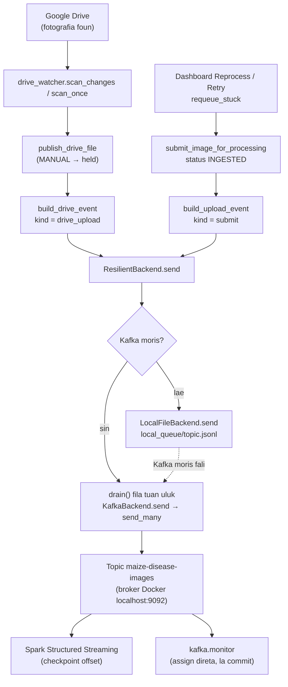
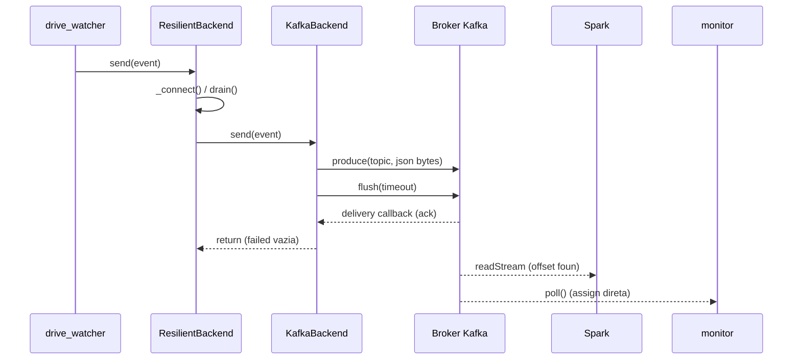
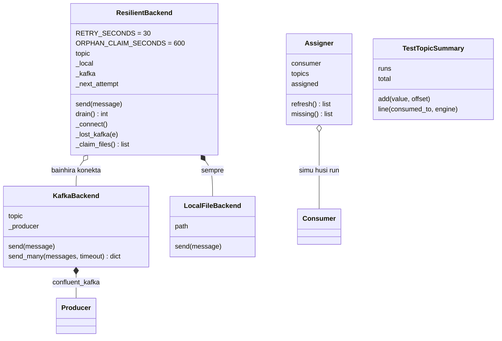

# 02 — Modulu Apache Kafka (Mensajen)

*Sistema Crop Disease Early Warning System (EWS) — dokumentasaun téknika ba modulu Kafka, hakerek ba estudante ne'ebé foin hahú aprende Python. Fonte úniku: kódigu iha repozitóriu (branch `main`, commit `302818f`). Kódigu hotu kópia automátiku husi arkivu loloos ho númeru liña; segredu (password) troka ho `***`.*

{{coverage kafka/config.py 1-28}}
{{coverage kafka/producer.py 1-221}}
{{coverage kafka/drive_watcher.py 1-256}}
{{coverage storage/pipeline_submit.py 1-70}}
{{coverage kafka/monitor.py 1-209}}
{{coverage docker-compose.yml 1-50}}

> **Oinsá lee.** Bloku kódigu kada ida tuir pasu 9: (1) Kódigu orijinál, (2) Objetivu, (3) Fundamentu Python, (4) Esplikasaun liña-ba-liña, (5) Walkthrough ezekusaun, (6) Tipu dadus, (7) Ligasaun OOP, (8) Impaktu integrasaun, (9) Checkpoint ba principiante. Etiketa: *Implementadu* (kódigu halo), *Inferidu* (dedús husi kódigu), *Teoria* (esplikasaun jerál), *Ezemplu ilustrativu* (valór hili atu esplika, la'ós dadus loloos).

## A. Introdusaun no Objetivu

### A.1 Papél Kafka iha sistema

Apache Kafka mak **sistema mensajen** (message broker): programa ida (*produtór*) hakerek mensajen ba **topic** (hanesan "kanál" ka "fila"), no programa seluk (*konsumidór*) lee mensajen husi topic. Iha EWS:

| Papél | Programa | Kódigu |
|---|---|---|
| Produtór 1 | Drive watcher — hatene fotografia foun iha Google Drive | `kafka/drive_watcher.py` |
| Produtór 2 | Reprocess / Retry / requeue — haruka fali fotografia ne'ebé iha ona iha base de dadus | `storage/pipeline_submit.py` |
| Biblioteka produtór | Haruka ba Kafka; se Kafka mate, rai iha fila arkivu lokál | `kafka/producer.py` |
| Konsumidór prinsipál | Spark Structured Streaming (Modulu 01) | `spark/streaming_job.py` |
| Konsumidór observadór | Janela `EWS-KafkaMonitor` (só lee, la commit) | `kafka/monitor.py` |
| Broker | Kafka 3.7.0 iha Docker (KRaft, nó ida) | `docker-compose.yml` |

**Importante:** mensajen Kafka lori **referénsia** ba fotografia (ID, dalan `gdrive:<id>`, metadata) — **nunka** bytes imajen. Spark mak foti imajen husi Drive.

### A.2 Problema ne'ebé Kafka rezolve

- **Separa produtór no konsumidór.** Watcher bele hatene fotografia foun maske Spark seidauk prontu; mensajen hein iha topic.
- **La lakon eventu.** Kafka rai mensajen iha disku (volume `kafka_data`); Spark lee tuir *offset* no rai checkpoint.
- **Kafka mate.** `ResilientBackend` rai eventu iha arkivu `storage/local_queue/<topic>.jsonl` no haruka hotu bainhira Kafka moris fali (`drain`).
- **Observasaun.** Monitor hatudu kada eventu iha konsola maibé la muda pozisaun lee Spark.

### A.3 Fundamentu Python (foun iha modulu ne'e)

Modulu 01 hanorin ona variavel, tipu, dict, lista, funsaun, klase, `self`, `__init__`, exception, `with`, thread, f-string, walrus `:=`. **Lembra badak:** klase = molde; objetu = buat ida harii husi molde; `self` = objetu rasik; `with` = loke no taka rekursu automátiku. Konseitu **foun** iha ne'e:

**1. Serializasaun JSON.** Konverte objetu Python ba testu (no fali).

```python
import json
event = {"image_id": "a1", "size_bytes": None}
texto = json.dumps(event)          # '{"image_id": "a1", "size_bytes": null}'
bytes_ = texto.encode("utf-8")     # b'{"image_id": ...}'  (Kafka haruka bytes)
fali = json.loads(texto)           # dict fali
```

`None` sai `null`; `True` sai `true`. `json.loads` hamosu `ValueError` (`json.JSONDecodeError`) se testu la'ós JSON.

**2. Arkivu: `open(path, mode)`.** `"a"` = append (aumenta iha rohan), `"r"` (default) = lee. `with open(...) as f:` taka arkivu automátiku. Loop `for line in f:` lee liña ida-ida.

**3. JSON Lines (`.jsonl`).** Arkivu ne'ebé kada liña mak JSON ida. Fasil atu aumenta (append) no lee liña ida-ida.

**4. Lock arkivu sistema operativu.** Thread lock (`threading.Lock`) proteje thread iha prosesu ida; **lock arkivu** (`msvcrt.locking` iha Windows, `fcntl.flock` iha Linux) proteje prosesu barak ne'ebé hakerek arkivu hanesan.

**5. Atributu klase.** Variavel ne'ebé define iha `class` nia laran (la'ós iha métodu). Objetu hotu partilla:

```python
class ResilientBackend:
    RETRY_SECONDS = 30          # atributu klase
    def __init__(self, topic):
        self.topic = topic      # atributu instánsia
```

`self.RETRY_SECONDS` lee atributu klase liuhusi objetu.

**6. Fábrika closure (closure factory).** Funsaun ne'ebé harii no fó fali funsaun foun ne'ebé "hanoin" valór:

```python
def _callback(index):
    def _on_delivery(err, msg):
        print(index, err)      # index "rai" iha funsaun laran
    return _on_delivery
cb0 = _callback(0)             # cb0 hanoin index = 0
```

**7. `enumerate(lista)`.** Fó pár `(índise, elementu)`: `for i, m in enumerate(["a","b"])` → `(0,"a")`, `(1,"b")`.

**8. `OrderedDict` no `Counter`** (`collections`). `OrderedDict` hanoin orden tama; `popitem(last=False)` hasai ida tuan liu. `Counter` mak dict ba kontajen: `c["x"] += 1` la presiza inisializa.

**9. Duck typing no `hasattr`.** "Se nia la'o hanesan pato no hakilar hanesan pato, nia mak pato." Kódigu la kontrola tipu objetu; nia kontrola se objetu iha métodu: `if hasattr(backend, "drain"): backend.drain()`.

**10. `socket.create_connection`.** Koko loke konesaun TCP ba host:port; hamosu `OSError` se la bele.

**11. String: `split`, `rpartition`, `strip`.** `"a:b:c".rpartition(":")` → `("a:b", ":", "c")` (fahe iha `:` ikus). `"[::1]".strip("[]")` → `"::1"`.

**12. `os.replace(a, b)` no `uuid.uuid4().hex`.** `os.replace` troka naran arkivu (atómiku); `uuid4().hex` fó testu aleatóriu úniku (karakter 32).

**13. `sys.path.insert(0, pasta)`.** Aumenta pasta ba lista fatin ne'ebé Python buka modulu (atu `import config` funsiona bainhira halai arkivu direta).

**14. Konseitu Kafka (Teoria).** *Topic* = naran fila mensajen. *Partition* = parte topic ida; mensajen iha partition ida iha orden. *Offset* = númeru pozisaun mensajen iha partition (0, 1, 2...). *Consumer group* = grupu konsumidór ne'ebé fahe partition no **commit** offset (rai to'o ne'ebé lee ona). *Acknowledgement (ack)* = broker konfirma katak simu mensajen. *Bootstrap server* = enderesu broker dahuluk ne'ebé cliente kontaktu.

## B. Arkivu Fonte Loloos

| Arkivu | Liña | Klase / funsaun | Serbisu |
|---|---|---|---|
| `kafka/config.py` | 28 | `bootstrap_address`, `broker_reachable` | Re-esporta konfigurasaun Kafka; kontrola broker moris |
| `kafka/producer.py` | 221 | `_append`, `_parse_lines`, `KafkaBackend`, `LocalFileBackend`, `ResilientBackend`, `get_backend` | Serializa no haruka eventu; fila lokál bainhira Kafka mate |
| `kafka/drive_watcher.py` | 256 | `build_drive_event`, `publish_drive_file`, `scan_once`, `scan_changes`, `start_change_feed`, `NoBookmark`, `next_interval`, `main` | Produtór: Drive → eventu `drive_upload` |
| `storage/pipeline_submit.py` | 70 | `build_upload_event`, `NotResubmittable`, `submit_image_for_processing`, `submit_all` | Produtór: base de dadus → eventu `submit` |
| `kafka/monitor.py` | 209 | `describe`, `TestTopicSummary`, `Assigner`, `consumer_config`, `run` | Konsumidór só-lee ba janela EWS-KafkaMonitor |
| `docker-compose.yml` | 1–50 | serbisu `kafka` | Broker Kafka 3.7.0 KRaft |

**Dependénsia esternu:** `confluent-kafka` (cliente Kafka C/librdkafka). Komentáriu `producer.py` liña 2–3: projetu la uza `kafka-python` tanba naran pakote `kafka` sei kahur ho pasta projetu `kafka/`.

**Konfigurasaun** (`config/settings.py` liña 45–48, valór default): `KAFKA_BOOTSTRAP_SERVERS = "localhost:9092"`, `KAFKA_TOPIC = "maize-disease-images"`, `KAFKA_USE_LOCAL_FALLBACK = True`, `LOCAL_QUEUE_DIR = <projetu>/storage/local_queue`.

## C. Arkitetura no Fluxu Ezekusaun

### C.1 Input, prosesu, output

| | Produtór | Konsumidór Spark | Monitor |
|---|---|---|---|
| **Input** | Metadata Drive (watcher) ka liña `images` (submit) | Mensajen iha topic | Mensajen iha topic |
| **Prosesu** | `build_*_event` → `json.dumps(...).encode("utf-8")` → `produce` → `flush` + callback ack | `from_json(value.cast("string"), EVENT_SCHEMA)` | `json.loads(value)` → `describe` |
| **Output** | Mensajen iha topic `maize-disease-images` (ka liña iha `local_queue/*.jsonl`) | Liña DataFrame (Modulu 01) | Liña konsola |

### C.2 Diagrama fluxu



### C.3 Estrutura payload (mensajen)

Kafka simu **bytes**. Bytes ne'e mak testu JSON UTF-8 husi dict Python. Mensajen la iha **key** (`produce(self.topic, payload, ...)` — la haruka key). Kampu tuir tipu eventu:

| Kampu | `drive_upload` (`build_drive_event`) | `submit` (`build_upload_event`) |
|---|---|---|
| `kind` | `"drive_upload"` | `"submit"` |
| `image_id` | `appProperties.image_id` | `image.image_id` |
| `user_id` | `None` (Spark hetan husi `owner_email`) | `image.user_id` |
| `drive_file_id` | ID arkivu | husi `image_path` se Drive, se lae `None` |
| `image_path` | `"gdrive:<id>"` | `image.image_path` |
| `uploaded_at` | `createdTime` Drive (relójiu Google) | `image.uploaded_at` ISO |
| `captured_at` | `appProperties.captured_at_client` | `image.captured_at` ISO |
| `location` | `appProperties.location` | `image.location` |
| `file_name`, `mime_type`, `size_bytes`, `owner_email`, `owner_name`, `folder_email`, `original_filename`, `content_hash`, `device_gps_lat`, `device_gps_lon` | sin | la iha |

*Ezemplu ilustrativu* (ID no email la loos):

```json
{"kind": "drive_upload", "image_id": "a1b2c3d4-0000-4000-8000-000000000001", "user_id": null,
 "drive_file_id": "1AbCdEf", "image_path": "gdrive:1AbCdEf", "file_name": "IMG_20261020.jpg",
 "mime_type": "image/jpeg", "size_bytes": "2457600", "owner_email": "agrikultor@example.com",
 "owner_name": "Agrikultor", "folder_email": "agrikultor@example.com",
 "uploaded_at": "2026-10-20T01:15:00.000Z", "captured_at": "2026-10-20T10:14:52+09:00",
 "location": "Aileu Vila", "original_filename": "IMG_20261020.jpg", "content_hash": "9f86d0...",
 "device_gps_lat": "-8.7281", "device_gps_lon": "125.5664"}
```

### C.4 Partition, consumer group no offset — saida mak implementa

| Konseitu | Iha kódigu | Detallu |
|---|---|---|
| Kriasaun topic esplísitu | Not implemented in the current codebase. | La iha `NewTopic`/`create_topics`. Topic harii automátiku husi broker bainhira mensajen dahuluk mai (Inferidu: konfigurasaun auto-create default Kafka). |
| Númeru partition | Not implemented in the current codebase (la konfigura). | `docker-compose.yml` la define `KAFKA_NUM_PARTITIONS`; Inferidu: default broker = 1. Kódigu monitor mós suporta partition barak (`for partition in info.partitions`). |
| Key mensajen | Not implemented in the current codebase. | `produce(topic, payload, callback=...)` — la iha key; librdkafka hili partition. |
| Consumer group Spark | Spark jere rasik | Spark Structured Streaming la commit offset ba Kafka group; nia rai offset iha **checkpoint** (`CHECKPOINT_DIR`). |
| Consumer group monitor | `group.id = "ews-kafka-monitor"` maibé `enable.auto.commit = False` no `incremental_assign` direta | La partisipa iha rebalance; la commit. |
| Consumer group teste eskala | `SCALABILITY_CONSUMER_GROUP = "scalability-test"` | Monitor lee de'it nia offset (`test_consumer_position`). |
| Ack produtór | Sin | Callback `_on_delivery` + `flush(timeout)`; mensajen la ack → erru |
| Replication | `KAFKA_OFFSETS_TOPIC_REPLICATION_FACTOR: 1` | Nó ida; la iha replikasaun. |

### C.5 Trasu konkretu: eventu ida husi publikasaun to'o konsumu

*Ezemplu ilustrativu* (valór); funsaun no regra loloos.

1. Agrikultór upload fotografia → Drive change feed hatudu arkivu foun.
2. `scan_changes` → `_publish_safely(meta, backend, "agrikultor@example.com")` → `publish_drive_file`.
3. `get_processing_mode()` = `AUTOMATIC` → `build_drive_event(meta, folder_email)` → dict (C.3).
4. `ResilientBackend.send(event)` → `_connect()` fó `KafkaBackend` → `drain()` (fila mamuk, 0) → `KafkaBackend.send(event)` → `send_many([event], timeout=10)`.
5. `json.dumps(event).encode("utf-8")` → bytes ~700 → `produce("maize-disease-images", payload, callback=_callback(0))` → `flush(10)` → broker ack → `acked = {0}` → `failed = {}`.
6. Konsola watcher: `[drive_watcher] new photo a1b2c3d4 from agrikultor@example.com (Aileu Vila) -> Kafka topic 'maize-disease-images' (Drive file 1AbCdEf)`.
7. Monitor: `[kafka 09:15:01] p0 offset 57: new photo a1b2c3d4 from agrikultor@example.com (Aileu Vila), uploaded 20/10/2026 10:15 TLT, Drive file -> waiting for Spark`.
8. Spark (trigger 1 s) lee offset 57 → `from_json` → `foreach_batch_sink` (Modulu 01).

### C.6 Diagrama sekuénsia



## D. Esplikasaun Kódigu-ba-Kódigu

### D.1 `kafka/config.py`

#### D.1.1 Re-esporta konfigurasaun

**1. Kódigu orijinál**

{{code kafka/config.py 1-8}}

**2. Objetivu**

Fó fatin ida ba konfigurasaun Kafka: modulu seluk import husi `kafka.config` (la'ós direta husi `config.settings`).

**3. Fundamentu Python**

- **Re-export**: import naran no la uza iha arkivu, atu modulu seluk bele `from kafka.config import KAFKA_TOPIC`.
- **`# noqa: F401`**: husu linter atu la hatete "import la uza".

**4. Esplikasaun liña-ba-liña**

- **Liña 1** — Docstring: konfigurasaun Kafka, husi `config.settings`.
- **Liña 3** — `from config.settings import (` — komentáriu: re-esporta.
- **Liña 4** — `KAFKA_BOOTSTRAP_SERVERS` — enderesu broker (default `"localhost:9092"`).
- **Liña 5** — `KAFKA_TOPIC` — topic (default `"maize-disease-images"`).
- **Liña 6** — `KAFKA_USE_LOCAL_FALLBACK` — uza fila lokál bainhira Kafka mate (default `True`).
- **Liña 7** — `LOCAL_QUEUE_DIR` — pasta fila lokál.
- **Liña 8** — `)`.

**5. Walkthrough ezekusaun**

`from kafka.config import KAFKA_TOPIC` → `"maize-disease-images"` (se variavel ambiente `KAFKA_TOPIC` la define).

**6. Tipu dadus**

`KAFKA_BOOTSTRAP_SERVERS`, `KAFKA_TOPIC`: `str`; `KAFKA_USE_LOCAL_FALLBACK`: `bool`; `LOCAL_QUEUE_DIR`: `Path`.

**7. Ligasaun OOP**

Not implemented in the current codebase. (Konstante modulu de'it.)

**8. Impaktu integrasaun**

Import husi `producer.py`, `monitor.py`, `pipeline_submit.py`, `spark/streaming_job.py`.

**9. Checkpoint ba principiante**

**P:** Tanba sá la import direta husi `config.settings`?
**R:** Atu modulu Kafka iha "pontu tama" ida; se fatin konfigurasaun muda, só arkivu ne'e mak muda.

#### D.1.2 `bootstrap_address` no `broker_reachable`

**1. Kódigu orijinál**

{{code kafka/config.py 11-28}}

**2. Objetivu**

Hetan host no port husi broker dahuluk iha `KAFKA_BOOTSTRAP_SERVERS`, no kontrola lalais (TCP) se broker moris.

**3. Fundamentu Python**

- **`split(",")[0]`** — elementu dahuluk; **`split("://", 1)[-1]`** — fahe dala ida, foti parte ikus.
- **`rpartition(":")`** — fahe iha `:` ikus (funsiona ba IPv6 `[::1]:9092`).
- **`_`** — variavel ne'ebé ita la uza.
- **`with socket.create_connection(...)`** — taka konesaun automátiku.

**4. Esplikasaun liña-ba-liña**

- **Liña 11** — `def bootstrap_address() -> tuple:`
- **Liña 12** — Docstring: (host, port) broker dahuluk.
- **Liña 13** — `first = KAFKA_BOOTSTRAP_SERVERS.split(",")[0].strip()` — broker dahuluk, la ho espasu.
- **Liña 14** — `first = first.split("://", 1)[-1]` — hasai prefiksu protokolu (komentáriu `PLAINTEXT://host:port`).
- **Liña 15** — `host, _, port = first.rpartition(":")`.
- **Liña 16** — `if not host:` — komentáriu: la iha port.
- **Liña 17** — `return first or "localhost", 9092` — port default 9092.
- **Liña 18** — `return host.strip("[]"), int(port)` — hasai `[]` husi IPv6; port `int`.
- **Liña 21** — `def broker_reachable(timeout: float = 1.0) -> bool:`
- **Liña 22** — `import socket`.
- **Liña 23** — `host, port = bootstrap_address()`.
- **Liña 24** — `try:`
- **Liña 25** — `with socket.create_connection((host, port), timeout=timeout):` — koko konesaun TCP.
- **Liña 26** — `return True`.
- **Liña 27** — `except OSError:` — konesaun falla/timeout.
- **Liña 28** — `return False`.

**5. Walkthrough ezekusaun**

| `KAFKA_BOOTSTRAP_SERVERS` | `bootstrap_address()` |
|---|---|
| `"localhost:9092"` | `("localhost", 9092)` |
| `"PLAINTEXT://a:9093,b:9094"` | `("a", 9093)` |
| `"[::1]:9092"` | `("::1", 9092)` |
| `"kafka"` | `("kafka", 9092)` |

`broker_reachable()` ho Docker mate → `False` iha ~1 s.

**6. Tipu dadus**

| Funsaun | Parámetru | Return | Exception |
|---|---|---|---|
| `bootstrap_address` | — | `tuple[str, int]` | `ValueError` se port la'ós númeru |
| `broker_reachable` | `timeout: float` | `bool` | la iha (OSError kaer) |

**7. Ligasaun OOP**

Objetu `socket` (husi `create_connection`) mak context manager. Not implemented in the current codebase: klase konfigurasaun.

**8. Impaktu integrasaun**

`monitor.run()` liña 147 hein to'o `broker_reachable()` loos. Mós uza husi `dashboard/app.py` liña 389–390 (status Kafka iha dashboard) no `dashboard/scalability_page.py` liña 148.

**9. Checkpoint ba principiante**

**P:** Tanba sá uza `rpartition` no la'ós `partition`?
**R:** Enderesu IPv6 iha `:` barak (`[::1]:9092`). `rpartition` fahe iha `:` **ikus**, ne'ebé sempre antes port.

### D.2 `kafka/producer.py` — serializasaun no haruka

#### D.2.1 Docstring, import no `_APPEND_LOCK`

**1. Kódigu orijinál**

{{code kafka/producer.py 1-18}}

**2. Objetivu**

Esplika modulu (haruka eventu ba Kafka; fila arkivu lokál bainhira broker mate), import, harii pasta fila, no lock thread ba hakerek arkivu.

**3. Fundamentu Python**

Kódigu nível modulu (`LOCAL_QUEUE_DIR.mkdir(...)`) halai bainhira import. `threading.Lock()` haree Modulu 01 A.3.

**4. Esplikasaun liña-ba-liña**

- **Liña 1–4** — Docstring: haruka eventu upload ba Kafka (confluent-kafka; kafka-python sei kahur ho pakote `kafka/` projetu). Bainhira broker mate, eventu hein iha fila arkivu lokál no haruka bainhira nia fila.
- **Liña 5** — Remata docstring.
- **Liña 7** — `import json` — serializasaun.
- **Liña 8** — `import os` — `os.name`, `os.replace`, `os.utime`.
- **Liña 9** — `import threading`.
- **Liña 10** — `import time` — `monotonic`, `time`.
- **Liña 11** — `import uuid` — naran arkivu úniku.
- **Liña 13** — Konfigurasaun husi `kafka.config`.
- **Liña 15** — `LOCAL_QUEUE_DIR.mkdir(parents=True, exist_ok=True)` — pasta fila iha.
- **Liña 17** — Komentáriu: append ida de'it iha tempu ida iha prosesu ne'e (thread barak bele haruka).
- **Liña 18** — `_APPEND_LOCK = threading.Lock()`.

**5. Walkthrough ezekusaun**

Import dahuluk → harii `storage/local_queue/` se seidauk iha.

**6. Tipu dadus**

`_APPEND_LOCK`: `threading.Lock`.

**7. Ligasaun OOP**

Objetu lock nível modulu (komposisaun modulu).

**8. Impaktu integrasaun**

Watcher no `pipeline_submit` import `get_backend` husi modulu ne'e.

**9. Checkpoint ba principiante**

**P:** Tanba sá projetu la uza pakote `kafka-python`?
**R:** Pakote ne'e naran `kafka` — hanesan ho pasta projetu `kafka/`. `import kafka` sei kahur; `confluent_kafka` iha naran seluk.

#### D.2.2 `_append` no `_parse_lines`

**1. Kódigu orijinál**

{{code kafka/producer.py 21-48}}

**2. Objetivu**

`_append` hakerek testu iha rohan arkivu fila ho lock thread **no** lock sistema operativu (prosesu rua labele kahur liña). `_parse_lines` lee liña JSON; fahe ba mensajen válidu no liña aat.

**3. Fundamentu Python**

- **`with A, B:`** — context manager rua iha `with` ida.
- **`if os.name == "nt": ... else: ...`** — kódigu diferente ba Windows/Linux.
- **`f.seek(0)`** — muda pozisaun arkivu ba inísiu.
- **Return tuple** `return messages, bad`.

**4. Esplikasaun liña-ba-liña**

- **Liña 21** — `def _append(path, text: str) -> None:`
- **Liña 22** — Docstring: append ho lock OS, atu prosesu rua la kahur liña.
- **Liña 23** — `with _APPEND_LOCK, open(path, "a") as f:` — lock thread + loke arkivu append.
- **Liña 24** — `if os.name == "nt":` — Windows:
- **Liña 25** — `import msvcrt`.
- **Liña 26** — `f.seek(0)` — lock byte dahuluk (fatin hanesan ba prosesu hotu).
- **Liña 27** — `msvcrt.locking(f.fileno(), msvcrt.LK_LOCK, 1)` — lock byte 1; komentáriu: hein to'o ~10 s, depois hamosu erru.
- **Liña 28** — `f.write(text)` — modu `"a"` hakerek sempre iha rohan.
- **Liña 29** — `f.flush()` — haruka ba disku.
- **Liña 30** — `f.seek(0)`.
- **Liña 31** — `msvcrt.locking(f.fileno(), msvcrt.LK_UNLCK, 1)` — loke lock.
- **Liña 32** — `else:` — Linux/macOS:
- **Liña 33** — `import fcntl`.
- **Liña 34** — `fcntl.flock(f.fileno(), fcntl.LOCK_EX)` — lock eskluzivu; komentáriu: loke bainhira arkivu taka.
- **Liña 35** — `f.write(text)`.
- **Liña 38** — `def _parse_lines(lines):`
- **Liña 39** — Docstring: (messages, bad_lines) husi fila JSON-lines.
- **Liña 40** — `messages, bad = [], []`.
- **Liña 41** — `for line in lines:`
- **Liña 42** — `if not line.strip():` — liña mamuk:
- **Liña 43** — `continue` — salta.
- **Liña 44** — `try:`
- **Liña 45** — `messages.append(json.loads(line))` — **deserializasaun** JSON.
- **Liña 46** — `except ValueError:` — JSON aat.
- **Liña 47** — `bad.append(line)`.
- **Liña 48** — `return messages, bad`.

**5. Walkthrough ezekusaun**

*Ezemplu ilustrativu:* arkivu ho liña `{"image_id":"a1"}\n`, `\n`, `{"image_id":` (corte) → `_parse_lines` → `([{"image_id": "a1"}], ['{"image_id":'])`.

**6. Tipu dadus**

| Funsaun | Parámetru | Return | Exception |
|---|---|---|---|
| `_append` | `path` (`Path`), `text: str` | `None` | `OSError` se lock la hetan (Windows ~10 s) |
| `_parse_lines` | iterável `str` (arkivu ka lista) | `tuple[list[dict], list[str]]` | la iha |

**7. Ligasaun OOP**

Objetu arkivu `f` iha métodu `write`, `flush`, `seek`, `fileno`. `_parse_lines` simu **iterável saida de'it** (arkivu ka lista) — duck typing.

**8. Impaktu integrasaun**

`LocalFileBackend.send` no `drain` (liña ba `.corrupt`) bolu `_append`. `drain` bolu `_parse_lines`.

**9. Checkpoint ba principiante**

**P:** Tanba sá presiza lock rua (`_APPEND_LOCK` no `msvcrt`/`fcntl`)?
**R:** `_APPEND_LOCK` proteje thread iha prosesu hanesan; lock OS proteje prosesu diferente (ezemplu watcher no dashboard) ne'ebé hakerek arkivu hanesan.

#### D.2.3 Klase `KafkaBackend` — konstrutór no `send`

**1. Kódigu orijinál**

{{code kafka/producer.py 51-63}}

**2. Objetivu**

Objetu ne'ebé haruka eventu ba Kafka loloos. Konstrutór harii `Producer` confluent-kafka no kontrola lalais katak broker moris. `send` haruka eventu ida no hamosu erru se Kafka la konfirma.

**3. Fundamentu Python**

- **Klase ho `__init__`**: `KafkaBackend("maize-disease-images")` → Python bolu `__init__(self, "maize-disease-images")`.
- **Atributu "privadu"** `self._producer` (konvensaun `_`).
- **Walrus** `if failed := self.send_many(...)`.
- **Dict vazia mak `False`** iha `if`.

**4. Esplikasaun liña-ba-liña**

- **Liña 51** — `class KafkaBackend:` — klase (herda `object`).
- **Liña 52** — `def __init__(self, topic: str):`
- **Liña 53** — `from confluent_kafka import Producer` — import lazy.
- **Liña 54** — `self.topic = topic` — atributu instánsia publiku.
- **Liña 55** — `self._producer = Producer({"bootstrap.servers": KAFKA_BOOTSTRAP_SERVERS})` — objetu produtór (konfigurasaun mínimu; serializasaun halo manual iha `send_many`).
- **Liña 56** — Komentáriu: falla lalais bainhira broker mate.
- **Liña 57** — `self._producer.list_topics(timeout=3)` — husu metadata; hamosu `KafkaException` se broker la responde iha 3 s.
- **Liña 59** — `def send(self, message: dict):`
- **Liña 60** — Komentáriu: hamosu erru se Kafka la konfirma, atu chamadór hatene.
- **Liña 61** — `from confluent_kafka import KafkaException`.
- **Liña 62** — `if failed := self.send_many([message], timeout=10):` — haruka lista ho mensajen ida; `failed` dict `{0: "erru"}` se falla.
- **Liña 63** — `raise KafkaException(f"Kafka delivery failed: {failed[0]} — broker unreachable?")`.

**5. Walkthrough ezekusaun**

`kb = KafkaBackend("maize-disease-images")` ho broker moris → objetu ho `kb.topic` no `kb._producer`. Broker mate → `list_topics` hamosu erru iha `__init__` → objetu la harii (ResilientBackend kaer). `kb.send({"image_id": "a1"})` → `send_many` fó `{}` → return `None`.

**6. Tipu dadus**

| Naran | Tipu |
|---|---|
| `self.topic` | `str` |
| `self._producer` | `confluent_kafka.Producer` |
| `send(message: dict)` | return `None`; exception `KafkaException` |

**7. Ligasaun OOP**

- **Klase + objetu**: `KafkaBackend` mak klase; `ResilientBackend._kafka` kaer objetu.
- **`__init__`/`self`**: rai `topic` no `_producer` iha objetu.
- **Enkapsulamentu**: `_producer` "internu"; kódigu liur uza `send`/`send_many` de'it.
- **Komposisaun**: objetu `KafkaBackend` **na'in** objetu `Producer`.
- **Polimorfizmu (duck typing)**: `KafkaBackend`, `LocalFileBackend`, `ResilientBackend` hotu iha métodu `send(message)` — chamadór (`publish_drive_file`, `submit_image_for_processing`) la hatene klase ida ne'ebé. La iha klase baze komún (herança Not implemented in the current codebase).

**8. Impaktu integrasaun**

`get_backend` fó objetu ne'e direta se `KAFKA_USE_LOCAL_FALLBACK=False` (docker-compose rekomenda ida ne'e ba demo atu falla "loud").

**9. Checkpoint ba principiante**

**P:** Tanba sá konstrutór bolu `list_topics(timeout=3)`?
**R:** Atu hatene kedas se broker mate (falla lalais), duke hein bainhira haruka mensajen dahuluk.

#### D.2.4 `KafkaBackend.send_many` — serializasaun, produce, flush no ack

**1. Kódigu orijinál**

{{code kafka/producer.py 65-91}}

**2. Objetivu**

Haruka mensajen barak ho `flush` ida. Kada mensajen: dict → JSON → bytes UTF-8 → `produce` ho callback ne'ebé rai ack ka erru. Depois `flush`, mensajen ne'ebé la ack no la erru konta hanesan falla (timeout). Fó dict `{índise: erru}`.

**3. Fundamentu Python**

- **Closure factory** `_callback(index)` (haree A.3.6) — kada mensajen iha callback ne'ebé hanoin nia índise.
- **`set()`** ba ack; **`dict`** ba falla.
- **`while True: try ... break except BufferError: ...`** — koko fali to'o susesu.
- **`enumerate`**, **`range(len(...))`**.

**4. Esplikasaun liña-ba-liña**

- **Liña 65** — `def send_many(self, messages: list, timeout: float = 120) -> dict:`
- **Liña 66** — Docstring: haruka eventu barak ho flush ida; fó `{index: error}` ba sira ne'ebé la to'o.
- **Liña 67** — `failed = {}`.
- **Liña 68** — `acked = set()`.
- **Liña 70** — `def _callback(index):` — fábrika callback.
- **Liña 71** — `def _on_delivery(err, _msg):` — librdkafka bolu bainhira broker responde.
- **Liña 72** — `if err is not None:`
- **Liña 73** — `failed[index] = str(err)`.
- **Liña 74** — `else:`
- **Liña 75** — `acked.add(index)` — broker konfirma.
- **Liña 76** — `return _on_delivery`.
- **Liña 78** — `for index, message in enumerate(messages):`
- **Liña 79** — `payload = json.dumps(message).encode("utf-8")` — **serializasaun**: dict → str JSON → bytes.
- **Liña 80** — `while True:`
- **Liña 81** — `try:`
- **Liña 82** — `self._producer.produce(self.topic, payload, callback=_callback(index))` — tau mensajen iha buffer haruka (asinkrónu); la iha key.
- **Liña 83** — `break`.
- **Liña 84** — `except BufferError:` — komentáriu: buffer nakonu, husik nia mamuk.
- **Liña 85** — `self._producer.poll(0.5)` — prosesa evento/callback 0.5 s (buffer mamuk).
- **Liña 86** — `self._producer.poll(0)` — prosesa callback ne'ebé prontu, la hein.
- **Liña 87** — `self._producer.flush(timeout=timeout)` — hein to'o mensajen hotu haruka no callback halai (ka timeout).
- **Liña 88** — `for index in range(len(messages)):`
- **Liña 89** — `if index not in acked and index not in failed:` — la iha resposta:
- **Liña 90** — `failed[index] = f"not acknowledged within {timeout:.0f}s"`.
- **Liña 91** — `return failed`.

**5. Walkthrough ezekusaun**

*Ezemplu ilustrativu:* `send_many([e0, e1], timeout=10)`. `produce` e0 ho callback(0), e1 ho callback(1). `flush(10)`: broker ack e0 → `acked={0}`; e1 erru `"Broker: Message size too large"` → `failed={1: "..."}`. Return `{1: "KafkaError{...}"}`. Se broker mate durante flush → la iha callback → `failed={0: "not acknowledged within 10s", 1: "..."}`.

**6. Tipu dadus**

| Naran | Tipu |
|---|---|
| `messages` | `list[dict]` |
| `timeout` | `float` |
| `failed` | `dict[int, str]` |
| `acked` | `set[int]` |
| `payload` | `bytes` |
| return | `dict[int, str]` |

**7. Ligasaun OOP**

Métodu instánsia uza `self._producer` no `self.topic` (estadu objetu). Callback mak funsaun (objetu first-class) ne'ebé haruka ba objetu `Producer` — padraun **callback/observer** husi biblioteka.

**8. Impaktu integrasaun**

Bytes `payload` mak koluna `value` ne'ebé Spark lee (`col("value").cast("string")` iha `parse_events`, Modulu 01) — serializasaun iha ne'e no deserializasaun iha Spark tenke uza JSON UTF-8 hanesan.

**9. Checkpoint ba principiante**

**P:** Tanba sá `produce` la sufisiente atu hatene mensajen to'o?
**R:** `produce` só tau mensajen iha buffer lokál. Konfirmasaun mai husi callback bainhira broker responde; `flush` hein callback hotu.

#### D.2.5 `LocalFileBackend` no `ResilientBackend` (konstrutór, `_connect`)

**1. Kódigu orijinál**

{{code kafka/producer.py 94-130}}

**2. Objetivu**

`LocalFileBackend` hakerek eventu iha arkivu `<topic>.jsonl`. `ResilientBackend` uza Kafka bainhira moris; bainhira mate, uza fila lokál, no koko konekta fali kada 30 s.

**3. Fundamentu Python**

- **Atributu klase** `RETRY_SECONDS = 30`.
- **`self._local = LocalFileBackend(topic)`** — objetu iha objetu (komposisaun).
- **Return sedu** iha `_connect`.

**4. Esplikasaun liña-ba-liña**

- **Liña 94** — `class LocalFileBackend:`
- **Liña 95** — Docstring: fila arkivu lokál uza bainhira Kafka mate.
- **Liña 97** — `def __init__(self, topic: str):`
- **Liña 98** — `self.path = LOCAL_QUEUE_DIR / f"{topic}.jsonl"`.
- **Liña 100** — `def send(self, message: dict):`
- **Liña 101** — `_append(self.path, json.dumps(message) + "\n")` — serializa liña JSON ida.
- **Liña 104** — `class ResilientBackend:`
- **Liña 105–106** — Docstring: Kafka bainhira moris, fila lokál bainhira mate (kontrola kada `send`); Kafka fila → fila haruka uluk.
- **Liña 108** — `RETRY_SECONDS = 30` — atributu klase.
- **Liña 110** — `def __init__(self, topic: str):`
- **Liña 111** — `self.topic = topic`.
- **Liña 112** — `self._local = LocalFileBackend(topic)`.
- **Liña 113** — `self._kafka = None` — seidauk konekta.
- **Liña 114** — `self._next_attempt = 0.0` — bele koko kedas.
- **Liña 115** — `self._connect()` — koko konekta iha konstrutór.
- **Liña 117** — `def _connect(self):`
- **Liña 118** — `if self._kafka is not None:` — konekta ona:
- **Liña 119** — `return self._kafka`.
- **Liña 120** — `if time.monotonic() < self._next_attempt:` — seidauk tempu koko fali:
- **Liña 121** — `return None`.
- **Liña 122** — `try:`
- **Liña 123** — `self._kafka = KafkaBackend(self.topic)`.
- **Liña 124** — `print(...)` — "Connected to Kafka at ...".
- **Liña 125** — `except Exception as e:`
- **Liña 126** — `self._next_attempt = time.monotonic() + self.RETRY_SECONDS`.
- **Liña 127–129** — `print(...)` — Kafka la iha; uza fila lokál; koko fali 30 s; Spark **la** lee fila ne'e — hahú broker no backlog haruka automátiku.
- **Liña 130** — `return self._kafka`.

**5. Walkthrough ezekusaun**

*Ezemplu ilustrativu:* Docker mate. `ResilientBackend("maize-disease-images")` → `_connect` → `KafkaBackend` falla → `_next_attempt = agora + 30` → print aviszu. `send` iha 10 s depois → `_connect` fó `None` (seidauk 30 s) → `LocalFileBackend.send` → liña iha `storage/local_queue/maize-disease-images.jsonl`.

**6. Tipu dadus**

| Atributu | Tipu |
|---|---|
| `LocalFileBackend.path` | `Path` |
| `ResilientBackend.RETRY_SECONDS` (klase) | `int` |
| `.topic` | `str` |
| `._local` | `LocalFileBackend` |
| `._kafka` | `KafkaBackend ka None` |
| `._next_attempt` | `float` |
| `_connect()` return | `KafkaBackend ka None` |

**7. Ligasaun OOP**

- **Komposisaun**: `ResilientBackend` na'in `LocalFileBackend` (sempre) no `KafkaBackend` (bainhira konekta). Objetu interior harii iha `__init__`/`_connect` no moris hamutuk ho objetu liur.
- **Atributu klase vs instánsia**: `RETRY_SECONDS` partilla; `_kafka`, `_next_attempt` kada objetu.
- **Padraun dezeñu**: hanesan **Proxy/Fallback** — objetu ida ho interface `send` hanesan ne'ebé hili objetu interior tuir estadu. Sira la herda klase komún.

**8. Impaktu integrasaun**

Watcher no `pipeline_submit` uza `ResilientBackend` (default). Spark la lee fila lokál — fila tenke haruka ba Kafka (`drain`).

**9. Checkpoint ba principiante**

**P:** Saida mak `self.RETRY_SECONDS` lee?
**R:** Atributu klase `ResilientBackend.RETRY_SECONDS` (30), tanba objetu la iha atributu instánsia ho naran ne'e.

#### D.2.6 `ResilientBackend._lost_kafka` no `send`

**1. Kódigu orijinál**

{{code kafka/producer.py 132-147}}

**2. Objetivu**

`send` haruka eventu: se Kafka moris, haruka fila tuan uluk (`drain`) atu mantein orden, depois eventu foun; se haruka falla, marka Kafka lakon no rai iha fila lokál.

**3. Fundamentu Python**

- **`is`** — komparasaun identidade objetu (objetu hanesan, la'ós só valór hanesan).
- **Return sedu** bainhira susesu.

**4. Esplikasaun liña-ba-liña**

- **Liña 132** — `def _lost_kafka(self, e: Exception):`
- **Liña 133** — `print(...)` — "Kafka send failed ...; falling back to local file queue."
- **Liña 134** — `self._kafka = None`.
- **Liña 135** — `self._next_attempt = time.monotonic() + self.RETRY_SECONDS`.
- **Liña 137** — `def send(self, message: dict):`
- **Liña 138** — `kafka = self._connect()`.
- **Liña 139** — `if kafka is not None:`
- **Liña 140** — `self.drain()` — komentáriu: eventu tuan iha fila ba uluk.
- **Liña 141** — `if self._kafka is kafka:` — `drain` la lakon Kafka (se lakon, `_kafka` sai `None`).
- **Liña 142** — `try:`
- **Liña 143** — `kafka.send(message)`.
- **Liña 144** — `return`.
- **Liña 145** — `except Exception as e:`
- **Liña 146** — `self._lost_kafka(e)`.
- **Liña 147** — `self._local.send(message)` — fallback.

**5. Walkthrough ezekusaun**

*Ezemplu ilustrativu:* fila iha eventu 3; Kafka moris fali. `send(e4)` → `drain` haruka e1–e3 → `_kafka` hanesan → `kafka.send(e4)` → return. Orden iha topic: e1, e2, e3, e4. Se `kafka.send(e4)` falla → `_lost_kafka` → e4 ba fila.

**6. Tipu dadus**

`send(message: dict)` → `None`; la hamosu erru (erru Kafka kaer; erru `_append` bele sa'e).

**7. Ligasaun OOP**

Objetu bolu nia métodu rasik (`self._connect()`, `self.drain()`, `self._lost_kafka(e)`) no métodu objetu interior (`kafka.send`, `self._local.send`) — **delegasaun**.

**8. Impaktu integrasaun**

`publish_drive_file` (`backend.send(event)`) no `submit_image_for_processing` bolu métodu ne'e.

**9. Checkpoint ba principiante**

**P:** Tanba sá `drain()` molok haruka eventu foun?
**R:** Atu eventu tuan to'o Spark uluk — orden kronolójiku mantein.

#### D.2.7 `ORPHAN_CLAIM_SECONDS` no `_claim_files`

**1. Kódigu orijinál**

{{code kafka/producer.py 149-173}}

**2. Objetivu**

"Kaer" (claim) arkivu fila atu haruka: troka naran arkivu ba `.draining-<uuid>`. Troka naran mak **lock entre prosesu** — prosesu ida de'it bele troka naran arkivu ida. Mós kaer arkivu `.draining-*` tuan liu 600 s (prosesu ne'ebé mate husik).

**3. Fundamentu Python**

- **`path.parent.glob(padraun)`** — buka arkivu tuir padraun.
- **`sorted(...)`** — orden.
- **`old.stat().st_mtime`** — tempu muda ikus (segundu desde 1970).
- **`os.utime(dst)`** — muda tempu arkivu ba agora.

**4. Esplikasaun liña-ba-liña**

- **Liña 149** — Komentáriu: arkivu kaer tuan liu ne'e husik husi prosesu mate.
- **Liña 150** — `ORPHAN_CLAIM_SECONDS = 600` — atributu klase.
- **Liña 152** — `def _claim_files(self) -> list:`
- **Liña 153–154** — Docstring: kaer arkivu fila (no kaer órfaun) ho troka naran; troka naran mak lock entre prosesu.
- **Liña 155** — `path = self._local.path`.
- **Liña 156** — `sources = [path] if path.exists() else []`.
- **Liña 157** — `cutoff = time.time() - self.ORPHAN_CLAIM_SECONDS`.
- **Liña 158** — `for old in sorted(path.parent.glob(f"{path.name}.draining-*")):`
- **Liña 159** — `try:`
- **Liña 160** — `if old.stat().st_mtime < cutoff:` — tuan liu 600 s:
- **Liña 161** — `sources.append(old)`.
- **Liña 162** — `except OSError:` — arkivu lakon (prosesu seluk kaer).
- **Liña 163** — `continue`.
- **Liña 164** — `claimed = []`.
- **Liña 165** — `for src in sources:`
- **Liña 166** — `dst = path.with_name(f"{path.name}.draining-{uuid.uuid4().hex}")`.
- **Liña 167** — `try:`
- **Liña 168** — `os.replace(src, dst)` — troka naran atómiku.
- **Liña 169** — `os.utime(dst)` — komentáriu: tempu kaer.
- **Liña 170** — `except OSError:` — prosesu seluk kaer uluk.
- **Liña 171** — `continue`.
- **Liña 172** — `claimed.append(dst)`.
- **Liña 173** — `return claimed`.

**5. Walkthrough ezekusaun**

*Ezemplu ilustrativu:* `maize-disease-images.jsonl` iha → troka ba `maize-disease-images.jsonl.draining-3f2a...` → `claimed = [Path(...draining-3f2a...)]`. Watcher no dashboard koko kaer iha tempu hanesan → ida de'it susesu `os.replace`; seluk hetan `OSError` no salta.

**6. Tipu dadus**

`ORPHAN_CLAIM_SECONDS`: `int` (atributu klase); `sources`, `claimed`: `list[Path]`; `cutoff`: `float`.

**7. Ligasaun OOP**

Atributu klase segundu (`ORPHAN_CLAIM_SECONDS`). Métodu "privadu" (`_claim_files`) — enkapsulamentu ho konvensaun.

**8. Impaktu integrasaun**

Bolu de'it husi `drain` (liña 181).

**9. Checkpoint ba principiante**

**P:** Tanba sá troka naran funsiona hanesan lock?
**R:** Arkivu ida bele troka naran dala ida de'it — prosesu dahuluk susesu; prosesu segundu la hetan arkivu orijinál no hetan erru.

#### D.2.8 `ResilientBackend.drain` no `get_backend`

**1. Kódigu orijinál**

{{code kafka/producer.py 175-221}}

**2. Objetivu**

Haruka fila lokál ba Kafka. Liña aat ba arkivu `.corrupt`. Se Kafka falla iha klaran, eventu ne'ebé seidauk haruka fila fali ba fila lokál (la lakon). `get_backend` hili `ResilientBackend` ka `KafkaBackend` tuir konfigurasaun.

**3. Fundamentu Python**

- **Slicing** `messages[done:]`, `claimed[i + 1:]`.
- **`break`** — sai husi loop `for`.
- **`path.unlink()`** — hamoos arkivu.
- **Espresaun kondisionál ba klase**: `(A if x else B)(topic)` — hili klase, depois harii objetu.

**4. Esplikasaun liña-ba-liña**

- **Liña 175** — `def drain(self) -> int:`
- **Liña 176–177** — Docstring: haruka fila lokál ba Kafka; fó kuantu; liña la bele lee ba `<queue>.corrupt`.
- **Liña 178** — `kafka = self._connect()`.
- **Liña 179** — `if kafka is None:`
- **Liña 180** — `return 0`.
- **Liña 181** — `claimed = self._claim_files()`.
- **Liña 182** — `sent = 0`.
- **Liña 183** — `for i, path in enumerate(claimed):`
- **Liña 184** — `try:`
- **Liña 185** — `with open(path) as f:`
- **Liña 186** — `messages, bad = _parse_lines(f)` — deserializa.
- **Liña 187** — `except OSError as e:`
- **Liña 188** — `print(...)` — "Could not read ...".
- **Liña 189** — `continue`.
- **Liña 190** — `if bad:`
- **Liña 191–192** — `_append(self._local.path.with_suffix(".corrupt"), "".join(line if line.endswith("\n") else line + "\n" for line in bad))` — rai liña aat (ho `\n`).
- **Liña 193–194** — `print(...)` — kuantu liña aat muda ba `.corrupt`.
- **Liña 195** — `done = 0`.
- **Liña 196** — `try:`
- **Liña 197** — `for m in messages:`
- **Liña 198** — `kafka.send(m)`.
- **Liña 199** — `done += 1`.
- **Liña 200** — `except Exception as e:`
- **Liña 201** — Komentáriu: tau fali buat hotu ne'ebé seidauk haruka iha fila.
- **Liña 202** — `for m in messages[done:]:`
- **Liña 203** — `self._local.send(m)`.
- **Liña 204** — `for rest in claimed[i + 1:]:` — arkivu kaer seluk ne'ebé seidauk loke:
- **Liña 205** — `with open(rest) as f:`
- **Liña 206** — `for m in _parse_lines(f)[0]:`
- **Liña 207** — `self._local.send(m)`.
- **Liña 208** — `rest.unlink()`.
- **Liña 209** — `path.unlink()`.
- **Liña 210** — `sent += done`.
- **Liña 211** — `self._lost_kafka(e)`.
- **Liña 212** — `break`.
- **Liña 213** — `path.unlink()` — arkivu haruka hotu, hamoos.
- **Liña 214** — `sent += done`.
- **Liña 215** — `if sent:`
- **Liña 216** — `print(...)` — "Forwarded N queued event(s) ... to Kafka."
- **Liña 217** — `return sent`.
- **Liña 220** — `def get_backend(topic: str):`
- **Liña 221** — `return (ResilientBackend if KAFKA_USE_LOCAL_FALLBACK else KafkaBackend)(topic)`.

**5. Walkthrough ezekusaun**

*Ezemplu ilustrativu:* fila ho eventu 5 + liña aat 1. `drain` → kaer arkivu → `messages` 5, `bad` 1 → liña aat ba `maize-disease-images.corrupt` → haruka e1, e2, e3; e4 falla → e4, e5 fila fali ba `maize-disease-images.jsonl` → `sent = 3` → `_lost_kafka` → return 3.

**6. Tipu dadus**

| Funsaun | Return | Exception |
|---|---|---|
| `drain` | `int` | la iha (erru Kafka kaer; erru OS iha `rest` bele sa'e) |
| `get_backend(topic)` | `ResilientBackend ka KafkaBackend` | `KafkaBackend` hamosu erru se broker mate |

**7. Ligasaun OOP**

`get_backend` mak **Factory function** (Teoria: padraun Factory): hili klase tuir konfigurasaun no harii objetu. Klase mak objetu iha Python, entaun espresaun kondisionál bele fó klase.

**8. Impaktu integrasaun**

Watcher `main` bolu `backend.drain()` kada volta (liña 228–229); `send` bolu `drain` molok eventu foun.

**9. Checkpoint ba principiante**

**P:** Se Kafka mate iha klaran `drain`, eventu ne'ebé seidauk haruka lakon?
**R:** Lae. Liña 202–208 tau fali eventu hotu ne'ebé seidauk haruka (no arkivu kaer seluk) ba fila lokál.

### D.3 `kafka/drive_watcher.py` — produtór Drive → Kafka

*Nota:* arkivu ne'e mós esplika iha Modulu 03 husi lado Google Drive. Iha ne'e ita fokus ba lado **Kafka**: oinsá eventu harii no publika.

#### D.3.1 Docstring, import no konstante

**1. Kódigu orijinál**

{{code kafka/drive_watcher.py 1-37}}

**2. Objetivu**

Define watcher: haree pasta Drive `/images/<email>/` agrikultór hotu no publika eventu Kafka ida kada fotografia foun (metadata de'it). La uza base de dadus. Iha modu MANUAL la publika. Define intervalu polling, arkivu estadu no memória arkivu publika ona.

**3. Fundamentu Python**

- **`sys.path.insert(0, ...)`** molok import projetu (atu `python kafka/drive_watcher.py` mós funsiona).
- **`# noqa: E402`** — import la iha leten arkivu (tanba `sys.path` muda uluk).
- **Type hint string** `"OrderedDict[str, None]"` — hint iha aspas.
- **`timedelta(minutes=2)`** — durasaun tempu.
- **`float(os.getenv(..., "1"))`** — konfigurasaun husi variavel ambiente.

**4. Esplikasaun liña-ba-liña**

- **Liña 1–4** — Docstring: Drive → Kafka; haree pasta `/images/<email>/` kada agrikultór; publika eventu Kafka ida kada fotografia foun (metadata de'it, nunka imajen); la iha base de dadus; modu MANUAL la publika.
- **Liña 6** — Oinsá halai: `python -m kafka.drive_watcher [--once]`.
- **Liña 7** — Remata docstring.
- **Liña 8** — `import argparse`.
- **Liña 9** — `import json` — arkivu estadu.
- **Liña 10** — `import os`.
- **Liña 11** — `import re`.
- **Liña 12** — `import sys`.
- **Liña 13** — `import time`.
- **Liña 14** — `from collections import OrderedDict`.
- **Liña 15** — `datetime, timedelta, timezone`.
- **Liña 16** — `Path`.
- **Liña 18** — `sys.path.insert(0, str(Path(__file__).resolve().parent.parent))` — aumenta pasta raiz projetu.
- **Liña 20** — `BASE_DIR`, `KAFKA_TOPIC` husi `config.settings`.
- **Liña 21** — `drive_client` (API Drive, Modulu 03).
- **Liña 22** — `to_drive_path` — ID → `"gdrive:<id>"`.
- **Liña 23** — `ProcessingMode`, `get_processing_mode` — modu AUTOMATIC/MANUAL.
- **Liña 25** — Komentáriu: pedidu change-feed ida kada kontrola: < 2% kuota Drive iha 1 s.
- **Liña 26** — `POLL_SECONDS` — default 1 s bainhira upload mai.
- **Liña 27** — `IDLE_POLL_SECONDS` — default 3 s bainhira nonok.
- **Liña 28** — `FULL_SCAN_SECONDS` — default 600 s, buka pasta tomak (rede seguransa).
- **Liña 29** — `STATE_FILE` — default `storage/drive_watcher_state.json`.
- **Liña 30** — Komentáriu: scan fali uitoan molok arkivu ikus, se Drive lista tarde.
- **Liña 31** — `OVERLAP = timedelta(minutes=2)`.
- **Liña 33** — `_UUID_RE = re.compile(...)` — padraun UUID (karakter hex 8-4-4-4-12).
- **Liña 35** — Komentáriu: arkivu Drive publika ona husi prosesu ne'e (scan rua bele hatudu ida).
- **Liña 36** — `_PUBLISHED: "OrderedDict[str, None]" = OrderedDict()` — uza hanesan "set ho orden".
- **Liña 37** — `_PUBLISHED_MAX = 20000` — limite memória.

**5. Walkthrough ezekusaun**

Ho variavel ambiente la define: `POLL_SECONDS = 1.0`, `IDLE_POLL_SECONDS = 3.0`, `FULL_SCAN_SECONDS = 600.0`, `OVERLAP = 0:02:00`.

**6. Tipu dadus**

| Naran | Tipu |
|---|---|
| `POLL_SECONDS`, `IDLE_POLL_SECONDS`, `FULL_SCAN_SECONDS` | `float` |
| `STATE_FILE` | `Path` |
| `OVERLAP` | `timedelta` |
| `_UUID_RE` | `re.Pattern` |
| `_PUBLISHED` | `OrderedDict[str, None]` |
| `_PUBLISHED_MAX` | `int` |

**7. Ligasaun OOP**

`_PUBLISHED` mak objetu `OrderedDict` (sub-klase `dict` iha biblioteka). `ProcessingMode` mak enum (Modulu 03).

**8. Impaktu integrasaun**

`run_all.py` hahú `python -m kafka.drive_watcher` (Modulu 06). Topic = `KAFKA_TOPIC` hanesan Spark.

**9. Checkpoint ba principiante**

**P:** Tanba sá `_PUBLISHED` iha limite 20000?
**R:** Atu memória la sa'e ba nafatin; bainhira liu, ida tuan liu hasai (`popitem(last=False)`).

#### D.3.2 `_device_gps` no `_parse_time`

**1. Kódigu orijinál**

{{code kafka/drive_watcher.py 40-57}}

**2. Objetivu**

Limpeza dadus husi `appProperties` Drive: GPS telemóvel (válidu de'it) no tempu ISO.

**3. Fundamentu Python**

- **Kaer exception tolu** `(KeyError, TypeError, ValueError)`.
- **Komparasaun kadeia** `-90 <= lat <= 90`.
- **`datetime.fromisoformat`** — parse testu ISO; `"Z"` troka ba `"+00:00"` (Python antigu la aseita `Z`).

**4. Esplikasaun liña-ba-liña**

- **Liña 40** — `def _device_gps(props: dict):`
- **Liña 41** — Docstring: (lat, lon) telemóvel husi appProperties, ka `None` se la iha ka la válidu.
- **Liña 42** — `try:`
- **Liña 43** — `lat, lon = float(props["gps_lat"]), float(props["gps_lon"])`.
- **Liña 44** — `except (KeyError, TypeError, ValueError):` — chave la iha / `None` / la'ós númeru.
- **Liña 45** — `return None`.
- **Liña 46** — `if not (-90 <= lat <= 90 and -180 <= lon <= 180) or (lat == 0 and lon == 0):` — liur limite ka (0,0) (GPS falsu).
- **Liña 47** — `return None`.
- **Liña 48** — `return lat, lon`.
- **Liña 51** — `def _parse_time(value):`
- **Liña 52** — `if not value:`
- **Liña 53** — `return None`.
- **Liña 54** — `try:`
- **Liña 55** — `return datetime.fromisoformat(str(value).replace("Z", "+00:00"))`.
- **Liña 56** — `except ValueError:`
- **Liña 57** — `return None`.

**5. Walkthrough ezekusaun**

| Input | Output |
|---|---|
| `_device_gps({"gps_lat": "-8.7281", "gps_lon": "125.5664"})` | `(-8.7281, 125.5664)` |
| `_device_gps({"gps_lat": "0", "gps_lon": "0"})` | `None` |
| `_device_gps({})` | `None` |
| `_parse_time("2026-10-20T01:15:00.000Z")` | `datetime(2026,10,20,1,15, tzinfo=UTC)` |
| `_parse_time("ontem")` | `None` |

**6. Tipu dadus**

| Funsaun | Return |
|---|---|
| `_device_gps(props: dict)` | `tuple[float, float] ka None` |
| `_parse_time(value)` | `datetime ka None` |

**7. Ligasaun OOP**

Not implemented in the current codebase. (Funsaun puru.)

**8. Impaktu integrasaun**

`build_drive_event` uza rua. `_parse_time` mós import husi `spark/preprocessing.py` (Modulu 01).

**9. Checkpoint ba principiante**

**P:** Tanba sá (0, 0) rejeita?
**R:** Telemóvel ne'ebé la hetan GPS dalaruma haruka 0,0 — fatin iha tasi Atlántiku, la'ós Timor. Kódigu trata nia hanesan "la iha GPS".

#### D.3.3 `build_drive_event` — harii payload Kafka

**1. Kódigu orijinál**

{{code kafka/drive_watcher.py 60-87}}

**2. Objetivu**

Harii dict eventu `drive_upload` husi metadata Drive. Valór hotu mak testu ka `None` (hanesan `EVENT_SCHEMA` Spark ne'ebé hotu `StringType`).

**3. Fundamentu Python**

- **`(x or {})`**, **`owners[0] if owners else {}`** — evita erru bainhira la iha.
- **Dict literal naruk** ho espresaun iha valór.
- **f-string ba númeru** `f"{gps[0]}"` — konverte `float` ba `str`.

**4. Esplikasaun liña-ba-liña**

- **Liña 60** — `def build_drive_event(meta: dict, folder_email: str = None) -> dict:`
- **Liña 61** — Docstring: eventu Kafka ba fotografia Drive ida, husi metadata; valór hotu testu ka `None`.
- **Liña 62** — `props = meta.get("appProperties") or {}` — etiketa ne'ebé Android tau.
- **Liña 63** — `owners = meta.get("owners") or []`.
- **Liña 64** — `owner = owners[0] if owners else {}`.
- **Liña 65** — `file_id = meta.get("id") or ""`.
- **Liña 66** — `captured_at = _parse_time(props.get("captured_at_client"))` — tempu telemóvel.
- **Liña 67** — `gps = _device_gps(props)`.
- **Liña 68** — `return {`
- **Liña 69** — `"kind": "drive_upload",`
- **Liña 70** — `"image_id": props.get("image_id") or None,` — UUID husi Android.
- **Liña 71** — `"user_id": None,` — komentáriu: hetan husi `owner_email` (Spark `register_upload`).
- **Liña 72** — `"drive_file_id": file_id,`
- **Liña 73** — `"image_path": to_drive_path(file_id),` — `"gdrive:<id>"`.
- **Liña 74** — `"file_name": meta.get("name"),`
- **Liña 75** — `"mime_type": meta.get("mimeType"),`
- **Liña 76** — `"size_bytes": str(meta["size"]) if meta.get("size") is not None else None,`
- **Liña 77** — `"owner_email": owner.get("emailAddress"),`
- **Liña 78** — `"owner_name": owner.get("displayName"),`
- **Liña 79** — `"folder_email": folder_email,`
- **Liña 80** — `"uploaded_at": meta.get("createdTime"),` — komentáriu: relójiu Google, la'ós telemóvel.
- **Liña 81** — `"captured_at": captured_at.isoformat() if captured_at else None,`
- **Liña 82** — `"location": props.get("location"),`
- **Liña 83** — `"original_filename": props.get("original_filename") or meta.get("name"),`
- **Liña 84** — `"content_hash": meta.get("sha256Checksum"),`
- **Liña 85** — `"device_gps_lat": f"{gps[0]}" if gps else None,`
- **Liña 86** — `"device_gps_lon": f"{gps[1]}" if gps else None,`
- **Liña 87** — `}`.

**5. Walkthrough ezekusaun**

*Ezemplu ilustrativu* `meta`: `{"id": "1AbCdEf", "name": "IMG_20261020.jpg", "mimeType": "image/jpeg", "size": "2457600", "createdTime": "2026-10-20T01:15:00.000Z", "owners": [{"emailAddress": "agrikultor@example.com", "displayName": "Agrikultor"}], "appProperties": {"image_id": "a1b2...", "location": "Aileu Vila", "gps_lat": "-8.7281", "gps_lon": "125.5664", "captured_at_client": "2026-10-20T10:14:52+09:00"}, "sha256Checksum": "9f86d0..."}` → payload hanesan iha C.3.

**6. Tipu dadus**

| Naran | Tipu |
|---|---|
| `meta` | `dict` (resposta API Drive) |
| `folder_email` | `str ka None` |
| `props`, `owner` | `dict` |
| `owners` | `list[dict]` |
| `captured_at` | `datetime ka None` |
| `gps` | `tuple ka None` |
| return | `dict[str, str ka None]` (kampu 18) |

**7. Ligasaun OOP**

Not implemented in the current codebase: klase eventu (`dataclass`). Eventu mak `dict` simples ne'ebé `json.dumps` bele serializa direta.

**8. Impaktu integrasaun**

Naran chave 18 tenke hanesan ho `EVENT_SCHEMA` (`spark/streaming_job.py` liña 52–74). Spark `parse_events` obriga `owner_email` ba `drive_upload`.

**9. Checkpoint ba principiante**

**P:** Tanba sá `user_id` mak `None`?
**R:** Watcher la iha base de dadus (dezeñu "stateless"). Spark hetan `user_id` husi `owner_email` bainhira `register_upload`.

#### D.3.4 `publish_drive_file` no `_publish_safely`

**1. Kódigu orijinál**

{{code kafka/drive_watcher.py 90-116}}

**2. Objetivu**

Publika fotografia ida: salta se publika ona iha prosesu ne'e; salta (`held`) se modu MANUAL; se lae harii eventu, haruka ba backend, rai iha `_PUBLISHED`. `_publish_safely` falun nia atu arkivu aat ida la para scan tomak.

**3. Fundamentu Python**

- **`in` iha dict** — kontrola chave.
- **`type(e).__name__`** — naran klase erru.
- **`str(e).splitlines()[0][:300]`** — liña dahuluk mensajen, maximu karakter 300.

**4. Esplikasaun liña-ba-liña**

- **Liña 90** — `def publish_drive_file(meta: dict, backend=None, folder_email: str = None) -> dict:`
- **Liña 91** — Docstring: status `published` | `held` (MANUAL) | `already_published`.
- **Liña 92** — `file_id = meta.get("id", "")`.
- **Liña 93** — `image_id = (meta.get("appProperties") or {}).get("image_id") or None`.
- **Liña 94** — `if file_id in _PUBLISHED:`
- **Liña 95** — `return {"image_id": image_id, "status": "already_published"}`.
- **Liña 96** — `if get_processing_mode() == ProcessingMode.MANUAL:`
- **Liña 97** — `return {"image_id": image_id, "status": "held"}` — admin tenke klik "Process" iha dashboard.
- **Liña 98** — `event = build_drive_event(meta, folder_email)`.
- **Liña 99** — `backend.send(event)` — **publika** (ResilientBackend).
- **Liña 100** — `_PUBLISHED[file_id] = None`.
- **Liña 101** — `while len(_PUBLISHED) > _PUBLISHED_MAX:`
- **Liña 102** — `_PUBLISHED.popitem(last=False)` — hasai tuan liu.
- **Liña 103–104** — `print(...)` — "new photo <id> from <email> (<fatin>) -> Kafka topic '<topic>' (Drive file <id>)".
- **Liña 105** — `return {"image_id": image_id, "status": "published"}`.
- **Liña 108** — `def _publish_safely(meta: dict, backend, folder_email) -> dict:`
- **Liña 109** — Docstring: `publish_drive_file` ne'ebé nunka hamosu erru.
- **Liña 110** — `try:`
- **Liña 111** — `return publish_drive_file(meta, backend=backend, folder_email=folder_email)`.
- **Liña 112** — `except Exception as e:` — komentáriu: arkivu ne'e de'it.
- **Liña 113** — `image_id = ...`.
- **Liña 114–115** — `print(...)` — "Could not publish Drive file <id>: <Tipu>: <mensajen>".
- **Liña 116** — `return {"image_id": image_id, "status": "error"}`.

**5. Walkthrough ezekusaun**

*Ezemplu ilustrativu:* modu AUTOMATIC, arkivu foun → `{"image_id": "a1b2...", "status": "published"}`. Scan segundu hetan arkivu hanesan → `"already_published"`. Modu MANUAL → `"held"` (Kafka la simu buat ida).

**6. Tipu dadus**

| Funsaun | Return | Exception |
|---|---|---|
| `publish_drive_file` | `dict` (`image_id`, `status`) | erru `backend.send` (ezemplu `KafkaException` ho `KafkaBackend`) |
| `_publish_safely` | `dict` | la iha |

**7. Ligasaun OOP**

`backend.send(event)` — **polimorfizmu duck typing**: `backend` bele `ResilientBackend` ka `KafkaBackend`. `ProcessingMode.MANUAL` — membru enum.

**8. Impaktu integrasaun**

Bolu husi `scan_once` no `scan_changes`. Iha modu MANUAL, fotografia hela iha Drive; dashboard hatudu nia hanesan "pending" (Drive menus base de dadus) no admin klik "Process" (Modulu 06).

**9. Checkpoint ba principiante**

**P:** Se `backend.send` hamosu erru ba arkivu ida, scan para?
**R:** Lae. `_publish_safely` kaer erru, print, no fó `"status": "error"`; scan kontinua ba arkivu tuirmai.

#### D.3.5 `_load_state`, `_save_state` no `scan_once`

**1. Kódigu orijinál**

{{code kafka/drive_watcher.py 119-152}}

**2. Objetivu**

Rai/lee estadu watcher iha arkivu JSON. `scan_once` buka arkivu iha pasta agrikultór hotu ne'ebé harii desde scan ikus (menus 2 minutu overlap), publika, no rai `createdTime` foun liu.

**3. Fundamentu Python**

- **`json.loads(path.read_text())`** / **`path.write_text(json.dumps(...))`**.
- **Generator ho `next(..., None)`** — elementu dahuluk ne'ebé loos, ka `None`.
- **`max(gerador, default=None)`**.
- **`strftime("%Y-%m-%dT%H:%M:%S")`**.

**4. Esplikasaun liña-ba-liña**

- **Liña 119** — `def _load_state() -> dict:`
- **Liña 120** — `try:`
- **Liña 121** — `return json.loads(STATE_FILE.read_text())`.
- **Liña 122** — `except (OSError, ValueError):` — arkivu la iha / JSON aat.
- **Liña 123** — `return {}`.
- **Liña 126** — `def _save_state(state: dict) -> None:`
- **Liña 127** — `STATE_FILE.parent.mkdir(parents=True, exist_ok=True)`.
- **Liña 128** — `STATE_FILE.write_text(json.dumps(state))`.
- **Liña 131** — `def scan_once(backend=None) -> list:`
- **Liña 132** — Docstring: buka pasta tomak ba arkivu desde scan ikus; publika foun.
- **Liña 133** — `state = _load_state()`.
- **Liña 134** — `created_after = None`.
- **Liña 135** — `last = _parse_time(state.get("last_created_time"))`.
- **Liña 136** — `if last is not None:`
- **Liña 137** — `created_after = (last - OVERLAP).astimezone(timezone.utc).strftime("%Y-%m-%dT%H:%M:%S")` — 2 minutu molok, formatu ba query Drive.
- **Liña 139** — `user_folders = drive_client.user_image_folders()` — `{folder_id: email}`.
- **Liña 140** — `if not user_folders:`
- **Liña 141** — `return []`.
- **Liña 142** — `files = drive_client.list_files_in_folders(list(user_folders), created_after=created_after)`.
- **Liña 143** — `outcomes = []`.
- **Liña 144** — `for meta in files:`
- **Liña 145** — `parent = next((p for p in meta.get("parents") or [] if p in user_folders), None)` — pasta agrikultór husi arkivu.
- **Liña 146** — `outcomes.append(_publish_safely(meta, backend, user_folders.get(parent)))`.
- **Liña 148** — `newest = max((f.get("createdTime") for f in files if f.get("createdTime")), default=None)` — string ISO bele kompara.
- **Liña 149** — `if newest and (last is None or _parse_time(newest) > last):`
- **Liña 150** — `state["last_created_time"] = newest`.
- **Liña 151** — `_save_state(state)`.
- **Liña 152** — `return outcomes`.

**5. Walkthrough ezekusaun**

*Ezemplu ilustrativu:* `state = {"last_created_time": "2026-10-20T01:15:00.000Z"}` → `created_after = "2026-10-20T01:13:00"`. Drive fó arkivu 2 (ida publika ona) → outcomes `[already_published, published]` → `last_created_time` muda ba arkivu foun liu.

**6. Tipu dadus**

| Funsaun | Return |
|---|---|
| `_load_state` | `dict` |
| `_save_state(state: dict)` | `None` |
| `scan_once(backend)` | `list[dict]` |
| `user_folders` | `dict[str, str]` |
| `files` | `list[dict]` |

**7. Ligasaun OOP**

Not implemented in the current codebase: klase watcher — estadu iha arkivu JSON no variavel modulu (`_PUBLISHED`).

**8. Impaktu integrasaun**

`main` bolu `scan_once` iha `--once`, iha `start_change_feed`, no kada 600 s (rede seguransa). Uza `drive_client` (Modulu 03).

**9. Checkpoint ba principiante**

**P:** Tanba sá `OVERLAP` 2 minutu? La halo publika dala rua?
**R:** Drive bele lista arkivu tarde. Overlap evita lakon. Dala rua la problema: `_PUBLISHED` salta iha prosesu hanesan, no Spark `register_upload` salta duplikadu.

#### D.3.6 `NoBookmark`, `scan_changes` no `start_change_feed`

**1. Kódigu orijinál**

{{code kafka/drive_watcher.py 155-195}}

**2. Objetivu**

Uza **change feed** Drive (lista mudansa desde "bookmark"/token) — pedidu ida kada kontrola. Publika fotografia foun; pasta agrikultór foun aumenta ba `user_folders`. `start_change_feed` harii bookmark (se presiza) no halo scan tomak ida atu hakat.

**3. Fundamentu Python**

- **Herança exception**: `class NoBookmark(RuntimeError)`.
- **Muda dict ne'ebé simu hanesan parámetru** (`user_folders[meta["id"]] = ...`) — efeitu sekundáriu ba chamadór (dict mak mutável).
- **`continue`** — salta ba elementu tuirmai.

**4. Esplikasaun liña-ba-liña**

- **Liña 155** — `class NoBookmark(RuntimeError):`
- **Liña 156** — Docstring: seidauk iha bookmark (hahú dahuluk, ka depois factory reset).
- **Liña 159** — `def scan_changes(user_folders: dict, backend=None) -> list:`
- **Liña 160–161** — Docstring: publika fotografia foun husi change feed (pedidu ida); aumenta pasta agrikultór foun ba `user_folders`.
- **Liña 162** — `state = _load_state()`.
- **Liña 163** — `token = state.get("changes_page_token")`.
- **Liña 164** — `if not token:`
- **Liña 165** — `raise NoBookmark(...)`.
- **Liña 166** — `changes, new_token = drive_client.list_changes(token)`.
- **Liña 167** — `images_root = drive_client.images_folder_id()` — pasta `/images`.
- **Liña 168** — `outcomes = []`.
- **Liña 169** — `for change in changes:`
- **Liña 170** — `meta = change.get("file") or {}`.
- **Liña 171** — `if change.get("removed") or not meta or meta.get("trashed"):` — hamoos/lixu:
- **Liña 172** — `continue`.
- **Liña 173** — `parents = meta.get("parents") or []`.
- **Liña 174** — `if meta.get("mimeType") == drive_client.FOLDER_MIME_TYPE:` — pasta:
- **Liña 175** — `if images_root in parents:` — komentáriu: agrikultór foun.
- **Liña 176** — `user_folders[meta["id"]] = meta.get("name")` — naran pasta = email.
- **Liña 177** — `continue`.
- **Liña 178** — `parent = next((p for p in parents if p in user_folders), None)`.
- **Liña 179** — `if parent is None:` — komentáriu: la'ós fotografia agrikultór.
- **Liña 180** — `continue`.
- **Liña 181** — `outcomes.append(_publish_safely(meta, backend, user_folders[parent]))`.
- **Liña 182** — `state["changes_page_token"] = new_token`.
- **Liña 183** — `_save_state(state)` — bookmark foun.
- **Liña 184** — `return outcomes`.
- **Liña 187** — `def start_change_feed(backend=None) -> dict:`
- **Liña 188–189** — Docstring: bookmark change feed (se presiza), depois scan tomak ida; fó `{folder id: email}`.
- **Liña 190** — `state = _load_state()`.
- **Liña 191** — `if not state.get("changes_page_token"):`
- **Liña 192** — `state["changes_page_token"] = drive_client.get_start_page_token()`.
- **Liña 193** — `_save_state(state)`.
- **Liña 194** — `scan_once(backend=backend)`.
- **Liña 195** — `return drive_client.user_image_folders()`.

**5. Walkthrough ezekusaun**

*Ezemplu ilustrativu:* token `"1234"` → `list_changes` fó mudansa 3: (a) pasta foun `agrikultor2@example.com` iha `/images` → aumenta ba `user_folders`; (b) fotografia iha pasta agrikultór → publika; (c) arkivu iha lixu → salta. Token foun `"1240"` rai.

**6. Tipu dadus**

| Naran | Tipu |
|---|---|
| `NoBookmark` | klase exception (`RuntimeError`) |
| `changes` | `list[dict]` |
| `new_token`, `token` | `str` |
| `scan_changes` return | `list[dict]` |
| `start_change_feed` return | `dict[str, str]` |

**7. Ligasaun OOP**

**Herança**: `NoBookmark` → `RuntimeError` → `Exception`. `main` kaer `except NoBookmark:` atu hahú fali. `user_folders` mak objetu dict partilla entre chamada (referénsia) — muda iha funsaun ida haree iha `main`.

**8. Impaktu integrasaun**

Factory reset (Modulu 03/06) hamoos arkivu estadu → `NoBookmark` → watcher publika fali fotografia hotu.

**9. Checkpoint ba principiante**

**P:** Tanba sá change feed di'ak liu duke buka pasta tomak kada segundu?
**R:** Change feed fó **mudansa de'it** ho pedidu ida — lalais no uza kuota Drive uitoan (< 2% iha 1 s tuir komentáriu liña 25).

#### D.3.7 `next_interval` no `main` — loop watcher

**1. Kódigu orijinál**

{{code kafka/drive_watcher.py 198-256}}

**2. Objetivu**

`next_interval`: polling lalais (1 s) bainhira fotografia mai, neineik to'o 3 s bainhira nonok. `main`: harii backend, opsaun `--once`, no loop infinitu: `drain` fila lokál, hahú change feed, `scan_changes`, scan tomak kada 600 s, trata erru, hein.

**3. Fundamentu Python**

- **`hasattr(backend, "drain")`** — duck typing (`KafkaBackend` la iha `drain`).
- **`outcomes += lista`** — aumenta lista.
- **`bool(lista)`** — `True` se la mamuk.
- **`except` barak** tuir orden: espesífiku uluk (`DriveNotConfigured`, `NoBookmark`), jerál ikus (`Exception`).

**4. Esplikasaun liña-ba-liña**

- **Liña 198** — `def next_interval(current: float, found_new: bool) -> float:`
- **Liña 199** — Docstring: lalais bainhira fotografia mai; neineik to'o `IDLE_POLL_SECONDS` bainhira nonok.
- **Liña 200** — `if found_new:`
- **Liña 201** — `return POLL_SECONDS`.
- **Liña 202** — `return min(IDLE_POLL_SECONDS, current * 1.5)` — aumenta 50% kada volta, maximu 3 s.
- **Liña 205** — `def main() -> int:`
- **Liña 206** — `p = argparse.ArgumentParser(...)`.
- **Liña 207** — `p.add_argument("--once", ...)` — scan dala ida no sai.
- **Liña 208** — `args = p.parse_args()`.
- **Liña 210** — `from kafka.producer import get_backend`.
- **Liña 211** — `backend = get_backend(KAFKA_TOPIC)` — `ResilientBackend` (default).
- **Liña 212** — `if args.once:`
- **Liña 213** — `try:`
- **Liña 214** — `print(f"[drive_watcher] {scan_once(backend=backend)}")`.
- **Liña 215** — `return 0`.
- **Liña 216** — `except drive_client.DriveNotConfigured as e:` — Drive seidauk autoriza.
- **Liña 217** — `print(f"[drive_watcher] {e}")`.
- **Liña 218** — `return 1`.
- **Liña 220–222** — `print(...)` — "Following Google Drive's change feed ... (every 1.0s ... up to 3.0s when quiet) -> Kafka '<topic>'".
- **Liña 223** — `user_folders, interval, last_full_scan = None, POLL_SECONDS, time.monotonic()`.
- **Liña 224** — `while True:`
- **Liña 225** — `found_new = False`.
- **Liña 226** — `try:`
- **Liña 227** — Komentáriu: haruka buat ne'ebé rai lokál bainhira Kafka mate.
- **Liña 228** — `if hasattr(backend, "drain"):`
- **Liña 229** — `backend.drain()`.
- **Liña 230** — `if user_folders is None:` — volta dahuluk ka depois reset:
- **Liña 231** — `user_folders = start_change_feed(backend=backend)`.
- **Liña 232** — `last_full_scan = time.monotonic()`.
- **Liña 233** — `outcomes = scan_changes(user_folders, backend=backend)`.
- **Liña 234** — `if time.monotonic() - last_full_scan >= FULL_SCAN_SECONDS:`
- **Liña 235** — Komentáriu: rede seguransa ba buat ne'ebé change feed lakon.
- **Liña 236** — `outcomes += scan_once(backend=backend)`.
- **Liña 237** — `last_full_scan = time.monotonic()`.
- **Liña 238** — `new = [o for o in outcomes if o["status"] == "published"]`.
- **Liña 239** — `found_new = bool(new)`.
- **Liña 240** — `if new:`
- **Liña 241** — `print(f"[drive_watcher] {len(new)} new file(s) published")`.
- **Liña 242** — `except drive_client.DriveNotConfigured as e:`
- **Liña 243** — `print(f"[drive_watcher] {e}")`.
- **Liña 244** — `return 1` — para (la iha autorizasaun).
- **Liña 245** — `except NoBookmark:`
- **Liña 246** — `print(...)` — "Bookmark gone (factory reset?) — publishing every photo in Drive again".
- **Liña 247** — `_PUBLISHED.clear()`.
- **Liña 248** — `user_folders, found_new = None, True` — hahú fali volta tuirmai.
- **Liña 249** — `except Exception as e:` — komentáriu: rede problema — kontinua haree.
- **Liña 250** — `print(f"[drive_watcher] scan failed, retrying: {e}")`.
- **Liña 251** — `interval = next_interval(interval, found_new)`.
- **Liña 252** — `time.sleep(interval)`.
- **Liña 255** — `if __name__ == "__main__":`
- **Liña 256** — `sys.exit(main())`.

**5. Walkthrough ezekusaun**

Intervalu iha tempu nonok: 1.0 → 1.5 → 2.25 → 3.0 → 3.0... Fotografia foun mai → fila ba 1.0. *Ezemplu ilustrativu:* internet monu → "scan failed, retrying: ..." → watcher kontinua.

**6. Tipu dadus**

| Naran | Tipu |
|---|---|
| `next_interval` | `(float, bool) -> float` |
| `backend` | `ResilientBackend ka KafkaBackend` |
| `user_folders` | `dict ka None` |
| `interval`, `last_full_scan` | `float` |
| `outcomes`, `new` | `list[dict]` |
| `main` return | `int` (kódigu saída) |

**7. Ligasaun OOP**

`hasattr` = **duck typing**: kódigu la pergunta "klase saida?" maibé "iha métodu `drain`?". Objetu `backend` uza durante loop tomak.

**8. Impaktu integrasaun**

Watcher mak produtór prinsipál topic. Bainhira Kafka mate, `ResilientBackend` rai eventu lokál, no liña 228–229 haruka sira bainhira Kafka fila.

**9. Checkpoint ba principiante**

**P:** Saida mak akontese se Drive seidauk autoriza (`DriveNotConfigured`)?
**R:** `main` print mensajen no fó `1` — watcher para, tanba koko fali la ajuda to'o ema autoriza Drive.

### D.4 `storage/pipeline_submit.py` — produtór "submit"

#### D.4.1 `build_upload_event`, `UPLOAD_REJECTED_PREFIX`, `NotResubmittable`, `is_upload_rejected`

**1. Kódigu orijinál**

{{code storage/pipeline_submit.py 1-36}}

**2. Objetivu**

Harii eventu `submit` ba fotografia ne'ebé iha ona iha base de dadus (Reprocess, Retry, requeue_stuck). Eventu lori referénsia, nunka bytes. Define regra: upload ne'ebé rejeita iha rejistu labele haruka fali.

**3. Fundamentu Python**

- **Parámetru la ho type hint** (`image`) — objetu ORM `Image` (Inferidu husi atributu).
- **`.isoformat()`** — `datetime` → testu ISO.
- **Herança** `class NotResubmittable(ValueError)`.
- **`(x or "").startswith(prefix)`** — evita erru bainhira `None`.

**4. Esplikasaun liña-ba-liña**

- **Liña 1–4** — Docstring: haruka fali fotografia ne'ebé iha ona iha base de dadus (Reprocess / Retry, requeue_stuck): eventu `"submit"` ba Kafka, liña INGESTED.
- **Liña 6** — `ProcessingStatus`, `now_utc`.
- **Liña 7** — `is_drive_path`, `drive_file_id_from_path`.
- **Liña 8** — `KAFKA_TOPIC`.
- **Liña 9** — `get_backend`.
- **Liña 12** — `def build_upload_event(image) -> dict:`
- **Liña 13** — Docstring: eventu Kafka ba liña `Image` (referénsia, nunka bytes).
- **Liña 14** — `return {`
- **Liña 15** — `"kind": "submit",`
- **Liña 16** — `"image_id": image.image_id,`
- **Liña 17** — `"user_id": image.user_id,` — iha ona (diferente husi `drive_upload`).
- **Liña 18** — `"location": image.location,`
- **Liña 19** — `"image_path": image.image_path,`
- **Liña 20** — `"drive_file_id": drive_file_id_from_path(image.image_path) if is_drive_path(image.image_path) else None,`
- **Liña 21** — `"captured_at": image.captured_at.isoformat() if image.captured_at else None,`
- **Liña 22** — `"uploaded_at": image.uploaded_at.isoformat() if image.uploaded_at else None,`
- **Liña 23** — `}`.
- **Liña 26** — Komentáriu: prefiksu `error_message` ba upload rejeita iha rejistu.
- **Liña 27** — `UPLOAD_REJECTED_PREFIX = "Upload rejected: "`.
- **Liña 30** — `class NotResubmittable(ValueError):`
- **Liña 31** — Docstring: upload rejeitadu; labele analiza.
- **Liña 34** — `def is_upload_rejected(image) -> bool:`
- **Liña 35–36** — `return (image.status == ProcessingStatus.FAILED and (image.error_message or "").startswith(UPLOAD_REJECTED_PREFIX))`.

**5. Walkthrough ezekusaun**

*Ezemplu ilustrativu:* `Image(image_id="a1", user_id="u-9", location="Aileu", image_path="gdrive:1AbC", captured_at=None, uploaded_at=datetime(2026,10,20,1,15,tzinfo=UTC))` → `{"kind": "submit", "image_id": "a1", "user_id": "u-9", "location": "Aileu", "image_path": "gdrive:1AbC", "drive_file_id": "1AbC", "captured_at": None, "uploaded_at": "2026-10-20T01:15:00+00:00"}` (kampu 8).

**6. Tipu dadus**

| Naran | Tipu |
|---|---|
| `image` | `storage.database.Image` (inferidu) |
| `build_upload_event` return | `dict` (kampu 8) |
| `UPLOAD_REJECTED_PREFIX` | `str` |
| `is_upload_rejected` return | `bool` |

**7. Ligasaun OOP**

Lee **atributu** objetu ORM (`image.image_id`...). `NotResubmittable` **herda** `ValueError` — erru ho naran klaru ba dashboard.

**8. Impaktu integrasaun**

Payload `submit` iha kampu menus duke `drive_upload`; Spark `parse_events` obriga `user_id` ba eventu la'ós `drive_upload` (Modulu 01 D.2.4).

**9. Checkpoint ba principiante**

**P:** Tanba sá eventu `submit` la iha `owner_email`?
**R:** Fotografia rejista ona; `user_id` iha kedas. Spark la presiza buka utilizadór husi email.

#### D.4.2 `submit_image_for_processing` no `submit_all`

**1. Kódigu orijinál**

{{code storage/pipeline_submit.py 39-70}}

**2. Objetivu**

Marka imajen `INGESTED` (commit uluk), depois publika eventu. Se publika falla, marka `FAILED` no hamosu fali erru. Rejeita upload ne'ebé rejeita ona. `submit_all` haruka barak; erru ida só log.

**3. Fundamentu Python**

- **`backend = backend or get_backend(...)`** — injesaun dependénsia opsionál (teste bele haruka backend falsu).
- **`raise` mesak** re-raise depois rai status.

**4. Esplikasaun liña-ba-liña**

- **Liña 39** — `def submit_image_for_processing(session, image, backend=None) -> None:`
- **Liña 40–41** — Docstring: marka INGESTED, depois publika; erru publika → FAILED no re-raise; rejeita upload rejeitadu.
- **Liña 42** — `if is_upload_rejected(image):`
- **Liña 43** — `raise NotResubmittable(f"{image.error_message} — this upload can't be processed")`.
- **Liña 44** — `backend = backend or get_backend(KAFKA_TOPIC)`.
- **Liña 45** — Komentáriu: commit INGESTED molok publika, atu rezultadu Spark labele troka.
- **Liña 46** — `if image.status == ProcessingStatus.FAILED:`
- **Liña 47** — `image.status = ProcessingStatus.INGESTED`.
- **Liña 48** — `image.error_message = None`.
- **Liña 49** — `image.ingested_at = now_utc()`.
- **Liña 50** — `session.commit()`.
- **Liña 51** — `try:`
- **Liña 52** — `backend.send(build_upload_event(image))` — **publika**.
- **Liña 53** — `except Exception as e:`
- **Liña 54** — `image.status = ProcessingStatus.FAILED`.
- **Liña 55** — `image.error_message = f"Kafka publish failed: {e}"`.
- **Liña 56** — `session.commit()`.
- **Liña 57** — `raise`.
- **Liña 60** — `def submit_all(session, images, backend=None, log_prefix="[pipeline_submit]") -> int:`
- **Liña 61** — Docstring: haruka kada imajen; falla só log; fó kuantu haruka.
- **Liña 62** — `sent = 0`.
- **Liña 63** — `for image in images:`
- **Liña 64** — `try:`
- **Liña 65** — `backend = backend or get_backend(KAFKA_TOPIC)` — harii dala ida.
- **Liña 66** — `submit_image_for_processing(session, image, backend)`.
- **Liña 67** — `sent += 1`.
- **Liña 68** — `except Exception as e:` — komentáriu: rai iha liña; seluk kontinua.
- **Liña 69** — `print(f"{log_prefix} Could not re-send {image.image_id}: {e}")`.
- **Liña 70** — `return sent`.

**5. Walkthrough ezekusaun**

*Ezemplu ilustrativu:* admin klik "Retry" ba imajen `FAILED` → status `INGESTED`, `error_message = None`, commit → `ResilientBackend.send` → Kafka. Se `KafkaBackend` (fallback hamate) no broker mate → `FAILED`, `"Kafka publish failed: ..."`, erru sa'e ba dashboard.

**6. Tipu dadus**

| Funsaun | Parámetru | Return | Exception |
|---|---|---|---|
| `submit_image_for_processing` | `session` (SQLAlchemy `Session`), `image` (`Image`), `backend` | `None` | `NotResubmittable`, erru backend |
| `submit_all` | `session`, `images` (iterável), `backend`, `log_prefix: str` | `int` | la iha |

**7. Ligasaun OOP**

Muda atributu objetu ORM (`image.status = ...`) no `session.commit()` hakerek. `backend` — duck typing (`send`). **Injesaun dependénsia** (prinsípiu dezeñu): `backend` bele haruka husi liur.

**8. Impaktu integrasaun**

Bolu husi dashboard (Reprocess/Retry/Process, Modulu 06) no `storage/requeue_stuck.py` (`resend_owed` iha `_auto_resend` Spark, Modulu 01).

**9. Checkpoint ba principiante**

**P:** Tanba sá commit `INGESTED` **molok** publika?
**R:** Se publika uluk, Spark bele prosesa lalais no hakerek `COMPLETED`; depois commit `INGESTED` sei troka rezultadu Spark. Commit uluk evita ida ne'e (komentáriu liña 45).

### D.5 `kafka/monitor.py` — konsumidór só-lee

#### D.5.1 Docstring, import, `GROUP_ID` no `_say`

**1. Kódigu orijinál**

{{code kafka/monitor.py 1-24}}

**2. Objetivu**

Janela EWS-KafkaMonitor: liña ida kada eventu fotografia agrikultór, no sumáriu kada segundu ba topic teste eskalabilidade. Só-lee: nunka commit offset.

**3. Fundamentu Python**

`Counter` (A.3.8). `print(..., flush=True)`.

**4. Esplikasaun liña-ba-liña**

- **Liña 1–3** — Docstring: janela EWS-KafkaMonitor; liña ida kada eventu fotografia; sumáriu kada segundu ba topic teste. Só-lee: nunka commit offset.
- **Liña 5** — Uza: `python -m kafka.monitor [--from-start] [--live-only]`.
- **Liña 6** — Remata docstring.
- **Liña 8** — `import argparse`.
- **Liña 9** — `import json`.
- **Liña 10** — `import sys`.
- **Liña 11** — `import time`.
- **Liña 12** — `from collections import Counter`.
- **Liña 13** — `from datetime import datetime`.
- **Liña 15** — Konfigurasaun teste: `SCALABILITY_KAFKA_TOPIC` (default `"maize-disease-images-scalability-test"`), `SCALABILITY_CONSUMER_GROUP` (`"scalability-test"`), `SCALABILITY_ENGINE` (`"spark"`).
- **Liña 16** — `format_local` — tempu Timor ("28/09/2026 14:05 TLT").
- **Liña 17** — `KAFKA_BOOTSTRAP_SERVERS`, `KAFKA_TOPIC`, `broker_reachable`.
- **Liña 19** — `GROUP_ID = "ews-kafka-monitor"` — komentáriu: Spark ka teste nunka uza.
- **Liña 20** — `TEST_SUMMARY_EVERY_S = 1.0`.
- **Liña 23** — `def _say(line: str) -> None:`
- **Liña 24** — `print(f"[kafka {datetime.now().strftime('%H:%M:%S')}] {line}", flush=True)`.

**5. Walkthrough ezekusaun**

`_say("hello")` iha 09:15:01 → `[kafka 09:15:01] hello`.

**6. Tipu dadus**

`GROUP_ID`: `str`; `TEST_SUMMARY_EVERY_S`: `float`; `_say` → `None`.

**7. Ligasaun OOP**

Not implemented in the current codebase (bloku ne'e).

**8. Impaktu integrasaun**

`run_all.py` loke janela monitor (Modulu 06). Topic hanesan Spark.

**9. Checkpoint ba principiante**

**P:** Tanba sá `GROUP_ID` diferente husi Spark importante?
**R:** Atu monitor nunka afeta pozisaun lee konsumidór seluk.

#### D.5.2 `describe` — deserializa no formata eventu

**1. Kódigu orijinál**

{{code kafka/monitor.py 27-40}}

**2. Objetivu**

Konverte bytes mensajen ida (JSON) ba liña konsola ne'ebé ema komprende.

**3. Fundamentu Python**

`json.loads(bytes)` aseita bytes UTF-8 direta. `len(value or b'')` — tamañu, `b''` se `None`.

**4. Esplikasaun liña-ba-liña**

- **Liña 27** — `def describe(value: bytes, partition: int, offset: int) -> str:`
- **Liña 28** — Docstring: liña konsola ba rekord Kafka ida.
- **Liña 29** — `try:`
- **Liña 30** — `event = json.loads(value)` — **deserializasaun**.
- **Liña 31** — `except (TypeError, ValueError):` — `None` ka la'ós JSON.
- **Liña 32** — `return f"p{partition} offset {offset}: unreadable message ({len(value or b'')} bytes)"`.
- **Liña 33** — `from spark.live_log import farmer_label`.
- **Liña 34** — `uploaded = format_local(event.get("uploaded_at")) or event.get("uploaded_at") or ""`.
- **Liña 35** — `source = "Drive file" if event.get("drive_file_id") else "local file"`.
- **Liña 36** — `farmer = event.get("owner_email") or farmer_label(event.get("user_id"))`.
- **Liña 37** — `kind = "new photo" if event.get("kind") == "drive_upload" else "photo sent again"`.
- **Liña 38–40** — `return (...)` — "p<partition> offset <n>: <kind> <id8> from <agrikultór> (<fatin>), uploaded <tempu>, <fonte> -> waiting for Spark".

**5. Walkthrough ezekusaun**

Haree C.5 pasu 7. Bytes `b"abc"` → `"p0 offset 12: unreadable message (3 bytes)"`.

**6. Tipu dadus**

| Parámetru | Tipu |
|---|---|
| `value` | `bytes` |
| `partition`, `offset` | `int` |
| return | `str` |

**7. Ligasaun OOP**

Not implemented in the current codebase. (Funsaun.)

**8. Impaktu integrasaun**

`run` bolu ba kada mensajen topic prinsipál.

**9. Checkpoint ba principiante**

**P:** Diferensa saida entre deserializasaun iha ne'e no iha Spark?
**R:** Monitor uza `json.loads` (Python, mensajen ida); Spark uza `from_json` ho `EVENT_SCHEMA` (koluna ho tipu). Formatu JSON UTF-8 hanesan.

#### D.5.3 Klase `TestTopicSummary`

**1. Kódigu orijinál**

{{code kafka/monitor.py 43-79}}

**2. Objetivu**

Halibur eventu topic teste entre liña sumáriu rua: kuantu kada `run_id`, intervalu offset, total, offset foun liu. `line()` fó testu sumáriu no reset kontadór.

**3. Fundamentu Python**

- **Atribuisaun kadeia** `self.first = self.last = None`.
- **`min`/`max` ho kondisaun** primeira vez.
- **Type hint `str | None`**.
- **`Counter.items()`**, **`sum(...values())`**, **`.clear()`**.

**4. Esplikasaun liña-ba-liña**

- **Liña 43** — `class TestTopicSummary:`
- **Liña 44** — Docstring: halibur eventu topic eskala entre liña sumáriu rua.
- **Liña 46** — `def __init__(self):`
- **Liña 47** — `self.runs = Counter()` — komentáriu: run_id → eventu desde liña ikus.
- **Liña 48** — `self.first = self.last = None` — intervalu offset.
- **Liña 49** — `self.total = 0`.
- **Liña 50** — `self.end_offset = None` — offset foun liu (+1).
- **Liña 52** — `def add(self, value: bytes, offset: int) -> None:`
- **Liña 53** — `try:`
- **Liña 54** — `run_id = json.loads(value).get("run_id") or "?"`.
- **Liña 55** — `except (TypeError, ValueError):`
- **Liña 56** — `run_id = "unreadable"`.
- **Liña 57** — `self.runs[run_id] += 1`.
- **Liña 58** — `self.first = offset if self.first is None else min(self.first, offset)`.
- **Liña 59** — `self.last = offset if self.last is None else max(self.last, offset)`.
- **Liña 60** — `self.total += 1`.
- **Liña 61** — `self.end_offset = max(self.end_offset or 0, offset + 1)`.
- **Liña 63** — `def line(self, consumed_to=None, engine: str = SCALABILITY_ENGINE) -> str | None:`
- **Liña 64** — Docstring: sumáriu desde chamada ikus, ka `None`.
- **Liña 65** — `if not self.runs:`
- **Liña 66** — `return None`.
- **Liña 67** — `runs = ", ".join(f"{n} for {run}" for run, n in self.runs.items())`.
- **Liña 68–69** — `text = ...` — "TEST topic '<topic>': +N event(s) (offsets a-b; ...); total since start".
- **Liña 70** — `if engine == "spark":`
- **Liña 71** — `text += " — read by the scalability test's own Spark query, not the live Spark job"`.
- **Liña 72** — `else:`
- **Liña 73** — `if consumed_to is not None and self.end_offset is not None:`
- **Liña 74–75** — `text += ...` — "test worker committed up to offset X (Y behind ...)".
- **Liña 76** — `text += " — processed by the scalability test's worker, not Spark"`.
- **Liña 77** — `self.runs.clear()`.
- **Liña 78** — `self.first = self.last = None`.
- **Liña 79** — `return text`.

**5. Walkthrough ezekusaun**

*Ezemplu ilustrativu:* `t = TestTopicSummary()`; `t.add(b'{"run_id":"r1"}', 100)`; `t.add(b'{"run_id":"r1"}', 101)` → `t.line()` (engine `"spark"`) = `"TEST topic 'maize-disease-images-scalability-test': +2 event(s) (offsets 100-101; 2 for r1); 2 since start — read by the scalability test's own Spark query, not the live Spark job"`. Chamada tuirmai → `None`.

**6. Tipu dadus**

| Atributu | Tipu |
|---|---|
| `runs` | `Counter[str]` |
| `first`, `last`, `end_offset` | `int ka None` |
| `total` | `int` |
| `line()` return | `str ka None` |

**7. Ligasaun OOP**

- **Klase + `__init__`** ho atributu instánsia 5.
- **Enkapsulamentu estadu**: kontadór no métodu `add`/`line` hamutuk iha objetu ida.
- **Komposisaun**: objetu na'in `Counter`.
- Objetu ida harii iha `run` (`tests = TestTopicSummary()`, liña 161).

**8. Impaktu integrasaun**

`run` bolu `tests.add` ba mensajen topic teste no `tests.line(...)` kada segundu.

**9. Checkpoint ba principiante**

**P:** Tanba sá `line()` hamamuk `runs` maibé la hamamuk `total`?
**R:** `runs` ba liña ida-idak (desde liña ikus); `total` mak kontajen desde monitor hahú.

#### D.5.4 `test_consumer_position` no klase `Assigner`

**1. Kódigu orijinál**

{{code kafka/monitor.py 82-127}}

**2. Objetivu**

`test_consumer_position` lee offset ne'ebé consumer group teste commit ona. `Assigner` lee topic ho **assign direta** partition (la iha group, la iha rebalance); topic ne'ebé harii depois lee husi inísiu.

**3. Fundamentu Python**

- **Set ho tuple** `(topic, partition)`.
- **`any(...)`** — loos se elementu ida loos.
- **Atributu bool** `first_check`.

**4. Esplikasaun liña-ba-liña**

- **Liña 82** — `def test_consumer_position(admin) -> int | None:`
- **Liña 83** — Docstring: offset commit consumer teste (soma), ka `None`.
- **Liña 84** — `try:`
- **Liña 85** — `from confluent_kafka import ConsumerGroupTopicPartitions`.
- **Liña 86** — `futures = admin.list_consumer_group_offsets([ConsumerGroupTopicPartitions(SCALABILITY_CONSUMER_GROUP)])`.
- **Liña 87** — `result = futures[SCALABILITY_CONSUMER_GROUP].result(timeout=2)`.
- **Liña 88–89** — `offsets = [tp.offset for tp in result.topic_partitions if tp.topic == SCALABILITY_KAFKA_TOPIC and tp.offset >= 0]`.
- **Liña 90** — `return sum(offsets) if offsets else None` — soma partition hotu.
- **Liña 91** — `except Exception:` — komentáriu: só ba hatudu.
- **Liña 92** — `return None`.
- **Liña 95** — `class Assigner:`
- **Liña 96–97** — Docstring: lee topic ho assign direta (la iha group, la iha rebalance); topic harii depois lee husi inísiu.
- **Liña 99** — `def __init__(self, consumer, topics, from_start: bool):`
- **Liña 100** — `self.consumer, self.topics, self.from_start = consumer, topics, from_start`.
- **Liña 101** — `self.assigned = set()`.
- **Liña 102** — `self.first_check = True`.
- **Liña 104** — `def refresh(self) -> list:`
- **Liña 105** — Docstring: assign partition foun desde chamada ikus; fó sira.
- **Liña 106** — `from confluent_kafka import TopicPartition, OFFSET_BEGINNING, OFFSET_END`.
- **Liña 107** — `try:`
- **Liña 108** — `meta = self.consumer.list_topics(timeout=2)`.
- **Liña 109** — `except Exception:` — komentáriu: koko fali tempu seluk.
- **Liña 110** — `return []`.
- **Liña 111** — `new = []`.
- **Liña 112** — `for topic in self.topics:`
- **Liña 113** — `info = meta.topics.get(topic)`.
- **Liña 114** — `if info is None or info.error is not None:` — topic seidauk iha.
- **Liña 115** — `continue`.
- **Liña 116** — `start = OFFSET_BEGINNING if (self.from_start or not self.first_check) else OFFSET_END` — dala uluk: rohan (eventu foun de'it) exetu `--from-start`; topic foun depois: inísiu.
- **Liña 117** — `for partition in info.partitions:` — **partition hotu** topic.
- **Liña 118** — `if (topic, partition) not in self.assigned:`
- **Liña 119** — `self.assigned.add((topic, partition))`.
- **Liña 120** — `new.append(TopicPartition(topic, partition, start))`.
- **Liña 121** — `self.first_check = False`.
- **Liña 122** — `if new:`
- **Liña 123** — `self.consumer.incremental_assign(new)` — assign direta (la'ós `subscribe`).
- **Liña 124** — `return new`.
- **Liña 126** — `def missing(self) -> list:`
- **Liña 127** — `return [t for t in self.topics if not any(a[0] == t for a in self.assigned)]` — topic la iha partition assign.

**5. Walkthrough ezekusaun**

*Ezemplu ilustrativu:* `topics = ["maize-disease-images", "maize-disease-images-scalability-test"]`; topic teste seidauk iha. `refresh()` dahuluk → assign `("maize-disease-images", 0)` iha `OFFSET_END`; `missing()` = `["...-scalability-test"]`. Depois teste harii topic → `refresh()` → assign partition 0 iha `OFFSET_BEGINNING`.

**6. Tipu dadus**

| Naran | Tipu |
|---|---|
| `admin` | `confluent_kafka.admin.AdminClient` |
| `test_consumer_position` return | `int ka None` |
| `Assigner.consumer` | `confluent_kafka.Consumer` |
| `Assigner.topics` | `list[str]` |
| `Assigner.assigned` | `set[tuple[str, int]]` |
| `refresh()` return | `list[TopicPartition]` |

**7. Ligasaun OOP**

- **Komposisaun/agregasaun**: `Assigner` kaer referénsia ba objetu `Consumer` ne'ebé `run` harii (la'ós na'in — `run` mak taka nia).
- **Enkapsulamentu**: lójika assign (set `assigned`, `first_check`) iha objetu.
- **Métodu**: `refresh`, `missing`.

**8. Impaktu integrasaun**

Assign direta signifika monitor **la tama** iha consumer group ruma, entaun Spark no teste la haree rebalance.

**9. Checkpoint ba principiante**

**P:** Diferensa entre `subscribe` no `assign`?
**R:** `subscribe` tama consumer group no broker fahe partition (rebalance). `assign` konsumidór hili partition rasik — la iha group koordenasaun.

#### D.5.5 `consumer_config` no hahú `run`

**1. Kódigu orijinál**

{{code kafka/monitor.py 130-162}}

**2. Objetivu**

Konfigurasaun konsumidór (la auto-commit), no inísiu `run`: naran janela, hein broker, harii `Consumer`, `Assigner`, `AdminClient`, no hakerek mensajen hahú.

**3. Fundamentu Python**

- **`ctypes.windll.kernel32.SetConsoleTitleW`** — bolu API Windows.
- **Lista kondisionál** `[A] + ([] if x else [B])`.
- **Atribuisaun kadeia** `a = b = c = time.monotonic()`.

**4. Esplikasaun liña-ba-liña**

- **Liña 130** — `def consumer_config(from_start: bool) -> dict:`
- **Liña 131** — `return {`
- **Liña 132** — `"bootstrap.servers": KAFKA_BOOTSTRAP_SERVERS,`
- **Liña 133** — `"group.id": GROUP_ID,` — confluent-kafka obriga; la uza ba commit.
- **Liña 134** — `"enable.auto.commit": False,` — **nunka commit**.
- **Liña 135** — `"auto.offset.reset": "earliest" if from_start else "latest",`
- **Liña 136** — Komentáriu: haree topic foun iha segundu balun.
- **Liña 137** — `"topic.metadata.refresh.interval.ms": 5000,`
- **Liña 138** — `}`.
- **Liña 141** — `def run(from_start: bool = False, live_only: bool = False) -> int:`
- **Liña 142** — `from confluent_kafka import Consumer, KafkaError`.
- **Liña 143** — `from confluent_kafka.admin import AdminClient`.
- **Liña 144** — `if sys.platform == "win32":`
- **Liña 145** — `import ctypes`.
- **Liña 146** — `ctypes.windll.kernel32.SetConsoleTitleW("EWS-KafkaMonitor")` — naran janela.
- **Liña 147** — `while not broker_reachable():`
- **Liña 148** — `_say(...)` — "Kafka broker not reachable ...; retrying in 5 s".
- **Liña 149** — `time.sleep(5)`.
- **Liña 150** — `topics = [KAFKA_TOPIC] + ([] if live_only else [SCALABILITY_KAFKA_TOPIC])`.
- **Liña 151** — `consumer = Consumer(consumer_config(from_start))`.
- **Liña 152** — `assigner = Assigner(consumer, topics, from_start)`.
- **Liña 153** — `admin = AdminClient({"bootstrap.servers": KAFKA_BOOTSTRAP_SERVERS})`.
- **Liña 154–156** — `_say(...)` — "Watching '<topic>' (farmer photos -> Spark) and '<teste>' ... Read-only: no consumer group, no offsets committed."
- **Liña 157** — `assigner.refresh()`.
- **Liña 158** — `if assigner.missing():`
- **Liña 159** — `_say(...)` — "(not created yet: ... — picked up as soon as it exists)".
- **Liña 160** — `seen = 0`.
- **Liña 161** — `tests = TestTopicSummary()`.
- **Liña 162** — `last_quiet = last_summary = last_refresh = time.monotonic()`.

**5. Walkthrough ezekusaun**

`python -m kafka.monitor` → `from_start=False` → `auto.offset.reset="latest"` → janela naran "EWS-KafkaMonitor" → se Docker mate, print kada 5 s → broker moris → assign partition → mensajen "Watching ...".

**6. Tipu dadus**

| Naran | Tipu |
|---|---|
| `consumer_config` return | `dict[str, object]` |
| `topics` | `list[str]` |
| `consumer` | `confluent_kafka.Consumer` |
| `assigner` | `Assigner` |
| `admin` | `AdminClient` |
| `tests` | `TestTopicSummary` |

**7. Ligasaun OOP**

`run` harii objetu 4 (`Consumer`, `Assigner`, `AdminClient`, `TestTopicSummary`) no liga sira: `Assigner` simu `consumer` (**komposisaun ho injesaun**).

**8. Impaktu integrasaun**

Konfigurasaun `enable.auto.commit=False` + assign direta = monitor nunka muda offset Spark (Spark uza checkpoint rasik) ka teste.

**9. Checkpoint ba principiante**

**P:** Tanba sá monitor hein `broker_reachable()` molok harii `Consumer`?
**R:** Atu hatudu mensajen klaru kada 5 s duke erru librdkafka barak bainhira Docker seidauk hahú.

#### D.5.6 `run` loop, `main`

**1. Kódigu orijinál**

{{code kafka/monitor.py 163-209}}

**2. Objetivu**

Loop `poll`: refresh topic foun kada 3 s, sumáriu teste kada 1 s, mensajen "nonok" kada minutu, trata erru Kafka, no hakerek liña ba kada eventu. `main` lee argumentu no prepara konsola UTF-8.

**3. Fundamentu Python**

- **`try/except KeyboardInterrupt/finally`** — `consumer.close()` halai beibeik.
- **`stream.reconfigure(encoding="utf-8", errors="replace")`** — muda encoding konsola.
- **`for stream in (sys.stdout, sys.stderr)`**.

**4. Esplikasaun liña-ba-liña**

- **Liña 163** — `try:`
- **Liña 164** — `while True:`
- **Liña 165** — `msg = consumer.poll(0.25)` — hein to'o 0.25 s ba mensajen.
- **Liña 166** — `now = time.monotonic()`.
- **Liña 167** — `if now - last_refresh >= 3 and assigner.missing():`
- **Liña 168** — `last_refresh = now`.
- **Liña 169** — `for tp in assigner.refresh():`
- **Liña 170** — `_say(...)` — "now watching '<topic>' partition <n> (it was just created)".
- **Liña 171** — `if now - last_summary >= TEST_SUMMARY_EVERY_S:`
- **Liña 172** — `last_summary = now`.
- **Liña 173** — `if tests.runs:`
- **Liña 174** — `_say(tests.line(test_consumer_position(admin)))`.
- **Liña 175** — `if msg is None:` — la iha mensajen:
- **Liña 176** — `if now - last_quiet > 60:`
- **Liña 177** — `_say(...)` — "… no new events in the last minute (X farmer, Y test seen since start)".
- **Liña 178** — `last_quiet = now`.
- **Liña 179** — `continue`.
- **Liña 180** — `if msg.error():`
- **Liña 181** — `code = msg.error().code()`.
- **Liña 182** — `if code not in (KafkaError._PARTITION_EOF, KafkaError.UNKNOWN_TOPIC_OR_PART):` — erru normál ignora.
- **Liña 183** — `_say(f"Kafka error: {msg.error()}")`.
- **Liña 184** — `continue`.
- **Liña 185** — `last_quiet = now`.
- **Liña 186** — `if msg.topic() == SCALABILITY_KAFKA_TOPIC:`
- **Liña 187** — `tests.add(msg.value(), msg.offset())`.
- **Liña 188** — `continue`.
- **Liña 189** — `seen += 1`.
- **Liña 190** — `_say(describe(msg.value(), msg.partition(), msg.offset()))`.
- **Liña 191** — `except KeyboardInterrupt:`
- **Liña 192** — `return 0`.
- **Liña 193** — `finally:`
- **Liña 194** — `consumer.close()`.
- **Liña 197** — `def main() -> int:`
- **Liña 198** — `p = argparse.ArgumentParser(...)`.
- **Liña 199** — `--from-start` — hatudu mós eventu iha topic ona.
- **Liña 200** — `--live-only` — topic tempu-real de'it.
- **Liña 201** — `args = p.parse_args()`.
- **Liña 202** — `for stream in (sys.stdout, sys.stderr):` — komentáriu: karakter "—" iha konsola ka log.
- **Liña 203** — `if hasattr(stream, "reconfigure"):`
- **Liña 204** — `stream.reconfigure(encoding="utf-8", errors="replace")`.
- **Liña 205** — `return run(args.from_start, args.live_only)`.
- **Liña 208** — `if __name__ == "__main__":`
- **Liña 209** — `sys.exit(main())`.

**5. Walkthrough ezekusaun**

*Ezemplu ilustrativu:* mensajen offset 57 topic prinsipál → `seen = 1` → liña C.5 pasu 7. Minutu ida la iha mensajen → "… no new events in the last minute (1 farmer, 0 test seen since start)".

**6. Tipu dadus**

| Naran | Tipu |
|---|---|
| `msg` | `confluent_kafka.Message ka None` |
| `code` | `int` |
| `seen` | `int` |
| `run`, `main` return | `int` |

**7. Ligasaun OOP**

Métodu objetu `Message`: `error()`, `topic()`, `value()`, `partition()`, `offset()`. `hasattr(stream, "reconfigure")` — duck typing.

**8. Impaktu integrasaun**

Monitor la afeta pipeline; nia ajuda ema haree eventu to'o Kafka molok Spark prosesa (komplementu ba konsola EWS-Spark, Modulu 01 D.5).

**9. Checkpoint ba principiante**

**P:** Tanba sá `consumer.close()` iha `finally`?
**R:** Atu konesaun Kafka taka di'ak maske ema hamate ho Ctrl+C ka erru.

### D.6 `docker-compose.yml` — broker Kafka

#### D.6.1 Komentáriu uzu

**1. Kódigu orijinál**

{{code docker-compose.yml 1-17}}

**2. Objetivu**

Esplika arkivu: infraestrutura lokál ba demo — Kafka no PostgreSQL — no oinsá uza.

**3. Fundamentu Python**

La'ós Python. YAML: `#` = komentáriu. Arkivu YAML deskreve konfigurasaun ho indentasaun (hanesan Python).

**4. Esplikasaun liña-ba-liña**

- **Liña 1–4** — Infraestrutura lokál: Kafka (`run_all.py` bolu `docker compose up -d` no hein broker iha `localhost:9092` — uluk arkivu ne'e la iha, entaun pasu ne'e falla nonok) no PostgreSQL (manuál DIT 5.3).
- **Liña 5** — Liña mamuk komentáriu.
- **Liña 6–8** — SQLite + fila Kafka lokál mak default ba dezenvolvimentu; arkivu compose ne'e presiza ba demo ho infraestrutura loloos.
- **Liña 9** — Liña mamuk komentáriu.
- **Liña 10–12** — Uza: `docker compose up -d`, depois `python -m storage.init_db`.
- **Liña 13** — Liña mamuk komentáriu.
- **Liña 14–15** — Hatudu aplikasaun ba Postgres no hamate fallback Kafka atu broker mate sai "loud".
- **Liña 16** — Ezemplu `DATABASE_URL` (password troka ho `***` iha dokumentu ne'e).
- **Liña 17** — `KAFKA_USE_LOCAL_FALLBACK=false`.

**5. Walkthrough ezekusaun**

`docker compose up -d` → hahú container `crop-disease-ews-kafka` no Postgres.

**6. Tipu dadus**

Komentáriu de'it.

**7. Ligasaun OOP**

Not implemented in the current codebase. (Konfigurasaun.)

**8. Impaktu integrasaun**

`run_all.py` (Modulu 06) bolu `docker compose up -d`.

**9. Checkpoint ba principiante**

**P:** Tanba sá rekomenda `KAFKA_USE_LOCAL_FALLBACK=false` ba demo?
**R:** Atu Kafka mate hatudu erru kedas; ho fallback, eventu hela iha fila lokál no Spark la simu buat ida (nonok).

#### D.6.2 Serbisu `kafka`

**1. Kódigu orijinál**

{{code docker-compose.yml 18-50}}

**2. Objetivu**

Define container Kafka 3.7.0 ho modu KRaft nó ida (la iha Zookeeper), port só iha localhost, no volume atu dadus topic no offset la lakon.

**3. Fundamentu Python**

La'ós Python. YAML: `chave: valór`; lista ho `-`.

**4. Esplikasaun liña-ba-liña**

- **Liña 18** — `services:`.
- **Liña 19** — `kafka:` — naran serbisu.
- **Liña 20** — `image: apache/kafka:3.7.0`.
- **Liña 21** — `container_name: crop-disease-ews-kafka`.
- **Liña 22** — `restart: unless-stopped` — hahú fali automátiku.
- **Liña 23** — `ports:`.
- **Liña 24–29** — Komentáriu: liga ba localhost de'it, hanesan PostgreSQL — Spark rejista fotografia foun ba konta Google ne'ebé eventu temi, entaun ema seluk iha rede hanesan labele publika ba topic. Endereso loopback rua: `localhost` rezolve ba `::1` uluk iha Windows; ho IPv4 de'it cliente lakon ~2 s kada konesaun.
- **Liña 30** — `"127.0.0.1:9092:9092"` — IPv4.
- **Liña 31** — `"[::1]:9092:9092"` — IPv6.
- **Liña 32** — `environment:`.
- **Liña 33** — Komentáriu: KRaft nó ida (la presiza container Zookeeper).
- **Liña 34** — `KAFKA_NODE_ID: 1`.
- **Liña 35** — `KAFKA_PROCESS_ROLES: broker,controller` — nó ida halo papél rua.
- **Liña 36** — `KAFKA_LISTENERS` — `PLAINTEXT://:29092` (interior Docker), `CONTROLLER://:29093`, `PLAINTEXT_HOST://:9092` (husi host).
- **Liña 37–38** — Komentáriu: `PLAINTEXT_HOST` anunsia `localhost:9092`, buat ne'ebé `KAFKA_BOOTSTRAP_SERVERS` hein.
- **Liña 39** — `KAFKA_ADVERTISED_LISTENERS: PLAINTEXT://kafka:29092,PLAINTEXT_HOST://localhost:9092`.
- **Liña 40** — `KAFKA_CONTROLLER_LISTENER_NAMES: CONTROLLER`.
- **Liña 41** — `KAFKA_LISTENER_SECURITY_PROTOCOL_MAP` — listener hotu `PLAINTEXT` (la iha TLS/SASL).
- **Liña 42** — `KAFKA_CONTROLLER_QUORUM_VOTERS: 1@kafka:29093`.
- **Liña 43** — `KAFKA_OFFSETS_TOPIC_REPLICATION_FACTOR: 1` — topic offset interna ho kópia ida.
- **Liña 44** — `CLUSTER_ID` — identifikadór cluster KRaft (la'ós segredu).
- **Liña 45–46** — Komentáriu: log Kafka iha volume ho naran atu dadus topic no offset konsumidór moris liu `docker compose down`.
- **Liña 47** — `KAFKA_LOG_DIRS: /var/lib/kafka/data`.
- **Liña 48** — `user: root` — permisaun hakerek volume.
- **Liña 49** — `volumes:`.
- **Liña 50** — `- kafka_data:/var/lib/kafka/data`.

**5. Walkthrough ezekusaun**

Produtór iha laptop konekta `localhost:9092` → broker fó metadata ho listener anunsia `localhost:9092` → produce. Container seluk (se iha) uza `kafka:29092`.

**6. Tipu dadus**

YAML: string, númeru, lista.

**7. Ligasaun OOP**

Not implemented in the current codebase. (Konfigurasaun.)

**8. Impaktu integrasaun**

Endereso `localhost:9092` hanesan default `KAFKA_BOOTSTRAP_SERVERS`. Volume `kafka_data` garante katak mensajen ne'ebé seidauk prosesa moris liu restart. Konfigurasaun partition la iha (default broker).

**9. Checkpoint ba principiante**

**P:** Tanba sá port liga ba `127.0.0.1` no la'ós `0.0.0.0`?
**R:** Seguransa: komputadór seluk iha rede labele publika eventu falsu ba topic (Spark konfia `owner_email` iha eventu).

## E. Analize OOP

### E.1 Klase iha modulu Kafka

| Klase | Arkivu | Herda | `__init__` | Atributu | Métodu | Objetu harii iha |
|---|---|---|---|---|---|---|
| `KafkaBackend` | `kafka/producer.py` 51–91 | `object` | sin | `topic`, `_producer` | `send`, `send_many` | `ResilientBackend._connect`, `get_backend` |
| `LocalFileBackend` | `kafka/producer.py` 94–101 | `object` | sin | `path` | `send` | `ResilientBackend.__init__` |
| `ResilientBackend` | `kafka/producer.py` 104–217 | `object` | sin | klase: `RETRY_SECONDS`, `ORPHAN_CLAIM_SECONDS`; instánsia: `topic`, `_local`, `_kafka`, `_next_attempt` | `_connect`, `_lost_kafka`, `send`, `_claim_files`, `drain` | `get_backend` (default) |
| `NoBookmark` | `kafka/drive_watcher.py` 155–156 | `RuntimeError` | herda | — | — | `raise` iha `scan_changes` |
| `NotResubmittable` | `storage/pipeline_submit.py` 30–31 | `ValueError` | herda | — | — | `raise` iha `submit_image_for_processing` |
| `TestTopicSummary` | `kafka/monitor.py` 43–79 | `object` | sin | `runs`, `first`, `last`, `total`, `end_offset` | `add`, `line` | `monitor.run` |
| `Assigner` | `kafka/monitor.py` 95–127 | `object` | sin | `consumer`, `topics`, `from_start`, `assigned`, `first_check` | `refresh`, `missing` | `monitor.run` |

### E.2 Relasaun objetu



### E.3 Prinsípiu OOP — evidénsia

| Konseitu | Iha? | Evidénsia |
|---|---|---|
| Klase no objetu | Sin | Klase 7 iha tabela E.1 |
| `__init__` / `self` | Sin | `KafkaBackend.__init__` rai `self.topic`, `self._producer`; `ResilientBackend.__init__` harii `self._local` |
| Atributu instánsia | Sin | `_kafka`, `_next_attempt`, `assigned`... |
| **Atributu klase** | Sin | `ResilientBackend.RETRY_SECONDS = 30`, `ORPHAN_CLAIM_SECONDS = 600` (lee ho `self.RETRY_SECONDS`) |
| Herança | Sin (exception de'it) | `NoBookmark(RuntimeError)`, `NotResubmittable(ValueError)`. Herança entre backend: Not implemented in the current codebase. |
| **Polimorfizmu (duck typing)** | Sin | `KafkaBackend`, `LocalFileBackend`, `ResilientBackend` hotu iha `send(message)`; `publish_drive_file` no `submit_image_for_processing` bolu `backend.send(...)` la hatene klase. `hasattr(backend, "drain")` iha watcher. |
| Enkapsulamentu | Sin (konvensaun) | `_producer`, `_local`, `_kafka`, `_connect`, `_claim_files` — naran ho `_`; kódigu liur uza `send`/`drain` |
| Abstrasaun | Parsiál | `send(message)` subar Kafka/fila lokál/reconnect. Klase abstrata (`abc.ABC`) ka `Protocol`: Not implemented in the current codebase. |
| **Komposisaun** | Sin | `ResilientBackend` na'in `LocalFileBackend` (moris hamutuk) no `KafkaBackend` (troka bainhira lakon); `KafkaBackend` na'in `Producer`; `TestTopicSummary` na'in `Counter` |
| Agregasaun | Sin | `Assigner` kaer `Consumer` ne'ebé `run` harii no taka |
| Delegasaun | Sin | `ResilientBackend.send` → `kafka.send` ka `self._local.send` |
| Padraun Factory | Sin (funsaun) | `get_backend(topic)` hili klase tuir `KAFKA_USE_LOCAL_FALLBACK` |
| Padraun Proxy / Fallback | Sin (prinsípiu) | `ResilientBackend` iha interface hanesan `KafkaBackend` no hili destinu |
| Padraun Callback | Sin | `_callback(index)` → `_on_delivery` haruka ba `Producer.produce` |
| Padraun Retry / Circuit breaker simples | Sin (prinsípiu) | `_next_attempt` + `RETRY_SECONDS`: la koko konekta kada `send` bainhira Kafka mate |
| Dependency injection | Sin (prinsípiu) | Parámetru `backend=None` iha `publish_drive_file`, `submit_image_for_processing`, `scan_once` |

**Nota aprendizajen Python — klase baze abstrata ba backend (Teoria, la'ós implementasaun):**

```python
from abc import ABC, abstractmethod
class Backend(ABC):
    @abstractmethod
    def send(self, message: dict): ...
class KafkaBackend(Backend): ...
```

Ho ida ne'e, Python sei obriga kada backend implementa `send`. Kódigu atuál uza duck typing: la iha obrigasaun formál, maibé klase tolu iha `send` ho asinatura hanesan.

## F. Integrasaun

| Husi | Ba | Saida | Oinsá |
|---|---|---|---|
| Google Drive (Modulu 03) | `drive_watcher` | metadata arkivu (`id`, `owners`, `appProperties`, `createdTime`, `sha256Checksum`) | `drive_client.list_changes`, `list_files_in_folders` |
| `drive_watcher` | Kafka | eventu `drive_upload` (JSON UTF-8) | `ResilientBackend.send` |
| Dashboard / `requeue_stuck` (Modulu 06) | Kafka | eventu `submit` | `submit_image_for_processing` |
| `pipeline_submit` | PostgreSQL (Modulu 04) | status `INGESTED`/`FAILED`, `ingested_at`, `error_message` | ORM commit |
| Kafka | Spark (Modulu 01) | koluna `value` | `readStream.format("kafka")` + `from_json(EVENT_SCHEMA)` |
| Kafka | monitor | `value`, `partition`, `offset` | `Consumer.poll` + `json.loads` |
| Modu processing (Modulu 03) | `drive_watcher` | AUTOMATIC / MANUAL | `get_processing_mode()` |

**Kontratu dadus (data contract)** entre produtór no Spark: naran chave iha `build_drive_event`/`build_upload_event` = naran `StructField` iha `EVENT_SCHEMA`; valór hotu testu ka `null`.

## G. Tratamentu Erru no Konfiabilidade

| Situasaun | Resposta kódigu | Fatin |
|---|---|---|
| Broker mate bainhira hahú | `list_topics(timeout=3)` falla → `ResilientBackend` uza fila lokál, koko fali kada 30 s | `KafkaBackend.__init__`, `_connect` |
| Broker mate durante `send` | `_lost_kafka` → fila lokál | `ResilientBackend.send` |
| Mensajen la ack | Callback erru ka timeout → `failed` → `KafkaException` | `send_many`, `send` |
| Buffer produtór nakonu | `BufferError` → `poll(0.5)` → koko fali | `send_many` liña 84–85 |
| Kafka fila moris | `drain` haruka fila uluk (orden mantein) | `send` liña 140, watcher liña 228–229 |
| Kafka mate iha klaran `drain` | Eventu la haruka fila fali ba fila lokál | `drain` liña 200–212 |
| Liña JSON aat iha fila | Muda ba `<topic>.corrupt` | `drain` liña 190–194 |
| Prosesu rua drain hamutuk | Troka naran = lock; órfaun > 600 s kaer fali | `_claim_files` |
| Prosesu rua hakerek fila hamutuk | Lock thread + lock OS | `_append` |
| Arkivu Drive aat ida | `_publish_safely` kaer; scan kontinua | watcher |
| Rede monu | `except Exception` → print → kontinua | watcher `main` liña 249–250 |
| Bookmark lakon (reset) | `NoBookmark` → publika fali hotu | watcher liña 245–248 |
| Eventu publika dala rua | `_PUBLISHED` iha prosesu; Spark `register_upload` "duplicate" + `replay_state` | watcher, Modulu 01 |
| Publika `submit` falla | Liña `FAILED` ho "Kafka publish failed: ..." + re-raise | `submit_image_for_processing` |
| Monitor lee mensajen aat | "unreadable message (N bytes)" | `describe` |

**Limitasaun:**

- Spark **la lee** fila lokál (komentáriu `producer.py` liña 128): se Kafka mate no watcher mós mate, eventu hela iha arkivu to'o watcher/dashboard halai `drain`.
- La iha **key** mensajen no partition la konfigura (Inferidu: 1) — orden global depende ba partition ida.
- Seguransa Kafka (TLS, SASL, ACL): Not implemented in the current codebase — protesaun mak port localhost de'it (`docker-compose.yml` liña 24–31).
- Idempotent producer (`enable.idempotence`): Not implemented in the current codebase — duplikadu trata iha Spark.
- Schema Registry / Avro: Not implemented in the current codebase — JSON simples.
- Replikasaun: nó ida, `REPLICATION_FACTOR 1`.

## H. Sumáriu no Pergunta Akadémiku

### H.1 Sumáriu

Kafka mak "korreiu" entre Google Drive no Spark. Produtór rua (`drive_watcher` → `drive_upload`; `pipeline_submit` → `submit`) harii dict, **serializa** ho `json.dumps(...).encode("utf-8")`, no haruka ho `confluent_kafka.Producer.produce` + `flush` + callback ack. `ResilientBackend` rai eventu iha `local_queue/*.jsonl` bainhira broker mate no haruka fali ho orden (`drain`, lock troka naran, `.corrupt`). Spark **deserializa** ho `from_json(EVENT_SCHEMA)`; monitor ho `json.loads`. Broker mak Kafka 3.7.0 KRaft iha Docker, port localhost. Offset Spark iha checkpoint; monitor só-lee ho assign direta no `enable.auto.commit=False`.

### H.2 Pergunta no resposta

**P1. Formatu serializasaun saida, no iha ne'ebé deserializa?**
R: JSON UTF-8. Serializa iha `KafkaBackend.send_many` liña 79; deserializa iha Spark `from_json(col("value").cast("string"), EVENT_SCHEMA)` no iha `monitor.describe` (`json.loads`), no iha `_parse_lines` ba fila lokál.

**P2. Oinsá produtór hatene katak mensajen to'o broker?**
R: Callback `_on_delivery` (closure husi `_callback(index)`) rai ack iha `acked` ka erru iha `failed`; `flush(timeout)` hein; mensajen la iha resposta → "not acknowledged within Ns" → `send` hamosu `KafkaException`.

**P3. Partition hira topic iha, no tanba sá?**
R: Kódigu la konfigura partition no la harii topic esplísitu (Not implemented in the current codebase). Inferidu: topic harii automátiku ho default broker (1). Mensajen la iha key.

**P4. Spark uza consumer group?**
R: Spark Structured Streaming la commit offset ba consumer group Kafka; nia rai offset iha checkpoint (`CHECKPOINT_DIR`, Modulu 01). Monitor iha `group.id` maibé la commit no uza `incremental_assign`.

**P5. Saida mak akontese ba eventu bainhira Docker Kafka mate?**
R: `ResilientBackend.send` → `_connect` fó `None` → `LocalFileBackend.send` → liña iha `storage/local_queue/maize-disease-images.jsonl`. Bainhira Kafka moris, watcher `main` (liña 228–229) ka `send` tuirmai halai `drain`.

**P6. Oinsá prosesu rua la haruka fila hanesan dala rua?**
R: `_claim_files` troka naran arkivu ba `.draining-<uuid>` ho `os.replace` — ida de'it susesu. Seluk hetan `OSError` no salta.

**P7. Tanba sá `submit_image_for_processing` commit `INGESTED` molok publika?**
R: Atu Spark nia rezultadu `COMPLETED` labele troka husi commit tarde (komentáriu liña 45).

**P8. Modu MANUAL afeta Kafka oinsá?**
R: `publish_drive_file` fó `"held"` no la bolu `backend.send` — Kafka la simu buat ida to'o admin klik "Process" (eventu `submit`).

**P9. Diferensa payload `drive_upload` no `submit`?**
R: `drive_upload` kampu 18 ho `user_id = null` no metadata Drive (`owner_email`, `content_hash`...); `submit` kampu 8 ho `user_id` iha. Spark obriga `owner_email` ba `drive_upload` no `user_id` ba seluk.

**P10. Iha ne'ebé atributu klase aparese, no diferensa ho atributu instánsia?**
R: `ResilientBackend.RETRY_SECONDS = 30` no `ORPHAN_CLAIM_SECONDS = 600` — objetu hotu partilla. `_kafka`, `_next_attempt` mak atributu instánsia — kada objetu iha rasik.
