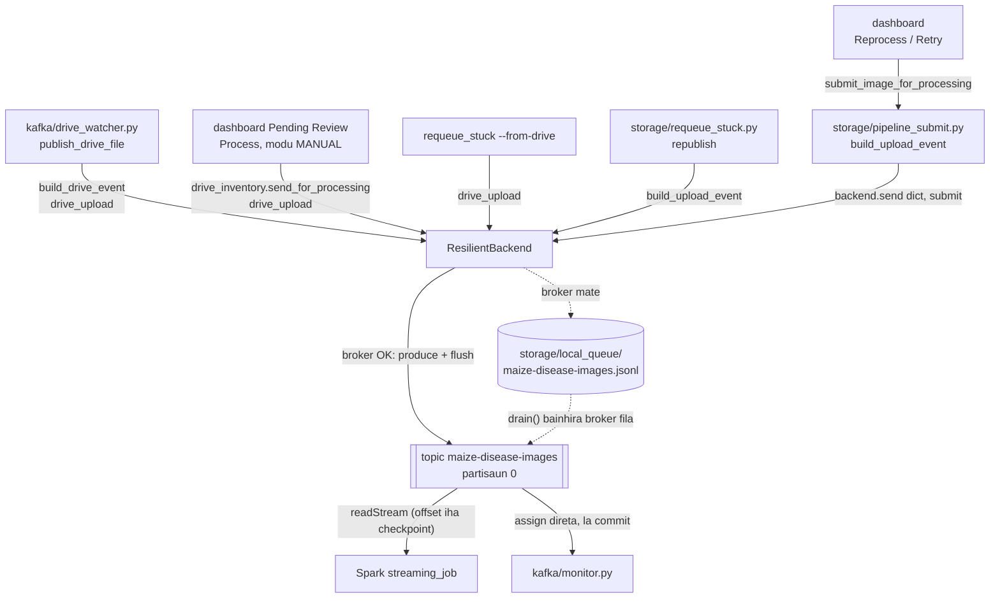
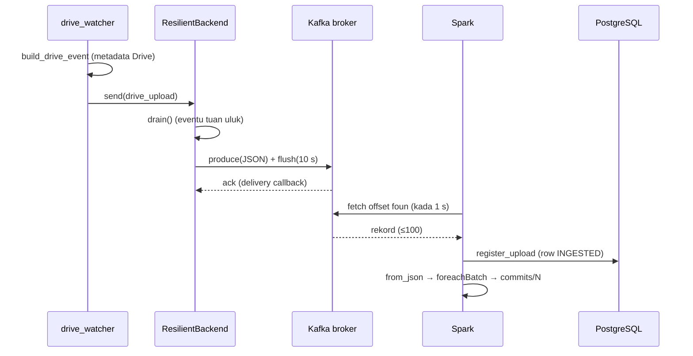

# 02 — Modulu Apache Kafka (Messaging)

*Sistema Crop Disease Early Warning System (EWS) — dokumentasaun téknika ba modulu Kafka. Fonte úniku: kódigu iha repozitóriu (commit `9ed46d4` + ajusta deep test, 2026-10-24). Kódigu hotu iha dokumentu ne'e mak kópia husi arkivu loloos, ho númeru liña. Password sira troka ho `***`.*

{{coverage kafka/config.py 1-31}}
{{coverage kafka/producer.py 1-275}}
{{coverage kafka/monitor.py 1-240}}
{{coverage storage/pipeline_submit.py 1-87}}
{{coverage storage/requeue_stuck.py 1-315}}
{{coverage storage/reset.py 106-133}}
{{coverage docker-compose.yml 18-50}}
{{coverage config/settings.py 59-68 195-203}}
{{coverage kafka/drive_watcher.py 95-162 265-320}}
{{coverage spark/streaming_job.py 83-114 168-171 364-373}}

## A. Introdusaun no Objetivu

Kafka mak **transporte mensajen** entre parte ne'ebé simu fotografia (Drive watcher, dashboard) no parte ne'ebé prosesa fotografia (Spark). Mensajen ida = **eventu** ida, JSON ki'ik (~300–700 bytes), tipu rua:

- **`drive_upload`** — fotografia **foun**, harii husi metadata arkivu Drive (`kafka/drive_watcher.build_drive_event`): `image_id`, na'in arkivu (`owner_email`), pasta (`folder_email`), naran, tipu, tamañu, hash, GPS, tempu. Drive watcher la iha base de dadus; Spark mak rejista fotografia.
- **`submit`** — fotografia ne'ebé **iha ona** base de dadus haruka fali (Reprocess, `requeue_stuck`), harii husi row (`storage/pipeline_submit.build_upload_event`): `image_id`, `user_id`, `location`, `image_path`, `drive_file_id`, `captured_at`, `uploaded_at`.

**Problema ne'ebé Kafka rezolve:**

- **Desakoplamentu (decoupling).** Watcher la presiza hein Spark, no la presiza base de dadus. Se Spark mate ka neineik, eventu sira hein iha topic.
- **Durabilidade.** Broker rai eventu iha disku (volume `kafka_data`), nune'e restart la lakon buat ida.
- **Replay.** Spark rai nia pozisaun (*offset*) iha checkpoint; depois restart nia kontinua husi ne'ebá.

**Prinsípiu *claim check*:** Kafka lori **referénsia** (`gdrive:<file id>`) no metadata de'it, nunka bytes imajen. Fotografia (2–12 MB) hela iha Google Drive.

**Saida mak la iha:** *cluster* Kafka ho broker barak la iha; broker ida (KRaft), partisaun ida, *replication* 1. *Producer* la *idempotent*. La iha *dead-letter topic* (eventu aat rai iha base de dadus).

## B. Arkivu Fonte Loloos

| Arkivu | Liña | Klase / funsaun | Papél |
|---|---|---|---|
| `docker-compose.yml` (servisu `kafka`) | 18–50 | — | Broker Kafka 3.7.0, modu KRaft, `localhost:9092` (laptop de'it) |
| `config/settings.py` | 59–68, 195–203 | `KAFKA_BOOTSTRAP_SERVERS`, `KAFKA_TOPIC`, `KAFKA_USE_LOCAL_FALLBACK`, `LOCAL_QUEUE_DIR`, `SCALABILITY_KAFKA_TOPIC` | Konfigurasaun |
| `kafka/config.py` | 31 | `bootstrap_address`, `broker_reachable` | Fonte ida ba konfigurasaun; kontrola broker |
| `kafka/producer.py` | 275 | `KafkaBackend`, `LocalFileBackend`, `ResilientBackend`, `get_backend` | Publika eventu (serializasaun JSON) |
| `storage/pipeline_submit.py` | 87 | `build_upload_event`, `NotResubmittable`, `is_upload_rejected`, `submit_image_for_processing` | Eventu `submit` (Reprocess / requeue): status INGESTED, publika |
| `kafka/monitor.py` | 240 | `describe`, `TestTopicSummary`, `Assigner`, `consumer_config`, `run` | *Consumer* lee-de'it ba janela EWS-KafkaMonitor |
| `storage/requeue_stuck.py` | 315 | `find_stuck`, `republish`, `process_inline`, `republish_from_drive`, … | Publika fali eventu ne'ebé "stuck", no fotografia Drive ne'ebé la iha row |
| `storage/reset.py` | 106–133 | `clear_kafka_topic` | Hamoos no kria fali topic |
| `kafka/drive_watcher.py` (parte Kafka) | 95–162, 265–320 | `build_drive_event`, `publish_drive_file`, `_publish_safely`, `main` | Produtór prinsipál (eventu `drive_upload`) |
| `spark/streaming_job.py` (parte Kafka) | 83–114, 168–171, 364–373 | `EVENT_SCHEMA`, `parse_events`, `run` | *Consumer* prinsipál (deserializasaun) |

**Dependénsia:** biblioteka `confluent-kafka` (`Producer`, `Consumer`, `AdminClient`, `KafkaException`). Projetu la uza `kafka-python` tanba pakote projetu naran `kafka/` sei kahur ho import `kafka` (`producer.py` liña 5–8).

## C. Arkitetura no Fluxu Ezekusaun



**Serializasaun (produtór):** `dict` Python → `json.dumps(message)` → `.encode("utf-8")` → bytes iha `value` rekord Kafka. La iha *key* (key = `null`), entaun broker hili partisaun; ho partisaun ida, orden hotu mantein.

**Deserializasaun (konsumidór):** Spark: `col("value").cast("string")` → `from_json(..., EVENT_SCHEMA)`. Monitor: `json.loads(value)`.

**Payload `drive_upload` (`build_drive_event`, fotografia foun):**

```json
{"kind": "drive_upload", "image_id": "3f2a9c1e-5b7d-4e2a-9f10-8c6d2b4a1e77", "user_id": null,
 "drive_file_id": "1AbCdEfGhIjKlMnOpQrStUvWxYz012345", "image_path": "gdrive:1AbCdEfGhIjKlMnOpQrStUvWxYz012345",
 "file_name": "3f2a9c1e-5b7d-4e2a-9f10-8c6d2b4a1e77.jpg", "mime_type": "image/jpeg", "size_bytes": "2417733",
 "owner_email": "farmer@example.com", "owner_name": "Farmer", "folder_email": "farmer@example.com",
 "uploaded_at": "2026-10-24T01:12:30.512Z", "captured_at": "2026-10-24T10:11:58+09:00", "location": " viqueque ",
 "original_filename": "IMG_0412.jpg", "content_hash": "9b1c...", "device_gps_lat": "-8.86", "device_gps_lon": "126.36"}
```

**Payload `submit` (`build_upload_event`, fotografia ne'ebé iha ona row):**

```json
{"kind": "submit", "image_id": "3f2a9c1e-5b7d-4e2a-9f10-8c6d2b4a1e77", "user_id": "7c1e0b3a-...", "location": "Viqueque",
 "image_path": "gdrive:1AbCdEfGhIjKlMnOpQrStUvWxYz012345", "drive_file_id": "1AbCdEfGhIjKlMnOpQrStUvWxYz012345",
 "captured_at": null, "uploaded_at": "2026-10-24T01:12:30.512000+00:00"}
```

*(Email, id no hash iha ezemplu ne'e la'ós dadus loloos.)*

**Partisaun no *consumer group*:**

| Konsumidór | Grupu | Rai pozisaun iha ne'ebé |
|---|---|---|
| Spark streaming (`streaming_job.run`) | la uza grupu | checkpoint Spark `offsets/N`, `commits/N` |
| `kafka/monitor.py` | `ews-kafka-monitor` | nunka (`enable.auto.commit: False`, *direct assignment*) |
| Teste eskalabilidade (motór `python`) | `scalability-test` | grupu Kafka, topic rasik `maize-disease-images-scalability-test` |

## D. Esplikasaun Kódigu ba Kódigu

### D.1 Broker no konfigurasaun

#### D.1.1 Servisu `kafka` iha `docker-compose.yml` (liña 18–50)

{{code docker-compose.yml 18-50}}

- Liña 20: imajen Docker ofisiál `apache/kafka:3.7.0`.
- Liña 22: `restart: unless-stopped` — Docker hahú fali broker se nia mate.
- Liña 23–31: porta 9092 laptop → 9092 kontentór, **laptop de'it** (*loopback*):
  - Komentáriu liña 24–26: Spark rejista fotografia foun ho konta Google ne'ebé eventu Kafka hateten, entaun ema seluk iha rede hanesan la bele publika ba topic.
  - Liña 30–31: enderesu *loopback* rua — `127.0.0.1` (IPv4) no `[::1]` (IPv6). Komentáriu liña 26–29: `localhost` iha Windows buka `::1` uluk; ho IPv4 de'it, kliente lakon ~2 s kada koneksaun no dala barak falla kontrola metadata 3 s. Deep test 2026-10-24 sukat: antes 8/15 koneksaun susesu, depois 15/15 ho ~0.08 s.
- Liña 34–35: **KRaft** — node ida mak *broker* no *controller* (la presiza ZooKeeper).
- Liña 36: *listener* tolu: `PLAINTEXT` (29092, laran Docker), `CONTROLLER` (29093), `PLAINTEXT_HOST` (9092, husi laptop).
- Liña 39: *advertised listener* — broker hateten ba kliente atu liga ba `localhost:9092`.
- Liña 41: protokolu `PLAINTEXT` (la iha TLS/SASL; broker la nakloke ba rede).
- Liña 43: `KAFKA_OFFSETS_TOPIC_REPLICATION_FACTOR: 1` — tanba broker ida de'it.
- Liña 44: `CLUSTER_ID` fiksu ba KRaft.
- Liña 47–50: log Kafka (dadus topic) iha volume `kafka_data`, sobrevive `docker compose down`.
- **La konfigura (default broker):** partisaun 1 kada topic, *retention* loron 7, `message.max.bytes` ~1 MB, topic kria automátiku.

#### D.1.2 Konfigurasaun Kafka iha `config/settings.py` (liña 59–68)

{{code config/settings.py 59-68}}

- `KAFKA_BOOTSTRAP_SERVERS` — default `localhost:9092`.
- `KAFKA_TOPIC` — `maize-disease-images`.
- `KAFKA_USE_LOCAL_FALLBACK` — `true`: bainhira broker mate, eventu rai iha arkivu lokál (D.3.5). `.lower() == "true"` troka testu ba `bool`.
- `LOCAL_QUEUE_DIR` — `storage/local_queue`.

#### D.1.3 Topic teste eskalabilidade (liña 195–203)

{{code config/settings.py 195-203}}

- Teste eskalabilidade iha nia topic **rasik** no grupu rasik, nune'e nunka kahur ho fotografia agrikultór.

### D.2 `kafka/config.py` — fonte ida no kontrola broker (liña 1–31)

{{code kafka/config.py 1-31}}

- Liña 4–9: *re-export* — módulu Kafka hotu lee husi fatin ida. `# noqa: F401` hamate avizu "import la uza".
- `bootstrap_address()` (liña 12–21):
  - Liña 16: foti broker uluk (`split(",")[0]`).
  - Liña 17: hasai prefiksu `PLAINTEXT://`.
  - Liña 18: `rpartition(":")` fahe `host` no `port` husi kuana.
  - Liña 19–20: la iha porta → `9092`.
  - Liña 21: `strip("[]")` ba IPv6; `int(port)`. **Valór retorna:** `(host, port)`.
- `broker_reachable(timeout)` (liña 24–31): koko liga TCP (`socket.create_connection`). Susesu → `True`; `OSError` → `False`. Kontrola lalais, la'ós protokolu Kafka.

### D.3 `kafka/producer.py` — publika eventu

#### D.3.1 Docstring, import no `_parse_lines` (liña 1–44)

{{code kafka/producer.py 1-44}}

- Liña 5–8: tanba sa `confluent-kafka`: pakote projetu `kafka/` sei subar `kafka-python`.
- Liña 10–13: arkivu lokál mak *fallback infraestrutura* de'it; eventu sempre loloos, nunka invente.
- Liña 24: kria pasta `storage/local_queue` bainhira import.
- Liña 29: `_APPEND_LOCK` — *thread* ida de'it hakerek ba arkivu fila iha tempu ida (liña la kahur).
- `_parse_lines(lines)` (liña 32–44): lee arkivu JSON-lines. Liña mamuk skip; liña JSON aat (prosesu mate iha klaran hakerek) rai iha `bad`, la halo arkivu tomak la bele lee. **Valór retorna:** `(messages, bad)`.

#### D.3.2 `KafkaBackend` — konstrutór no `send` (liña 47–83)

{{code kafka/producer.py 47-83}}

- **Klase** ho `__init__` (konstrutór):
  - Liña 49: import `Producer` iha laran (biblioteka todan uitoan).
  - Liña 50: atributu `topic`.
  - Liña 51: atributu `_producer` — `confluent_kafka.Producer` ho `bootstrap.servers`. librdkafka liga ho neineik (*lazy*).
  - Liña 54: `list_topics(timeout=3)` — pedidu metadata. Broker la responde iha 3 s → `KafkaException`, konstrutór falla. La ho ida ne'e, `Producer()` susesu maske broker la iha, no mensajen hein ho silénsiu.
- **Métodu `send(message)`** — publikasaun **sinkronu ho konfirmasaun**:
  - Liña 65–69: `_on_delivery(err, _msg)` — *callback* ne'ebé librdkafka bolu bainhira broker fó *ack* ka erru; rai erru iha lista.
  - Liña 71–75: `produce(topic, value, callback=...)` — **serializasaun**: `json.dumps(message).encode("utf-8")`. `produce` tau de'it iha fila lokál.
  - Liña 76: `flush(timeout=10)` — hein to'o mensajen hotu entrega (ka 10 s). Fila númeru mensajen ne'ebé sei iha fila.
  - Liña 77–81: sei iha mensajen → `KafkaException` (broker la responde).
  - Liña 82–83: *callback* fó erru → `KafkaException`.
  - **Tanba sa importante:** uluk, broker mate depois konstrutór halo `send` fila ho di'ak maibé eventu la to'o — fotografia hela INGESTED maibé nunka prosesa (komentáriu liña 57–63).

#### D.3.3 `KafkaBackend.send_many` (liña 85–113)

{{code kafka/producer.py 85-113}}

- Ba teste eskalabilidade: publika eventu barak ho `flush` **dala ida** iha ikus.
- Liña 92–98: `_callback(index)` — *closure* ne'ebé lembra `index`; rai iha `failed` ka `acked`.
- Liña 100–108: kada mensajen: `produce`; `BufferError` (fila lokál nakonu) → `poll(0.5)` hodi entrega uitoan, depois koko fali. `poll(0)` halai *callback* sira.
- Liña 109: `flush(timeout)`.
- Liña 110–112: mensajen la iha *ack* no la iha erru → "not acknowledged".
- **Valór retorna:** `{index: erru}`; `{}` = entrega hotu.

#### D.3.4 `LocalFileBackend` (liña 116–128)

{{code kafka/producer.py 116-128}}

- Atributu `path` = `storage/local_queue/<topic>.jsonl`.
- `send`: hakerek JSON ida kada liña (modu `"a"` = *append*), ho `_APPEND_LOCK`.
- **Spark la lee arkivu ne'e.** Eventu to'o Spark de'it bainhira `ResilientBackend.drain()` haruka ba Kafka.
- *Limitasaun:* la iha `fsync`; korrente mate iha momentu ida-ne'e bele lakon liña ikus.

#### D.3.5 `ResilientBackend` — konstrutór, `_connect`, `_lost_kafka`, `send` (liña 131–186)

{{code kafka/producer.py 131-186}}

- **Objetivu** (docstring liña 132–142): hili Kafka ka arkivu **kada `send`**, la'ós dala ida iha hahú. Uluk, se Kafka mate iha hahú, prosesu hela iha arkivu ba nafatin no fotografia nunka analiza.
- Liña 144: `RETRY_SECONDS = 30` — atributu klase.
- Liña 146–151 `__init__`: kompozisaun — iha `LocalFileBackend` (`_local`) no `KafkaBackend` ka `None` (`_kafka`); `_next_attempt` (tempu `monotonic`); koko liga dala ida.
- `_connect` (liña 153–166): liga ona → fila; seidauk to'o tempu koko fali → `None`; koko kria `KafkaBackend`; falla → koko fali iha 30 s.
- `_lost_kafka` (liña 168–171): hamosu koneksaun no hein 30 s.
- `send` (liña 173–186): (1) Kafka iha → `drain()` uluk (eventu tuan ba uluk, orden mantein); (2) se `drain` la lakon Kafka, `kafka.send`; (3) erru → `_lost_kafka` no hakerek ba arkivu. Eventu **nunka lakon**: ba Kafka ka ba arkivu.

#### D.3.6 `_claim_files` (liña 188–216)

{{code kafka/producer.py 188-216}}

- Prosesu rua (watcher no dashboard) uza arkivu hanesan. **Rename mak *lock*:** `os.replace(src, dst)` ba naran foun `.draining-<uuid>` mak atómiku; ida de'it mak susesu.
- Liña 190: `ORPHAN_CLAIM_SECONDS = 600` — arkivu `.draining-*` tuan liu 10 min = prosesu mate iha klaran; foti fali.
- Liña 212: `os.utime(dst)` rai tempu *claim*.
- **Valór retorna:** lista arkivu ne'ebé prosesu ne'e kaer.

#### D.3.7 `drain` (liña 218–268)

{{code kafka/producer.py 218-268}}

- Liña 228–230: Kafka la iha → `0`.
- Liña 233–239: kada arkivu kaer: lee ho `_parse_lines`.
- Liña 240–244: liña aat → arkivu `.corrupt` (la blokeia seluk).
- Liña 246–249: haruka mensajen ida-idak ba Kafka.
- Liña 250–263: erru iha klaran → **tau fali** mensajen seidauk haruka ba arkivu fila, no arkivu seluk ne'ebé seidauk lee; depois `_lost_kafka`. Nada lakon (maximu balun haruka dala rua; Spark skip COMPLETED).
- Liña 264–265: susesu → hamoos arkivu.
- **Valór retorna:** númeru eventu haruka.

#### D.3.8 `get_backend` (liña 271–275)

{{code kafka/producer.py 271-275}}

- *Factory*: `KAFKA_USE_LOCAL_FALLBACK` true → `ResilientBackend`; false → `KafkaBackend` (broker mate = erru klaru, la iha arkivu).
- **Polimorfizmu (*duck typing*):** klase tolu hotu iha métodu `send(message)`; kliente (`submit_image_for_processing`) bolu `backend.send(...)` la hatene klase saida.

### D.4 `storage/pipeline_submit.py` — estrutura eventu no publika

#### D.4.1 Docstring no import (liña 1–15)

{{code storage/pipeline_submit.py 1-15}}

- Liña 2–5: arkivu ne'e haruka fali fotografia ne'ebé **iha ona** base de dadus: Reprocess / Retry fotografia FAILED iha dashboard, no `storage/requeue_stuck`. Nia publika eventu `"submit"` no marka row INGESTED.
- Liña 7–9: fotografia **foun** la liu iha ne'e: Drive watcher (no botaun Process iha Pending Review, modu MANUAL) publika eventu `"drive_upload"` husi metadata Drive, no Spark mak kria row (`spark/ingestion.py`).
- Liña 12–15: `ProcessingStatus`, `now_utc`; `is_drive_path`/`drive_file_id_from_path` (troka `gdrive:<id>` ↔ id); `KAFKA_TOPIC`; `get_backend`.

#### D.4.2 `build_upload_event` — *payload* `submit` (liña 18–37)

{{code storage/pipeline_submit.py 18-37}}

- **Parámetru:** `image` (objetu ORM `Image`). **Valór retorna:** `dict` ho xave 8 — ne'e mak **estrutura payload** eventu `submit`.
- Liña 29: `"kind": "submit"` — fotografia ne'ebé iha ona row; Spark la rejista fali, no `parse_events` obriga `user_id`.
- Liña 34: `drive_file_id`: id Drive husi `gdrive:<id>`, ka `None` ba imajen lokál.
- Liña 35–36: `captured_at`/`uploaded_at`: `.isoformat()` troka `datetime` ba testu ISO-8601 (Spark `to_timestamp` no Python `fromisoformat` lee).
- **Harii husi row base de dadus**, nune'e dashboard no `requeue_stuck` publika eventu **hanesan**.
- La iha bytes imajen (*claim check*).

#### D.4.3 Guarda upload rejeitadu (liña 40–53)

{{code storage/pipeline_submit.py 40-53}}

- `UPLOAD_REJECTED_PREFIX = "Upload rejected: "` — Spark nia pasu *ingestion* (`spark/ingestion.register_upload`) tau prefiksu ne'e ba upload ne'ebé nia rejeita (konta la ativu, pasta la loos, naran/tipu/tamañu).
- `NotResubmittable(ValueError)` — esesaun (herança husi `ValueError`).
- `is_upload_rejected(image)` — `True` se FAILED **no** erru hahú ho prefiksu.

#### D.4.4 `submit_image_for_processing` (liña 56–87)

{{code storage/pipeline_submit.py 56-87}}

- Liña 68–69: upload rejeitadu → `NotResubmittable` (dashboard la bele liu kontrola Spark nian).
- Liña 70: `backend` default `get_backend(KAFKA_TOPIC)`.
- Liña 76–78: fotografia **FAILED** → **INGESTED**, hamoos erru (ne'e mak "Reprocess"). Status seluk la muda.
- Liña 79: `ingested_at = now`.
- Liña 80: **commit MOLOK publika.** Se publika uluk, Spark bele hotu (COMPLETED) molok commit ne'e, no commit sei troka fali ba INGESTED.
- Liña 81–82: `backend.send(build_upload_event(image))`.
- Liña 83–87: falla → FAILED `"Kafka publish failed: ..."`, commit, no hasai fali esesaun ba kliente.

### D.5 Produtór prinsipál: `kafka/drive_watcher.py` (parte Kafka)

Watcher **la iha base de dadus** (*stateless*): nia lee metadata Drive no publika eventu `drive_upload` ba Kafka de'it. Spark mak rejista fotografia (01_spark_module, D.6).

#### D.5.1 `build_drive_event` — *payload* `drive_upload` (liña 95–126)

{{code kafka/drive_watcher.py 95-126}}

- **Parámetru:** `meta` (metadata arkivu Drive), `folder_email` (email pasta `images/<email>/` ne'ebé arkivu iha). **Valór retorna:** `dict` ho xave 18.
- Liña 97–99: watcher, botaun dashboard "Process" no `requeue_stuck --from-drive` uza funsaun ida ne'e, nune'e dalan tolu publika eventu **hanesan**.
- Liña 99–100: valór hotu `str` ka `None`, tanba `EVENT_SCHEMA` Spark lee hotu hanesan testu.
- Liña 101–106: `appProperties` (aplikasaun Android tau: `image_id`, `location`, tempu, GPS), na'in arkivu, id arkivu, `captured_at`, GPS telefone.
- Liña 108: `"kind": "drive_upload"`.
- Liña 110: `user_id` = `None` — Spark buka husi `owner_email`.
- Liña 116–118: `owner_email`/`owner_name` husi **Google** (na'in arkivu, la'ós telefone), no `folder_email`. Spark kompara rua ne'e (pasta agrikultór rasik).
- Liña 119: `uploaded_at` = `createdTime` Drive (relójiu Google).
- Liña 121: `location` hanesan telefone haruka; Spark limpa.
- Liña 123: `content_hash` = `sha256Checksum` Drive.
- Liña 124–125: GPS telefone (válidu de'it; D.1 iha 03_google_drive_module).

#### D.5.2 `publish_drive_file` no `_publish_safely` (liña 129–162)

{{code kafka/drive_watcher.py 129-162}}

- `publish_drive_file` (liña 129–148):
  - Liña 135–136: arkivu ne'e publika ona iha prosesu ne'e (`_PUBLISHED`) → `"already_published"`.
  - Liña 137–140: modu MANUAL → la haruka buat ida (`"held"`). Dashboard Pending Review lista fotografia direta husi Drive.
  - Liña 141–142: harii eventu no `backend.send(event)`.
  - Liña 143–145: rai id arkivu iha `_PUBLISHED` (`OrderedDict` ho limite 20000; tuan liu sai uluk). Ne'e la'ós kontrola duplikadu loloos — Spark mak halo.
  - Liña 146–148: liña konsola no `"published"`.
- `_publish_safely` (liña 151–162): bolu `publish_drive_file` maibé **nunka hasai esesaun**. Arkivu ida ne'ebé la bele haruka (Kafka mate no *fallback* off) la bele hapara *scan* — se lae *bookmark* change feed sei la muda. *Scan* 10 min ka `requeue_stuck --from-drive` haruka fali depois; arkivu ne'e la tama `_PUBLISHED`.

#### D.5.3 `main` — backend ida no `drain` kada volta (liña 265–320)

{{code kafka/drive_watcher.py 265-320}}

- Liña 270–271: kria **backend ida** ba prosesu tomak (`ResilientBackend` iha default).
- Liña 272–278: `--once` — *scan* ida no remata.
- Liña 289–290: kada volta, `backend.drain()` — eventu ne'ebé tama arkivu lokál bainhira Kafka mate haruka ba Kafka, maske la iha fotografia foun. `hasattr` tanba `KafkaBackend` la iha `drain`.
- Liña 291–299: buka fotografia foun (*change feed*, no *scan* tomak kada 10 min; detalle iha 03_google_drive_module).
- Liña 307–312: *bookmark* lakon (*factory reset*) → hamoos `_PUBLISHED` no hahú fali.
- Liña 313–314: erru rede → kontinua.
- Liña 315–316: intervalu adaptativu (1 s → 3 s).

### D.6 Konsumidór prinsipál: `spark/streaming_job.py` (parte Kafka)

#### D.6.1 *Schema* deserializasaun (liña 83–114)

{{code spark/streaming_job.py 83-114}}

- `CHECKPOINT_DIR` — fatin Spark rai *offset* (la'ós grupu Kafka).
- `EVENT_SCHEMA` — kontratu deserializasaun: koluna 19, hotu `StringType`. Xave `build_drive_event` (`drive_upload`) no `build_upload_event` (`submit`) hotu iha ne'e (+ `run_id`). Xave ne'ebé eventu ida la iha → `null`.

#### D.6.2 Deserializasaun (liña 168–171)

{{code spark/streaming_job.py 168-171}}

- `value` (bytes) → `cast("string")` → `from_json(..., EVENT_SCHEMA)` → koluna. JSON aat → `null` (la halo query mate).

#### D.6.3 Fonte Kafka (liña 364–373)

{{code spark/streaming_job.py 364-373}}

- `subscribe` topic; `startingOffsets = "earliest"` (de'it bainhira checkpoint la iha); `maxOffsetsPerTrigger = 100` (batch máximu eventu 100).
- Spark la uza *consumer group* ba pozisaun: nia hakerek `offsets/N` molok batch no `commits/N` depois batch.

### D.7 `kafka/monitor.py` — konsumidór lee-de'it

#### D.7.1 Docstring no konstante (liña 1–38)

{{code kafka/monitor.py 1-38}}

- Janela EWS-KafkaMonitor: liña ida kada eventu fotografia agrikultór; rezumu kada segundu ba topic teste.
- **Lee-de'it** (liña 11–16): grupu rasik, nunka *commit*, hahú iha mensajen foun liu. Nia la bele muda, hanetik ka foti eventu.
- `GROUP_ID = "ews-kafka-monitor"`; `_say` hakerek ho tempu.

#### D.7.2 `describe` — deserializa no hatudu (liña 41–61)

{{code kafka/monitor.py 41-61}}

- `json.loads(value)`; JSON aat → "unreadable message".
- Liña 55–57: agrikultór — `owner_email` (eventu `drive_upload`) ka naran husi `user_id` (`farmer_label`, eventu `submit`).
- Liña 58: `"new photo"` ba `drive_upload`, `"photo sent again"` ba `submit`.
- Hatudu partisaun, *offset*, `image_id` (8 karakter), agrikultór, fatin, tempu upload (hora Timor) no fonte.

#### D.7.3 `TestTopicSummary` (liña 64–103)

{{code kafka/monitor.py 64-103}}

- **Klase** ho `__init__`: atributu `runs` (`Counter`), `first`/`last` (*offset*), `total`, `end_offset`.
- `add`: konta eventu kada `run_id` no rai *offset* minimu/máximu.
- `line`: liña rezumu; motór `spark` rai pozisaun iha checkpoint, motór `python` iha grupu Kafka. Hamoos kontajen depois.

#### D.7.4 `test_consumer_position` (liña 106–117)

{{code kafka/monitor.py 106-117}}

- `AdminClient.list_consumer_group_offsets` — **lee** *offset* grupu `scalability-test` (soma partisaun); nunka muda.

#### D.7.5 `Assigner` — *direct assignment* (liña 120–156)

{{code kafka/monitor.py 120-156}}

- La tama *consumer group* (la iha *rebalance*, la rai pozisaun).
- `refresh`: `list_topics` → kada partisaun foun: `TopicPartition(topic, partition, start)`; `OFFSET_END` (foun liu) iha hahú, ka `OFFSET_BEGINNING` ho `--from-start` ka ba topic ne'ebé mosu depois. `incremental_assign(new)`.
- `missing`: topic seidauk iha.

#### D.7.6 `consumer_config` (liña 159–169)

{{code kafka/monitor.py 159-169}}

- `group.id` rasik, `enable.auto.commit: False` (nunka rai pozisaun), `auto.offset.reset`, no `topic.metadata.refresh.interval.ms: 5000` (haree topic foun iha segundu 5).

#### D.7.7 `run` — *poll loop* (liña 172–225)

{{code kafka/monitor.py 172-225}}

- Liña 175–177: títulu janela Windows.
- Liña 178–180: hein to'o broker iha.
- Liña 182–184: `Consumer`, `Assigner`, `AdminClient`.
- Liña 195–221: `poll(0.25)`; kada 3 s buka topic foun; kada segundu rezumu teste; minutu ida la iha eventu → liña "no new events"; erru `_PARTITION_EOF`/`UNKNOWN_TOPIC_OR_PART` ignora; topic teste → rezumu; topic agrikultór → `describe`.
- Liña 224–225: `finally` `consumer.close()`.

#### D.7.8 `main` (liña 228–240)

{{code kafka/monitor.py 228-240}}

- Opsaun `--from-start` no `--live-only`; `reconfigure(encoding="utf-8")` ba karakter hanesan "—".

### D.8 `storage/requeue_stuck.py` — publika fali eventu

#### D.8.1 Docstring no import (liña 1–61)

{{code storage/requeue_stuck.py 1-61}}

- Problema: imajen INGESTED maibé Spark la iha (mate) ka topic hamoos → eventu la iha ona iha Kafka.
- Modu rua: *default* publika fali ba Kafka; `--inline` prosesa iha prosesu ne'e (la iha broker, la iha Spark).
- Liña 28–35: row ne'ebé toka: INGESTED, PROCESSING, COMPLETED ne'ebé rezultadu la to'o Drive, no (ho `--include-failed`) FAILED tanba transporte.
- Liña 45–48: base de dadus iha row de'it ba fotografia ne'ebé Spark rejista. Fotografia ne'ebé nia eventu `drive_upload` la to'o Spark → `--from-drive` (Drive menus base de dadus).
- Liña 61: uza `build_upload_event` — eventu `submit` hanesan dashboard.

#### D.8.2 Status no kondisaun (liña 63–91)

{{code storage/requeue_stuck.py 63-91}}

- `STUCK_STATUSES` — INGESTED, PROCESSING.
- `_RETRYABLE_FAILURE_MARKERS` — FAILED tanba transporte (ezemplu "Kafka publish failed"), la'ós tanba imajen.
- `result_not_delivered()` — kondisaun SQL: COMPLETED, `result_published_at` mamuk, imajen Drive.
- `_not_scale_test()` — hasai imajen teste.

#### D.8.3 `find_stuck` no `count_owed` (liña 94–125)

{{code storage/requeue_stuck.py 94-125}}

- *Query* filter iha base de dadus (`or_(*eligible)`), depois filter idade (default 120 s) iha Python; COMPLETED uza `processed_at`. SQLite *naive* → tau `tzinfo`.
- `count_owed` — kontajen ba dashboard System Status.

#### D.8.4 `_mark_failed` no `rebase_paths` (liña 127–157)

{{code storage/requeue_stuck.py 127-157}}

- `_mark_failed` — FAILED ho mensajen.
- `rebase_paths` — imajen lokál tuan: hakerek fali dalan iha forma relativu; imajen Drive skip.

#### D.8.5 `republish` (liña 160–187)

{{code storage/requeue_stuck.py 160-187}}

- `get_backend` → kada imajen: imajen lokál ne'ebé arkivu la iha → FAILED; se lae `backend.send(build_upload_event(img))`.
- La reseta status (diferente ho `submit_image_for_processing`); Spark `mark_processing` mak muda.
- Seguru haruka fali: `persist_result` delete-then-insert; Drive update iha fatin.

#### D.8.6 `process_inline` (liña 190–226)

{{code storage/requeue_stuck.py 190-226}}

- Prosesa la ho Kafka: `process_event`, `persist_result`, `publish_result_to_drive_safely` hanesan Spark, maibé sekuensiál.

#### D.8.7 `republish_from_drive` (liña 229–250)

{{code storage/requeue_stuck.py 229-250}}

- `drive_inventory.unprocessed_photos(session)` — fotografia iha pasta agrikultór `images/<email>/` ne'ebé la iha row `images` (eventu lakon, ka upload iha modu MANUAL no seidauk haruka).
- La iha → "Every photo ... is registered".
- `--dry-run` → lista de'it.
- `send_for_processing(photos, get_backend(...))` — publika eventu `drive_upload` (`build_drive_event`) ba kada fotografia; fila `(sent, failed)`.

#### D.8.8 `main` (liña 253–315)

{{code storage/requeue_stuck.py 253-315}}

- Opsaun `--older-than`, `--all`, `--include-failed`, `--inline`, `--dry-run`, `--from-drive`.
- Liña 271: `init_db()`.
- Liña 273–275: `--from-drive` → `republish_from_drive` no remata.
- Liña 277–311: buka row "stuck", hatudu lista, `rebase_paths`, depois `process_inline` ka `republish`.

### D.9 `storage/reset.py` — `clear_kafka_topic` (liña 106–133)

{{code storage/reset.py 106-133}}

- `AdminClient`: buka topic no nia númeru partisaun (default 1).
- `delete_topics(...)[topic].result()` — hamoos topic.
- Hamoos halo *asynchronous*; `create_topics([NewTopic(topic, partitions, 1)])` koko fali kada segundu to'o broker aseita ("marked for deletion"). `NewTopic(..., 1)` = *replication factor* 1.
- Nunka hasai esesaun: fila testu status (broker mate la blokeia *reset*).
- **Importante:** *reset* hamoos topic **no** checkpoint Spark hamutuk; se lae, checkpoint aponta ba *offset* ne'ebé la iha ona no `failOnDataLoss` hapara query.

## E. Análize OOP

| Konseitu | Iha kódigu? | Ezemplu loloos |
|---|---|---|
| **Klase no objetu** | Sim | `KafkaBackend`, `LocalFileBackend`, `ResilientBackend` (`producer.py`); `TestTopicSummary`, `Assigner` (`monitor.py`); `NotResubmittable` (`pipeline_submit.py`); objetu `OrderedDict` `_PUBLISHED` (`drive_watcher.py`). |
| **`__init__` / konstrutór** | Sim | `KafkaBackend.__init__` kria `Producer` no kontrola broker; `ResilientBackend.__init__` kria `LocalFileBackend` no koko liga; `Assigner.__init__`, `TestTopicSummary.__init__`. |
| **Atributu** | Sim | Objetu: `topic`, `_producer`, `path`, `_local`, `_kafka`, `_next_attempt`, `assigned`, `runs`. Klase: `RETRY_SECONDS`, `ORPHAN_CLAIM_SECONDS`. |
| **Métodu** | Sim | `send`, `send_many`, `drain`, `_claim_files`, `_connect`, `_lost_kafka`, `refresh`, `missing`, `add`, `line`. |
| **Enkapsulamentu** | Konvensaun | `_producer`, `_kafka`, `_local`, `_connect` (prefiksu `_` = interna). Kliente uza `send`/`drain` de'it. |
| **Herança** | Uitoan | `NotResubmittable(ValueError)`. Backend tolu **la** herda husi klase baze komún. |
| **Polimorfizmu** | Sim, *duck typing* | Backend tolu hotu iha `send(message)`; `submit_image_for_processing` bolu `backend.send` la hatene klase. `hasattr(backend, "drain")` iha watcher. |
| **Abstrasaun** | Sim | `get_backend` subar klase saida mak uza; `ResilientBackend` subar Kafka vs arkivu. |
| **Kompozisaun** | Sim | `ResilientBackend` **iha** `LocalFileBackend` no `KafkaBackend`; `KafkaBackend` **iha** `Producer`; `Assigner` **iha** `Consumer`. |
| **Padraun dezeñu** | Sim | *Factory* (`get_backend`), *Strategy* (backend troka), *Fallback / Circuit breaker* simples (`RETRY_SECONDS`), *Store-and-forward* (arkivu + `drain`), *Claim check* (`gdrive:<id>`), *Callback* (`_on_delivery`), *Closure* (`_callback(index)`). |

**La implementa:** klase abstrata (`abc.ABC`) ba backend la iha.

## F. Integrasaun

| Husi | Ba | Dadus | Oinsá |
|---|---|---|---|
| Drive watcher | Kafka | eventu `drive_upload` (metadata Drive) | `build_drive_event` → `ResilientBackend.send` |
| Dashboard Pending Review (Process, MANUAL) | Kafka | eventu `drive_upload` hanesan | `drive_inventory.send_for_processing` |
| Dashboard (Reprocess/Retry) | Kafka | eventu `submit` | `submit_image_for_processing` |
| `requeue_stuck` | Kafka | `submit`; `drive_upload` ho `--from-drive` | `build_upload_event` / `send_for_processing` → `backend.send` |
| Kafka | Spark | rekord JSON | `readStream.format("kafka")`, `from_json` |
| Kafka | Monitor | rekord JSON | `Consumer.incremental_assign`, `json.loads` |
| Teste eskalabilidade | topic rasik | eventu teste | `KafkaBackend.send_many` |
| Factory reset | Kafka | — | `AdminClient.delete_topics` / `create_topics` |



## G. Tratamentu Erru no Konfiabilidade

| Situasaun | Kódigu | Rezultadu |
|---|---|---|
| Broker mate bainhira kria backend | `KafkaBackend.__init__` `list_topics(timeout=3)` | `ResilientBackend` uza arkivu, koko fali iha 30 s |
| Broker mate depois | `send`: `flush` fila > 0 ka *callback* erru | `KafkaException` → `_lost_kafka` → arkivu |
| Fallback off | `get_backend` → `KafkaBackend` | watcher: `_publish_safely` hakerek erru, *scan* kontinua (*scan* 10 min / `--from-drive` haruka fali); Reprocess: FAILED "Kafka publish failed" |
| Prosesu rua drain hamutuk | `_claim_files` (rename atómiku) | ida de'it haruka |
| Prosesu mate iha klaran drain | `ORPHAN_CLAIM_SECONDS` | arkivu `.draining-*` foti fali depois 10 min |
| Liña JSON aat iha arkivu | `_parse_lines` | ba `.corrupt` |
| Spark mate | eventu hela iha topic; checkpoint | restart kontinua |
| Eventu lakon (topic hamoos) | `requeue_stuck`, `requeue_stuck --from-drive` | publika fali husi base de dadus; fotografia ne'ebé la iha row: husi Drive |
| Watcher haree arkivu dala rua (change feed + scan) | `_PUBLISHED`; Spark `register_upload` | haruka dala ida; se haruka dala rua, Spark skip ("duplicate") |
| `localhost` buka IPv6 uluk (Windows) | `docker-compose.yml` porta `[::1]:9092` | koneksaun ~0.08 s, la falla (hadi'a 2026-10-24) |
| Eventu duplikadu | producer la *idempotent* | Spark absorve (`replay_state`, delete-then-insert) |

**Garantia:** *at-least-once* husi produtór (flush + callback; arkivu bele haruka dala rua) no husi Spark. **Limitasaun:** broker ida no partisaun ida (la iha *fault tolerance* broker, konsumidór paralelu la iha); la iha TLS; la iha *dead-letter topic*; arkivu fila la `fsync`.

## H. Rezumu no Pergunta Akadémiku

**Rezumu.** Kafka lori eventu JSON ki'ik husi watcher/dashboard ba Spark iha topic `maize-disease-images` (broker KRaft ida, partisaun ida, laptop de'it). Fotografia foun = eventu `drive_upload` harii husi metadata Drive (watcher la iha base de dadus); fotografia ne'ebé iha ona row = eventu `submit` harii husi row. Produtór publika ho konfirmasaun (`produce` + `flush` + *callback*); bainhira broker mate, `ResilientBackend` rai eventu iha arkivu JSON-lines no haruka fali automátiku. Spark lee ho Structured Streaming no rai pozisaun iha checkpoint rasik; monitor lee-de'it la ho *commit*.

**P1. Tanba sa la haruka imajen iha Kafka?**
> Fotografia 2–12 MB; limite default mensajen Kafka ~1 MB, no binary boot iha log aumenta kustu. Padraun *claim check*: eventu lori `image_path = "gdrive:<file id>"` no Spark foti bytes husi Drive.

**P2. Oinsá ita hatene eventu to'o broker?**
> `KafkaBackend.send` hein `flush(timeout=10)` no kontrola *delivery callback*. Fila > 0 ka erru → `KafkaException`, no imajen FAILED ka eventu ba arkivu.

**P3. Tanba sa commit INGESTED molok publika?**
> Se publika uluk, Spark bele hakerek COMPLETED molok commit, no commit sei troka fali ba INGESTED (`pipeline_submit.py` liña 71–80). Ne'e ba eventu `submit` (Reprocess). Fotografia foun seidauk iha row; Spark rejista no prosesa iha thread hanesan.

**P4. Spark uza *consumer group* ka?**
> Lae. Fonte Kafka Spark hili partisaun rasik no rai *offset* iha `offsets/N` / `commits/N` checkpoint. Monitor uza `group.id` tanba librdkafka obriga, maibé nia uza *direct assignment* no nunka commit.

**P5. Saida mak akontese bainhira broker mate?**
> `ResilientBackend.send` la bele liga (3 s), entaun eventu ba `storage/local_queue/maize-disease-images.jsonl`. Watcher bolu `drain()` kada volta; bainhira broker fila, arkivu haruka uluk (orden mantein). Rename atómiku prevene prosesu rua haruka hanesan.

**P6. Pipeline ne'e *exactly-once* ka?**
> Lae. Produtór la *idempotent* no arkivu bele haruka dala rua: *at-least-once*. Spark halo efeitu dala ida kada `image_id` (`replay_state`, delete-then-insert).

**P7. Orden eventu mantein ka?**
> Iha partisaun ida, sim — Kafka mantein orden iha partisaun. `drain()` haruka eventu tuan molok foun. Ho partisaun barak, presiza *key* (ezemplu `user_id`) ba orden kada agrikultór; ne'e seidauk implementa.

**P8. Oinsá eskala?**
> Partisaun barak ho *key* `user_id`, *replication* 3 iha broker barak, *producer* `enable.idempotence=true`, no Spark iha *cluster*. Konfigurasaun atuál mak broker ida (`docker-compose.yml`).

**P9. Tanba sa *factory reset* hamoos topic no checkpoint hamutuk?**
> Checkpoint aponta ba *offset* topic. Se topic hamoos maibé checkpoint hela, *offset* la iha ona no Spark hapara (`failOnDataLoss`). `clear_kafka_topic` kria fali topic mamuk ho partisaun hanesan.

**P10. Tanba sa eventu tipu rua (`drive_upload` no `submit`)?**
> Fotografia foun seidauk iha row: eventu tenke lori buat hotu Spark presiza atu rejista (na'in Drive, pasta, naran, tipu, tamañu, hash). Fotografia ne'ebé iha ona row presiza `image_id` + `user_id` de'it. `parse_events` obriga `owner_email` ba `drive_upload` no `user_id` ba `submit`.

**P11. Monitor bele hanetik Spark ka?**
> Lae. Nia grupu rasik, `enable.auto.commit: False`, *direct assignment*, no lee de'it. Spark la uza grupu Kafka, entaun monitor la muda nia pozisaun.
