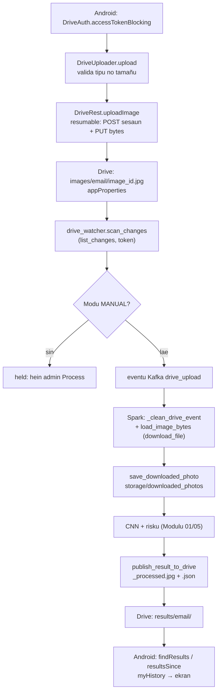
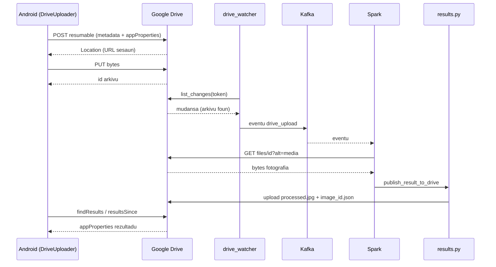
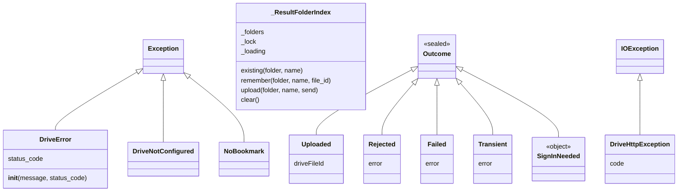

# 03 — Modulu Integrasaun Google Drive

*Sistema Crop Disease Early Warning System (EWS) — dokumentasaun téknika ba integrasaun Google Drive (laptop Python + aplikasaun Android Kotlin), ba estudante ne'ebé foin hahú programasaun. Fonte úniku: kódigu iha repozitóriu (branch `main`, commit `302818f`). Kódigu hotu kópia automátiku ho númeru liña. Token OAuth, client secret no password **la hatudu** iha dokumentu ne'e.*

{{coverage config/settings.py 141-166}}
{{coverage scripts/drive_authorize.py 1-66}}
{{coverage scripts/drive_share_user.py 1-33}}
{{coverage storage/drive_client.py 1-458}}
{{coverage storage/image_storage.py 1-109}}
{{coverage kafka/drive_watcher.py 1-256}}
{{coverage storage/processing_mode.py 1-38}}
{{coverage storage/drive_inventory.py 1-60}}
{{coverage storage/farmers.py 1-37}}
{{coverage spark/preprocessing.py 90-116 201-208}}
{{coverage spark/streaming_job.py 130-150}}
{{coverage storage/results.py 129-270}}
{{coverage storage/reset.py 99-153 227-234}}
{{coverage android_app/app/src/main/java/com/cropdisease/app/DriveAuth.kt 1-46}}
{{coverage android_app/app/src/main/java/com/cropdisease/app/DriveUploader.kt 1-121}}
{{coverage android_app/app/src/main/java/com/cropdisease/app/DriveRest.kt 1-346}}

> **Oinsá lee.** Bloku kódigu kada ida tuir pasu 9: (1) Kódigu orijinál, (2) Objetivu, (3) Fundamentu Python (ba Kotlin: fundamentu Kotlin), (4) Esplikasaun liña-ba-liña, (5) Walkthrough ezekusaun, (6) Tipu dadus, (7) Ligasaun OOP, (8) Impaktu integrasaun, (9) Checkpoint ba principiante. Etiketa: *Implementadu*, *Inferidu*, *Teoria*, *Ezemplu ilustrativu*.
>
> **Kódigu partilla.** `kafka/drive_watcher.py`, `spark/preprocessing.py` 90–116 no 201–208, no `spark/streaming_job.py` 130–150 mós esplika iha Modulu 01/02. Iha ne'e ita esplika fali husi **lado Google Drive** atu dokumentu ne'e bele lee mesak.

## A. Introdusaun no Objetivu

### A.1 Papél Google Drive iha sistema

Google Drive mak **fatin troka dadus** entre agrikultór (telemóvel Android) no laptop (Spark + CNN). Telemóvel no laptop la ko'alia direta; sira ko'alia liuhusi pasta Drive.

| Pasta (iha konta sentrál) | Na'in / asesu | Saida mak iha |
|---|---|---|
| `CropDiseaseEWS/images/<email>/` | Konta sentrál; partilla ho agrikultór ho papél **writer** | Fotografia `<image_id>.jpg` ne'ebé Android upload, ho `appProperties` (`image_id`, `location`, `gps_lat`...) |
| `CropDiseaseEWS/results/<email>/` | Konta sentrál; partilla ho agrikultór ho papél **reader** | `<image_id>.json` (rezultadu), `<image_id>_processed.jpg` (imajen ho heatmap), `_reset_marker.json` |

### A.2 Problema ne'ebé modulu ne'e rezolve

- **Agrikultór la iha server publiku.** Laptop la presiza IP publiku: telemóvel no laptop uza Google Drive.
- **Seguransa.** Kada agrikultór haree de'it nia pasta rasik (partilla ho email ida de'it). Telemóvel la rai password — Google fó *access token* badak.
- **Rede la estável (Timor-Leste).** Laptop koko fali chamada Drive (backoff ba 429/5xx, network retry); Android koko fali to'o dala 4 no buka fotografia molok upload fali (la iha duplikadu).
- **Rezultadu fila ba agrikultór.** Spark hakerek JSON + imajen ba `/results/<email>/`; Android lee sira.

### A.3 Fundamentu Python no Kotlin (foun iha modulu ne'e)

Modulu 01–02 hanorin ona variavel, dict, funsaun, klase, `self`, `__init__`, exception, herança, `with`, thread, JSON, atributu klase, duck typing. **Lembra:** klase = molde; objetu = buat harii husi molde; `raise` = hamosu erru; `try/except` = kaer erru. Konseitu **foun**:

**Python**

1. **`global`** — iha funsaun nia laran, `global _session` husu Python atu muda variavel nível modulu (la'ós harii variavel lokál).
2. **`super().__init__(message)`** — bolu konstrutór klase inan husi sub-klase.
3. **`Optional[int]`** (`typing`) — "int ka None".
4. **`lambda`** — funsaun badak la ho naran: `lambda attempt: _upload_once(...)`.
5. **`getattr(obj, "naran")`** — foti atributu/métodu ho naran iha string: `getattr(session, "get")` = `session.get`.
6. **`kwargs.setdefault("timeout", x)`** — tau valór se chave seidauk iha.
7. **`2 ** n`** — potênsia (2, 4, 8...). Backoff eksponensiál: hein dala rua liu kada koko.
8. **HTTP (Teoria).** Cliente haruka *request* (método `GET`/`POST`/`PATCH`) ba URL; server fó *response* ho kódigu status: 2xx = di'ak, 400 = pedidu aat, 401 = presiza login, 403 = la iha permisaun (ka rate limit), 404 = la iha, 429 = haruka barak liu, 5xx = erru server.
9. **OAuth 2.0 (Teoria).** Utilizadór husu Google fó **access token** (validu ~1 oras) no **refresh token** (atu hetan access token foun). Aplikasaun haruka `Authorization: Bearer <token>`. *Scope* = permisaun saida (`https://www.googleapis.com/auth/drive` = Drive tomak).
10. **`multipart/related`** — body HTTP ho parte rua (metadata JSON + bytes arkivu) fahe ho *boundary*.
11. **`raise ... from e`** — hamosu erru foun no rai erru orijinál hanesan kauza.
12. **Enum ho `str`**: `class ProcessingMode(str, enum.Enum)` — membru enum mós string (bele kompara ho `"MANUAL"` no serializa JSON).

**Kotlin (aplikasaun Android)**

| Kotlin | Signifika | Hanesan iha Python |
|---|---|---|
| `package com.cropdisease.app` | naran pakote | pasta pakote |
| `import a.b.C` | foti klase | `from a.b import C` |
| `object DriveAuth { ... }` | **singleton**: objetu ida de'it, harii automátiku | modulu Python ho funsaun |
| `fun f(x: Int): String` | funsaun ho tipu parámetru no return | `def f(x: int) -> str:` |
| `val x = 1` / `var y = 2` | `val` la bele muda; `var` bele muda | variavel |
| `const val A = "x"` | konstante tempu kompilasaun | `A = "x"` |
| `String?` | tipu ne'ebé bele `null` | `Optional[str]` |
| `a?.b` | se `a` null, rezultadu null (la erru) | `a.b if a is not None else None` |
| `a ?: b` | "Elvis": se `a` null, uza `b` | `a if a is not None else b` |
| `a!!` | obriga la null (erru se null) | — |
| `"Valór $x ${y.z}"` | string template | f-string |
| `data class Me(val email: String)` | klase dadus (`equals`, `toString` automátiku) | `@dataclass` |
| `sealed class Outcome` | klase ho sub-klase fixu (lista taka) | hierarkia klase |
| `when { kond -> ... }` | hanesan `if/elif` | `if/elif/else` |
| `x.use { ... }` | taka rekursu automátiku | `with` |
| `x.let { ... }` | halai bloku ho `it = x` (dalaruma ho `?.`) | — |
| `try { } catch (e: Exception) { }` | kaer erru | `try/except` |
| `for (i in 0 until n)` | 0..n-1 | `for i in range(n)` |
| `1L shl n` | shift bit (2ⁿ) | `1 << n` |
| `mutableMapOf("a" to 1)` | dict muda | `{"a": 1}` |

## B. Arkivu Fonte Loloos

| Arkivu | Liña | Klase / funsaun prinsipál | Serbisu |
|---|---|---|---|
| `config/settings.py` | 141–166 | `GOOGLE_DRIVE_*`, `_drive_folder_id` | Fatin token, client secret, ID pasta |
| `scripts/drive_authorize.py` | 66 | `main` | OAuth dala ida iha laptop; harii pasta `images`/`results` |
| `scripts/drive_share_user.py` | 33 | `main` | Harii no partilla pasta agrikultór |
| `storage/drive_client.py` | 458 | `DriveError`, `DriveNotConfigured`, `_authed_session`, `_request`, `_with_network_retry`, `get_file_metadata`, `download_file`, `upload_bytes`, `upload_json`, `list_changes`, `list_files_in_folders`, `user_folder_id`, `register_farmer`, `share_with`, `ensure_folder` | Modulu **úniku** ne'ebé ko'alia ho API Drive (REST v3) |
| `storage/image_storage.py` | 109 | `is_drive_path`, `to_drive_path`, `load_image_bytes`, `downloaded_photo_path`, `store_downloaded_photo` | Dalan `gdrive:<id>`, download, kópia lokál |
| `kafka/drive_watcher.py` | 256 | `scan_changes`, `scan_once`, `publish_drive_file`, `main` | Deteta upload foun iha Drive |
| `storage/processing_mode.py` | 38 | `ProcessingMode`, `get_processing_mode`, `set_processing_mode` | AUTOMATIC / MANUAL iha arkivu JSON |
| `storage/drive_inventory.py` | 60 | `farmer_photos`, `unprocessed_photos`, `send_for_processing` | Fotografia iha Drive ne'ebé seidauk iha base de dadus |
| `storage/farmers.py` | 37 | `get_or_create_farmer` | Konta agrikultór husi email na'in Drive |
| `spark/preprocessing.py` | 90–116, 201–208 | `_clean_drive_event`, `_registered_from_drive`, `save_downloaded_photo` | Kontrola arkivu Drive; rai kópia download |
| `spark/streaming_job.py` | 130–150 | parte `process_event` | Download Drive iha paralelu |
| `storage/results.py` | 129–270 | `publish_result_to_drive`, `_ResultFolderIndex`, `publish_result_to_drive_safely` | Hakerek rezultadu ba `/results/<email>/` |
| `storage/reset.py` | 99–153, 227–234 | `clear_drive_files`, `write_reset_markers`, `_clear_watcher_bookmark` | Factory reset Drive |
| `DriveAuth.kt` | 46 | `object DriveAuth` | Token OAuth iha telemóvel |
| `DriveUploader.kt` | 121 | `object DriveUploader`, `sealed class Outcome` | Upload fotografia ida ho retry |
| `DriveRest.kt` | 346 | `object DriveRest` | Chamada REST Drive husi Android |

**Dependénsia:** Python — `google-auth`, `google-auth-oauthlib` (`InstalledAppFlow`), `requests` (via `AuthorizedSession`). Android — Google Identity Services (`AuthorizationClient`), OkHttp, `org.json`.

## C. Arkitetura no Fluxu Ezekusaun

### C.1 Input, prosesu, output

| Fase | Input | Prosesu | Output |
|---|---|---|---|
| Setup (dala ida) | client secret JSON | `drive_authorize.py` → OAuth browser | token iha `GOOGLE_DRIVE_TOKEN_FILE`; ID pasta iha `google_drive_folders.json` |
| Rejistu agrikultór | email | `drive_share_user.py` → `register_farmer` | pasta `images/<email>` (writer) + `results/<email>` (reader) |
| Upload | fotografia telemóvel | `DriveUploader.upload` → `DriveRest.uploadImage` (resumable) | arkivu `<image_id>.jpg` ho `appProperties` |
| Deteta | change feed Drive | `drive_watcher.scan_changes` | eventu Kafka `drive_upload` |
| Download | `gdrive:<id>` | `load_image_bytes` → `download_file` (retry) | bytes orijinál + kópia `storage/downloaded_photos/<user>/<image>.jpg` |
| Entrega rezultadu | rezultadu BD | `publish_result_to_drive` → `upload_bytes`/`upload_json` | `<image_id>_processed.jpg`, `<image_id>.json` |
| Telemóvel lee | pasta results | `DriveRest.findResults`, `resultsSince`, `myHistory` | istória iha app |

### C.2 Diagrama fluxu



### C.3 Trasu konkretu: upload → detesaun → download → rezultadu

*Ezemplu ilustrativu* (ID, email no valór); funsaun no regra loloos.

1. Agrikultór hili fotografia; app harii `image_id = "a1b2c3d4-0000-4000-8000-000000000001"`.
2. `DriveUploader.upload`: tipu `image/jpeg`, 2.4 MB (< 15 MB); `properties = {"image_id": "a1b2...", "original_filename": "IMG_20261020.jpg", "location": "Aileu Vila", "gps_lat": "-8.728100", "gps_lon": "125.566400", "gps_acc_m": "12"}`.
3. `DriveAuth.accessTokenBlocking` → token. `DriveRest.uploadImage` → `POST .../upload/drive/v3/files?uploadType=resumable` → header `Location` (URL sesaun) → `PUT` bytes → `{"id": "1AbCdEf"}` → `Outcome.Uploaded("1AbCdEf")`.
4. Laptop: `drive_watcher.scan_changes` → `list_changes(token)` fó mudansa ho arkivu `1AbCdEf` iha pasta agrikultór → `publish_drive_file` → Kafka.
5. Spark: `_clean_drive_event` → `drive_file_id = "1AbCdEf"`; rejista ona → la husu Drive fali. `_DOWNLOADS.submit(load_image_bytes, "gdrive:1AbCdEf")` → `download_file("1AbCdEf")` → `GET .../files/1AbCdEf?alt=media` → bytes.
6. `save_downloaded_photo("u-9", "a1b2...", bytes)` → `storage/downloaded_photos/u-9/a1b2....jpg`.
7. CNN → `blight`, risku `HIGH` → `persist_result`.
8. `publish_result_to_drive` → `user_folder_id("agrikultor@example.com", "user_results")` → `upload_bytes("a1b2..._processed.jpg", ...)` → `upload_json("a1b2....json", payload, ..., summary)` → `images.result_published_at = agora`.
9. Android: `findResults(... ["a1b2..."])` → `{"a1b2...": "1XyZ..."}` → `myHistory` → item `outcome = "diseased"`, `prediction.predicted_class = "blight"`.

### C.4 Diagrama sekuénsia



## D. Esplikasaun Kódigu-ba-Kódigu

### D.1 Konfigurasaun no script setup

#### D.1.1 `config/settings.py` — konfigurasaun Google Drive

**1. Kódigu orijinál**

{{code config/settings.py 141-166}}

**2. Objetivu**

Define fatin arkivu segredu (client secret, token) no arkivu ID pasta, naran pasta raiz, no lee ID pasta `images`/`results` — husi variavel ambiente uluk, se lae husi arkivu ne'ebé `drive_authorize.py` hakerek.

**3. Fundamentu Python**

- **`Path(os.getenv("X", default))`** — dalan husi variavel ambiente ka default.
- **Import lokál** `import json` iha funsaun nia laran.
- **Kódigu nível modulu bolu funsaun** (liña 165–166) — halai dala ida bainhira import.

**4. Esplikasaun liña-ba-liña**

- **Liña 141–143** — Komentáriu seksaun: Google Drive (konta sentrál ida; token harii husi `scripts/drive_authorize.py`).
- **Liña 144–145** — `GOOGLE_DRIVE_CLIENT_SECRET_FILE` — default `storage/google_client_secret.json` (OAuth client "Desktop app"; segredu — la hatudu konteúdu).
- **Liña 146–147** — `GOOGLE_DRIVE_TOKEN_FILE` — default `storage/google_drive_token.json` (token OAuth; segredu).
- **Liña 148–149** — `GOOGLE_DRIVE_FOLDERS_FILE` — default `storage/google_drive_folders.json` (ID pasta, la'ós segredu).
- **Liña 150** — `GOOGLE_DRIVE_ROOT_FOLDER_NAME` — default `"CropDiseaseEWS"`.
- **Liña 153** — `def _drive_folder_id(env_name: str, key: str) -> str:`
- **Liña 154** — Docstring: ID pasta husi ambiente, se lae husi arkivu ne'ebé `drive_authorize.py` hakerek.
- **Liña 155** — `value = os.getenv(env_name, "")`.
- **Liña 156** — `if value:`
- **Liña 157** — `return value`.
- **Liña 158** — `try:`
- **Liña 159** — `import json`.
- **Liña 160** — `return json.loads(GOOGLE_DRIVE_FOLDERS_FILE.read_text()).get(key, "")`.
- **Liña 161** — `except (OSError, ValueError):` — arkivu la iha / JSON aat.
- **Liña 162** — `return ""` — "seidauk konfigura".
- **Liña 165** — `GOOGLE_DRIVE_IMAGES_FOLDER_ID = _drive_folder_id("GOOGLE_DRIVE_IMAGES_FOLDER_ID", "images_folder_id")`.
- **Liña 166** — `GOOGLE_DRIVE_RESULTS_FOLDER_ID = _drive_folder_id("GOOGLE_DRIVE_RESULTS_FOLDER_ID", "results_folder_id")`.

**5. Walkthrough ezekusaun**

*Ezemplu ilustrativu:* la iha variavel ambiente; `google_drive_folders.json` = `{"root_folder_id": "1Root...", "images_folder_id": "1Img...", "results_folder_id": "1Res..."}` → `GOOGLE_DRIVE_IMAGES_FOLDER_ID = "1Img..."`. Molok `drive_authorize.py` halai → `""`.

**6. Tipu dadus**

| Naran | Tipu |
|---|---|
| `GOOGLE_DRIVE_*_FILE` | `Path` |
| `GOOGLE_DRIVE_ROOT_FOLDER_NAME` | `str` |
| `_drive_folder_id` | `(str, str) -> str` |
| `GOOGLE_DRIVE_IMAGES_FOLDER_ID`, `..._RESULTS_...` | `str` (bele `""`) |

**7. Ligasaun OOP**

Not implemented in the current codebase. (Konstante no funsaun.)

**8. Impaktu integrasaun**

`drive_client` import token no ID pasta; `drive_authorize.py` hakerek `GOOGLE_DRIVE_FOLDERS_FILE`.

**9. Checkpoint ba principiante**

**P:** Tanba sá ID pasta bele mai husi variavel ambiente **ka** arkivu?
**R:** Variavel ambiente permite troka ba konta seluk la ho muda arkivu; arkivu halo setup automátiku depois `drive_authorize.py`.

#### D.1.2 `scripts/drive_authorize.py` — docstring no import

**1. Kódigu orijinál**

{{code scripts/drive_authorize.py 1-22}}

**2. Objetivu**

Script setup dala ida iha laptop (nunka iha Android): login ho konta Google sentrál, rai token, harii pasta.

**3. Fundamentu Python**

`sys.path.insert(0, ...)` + `# noqa: E402` (haree Modulu 02 D.3.1).

**4. Esplikasaun liña-ba-liña**

- **Liña 1–2** — Docstring: setup Google Drive dala ida iha laptop (nunka Android).
- **Liña 3** — Liña mamuk docstring.
- **Liña 4** — Komando: `python scripts/drive_authorize.py`.
- **Liña 5** — Liña mamuk docstring.
- **Liña 6–9** — Login ho konta Google sentrál; token rai iha `GOOGLE_DRIVE_TOKEN_FILE` (rai privadu); harii pasta `CropDiseaseEWS/images` no `/results`; presiza OAuth client "Desktop app" JSON iha `GOOGLE_DRIVE_CLIENT_SECRET_FILE`.
- **Liña 10** — Remata docstring.
- **Liña 11** — `import json`.
- **Liña 12** — `import sys`.
- **Liña 13** — `from pathlib import Path`.
- **Liña 15** — `sys.path.insert(0, str(Path(__file__).resolve().parent.parent))` — pasta raiz projetu.
- **Liña 17–22** — Import konfigurasaun 4: client secret, token, arkivu pasta, naran raiz.

**5. Walkthrough ezekusaun**

`python scripts/drive_authorize.py` → Python halai liña 1–22, depois `main()` (D.1.3).

**6. Tipu dadus**

Konstante `Path` no `str` (haree D.1.1).

**7. Ligasaun OOP**

Not implemented in the current codebase.

**8. Impaktu integrasaun**

Script ne'e prepara buat hotu ne'ebé `drive_client` presiza.

**9. Checkpoint ba principiante**

**P:** Tanba sá script ne'e "nunka iha Android"?
**R:** Token konta sentrál fó asesu ba pasta agrikultór hotu — tenke rai iha laptop de'it. Telemóvel uza token agrikultór rasik.

#### D.1.3 `scripts/drive_authorize.py` — `main` (fluxu OAuth)

**1. Kódigu orijinál**

{{code scripts/drive_authorize.py 25-66}}

**2. Objetivu**

Halai fluxu OAuth "installed app": loke browser, utilizadór fó permisaun, rai token (ho refresh token), harii pasta `CropDiseaseEWS`, `images`, `results`, no rai ID sira.

**3. Fundamentu Python**

- **`InstalledAppFlow.from_client_secrets_file(...)`** — métodu klase ne'ebé harii objetu fluxu.
- **`flow.run_local_server(port=0, ...)`** — loke server lokál iha port livre atu simu resposta Google.
- **`json.dumps(..., indent=2)`** — JSON ho indentasaun.

**4. Esplikasaun liña-ba-liña**

- **Liña 25** — `def main() -> int:`
- **Liña 26** — `secret = Path(GOOGLE_DRIVE_CLIENT_SECRET_FILE)`.
- **Liña 27** — `if not secret.exists():`
- **Liña 28–30** — `print(...)` — arkivu client la iha; harii OAuth client "Desktop app" iha Google Cloud Console no rai.
- **Liña 31** — `return 1`.
- **Liña 33** — `from google_auth_oauthlib.flow import InstalledAppFlow`.
- **Liña 34** — `from storage import drive_client`.
- **Liña 36** — `flow = InstalledAppFlow.from_client_secrets_file(str(secret), drive_client.SCOPES)` — scope Drive tomak.
- **Liña 37** — `creds = flow.run_local_server(port=0, access_type="offline", prompt="consent")` — `offline` = husu refresh token; `consent` = sempre hatudu ekran konsentimentu (garante refresh token).
- **Liña 39** — `token_path = Path(GOOGLE_DRIVE_TOKEN_FILE)`.
- **Liña 40** — `token_path.parent.mkdir(parents=True, exist_ok=True)`.
- **Liña 41** — `token_path.write_text(creds.to_json())` — rai token (segredu).
- **Liña 42** — `print(f"Saved OAuth token to {token_path}")`.
- **Liña 44** — Komentáriu: `drive_client` seidauk rai sesaun, entaun nia sei uza token foun.
- **Liña 45** — `root_id = drive_client.ensure_folder(GOOGLE_DRIVE_ROOT_FOLDER_NAME)`.
- **Liña 46** — `images_id = drive_client.ensure_folder("images", root_id)`.
- **Liña 47** — `results_id = drive_client.ensure_folder("results", root_id)`.
- **Liña 49** — `folders = {`
- **Liña 50** — `"root_folder_id": root_id,`
- **Liña 51** — `"images_folder_id": images_id,`
- **Liña 52** — `"results_folder_id": results_id,`
- **Liña 53** — `}`.
- **Liña 54** — `Path(GOOGLE_DRIVE_FOLDERS_FILE).write_text(json.dumps(folders, indent=2))`.
- **Liña 55** — `print(...)` — "Folders ready: CropDiseaseEWS/images = <id>".
- **Liña 56** — `print(...)` — ".../results = <id>".
- **Liña 57** — `print(...)` — "Saved folder IDs to ...".
- **Liña 58** — `print()` — liña mamuk.
- **Liña 59** — `print(...)` — pasu tuirmai: fó pasta privadu ba kada agrikultór.
- **Liña 60** — `print(...)` — `python scripts/drive_share_user.py farmer@gmail.com`.
- **Liña 61** — `print(...)` — app Android hetan nia pasta rasik.
- **Liña 62** — `return 0`.
- **Liña 65** — `if __name__ == "__main__":`
- **Liña 66** — `sys.exit(main())`.

**5. Walkthrough ezekusaun**

Admin halai script → browser loke → login konta sentrál → "Allow" → token rai → pasta harii (ka hetan se iha ona: `ensure_folder` buka uluk) → `google_drive_folders.json` rai ID 3.

**6. Tipu dadus**

| Naran | Tipu |
|---|---|
| `secret`, `token_path` | `Path` |
| `flow` | `InstalledAppFlow` |
| `creds` | `google.oauth2.credentials.Credentials` |
| `root_id`, `images_id`, `results_id` | `str` |
| `folders` | `dict[str, str]` |
| return | `int` |

**7. Ligasaun OOP**

`InstalledAppFlow.from_client_secrets_file` mak **métodu klase** (fábrika) ne'ebé fó objetu; `creds.to_json()` mak métodu objetu.

**8. Impaktu integrasaun**

Token ne'e uza husi `drive_client._authed_session` (D.2.3) ba chamada laptop hotu (watcher, Spark, results, reset).

**9. Checkpoint ba principiante**

**P:** Tanba sá `access_type="offline"`?
**R:** Atu Google fó refresh token — laptop bele hetan access token foun automátiku la ho login fali.

#### D.1.4 `scripts/drive_share_user.py`

**1. Kódigu orijinál**

{{code scripts/drive_share_user.py 1-33}}

**2. Objetivu**

Fó pasta privadu ba agrikultór: harii `images/<email>/` (writer) no `results/<email>/` (reader), partilla ho email ne'e de'it. Seguru atu repete.

**3. Fundamentu Python**

- **`sys.argv[1:]`** — argumentu liña komando (la inklui naran script).
- **`print(__doc__)`** — hatudu docstring modulu hanesan ajuda.
- **Espresaun kondisionál iha argumentu `print`**.

**4. Esplikasaun liña-ba-liña**

- **Liña 1–2** — Docstring: fó pasta privadu ba agrikultór iha Drive sentrál.
- **Liña 3** — Liña mamuk docstring.
- **Liña 4** — Uza: `python scripts/drive_share_user.py farmer.name@gmail.com [more@gmail.com ...]`.
- **Liña 5** — Liña mamuk.
- **Liña 6–8** — Harii `images/<email>/` (writer) no `results/<email>/` (reader), partilla de'it ho agrikultór; seguru repete; aumenta mós email hanesan test user iha Google Cloud.
- **Liña 9** — Remata docstring.
- **Liña 10** — `import sys`.
- **Liña 11** — `from pathlib import Path`.
- **Liña 13** — `sys.path.insert(...)`.
- **Liña 15** — `from storage import drive_client`.
- **Liña 18** — `def main(emails) -> int:`
- **Liña 19** — `if not emails:`
- **Liña 20** — `print(__doc__)`.
- **Liña 21** — `return 1`.
- **Liña 22** — `for email in emails:`
- **Liña 23** — `email = drive_client.register_farmer(email)["email"]` — email normalizadu (letra ki'ik).
- **Liña 24** — `print(...)` — "<email>: images/<email>/ (upload) and results/<email>/ (read) — shared only with <email>".
- **Liña 25** — `project = drive_client.google_cloud_project_id()`.
- **Liña 26** — `print(...)` — aumenta kada email hanesan TEST USER (presiza bainhira app iha Testing).
- **Liña 27–28** — `print(URL console ho project if project else dalan menu)`.
- **Liña 29** — `return 0`.
- **Liña 32** — `if __name__ == "__main__":`
- **Liña 33** — `sys.exit(main(sys.argv[1:]))`.

**5. Walkthrough ezekusaun**

`python scripts/drive_share_user.py Agrikultor@Example.com` → `register_farmer` → email `agrikultor@example.com` → pasta 2 harii/partilla → print → link Google Cloud Console "Audience".

**6. Tipu dadus**

`emails`: `list[str]`; `project`: `str ka None`; return `int`.

**7. Ligasaun OOP**

Not implemented in the current codebase.

**8. Impaktu integrasaun**

Pasta ne'ebé harii iha ne'e mak pasta ne'ebé Android `DriveRest.myFolders` buka (`sharedWithMe`) no watcher `user_image_folders` lista.

**9. Checkpoint ba principiante**

**P:** Tanba sá pasta `results` partilla ho papél **reader**?
**R:** Agrikultór presiza lee rezultadu maibé labele muda ka hamoos rezultadu Spark.

### D.2 `storage/drive_client.py` — cliente API Drive

#### D.2.1 Docstring, import, konstante no `_DRIVE_ID_RE`

**1. Kódigu orijinál**

{{code storage/drive_client.py 1-31}}

**2. Objetivu**

Modulu úniku ne'ebé ko'alia ho Google Drive (REST API v3, konta sentrál). Define scope, URL API, tipu MIME pasta, kampu metadata, no regex atu valida ID Drive (proteje kontra *injection*).

**3. Fundamentu Python**

- **`from typing import Optional`**.
- **String adjasente** iha parénteze (liña 24–27) kombina automátiku.

**4. Esplikasaun liña-ba-liña**

- **Liña 1–6** — Docstring: modulu úniku ne'ebé ko'alia ho Google Drive (REST v3, konta sentrál); halai `drive_authorize.py` dala ida; agrikultór kada ida iha pasta `/images/<email>/` (upload) no `/results/<email>/` (rezultadu).
- **Liña 7** — `import json`.
- **Liña 8** — `import re`.
- **Liña 9** — `import threading` — lock pasta agrikultór.
- **Liña 10** — `import uuid` — boundary multipart.
- **Liña 11** — `from typing import Optional`.
- **Liña 13–17** — Import token no ID pasta.
- **Liña 19** — `SCOPES = ["https://www.googleapis.com/auth/drive"]` — Drive tomak.
- **Liña 20** — `DRIVE_API = "https://www.googleapis.com/drive/v3"`.
- **Liña 21** — `UPLOAD_API = "https://www.googleapis.com/upload/drive/v3"`.
- **Liña 22** — `FOLDER_MIME_TYPE = "application/vnd.google-apps.folder"`.
- **Liña 24–27** — `FILE_METADATA_FIELDS` — kampu ne'ebé husu: `id`, `name`, `mimeType`, `size`, `parents`, `appProperties`, `md5Checksum`, `sha256Checksum`, `trashed`, `createdTime`, `owners(emailAddress,displayName)`.
- **Liña 29** — Komentáriu: valida molok tama URL ka query (prevene injection).
- **Liña 30** — `_DRIVE_ID_RE = re.compile(r"^[A-Za-z0-9_-]{10,200}$")` — letra, númeru, `_`, `-`; karakter 10–200.

**5. Walkthrough ezekusaun**

`_DRIVE_ID_RE.match("1AbCdEfGhIj")` → match; `_DRIVE_ID_RE.match("x' or '1'='1")` → `None`.

**6. Tipu dadus**

`SCOPES`: `list[str]`; `DRIVE_API`, `UPLOAD_API`, `FOLDER_MIME_TYPE`, `FILE_METADATA_FIELDS`: `str`; `_DRIVE_ID_RE`: `re.Pattern`.

**7. Ligasaun OOP**

Not implemented in the current codebase (bloku ne'e).

**8. Impaktu integrasaun**

`FILE_METADATA_FIELDS` determina kampu ne'ebé watcher hetan (no tama iha eventu Kafka): `owners`, `appProperties`, `sha256Checksum`, `createdTime`.

**9. Checkpoint ba principiante**

**P:** Tanba sá valida ID ho regex molok tau iha query?
**R:** Query Drive hanesan `'<id>' in parents`. Se ID iha `'`, ema bele muda query (injection). Regex aseita de'it karakter seguru.

#### D.2.2 Klase erru, validasaun ID, ID pasta raiz, `is_configured`

**1. Kódigu orijinál**

{{code storage/drive_client.py 33-75}}

**2. Objetivu**

Define klase erru rua (`DriveNotConfigured`, `DriveError` ho `status_code`), funsaun valida ID, funsaun fó ID pasta raiz (ka erru), no kontrola se Drive konfigura ona.

**3. Fundamentu Python**

- **Sub-klase ho `__init__` rasik** no **`super().__init__(message)`**.
- **`bool(x) and bool(y)`** — fó `True/False` puru.

**4. Esplikasaun liña-ba-liña**

- **Liña 33** — `class DriveNotConfigured(Exception):`
- **Liña 34** — Docstring: arkivu token ka ID pasta la iha — halai `drive_authorize.py`.
- **Liña 37** — `class DriveError(Exception):`
- **Liña 38** — Docstring: chamada API Drive falla.
- **Liña 40** — `def __init__(self, message: str, status_code: Optional[int] = None):`
- **Liña 41** — `super().__init__(message)` — `Exception` rai mensajen.
- **Liña 42** — `self.status_code = status_code` — atributu foun (kódigu HTTP).
- **Liña 45** — `def is_valid_drive_id(value: Optional[str]) -> bool:`
- **Liña 46** — `return bool(value) and bool(_DRIVE_ID_RE.match(value))`.
- **Liña 49** — `def _require_valid_id(value: str, what: str = "Drive file id") -> str:`
- **Liña 50** — `if not is_valid_drive_id(value):`
- **Liña 51** — `raise DriveError(f"Invalid {what}: {value!r}", status_code=400)`.
- **Liña 52** — `return value`.
- **Liña 55** — `def _root_folder_id(folder_id: str, setting: str) -> str:`
- **Liña 56** — `if not folder_id:`
- **Liña 57** — `raise DriveNotConfigured(f"{setting} is not set — run scripts/drive_authorize.py")`.
- **Liña 58** — `return folder_id`.
- **Liña 61** — `def images_folder_id() -> str:`
- **Liña 62** — `return _root_folder_id(GOOGLE_DRIVE_IMAGES_FOLDER_ID, "GOOGLE_DRIVE_IMAGES_FOLDER_ID")`.
- **Liña 65** — `def results_folder_id() -> str:`
- **Liña 66** — `return _root_folder_id(GOOGLE_DRIVE_RESULTS_FOLDER_ID, "GOOGLE_DRIVE_RESULTS_FOLDER_ID")`.
- **Liña 69** — `def is_configured() -> bool:`
- **Liña 70** — `from pathlib import Path`.
- **Liña 71** — `return (`
- **Liña 72** — `Path(GOOGLE_DRIVE_TOKEN_FILE).exists()`.
- **Liña 73** — `and bool(GOOGLE_DRIVE_IMAGES_FOLDER_ID)`.
- **Liña 74** — `and bool(GOOGLE_DRIVE_RESULTS_FOLDER_ID)`.
- **Liña 75** — `)`.

**5. Walkthrough ezekusaun**

`_require_valid_id("abc")` → `DriveError("Invalid Drive file id: 'abc'", status_code=400)` (menus karakter 10). `images_folder_id()` molok setup → `DriveNotConfigured(...)`.

**6. Tipu dadus**

| Naran | Tipu |
|---|---|
| `DriveError.status_code` | `int ka None` |
| `is_valid_drive_id` | `Optional[str] -> bool` |
| `_require_valid_id` | `-> str`; raise `DriveError` |
| `images_folder_id`, `results_folder_id` | `-> str`; raise `DriveNotConfigured` |
| `is_configured` | `-> bool` |

**7. Ligasaun OOP**

- **Herança**: `DriveError(Exception)`, `DriveNotConfigured(Exception)`.
- **Konstrutór sub-klase + `super()`**: `DriveError.__init__` bolu `Exception.__init__` (`super().__init__(message)`) no aumenta atributu `status_code` — ezemplu klaru **estende** klase inan.
- **Polimorfizmu exception**: `except (drive_client.DriveError, drive_client.DriveNotConfigured)` iha `_clean_drive_event` kaer rua.

**8. Impaktu integrasaun**

`load_image_bytes` troka `DriveError` ba `FileNotFoundError`; watcher `main` para ho `DriveNotConfigured`.

**9. Checkpoint ba principiante**

**P:** Saida mak `super().__init__(message)` halo?
**R:** Bolu konstrutór `Exception` atu mensajen rai iha objetu erru (ezemplu `str(e)` fó mensajen), depois `DriveError` aumenta `status_code`.

#### D.2.3 Sesaun autentikadu, `_check`, `_escape_query_value`

**1. Kódigu orijinál**

{{code storage/drive_client.py 78-113}}

**2. Objetivu**

Harii `AuthorizedSession` **ida** husi token rai (Google refresh automátiku), kontrola resposta HTTP (≥ 400 → `DriveError`), no escape valór iha query Drive.

**3. Fundamentu Python**

- **`global _session`** — muda variavel modulu.
- **Cache simples** — se iha ona, fó fali.
- **`str.replace`** kadeia.

**4. Esplikasaun liña-ba-liña**

- **Liña 78–80** — Komentáriu seksaun: sesaun HTTP autentikadu (konta sentrál, lado server de'it).
- **Liña 81** — `_session = None`.
- **Liña 84** — `def _authed_session():`
- **Liña 85** — Docstring: `AuthorizedSession` ida husi token rai (refresh automátiku).
- **Liña 86** — `global _session`.
- **Liña 87** — `if _session is not None:`
- **Liña 88** — `return _session`.
- **Liña 89** — `from pathlib import Path`.
- **Liña 90** — `if not Path(GOOGLE_DRIVE_TOKEN_FILE).exists():`
- **Liña 91–94** — `raise DriveNotConfigured(...)` — token la iha; halai `drive_authorize.py`.
- **Liña 95** — `from google.oauth2.credentials import Credentials`.
- **Liña 96** — `from google.auth.transport.requests import AuthorizedSession`.
- **Liña 98** — `creds = Credentials.from_authorized_user_file(str(GOOGLE_DRIVE_TOKEN_FILE), SCOPES)` — lee token (access + refresh).
- **Liña 99** — `_session = AuthorizedSession(creds)` — sesaun `requests` ne'ebé tau header `Authorization: Bearer ...` no refresh token bainhira expira.
- **Liña 100** — `return _session`.
- **Liña 103** — `def _check(resp, action: str):`
- **Liña 104** — `if resp.status_code >= 400:`
- **Liña 105–108** — `raise DriveError(f"Google Drive {action} failed: HTTP {code} {resp.text[:300]}", status_code=...)`.
- **Liña 109** — `return resp`.
- **Liña 112** — `def _escape_query_value(value: str) -> str:`
- **Liña 113** — `return value.replace("\\", "\\\\").replace("'", "\\'")` — `\` → `\\`, `'` → `\'`.

**5. Walkthrough ezekusaun**

Chamada dahuluk `_authed_session()` → lee token → harii sesaun; chamada tuirmai → objetu hanesan. `_escape_query_value("O'Neil")` → `"O\'Neil"`.

**6. Tipu dadus**

| Naran | Tipu |
|---|---|
| `_session` | `AuthorizedSession ka None` |
| `creds` | `Credentials` |
| `_check(resp, action)` | `requests.Response` → `Response`; raise `DriveError` |
| `_escape_query_value` | `str -> str` |

**7. Ligasaun OOP**

`_session` mak objetu **singleton nível modulu** (Teoria: *lazy singleton*) — harii dala ida, partilla husi thread hotu. `AuthorizedSession` herda husi `requests.Session` (biblioteka) — **komposisaun**: objetu kaer objetu `Credentials`.

**8. Impaktu integrasaun**

Chamada Drive hotu iha laptop liuhusi `_request` → `_authed_session()`. `reset.clear_drive_files` uza `_authed_session()` direta.

**9. Checkpoint ba principiante**

**P:** Tanba sá rai `_session` iha variavel global?
**R:** Atu lee token no harii konesaun dala ida de'it; harii sesaun foun kada chamada neineik.

#### D.2.4 Konstante retry, `_should_back_off`, `_request`

**1. Kódigu orijinál**

{{code storage/drive_client.py 116-154}}

**2. Objetivu**

Define timeout no númeru koko fali. `_request` mak dalan ba chamada Drive hotu: sempre ho timeout, no koko fali ho **backoff eksponensiál** bainhira Google hatete "neineik liu" (429, 403 rate limit) ka erru server (5xx).

**3. Fundamentu Python**

- **`__import__("time").sleep`** — import funsaun hanesan valór (teste bele troka `_sleep`).
- **`getattr(obj, method.lower())`** — "get"/"post"/"patch" → métodu sesaun.
- **`random.random()`** — 0.0–1.0 (jitter).
- **`any(gerador)`**.

**4. Esplikasaun liña-ba-liña**

- **Liña 116–118** — Komentáriu seksaun: upload (Android → Drive), metadata, download (Drive → Spark / API).
- **Liña 119** — `_GET_ATTEMPTS = 3`.
- **Liña 120** — `_GET_TIMEOUT = (15, 60)` — komentáriu: (konekta, lee) segundu.
- **Liña 121** — `_REQUEST_TIMEOUT = (15, 60)` — chamada seluk (upload, buka, partilla).
- **Liña 122** — `_UPLOAD_ATTEMPTS = 3` — upload koko fali depois timeout/konesaun monu.
- **Liña 123** — Komentáriu: resposta "slow down" Google, koko fali ho backoff.
- **Liña 124** — `_RATE_LIMIT_ATTEMPTS = 6` — hein ~1, 2, 4, 8, 16 s (+ jitter), ~30 s total.
- **Liña 125** — `_RATE_LIMIT_REASONS = ("rateLimitExceeded", "userRateLimitExceeded")`.
- **Liña 126** — `_RETRY_STATUSES = (429, 500, 502, 503, 504)`.
- **Liña 127** — `_sleep = __import__("time").sleep` — komentáriu: teste troka ida ne'e.
- **Liña 130** — `def _should_back_off(resp) -> bool:`
- **Liña 131** — `if resp.status_code in _RETRY_STATUSES:`
- **Liña 132** — `return True`.
- **Liña 133** — `if resp.status_code == 403:` — komentáriu: 403 mós "la iha permisaun" — koko fali só tipu rate-limit.
- **Liña 134** — `try:`
- **Liña 135** — `errors = (resp.json().get("error") or {}).get("errors") or []`.
- **Liña 136** — `except ValueError:` — body la'ós JSON.
- **Liña 137** — `return False`.
- **Liña 138** — `return any(e.get("reason") in _RATE_LIMIT_REASONS for e in errors)`.
- **Liña 139** — `return False`.
- **Liña 142** — `def _request(method: str, url: str, **kwargs):`
- **Liña 143–144** — Docstring: chamada Drive hotu: koko fali "slow down" no 5xx ho backoff, sempre timeout; fó resposta ikus ba `_check()`.
- **Liña 145** — `import random`.
- **Liña 146** — `kwargs.setdefault("timeout", _REQUEST_TIMEOUT)`.
- **Liña 147** — `for attempt in range(1, _RATE_LIMIT_ATTEMPTS + 1):` — 1..6.
- **Liña 148** — `resp = getattr(_authed_session(), method.lower())(url, **kwargs)` — ezemplu `session.get(url, params=..., timeout=...)`.
- **Liña 149** — `if attempt == _RATE_LIMIT_ATTEMPTS or not _should_back_off(resp):`
- **Liña 150** — `return resp`.
- **Liña 151** — `wait = 2 ** (attempt - 1) + random.random()` — 1, 2, 4, 8, 16 s + 0–1 s.
- **Liña 152–153** — `print(...)` — "Google Drive answered HTTP <kódigu> (busy/rate limit); retrying in X.Xs".
- **Liña 154** — `_sleep(wait)`.

**5. Walkthrough ezekusaun**

*Ezemplu ilustrativu:* `_request("GET", url)` → resposta 429 → hein ~1.3 s → 429 → ~2.7 s → 200 → return. Resposta 403 "insufficientPermissions" → `_should_back_off` = `False` → return kedas (la koko fali).

**6. Tipu dadus**

| Naran | Tipu |
|---|---|
| `_GET_TIMEOUT`, `_REQUEST_TIMEOUT` | `tuple[int, int]` |
| `_*_ATTEMPTS` | `int` |
| `_RETRY_STATUSES` | `tuple[int, ...]` |
| `_should_back_off` | `Response -> bool` |
| `_request` | `(str, str, **kwargs) -> Response` |
| `wait` | `float` |

**7. Ligasaun OOP**

`getattr(session, "get")` — **polimorfizmu dinámiku**: kódigu hili métodu objetu tuir string. Padraun **Retry with exponential backoff** (prinsípiu, implementa ho funsaun).

**8. Impaktu integrasaun**

Chamada hotu (`_get_with_retry`, upload, partilla, `ensure_folder`) liuhusi `_request`.

**9. Checkpoint ba principiante**

**P:** Tanba sá aumenta `random.random()` ba tempu hein?
**R:** "Jitter": se prosesu barak hetan 429 hamutuk, sira la koko fali iha segundu hanesan (evita sobrekarga foun).

#### D.2.5 Network retry, GET, metadata, download no thumbnail

**1. Kódigu orijinál**

{{code storage/drive_client.py 157-202}}

**2. Objetivu**

`_with_network_retry` koko fali chamada bainhira konesaun monu (2 s, 4 s...). `_get_with_retry` aplika ida ne'e ba GET (GET de'it — repete POST bele harii arkivu rua). Funsaun publiku: metadata, download bytes, thumbnail.

**3. Fundamentu Python**

- **Funsaun ne'ebé simu funsaun** (`call`) — *higher-order function*.
- **`label.format(attempt=attempt)`** — formata string ho `{attempt}`.
- **`resp.content`** — lee body tomak (forsa download iha loop retry).
- **`re.sub(r"=s\d+$", ...)`** — troka tamañu iha rohan URL.

**4. Esplikasaun liña-ba-liña**

- **Liña 157** — `def _with_network_retry(attempts: int, label: str, call):`
- **Liña 158** — Docstring: `call(attempt)`, koko fali depois konesaun monu (2 s, 4 s, ...).
- **Liña 159** — `import requests`.
- **Liña 160** — `for attempt in range(1, attempts + 1):`
- **Liña 161** — `try:`
- **Liña 162** — `return call(attempt)`.
- **Liña 163–165** — `except (ConnectionError, ChunkedEncodingError, Timeout) as e:` — konesaun monu, body la kompletu, timeout.
- **Liña 166** — `if attempt == attempts:`
- **Liña 167** — `raise` — koko ikus: hamosu erru.
- **Liña 168** — `print(...)` — "<label> failed (...); retrying".
- **Liña 169** — `_sleep(2 * attempt)` — 2 s, 4 s.
- **Liña 172** — `def _get_with_retry(url: str, params: dict):`
- **Liña 173–174** — Docstring: GET ho timeout no retry (GET de'it: repete POST bele harii arkivu segundu).
- **Liña 175** — `def get(_attempt):`
- **Liña 176** — `resp = _request("GET", url, params=params, timeout=_GET_TIMEOUT)`.
- **Liña 177** — `resp.content` — komentáriu: forsa lee body tomak iha loop retry.
- **Liña 178** — `return resp`.
- **Liña 179** — `return _with_network_retry(_GET_ATTEMPTS, "GET attempt {attempt}", get)`.
- **Liña 182** — `def _get_file(file_id: str, params: dict, action: str):`
- **Liña 183** — Docstring: GET `files/<file_id>` (ho retry), kontrola.
- **Liña 184** — `_require_valid_id(file_id)`.
- **Liña 185** — `return _check(_get_with_retry(f"{DRIVE_API}/files/{file_id}", params), f"{action} {file_id}")`.
- **Liña 188** — `def get_file_metadata(file_id: str) -> dict:`
- **Liña 189** — `return _get_file(file_id, {"fields": FILE_METADATA_FIELDS}, "get metadata for").json()`.
- **Liña 192** — `def download_file(file_id: str) -> bytes:`
- **Liña 193** — `return _get_file(file_id, {"alt": "media"}, "download").content` — `alt=media` = konteúdu arkivu.
- **Liña 196** — `def download_thumbnail(file_id: str, size_px: int = 220) -> Optional[bytes]:`
- **Liña 197** — Docstring: preview ki'ik Google, ka `None`.
- **Liña 198** — `link = _get_file(file_id, {"fields": "thumbnailLink"}, ...).json().get("thumbnailLink")`.
- **Liña 199** — `if not link:`
- **Liña 200** — `return None`.
- **Liña 201** — `resp = _get_with_retry(re.sub(r"=s\d+$", f"=s{int(size_px)}", link), {})`.
- **Liña 202** — `return resp.content if resp.status_code < 400 else None`.

**5. Walkthrough ezekusaun**

*Ezemplu ilustrativu:* `download_file("1AbCdEf")` → `GET https://www.googleapis.com/drive/v3/files/1AbCdEf?alt=media` → koko 1: `ConnectionError` → hein 2 s → koko 2: 200 → `bytes` 2,457,600.

**6. Tipu dadus**

| Funsaun | Return | Exception |
|---|---|---|
| `_with_network_retry(attempts, label, call)` | rezultadu `call` | erru rede ikus |
| `_get_with_retry(url, params)` | `Response` | erru rede |
| `get_file_metadata(file_id)` | `dict` | `DriveError` |
| `download_file(file_id)` | `bytes` | `DriveError` |
| `download_thumbnail(file_id, size_px)` | `bytes ka None` | `DriveError` |

**7. Ligasaun OOP**

`call` mak funsaun haruka hanesan objetu (first-class function); funsaun interior `get` mak closure. La iha klase.

**8. Impaktu integrasaun**

`download_file` ← `image_storage.load_image_bytes` ← Spark `_DOWNLOADS` (D.4). `get_file_metadata` ← `_clean_drive_event` (D.4).

**9. Checkpoint ba principiante**

**P:** Tanba sá network retry só ba GET, la'ós POST?
**R:** Se POST (harii arkivu) to'o Drive maibé resposta lakon, repete sei harii arkivu daruak. GET la muda buat ida, entaun seguru repete. (Upload iha nia proteksaun rasik: buka uluk — D.2.7.)

#### D.2.6 `find_file_in_folder`, `_multipart_body`, `_short_app_properties`

**1. Kódigu orijinál**

{{code storage/drive_client.py 205-248}}

**2. Objetivu**

Buka arkivu foun liu ho naran ida iha pasta; harii body `multipart/related` (metadata JSON + bytes); no koto `appProperties` ba limite Drive (124 bytes kada chave+valór).

**3. Fundamentu Python**

- **String multi-liña ho `\r\n`** — HTTP uza CRLF.
- **`str.encode("utf-8") + bytes + ...`** — kombina bytes.
- **`while len(...) > 124: value = value[:-1]`** — koto karakter ida-ida to'o kabe.

**4. Esplikasaun liña-ba-liña**

- **Liña 205** — `def find_file_in_folder(name: str, parent_id: str) -> Optional[dict]:`
- **Liña 206** — Docstring: arkivu foun liu naran `name` iha `parent_id`, ka `None`.
- **Liña 207** — `_require_valid_id(parent_id, "parent folder id")`.
- **Liña 208** — `q = (`
- **Liña 209** — `f"name = '{_escape_query_value(name)}' and "` — naran ho escape.
- **Liña 210** — `f"'{parent_id}' in parents and trashed = false"`.
- **Liña 211** — `)`.
- **Liña 212** — `resp = _get_with_retry(`
- **Liña 213** — `f"{DRIVE_API}/files",`
- **Liña 214** — `{`
- **Liña 215** — `"q": q,`
- **Liña 216** — `"spaces": "drive",`
- **Liña 217** — `"orderBy": "modifiedTime desc",` — foun liu uluk.
- **Liña 218** — `"pageSize": 1,`
- **Liña 219** — `"fields": "files(id,name,appProperties)",`
- **Liña 220** — `},`
- **Liña 221** — `)`.
- **Liña 222** — `files = _check(resp, f"search for {name}").json().get("files", [])`.
- **Liña 223** — `return files[0] if files else None`.
- **Liña 226** — `def _multipart_body(metadata: dict, payload: bytes, mime_type: str = "application/json"):`
- **Liña 227** — `boundary = f"=====crop-ews-{uuid.uuid4().hex}"` — separadór úniku.
- **Liña 228** — `body = (`
- **Liña 229** — `f"--{boundary}\r\n"` — hahú parte 1.
- **Liña 230** — `"Content-Type: application/json; charset=UTF-8\r\n\r\n"`.
- **Liña 231** — `f"{json.dumps(metadata)}\r\n"` — metadata.
- **Liña 232** — `f"--{boundary}\r\n"` — hahú parte 2.
- **Liña 233** — `f"Content-Type: {mime_type}\r\n\r\n"`.
- **Liña 234** — `).encode("utf-8") + payload + f"\r\n--{boundary}--\r\n".encode("utf-8")` — bytes arkivu + remata.
- **Liña 235** — `return body, f"multipart/related; boundary={boundary}"`.
- **Liña 238** — `def _short_app_properties(app_properties: dict) -> dict:`
- **Liña 239** — Docstring: koto valór ba limite appProperties 124 bytes Drive.
- **Liña 240** — `out = {}`.
- **Liña 241** — `for k, v in app_properties.items():`
- **Liña 242** — `if v is None:`
- **Liña 243** — `continue` — la haruka `None`.
- **Liña 244** — `value = str(v)`.
- **Liña 245** — `while len((k + value).encode("utf-8")) > 124:`
- **Liña 246** — `value = value[:-1]`.
- **Liña 247** — `out[k] = value`.
- **Liña 248** — `return out`.

**5. Walkthrough ezekusaun**

*Ezemplu ilustrativu:* `_short_app_properties({"image_id": "a1b2", "risk_score": 0.97, "x": None})` → `{"image_id": "a1b2", "risk_score": "0.97"}`. `_multipart_body({"name": "a.json"}, b'{"ok":1}')` → body ho parte 2 + `"multipart/related; boundary=====crop-ews-3f2a..."`.

**6. Tipu dadus**

| Funsaun | Return |
|---|---|
| `find_file_in_folder` | `dict ka None` |
| `_multipart_body` | `tuple[bytes, str]` |
| `_short_app_properties` | `dict[str, str]` |

**7. Ligasaun OOP**

Not implemented in the current codebase. (Funsaun.)

**8. Impaktu integrasaun**

`_upload_once` uza rua; `find_file_in_folder` mós husi `_find_or_create_user_folder`.

**9. Checkpoint ba principiante**

**P:** Tanba sá konverte valór hotu ba `str` iha appProperties?
**R:** API Drive aseita appProperties hanesan pár string → string de'it.

#### D.2.7 `upload_bytes`, `_upload_once`, `upload_json`

**1. Kódigu orijinál**

{{code storage/drive_client.py 251-290}}

**2. Objetivu**

Harii arkivu ka **troka** (overwrite) se iha ona (replay atualiza arkivu ida, la harii rua). Koko fali sempre buka uluk (koko ne'ebé timeout bele harii ona). `upload_json` serializa dict ba JSON no upload.

**3. Fundamentu Python**

- **`lambda attempt: ...`** haruka ba `_with_network_retry`.
- **`may_exist or attempt > 1`** — koko segundu sempre buka.
- **`json.dumps(data, indent=2, default=str)`** — `default=str` konverte objetu la-JSON (ezemplu `datetime`) ba string.

**4. Esplikasaun liña-ba-liña**

- **Liña 251–252** — `def upload_bytes(name, payload, mime_type, parent_id, app_properties, may_exist=True, existing_id=None) -> str:`
- **Liña 253–254** — Docstring: harii `name` iha `parent_id`, ka troka se iha (replay atualiza arkivu ida); `may_exist=False` salta buka.
- **Liña 255** — Komentáriu: retry sempre buka uluk: koko ne'ebé timeout bele harii ona.
- **Liña 256–257** — `return _with_network_retry(_UPLOAD_ATTEMPTS, f"upload of {name}", lambda attempt: _upload_once(..., may_exist or attempt > 1, existing_id))`.
- **Liña 260** — `def _upload_once(name, payload, mime_type, parent_id, app_properties, may_exist, existing_id=None):`
- **Liña 261** — `props = _short_app_properties(app_properties)`.
- **Liña 262** — `if existing_id:` — komentáriu: chamadór hatene arkivu: atualiza direta.
- **Liña 263** — `existing = {"id": _require_valid_id(existing_id)}`.
- **Liña 264** — `else:`
- **Liña 265** — `existing = find_file_in_folder(name, parent_id) if may_exist else None`.
- **Liña 267** — `if existing:`
- **Liña 268** — `body, content_type = _multipart_body({"appProperties": props}, payload, mime_type)`.
- **Liña 269** — `resp = _request(`
- **Liña 270** — `"PATCH", f"{UPLOAD_API}/files/{existing['id']}?uploadType=multipart&fields=id",` — atualiza konteúdu + appProperties.
- **Liña 271** — `headers={"Content-Type": content_type},`
- **Liña 272** — `data=body,`
- **Liña 273** — `)`.
- **Liña 274** — `return _check(resp, f"update {name}").json()["id"]`.
- **Liña 276** — `metadata = {"name": name, "mimeType": mime_type, "parents": [parent_id], "appProperties": props}`.
- **Liña 277** — `body, content_type = _multipart_body(metadata, payload, mime_type)`.
- **Liña 278** — `resp = _request(`
- **Liña 279** — `"POST", f"{UPLOAD_API}/files?uploadType=multipart&fields=id",` — harii foun.
- **Liña 280** — `headers={"Content-Type": content_type},`
- **Liña 281** — `data=body,`
- **Liña 282** — `)`.
- **Liña 283** — `return _check(resp, f"create {name}").json()["id"]`.
- **Liña 286–287** — `def upload_json(name, data, parent_id, app_properties, may_exist=True, existing_id=None) -> str:`
- **Liña 288** — Docstring: arkivu JSON rezultadu; appProperties iha sumáriu badak ba app.
- **Liña 289** — `payload = json.dumps(data, indent=2, default=str).encode("utf-8")`.
- **Liña 290** — `return upload_bytes(name, payload, "application/json", parent_id, app_properties, may_exist, existing_id)`.

**5. Walkthrough ezekusaun**

*Ezemplu ilustrativu:* `upload_json("a1b2.json", payload, "1Res...", summary, may_exist=False, existing_id=None)` → koko 1: `existing = None` → POST → `"1XyZ..."`. Replay: `existing_id = "1XyZ..."` → PATCH → ID hanesan. Timeout iha koko 1 → koko 2 ho `may_exist=True` → `find_file_in_folder` hetan arkivu → PATCH (la iha duplikadu).

**6. Tipu dadus**

| Parámetru | Tipu |
|---|---|
| `name`, `mime_type`, `parent_id` | `str` |
| `payload` | `bytes` |
| `app_properties` | `dict` |
| `may_exist` | `bool` |
| `existing_id` | `str ka None` |
| return | `str` (ID arkivu Drive) |

**7. Ligasaun OOP**

Not implemented in the current codebase. Padraun **upsert idempotent** (prinsípiu): "harii ka atualiza" atu replay la duplika.

**8. Impaktu integrasaun**

`publish_result_to_drive` (D.6) uza `upload_bytes` (imajen) no `upload_json` (rezultadu); `write_reset_markers` uza `upload_json`.

**9. Checkpoint ba principiante**

**P:** Tanba sá koko segundu uza `may_exist=True` maske chamadór haruka `False`?
**R:** Koko dahuluk bele harii ona arkivu maibé resposta lakon (timeout). Buka uluk evita arkivu daruak.

#### D.2.8 Change feed no lista arkivu

**1. Kódigu orijinál**

{{code storage/drive_client.py 293-349}}

**2. Objetivu**

`get_start_page_token` fó bookmark "agora". `list_changes` fó mudansa hotu desde bookmark (ho paginasaun) + bookmark foun — pedidu ida ba agrikultór hotu. `_list_files` lista arkivu hotu ne'ebé tuir query (paginasaun). `list_subfolders`, `user_image_folders`, `list_files_in_folders` (query ida kada pasta 20).

**3. Fundamentu Python**

- **Paginasaun ho `while True`** + `nextPageToken`.
- **`list.extend`**.
- **`{**params, "pageToken": ...}`** — dict foun ho chave aumenta.
- **`range(0, n, 20)`** — 0, 20, 40...
- **`sorted(..., key=lambda f: ...)`**.

**4. Esplikasaun liña-ba-liña**

- **Liña 293** — `def get_start_page_token() -> str:`
- **Liña 294** — Docstring: bookmark change-feed ba "agora".
- **Liña 295** — `resp = _get_with_retry(f"{DRIVE_API}/changes/startPageToken", {"fields": "startPageToken"})`.
- **Liña 296** — `return _check(resp, ...).json()["startPageToken"]`.
- **Liña 299** — `def list_changes(page_token: str) -> tuple:`
- **Liña 300–301** — Docstring: buat hotu muda iha Drive desde `page_token`, hanesan (changes, new_token); pedidu ida, la importa agrikultór hira.
- **Liña 302** — `changes = []`.
- **Liña 303** — `while True:`
- **Liña 304** — `resp = _get_with_retry(f"{DRIVE_API}/changes", {`
- **Liña 305** — `"pageToken": page_token, "pageSize": 1000, "spaces": "drive", "includeRemoved": "false",`
- **Liña 306** — `"fields": f"nextPageToken,newStartPageToken,changes(fileId,removed,file({FILE_METADATA_FIELDS}))",`
- **Liña 307** — `})`.
- **Liña 308** — `body = _check(resp, "list changes").json()`.
- **Liña 309** — `changes.extend(body.get("changes", []))`.
- **Liña 310** — `if body.get("newStartPageToken"):` — pájina ikus:
- **Liña 311** — `return changes, body["newStartPageToken"]`.
- **Liña 312** — `page_token = body["nextPageToken"]` — pájina tuirmai.
- **Liña 315** — `def _list_files(q: str, fields: str, action: str, **extra) -> list:`
- **Liña 316** — Docstring: arkivu hotu ne'ebé tuir query `q`.
- **Liña 317–318** — `out, params = [], {"q": q, "spaces": "drive", **extra, "pageSize": 100, "fields": f"nextPageToken,files({fields})"}`.
- **Liña 319** — `while True:`
- **Liña 320** — `body = _check(_get_with_retry(f"{DRIVE_API}/files", params), action).json()`.
- **Liña 321** — `out.extend(body.get("files", []))`.
- **Liña 322** — `if not body.get("nextPageToken"):`
- **Liña 323** — `return out`.
- **Liña 324** — `params = {**params, "pageToken": body["nextPageToken"]}`.
- **Liña 327** — `def list_subfolders(parent_id: str) -> list:`
- **Liña 328** — Docstring: pasta direta iha `parent_id` nia laran.
- **Liña 329** — `_require_valid_id(parent_id, "parent folder id")`.
- **Liña 330** — `q = f"'{parent_id}' in parents and mimeType = '{FOLDER_MIME_TYPE}' and trashed = false"`.
- **Liña 331** — `return _list_files(q, "id,name,appProperties", "list subfolders")`.
- **Liña 334** — `def user_image_folders() -> dict:`
- **Liña 335** — Docstring: `{folder id: email agrikultór}` ba pasta `/images/<email>/` hotu.
- **Liña 336** — `return {f["id"]: f["name"] for f in list_subfolders(images_folder_id())}`.
- **Liña 339** — `def list_files_in_folders(parent_ids: list, created_after: Optional[str] = None) -> list:`
- **Liña 340** — Docstring: arkivu iha `parent_ids` ruma, query ida kada pasta 20.
- **Liña 341** — `files = []`.
- **Liña 342** — `for i in range(0, len(parent_ids), 20):`
- **Liña 343** — `chunk = [_require_valid_id(pid, "folder id") for pid in parent_ids[i:i + 20]]`.
- **Liña 344** — `parents_q = " or ".join(f"'{pid}' in parents" for pid in chunk)`.
- **Liña 345** — `q = f"({parents_q}) and mimeType != '{FOLDER_MIME_TYPE}' and trashed = false"`.
- **Liña 346** — `if created_after:`
- **Liña 347** — `q += f" and createdTime > '{_escape_query_value(created_after)}'"`.
- **Liña 348** — `files.extend(_list_files(q, FILE_METADATA_FIELDS, "list user folders", orderBy="createdTime"))`.
- **Liña 349** — `return sorted(files, key=lambda f: f.get("createdTime", ""))` — tuan liu uluk.

**5. Walkthrough ezekusaun**

*Ezemplu ilustrativu:* agrikultór 45 → `list_files_in_folders` halo query 3 (20 + 20 + 5). `list_changes("1234")` → pájina 1 ho `nextPageToken` → pájina 2 ho `newStartPageToken = "1260"` → `(mudansa hotu, "1260")`.

**6. Tipu dadus**

| Funsaun | Return |
|---|---|
| `get_start_page_token` | `str` |
| `list_changes(page_token)` | `tuple[list[dict], str]` |
| `_list_files(q, fields, action, **extra)` | `list[dict]` |
| `list_subfolders(parent_id)` | `list[dict]` |
| `user_image_folders()` | `dict[str, str]` |
| `list_files_in_folders(parent_ids, created_after)` | `list[dict]` |

**7. Ligasaun OOP**

Not implemented in the current codebase. (Funsaun ho paginasaun.)

**8. Impaktu integrasaun**

Watcher (`scan_changes`, `scan_once`, `start_change_feed`), `drive_inventory.farmer_photos`, `_ResultFolderIndex._index`, `reset.clear_drive_files`.

**9. Checkpoint ba principiante**

**P:** Tanba sá `list_files_in_folders` fahe pasta ba grupu 20?
**R:** Query ho `or` naruk liu bele liu limite API; grupu 20 mantein query badak no pedidu uitoan.

#### D.2.9 Pasta agrikultór, `register_farmer`, `account_info`

**1. Kódigu orijinál**

{{code storage/drive_client.py 352-407}}

**2. Objetivu**

Hetan (ka harii no partilla) pasta `images`/`results` agrikultór ida; rai iha cache; lock garante fotografia rua husi agrikultór foun la harii pasta rua. `register_farmer` harii no partilla pasta rua. `account_info` hatudu konta no kuota.

**3. Fundamentu Python**

- **Double-checked locking**: kontrola cache, depois lock, depois kontrola fali.
- **Tuple hanesan chave dict**: `key = (email, kind)`.
- **Annotation variavel** `_user_folder_cache: dict = {}`.

**4. Esplikasaun liña-ba-liña**

- **Liña 352** — Komentáriu: pasta privadu ida kada agrikultór iha `/images` (writer) no `/results` (reader).
- **Liña 353** — `USER_IMAGES_KIND = "user_images"`.
- **Liña 354** — `USER_RESULTS_KIND = "user_results"`.
- **Liña 355** — `_user_folder_cache: dict = {}`.
- **Liña 356** — `_user_folder_lock = threading.Lock()`.
- **Liña 359** — `def user_folder_id(email: str, kind: str, create: bool = False, share_role: Optional[str] = None) -> Optional[str]:`
- **Liña 360** — Docstring: ID pasta images ka results agrikultór, harii no partilla se presiza; cache.
- **Liña 361** — `email = (email or "").strip().lower()`.
- **Liña 362** — `key = (email, kind)`.
- **Liña 363** — `if key in _user_folder_cache:`
- **Liña 364** — `return _user_folder_cache[key]` — lalais, la ho lock.
- **Liña 365** — Komentáriu: fotografia rua husi agrikultór foun labele harii pasta rua.
- **Liña 366** — `with _user_folder_lock:`
- **Liña 367** — `if key in _user_folder_cache:` — kontrola fali (thread seluk bele harii ona).
- **Liña 368** — `return _user_folder_cache[key]`.
- **Liña 369** — `return _find_or_create_user_folder(email, kind, key, create, share_role)`.
- **Liña 372** — `def _find_or_create_user_folder(email, kind, key, create, share_role):`
- **Liña 373** — `root = images_folder_id() if kind == USER_IMAGES_KIND else results_folder_id()`.
- **Liña 374** — `found = find_file_in_folder(email, root)`.
- **Liña 375** — `if found is None and not create:`
- **Liña 376** — `return None`.
- **Liña 377** — `if found:`
- **Liña 378** — `folder_id = found["id"]`.
- **Liña 379** — `else:`
- **Liña 380** — `folder_id = ensure_folder(email, root, {"kind": kind, "user_email": email})` — appProperties `kind` (Android uza atu hatene pasta ida ne'ebé).
- **Liña 381** — `if share_role:`
- **Liña 382** — `share_with(folder_id, email, share_role)`.
- **Liña 383** — `_user_folder_cache[key] = folder_id`.
- **Liña 384** — `return folder_id`.
- **Liña 387** — `def register_farmer(email: str) -> dict:`
- **Liña 388–389** — Docstring: harii no partilla pasta images no results agrikultór ida; seguru repete; test user Google Cloud halo ho liman.
- **Liña 390** — `email = (email or "").strip().lower()`.
- **Liña 391** — `images = user_folder_id(email, USER_IMAGES_KIND, create=True)`.
- **Liña 392** — `results = user_folder_id(email, USER_RESULTS_KIND, create=True)`.
- **Liña 393** — `share_with(images, email, "writer")`.
- **Liña 394** — `share_with(results, email, "reader")`.
- **Liña 395** — `return {"email": email, "images_folder_id": images, "results_folder_id": results}`.
- **Liña 398** — `def account_info() -> dict:`
- **Liña 399** — Docstring: konta Google konekta no uza armazenamentu.
- **Liña 400** — `resp = _get_with_retry(f"{DRIVE_API}/about", {"fields": "user(emailAddress),storageQuota(limit,usage)"})`.
- **Liña 401** — `body = _check(resp, "about").json()`.
- **Liña 402** — `quota = body.get("storageQuota") or {}`.
- **Liña 403** — `return {`
- **Liña 404** — `"email": (body.get("user") or {}).get("emailAddress"),`
- **Liña 405** — `"usage_bytes": int(quota["usage"]) if quota.get("usage") else None,`
- **Liña 406** — `"limit_bytes": int(quota["limit"]) if quota.get("limit") else None,`
- **Liña 407** — `}`.

**5. Walkthrough ezekusaun**

*Ezemplu ilustrativu:* thread 8 hakerek rezultadu agrikultór foun iha tempu hanesan → ida de'it tama lock no harii pasta `results/agrikultor@example.com` → cache → thread 7 seluk hetan ID husi cache (liña 367–368).

**6. Tipu dadus**

| Naran | Tipu |
|---|---|
| `_user_folder_cache` | `dict[tuple[str, str], str]` |
| `_user_folder_lock` | `threading.Lock` |
| `user_folder_id` | `-> str ka None` |
| `register_farmer` | `-> dict[str, str]` |
| `account_info` | `-> dict` (`email`, `usage_bytes`, `limit_bytes`) |

**7. Ligasaun OOP**

Not implemented in the current codebase: klase cache. Cache + lock nível modulu mak uza. Padraun **double-checked locking** (prinsípiu konkorrénsia).

**8. Impaktu integrasaun**

`publish_result_to_drive` bolu `user_folder_id(owner_email, USER_RESULTS_KIND, create=True, share_role="reader")`. `drive_share_user.py` bolu `register_farmer`. Android `myFolders` lee appProperties `kind`.

**9. Checkpoint ba principiante**

**P:** Tanba sá kontrola cache dala rua (liur no laran lock)?
**R:** Dala uluk lalais (la hein lock). Dala rua garante katak thread seluk la harii pasta bainhira ita hein lock.

#### D.2.10 `google_cloud_project_id`, `share_with`, `ensure_folder`

**1. Kódigu orijinál**

{{code storage/drive_client.py 410-458}}

**2. Objetivu**

Lee ID projetu Google Cloud husi arkivu client (ba link ajuda); partilla arkivu/pasta ho email (la haruka email notifikasaun); buka ka harii pasta (buka fali depois konesaun monu).

**3. Fundamentu Python**

- **`next(iter(data.values()))`** — valór dahuluk dict.
- **Kaer exception 4**.
- **`json=body`** iha `requests` — serializa dict automátiku.

**4. Esplikasaun liña-ba-liña**

- **Liña 410** — `def google_cloud_project_id() -> Optional[str]:`
- **Liña 411** — Docstring: ID projetu husi arkivu OAuth client.
- **Liña 412** — `from config.settings import GOOGLE_DRIVE_CLIENT_SECRET_FILE`.
- **Liña 413** — `try:`
- **Liña 414** — `data = json.loads(open(GOOGLE_DRIVE_CLIENT_SECRET_FILE, encoding="utf-8").read())`.
- **Liña 415** — `return next(iter(data.values())).get("project_id")` — `{"installed": {"project_id": ...}}`; só foti `project_id` (la'ós segredu).
- **Liña 416** — `except (OSError, ValueError, StopIteration, AttributeError):`
- **Liña 417** — `return None`.
- **Liña 420** — `def share_with(file_id: str, email: str, role: str) -> None:`
- **Liña 421** — Docstring: partilla ho `email` la ho email notifikasaun Google.
- **Liña 422** — `_require_valid_id(file_id, "folder id")`.
- **Liña 423** — `if role not in ("reader", "writer"):`
- **Liña 424** — `raise DriveError(f"Invalid role: {role}")`.
- **Liña 425** — Komentáriu: partilla fali la muda buat ida, entaun seguru koko fali.
- **Liña 426** — `resp = _with_network_retry(_UPLOAD_ATTEMPTS, f"share {file_id}", lambda _attempt: _request(`
- **Liña 427** — `"POST", f"{DRIVE_API}/files/{file_id}/permissions",`
- **Liña 428** — `params={"sendNotificationEmail": "false", "fields": "id"},`
- **Liña 429** — `json={"type": "user", "role": role, "emailAddress": email},`
- **Liña 430** — `))`.
- **Liña 431** — `_check(resp, f"share {file_id} with {email}")`.
- **Liña 434** — `def ensure_folder(name: str, parent_id: Optional[str] = None, app_properties: Optional[dict] = None) -> str:`
- **Liña 435** — Docstring: buka ka harii pasta (buka fali depois konesaun monu).
- **Liña 436–437** — `return _with_network_retry(_UPLOAD_ATTEMPTS, f"create folder {name}", lambda _attempt: _find_or_create_folder(name, parent_id, app_properties))`.
- **Liña 440** — `def _find_or_create_folder(name, parent_id, app_properties) -> str:`
- **Liña 441** — `q = (`
- **Liña 442** — `f"name = '{_escape_query_value(name)}' and mimeType = '{FOLDER_MIME_TYPE}' "`.
- **Liña 443** — `f"and trashed = false"`.
- **Liña 444** — `)`.
- **Liña 445** — `if parent_id:`
- **Liña 446** — `_require_valid_id(parent_id, "parent folder id")`.
- **Liña 447** — `q += f" and '{parent_id}' in parents"`.
- **Liña 448** — `resp = _get_with_retry(f"{DRIVE_API}/files", {"q": q, "fields": "files(id,name)", "pageSize": 1})`.
- **Liña 449** — `files = _check(resp, f"search folder {name}").json().get("files", [])`.
- **Liña 450** — `if files:`
- **Liña 451** — `return files[0]["id"]` — iha ona.
- **Liña 452** — `body = {"name": name, "mimeType": FOLDER_MIME_TYPE}`.
- **Liña 453** — `if parent_id:`
- **Liña 454** — `body["parents"] = [parent_id]`.
- **Liña 455** — `if app_properties:`
- **Liña 456** — `body["appProperties"] = _short_app_properties(app_properties)`.
- **Liña 457** — `resp = _request("POST", f"{DRIVE_API}/files?fields=id", json=body)`.
- **Liña 458** — `return _check(resp, f"create folder {name}").json()["id"]`.

**5. Walkthrough ezekusaun**

`ensure_folder("images", "1Root...")` → buka → la iha → POST harii → `"1Img..."`. Halai fali → buka hetan → `"1Img..."` (la harii foun). `share_with("1Img...", "agrikultor@example.com", "owner")` → `DriveError("Invalid role: owner")`.

**6. Tipu dadus**

| Funsaun | Return | Exception |
|---|---|---|
| `google_cloud_project_id` | `str ka None` | la iha |
| `share_with(file_id, email, role)` | `None` | `DriveError` |
| `ensure_folder(name, parent_id, app_properties)` | `str` | `DriveError`, erru rede |

**7. Ligasaun OOP**

Not implemented in the current codebase. (Funsaun.)

**8. Impaktu integrasaun**

`drive_authorize.py` (pasta raiz), `_find_or_create_user_folder` (pasta agrikultór), `register_farmer` (partilla).

**9. Checkpoint ba principiante**

**P:** Tanba sá `sendNotificationEmail=false`?
**R:** Atu agrikultór la simu email Google kada vez pasta partilla (script bele halai dala barak).

### D.3 `storage/image_storage.py` — dalan `gdrive:` no kópia lokál

#### D.3.1 Dalan lokál no dalan Drive

**1. Kódigu orijinál**

{{code storage/image_storage.py 1-62}}

**2. Objetivu**

Define oinsá sistema rai "fatin fotografia": fotografia Drive hanesan `"gdrive:<drive_file_id>"`, fotografia lokál tuan hanesan dalan. Funsaun konverte no hatene tipu dalan.

**3. Fundamentu Python**

- **`Path.parts`** — tuple parte dalan (`("storage", "images", "a.jpg")`).
- **`Path(*lista)`** — harii dalan husi parte.
- **`p.as_posix()`** — dalan ho `/`.
- **Slicing string** `stored[len(PREFIX):]`.

**4. Esplikasaun liña-ba-liña**

- **Liña 1–3** — Docstring: fatin bytes fotografia — fotografia Drive (`"gdrive:<file id>"`) ho kópia lokál iha `DOWNLOADED_PHOTOS_DIR`, no fotografia disku lokál tuan.
- **Liña 4** — Remata docstring.
- **Liña 6** — `import re`.
- **Liña 7** — `from pathlib import Path`.
- **Liña 9** — `BASE_DIR`, `IMAGE_STORAGE_PATH`, `DOWNLOADED_PHOTOS_DIR`.
- **Liña 12** — `def resolve_image_path(stored: str) -> Path:`
- **Liña 13–14** — Docstring: `images.image_path` → dalan loloos iha makina ne'e (mós hadi'a dalan husi makina seluk); hamosu `FileNotFoundError`.
- **Liña 15** — `p = Path(stored)`.
- **Liña 16** — `if p.exists():`
- **Liña 17** — `return p`.
- **Liña 19** — `if not p.is_absolute():` — dalan relativu:
- **Liña 20** — `candidate = (BASE_DIR / p).resolve()`.
- **Liña 21** — `if candidate.exists():`
- **Liña 22** — `return candidate`.
- **Liña 24** — `parts = p.parts`.
- **Liña 25** — `if "images" in parts:` — dalan husi makina seluk ho pasta `images`:
- **Liña 26** — `tail = Path(*parts[parts.index("images") + 1:])` — parte depois `images`.
- **Liña 27** — `candidate = (IMAGE_STORAGE_PATH / tail).resolve()`.
- **Liña 28** — `if candidate.exists():`
- **Liña 29** — `return candidate`.
- **Liña 31** — `raise FileNotFoundError(stored)`.
- **Liña 34** — `def to_stored_path(file_path: Path) -> str:`
- **Liña 35** — Docstring: forma relativu ba projetu ne'ebé rai iha `images.image_path`.
- **Liña 36** — `try:`
- **Liña 37** — `rel = Path(file_path).resolve().relative_to(BASE_DIR.resolve())`.
- **Liña 38** — `return rel.as_posix()`.
- **Liña 39** — `except ValueError:`
- **Liña 40** — Komentáriu: armazenamentu iha liur projetu (`IMAGE_STORAGE_PATH` rasik).
- **Liña 41** — `return str(Path(file_path).resolve())`.
- **Liña 44–46** — Komentáriu seksaun: armazenamentu Google Drive (upload foun husi Android).
- **Liña 47** — Komentáriu: fotografia Drive rai hanesan `"gdrive:<drive_file_id>"` iha `images.image_path`.
- **Liña 48** — `DRIVE_PATH_PREFIX = "gdrive:"`.
- **Liña 51** — `def is_drive_path(stored: str) -> bool:`
- **Liña 52** — `return bool(stored) and stored.startswith(DRIVE_PATH_PREFIX)`.
- **Liña 55** — `def to_drive_path(drive_file_id: str) -> str:`
- **Liña 56** — `return f"{DRIVE_PATH_PREFIX}{drive_file_id}"`.
- **Liña 59** — `def drive_file_id_from_path(stored: str) -> str:`
- **Liña 60** — `if not is_drive_path(stored):`
- **Liña 61** — `raise ValueError(f"Not a Google Drive image path: {stored!r}")`.
- **Liña 62** — `return stored[len(DRIVE_PATH_PREFIX):]`.

**5. Walkthrough ezekusaun**

`to_drive_path("1AbCdEf")` → `"gdrive:1AbCdEf"`; `is_drive_path("gdrive:1AbCdEf")` → `True`; `drive_file_id_from_path("gdrive:1AbCdEf")` → `"1AbCdEf"`; `drive_file_id_from_path("a.jpg")` → `ValueError`.

**6. Tipu dadus**

| Funsaun | Return | Exception |
|---|---|---|
| `resolve_image_path(stored: str)` | `Path` | `FileNotFoundError` |
| `to_stored_path(file_path: Path)` | `str` | — |
| `is_drive_path(stored: str)` | `bool` | — |
| `to_drive_path(drive_file_id: str)` | `str` | — |
| `drive_file_id_from_path(stored: str)` | `str` | `ValueError` |

**7. Ligasaun OOP**

Not implemented in the current codebase. (Funsaun; `Path` mak klase biblioteka.)

**8. Impaktu integrasaun**

Watcher (`to_drive_path` iha eventu), Spark (`is_drive_path`, `drive_file_id_from_path`), `pipeline_submit`, `results`.

**9. Checkpoint ba principiante**

**P:** Tanba sá sistema rai `"gdrive:<id>"` no la'ós URL tomak?
**R:** Prefiksu ki'ik fasil atu hatene tipu fatin (`startswith`) no ID mak buat ne'ebé API Drive presiza.

#### D.3.2 `load_image_bytes` no kópia lokál

**1. Kódigu orijinál**

{{code storage/image_storage.py 65-109}}

**2. Objetivu**

Foti bytes fotografia (Drive ka disku). Jere kópia lokál fotografia Drive iha `DOWNLOADED_PHOTOS_DIR/<user_id>/<image_id>.jpg|.png` — ID tenke seguru (la bele sai husi pasta).

**3. Fundamentu Python**

- **`raise FileNotFoundError(...) from e`** — troka tipu erru, rai kauza.
- **`bytes.startswith(b"\x89PNG")`** — assinatura PNG.
- **`base.with_name(base.name + ext)`** — aumenta estensaun.

**4. Esplikasaun liña-ba-liña**

- **Liña 65** — `def load_image_bytes(stored: str) -> bytes:`
- **Liña 66** — Docstring: bytes imajen husi Drive ka disku; hamosu `FileNotFoundError`.
- **Liña 67** — `if is_drive_path(stored):`
- **Liña 68** — `from storage import drive_client`.
- **Liña 69** — `try:`
- **Liña 70** — `return drive_client.download_file(drive_file_id_from_path(stored))`.
- **Liña 71** — `except drive_client.DriveError as e:`
- **Liña 72** — `raise FileNotFoundError(f"{stored} ({e})") from e` — tipu erru hanesan ba Drive no disku.
- **Liña 73** — `return resolve_image_path(stored).read_bytes()`.
- **Liña 76** — Komentáriu: ID tenke UUID simples, atu dalan labele hatudu liur `DOWNLOADED_PHOTOS_DIR`.
- **Liña 77** — `_SAFE_ID_RE = re.compile(r"^[A-Za-z0-9_-]{1,64}$")`.
- **Liña 80** — `def _local_copy_base(user_id, image_id):`
- **Liña 81** — `if not (user_id and image_id and _SAFE_ID_RE.match(str(user_id)) and _SAFE_ID_RE.match(str(image_id))):`
- **Liña 82** — `return None`.
- **Liña 83** — `return Path(DOWNLOADED_PHOTOS_DIR) / str(user_id) / str(image_id)`.
- **Liña 86** — `def downloaded_photo_path(user_id, image_id):`
- **Liña 87** — Docstring: kópia lokál fotografia Drive, ka `None`.
- **Liña 88** — `base = _local_copy_base(user_id, image_id)`.
- **Liña 89** — `if base is None:`
- **Liña 90** — `return None`.
- **Liña 91** — `for ext in (".jpg", ".png"):`
- **Liña 92** — `path = base.with_name(base.name + ext)`.
- **Liña 93** — `if path.is_file():`
- **Liña 94** — `return path`.
- **Liña 95** — `return None`.
- **Liña 98** — `def store_downloaded_photo(user_id: str, image_id: str, original_bytes: bytes) -> Path:`
- **Liña 99** — Docstring: rai fotografia Drive la muda (liuhusi arkivu temp); hamosu erru se falla.
- **Liña 100** — `ext = ".png" if original_bytes.startswith(b"\x89PNG") else ".jpg"`.
- **Liña 101** — `base = _local_copy_base(user_id, image_id)`.
- **Liña 102** — `if base is None:`
- **Liña 103** — `raise ValueError(f"unsafe user_id/image_id for a local copy: ...")`.
- **Liña 104** — `target = base.with_name(base.name + ext)`.
- **Liña 105** — `target.parent.mkdir(parents=True, exist_ok=True)`.
- **Liña 106** — `tmp = target.with_name(target.name + ".tmp")`.
- **Liña 107** — `tmp.write_bytes(original_bytes)`.
- **Liña 108** — `tmp.replace(target)` — atómiku.
- **Liña 109** — `return target`.

**5. Walkthrough ezekusaun**

*Ezemplu ilustrativu:* `store_downloaded_photo("u-9", "a1b2", b"\xff\xd8...")` → `storage/downloaded_photos/u-9/a1b2.jpg`. `downloaded_photo_path("u-9", "a1b2")` → dalan ne'e. `downloaded_photo_path("../x", "a1")` → `None` (la seguru).

**6. Tipu dadus**

| Funsaun | Return | Exception |
|---|---|---|
| `load_image_bytes(stored)` | `bytes` | `FileNotFoundError` |
| `_local_copy_base` | `Path ka None` | — |
| `downloaded_photo_path` | `Path ka None` | — |
| `store_downloaded_photo` | `Path` | `ValueError`, `OSError` |

**7. Ligasaun OOP**

Not implemented in the current codebase. (Funsaun.)

**8. Impaktu integrasaun**

Spark `process_event`: `downloaded_photo_path` (uza kópia se iha) no `load_image_bytes` (download); `save_downloaded_photo` → `store_downloaded_photo` (D.4). Kópia sira ne'e mak cache ne'ebé sistema la hamoos automátiku.

**9. Checkpoint ba principiante**

**P:** Tanba sá `load_image_bytes` troka `DriveError` ba `FileNotFoundError`?
**R:** Atu chamadór trata fotografia la iha ho maneira ida, la importa se husi Drive ka disku.

### D.4 Lado Drive iha Spark (download no kontrola)

#### D.4.1 `spark/streaming_job.py` 130–150 — download paralelu

**1. Kódigu orijinál**

{{code spark/streaming_job.py 130-150}}

**2. Objetivu**

Iha `process_event`, hahú download Drive **iha tempu hanesan** ho validasaun eventu; uza kópia lokál se iha; depois foti bytes no rai kópia.

**3. Fundamentu Python**

`ThreadPoolExecutor.submit` fó `Future`; `future.result()` hein; `future.cancel()` koko kansela (haree Modulu 01 A.3.17).

**4. Esplikasaun liña-ba-liña**

- **Liña 130** — Komentáriu: hahú download Drive bainhira kontrola eventu; uza kópia lokál se iha.
- **Liña 131** — `download = None`.
- **Liña 132** — `local_copy = None`.
- **Liña 133** — `if is_drive_path(event.get("image_path") or ""):` — fotografia Drive.
- **Liña 134** — `local_copy = downloaded_photo_path(event.get("user_id"), event.get("image_id"))`.
- **Liña 135** — `if local_copy is None:`
- **Liña 136** — `download = _DOWNLOADS.submit(load_image_bytes, event["image_path"])` — thread `drive-download` (16).
- **Liña 137** — `try:`
- **Liña 138** — `event = clean_event(event)` — inklui `_clean_drive_event` (D.4.2).
- **Liña 139** — `except Exception:`
- **Liña 140** — `if download is not None:`
- **Liña 141** — `download.cancel()`.
- **Liña 142** — `raise`.
- **Liña 143** — `lap("validate_s")`.
- **Liña 144** — `scale_run = scale_test_run_for(event)`.
- **Liña 146** — `prediction_started_at = datetime.now(timezone.utc)`.
- **Liña 147** — `if local_copy is not None:`
- **Liña 148** — `original_bytes = local_copy.read_bytes()` — la presiza Drive.
- **Liña 149** — `elif download is not None:`
- **Liña 150** — `original_bytes = download.result()` — hein download; `FileNotFoundError` sa'e se Drive falla.

**5. Walkthrough ezekusaun**

*Ezemplu ilustrativu:* Reprocess fotografia ne'ebé download ona → `local_copy` iha → la iha chamada Drive. Fotografia foun → download iha thread (~1.2 s) paralelu ho validasaun (~0.05 s).

**6. Tipu dadus**

`download`: `Future[bytes] ka None`; `local_copy`: `Path ka None`; `original_bytes`: `bytes`.

**7. Ligasaun OOP**

`_DOWNLOADS` mak objetu `ThreadPoolExecutor` nível modulu; `Future` mak objetu rezultadu futuru.

**8. Impaktu integrasaun**

Chamada Drive iha ne'e: `load_image_bytes` → `download_file` (ho retry D.2.5).

**9. Checkpoint ba principiante**

**P:** Saida mak akontese se download falla?
**R:** `download.result()` hamosu `FileNotFoundError`; `process_and_persist` kaer no rai fotografia `FAILED`.

#### D.4.2 `spark/preprocessing.py` — `_clean_drive_event`, `_registered_from_drive`, `save_downloaded_photo`

**1. Kódigu orijinál**

{{code spark/preprocessing.py 90-116}}

{{code spark/preprocessing.py 201-208}}

**2. Objetivu**

Kontrola arkivu Drive: ID hanesan ho dalan; se rejista ona husi watcher, la husu Drive fali; se lae, arkivu tenke iha, la iha lixu, no iha etiketa `image_id`. Rai kópia fotografia download (nunka halo diagnóstiku falla).

**3. Fundamentu Python**

`except (A, B) as e`; `(meta.get("appProperties") or {}).get("image_id")`.

**4. Esplikasaun liña-ba-liña**

- **Liña 90** — `def _clean_drive_event(event: dict) -> dict:`
- **Liña 91** — Docstring: arkivu Drive tenke iha, la iha lixu, no lori `image_id` ne'e.
- **Liña 92** — `file_id = drive_file_id_from_path(event["image_path"])`.
- **Liña 93** — `if event.get("drive_file_id") and event["drive_file_id"] != file_id:`
- **Liña 94** — `raise InvalidEvent("drive_file_id does not match image_path")`.
- **Liña 95** — `event["drive_file_id"] = file_id`.
- **Liña 96** — `if not SPARK_RECHECK_DRIVE_FILE and _registered_from_drive(event):`
- **Liña 97** — `return event` — komentáriu: kontrola ona; husu Drive fali neineik.
- **Liña 98** — `try:`
- **Liña 99** — `meta = drive_client.get_file_metadata(file_id)` — chamada API (D.2.5).
- **Liña 100** — `except (drive_client.DriveError, drive_client.DriveNotConfigured) as e:`
- **Liña 101** — `raise InvalidEvent(f"Image file not found in Google Drive: {file_id} ({e})")`.
- **Liña 102** — `if meta.get("trashed"):`
- **Liña 103** — `raise InvalidEvent(f"Image file was deleted from Google Drive: {file_id}")`.
- **Liña 104** — `if (meta.get("appProperties") or {}).get("image_id") != event["image_id"]:` — etiketa Android.
- **Liña 105–107** — `raise InvalidEvent(...)` — "not tagged with image_id ...".
- **Liña 108** — `return event`.
- **Liña 111** — `def _registered_from_drive(event: dict) -> bool:`
- **Liña 112** — Docstring: loos bainhira arkivu Drive ne'e rejista ona ba utilizadór ne'e.
- **Liña 113** — `with SessionLocal() as session:`
- **Liña 114** — `image = session.get(Image, event["image_id"])`.
- **Liña 115–116** — `return (image is not None and image.source == "android_drive_upload" and image.image_path == event["image_path"] and image.user_id == event["user_id"])`.
- **Liña 201** — `def save_downloaded_photo(user_id: str, image_id: str, original_bytes: bytes) -> None:`
- **Liña 202** — Docstring: rai kópia lokál fotografia Drive; nunka halo diagnóstiku falla.
- **Liña 203** — `if not SAVE_DOWNLOADED_PHOTOS:`
- **Liña 204** — `return`.
- **Liña 205** — `try:`
- **Liña 206** — `store_downloaded_photo(user_id, image_id, original_bytes)` — D.3.2.
- **Liña 207** — `except Exception as e:`
- **Liña 208** — `print(f"[preprocessing] Could not save downloaded photo {image_id}: {e}")`.

**5. Walkthrough ezekusaun**

*Ezemplu ilustrativu:* eventu `submit` antigu ba fotografia ne'ebé agrikultór hamoos iha Drive → `_registered_from_drive` loos maibé `SPARK_RECHECK_DRIVE_FILE=False` → la husu Drive; download depois falla → `FAILED`. Ho `SPARK_RECHECK_DRIVE_FILE=True` → `meta.trashed = True` → `InvalidEvent("Image file was deleted from Google Drive: ...")`.

**6. Tipu dadus**

| Funsaun | Return | Exception |
|---|---|---|
| `_clean_drive_event(event: dict)` | `dict` | `InvalidEvent` |
| `_registered_from_drive(event: dict)` | `bool` | erru BD |
| `save_downloaded_photo(...)` | `None` | la iha |

**7. Ligasaun OOP**

`InvalidEvent` (herda `Exception`) — haree Modulu 01. `drive_client.DriveError` (herda `Exception`, ho `status_code`).

**8. Impaktu integrasaun**

`appProperties.image_id` hakerek husi Android (`DriveUploader` properties `"image_id"`, D.9.3) — kontrola ne'e liga telemóvel ho Spark.

**9. Checkpoint ba principiante**

**P:** Tanba sá `SPARK_RECHECK_DRIVE_FILE` default `False`?
**R:** Watcher no `register_upload` hetan ona metadata Drive bainhira rejista; husu dala rua neineik (chamada API ida kada fotografia).

### D.5 `kafka/drive_watcher.py` — deteta upload foun (lado Drive)

*Nota:* Modulu 02 esplika arkivu ne'e husi lado Kafka (payload, backend). Iha ne'e ita fokus ba **chamada Google Drive**: change feed, buka pasta, metadata, bookmark.

#### D.5.1 Konfigurasaun watcher, GPS no tempu

**1. Kódigu orijinál**

{{code kafka/drive_watcher.py 1-57}}

**2. Objetivu**

Define watcher Drive → Kafka (la iha base de dadus), intervalu polling (pedidu change-feed ida kada segundu < 2% kuota Drive), arkivu estadu (bookmark), overlap 2 minutu, regex UUID, memória arkivu publika ona; limpeza GPS no tempu husi `appProperties`.

**3. Fundamentu Python**

`OrderedDict`, `timedelta`, `float(os.getenv(...))`, `try/except (KeyError, TypeError, ValueError)`.

**4. Esplikasaun liña-ba-liña**

- **Liña 1–4** — Docstring: Drive → Kafka; haree pasta `/images/<email>/` agrikultór hotu; publika eventu ida kada fotografia foun (metadata de'it); la iha BD; MANUAL la publika.
- **Liña 6** — Uza: `python -m kafka.drive_watcher [--once]`.
- **Liña 7** — Remata docstring.
- **Liña 8–16** — Import padraun: `argparse`, `json` (arkivu estadu), `os`, `re`, `sys`, `time`, `OrderedDict`, `datetime/timedelta/timezone`, `Path`.
- **Liña 18** — `sys.path.insert(...)` — pasta raiz projetu.
- **Liña 20** — `BASE_DIR`, `KAFKA_TOPIC`.
- **Liña 21** — `drive_client` — chamada Drive hotu.
- **Liña 22** — `to_drive_path`.
- **Liña 23** — `ProcessingMode`, `get_processing_mode`.
- **Liña 25** — Komentáriu: pedidu change-feed ida kada kontrola: < 2% kuota Drive iha 1 s.
- **Liña 26** — `POLL_SECONDS` (default 1).
- **Liña 27** — `IDLE_POLL_SECONDS` (default 3).
- **Liña 28** — `FULL_SCAN_SECONDS` (default 600) — buka pasta tomak hanesan rede seguransa.
- **Liña 29** — `STATE_FILE` — `storage/drive_watcher_state.json` (bookmark + `last_created_time`).
- **Liña 30** — Komentáriu: scan fali uitoan molok arkivu ikus, se Drive lista tarde.
- **Liña 31** — `OVERLAP = timedelta(minutes=2)`.
- **Liña 33** — `_UUID_RE` — formatu `image_id` Android.
- **Liña 35** — Komentáriu: arkivu Drive publika ona husi prosesu ne'e.
- **Liña 36** — `_PUBLISHED` — `OrderedDict` ID arkivu Drive.
- **Liña 37** — `_PUBLISHED_MAX = 20000`.
- **Liña 40** — `def _device_gps(props: dict):`
- **Liña 41** — Docstring: (lat, lon) telemóvel husi appProperties, ka `None`.
- **Liña 42** — `try:`
- **Liña 43** — `lat, lon = float(props["gps_lat"]), float(props["gps_lon"])` — chave ne'ebé `DriveUploader` hakerek.
- **Liña 44** — `except (KeyError, TypeError, ValueError):`
- **Liña 45** — `return None`.
- **Liña 46** — `if not (-90 <= lat <= 90 and -180 <= lon <= 180) or (lat == 0 and lon == 0):`
- **Liña 47** — `return None`.
- **Liña 48** — `return lat, lon`.
- **Liña 51** — `def _parse_time(value):`
- **Liña 52** — `if not value:`
- **Liña 53** — `return None`.
- **Liña 54** — `try:`
- **Liña 55** — `return datetime.fromisoformat(str(value).replace("Z", "+00:00"))` — formatu `createdTime` Drive (`...Z`).
- **Liña 56** — `except ValueError:`
- **Liña 57** — `return None`.

**5. Walkthrough ezekusaun**

`appProperties = {"gps_lat": "-8.728100", "gps_lon": "125.566400"}` (husi Android) → `_device_gps` → `(-8.7281, 125.5664)`.

**6. Tipu dadus**

Haree Modulu 02 D.3.1–D.3.2: `POLL_SECONDS` `float`, `STATE_FILE` `Path`, `_device_gps` → `tuple ka None`, `_parse_time` → `datetime ka None`.

**7. Ligasaun OOP**

`ProcessingMode` mak enum (D.6.1). La iha klase foun iha bloku ne'e.

**8. Impaktu integrasaun**

Chave `gps_lat`/`gps_lon`/`captured_at_client`/`image_id`/`location` mak kontratu ho aplikasaun Android (`DriveUploader`).

**9. Checkpoint ba principiante**

**P:** Tanba sá watcher la uza base de dadus?
**R:** Dezeñu "stateless": watcher só hatene Drive no Kafka. Spark mak "gatekeeper" ne'ebé rejista fotografia iha BD.

#### D.5.2 `build_drive_event`, `publish_drive_file`, `_publish_safely`

**1. Kódigu orijinál**

{{code kafka/drive_watcher.py 60-116}}

**2. Objetivu**

Husi metadata Drive (resposta `FILE_METADATA_FIELDS`), harii eventu no publika. Kampu Drive ne'ebé uza: `id`, `name`, `mimeType`, `size`, `owners[0].emailAddress/displayName`, `createdTime`, `sha256Checksum`, `appProperties`.

**3. Fundamentu Python**

`owners[0] if owners else {}`; `str(meta["size"]) if ... else None`; `type(e).__name__`.

**4. Esplikasaun liña-ba-liña**

- **Liña 60** — `def build_drive_event(meta: dict, folder_email: str = None) -> dict:`
- **Liña 61** — Docstring: eventu Kafka ba fotografia Drive ida husi metadata; valór hotu testu ka `None`.
- **Liña 62** — `props = meta.get("appProperties") or {}` — etiketa Android.
- **Liña 63** — `owners = meta.get("owners") or []` — na'in arkivu = agrikultór (nia upload ho nia konta).
- **Liña 64** — `owner = owners[0] if owners else {}`.
- **Liña 65** — `file_id = meta.get("id") or ""`.
- **Liña 66** — `captured_at = _parse_time(props.get("captured_at_client"))`.
- **Liña 67** — `gps = _device_gps(props)`.
- **Liña 68** — `return {`
- **Liña 69** — `"kind": "drive_upload",`
- **Liña 70** — `"image_id": props.get("image_id") or None,`
- **Liña 71** — `"user_id": None,` — hetan husi `owner_email`.
- **Liña 72** — `"drive_file_id": file_id,`
- **Liña 73** — `"image_path": to_drive_path(file_id),`
- **Liña 74** — `"file_name": meta.get("name"),` — `<image_id>.jpg`.
- **Liña 75** — `"mime_type": meta.get("mimeType"),`
- **Liña 76** — `"size_bytes": str(meta["size"]) if meta.get("size") is not None else None,`
- **Liña 77** — `"owner_email": owner.get("emailAddress"),`
- **Liña 78** — `"owner_name": owner.get("displayName"),`
- **Liña 79** — `"folder_email": folder_email,` — naran pasta (email).
- **Liña 80** — `"uploaded_at": meta.get("createdTime"),` — relójiu Google.
- **Liña 81** — `"captured_at": captured_at.isoformat() if captured_at else None,`
- **Liña 82** — `"location": props.get("location"),`
- **Liña 83** — `"original_filename": props.get("original_filename") or meta.get("name"),`
- **Liña 84** — `"content_hash": meta.get("sha256Checksum"),` — Google kalkula SHA-256.
- **Liña 85** — `"device_gps_lat": f"{gps[0]}" if gps else None,`
- **Liña 86** — `"device_gps_lon": f"{gps[1]}" if gps else None,`
- **Liña 87** — `}`.
- **Liña 90** — `def publish_drive_file(meta: dict, backend=None, folder_email: str = None) -> dict:`
- **Liña 91** — Docstring: publika fotografia ida; status `published` | `held` | `already_published`.
- **Liña 92** — `file_id = meta.get("id", "")`.
- **Liña 93** — `image_id = (meta.get("appProperties") or {}).get("image_id") or None`.
- **Liña 94** — `if file_id in _PUBLISHED:`
- **Liña 95** — `return {"image_id": image_id, "status": "already_published"}`.
- **Liña 96** — `if get_processing_mode() == ProcessingMode.MANUAL:` — lee arkivu modu (D.6.1).
- **Liña 97** — `return {"image_id": image_id, "status": "held"}`.
- **Liña 98** — `event = build_drive_event(meta, folder_email)`.
- **Liña 99** — `backend.send(event)`.
- **Liña 100** — `_PUBLISHED[file_id] = None`.
- **Liña 101** — `while len(_PUBLISHED) > _PUBLISHED_MAX:`
- **Liña 102** — `_PUBLISHED.popitem(last=False)`.
- **Liña 103–104** — `print(...)` — "new photo ... from <email> (...) -> Kafka topic ... (Drive file <id>)".
- **Liña 105** — `return {"image_id": image_id, "status": "published"}`.
- **Liña 108** — `def _publish_safely(meta: dict, backend, folder_email) -> dict:`
- **Liña 109** — Docstring: nunka hamosu erru, atu arkivu aat ida la para scan.
- **Liña 110** — `try:`
- **Liña 111** — `return publish_drive_file(meta, backend=backend, folder_email=folder_email)`.
- **Liña 112** — `except Exception as e:` — arkivu ne'e de'it.
- **Liña 113** — `image_id = ...`.
- **Liña 114–115** — `print(...)` — "Could not publish Drive file <id>: <Tipu>: <mensajen badak>".
- **Liña 116** — `return {"image_id": image_id, "status": "error"}`.

**5. Walkthrough ezekusaun**

Haree Modulu 02 C.5 no D.3.3 ba payload tomak husi `meta` ilustrativu.

**6. Tipu dadus**

`meta`: `dict` (JSON API Drive); `build_drive_event` → `dict` (kampu 18); `publish_drive_file`/`_publish_safely` → `dict` (`image_id`, `status`).

**7. Ligasaun OOP**

`backend.send` — duck typing (Modulu 02 E.3).

**8. Impaktu integrasaun**

`owner_email` ne'e Spark uza atu hetan/harii agrikultór (`farmers.get_or_create_farmer`, D.6.3).

**9. Checkpoint ba principiante**

**P:** Tanba sá `uploaded_at` uza `createdTime` Google no la'ós relójiu telemóvel?
**R:** Relójiu telemóvel bele sala; relójiu Google konsistente ba agrikultór hotu (komentáriu liña 80).

#### D.5.3 Estadu, `scan_once`, change feed

**1. Kódigu orijinál**

{{code kafka/drive_watcher.py 119-195}}

**2. Objetivu**

Rai bookmark iha arkivu JSON. `scan_once`: buka pasta agrikultór hotu ba arkivu foun (`createdTime > last - 2 min`). `scan_changes`: lee change feed Drive desde bookmark (pedidu ida), deteta pasta agrikultór foun no fotografia foun. `start_change_feed`: harii bookmark + scan tomak.

**3. Fundamentu Python**

`json.loads(path.read_text())`; `next(gerador, None)`; `max(..., default=None)`; herança `NoBookmark(RuntimeError)`.

**4. Esplikasaun liña-ba-liña**

- **Liña 119** — `def _load_state() -> dict:`
- **Liña 120** — `try:`
- **Liña 121** — `return json.loads(STATE_FILE.read_text())`.
- **Liña 122** — `except (OSError, ValueError):`
- **Liña 123** — `return {}`.
- **Liña 126** — `def _save_state(state: dict) -> None:`
- **Liña 127** — `STATE_FILE.parent.mkdir(parents=True, exist_ok=True)`.
- **Liña 128** — `STATE_FILE.write_text(json.dumps(state))`.
- **Liña 131** — `def scan_once(backend=None) -> list:`
- **Liña 132** — Docstring: buka pasta tomak ba arkivu desde scan ikus; publika foun.
- **Liña 133** — `state = _load_state()`.
- **Liña 134** — `created_after = None`.
- **Liña 135** — `last = _parse_time(state.get("last_created_time"))`.
- **Liña 136** — `if last is not None:`
- **Liña 137** — `created_after = (last - OVERLAP).astimezone(timezone.utc).strftime("%Y-%m-%dT%H:%M:%S")`.
- **Liña 139** — `user_folders = drive_client.user_image_folders()` — **chamada Drive**: lista sub-pasta `/images`.
- **Liña 140** — `if not user_folders:`
- **Liña 141** — `return []`.
- **Liña 142** — `files = drive_client.list_files_in_folders(list(user_folders), created_after=created_after)` — **chamada Drive**.
- **Liña 143** — `outcomes = []`.
- **Liña 144** — `for meta in files:`
- **Liña 145** — `parent = next((p for p in meta.get("parents") or [] if p in user_folders), None)`.
- **Liña 146** — `outcomes.append(_publish_safely(meta, backend, user_folders.get(parent)))`.
- **Liña 148** — `newest = max((f.get("createdTime") for f in files if f.get("createdTime")), default=None)`.
- **Liña 149** — `if newest and (last is None or _parse_time(newest) > last):`
- **Liña 150** — `state["last_created_time"] = newest`.
- **Liña 151** — `_save_state(state)`.
- **Liña 152** — `return outcomes`.
- **Liña 155** — `class NoBookmark(RuntimeError):`
- **Liña 156** — Docstring: seidauk iha bookmark (hahú dahuluk, ka depois factory reset).
- **Liña 159** — `def scan_changes(user_folders: dict, backend=None) -> list:`
- **Liña 160–161** — Docstring: publika fotografia foun husi change feed (pedidu ida); aumenta pasta agrikultór foun.
- **Liña 162** — `state = _load_state()`.
- **Liña 163** — `token = state.get("changes_page_token")`.
- **Liña 164** — `if not token:`
- **Liña 165** — `raise NoBookmark(...)`.
- **Liña 166** — `changes, new_token = drive_client.list_changes(token)` — **chamada Drive**.
- **Liña 167** — `images_root = drive_client.images_folder_id()`.
- **Liña 168** — `outcomes = []`.
- **Liña 169** — `for change in changes:`
- **Liña 170** — `meta = change.get("file") or {}`.
- **Liña 171** — `if change.get("removed") or not meta or meta.get("trashed"):`
- **Liña 172** — `continue`.
- **Liña 173** — `parents = meta.get("parents") or []`.
- **Liña 174** — `if meta.get("mimeType") == drive_client.FOLDER_MIME_TYPE:`
- **Liña 175** — `if images_root in parents:` — agrikultór foun (pasta foun iha `/images`).
- **Liña 176** — `user_folders[meta["id"]] = meta.get("name")`.
- **Liña 177** — `continue`.
- **Liña 178** — `parent = next((p for p in parents if p in user_folders), None)`.
- **Liña 179** — `if parent is None:` — la'ós fotografia agrikultór.
- **Liña 180** — `continue`.
- **Liña 181** — `outcomes.append(_publish_safely(meta, backend, user_folders[parent]))`.
- **Liña 182** — `state["changes_page_token"] = new_token`.
- **Liña 183** — `_save_state(state)`.
- **Liña 184** — `return outcomes`.
- **Liña 187** — `def start_change_feed(backend=None) -> dict:`
- **Liña 188–189** — Docstring: bookmark change feed (se presiza), depois scan tomak ida; fó `{folder id: email}`.
- **Liña 190** — `state = _load_state()`.
- **Liña 191** — `if not state.get("changes_page_token"):`
- **Liña 192** — `state["changes_page_token"] = drive_client.get_start_page_token()` — **chamada Drive**.
- **Liña 193** — `_save_state(state)`.
- **Liña 194** — `scan_once(backend=backend)`.
- **Liña 195** — `return drive_client.user_image_folders()`.

**5. Walkthrough ezekusaun**

*Ezemplu ilustrativu* `drive_watcher_state.json`: `{"changes_page_token": "1260", "last_created_time": "2026-10-20T01:15:00.000Z"}`. Kada segundu: `list_changes("1260")` → mudansa 0 → token hanesan. Agrikultór upload → mudansa 1 → publika → token `"1263"`.

**6. Tipu dadus**

Haree Modulu 02 D.3.5–D.3.6. `state`: `dict` (`changes_page_token: str`, `last_created_time: str`).

**7. Ligasaun OOP**

Herança `NoBookmark(RuntimeError)`; `main` kaer atu hahú fali.

**8. Impaktu integrasaun**

`reset._clear_watcher_bookmark` (D.7) hamoos `STATE_FILE` → `NoBookmark` → publika fali fotografia hotu.

**9. Checkpoint ba principiante**

**P:** Change feed fó mós arkivu iha pasta `results`. Watcher publika sira?
**R:** Lae. Liña 178–180: arkivu ne'ebé la iha pasta `user_folders` (pasta `/images/<email>`) salta.

#### D.5.4 `next_interval` no `main`

**1. Kódigu orijinál**

{{code kafka/drive_watcher.py 198-256}}

**2. Objetivu**

Loop watcher: haruka fila lokál, hahú change feed, `scan_changes` kada 1–3 s, scan tomak kada 600 s, trata erru Drive (`DriveNotConfigured` para; `NoBookmark` hahú fali; seluk koko fali).

**3. Fundamentu Python**

`hasattr`; `except` barak tuir orden; `min(a, b * 1.5)`.

**4. Esplikasaun liña-ba-liña**

- **Liña 198** — `def next_interval(current: float, found_new: bool) -> float:`
- **Liña 199** — Docstring: lalais bainhira fotografia mai; neineik to'o `IDLE_POLL_SECONDS`.
- **Liña 200** — `if found_new:`
- **Liña 201** — `return POLL_SECONDS`.
- **Liña 202** — `return min(IDLE_POLL_SECONDS, current * 1.5)`.
- **Liña 205** — `def main() -> int:`
- **Liña 206** — `p = argparse.ArgumentParser(...)`.
- **Liña 207** — `--once`.
- **Liña 208** — `args = p.parse_args()`.
- **Liña 210** — `from kafka.producer import get_backend`.
- **Liña 211** — `backend = get_backend(KAFKA_TOPIC)`.
- **Liña 212** — `if args.once:`
- **Liña 213** — `try:`
- **Liña 214** — `print(f"[drive_watcher] {scan_once(backend=backend)}")`.
- **Liña 215** — `return 0`.
- **Liña 216** — `except drive_client.DriveNotConfigured as e:`
- **Liña 217** — `print(f"[drive_watcher] {e}")`.
- **Liña 218** — `return 1`.
- **Liña 220–222** — `print(...)` — "Following Google Drive's change feed ...".
- **Liña 223** — `user_folders, interval, last_full_scan = None, POLL_SECONDS, time.monotonic()`.
- **Liña 224** — `while True:`
- **Liña 225** — `found_new = False`.
- **Liña 226** — `try:`
- **Liña 227** — Komentáriu: haruka buat ne'ebé rai lokál bainhira Kafka mate.
- **Liña 228** — `if hasattr(backend, "drain"):`
- **Liña 229** — `backend.drain()`.
- **Liña 230** — `if user_folders is None:`
- **Liña 231** — `user_folders = start_change_feed(backend=backend)`.
- **Liña 232** — `last_full_scan = time.monotonic()`.
- **Liña 233** — `outcomes = scan_changes(user_folders, backend=backend)`.
- **Liña 234** — `if time.monotonic() - last_full_scan >= FULL_SCAN_SECONDS:`
- **Liña 235** — Komentáriu: rede seguransa ba buat ne'ebé change feed lakon.
- **Liña 236** — `outcomes += scan_once(backend=backend)`.
- **Liña 237** — `last_full_scan = time.monotonic()`.
- **Liña 238** — `new = [o for o in outcomes if o["status"] == "published"]`.
- **Liña 239** — `found_new = bool(new)`.
- **Liña 240** — `if new:`
- **Liña 241** — `print(...)` — "N new file(s) published".
- **Liña 242** — `except drive_client.DriveNotConfigured as e:` — token/pasta la iha.
- **Liña 243** — `print(f"[drive_watcher] {e}")`.
- **Liña 244** — `return 1`.
- **Liña 245** — `except NoBookmark:`
- **Liña 246** — `print(...)` — bookmark lakon (factory reset?) — publika fali fotografia hotu.
- **Liña 247** — `_PUBLISHED.clear()`.
- **Liña 248** — `user_folders, found_new = None, True`.
- **Liña 249** — `except Exception as e:` — rede monu, `DriveError` — kontinua haree.
- **Liña 250** — `print(f"[drive_watcher] scan failed, retrying: {e}")`.
- **Liña 251** — `interval = next_interval(interval, found_new)`.
- **Liña 252** — `time.sleep(interval)`.
- **Liña 255** — `if __name__ == "__main__":`
- **Liña 256** — `sys.exit(main())`.

**5. Walkthrough ezekusaun**

*Ezemplu ilustrativu:* internet Timor monu minutu 2 → `list_changes` hamosu erru (depois retry D.2.5) → "scan failed, retrying" kada 1–3 s → internet fila → `scan_changes` kontinua husi bookmark → fotografia hotu iha minutu 2 ne'e publika (la lakon).

**6. Tipu dadus**

Haree Modulu 02 D.3.7.

**7. Ligasaun OOP**

`hasattr(backend, "drain")` — duck typing.

**8. Impaktu integrasaun**

`run_all.py` hahú watcher (Modulu 06).

**9. Checkpoint ba principiante**

**P:** Tanba sá scan tomak kada 600 s maske change feed iha?
**R:** Rede seguransa: se change feed lakon mudansa ruma, scan tomak hetan arkivu ho `createdTime` foun.

### D.6 Modu processing, inventáriu Drive no agrikultór

#### D.6.1 `storage/processing_mode.py`

**1. Kódigu orijinál**

{{code storage/processing_mode.py 1-38}}

**2. Objetivu**

Rai modu AUTOMATIC/MANUAL iha arkivu JSON atu watcher bele lee la ho base de dadus. MANUAL: fotografia hein iha "Pending Review".

**3. Fundamentu Python**

- **Enum ho herança múltipla** `class ProcessingMode(str, enum.Enum)` — membru mós `str`.
- **`ProcessingMode("MANUAL")`** — harii membru husi valór (erru se valór la iha).
- **Temp + rename** atómiku.

**4. Esplikasaun liña-ba-liña**

- **Liña 1–3** — Docstring: modu AUTOMATIC / MANUAL iha arkivu JSON atu watcher lee la ho BD; MANUAL: fotografia hein iha Pending Review.
- **Liña 4** — Remata docstring.
- **Liña 6** — `import enum`.
- **Liña 7** — `import json`.
- **Liña 8** — `import os`.
- **Liña 9** — `from pathlib import Path`.
- **Liña 11** — `from config.settings import BASE_DIR`.
- **Liña 13** — `MODE_FILE = Path(os.getenv("PROCESSING_MODE_FILE", str(BASE_DIR / "storage" / "processing_mode.json")))`.
- **Liña 16** — `class ProcessingMode(str, enum.Enum):`
- **Liña 17** — Komentáriu: upload hotu prosesa kedas.
- **Liña 18** — `AUTOMATIC = "AUTOMATIC"`.
- **Liña 19** — Komentáriu: la prosesa to'o admin klik "Process".
- **Liña 20** — `MANUAL = "MANUAL"`.
- **Liña 23** — `def get_processing_mode() -> ProcessingMode:`
- **Liña 24** — Docstring: modu agora; arkivu la iha ka aat = AUTOMATIC.
- **Liña 25** — `try:`
- **Liña 26** — `return ProcessingMode(json.loads(MODE_FILE.read_text(encoding="utf-8"))["mode"])`.
- **Liña 27** — `except (OSError, ValueError, KeyError, TypeError):`
- **Liña 28** — `return ProcessingMode.AUTOMATIC`.
- **Liña 31** — `def set_processing_mode(mode) -> ProcessingMode:`
- **Liña 32** — Docstring: rai modu (temp + rename, atu leitór nunka haree arkivu sorin-balun).
- **Liña 33** — `mode = ProcessingMode(mode)` — valida.
- **Liña 34** — `MODE_FILE.parent.mkdir(parents=True, exist_ok=True)`.
- **Liña 35** — `tmp = MODE_FILE.with_name(MODE_FILE.name + ".tmp")`.
- **Liña 36** — `tmp.write_text(json.dumps({"mode": mode.value}), encoding="utf-8")`.
- **Liña 37** — `tmp.replace(MODE_FILE)`.
- **Liña 38** — `return mode`.

**5. Walkthrough ezekusaun**

`set_processing_mode("MANUAL")` → arkivu `{"mode": "MANUAL"}` → `get_processing_mode()` → `ProcessingMode.MANUAL` → watcher fó `"held"`. `set_processing_mode("X")` → `ValueError`.

**6. Tipu dadus**

| Naran | Tipu |
|---|---|
| `MODE_FILE` | `Path` |
| `ProcessingMode.AUTOMATIC/MANUAL` | `ProcessingMode` (no `str`) |
| `get_processing_mode()` | `-> ProcessingMode` |
| `set_processing_mode(mode)` | `-> ProcessingMode`; raise `ValueError` |

**7. Ligasaun OOP**

- **Herança múltipla**: `ProcessingMode` herda `str` **no** `enum.Enum`. Rezultadu: `ProcessingMode.MANUAL == "MANUAL"` loos, no `json.dumps` bele uza `.value`.
- **Atributu klase**: `AUTOMATIC`, `MANUAL` mak membru enum (atributu klase espesiál; objetu ida kada membru — singleton kada valór).

**8. Impaktu integrasaun**

Watcher lee (`publish_drive_file`); dashboard muda (botaun modu, Modulu 06); `drive_inventory` uza ba "Pending Review".

**9. Checkpoint ba principiante**

**P:** Tanba sá modu rai iha arkivu JSON no la'ós iha base de dadus?
**R:** Watcher la ko'alia ho base de dadus (dezeñu stateless); arkivu JSON fasil atu lee husi prosesu hotu.

#### D.6.2 `storage/drive_inventory.py`

**1. Kódigu orijinál**

{{code storage/drive_inventory.py 1-60}}

**2. Objetivu**

Hetan fotografia agrikultór iha Drive ne'ebé seidauk haruka ba prosesa: fotografia ho etiketa `image_id` app no la iha liña `images` (Pending Review, troka ba AUTOMATIC, `requeue_stuck --from-drive`). Haruka sira hanesan eventu `drive_upload`.

**3. Fundamentu Python**

- **Lista tuple** `[(meta, email), ...]`.
- **`set.update(gerador)`**.
- **Query SQLAlchemy `in_(lista)`** iha grupu 500.
- **Atribuisaun kadeia** `sent = failed = 0`.

**4. Esplikasaun liña-ba-liña**

- **Liña 1–4** — Docstring: fotografia agrikultór iha Drive seidauk haruka: ho etiketa `image_id` app no la iha liña `images` (Pending Review, troka ba AUTOMATIC, `requeue_stuck --from-drive`).
- **Liña 5** — Remata docstring.
- **Liña 7** — `from kafka.drive_watcher import _UUID_RE, build_drive_event` — reuza.
- **Liña 8** — `from storage import drive_client`.
- **Liña 9** — `from storage.database import Image`.
- **Liña 11** — `_CHUNK = 500`.
- **Liña 14** — `def farmer_photos() -> list:`
- **Liña 15** — Docstring: (metadata, email pasta) fotografia agrikultór hotu iha Drive, tuan uluk.
- **Liña 16** — `folders = drive_client.user_image_folders()`.
- **Liña 17** — `if not folders:`
- **Liña 18** — `return []`.
- **Liña 19** — `out = []`.
- **Liña 20** — `for meta in drive_client.list_files_in_folders(list(folders)):`
- **Liña 21** — `parent = next((p for p in meta.get("parents") or [] if p in folders), None)`.
- **Liña 22** — `out.append((meta, folders.get(parent)))`.
- **Liña 23** — `return out`.
- **Liña 26** — `def uploaded_at(meta: dict):`
- **Liña 27** — Docstring: `createdTime` Drive hanesan datetime, ka `None`.
- **Liña 28** — `from datetime import datetime`.
- **Liña 29** — `try:`
- **Liña 30** — `return datetime.fromisoformat(str(meta.get("createdTime")).replace("Z", "+00:00"))`.
- **Liña 31** — `except ValueError:`
- **Liña 32** — `return None`.
- **Liña 35** — `def _image_id(meta: dict) -> str:`
- **Liña 36** — `return (meta.get("appProperties") or {}).get("image_id") or ""`.
- **Liña 39** — `def unprocessed_photos(session) -> list:`
- **Liña 40** — Docstring: fotografia app iha Drive ne'ebé seidauk iha liña `images`.
- **Liña 41** — `photos = [(m, f) for m, f in farmer_photos() if _UUID_RE.match(_image_id(m))]` — só fotografia ho UUID (husi app).
- **Liña 42** — `ids = [_image_id(m) for m, _ in photos]`.
- **Liña 43** — `known = set()`.
- **Liña 44** — `for i in range(0, len(ids), _CHUNK):`
- **Liña 45** — `chunk = ids[i:i + _CHUNK]`.
- **Liña 46** — `known.update(r[0] for r in session.query(Image.image_id).filter(Image.image_id.in_(chunk)))` — `image_id` ne'ebé iha ona iha BD.
- **Liña 47** — `return [(m, f) for m, f in photos if _image_id(m) not in known]`.
- **Liña 50** — `def send_for_processing(photos: list, backend) -> tuple:`
- **Liña 51** — Docstring: publika eventu `drive_upload` ba kada ida; fó (sent, failed).
- **Liña 52** — `sent = failed = 0`.
- **Liña 53** — `for meta, folder_email in photos:`
- **Liña 54** — `try:`
- **Liña 55** — `backend.send(build_drive_event(meta, folder_email))`.
- **Liña 56** — `sent += 1`.
- **Liña 57** — `except Exception as e:` — kontinua haruka seluk.
- **Liña 58** — `print(f"[drive_inventory] could not send {_image_id(meta)}: {e}")`.
- **Liña 59** — `failed += 1`.
- **Liña 60** — `return sent, failed`.

**5. Walkthrough ezekusaun**

*Ezemplu ilustrativu:* modu MANUAL, Drive iha fotografia 12, BD iha 9 → `unprocessed_photos` fó 3 → dashboard hatudu iha "Pending Review" → admin klik → `send_for_processing` (ka `submit` ida-ida) → `(3, 0)`.

**6. Tipu dadus**

| Funsaun | Return |
|---|---|
| `farmer_photos()` | `list[tuple[dict, str]]` |
| `uploaded_at(meta)` | `datetime ka None` |
| `_image_id(meta)` | `str` |
| `unprocessed_photos(session)` | `list[tuple[dict, str]]` |
| `send_for_processing(photos, backend)` | `tuple[int, int]` |

**7. Ligasaun OOP**

`Image.image_id.in_(chunk)` — métodu atributu klase ORM. `backend.send` — duck typing.

**8. Impaktu integrasaun**

Formula "PENDING = Drive menus BD" ba modu MANUAL. Eventu hanesan ho watcher (`build_drive_event`) — Spark trata hanesan.

**9. Checkpoint ba principiante**

**P:** Tanba sá query BD iha grupu 500?
**R:** Lista `IN (...)` naruk liu bele neineik ka liu limite base de dadus; grupu 500 seguru.

#### D.6.3 `storage/farmers.py`

**1. Kódigu orijinál**

{{code storage/farmers.py 1-37}}

**2. Objetivu**

Konta agrikultór mai husi konta Google ne'ebé na'in upload iha Drive; agrikultór la iha password rasik. Hetan utilizadór tuir email, ka harii foun ho password aleatóriu ne'ebé ema ida la hatene.

**3. Fundamentu Python**

- **`secrets.token_urlsafe(32)`** — testu aleatóriu seguru (kriptográfiku).
- **`except IntegrityError:` + `session.rollback()`** — trata "race" (prosesu rua harii hamutuk).
- **Argumentu ho naran** iha `User(...)`.

**4. Esplikasaun liña-ba-liña**

- **Liña 1–3** — Docstring: konta agrikultór mai husi konta Google ne'ebé na'in upload iha Drive; agrikultór nunka iha password rasik.
- **Liña 4** — Remata docstring.
- **Liña 6** — `import secrets`.
- **Liña 8** — `from sqlalchemy.exc import IntegrityError`.
- **Liña 10** — `hash_password`, `normalize_email`.
- **Liña 11** — `User`, `Role`, `UserStatus`.
- **Liña 14** — `def get_or_create_farmer(session, email: str, display_name: str):`
- **Liña 15** — `email = normalize_email(email)`.
- **Liña 16** — `user = session.query(User).filter(User.email == email).first()`.
- **Liña 17** — `if user is not None:`
- **Liña 18** — `return user`.
- **Liña 19** — `user = User(`
- **Liña 20** — `username=email,`
- **Liña 21** — `full_name=display_name or email,`
- **Liña 22** — `email=email,`
- **Liña 23** — Komentáriu: password aleatóriu ema ida la hatene: agrikultór login ho Google iha telemóvel.
- **Liña 24** — `password_hash=hash_password(secrets.token_urlsafe(32)),`
- **Liña 25** — `role=Role.USER,`
- **Liña 26** — `status=UserStatus.ACTIVE,`
- **Liña 27** — `email_verified=True,` — komentáriu: verifika husi login Google.
- **Liña 28** — `)`.
- **Liña 29** — `session.add(user)`.
- **Liña 30** — `try:`
- **Liña 31** — `session.commit()`.
- **Liña 32** — `except IntegrityError:`
- **Liña 33** — Komentáriu: fotografia seluk husi agrikultór foun hanesan harii nia momentu uluk.
- **Liña 34** — `session.rollback()`.
- **Liña 35** — `return session.query(User).filter(User.email == email).one()`.
- **Liña 36** — `print(f"[farmers] New user from Google Drive: {email}")`.
- **Liña 37** — `return user`.

**5. Walkthrough ezekusaun**

*Ezemplu ilustrativu:* eventu dahuluk ho `owner_email = "Agrikultor@Example.com"` → email normaliza `agrikultor@example.com` → la iha → harii `User` (role USER) → print "New user from Google Drive: agrikultor@example.com". Fotografia rua hamutuk → ida hetan `IntegrityError` → rollback → foti utilizadór ne'ebé harii ona.

**6. Tipu dadus**

`session`: SQLAlchemy `Session`; `email`, `display_name`: `str`; return `User`.

**7. Ligasaun OOP**

Harii **objetu ORM** `User(...)` ho argumentu ho naran (konstrutór automátiku SQLAlchemy); `session.add(user)` hatama objetu iha *Unit of Work*. `Role.USER`, `UserStatus.ACTIVE` — membru enum.

**8. Impaktu integrasaun**

`storage/uploads.register_upload` (Spark) bolu funsaun ne'e ho `owner_email`/`owner_name` husi eventu (`storage/uploads.py` liña 49–50), no depois tau `event["user_id"] = user.user_id`. Tabela `users` (Modulu 04).

**9. Checkpoint ba principiante**

**P:** Tanba sá harii password aleatóriu ba agrikultór?
**R:** Koluna `password_hash` presiza valór, maibé agrikultór la login ho password (login ho Google). Password aleatóriu ne'ebé ema ida la hatene garante katak ema la bele login ho password ne'e.

### D.7 `storage/results.py` — Spark → Drive `/results`

#### D.7.1 `_prediction_to_dict` no `publish_result_to_drive`

**1. Kódigu orijinál**

{{code storage/results.py 129-216}}

**2. Objetivu**

Hakerek rezultadu ba pasta `/results/<email>/` agrikultór: `<image_id>_processed.jpg` (imajen ho heatmap, se COMPLETED) no `<image_id>.json` (rezultadu tomak) ho `appProperties` sumáriu badak (app lista rezultadu hotu ho pedidu ida). Marka `result_published_at`.

**3. Fundamentu Python**

- **`**{k: getattr(p, k) for k in ...}`** — kopia atributu barak husi objetu ba dict.
- **`.isoformat() if x else None`**.
- **`lambda existing: ...`** haruka ba `_RESULT_FILES.upload`.
- **Dict comprehension ho `or ""`** — valór mamuk sai `""`.

**4. Esplikasaun liña-ba-liña**

- **Liña 129–131** — Komentáriu seksaun: Spark → Google Drive `/results`.
- **Liña 132** — `def _prediction_to_dict(p: Prediction) -> dict:`
- **Liña 133** — Docstring: kampu prediksaun iha forma ne'ebé app Android lee.
- **Liña 134** — `return {`
- **Liña 135** — `"prediction_id": p.prediction_id, "image_id": p.image_id,`
- **Liña 136** — `**{k: getattr(p, k) for k in PREDICTION_FIELDS},` — klase, konfiansa, feature, risku, versaun, tempu.
- **Liña 137** — `"risk_level": p.risk_level.value if p.risk_level else None,` — enum → testu.
- **Liña 138** — `"predicted_at": p.predicted_at.isoformat() if p.predicted_at else None,`
- **Liña 139** — `"is_uncertain": p.is_uncertain, "processing_latency_ms": p.processing_latency_ms,`
- **Liña 140** — `}`.
- **Liña 143–144** — `def publish_result_to_drive(event, status, error_message=None, processed_image=None):`
- **Liña 145–146** — Docstring: hakerek `<image_id>.json` (no `<image_id>_processed.jpg`) iha `/results/<email>/`; fó ID arkivu JSON, ka `None` ba imajen lokál.
- **Liña 147** — `image_id = event.get("image_id")`.
- **Liña 148** — `test_folder = None`.
- **Liña 149** — `with SessionLocal() as session:`
- **Liña 150** — `image = session.get(Image, image_id) if image_id else None`.
- **Liña 151** — `if image is None:`
- **Liña 152** — `return None` — eventu la iha liña (ezemplu rejeitadu la ho `image_id`).
- **Liña 153** — `if image.source == SCALE_TEST_SOURCE:`
- **Liña 154** — Komentáriu: teste eskala: só bainhira run publika rezultadu, ba nia pasta rasik.
- **Liña 155** — `item = session.get(ScaleTestItem, image_id)`.
- **Liña 156** — `run = session.get(ScaleTestRun, item.run_id) if item else None`.
- **Liña 157** — `if run is None or not run.publish_results or not run.drive_results_folder_id:`
- **Liña 158** — `return None`.
- **Liña 159** — `test_folder = run.drive_results_folder_id`.
- **Liña 160** — `drive_image_file_id = item.source_drive_file_id`.
- **Liña 161** — `elif not is_drive_path(image.image_path):` — fotografia lokál:
- **Liña 162** — `return None` — la iha Drive atu hakerek.
- **Liña 163** — `else:`
- **Liña 164** — `drive_image_file_id = drive_file_id_from_path(image.image_path)`.
- **Liña 165** — `prediction = (`
- **Liña 166** — `session.query(Prediction).filter(Prediction.image_id == image_id)`
- **Liña 167** — `.order_by(Prediction.predicted_at.desc()).first()` — prediksaun foun liu.
- **Liña 168** — `)`.
- **Liña 169** — `owner = session.get(User, image.user_id)`.
- **Liña 170** — `owner_email = owner.email if owner else ""`.
- **Liña 171** — `payload = {` — konteúdu `<image_id>.json`:
- **Liña 172** — `"image_id": image.image_id,`
- **Liña 173** — `"user_id": image.user_id,`
- **Liña 174** — `"drive_image_file_id": drive_image_file_id,`
- **Liña 175** — `"processed_file_id": None,` — prenxe depois.
- **Liña 176** — `"location": image.location,`
- **Liña 177** — `"captured_at": ... .isoformat() ...,`
- **Liña 178** — `"uploaded_at": ... .isoformat() ...,`
- **Liña 179** — Komentáriu: tempu rua hanesan, iha Timor-Leste Time.
- **Liña 180** — `"captured_at_local": format_local(image.captured_at) or None,`
- **Liña 181** — `"uploaded_at_local": format_local(image.uploaded_at) or None,`
- **Liña 182** — `**{c: getattr(image, c) for c in GPS_COLUMNS + ("gps_source", "camera_make", "camera_model")},`
- **Liña 183** — `"status": status.value,` — `"COMPLETED"`/`"FAILED"`.
- **Liña 184** — `"error_message": error_message,`
- **Liña 185** — `"prediction": _prediction_to_dict(prediction) if (prediction and status == COMPLETED) else None,`
- **Liña 186** — `"processed_at": datetime.now(timezone.utc).isoformat(),`
- **Liña 187** — `}`.
- **Liña 189–191** — `folder = test_folder or drive_client.user_folder_id(owner_email, drive_client.USER_RESULTS_KIND, create=True, share_role="reader")` — pasta rezultadu agrikultór (harii + partilla reader se seidauk iha).
- **Liña 192** — `if processed_image and status == ProcessingStatus.COMPLETED:`
- **Liña 193** — `name = f"{image_id}_processed.jpg"`.
- **Liña 194–197** — `payload["processed_file_id"] = _RESULT_FILES.upload(folder, name, lambda existing: drive_client.upload_bytes(name, processed_image, "image/jpeg", folder, {"image_id": ..., "user_email": ..., "kind": "processed"}, may_exist=False, existing_id=existing))` — upload ka troka imajen.
- **Liña 198** — `pred = payload["prediction"] or {}`.
- **Liña 199** — Komentáriu: sumáriu badak iha appProperties: app lista rezultadu hotu ho pedidu ida.
- **Liña 200** — `summary = {`
- **Liña 201** — `"image_id": image_id,`
- **Liña 202** — `"user_id": payload["user_id"],`
- **Liña 203** — `"user_email": owner_email,`
- **Liña 204** — `"kind": "result",`
- **Liña 205** — `"status": status.value,`
- **Liña 206** — `"drive_image_file_id": payload["drive_image_file_id"],`
- **Liña 207** — `**{k: payload[k] or "" for k in ("processed_file_id", "location", "uploaded_at")},`
- **Liña 208** — `**{k: pred.get(k) or "" for k in ("predicted_class", "risk_level")},`
- **Liña 209** — `**{k: pred.get(k) if pred else "" for k in ("prediction_confidence", "risk_score")},`
- **Liña 210** — `"error_message": (error_message or "")[:80],` — badak (limite appProperties).
- **Liña 211** — `}`.
- **Liña 212** — `name = f"{image_id}.json"`.
- **Liña 213–214** — `file_id = _RESULT_FILES.upload(folder, name, lambda existing: drive_client.upload_json(name, payload, folder, summary, may_exist=False, existing_id=existing))`.
- **Liña 215** — `_update_image(image_id, result_published_at=datetime.now(timezone.utc))` — komentáriu: rezultadu ne'e iha Drive.
- **Liña 216** — `return file_id`.

**5. Walkthrough ezekusaun**

*Ezemplu ilustrativu* `<image_id>.json` (valór la loos):

```json
{"image_id": "a1b2...", "user_id": "u-9", "drive_image_file_id": "1AbCdEf",
 "processed_file_id": "1PrOc...", "location": "Aileu Vila",
 "captured_at": "2026-10-20T01:14:52+00:00", "uploaded_at": "2026-10-20T01:15:00+00:00",
 "captured_at_local": "20/10/2026 10:14 TLT", "uploaded_at_local": "20/10/2026 10:15 TLT",
 "gps_latitude": -8.7281, "gps_longitude": 125.5664, "gps_altitude_m": null, "gps_source": "device",
 "camera_make": "samsung", "camera_model": "SM-A145F", "status": "COMPLETED", "error_message": null,
 "prediction": {"predicted_class": "blight", "prediction_confidence": 0.97, "risk_level": "HIGH", "...": "..."},
 "processed_at": "2026-10-20T01:15:04+00:00"}
```

appProperties (`summary`): `{"image_id": "a1b2...", "kind": "result", "status": "COMPLETED", "predicted_class": "blight", "risk_level": "HIGH", "prediction_confidence": "0.97", ...}` (koto ba 124 bytes kada pár).

**6. Tipu dadus**

| Naran | Tipu |
|---|---|
| `event` | `dict` |
| `status` | `ProcessingStatus` |
| `error_message` | `str ka None` |
| `processed_image` | `bytes ka None` |
| `payload`, `summary`, `pred` | `dict` |
| `folder` | `str` (ID pasta) |
| return | `str ka None` |
| Exception | `DriveError`, erru rede (kaer iha `..._safely`) |

**7. Ligasaun OOP**

`getattr(p, k)` lee atributu objetu ORM `Prediction`; `p.risk_level.value` — enum. `_RESULT_FILES` mak objetu klase `_ResultFolderIndex` (D.7.2) — **komposisaun nível modulu**.

**8. Impaktu integrasaun**

Bolu husi `streaming_job._upload_result` → `publish_result_to_drive_safely` (Modulu 01). appProperties `summary` mak buat ne'ebé Android `findResults`, `resultsSince`, `myHistory` lee (D.9.7–D.9.9). `result_published_at` uza husi `replay_state` ("result_missing") no `requeue_stuck`.

**9. Checkpoint ba principiante**

**P:** Tanba sá rai sumáriu iha appProperties maske JSON tomak iha arkivu?
**R:** App bele lista rezultadu hotu ho pedidu **ida** (lee appProperties) la ho download JSON kada arkivu.

#### D.7.2 Klase `_ResultFolderIndex` no `publish_result_to_drive_safely`

**1. Kódigu orijinál**

{{code storage/results.py 219-270}}

**2. Objetivu**

Rai mapa `naran → file id` ba arkivu iha kada pasta rezultadu (lista dala ida kada pasta), atu rezultadu atualiza iha fatin duke duplika. Thread-safe (thread 8–16). `..._safely` falun publikasaun atu erru Drive só log (rezultadu rai ona iha BD).

**3. Fundamentu Python**

- **Klase ho atributu privadu** (`self._folders`, `self._lock`, `self._loading`).
- **`dict.setdefault(k, default)`** — fó valór, ka tau default no fó.
- **Lock per-pasta** (`threading.Lock()` kada pasta) + lock jerál.

**4. Esplikasaun liña-ba-liña**

- **Liña 219** — `class _ResultFolderIndex:`
- **Liña 220–221** — Docstring: naran → file id arkivu iha kada pasta rezultadu, lista dala ida kada pasta, atu rezultadu atualiza iha fatin duke duplika.
- **Liña 223** — `def __init__(self):`
- **Liña 224** — `self._folders = {}` — `{folder_id: {naran: file_id}}`.
- **Liña 225** — `self._lock = threading.Lock()` — proteje `_folders`/`_loading`.
- **Liña 226** — `self._loading = {}` — `{folder_id: Lock}` ba lista.
- **Liña 228** — `def _index(self, folder: str) -> dict:`
- **Liña 229** — `with self._lock:`
- **Liña 230** — `if folder in self._folders:`
- **Liña 231** — `return self._folders[folder]`.
- **Liña 232** — `loading = self._loading.setdefault(folder, threading.Lock())`.
- **Liña 233** — `with loading:` — komentáriu: lista ida kada pasta, maske thread 8.
- **Liña 234** — `with self._lock:`
- **Liña 235** — `if folder in self._folders:` — thread seluk lista ona.
- **Liña 236** — `return self._folders[folder]`.
- **Liña 237** — Komentáriu: tuan uluk: kópia foun liu ho naran hanesan manán.
- **Liña 238** — `names = {f["name"]: f["id"] for f in drive_client.list_files_in_folders([folder])}` — **chamada Drive**.
- **Liña 239** — `with self._lock:`
- **Liña 240** — `self._folders[folder] = names`.
- **Liña 241** — `return names`.
- **Liña 243** — `def existing(self, folder: str, name: str):`
- **Liña 244** — `return self._index(folder).get(name)`.
- **Liña 246** — `def remember(self, folder: str, name: str, file_id: str) -> str:`
- **Liña 247** — `with self._lock:`
- **Liña 248** — `self._folders.setdefault(folder, {})[name] = file_id`.
- **Liña 249** — `return file_id`.
- **Liña 251** — `def upload(self, folder: str, name: str, send) -> str:`
- **Liña 252** — Docstring: `send(existing_id)` hakerek `name`; ID ne'ebé fó fali rai.
- **Liña 253** — `return self.remember(folder, name, send(self.existing(folder, name)))`.
- **Liña 255** — `def clear(self):`
- **Liña 256** — `with self._lock:`
- **Liña 257** — `self._folders.clear()`.
- **Liña 260** — `_RESULT_FILES = _ResultFolderIndex()` — objetu ida ba modulu.
- **Liña 263–264** — `def publish_result_to_drive_safely(event, status, error_message=None, processed_image=None):`
- **Liña 265** — Docstring: erru Drive só log (rezultadu rai ona).
- **Liña 266** — `try:`
- **Liña 267** — `return publish_result_to_drive(event, status, error_message, processed_image)`.
- **Liña 268** — `except Exception as e:`
- **Liña 269** — `print(f"[results] Could not write result to Google Drive for {event.get('image_id')}: {e}")`.
- **Liña 270** — `return None`.

**5. Walkthrough ezekusaun**

*Ezemplu ilustrativu:* rezultadu dahuluk ba pasta `1Res...` → `_index` lista pasta (Drive) → `{}` → `existing` = `None` → `upload_json(..., existing_id=None)` → POST → `"1XyZ"` → `remember` → `{"a1b2.json": "1XyZ"}`. Replay → `existing` = `"1XyZ"` → PATCH (la iha lista Drive foun, la iha duplikadu).

**6. Tipu dadus**

| Atributu / métodu | Tipu |
|---|---|
| `_folders` | `dict[str, dict[str, str]]` |
| `_lock` | `threading.Lock` |
| `_loading` | `dict[str, threading.Lock]` |
| `existing(folder, name)` | `str ka None` |
| `remember(...)` | `str` |
| `upload(folder, name, send)` | `str` (`send`: funsaun `str ka None -> str`) |
| `publish_result_to_drive_safely` | `str ka None` |

**7. Ligasaun OOP**

- **Klase + `__init__`**: atributu instánsia 3 privadu (`_`).
- **Enkapsulamentu**: estadu cache no lock subar; liur uza `existing`, `remember`, `upload`, `clear`.
- **Komposisaun**: objetu na'in `dict` no `Lock`.
- **Objetu nível modulu** `_RESULT_FILES` (singleton prátiku).
- **Callback**: `upload(folder, name, send)` simu funsaun `send` — objetu la hatene oinsá upload; nia só jere ID (separasaun responsabilidade).
- Herança: Not implemented in the current codebase.

**8. Impaktu integrasaun**

`publish_result_to_drive` uza `_RESULT_FILES.upload` ba arkivu rua. Métodu `clear()` iha, maibé kódigu iha repozitóriu la bolu nia husi liur `storage/results.py`.

**9. Checkpoint ba principiante**

**P:** Tanba sá lock per-pasta (`_loading`) no lock jerál (`_lock`)?
**R:** `_lock` proteje dict lalais. `_loading` garante katak lista Drive (neineik) halai **dala ida** kada pasta, maske thread barak husu iha tempu hanesan — thread seluk hein no uza rezultadu.

### D.8 `storage/reset.py` — factory reset Drive

#### D.8.1 `clear_drive_files`, `write_reset_markers`, `_clear_watcher_bookmark`

**1. Kódigu orijinál**

{{code storage/reset.py 99-153}}

{{code storage/reset.py 227-234}}

**2. Objetivu**

Hamamuk pasta images no results agrikultór hotu iha Drive (arkivu na'in konta sentrál → lixu; arkivu na'in agrikultór → hasai husi pasta), hakerek **reset marker** iha kada pasta results atu telemóvel hamoos nia istória, no hamoos bookmark watcher atu fotografia ne'ebé hela iha Drive prosesa fali.

**3. Fundamentu Python**

- **Dict sumáriu** ho kontajen no lista erru — funsaun "nunka hamosu erru".
- **`session.patch(url, params=..., json=...)`** — HTTP PATCH direta.
- **`strftime("%Y-%m-%dT%H:%M:%S.%fZ")`** — tempu ho mikrosegundu.

**4. Esplikasaun liña-ba-liña**

- **Liña 99** — `def clear_drive_files() -> dict:`
- **Liña 100–102** — Docstring: hamamuk pasta images no results agrikultór hotu (fotografia na'in agrikultór hasai husi pasta) no husik reset marker atu telemóvel kada ida hamoos istória; nunka hamosu erru.
- **Liña 103** — `from storage import drive_client`.
- **Liña 105** — `summary = {"trashed": 0, "removed_from_folder": 0, "reset_markers": 0, "errors": []}`.
- **Liña 106** — `try:`
- **Liña 107** — `session = drive_client._authed_session()`.
- **Liña 108** — `image_folders = [f["id"] for f in drive_client.list_subfolders(drive_client.images_folder_id())]`.
- **Liña 109** — `result_folders = [f["id"] for f in drive_client.list_subfolders(drive_client.results_folder_id())]`.
- **Liña 110** — `folders = image_folders + result_folders`.
- **Liña 111** — `files = drive_client.list_files_in_folders(folders) if folders else []`.
- **Liña 112** — `except Exception as e:`
- **Liña 113** — `summary["errors"].append(f"could not list Drive folders: {e}")`.
- **Liña 114** — `return summary`.
- **Liña 116** — `folder_set = set(folders)`.
- **Liña 117** — `for meta in files:`
- **Liña 118** — `file_id = meta["id"]`.
- **Liña 119** — `url = f"{drive_client.DRIVE_API}/files/{file_id}"`.
- **Liña 120** — `try:`
- **Liña 121** — `resp = session.patch(url, params={"fields": "id"}, json={"trashed": True})` — tau ba lixu.
- **Liña 122** — `if resp.status_code == 403:` — komentáriu: la'ós na'in → hasai husi pasta agrikultór.
- **Liña 123** — `parents = ",".join(p for p in meta.get("parents", []) if p in folder_set)`.
- **Liña 124** — `resp = session.patch(url, params={"removeParents": parents, "fields": "id"}, json={})`.
- **Liña 125** — `drive_client._check(resp, f"remove {file_id} from folder")`.
- **Liña 126** — `summary["removed_from_folder"] += 1`.
- **Liña 127** — `else:`
- **Liña 128** — `drive_client._check(resp, f"trash {file_id}")`.
- **Liña 129** — `summary["trashed"] += 1`.
- **Liña 130** — `except Exception as e:`
- **Liña 131** — `summary["errors"].append(f"{meta.get('name', file_id)}: {e}")`.
- **Liña 133** — `write_reset_markers(result_folders, summary)`.
- **Liña 134** — `return summary`.
- **Liña 137** — Komentáriu: app haree `reset_at` foun no karrega fali istória husi Drive.
- **Liña 138** — `RESET_MARKER_NAME = "_reset_marker.json"`.
- **Liña 141** — `def write_reset_markers(result_folders: list, summary: dict) -> None:`
- **Liña 142** — `from datetime import datetime, timezone`.
- **Liña 143** — `from storage import drive_client`.
- **Liña 145** — `reset_at = datetime.now(timezone.utc).strftime("%Y-%m-%dT%H:%M:%S.%fZ")`.
- **Liña 146** — `for folder_id in result_folders:`
- **Liña 147** — `try:`
- **Liña 148–149** — `drive_client.upload_json(RESET_MARKER_NAME, {"reset_at": reset_at}, folder_id, {"kind": "reset_marker", "reset_at": reset_at})` — JSON + appProperties `reset_at`.
- **Liña 150** — `summary["reset_markers"] += 1`.
- **Liña 151** — `except Exception as e:`
- **Liña 152** — `summary["errors"].append(f"reset marker in {folder_id}: {e}")`.
- **Liña 227** — `def _clear_watcher_bookmark() -> str:`
- **Liña 228** — Docstring: hamoos bookmark watcher atu fotografia hotu ne'ebé hela iha Drive haruka fali.
- **Liña 229** — `from kafka import drive_watcher`.
- **Liña 230** — `path = drive_watcher.STATE_FILE`.
- **Liña 231** — `if not path.exists():`
- **Liña 232** — `return "none"`.
- **Liña 233** — `path.unlink()`.
- **Liña 234** — `return "cleared (every photo still in Drive is processed again)"`.

**5. Walkthrough ezekusaun**

*Ezemplu ilustrativu:* agrikultór 2, fotografia 10 (na'in agrikultór), rezultadu 20 (na'in konta sentrál). `clear_drive_files()` → fotografia: PATCH trashed → 403 → `removeParents` → `removed_from_folder = 10`; rezultadu → `trashed = 20`; marker → `reset_markers = 2` → `{"trashed": 20, "removed_from_folder": 10, "reset_markers": 2, "errors": []}`. Telemóvel `DriveRest.resetMarker` haree `reset_at` foun → hamoos istória lokál.

**6. Tipu dadus**

| Funsaun | Return |
|---|---|
| `clear_drive_files()` | `dict` (`trashed`, `removed_from_folder`, `reset_markers`: `int`; `errors`: `list[str]`) |
| `write_reset_markers(result_folders, summary)` | `None` (muda `summary`) |
| `_clear_watcher_bookmark()` | `str` |

**7. Ligasaun OOP**

Uza objetu sesaun (`session.patch`) no funsaun `drive_client` "privadu" (`_authed_session`, `_check`) — kódigu reuza helper interior (konvensaun `_` la blokeia). Not implemented in the current codebase: klase reset.

**8. Impaktu integrasaun**

Dashboard factory reset (Modulu 06) bolu funsaun sira ne'e. `RESET_MARKER_NAME` hanesan ho `DriveRest.RESET_MARKER_NAME` (Kotlin) — kontratu laptop ↔ telemóvel.

**9. Checkpoint ba principiante**

**P:** Tanba sá fotografia agrikultór la tama lixu maibé "hasai husi pasta"?
**R:** Arkivu na'in agrikultór (nia upload). Konta sentrál la iha permisaun hamoos (403); nia bele de'it hasai arkivu husi pasta sentrál (`removeParents`).

### D.9 Aplikasaun Android (Kotlin)

*Nota:* bloku sira ne'e Kotlin. Pasu 3 "Fundamentu Python" iha ne'e esplika **fundamentu Kotlin** (haree tabela A.3) no kompara ho Python.

#### D.9.1 `DriveAuth.kt` — token OAuth iha telemóvel

**1. Kódigu orijinál**

{{code android_app/app/src/main/java/com/cropdisease/app/DriveAuth.kt 1-46}}

**2. Objetivu**

Fó *access token* OAuth Drive ba agrikultór ne'ebé login ona, ho Google Identity Services `AuthorizationClient`. Telemóvel nunka rai password ka chave; Google fó token badak ba konta agrikultór **rasik**.

**3. Fundamentu Python**

*(Kotlin)* `object` = singleton (hanesan modulu Python). `fun f(): T = espresaun` = funsaun ho korpu espresaun ida. `String?` = bele `null`. `try { ... } catch (e: Exception) { null }` iha Kotlin mak **espresaun** — fó valór. `Tasks.await(...)` hein tarefa asinkrónu (bloke thread).

**4. Esplikasaun liña-ba-liña**

- **Liña 1** — `package com.cropdisease.app` — pakote aplikasaun.
- **Liña 3** — `import android.content.Context` — "kontekstu" Android (asesu ba rekursu app).
- **Liña 4** — `AuthorizationRequest` — pedidu scope OAuth.
- **Liña 5** — `Identity` — pontu tama Google Identity Services.
- **Liña 6** — `Scope` — scope OAuth.
- **Liña 7** — `Tasks` — utilidade ba `Task` Google (`await`).
- **Liña 9–23** — KDoc (komentáriu dokumentasaun): asesu OAuth Drive ba agrikultór ne'ebé login, ho `AuthorizationClient`; telemóvel nunka rai password ka chave; Google fó access token badak ba konta agrikultór RASIK; pasta konta sentrál bele asesu tanba admin partilla (`drive_share_user.py`); scope Drive tomak tanba app tenke hakerek no lee pasta na'in konta sentrál, ne'ebé scope `drive.file` la haree; di'ak ba projetu akadémiku bainhira app iha Testing ho test user.
- **Liña 24** — `object DriveAuth {` — singleton.
- **Liña 25** — `const val DRIVE_SCOPE = "https://www.googleapis.com/auth/drive"` — hanesan `SCOPES` laptop.
- **Liña 27** — `fun authorizationRequest(): AuthorizationRequest =`
- **Liña 28** — `AuthorizationRequest.builder()` — padraun Builder.
- **Liña 29** — `.setRequestedScopes(listOf(Scope(DRIVE_SCOPE)))`.
- **Liña 30** — `.build()`.
- **Liña 32–37** — KDoc: access token foun ba konta autoriza ona, ka `null` se utilizadór tenke login/konsente fali (depois ba `LoginActivity`); bloke: bolu husi thread background de'it; Google rai no refresh token, entaun bolu molok kada batch barata.
- **Liña 38** — `fun accessTokenBlocking(context: Context): String? = try {`
- **Liña 39** — `val result = Tasks.await(`
- **Liña 40** — `Identity.getAuthorizationClient(context).authorize(authorizationRequest())` — husu autorizasaun (Task).
- **Liña 41** — `)` — hein rezultadu.
- **Liña 42** — `if (result.hasResolution()) null else result.accessToken` — presiza intervensaun utilizadór (login/konsentimentu) → `null`; se lae, token.
- **Liña 43** — `} catch (e: Exception) {`
- **Liña 44** — `null`.
- **Liña 45** — `}` — remata try/catch.
- **Liña 46** — `}` — remata `object`.

**5. Walkthrough ezekusaun**

*Ezemplu ilustrativu:* `UploadWorker` (thread background) bolu `DriveAuth.accessTokenBlocking(ctx)` → Google fó token (cache) → `<access token>` (token la hatudu). Se utilizadór hasai permisaun → `hasResolution() == true` → `null` → `DriveUploader` fó `Outcome.SignInNeeded`.

**6. Tipu dadus**

| Naran | Tipu Kotlin |
|---|---|
| `DRIVE_SCOPE` | `String` (`const`) |
| `authorizationRequest()` | `AuthorizationRequest` |
| `accessTokenBlocking(context: Context)` | `String?` |
| `result` | `AuthorizationResult` (inferidu) |

**7. Ligasaun OOP**

`object DriveAuth` mak **singleton Kotlin** (objetu ida, harii bainhira uza dahuluk). `AuthorizationRequest.builder()...build()` mak padraun **Builder** husi biblioteka Google.

**8. Impaktu integrasaun**

`DriveUploader.upload` bolu kada koko (liña 69). Scope hanesan laptop. Token iha ne'e mak token **agrikultór**, la'ós token konta sentrál (laptop).

**9. Checkpoint ba principiante**

**P:** Tanba sá funsaun ne'e tenke bolu husi thread background?
**R:** `Tasks.await` bloke to'o Google responde. Iha thread UI, ida ne'e sei halo aplikasaun "hakmatek" (ANR).

#### D.9.2 `DriveUploader.kt` — header, konstante no `sealed class Outcome`

**1. Kódigu orijinál**

{{code android_app/app/src/main/java/com/cropdisease/app/DriveUploader.kt 1-43}}

**2. Objetivu**

Haruka fotografia IDA husi fila ba pasta agrikultór `/images/<email>/<image_id>.jpg` ho `appProperties` ne'ebé watcher laptop lee. Bytes haruka hanesan iha telemóvel (la hadi'ak, la re-encode). Define limite tamañu, koko fali, no rezultadu posível (`Outcome`).

**3. Fundamentu Python**

*(Kotlin)* `private const val` — konstante ne'ebé só objetu ne'e haree. `sealed class` — klase inan ho sub-klase **fixu** (kompiladór hatene hotu; `when` bele kompleta). `data class X(val a: String) : Outcome()` — sub-klase dadus. `object SignInNeeded : Outcome()` — sub-klase singleton (la iha dadus). `15 * 1024 * 1024` = 15 MB.

**4. Esplikasaun liña-ba-liña**

- **Liña 1** — `package com.cropdisease.app`.
- **Liña 3** — `import android.Manifest` — naran permisaun.
- **Liña 4** — `import android.content.Context`.
- **Liña 5** — `import android.content.pm.PackageManager` — kontrola permisaun.
- **Liña 6** — `import android.net.Uri` — enderesu fotografia.
- **Liña 7** — `import android.os.Build` — versaun Android.
- **Liña 8** — `import android.provider.MediaStore` — galeria.
- **Liña 9** — `import androidx.core.content.ContextCompat`.
- **Liña 10** — `import okhttp3.OkHttpClient` — cliente HTTP.
- **Liña 11** — `import java.io.IOException`.
- **Liña 12** — `import java.util.Locale` — formatu númeru.
- **Liña 14–24** — KDoc: haruka fotografia IDA ba pasta `/images/<email>/<image_id>.jpg`, ho appProperties ne'ebé watcher lee (`image_id`, `original_filename`, `location`, `gps_*`); uza husi `UploadWorker`; bytes haruka hanesan iha telemóvel — nunka hadi'ak ka re-encode — atu Spark no CNN analiza orijinál; bloke: bolu husi thread background.
- **Liña 25** — `object DriveUploader {`
- **Liña 26** — Komentáriu: limite hanesan watcher laptop (`MAX_IMAGE_SIZE`).
- **Liña 27** — `const val MAX_PHOTO_BYTES = 15 * 1024 * 1024` — 15 MB.
- **Liña 28–29** — Komentáriu: koko kada fotografia ba konesaun monu / rate limit / 5xx, hein 1 s, 2 s, 4 s (+ jitter).
- **Liña 30** — `private const val ATTEMPTS = 4`.
- **Liña 31** — `private const val RETRY_BASE_DELAY_MS = 1000L` — `L` = `Long`.
- **Liña 33** — `sealed class Outcome {`
- **Liña 34** — `data class Uploaded(val driveFileId: String) : Outcome()` — susesu, ho ID arkivu.
- **Liña 35** — KDoc: la'ós fotografia útil (tipu sala, la bele lee, boot liu): la koko fali.
- **Liña 36** — `data class Rejected(val error: String) : Outcome()`.
- **Liña 37** — KDoc: Drive rejeita (ezemplu la iha asesu pasta): "Retry failed" bele ajuda depois.
- **Liña 38** — `data class Failed(val error: String) : Outcome()`.
- **Liña 39** — KDoc: problema rede/Drive ne'ebé liu koko fali: hela iha fila.
- **Liña 40** — `data class Transient(val error: String) : Outcome()`.
- **Liña 41** — KDoc: presiza login Google fali: hela iha fila.
- **Liña 42** — `object SignInNeeded : Outcome()`.
- **Liña 43** — `}` — remata `Outcome`.

**5. Walkthrough ezekusaun**

`UploadWorker` simu `Outcome` no hili: `Uploaded` → marka "uploaded"; `Rejected` → marka erru (la koko fali); `Transient`/`SignInNeeded` → hela iha fila (Modulu 06).

**6. Tipu dadus**

| Naran | Tipu |
|---|---|
| `MAX_PHOTO_BYTES` | `Int` (15,728,640) |
| `ATTEMPTS` | `Int` |
| `RETRY_BASE_DELAY_MS` | `Long` |
| `Outcome` | `sealed class` ho sub-klase 5 |

**7. Ligasaun OOP**

- **Herança implementadu**: `Uploaded`, `Rejected`, `Failed`, `Transient` (data class) no `SignInNeeded` (object) **herda** `Outcome`.
- **Polimorfizmu + abstrasaun**: funsaun `upload` fó tipu `Outcome` (abstratu); chamadór uza `when (outcome) { is Uploaded -> ...; is Rejected -> ... }`.
- **Klase taka (sealed)**: kompiladór garante katak kazu hotu trata.
- **Singleton**: `object DriveUploader`, `object SignInNeeded`.

**8. Impaktu integrasaun**

Limite 15 MB proteje Drive/Spark husi arkivu boot liu. `UploadWorker.kt` (Modulu 06) uza `Outcome`.

**9. Checkpoint ba principiante**

**P:** Tanba sá `SignInNeeded` mak `object` no la'ós `data class`?
**R:** La iha dadus atu lori (la iha erru/ID) — objetu ida de'it sufisiente.

#### D.9.3 `DriveUploader.upload` — valida, properties, retry

**1. Kódigu orijinál**

{{code android_app/app/src/main/java/com/cropdisease/app/DriveUploader.kt 45-95}}

**2. Objetivu**

Valida fotografia (tipu JPEG/PNG, la mamuk, ≤ 15 MB), harii `appProperties`, no koko upload to'o dala 4: token foun kada koko; koko segundu buka uluk se koko anterior to'o Drive ona; trata kódigu HTTP; hein ho backoff.

**3. Fundamentu Python**

*(Kotlin)* `?: return X` — se `null`, sai husi funsaun. `x?.let { ... }` — halai bloku se la `null` (`it` = valór). `mutableMapOf("a" to b)` — dict. `for (attempt in 1..ATTEMPTS)` — 1..4. `when { kond -> ação }`. `Unit` — "la halo buat ida" (hanesan `pass`). `1L shl (attempt - 1)` — 1, 2, 4. `(0..500).random()` — aleatóriu 0–500.

**4. Esplikasaun liña-ba-liña**

- **Liña 45** — `fun upload(`
- **Liña 46** — `context: Context, uploadClient: OkHttpClient, apiClient: OkHttpClient,` — cliente HTTP rua (upload ho timeout naruk, API normál).
- **Liña 47** — `item: UploadQueue.Item, folders: DriveRest.Folders,` — fotografia iha fila; pasta agrikultór.
- **Liña 48** — `): Outcome {`
- **Liña 49** — `val invalid = context.getString(R.string.error_invalid_file)` — mensajen lian lokál.
- **Liña 50** — `if (item.mimeType != "image/jpeg" && item.mimeType != "image/png") return Outcome.Rejected(invalid)`.
- **Liña 51** — `val bytes = readPhotoBytes(context, Uri.parse(item.uri)) ?: return Outcome.Rejected(invalid)`.
- **Liña 52** — `if (bytes.isEmpty() || bytes.size > MAX_PHOTO_BYTES) return Outcome.Rejected(invalid)`.
- **Liña 54** — `val properties = mutableMapOf(`
- **Liña 55** — `"image_id" to item.imageId,` — UUID ne'ebé app harii.
- **Liña 56** — `"original_filename" to item.displayName.take(80),` — maximu karakter 80.
- **Liña 57** — `)`.
- **Liña 58** — `item.location?.let { properties["location"] = it.take(100) }`.
- **Liña 59** — `if (item.gpsLat != null && item.gpsLon != null) {`
- **Liña 60** — `properties["gps_lat"] = String.format(Locale.US, "%.6f", item.gpsLat)` — desimál 6, pontu (la'ós vírgula).
- **Liña 61** — `properties["gps_lon"] = String.format(Locale.US, "%.6f", item.gpsLon)`.
- **Liña 62** — `item.gpsAccM?.let { properties["gps_acc_m"] = String.format(Locale.US, "%.0f", it) }` — presizaun metru.
- **Liña 63** — `}`.
- **Liña 65** — `var lastError: Exception? = null`.
- **Liña 66** — `for (attempt in 1..ATTEMPTS) {`
- **Liña 67–68** — Komentáriu: token foun kada koko: Google rai nia, no upload naruk liu ~1 oras token válidu.
- **Liña 69** — `val token = DriveAuth.accessTokenBlocking(context) ?: return Outcome.SignInNeeded`.
- **Liña 70** — `try {`
- **Liña 71–72** — Komentáriu: koko fali kontrola uluk se koko anterior to'o Drive duni (só resposta lakon).
- **Liña 73** — `val driveFileId = (if (attempt > 1) DriveRest.findImage(apiClient, token, folders.imagesId, item.imageId) else null)`.
- **Liña 74** — `?: DriveRest.uploadImage(uploadClient, token, folders.imagesId, bytes, item.mimeType, item.imageId, properties)` — se la hetan, upload.
- **Liña 75** — `return Outcome.Uploaded(driveFileId)`.
- **Liña 76** — `} catch (e: DriveRest.DriveHttpException) {`
- **Liña 77** — `when {`
- **Liña 78** — `e.code == 401 && attempt < ATTEMPTS -> Unit` — token refresh iha koko tuirmai.
- **Liña 79** — `e.code == 401 -> return Outcome.SignInNeeded`.
- **Liña 80** — `DriveRest.isRetryable(e) -> Unit` — 429/5xx/403 rate limit: koko fali.
- **Liña 81** — `e.code == 403 || e.code == 404 -> return Outcome.Failed(context.getString(R.string.error_drive_no_access))` — la iha asesu pasta.
- **Liña 82** — `else -> return Outcome.Failed(e.message ?: ...)`.
- **Liña 83** — `}`.
- **Liña 84** — `lastError = e`.
- **Liña 85** — `} catch (e: IOException) {`
- **Liña 86** — `lastError = e` — komentáriu: konesaun monu / timeout: koko fali.
- **Liña 87** — `} catch (e: Exception) {`
- **Liña 88** — `return Outcome.Failed(e.message ?: ...)`.
- **Liña 89** — `}`.
- **Liña 90** — `if (attempt < ATTEMPTS) {`
- **Liña 91** — `Thread.sleep(RETRY_BASE_DELAY_MS * (1L shl (attempt - 1)) + (0..500).random())` — 1 s, 2 s, 4 s + 0–0.5 s.
- **Liña 92** — `}`.
- **Liña 93** — `}` — remata `for`.
- **Liña 94** — `return Outcome.Transient(lastError?.message ?: ...)` — koko hotu falla: hela iha fila.
- **Liña 95** — `}` — remata funsaun.

**5. Walkthrough ezekusaun**

*Ezemplu ilustrativu:* koko 1: `uploadImage` → `IOException` (sinál monu) → hein ~1.3 s. Koko 2: `findImage` → `"1AbCdEf"` (upload anterior to'o Drive!) → `Outcome.Uploaded("1AbCdEf")` — la iha fotografia daruak. Koko seluk: 403 "insufficientPermissions" → `Outcome.Failed("no access")`.

**6. Tipu dadus**

| Naran | Tipu |
|---|---|
| `item` | `UploadQueue.Item` (`imageId`, `uri`, `mimeType`, `displayName`, `location?`, `gpsLat?`, `gpsLon?`, `gpsAccM?`) |
| `folders` | `DriveRest.Folders` |
| `bytes` | `ByteArray` |
| `properties` | `MutableMap<String, String>` |
| `token` | `String` |
| `lastError` | `Exception?` |
| return | `Outcome` |

**7. Ligasaun OOP**

Fó sub-klase `Outcome` diferente tuir situasaun — **polimorfizmu** via `sealed class`. Kaer `DriveRest.DriveHttpException` (sub-klase `IOException`) **molok** `IOException` — orden importante tanba herança.

**8. Impaktu integrasaun**

Chave `properties` (`image_id`, `location`, `gps_lat`, `gps_lon`) lee husi `build_drive_event`/`_device_gps` (D.5) no `_clean_drive_event` (D.4.2). Telemóvel la haruka `captured_at_client` iha funsaun ne'e (watcher lee nia se iha; Inferidu: la haruka husi kódigu ne'e).

**9. Checkpoint ba principiante**

**P:** Tanba sá koko segundu bolu `findImage` uluk?
**R:** Koko dahuluk bele to'o Drive maibé resposta lakon. Buka uluk evita fotografia daruak (no Spark analiza dala rua).

#### D.9.4 `DriveUploader.readPhotoBytes`

**1. Kódigu orijinál**

{{code android_app/app/src/main/java/com/cropdisease/app/DriveUploader.kt 97-121}}

**2. Objetivu**

Lee bytes fotografia **ho** tag EXIF GPS bainhira Android permite (`setRequireOriginal` presiza permisaun `ACCESS_MEDIA_LOCATION` no URI MediaStore). Se lae, lee URI normál (Android bele hasai GPS).

**3. Fundamentu Python**

*(Kotlin)* `?.use { return it.readBytes() }` — loke stream, lee, taka; `return` iha lambda inline sai husi funsaun. `if (A && B && C)`. `Build.VERSION.SDK_INT >= Build.VERSION_CODES.Q` — Android 10+.

**4. Esplikasaun liña-ba-liña**

- **Liña 97–100** — KDoc: bytes fotografia HO tag EXIF GPS bainhira Android permite; `setRequireOriginal` presiza `ACCESS_MEDIA_LOCATION` no URI MediaStore (dokumentu galeria konverte ho `getMediaUri`); seluk uza URI normál, ne'ebé Android bele hasai tag GPS.
- **Liña 101** — `fun readPhotoBytes(context: Context, uri: Uri): ByteArray? {`
- **Liña 102** — `val mediaLocation = ContextCompat.checkSelfPermission(context, Manifest.permission.ACCESS_MEDIA_LOCATION) ==`
- **Liña 103** — `PackageManager.PERMISSION_GRANTED` — permisaun fó ona?
- **Liña 104** — `if (Build.VERSION.SDK_INT >= Build.VERSION_CODES.Q && mediaLocation && uri.scheme == "content") {`
- **Liña 105** — `try {`
- **Liña 106** — `val media = if (uri.authority == MediaStore.AUTHORITY) uri else MediaStore.getMediaUri(context, uri)`.
- **Liña 107** — `if (media != null) {`
- **Liña 108** — `context.contentResolver.openInputStream(MediaStore.setRequireOriginal(media))` — husu orijinál (ho GPS).
- **Liña 109** — `?.use { return it.readBytes() }`.
- **Liña 110** — `}`.
- **Liña 111** — `} catch (e: Exception) {`
- **Liña 112** — Komentáriu: la'ós fotografia MediaStore (ezemplu Drive, Downloads) → lee normál iha okos.
- **Liña 113** — `}`.
- **Liña 114** — `}`.
- **Liña 115** — `return try {`
- **Liña 116** — `context.contentResolver.openInputStream(uri)?.use { it.readBytes() }`.
- **Liña 117** — `} catch (e: Exception) {`
- **Liña 118** — `null`.
- **Liña 119** — `}`.
- **Liña 120** — `}` — remata funsaun.
- **Liña 121** — `}` — remata `object DriveUploader`.

**5. Walkthrough ezekusaun**

*Ezemplu ilustrativu:* Android 13, permisaun fó, fotografia galeria `content://media/external/images/media/123` → lee orijinál ho GPS EXIF → Spark `extract_metadata` hetan GPS EXIF. La ho permisaun → lee normál → GPS EXIF bele lakon → Spark uza GPS telemóvel (`gps_lat`/`gps_lon` iha appProperties).

**6. Tipu dadus**

`uri`: `Uri`; `mediaLocation`: `Boolean`; `media`: `Uri?`; return `ByteArray?`.

**7. Ligasaun OOP**

`context.contentResolver` — objetu Android ne'ebé fó stream; `use` taka objetu `InputStream` (interface `Closeable`).

**8. Impaktu integrasaun**

Bytes ne'e mak bytes ne'ebé Spark download no `extract_metadata` lee (Modulu 01 D.3.5).

**9. Checkpoint ba principiante**

**P:** Tanba sá GPS EXIF bele lakon?
**R:** Android hasai lokalizasaun husi fotografia ba privasidade, exetu app iha permisaun `ACCESS_MEDIA_LOCATION` no husu orijinál.

#### D.9.5 `DriveRest.kt` — header, tipu dadus no helper HTTP

**1. Kódigu orijinál**

{{code android_app/app/src/main/java/com/cropdisease/app/DriveRest.kt 1-70}}

**2. Objetivu**

Objetu ida ho buat hotu ne'ebé app halo ho Drive (REST v3) ho token agrikultór. Define URL, klase erru HTTP, klase dadus (`Me`, `Folders`), helper `authed`/`execute`/`getJson`/`q`, no `aboutMe`.

**3. Fundamentu Python**

*(Kotlin)* `class DriveHttpException(val code: Int, message: String) : IOException(message)` — sub-klase ho propriedade `code` no bolu konstrutór inan. `private fun` — só iha objetu. `"Bearer $token"` — string template. `response.body?.string()?.take(300)`. `.use { }` — taka resposta. `it.body!!` — obriga la null.

**4. Esplikasaun liña-ba-liña**

- **Liña 1** — `package com.cropdisease.app`.
- **Liña 3** — `toHttpUrl` — string → URL.
- **Liña 4** — `toMediaType`.
- **Liña 5** — `toMediaTypeOrNull`.
- **Liña 6** — `OkHttpClient`.
- **Liña 7** — `Request`.
- **Liña 8** — `toRequestBody`.
- **Liña 9** — `JSONArray`.
- **Liña 10** — `JSONObject`.
- **Liña 11** — `IOException`.
- **Liña 13–31** — KDoc: buat hotu app halo ho Drive (REST v3) ho token agrikultór (`DriveAuth`); troka chamada ba API projetu antigu. Lista funsaun: `myFolders()` (pasta PRIVADU rua: `/images/<email>/` writer, `/results/<email>/` reader), `uploadImage()` (Android → Drive), `findResults()` (rezultadu Spark), `resetMarker()` (factory reset ikus), `myHistory()` (upload + rezultadu iha forma JSON hanesan `GET /my/history` antigu). Funsaun hotu BLOKE — bolu husi thread background.
- **Liña 32** — `object DriveRest {`
- **Liña 33** — `private const val DRIVE = "https://www.googleapis.com/drive/v3"`.
- **Liña 34** — `private const val UPLOAD = "https://www.googleapis.com/upload/drive/v3"`.
- **Liña 35** — `private val JSON = "application/json; charset=utf-8".toMediaType()`.
- **Liña 37** — KDoc: erru HTTP Drive; 401 = login fali, 403/404 = la iha asesu pasta.
- **Liña 38** — `class DriveHttpException(val code: Int, message: String) : IOException(message)`.
- **Liña 40** — `data class Me(val email: String, val displayName: String?)`.
- **Liña 42** — KDoc: pasta privadu agrikultór.
- **Liña 43** — `data class Folders(val imagesId: String, val resultsId: String)`.
- **Liña 45** — `private const val FOLDER_MIME = "application/vnd.google-apps.folder"`.
- **Liña 46** — `private const val RESET_MARKER_NAME = "_reset_marker.json"` — hanesan `storage/reset.py`.
- **Liña 48** — `private fun authed(token: String) = Request.Builder().header("Authorization", "Bearer $token")`.
- **Liña 50** — `private fun execute(client: OkHttpClient, request: Request): okhttp3.Response {`
- **Liña 51** — `val response = client.newCall(request).execute()` — haruka (bloke).
- **Liña 52** — `if (!response.isSuccessful) {` — la'ós 2xx:
- **Liña 53** — `val body = response.body?.string()?.take(300)`.
- **Liña 54** — `response.close()`.
- **Liña 55** — `throw DriveHttpException(response.code, "Google Drive error ${response.code}: $body")`.
- **Liña 56** — `}`.
- **Liña 57** — `return response`.
- **Liña 58** — `}`.
- **Liña 60** — `private fun getJson(client: OkHttpClient, token: String, url: String): JSONObject =`
- **Liña 61** — `execute(client, authed(token).url(url).get().build()).use { JSONObject(it.body!!.string()) }`.
- **Liña 63** — `private fun q(value: String) = value.replace("\\", "\\\\").replace("'", "\\'")` — escape hanesan `_escape_query_value`.
- **Liña 65** — KDoc: konta Google login (identidade utilizadór iha app).
- **Liña 66** — `fun aboutMe(client: OkHttpClient, token: String): Me {`
- **Liña 67** — `val user = getJson(client, token, "$DRIVE/about?fields=user(emailAddress,displayName)")`.
- **Liña 68** — `.getJSONObject("user")`.
- **Liña 69** — `return Me(user.getString("emailAddress").lowercase(), user.optString("displayName").ifEmpty { null })`.
- **Liña 70** — `}`.

**5. Walkthrough ezekusaun**

`aboutMe(client, token)` → `GET .../about?fields=user(emailAddress,displayName)` → `Me("agrikultor@example.com", "Agrikultor")` (*ezemplu ilustrativu*). Resposta 401 → `DriveHttpException(401, "Google Drive error 401: ...")`.

**6. Tipu dadus**

| Naran | Tipu |
|---|---|
| `DriveHttpException.code` | `Int` |
| `Me` | `email: String`, `displayName: String?` |
| `Folders` | `imagesId: String`, `resultsId: String` |
| `execute` | `okhttp3.Response` |
| `getJson` | `JSONObject` |

**7. Ligasaun OOP**

- **Herança**: `DriveHttpException : IOException(message)` — bolu konstrutór inan (hanesan `super().__init__` Python) no aumenta propriedade `code` (hanesan `DriveError.status_code` iha laptop).
- **Data class**: `Me`, `Folders` (klase dadus imutável).
- **Enkapsulamentu**: `private` (`DRIVE`, `authed`, `execute`, `getJson`, `q`) — Kotlin **blokeia** asesu husi liur (diferente husi konvensaun `_` Python).
- **Singleton**: `object DriveRest`.

**8. Impaktu integrasaun**

`RESET_MARKER_NAME` no escape query hanesan ho laptop — kontratu Python ↔ Kotlin.

**9. Checkpoint ba principiante**

**P:** Diferensa `private` Kotlin no `_nome` Python?
**R:** `private` Kotlin mak regra kompiladór (labele asesu husi liur). `_nome` Python mak só konvensaun (bele asesu).

#### D.9.6 `myFolders` no `uploadImage` (upload resumable)

**1. Kódigu orijinál**

{{code android_app/app/src/main/java/com/cropdisease/app/DriveRest.kt 72-139}}

**2. Objetivu**

`myFolders`: buka pasta rua agrikultór entre pasta ne'ebé partilla ho nia (`sharedWithMe`), hatene ida images no ida results (tuir `appProperties.kind` ka `canAddChildren`). `uploadImage`: upload **resumable** (pasu 2: harii sesaun → haruka bytes), funsiona ba fotografia > 5 MB.

**3. Fundamentu Python**

*(Kotlin)* `var images: String? = null`; `for (i in 0 until files.length())`; `when { A || B -> ... }`; `JSONObject().put(...).put(...)` chaining; `properties.filterValues { it.isNotEmpty() }`.

**4. Esplikasaun liña-ba-liña**

- **Liña 72–77** — KDoc: buka pasta privadu rua entre pasta partilla; naran rua = email; ida ne'ebé bele aumenta arkivu mak `/images/<email>/`, read-only mak `/results/<email>/`; `null` se admin seidauk partilla.
- **Liña 78** — `fun myFolders(client: OkHttpClient, token: String, email: String): Folders? {`
- **Liña 79** — `val url = "$DRIVE/files".toHttpUrl().newBuilder()`.
- **Liña 80** — `.addQueryParameter(`
- **Liña 81** — `"q",`
- **Liña 82** — `"name = '${q(email)}' and mimeType = '$FOLDER_MIME' and trashed = false and sharedWithMe"`.
- **Liña 83** — `)`.
- **Liña 84** — `.addQueryParameter("fields", "files(id,capabilities(canAddChildren),appProperties)")`.
- **Liña 85** — `.build().toString()`.
- **Liña 86** — `val files = getJson(client, token, url).optJSONArray("files") ?: return null`.
- **Liña 87** — `var images: String? = null`.
- **Liña 88** — `var results: String? = null`.
- **Liña 89** — `for (i in 0 until files.length()) {`
- **Liña 90** — `val f = files.getJSONObject(i)`.
- **Liña 91** — `val kind = f.optJSONObject("appProperties")?.optString("kind").orEmpty()` — `"user_images"`/`"user_results"` (husi `ensure_folder` laptop).
- **Liña 92** — `val canUpload = f.optJSONObject("capabilities")?.optBoolean("canAddChildren") == true`.
- **Liña 93** — `when {`
- **Liña 94** — `kind == "user_images" || (kind.isEmpty() && canUpload) -> images = f.getString("id")`.
- **Liña 95** — `kind == "user_results" || (kind.isEmpty() && !canUpload) -> results = f.getString("id")`.
- **Liña 96** — `}`.
- **Liña 97** — `}`.
- **Liña 98** — `return if (images != null && results != null) Folders(images, results) else null`.
- **Liña 99** — `}`.
- **Liña 101–106** — KDoc: upload fotografia ida ba `/images/<email>/` hanesan `<imageId>.jpg/.png` (resumable: funsiona ba > 5 MB); `properties` sai appProperties Drive ne'ebé watcher lee; fó ID arkivu.
- **Liña 107** — `fun uploadImage(`
- **Liña 108** — `client: OkHttpClient,`
- **Liña 109** — `token: String,`
- **Liña 110** — `imagesFolderId: String,`
- **Liña 111** — `bytes: ByteArray,`
- **Liña 112** — `mimeType: String,`
- **Liña 113** — `imageId: String,`
- **Liña 114** — `properties: Map<String, String>,`
- **Liña 115** — `): String {`
- **Liña 116** — `val extension = if (mimeType == "image/png") ".png" else ".jpg"`.
- **Liña 117** — `val metadata = JSONObject()`.
- **Liña 118** — `.put("name", "$imageId$extension")` — naran arkivu = `image_id`.
- **Liña 119** — `.put("mimeType", mimeType)`.
- **Liña 120** — `.put("parents", JSONArray().put(imagesFolderId))`.
- **Liña 121** — `.put("appProperties", JSONObject(properties.filterValues { it.isNotEmpty() }))`.
- **Liña 123** — Komentáriu: 1. hahú sesaun upload resumable.
- **Liña 124** — `val sessionUrl = execute(`
- **Liña 125** — `client,`
- **Liña 126** — `authed(token)`.
- **Liña 127** — `.url("$UPLOAD/files?uploadType=resumable&fields=id")`.
- **Liña 128** — `.header("X-Upload-Content-Type", mimeType)`.
- **Liña 129** — `.header("X-Upload-Content-Length", bytes.size.toString())`.
- **Liña 130** — `.post(metadata.toString().toRequestBody(JSON))` — POST metadata.
- **Liña 131** — `.build()`.
- **Liña 132** — `).use { it.header("Location") } ?: throw IOException("Google Drive did not return an upload URL")` — URL sesaun.
- **Liña 134** — Komentáriu: 2. haruka bytes.
- **Liña 135** — `return execute(`
- **Liña 136** — `client,`
- **Liña 137** — `authed(token).url(sessionUrl).put(bytes.toRequestBody(mimeType.toMediaTypeOrNull())).build()` — PUT bytes.
- **Liña 138** — `).use { JSONObject(it.body!!.string()).getString("id") }`.
- **Liña 139** — `}`.

**5. Walkthrough ezekusaun**

Haree C.3 pasu 3. `myFolders(... "agrikultor@example.com")` → pasta rua partilla → `Folders(imagesId="1Img...", resultsId="1Res...")`. Admin seidauk halai `drive_share_user.py` → `null` → app hatudu mensajen "la iha asesu".

**6. Tipu dadus**

| Naran | Tipu |
|---|---|
| `myFolders` return | `Folders?` |
| `kind` | `String` |
| `canUpload` | `Boolean` |
| `metadata` | `JSONObject` |
| `sessionUrl` | `String` |
| `uploadImage` return | `String` (ID arkivu) |

**7. Ligasaun OOP**

Harii objetu `Folders(images, results)` (data class). `Request.Builder` chaining — padraun Builder (OkHttp).

**8. Impaktu integrasaun**

Naran arkivu `<image_id>.jpg` no `appProperties` liga ho watcher (D.5.2) no Spark (`_clean_drive_event`, D.4.2). `kind` husi `drive_client._find_or_create_user_folder` (D.2.9).

**9. Checkpoint ba principiante**

**P:** Tanba sá upload "resumable" iha pasu rua?
**R:** Pasu 1 haruka metadata no hetan URL sesaun; pasu 2 haruka bytes. Metodu ne'e suporta arkivu boot (> 5 MB) no rede la estável.

#### D.9.7 `findImage`, `isRetryable`, `findResults`, `resetMarker`, download

**1. Kódigu orijinál**

{{code android_app/app/src/main/java/com/cropdisease/app/DriveRest.kt 141-220}}

**2. Objetivu**

Buka fotografia iha pasta images (antes koko fali upload); hatene erru ne'ebé vale koko fali; buka rezultadu ba `image_id` barak (pedidu ida kada 20); lee reset marker foun liu; download JSON, bytes no thumbnail.

**3. Fundamentu Python**

*(Kotlin)* `imageIds.chunked(20)` — fahe lista ba grupu 20 (hanesan `range(0, n, 20)` Python). `joinToString(" or ") { ... }`. `removeSuffix(".json")`. `Regex("=s\\d+$")`. `.ifEmpty { return null }`.

**4. Esplikasaun liña-ba-liña**

- **Liña 141–143** — KDoc: ID arkivu `<imageId>.jpg/.png` iha pasta images, ka `null`; uza molok koko fali upload ne'ebé resposta lakon, atu retry nunka tau fotografia hanesan dala rua.
- **Liña 144** — `fun findImage(client, token, imagesFolderId, imageId): String? {`
- **Liña 145** — `val url = "$DRIVE/files".toHttpUrl().newBuilder()`.
- **Liña 146** — `.addQueryParameter(`
- **Liña 147** — `"q",`
- **Liña 148** — `"'$imagesFolderId' in parents and trashed = false and " +`
- **Liña 149** — `"(name = '${q(imageId)}.jpg' or name = '${q(imageId)}.png')"`.
- **Liña 150** — `)`.
- **Liña 151** — `.addQueryParameter("fields", "files(id)")`.
- **Liña 152** — `.addQueryParameter("pageSize", "1")`.
- **Liña 153** — `.build().toString()`.
- **Liña 154** — `val files = getJson(client, token, url).optJSONArray("files") ?: return null`.
- **Liña 155** — `return if (files.length() > 0) files.getJSONObject(0).getString("id") else null`.
- **Liña 156** — `}`.
- **Liña 158–159** — KDoc: loos ba erru Drive ne'ebé vale koko fali: rate limit (429, ka 403 ho `rateLimitExceeded`) no 5xx.
- **Liña 160** — `fun isRetryable(e: DriveHttpException): Boolean =`
- **Liña 161** — `e.code == 429 || e.code >= 500 ||`
- **Liña 162** — `(e.code == 403 && e.message.orEmpty().contains("rateLimitExceeded", ignoreCase = true))` — regra hanesan `_should_back_off` laptop.
- **Liña 164–168** — KDoc: `imageIds` ne'ebé iha ona arkivu rezultadu; pedidu Drive IDA kada ID 20; fó `image_id → ID arkivu <image_id>.json`.
- **Liña 169** — `fun findResults(`
- **Liña 170** — `client, token, resultsFolderId, imageIds: Collection<String>,`
- **Liña 171** — `): Map<String, String> {`
- **Liña 172** — `val found = mutableMapOf<String, String>()`.
- **Liña 173** — `for (chunk in imageIds.chunked(20)) {`
- **Liña 174** — `val names = chunk.joinToString(" or ") { "name = '${q(it)}.json'" }`.
- **Liña 175** — `val url = "$DRIVE/files".toHttpUrl().newBuilder()`.
- **Liña 176** — `.addQueryParameter("q", "'$resultsFolderId' in parents and trashed = false and ($names)")`.
- **Liña 177** — `.addQueryParameter("fields", "files(id,name)")`.
- **Liña 178** — `.addQueryParameter("pageSize", "100")`.
- **Liña 179** — `.build().toString()`.
- **Liña 180** — `val files = getJson(client, token, url).optJSONArray("files") ?: JSONArray()`.
- **Liña 181** — `for (i in 0 until files.length()) {`
- **Liña 182** — `val f = files.getJSONObject(i)`.
- **Liña 183** — `found[f.getString("name").removeSuffix(".json")] = f.getString("id")`.
- **Liña 184** — `}`.
- **Liña 185** — `}`.
- **Liña 186** — `return found`.
- **Liña 187** — `}`.
- **Liña 189–191** — KDoc: `reset_at` husi reset marker foun liu ne'ebé factory reset laptop husik iha `/results/<email>/` (`storage/reset.py`), ka `null`.
- **Liña 192** — `fun resetMarker(client, token, resultsFolderId): String? {`
- **Liña 193** — `val url = "$DRIVE/files".toHttpUrl().newBuilder()`.
- **Liña 194** — `.addQueryParameter("q", "'$resultsFolderId' in parents and trashed = false and name = '$RESET_MARKER_NAME'")`.
- **Liña 195** — `.addQueryParameter("orderBy", "modifiedTime desc")`.
- **Liña 196** — `.addQueryParameter("pageSize", "1")`.
- **Liña 197** — `.addQueryParameter("fields", "files(appProperties)")`.
- **Liña 198** — `.build().toString()`.
- **Liña 199** — `val files = getJson(...).optJSONArray("files") ?: return null`.
- **Liña 200** — `if (files.length() == 0) return null`.
- **Liña 201** — `return files.getJSONObject(0).optJSONObject("appProperties")?.optString("reset_at")?.ifEmpty { null }` — lee appProperties (la download JSON).
- **Liña 202** — `}`.
- **Liña 204** — `fun downloadJson(client, token, fileId): JSONObject =`
- **Liña 205** — `execute(client, authed(token).url("$DRIVE/files/$fileId?alt=media").get().build())`.
- **Liña 206** — `.use { JSONObject(it.body!!.string()) }`.
- **Liña 208** — `fun downloadBytes(client, token, fileId): ByteArray =`
- **Liña 209** — `execute(client, authed(token).url("$DRIVE/files/$fileId?alt=media").get().build())`.
- **Liña 210** — `.use { it.body!!.bytes() }` — ezemplu `_processed.jpg`.
- **Liña 212–213** — KDoc: preview ki'ik Google (KB balun duke fotografia tomak), ka `null`.
- **Liña 214** — `fun downloadThumbnail(client, token, fileId, sizePx: Int): ByteArray? {`
- **Liña 215** — `val link = getJson(client, token, "$DRIVE/files/$fileId?fields=thumbnailLink")`.
- **Liña 216** — `.optString("thumbnailLink").ifEmpty { return null }`.
- **Liña 217** — Komentáriu: `thumbnailLink` remata ho `"=s220"`; husu tamañu ne'ebé ekran presiza.
- **Liña 218** — `val sized = link.replace(Regex("=s\\d+$"), "=s$sizePx")`.
- **Liña 219** — `return execute(client, authed(token).url(sized).get().build()).use { it.body?.bytes() }`.
- **Liña 220** — `}`.

**5. Walkthrough ezekusaun**

*Ezemplu ilustrativu:* fotografia 45 hein rezultadu → `findResults` halo pedidu 3 → `{"a1b2...": "1XyZ...", ...}` (sira ne'ebé Spark hakerek ona). `resetMarker` → `"2026-10-28T03:00:00.000000Z"` → app kompara ho valór rai → se foun, hamoos istória.

**6. Tipu dadus**

| Funsaun | Return |
|---|---|
| `findImage` | `String?` |
| `isRetryable` | `Boolean` |
| `findResults` | `Map<String, String>` |
| `resetMarker` | `String?` |
| `downloadJson` | `JSONObject` |
| `downloadBytes` | `ByteArray` |
| `downloadThumbnail` | `ByteArray?` |

**7. Ligasaun OOP**

Métodu iha singleton `object DriveRest`; kada funsaun la iha estadu (stateless).

**8. Impaktu integrasaun**

`findResults` lee arkivu `<image_id>.json` ne'ebé `publish_result_to_drive` hakerek (D.7.1). `resetMarker` lee `reset_at` husi `write_reset_markers` (D.8.1). `isRetryable` hanesan `_should_back_off` laptop (D.2.4).

**9. Checkpoint ba principiante**

**P:** Tanba sá `findResults` fahe ID ba grupu 20?
**R:** Query ho `or` barak naruk liu bele falla; grupu 20 = pedidu uitoan no query badak (hanesan `list_files_in_folders` laptop).

#### D.9.8 `listFiles` no `myHistory`

**1. Kódigu orijinál**

{{code android_app/app/src/main/java/com/cropdisease/app/DriveRest.kt 222-280}}

**2. Objetivu**

`listFiles`: lista arkivu (paginasaun) to'o `max`. `myHistory`: upload agrikultór (pasta images) foun uluk, kombina ho rezultadu (pasta results, liuhusi appProperties `image_id`), forma JSON hanesan `GET /my/history` antigu; rezultadu ne'ebé fotografia la iha ona mós hatudu.

**3. Fundamentu Python**

*(Kotlin)* `do { ... } while (kond)`; `results.associateBy { chave }` — lista → map tuir chave (hanesan `{k(x): x for x in lista}`); `substringBeforeLast('.')`; `mutableSetOf<String>()`; `for ((k, v) in map)` — destructuring; `sortedByDescending { }`.

**4. Esplikasaun liña-ba-liña**

- **Liña 222** — `private fun listFiles(client, token, query: String, max: Int): List<JSONObject> {`
- **Liña 223** — `val out = mutableListOf<JSONObject>()`.
- **Liña 224** — `var pageToken: String? = null`.
- **Liña 225** — `do {`
- **Liña 226** — `val builder = "$DRIVE/files".toHttpUrl().newBuilder()`.
- **Liña 227** — `.addQueryParameter("q", query)`.
- **Liña 228** — `.addQueryParameter("orderBy", "createdTime desc")` — foun uluk.
- **Liña 229** — `.addQueryParameter("pageSize", "100")`.
- **Liña 230** — `.addQueryParameter("fields", "nextPageToken,files(id,name,createdTime,appProperties)")`.
- **Liña 231** — `pageToken?.let { builder.addQueryParameter("pageToken", it) }`.
- **Liña 232** — `val body = getJson(client, token, builder.build().toString())`.
- **Liña 233** — `val files = body.optJSONArray("files") ?: JSONArray()`.
- **Liña 234** — `for (i in 0 until files.length()) out.add(files.getJSONObject(i))`.
- **Liña 235** — `pageToken = body.optString("nextPageToken").ifEmpty { null }`.
- **Liña 236** — `} while (pageToken != null && out.size < max)`.
- **Liña 237** — `return out.take(max)`.
- **Liña 238** — `}`.
- **Liña 240–249** — KDoc: upload utilizadór (pasta images) foun uluk, kada ida kombina ho rezultadu husi `/results/<email>/` (se Spark hakerek ona), forma hanesan `GET /my/history` antigu: `{image_id, drive_file_id, processed_file_id, location, uploaded_at, outcome, prediction: {predicted_class, prediction_confidence, risk_level} | null, error_message}`; `outcome` tuir regra: failed → pending (seidauk iha rezultadu) → healthy → diseased.
- **Liña 250** — `fun myHistory(client, token, folders: Folders, max: Int = 200): List<JSONObject> {`
- **Liña 251** — `val images = listFiles(`
- **Liña 252** — `client, token,`
- **Liña 253** — `"'${folders.imagesId}' in parents and trashed = false and mimeType != '$FOLDER_MIME'", max`.
- **Liña 254** — `)`.
- **Liña 255** — `val results = listFiles(`
- **Liña 256** — `client, token,`
- **Liña 257** — `"'${folders.resultsId}' in parents and trashed = false and mimeType = 'application/json'", max` — JSON de'it (inklui reset marker; nia la iha `image_id`).
- **Liña 258** — `)`.
- **Liña 259** — `val resultByImage = results.associateBy {`
- **Liña 260** — `it.optJSONObject("appProperties")?.optString("image_id").orEmpty()`.
- **Liña 261** — `}`.
- **Liña 263** — `val items = mutableListOf<JSONObject>()`.
- **Liña 264** — `val seen = mutableSetOf<String>()`.
- **Liña 265** — `for (image in images) {`
- **Liña 266** — `val props = image.optJSONObject("appProperties") ?: JSONObject()`.
- **Liña 267** — `val imageId = props.optString("image_id").ifEmpty { image.optString("name").substringBeforeLast('.') }` — `image_id` husi appProperties ka naran arkivu.
- **Liña 268** — `seen.add(imageId)`.
- **Liña 269** — `items.add(historyItem(imageId, image.getString("id"), props.optString("location"),`
- **Liña 270** — `image.optString("createdTime"), resultByImage[imageId]?.optJSONObject("appProperties")))`.
- **Liña 271** — `}`.
- **Liña 272** — Komentáriu: rezultadu ne'ebé fotografia la lista ona (ezemplu hamoos husi Drive) hatudu nafatin.
- **Liña 273** — `for ((imageId, result) in resultByImage) {`
- **Liña 274** — `if (imageId.isEmpty() || imageId in seen) continue`.
- **Liña 275** — `val props = result.optJSONObject("appProperties") ?: JSONObject()`.
- **Liña 276** — `items.add(historyItem(imageId, props.optString("drive_image_file_id"), props.optString("location"),`
- **Liña 277** — `props.optString("uploaded_at"), props))`.
- **Liña 278** — `}`.
- **Liña 279** — `return items.sortedByDescending { it.optString("uploaded_at") }`.
- **Liña 280** — `}`.

**5. Walkthrough ezekusaun**

*Ezemplu ilustrativu:* pasta images: `a1.jpg`, `b2.jpg`; pasta results: `a1.json` (COMPLETED, blight). → item 2: `a1` (`outcome = "diseased"`), `b2` (`outcome = "pending"`).

**6. Tipu dadus**

| Naran | Tipu |
|---|---|
| `listFiles` return | `List<JSONObject>` |
| `resultByImage` | `Map<String, JSONObject>` |
| `seen` | `MutableSet<String>` |
| `myHistory` return | `List<JSONObject>` |

**7. Ligasaun OOP**

Uza `Folders` (data class) hanesan parámetru — objetu lori ID rua hamutuk.

**8. Impaktu integrasaun**

Lee appProperties `summary` husi `publish_result_to_drive` (D.7.1): `image_id`, `status`, `predicted_class`, `prediction_confidence`, `risk_level`, `location`, `uploaded_at`, `drive_image_file_id`, `processed_file_id`, `error_message`.

**9. Checkpoint ba principiante**

**P:** Tanba sá `myHistory` mós hatudu rezultadu ne'ebé fotografia la iha ona?
**R:** Agrikultór bele hamoos fotografia iha Drive maibé rezultadu (pasta results, read-only) hela; app hatudu nafatin istória.

#### D.9.9 `resultsSince` no `historyItem`

**1. Kódigu orijinál**

{{code android_app/app/src/main/java/com/cropdisease/app/DriveRest.kt 282-346}}

**2. Objetivu**

`resultsSince`: rezultadu hotu ne'ebé Spark hakerek/atualiza depois `sinceIso` (pájina 1000), plus `modifiedTime` foun liu — telemóvel mantein rezultadu fotografia rihun ho pedidu uitoan. `historyItem`: harii item istória ho regra `outcome`.

**3. Fundamentu Python**

*(Kotlin)* `Pair<A, B>` + `items to newest` (harii pár, hanesan tuple Python). `?: continue`. Komparasaun string `modified > newest` (ISO kompara hanesan tempu). `JSONObject.NULL` — `null` JSON.

**4. Esplikasaun liña-ba-liña**

- **Liña 282–288** — KDoc: rezultadu hotu ne'ebé Spark hakerek ka atualiza iha `/results/<email>/` depois `sinceIso` (null = hotu), hanesan item istória, plus `modifiedTime` foun liu (haruka fali dala tuirmai); telemóvel mantein rezultadu fotografia rihun ho pedidu uitoan (1000 kada pájina).
- **Liña 289** — `fun resultsSince(`
- **Liña 290** — `client, token, folders: Folders, sinceIso: String?,`
- **Liña 291** — `): Pair<List<JSONObject>, String?> {`
- **Liña 292** — `var query = "'${folders.resultsId}' in parents and trashed = false and mimeType = 'application/json'"`.
- **Liña 293** — `if (sinceIso != null) query += " and modifiedTime > '${q(sinceIso)}'"`.
- **Liña 294** — `val items = mutableListOf<JSONObject>()`.
- **Liña 295** — `var newest = sinceIso`.
- **Liña 296** — `var pageToken: String? = null`.
- **Liña 297** — `do {`
- **Liña 298** — `val builder = "$DRIVE/files".toHttpUrl().newBuilder()`.
- **Liña 299** — `.addQueryParameter("q", query)`.
- **Liña 300** — `.addQueryParameter("pageSize", "1000")`.
- **Liña 301** — `.addQueryParameter("fields", "nextPageToken,files(id,modifiedTime,appProperties)")`.
- **Liña 302** — `pageToken?.let { builder.addQueryParameter("pageToken", it) }`.
- **Liña 303** — `val body = getJson(client, token, builder.build().toString())`.
- **Liña 304** — `val files = body.optJSONArray("files") ?: JSONArray()`.
- **Liña 305** — `for (i in 0 until files.length()) {`
- **Liña 306** — `val f = files.getJSONObject(i)`.
- **Liña 307** — `val props = f.optJSONObject("appProperties") ?: continue`.
- **Liña 308** — `val imageId = props.optString("image_id")`.
- **Liña 309** — `if (imageId.isEmpty()) continue` — salta reset marker.
- **Liña 310** — `items.add(historyItem(imageId, props.optString("drive_image_file_id"), props.optString("location"),`
- **Liña 311** — `props.optString("uploaded_at"), props))`.
- **Liña 312** — `val modified = f.optString("modifiedTime")`.
- **Liña 313** — `if (newest == null || modified > newest) newest = modified`.
- **Liña 314** — `}`.
- **Liña 315** — `pageToken = body.optString("nextPageToken").ifEmpty { null }`.
- **Liña 316** — `} while (pageToken != null)`.
- **Liña 317** — `return items to newest`.
- **Liña 318** — `}`.
- **Liña 320** — `private fun historyItem(`
- **Liña 321** — `imageId: String, driveFileId: String, imageLocation: String, createdTime: String, result: JSONObject?,`
- **Liña 322** — `): JSONObject {`
- **Liña 323** — `val status = result?.optString("status").orEmpty()`.
- **Liña 324** — `val predictedClass = result?.optString("predicted_class").orEmpty()`.
- **Liña 325** — `val outcome = when {`
- **Liña 326** — `status == "FAILED" -> "failed"`.
- **Liña 327** — `status != "COMPLETED" -> "pending"`.
- **Liña 328** — `predictedClass.equals("healthy", ignoreCase = true) -> "healthy"`.
- **Liña 329** — `else -> "diseased"`.
- **Liña 330** — `}`.
- **Liña 331** — `val location = result?.optString("location")?.ifEmpty { null } ?: imageLocation.ifEmpty { null }`.
- **Liña 332** — `return JSONObject()`.
- **Liña 333** — `.put("image_id", imageId)`.
- **Liña 334** — `.put("drive_file_id", driveFileId)`.
- **Liña 335** — `.put("processed_file_id", result?.optString("processed_file_id").orEmpty())`.
- **Liña 336** — `.put("location", location ?: JSONObject.NULL)`.
- **Liña 337** — `.put("uploaded_at", result?.optString("uploaded_at")?.ifEmpty { null } ?: createdTime)`.
- **Liña 338** — `.put("outcome", outcome)`.
- **Liña 339** — `.put("prediction", if (status == "COMPLETED") JSONObject()`
- **Liña 340** — `.put("predicted_class", predictedClass.ifEmpty { "unknown" })`.
- **Liña 341** — `.put("prediction_confidence", result?.optString("prediction_confidence")?.toDoubleOrNull() ?: 0.0)` — appProperties string → `Double`.
- **Liña 342** — `.put("risk_level", result?.optString("risk_level").orEmpty().ifEmpty { "UNKNOWN" })`.
- **Liña 343** — `else JSONObject.NULL)`.
- **Liña 344** — `.put("error_message", result?.optString("error_message")?.ifEmpty { null } ?: JSONObject.NULL)`.
- **Liña 345** — `}` — remata `historyItem`.
- **Liña 346** — `}` — remata `object DriveRest`.

**5. Walkthrough ezekusaun**

*Ezemplu ilustrativu:* `resultsSince(..., "2026-10-20T01:00:00.000Z")` → rezultadu 3 foun → `newest = "2026-10-20T01:15:04.120Z"` → telemóvel rai no haruka dala tuirmai. `historyItem("a1", "1AbC", "Aileu", "...", {"status": "COMPLETED", "predicted_class": "blight", "prediction_confidence": "0.97", "risk_level": "HIGH"})` → `{"outcome": "diseased", "prediction": {"predicted_class": "blight", "prediction_confidence": 0.97, "risk_level": "HIGH"}, ...}`.

**6. Tipu dadus**

| Funsaun | Return |
|---|---|
| `resultsSince` | `Pair<List<JSONObject>, String?>` |
| `historyItem` | `JSONObject` |
| `outcome` | `String` (`failed`/`pending`/`healthy`/`diseased`) |

**7. Ligasaun OOP**

`Pair` mak klase jenérika Kotlin. `historyItem` `private` — enkapsulamentu formál.

**8. Impaktu integrasaun**

Regra `outcome` hanesan ho API antigu; dadus mai husi `summary` iha `publish_result_to_drive`. Ekran Home/History app (Modulu 06) uza item sira ne'e.

**9. Checkpoint ba principiante**

**P:** Saida mak `outcome` ba fotografia ne'ebé seidauk iha arkivu rezultadu?
**R:** `result` = `null` → `status = ""` → la'ós `"FAILED"` no la'ós `"COMPLETED"` → `"pending"`.

## E. Analize OOP

### E.1 Klase / objetu iha integrasaun Drive

| Klase / objetu | Arkivu | Tipu | Herda | Atributu / membru | Métodu |
|---|---|---|---|---|---|
| `DriveNotConfigured` | `storage/drive_client.py` 33 | klase exception | `Exception` | — | — |
| `DriveError` | `storage/drive_client.py` 37 | klase exception | `Exception` | `status_code` (instánsia) | `__init__` (bolu `super().__init__`) |
| `ProcessingMode` | `storage/processing_mode.py` 16 | enum | `str`, `enum.Enum` | `AUTOMATIC`, `MANUAL` | — |
| `NoBookmark` | `kafka/drive_watcher.py` 155 | klase exception | `RuntimeError` | — | — |
| `_ResultFolderIndex` | `storage/results.py` 219 | klase | `object` | `_folders`, `_lock`, `_loading` | `_index`, `existing`, `remember`, `upload`, `clear` |
| `_RESULT_FILES` | `storage/results.py` 260 | objetu (instánsia) | — | — | — |
| `_session` | `storage/drive_client.py` 81 | objetu `AuthorizedSession` | — | — | — |
| `DriveAuth` | `DriveAuth.kt` 24 | `object` (singleton) | — | `DRIVE_SCOPE` | `authorizationRequest`, `accessTokenBlocking` |
| `DriveUploader` | `DriveUploader.kt` 25 | `object` | — | `MAX_PHOTO_BYTES`, `ATTEMPTS`, `RETRY_BASE_DELAY_MS` | `upload`, `readPhotoBytes` |
| `Outcome` + 5 sub-klase | `DriveUploader.kt` 33–43 | `sealed class` | `Outcome` | `driveFileId` / `error` | — |
| `DriveRest` | `DriveRest.kt` 32 | `object` | — | URL, `JSON`, `FOLDER_MIME`, `RESET_MARKER_NAME` | `myFolders`, `uploadImage`, `findImage`, `findResults`, `resetMarker`, `myHistory`, `resultsSince`... |
| `DriveHttpException` | `DriveRest.kt` 38 | klase | `IOException` | `code` | — |
| `Me`, `Folders` | `DriveRest.kt` 40, 43 | `data class` | — | `email`, `displayName` / `imagesId`, `resultsId` | — |

### E.2 Diagrama klase



### E.3 Prinsípiu OOP — evidénsia

| Konseitu | Iha? | Evidénsia |
|---|---|---|
| Klase no objetu | Sin | `_ResultFolderIndex` → objetu `_RESULT_FILES`; Kotlin `data class Folders(...)` harii iha `myFolders` |
| `__init__` / konstrutór | Sin | `_ResultFolderIndex.__init__`; `DriveError.__init__`; konstrutór primáriu Kotlin `class DriveHttpException(val code: Int, ...)` |
| `super()` | Sin | `DriveError.__init__` → `super().__init__(message)`; Kotlin `: IOException(message)` |
| Herança | Sin | Exception Python 3; `ProcessingMode(str, Enum)` (herança múltipla); `Outcome` sealed ho sub-klase 5; `DriveHttpException : IOException` |
| Polimorfizmu | Sin | `except (DriveError, DriveNotConfigured)`; `when (outcome)` ba sub-klase `Outcome`; `getattr(session, method.lower())` |
| Enkapsulamentu | Sin | Python: `_folders`, `_lock`, `_session`, `_request` (konvensaun). Kotlin: `private` (`authed`, `execute`, `getJson`, `listFiles`, `historyItem`) — formál |
| Abstrasaun | Sin | `drive_client` subar HTTP/OAuth/retry atrás funsaun simples (`download_file`, `upload_json`); `Outcome` (tipu abstratu ba rezultadu upload) |
| Komposisaun | Sin | `_ResultFolderIndex` na'in `dict` + `Lock`; `_session` kaer `Credentials` |
| Singleton | Sin | Kotlin `object` (`DriveAuth`, `DriveUploader`, `DriveRest`); Python `_session` (lazy), `_RESULT_FILES` |
| Builder | Uza husi biblioteka | `AuthorizationRequest.builder()`, `Request.Builder()`, `HttpUrl.newBuilder()` |
| Retry / backoff | Sin (prinsípiu) | `_request`, `_with_network_retry`, `DriveUploader.upload` |
| Upsert idempotent | Sin (prinsípiu) | `upload_bytes` (buka → PATCH ka POST), `_ResultFolderIndex`, `findImage` molok upload fali |
| Double-checked locking | Sin | `user_folder_id`, `_ResultFolderIndex._index` |
| Klase abstrata formál | Not implemented in the current codebase. | La iha `abc.ABC` iha Python; Kotlin `sealed class Outcome` mak klase abstrata implísitu (labele harii direta) |
| Interface | Not implemented in the current codebase. | La iha `interface` Kotlin ka `Protocol` Python iha arkivu sira ne'e |
| Klase cliente Drive (Python) | Not implemented in the current codebase. | `drive_client` mak modulu ho funsaun + estadu modulu, la'ós klase |

**Nota aprendizajen Python — klase cliente (Teoria):** alternativa ba modulu `drive_client` mak `class DriveClient: def __init__(self, token_file): self._session = ...; def download_file(self, file_id): ...`. Ida ne'e permite objetu barak (konta barak). Projetu uza konta sentrál ida, entaun modulu ho variavel global `_session` sufisiente.

## F. Integrasaun

| Husi | Ba | Saida | Kódigu |
|---|---|---|---|
| Android | Drive images | Fotografia orijinál + appProperties | `DriveUploader.upload` → `DriveRest.uploadImage` |
| Drive images | Watcher | Metadata arkivu foun | `list_changes`, `list_files_in_folders` |
| Watcher | Kafka (Modulu 02) | Eventu `drive_upload` | `publish_drive_file` |
| Spark (Modulu 01) | Drive | Metadata (opsionál) + bytes | `_clean_drive_event` → `get_file_metadata`; `load_image_bytes` → `download_file` |
| Spark | Disku lokál | Kópia fotografia | `save_downloaded_photo` → `store_downloaded_photo` |
| Spark → `results.py` | Drive results | `_processed.jpg` + `.json` + appProperties | `publish_result_to_drive` |
| `results.py` | PostgreSQL (Modulu 04) | `images.result_published_at` | `_update_image` |
| Drive results | Android | Rezultadu + istória | `findResults`, `resultsSince`, `myHistory` |
| Dashboard (Modulu 06) | Arkivu modu | AUTOMATIC/MANUAL | `set_processing_mode` |
| Dashboard reset | Drive + watcher | Hamoos arkivu, marker, bookmark | `clear_drive_files`, `_clear_watcher_bookmark` |
| Drive results (marker) | Android | `reset_at` | `DriveRest.resetMarker` |

**Kontratu Python ↔ Kotlin:** naran arkivu `<image_id>.jpg`, `<image_id>.json`, `<image_id>_processed.jpg`, `_reset_marker.json`; chave appProperties (`image_id`, `location`, `gps_lat`, `gps_lon`, `kind`, `status`, `predicted_class`, `risk_level`, `prediction_confidence`...); `kind` pasta (`user_images`/`user_results`); regra retry (429/5xx/403 rate limit).

## G. Tratamentu Erru no Konfiabilidade

| Situasaun | Resposta | Fatin |
|---|---|---|
| Token/pasta seidauk iha | `DriveNotConfigured` ho mensajen "run scripts/drive_authorize.py"; watcher para | `drive_client`, watcher `main` |
| HTTP ≥ 400 | `DriveError` ho `status_code` | `_check` |
| 429 / 5xx / 403 rate limit | Backoff 1, 2, 4, 8, 16 s + jitter (koko 6) | `_request` |
| Konesaun monu / timeout | Retry 2 s, 4 s (koko 3) | `_with_network_retry` |
| Timeout ba chamada hotu | `(15, 60)` s | `_REQUEST_TIMEOUT`, `_GET_TIMEOUT` |
| Upload timeout (laptop) | Koko segundu buka uluk → PATCH (la duplika) | `upload_bytes` |
| Upload timeout (Android) | `findImage` molok upload fali | `DriveUploader.upload` |
| Token telemóvel expira (401) | Token foun koko tuirmai; ikus `SignInNeeded` | `DriveUploader.upload` |
| Fotografia la válidu | `Outcome.Rejected` (la koko fali) | `DriveUploader.upload` |
| ID Drive aat / injection | Regex + escape query | `_require_valid_id`, `_escape_query_value`, Kotlin `q()` |
| Dalan kópia lokál la seguru | `_SAFE_ID_RE` → `None`/`ValueError` | `image_storage` |
| Agrikultór foun, thread barak | Lock + double-check (pasta ida) | `user_folder_id` |
| Agrikultór foun, prosesu barak | `IntegrityError` → rollback → foti | `get_or_create_farmer` |
| Rezultadu replay | `_ResultFolderIndex` → PATCH arkivu hanesan | `publish_result_to_drive` |
| Drive falla bainhira entrega rezultadu | Log; rezultadu iha BD; `result_published_at` la iha → `replay_state` "result_missing" / `requeue_stuck` haruka fali | `publish_result_to_drive_safely` |
| Arkivu iha lixu / etiketa sala | `InvalidEvent` → `FAILED` | `_clean_drive_event` |
| Bookmark lakon | `NoBookmark` → publika hotu fali | watcher |
| Reset: arkivu la'ós na'in | `removeParents` duke trash | `clear_drive_files` |

**Limitasaun:**

- Scope Drive tomak (`auth/drive`) iha Android no laptop — komentáriu `DriveAuth.kt` hatete aseitavel ba projetu akadémiku iha modu Testing.
- Konta sentrál ida (single point of failure; kuota Drive ida).
- Polling change feed (1–3 s), la'ós *push notification* Drive (webhook): Not implemented in the current codebase.
- Upload resumable Android haruka bytes tomak iha `PUT` ida; *resume* depois konesaun monu (kontinua husi byte X): Not implemented in the current codebase — retry halo upload foun (depois `findImage`).
- Enkriptasaun adisionál ba fotografia iha Drive: Not implemented in the current codebase.

## H. Sumáriu no Pergunta Akadémiku

### H.1 Sumáriu

Google Drive mak "kaixa korreiu" entre agrikultór no laptop. Setup: `drive_authorize.py` (OAuth installed-app, token offline) + `drive_share_user.py` (pasta privadu images=writer, results=reader). Android: `DriveAuth` (token agrikultór), `DriveUploader` (valida, appProperties, retry 4, `findImage` anti-duplikadu), `DriveRest` (upload resumable, rezultadu, istória, reset marker). Laptop: `drive_client` (modulu úniku API Drive: sesaun OAuth ida, backoff, network retry, upsert, change feed, pasta agrikultór ho lock), watcher (change feed → Kafka), Spark (download + kópia lokál), `results.py` (JSON + imajen + appProperties sumáriu, `_ResultFolderIndex`), `reset.py` (hamoos + marker + bookmark).

### H.2 Pergunta no resposta

**P1. Oinsá laptop autentika ba Google Drive?**
R: OAuth 2.0 "installed app" (`InstalledAppFlow`, `access_type="offline"`, `prompt="consent"`) dala ida; token (access + refresh) rai iha `GOOGLE_DRIVE_TOKEN_FILE`. `_authed_session` lee token ho `Credentials.from_authorized_user_file` no harii `AuthorizedSession` ida ne'ebé refresh automátiku.

**P2. Telemóvel rai password ka token konta sentrál?**
R: Lae. `DriveAuth.accessTokenBlocking` husu Google Identity Services token badak ba konta agrikultór rasik. Pasta konta sentrál bele asesu tanba admin partilla (`register_farmer`).

**P3. Oinsá sistema evita fotografia ka rezultadu duplikadu iha Drive?**
R: Android: `findImage` molok upload fali. Laptop: `upload_bytes` koko segundu buka uluk; `_ResultFolderIndex` rai `naran → id` atu PATCH arkivu hanesan; `ensure_folder` buka molok harii; lock `user_folder_id` ba pasta.

**P4. Diferensa `_request` no `_with_network_retry`?**
R: `_request` koko fali bainhira Google **responde** 429/5xx/403-rate-limit (backoff eksponensiál, koko 6). `_with_network_retry` koko fali bainhira **la iha resposta** (konesaun monu, timeout; 2 s, 4 s, koko 3).

**P5. Saida mak `appProperties` no tanba sá importante?**
R: Pár chave-valór ki'ik (≤ 124 bytes) iha arkivu Drive. Android tau `image_id`, `location`, GPS iha fotografia; watcher lee sira atu harii eventu; Spark kontrola `image_id`; `results.py` tau sumáriu rezultadu atu Android lista hotu ho pedidu ida.

**P6. Oinsá watcher hatene fotografia foun ho lalais no barata?**
R: Change feed (`list_changes(token)`) — pedidu ida kada 1–3 s ba agrikultór hotu; bookmark rai iha `drive_watcher_state.json`. Scan tomak kada 600 s hanesan rede seguransa.

**P7. Saida mak akontese se Drive falla bainhira Spark hakerek rezultadu?**
R: `publish_result_to_drive_safely` log erru; rezultadu iha PostgreSQL ona; `result_published_at` la muda → `replay_state` fó "result_missing" (replay prosesa fali) no `_auto_resend`/`requeue_stuck` haruka fali.

**P8. Herança iha ne'ebé iha modulu ne'e?**
R: Python: `DriveError(Exception)` (ho `super().__init__` + `status_code`), `DriveNotConfigured(Exception)`, `NoBookmark(RuntimeError)`, `ProcessingMode(str, Enum)`. Kotlin: `DriveHttpException : IOException`, `sealed class Outcome` ho sub-klase 5.

**P9. Tanba sá reset hakerek `_reset_marker.json`?**
R: Telemóvel rai istória lokál. `DriveRest.resetMarker` lee `reset_at`; se foun, app hamoos istória no karrega fali husi Drive.

**P10. Tanba sá Android lee fotografia ho `setRequireOriginal`?**
R: Atu mantein tag EXIF GPS (Android hasai sira la ho permisaun `ACCESS_MEDIA_LOCATION`); Spark `extract_metadata` uza GPS EXIF.
