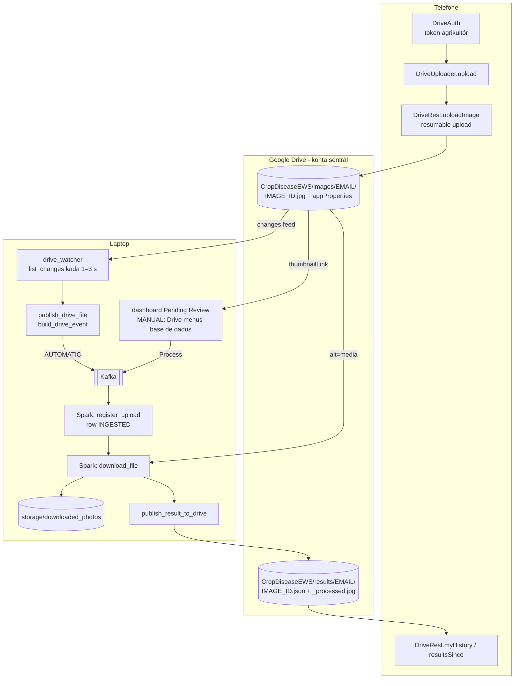
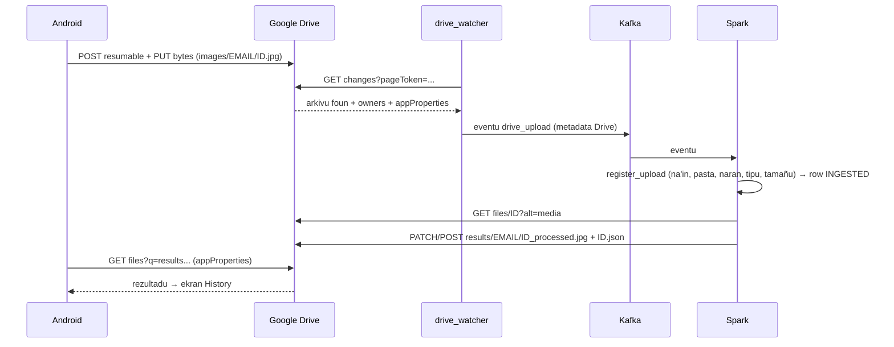

# 03 — Modulu Integrasaun Google Drive

*Sistema Crop Disease Early Warning System (EWS) — dokumentasaun téknika ba modulu Google Drive. Fonte úniku: kódigu iha repozitóriu (commit `9ed46d4` + ajusta deep test, 2026-10-24). Kódigu hotu iha dokumentu ne'e mak kópia husi arkivu loloos, ho númeru liña. Token, password no segredu sira la hatudu.*

{{coverage config/settings.py 211-240}}
{{coverage scripts/drive_authorize.py 1-80}}
{{coverage scripts/drive_share_user.py 1-46}}
{{coverage storage/drive_client.py 1-546}}
{{coverage storage/image_storage.py 1-140}}
{{coverage kafka/drive_watcher.py 1-320}}
{{coverage storage/processing_mode.py 1-48}}
{{coverage storage/drive_inventory.py 1-72}}
{{coverage storage/farmers.py 1-42}}
{{coverage spark/preprocessing.py 235-276 746-937}}
{{coverage storage/reset.py 136-197 291-304}}
{{coverage android_app/app/src/main/java/com/cropdisease/app/DriveAuth.kt 1-46}}
{{coverage android_app/app/src/main/java/com/cropdisease/app/DriveUploader.kt 1-121}}
{{coverage android_app/app/src/main/java/com/cropdisease/app/DriveRest.kt 1-346}}

## A. Introdusaun no Objetivu

Google Drive mak **fatin úniku** ne'ebé telefone agrikultór koalia ba. La iha servidór API ida entre telefone no laptop. Drive halo serbisu tolu:

1. **Ingestaun.** Aplikasaun Android upload fotografia ba pasta agrikultór nian `images/<email>/`. Drive watcher (la iha base de dadus) haree arkivu foun no publika eventu `drive_upload` ho metadata Drive ba Kafka; Spark mak rejista fotografia iha base de dadus.
2. **Armazenamentu orijinál.** Fotografia orijinál hela iha Drive; base de dadus rai de'it `gdrive:<file id>`. Spark rai kópia lokál ida (`storage/downloaded_photos/`).
3. **Entrega rezultadu.** Spark hakerek `<image_id>.json` no `<image_id>_processed.jpg` ba `results/<email>/`, no telefone lee husi ne'ebá.

**Problema ne'ebé modulu ne'e rezolve:** agrikultór presiza haruka fotografia no simu rezultadu la ho servidór públiku, la ho password foun, no la ho porta nakloke iha laptop. Google mak halo autentikasaun, armazenamentu, partilla no seguransa transporte (HTTPS).

**Konta OAuth rua:**

| Na'in | Konta | Token rai iha ne'ebé | Scope |
|---|---|---|---|
| Laptop (sistema) | Konta **sentrál** ida | `storage/google_drive_token.json` (laptop de'it; iha `.gitignore`) | `https://www.googleapis.com/auth/drive` |
| Telefone | Konta Google **agrikultór** rasik | Google Identity Services (token badak) | `https://www.googleapis.com/auth/drive` |

## B. Arkivu Fonte Loloos

| Arkivu | Liña | Funsaun / klase prinsipál | Papél |
|---|---|---|---|
| `config/settings.py` | 211–240 | `GOOGLE_DRIVE_*`, `_drive_folder_id` | Konfigurasaun Drive |
| `scripts/drive_authorize.py` | 80 | `main` | OAuth dala ida (konta sentrál) no pasta baze |
| `scripts/drive_share_user.py` | 46 | `main` | Rejista agrikultór: pasta privadu rua |
| `storage/drive_client.py` | 546 | `DriveError`, `DriveNotConfigured`, `_authed_session`, `_request`, `download_file`, `download_thumbnail`, `upload_bytes`, `list_changes`, `user_folder_id`, `register_farmer`, `share_with`, `ensure_folder` | Kliente API Drive úniku iha laptop |
| `storage/image_storage.py` | 140 | `is_drive_path`, `load_image_bytes`, `downloaded_photo_path`, `store_downloaded_photo` | Konvensaun `gdrive:` no kópia lokál |
| `kafka/drive_watcher.py` | 320 | `build_drive_event`, `publish_drive_file`, `scan_once`, `scan_changes`, `start_change_feed`, `main` | Deteta upload foun iha Drive no publika eventu (la iha base de dadus) |
| `storage/processing_mode.py` | 48 | `ProcessingMode`, `get_processing_mode`, `set_processing_mode` | Modu AUTOMATIC / MANUAL iha arkivu JSON |
| `storage/drive_inventory.py` | 72 | `farmer_photos`, `unprocessed_photos`, `send_for_processing` | Fotografia Drive ne'ebé seidauk iha row (Pending Review, `--from-drive`) |
| `storage/farmers.py` | 42 | `get_or_create_farmer` | Konta agrikultór husi konta Google |
| `spark/preprocessing.py` | 235–276, 746–937 | `_clean_drive_event`, `publish_result_to_drive`, `_ResultFolderIndex` | Spark kontrola arkivu Drive no hakerek rezultadu |
| `storage/reset.py` | 136–197, 291–304 | `clear_drive_files`, `write_reset_markers`, `_clear_watcher_bookmark` | Factory reset iha Drive |
| `android_app/.../DriveAuth.kt` | 46 | `DriveAuth` | OAuth agrikultór iha telefone |
| `android_app/.../DriveUploader.kt` | 121 | `DriveUploader.upload`, `Outcome` | Upload fotografia ida ho retry |
| `android_app/.../DriveRest.kt` | 346 | `DriveRest` | Chamada REST Drive hotu husi telefone |

**Dependénsia:** laptop: `google-auth` (`Credentials`, `AuthorizedSession`), `google-auth-oauthlib` (`InstalledAppFlow`), `requests`. Telefone: Google Play Services Identity (`AuthorizationClient`), OkHttp, `org.json`. API: Google Drive REST v3.

## C. Arkitetura no Fluxu Ezekusaun

**Estrutura pasta iha konta sentrál:**

| Pasta | Fahe ho | Papél |
|---|---|---|
| `CropDiseaseEWS/` | ninguén | Abut |
| `CropDiseaseEWS/images/` | ninguén | Pasta agrikultór hotu |
| `CropDiseaseEWS/images/<email>/` | agrikultór ne'e de'it, `writer` | Telefone upload iha ne'e |
| `CropDiseaseEWS/results/` | ninguén | — |
| `CropDiseaseEWS/results/<email>/` | agrikultór ne'e de'it, `reader` | Spark hakerek rezultadu |

**Identidade:** sé mak upload, sistema foti husi Drive `owners` (Google mak hatene), la'ós husi telefone. Telefone fó de'it informasaun deskritivu (`image_id`, `location`, GPS) iha `appProperties`.

## D. Esplikasaun Kódigu ba Kódigu

### D.1 Konfigurasaun Drive — `config/settings.py` (liña 211–240)

{{code config/settings.py 211-240}}

- Liña 214–216: konta **sentrál** ida rai imajen no rezultadu hotu; nia token iha laptop de'it no nunka ba Android.
- `GOOGLE_DRIVE_CLIENT_SECRET_FILE` — JSON klient OAuth "Desktop app" husi Google Cloud Console (identifika *aplikasaun*, la'ós password utilizadór).
- `GOOGLE_DRIVE_TOKEN_FILE` — fatin *refresh token* (`storage/google_drive_token.json`).
- `GOOGLE_DRIVE_FOLDERS_FILE` — JSON ho id pasta ne'ebé `drive_authorize.py` kria.
- `GOOGLE_DRIVE_ROOT_FOLDER_NAME` — `CropDiseaseEWS`.
- `_drive_folder_id(env_name, key)` (liña 226–236): variavel ambiente iha prioridade; se lae lee JSON; arkivu la iha (`OSError`) ka JSON aat (`ValueError`) → `""` (la hasai esesaun iha import).
- Liña 239–240: halai **dala ida bainhira import**; id pasta fiksu ba prosesu tomak.

### D.2 OAuth dala ida — `scripts/drive_authorize.py`

#### D.2.1 Docstring no import (liña 1–36)

{{code scripts/drive_authorize.py 1-36}}

- Pasu tolu: (1) browser loke ekran konsentimentu Google ba konta sentrál; (2) rai *refresh token*; (3) kria/buka pasta `CropDiseaseEWS/images` no `/results` no rai sira nia id.
- Liña 29: `sys.path.insert` — script bele import pakote projetu.

#### D.2.2 `main` — fluxu OAuth (liña 39–80)

{{code scripts/drive_authorize.py 39-80}}

- Liña 40–45: klient secret la iha → mensajen klaru, fila `1`.
- Liña 50: `InstalledAppFlow.from_client_secrets_file(..., SCOPES)` — fluxu OAuth 2.0 ba "installed app".
- Liña 51: `run_local_server(port=0, access_type="offline", prompt="consent")`:
  - `port=0` — servidór lokál ki'ik iha porta livre simu *redirect* Google.
  - `access_type="offline"` — Google fó **refresh token** (bele hetan *access token* foun la ho husu fali).
  - `prompt="consent"` — obriga ekran konsentimentu, nune'e refresh token sempre fó.
- Liña 53–56: hakerek token JSON ba arkivu (**privadu**; `.gitignore`).
- Liña 59–61: `ensure_folder` — kria ka buka pasta tolu.
- Liña 63–71: rai id pasta iha `google_drive_folders.json`.
- Liña 73–76: pasu tuir mai: `drive_share_user.py` ba agrikultór ida-idak.

### D.3 Rejista agrikultór — `scripts/drive_share_user.py` (liña 1–46)

{{code scripts/drive_share_user.py 1-46}}

- Kada email: `drive_client.register_farmer(email)` kria (ka reuza) `images/<email>/` (`writer`) no `results/<email>/` (`reader`).
- Pasta baze la fahe ho ema ida, nune'e agrikultór haree de'it nia pasta rua.
- Liña 38–41: hatudu link Google Cloud atu aumenta email hanesan *test user* (presiza bainhira app iha modu "Testing").
- Halai fali ba email hanesan seguru (*idempotent*).

### D.4 `storage/drive_client.py` — kliente API Drive

#### D.4.1 Docstring (liña 1–32)

{{code storage/drive_client.py 1-32}}

- Módulu **úniku** iha laptop ne'ebé koalia ho Drive (watcher, Spark, dashboard hotu liu iha ne'e).
- Uza Drive REST v3 direta liuhusi `AuthorizedSession` (la uza biblioteka `googleapiclient`).
- Scope `drive` tomak: laptop tenke lee fotografia ne'ebé konta **agrikultór** kria; scope `drive.file` la bele haree.

#### D.4.2 Konstante no validasaun id (liña 33–57)

{{code storage/drive_client.py 33-57}}

- `SCOPES`, `DRIVE_API`, `UPLOAD_API`, `FOLDER_MIME_TYPE`.
- `FILE_METADATA_FIELDS` — koluna metadata ne'ebé husu: `appProperties` (tag telefone), `sha256Checksum` (hash Google), `owners` (sé mak upload), `trashed`, `createdTime`, `size`, `mimeType`, `parents`.
- `_DRIVE_ID_RE` — id Drive válidu: letra, númeru, `_`, `-`, 10–200 karakter. **Seguransa:** valida molok tau iha URL ka *query* → prevene *injection*.

#### D.4.3 Esesaun no ajuda konfigurasaun (liña 60–100)

{{code storage/drive_client.py 60-100}}

- `DriveNotConfigured(Exception)` — token ka id pasta falta.
- `DriveError(Exception)` ho `__init__(message, status_code)`: `super().__init__(message)` (herança) no atributu `status_code`.
- `is_valid_drive_id`, `_require_valid_id` — `DriveError(..., 400)` ba id aat.
- `images_folder_id`, `results_folder_id` — `DriveNotConfigured` se mamuk.
- `is_configured` — token iha **no** id pasta rua iha.

#### D.4.4 Sesaun autentikadu (liña 103–127)

{{code storage/drive_client.py 103-127}}

- `_session` — variavel global; sesaun ida ba prosesu (*lazy singleton*).
- Liña 117–121: token la iha → `DriveNotConfigured` ho instrusaun.
- Liña 125: `Credentials.from_authorized_user_file(token_file, SCOPES)` — lee refresh token.
- Liña 126: `AuthorizedSession(creds)` — sesaun `requests` ne'ebé tau `Authorization: Bearer <access token>` automátiku no **refresh** token badak bainhira nia mate.

#### D.4.5 `_check` no `_escape_query_value` (liña 130–140)

{{code storage/drive_client.py 130-140}}

- `_check` — HTTP ≥ 400 → `DriveError` ho status no testu (300 karakter).
- `_escape_query_value` — escape `\` no `'` iha valór *query* Drive (`name = '...'`) — prevene *query injection*.

#### D.4.6 Konstante retry no `_should_back_off` (liña 143–167)

{{code storage/drive_client.py 143-167}}

- Timeout `(15, 60)` = segundu 15 ba liga, 60 ba lee.
- `_RATE_LIMIT_ATTEMPTS = 6` — hein 1, 2, 4, 8, 16 s (+ *jitter*).
- `_RETRY_STATUSES` — 429, 500, 502, 503, 504.
- `_sleep` — bele troka iha teste.
- `_should_back_off(resp)`: status iha lista → `True`; 403 → `True` de'it se razaun `rateLimitExceeded`/`userRateLimitExceeded` (403 seluk = la iha permisaun, la retry).

#### D.4.7 `_request` — chamada hotu liu iha ne'e (liña 170–189)

{{code storage/drive_client.py 170-189}}

- Liña 181: tau `timeout` default — uluk upload ne'ebé Google la responde hein ba nafatin no hapara batch Spark tomak.
- Liña 182–189: to'o dala 6: halai pedidu (`getattr(session, "get"/"post"/...)`); se la presiza hein ka tentativa ikus, fila resposta (maske erru, ba `_check`); se lae hein `2^(n−1) + random()` segundu (*exponential backoff* ho *jitter*).

#### D.4.8 `_get_with_retry`, `get_file_metadata`, `download_file` (liña 192–225)

{{code storage/drive_client.py 192-225}}

- `_get_with_retry` — GET ho retry 3 ba rede monu (`ConnectionError`, `ChunkedEncodingError`, `Timeout`), hein 2, 4 s. `resp.content` lee isin tomak iha laran *loop*. De'it GET: POST ne'ebé resposta lakon bele kria arkivu dala rua.
- `get_file_metadata(file_id)` — valida id, GET `files/<id>?fields=...`, `_check`, fila JSON.
- `download_file(file_id)` — GET `files/<id>?alt=media` → bytes orijinál.

#### D.4.8b `download_thumbnail` — imajen ki'ik husi Google (liña 228–239)

{{code storage/drive_client.py 228-239}}

- **Objetivu:** dashboard Pending Review hatudu fotografia ne'ebé seidauk prosesa direta husi Drive. Download fotografia tomak (2–12 MB) ba kada kartaun neineik liu; Google kria ona imajen ki'ik (*thumbnail*, KB balun).
- Liña 231–233: valida id, husu `fields=thumbnailLink` husi metadata arkivu.
- Liña 234–236: Google seidauk kria *thumbnail* → `None` (dashboard hatudu testu de'it).
- Liña 237–238: `thumbnailLink` remata ho `=s220` (pixel 220); `re.sub` troka ba tamañu ne'ebé pájina presiza.
- Liña 239: bytes imajen, ka `None` se Google fó erru (≥ 400).

#### D.4.9 `find_file_in_folder` (liña 242–262)

{{code storage/drive_client.py 242-262}}

- *Query* Drive: `name = '<escaped>' and '<parent>' in parents and trashed = false`, orden `modifiedTime desc`, `pageSize 1` → arkivu foun liu ka `None`.

#### D.4.10 `_multipart_body` no `_short_app_properties` (liña 265–288)

{{code storage/drive_client.py 265-288}}

- `_multipart_body` — harii isin `multipart/related` (RFC 2387): parte 1 metadata JSON, parte 2 bytes arkivu, separa ho *boundary* aleatóriu (`uuid4`). Fila `(body, content_type)`.
- `_short_app_properties` — Drive limita kada `appProperties` xave+valór ba **124 bytes**; valór `None` skip, valór naruk ko'a karakter ida-idak to'o kabe (sukat bytes UTF-8).

#### D.4.11 `upload_bytes` no `_upload_once` (liña 291–342)

{{code storage/drive_client.py 291-342}}

- `upload_bytes` — kria ka **substitui** arkivu; replay Spark atualiza arkivu ida (la duplika). Retry 3 ba rede monu; **retry sempre buka uluk** (`may_exist or attempt > 1`), tanba tentativa ne'ebé *timeout* bele kria tiha ona arkivu.
- `_upload_once`:
  - Liña 318: ko'a `appProperties`.
  - Liña 319–322: `existing_id` husi kliente (indeks rezultadu Spark) → atualiza direta; se lae buka (`find_file_in_folder`) se `may_exist`.
  - Liña 324–332: iha ona → `PATCH upload/.../files/<id>?uploadType=multipart` (isin foun + `appProperties`).
  - Liña 334–342: la iha → `POST upload/.../files?uploadType=multipart` ho `name`, `mimeType`, `parents`, `appProperties`.
  - **Valór retorna:** id arkivu Drive.

#### D.4.12 `upload_json` (liña 345–350)

{{code storage/drive_client.py 345-350}}

- `json.dumps(data, indent=2, default=str)` → bytes UTF-8 → `upload_bytes` ho tipu `application/json`.

#### D.4.13 *Change feed*: `get_start_page_token` no `list_changes` (liña 353–379)

{{code storage/drive_client.py 353-379}}

- `get_start_page_token` — *bookmark* "agora" iha *change feed* konta sentrál.
- `list_changes(page_token)` — buat hotu ne'ebé muda depois *bookmark* (inklui fotografia agrikultór iha pasta ne'ebé konta sentrál na'in). Pedidu **ida** ba to'o mudansa 1000, la depende ba númeru agrikultór. *Loop*: `nextPageToken` → pájina tuir mai; `newStartPageToken` → remata no fila `(changes, new_token)`.

#### D.4.14 Lista pasta no arkivu (liña 382–424)

{{code storage/drive_client.py 382-424}}

- `list_subfolders(parent_id)` — pasta iha laran (`mimeType = folder`), pájina 100.
- `list_files_in_folders(parent_ids, created_after)` — arkivu (la'ós pasta) iha pasta barak; *query* ida kada pasta 20 (`'a' in parents or 'b' in parents ...`); opsionál `createdTime > ...`; orden tuir `createdTime`. Ne'e *safety net* ba watcher.

#### D.4.15 Pasta agrikultór: `user_folder_id`, `_find_or_create_user_folder` (liña 427–466)

{{code storage/drive_client.py 427-466}}

- `USER_IMAGES_KIND`/`USER_RESULTS_KIND` — tag `appProperties.kind` ne'ebé telefone uza atu hetan pasta.
- `_user_folder_cache` (`dict`) no `_user_folder_lock` — *cache* kada prosesu.
- `user_folder_id` — normaliza email (letra ki'ik); iha *cache* → fila; se lae ho *lock* (*double-checked*): Spark prosesa fotografia barak hamutuk, no fotografia rua husi agrikultór foun la bele kria pasta rezultadu rua.
- `_find_or_create_user_folder` — buka pasta naran email iha abut; la iha no `create=False` → `None`; la iha no `create=True` → `ensure_folder` (ho tag) no `share_with` se `share_role`.

#### D.4.16 `register_farmer`, `account_info`, `google_cloud_project_id` (liña 469–508)

{{code storage/drive_client.py 469-508}}

- `register_farmer` — parte Drive husi rejistu (script no botaun dashboard "Register farmer"): pasta rua + partilla `writer`/`reader`.
- `account_info` — `GET about`: email konta sentrál no uzu armazenamentu (`limit` `None` = la iha limite).
- `google_cloud_project_id` — lee `project_id` husi JSON klient OAuth (ba link konsola). `next(iter(data.values()))` foti objetu uluk (`"installed": {...}`).

#### D.4.17 `share_with` no `ensure_folder` (liña 511–546)

{{code storage/drive_client.py 511-546}}

- `share_with(file_id, email, role)` — `POST files/<id>/permissions` ho `{"type": "user", "role": ..., "emailAddress": ...}` no `sendNotificationEmail=false`. `role` de'it `reader` ka `writer`.
- `ensure_folder(name, parent_id, app_properties)` — buka pasta (naran escape, la iha lixu, iha *parent*); la iha → `POST files` kria.

### D.5 `storage/image_storage.py` — referénsia `gdrive:` no kópia lokál

#### D.5.1 Docstring no dalan lokál (liña 1–60)

{{code storage/image_storage.py 1-60}}

- Fotografia antigu (API REST ne'ebé hasai tiha ona) iha disku; fotografia foun iha Drive ho `gdrive:<file id>`.
- `resolve_image_path` — buka arkivu lokál: dalan iha → uza; relativu → iha `BASE_DIR`; dalan absolutu tuan ho segmentu `images/` → tau iha `IMAGE_STORAGE_PATH` atuál. La iha → `FileNotFoundError`.
- `to_stored_path` — dalan relativu ho `/` (portátil).

#### D.5.2 Konvensaun `gdrive:` no download (liña 63–96)

{{code storage/image_storage.py 63-96}}

- `DRIVE_PATH_PREFIX = "gdrive:"` — rai iha koluna `images.image_path` hanesan, nune'e la presiza muda *schema*.
- `is_drive_path`, `to_drive_path`, `drive_file_id_from_path` — kontrola, kria no foti id.
- `load_image_bytes(stored)` — Drive: `download_file`; `DriveError` → `FileNotFoundError` (tipu erru hanesan ba fonte rua). Lokál: `resolve_image_path(...).read_bytes()`.

#### D.5.3 Kópia lokál permanente (liña 99–140)

{{code storage/image_storage.py 99-140}}

- `_SAFE_ID_RE` — `user_id`/`image_id` tenke naran arkivu seguru (letra, númeru, `_`, `-`); prevene `..` ka separadór (*path traversal*).
- `_local_copy_base` — `storage/downloaded_photos/<user_id>/<image_id>` ka `None`.
- `downloaded_photo_path` — buka `.jpg` ka `.png`; la iha → `None`.
- `store_downloaded_photo` — hakerek bytes **la muda** (EXIF inklui). `.png` se hahú ho assinatura `\x89PNG`. Hakerek ba `.tmp` depois `replace` (atómiku): kópia la kompletu nunka parese válidu. Aplikasaun la hamoos arkivu sira ne'e.
- **"Local folder sync":** la iha sinkronizasaun automátiku Drive ↔ pasta lokál. Kópia lokál kria bainhira Spark download dala uluk; Reprocess no replay uza kópia ne'e (la presiza rede).

### D.6 `kafka/drive_watcher.py` — deteta upload iha Drive

#### D.6.1 Docstring (liña 1–33)

{{code kafka/drive_watcher.py 1-33}}

- Liña 5–13: fluxu: telefone upload ba `images/<email>/`; watcher tuir *change feed* konta sentrál (pedidu ida kada kontrola, kada 1 s bainhira iha upload, to'o 3 s bainhira trankilu) no publika eventu Kafka ida kada fotografia, harii husi **metadata Drive** (nunka bytes). Folder scan tomak iha hahú no kada minutu 10 hanesan *safety net*.
- Liña 15–16: watcher mak dalan úniku fotografia tama sistema; telefone koalia ho Google Drive de'it.
- Liña 18–20: **stateless — la iha base de dadus.** Watcher lee Drive no publika de'it. Spark nia pasu *ingestion* (`spark/ingestion.register_upload`) mak buka agrikultór, kontrola upload, skip duplikadu no hakerek row uluk.
- Liña 21–23: modu MANUAL (`storage/processing_mode.json`) → watcher la publika buat ida; dashboard Pending Review lista fotografia Drive ne'ebé seidauk iha row, no admin mak haruka.
- **Modelu konfiansa** (liña 25–28): `image_id`/`location`/tempu husi telefone (`appProperties`); **sé** mak upload husi Google (na'in arkivu iha metadata Drive), nune'e ema ida la bele upload ho naran ema seluk. Eventu lori na'in ne'e no pasta ne'ebé fotografia iha.

#### D.6.2 Import no konstante (liña 34–69)

{{code kafka/drive_watcher.py 34-69}}

- Liña 40: `OrderedDict` ba lista arkivu ne'ebé publika ona (D.6.5).
- Liña 46–49: import ki'ik: konfigurasaun, `drive_client`, `to_drive_path` (`gdrive:<id>`), no `get_processing_mode`. **La iha import base de dadus** (`storage.database`) — deep test 2026-10-24 konfirma watcher la load modulu base de dadus.
- Liña 51–53: kota Drive: kontrola ida ~100 unidade husi 325,000/minutu; kada 1 s ≈ 6,000/minutu (< 2%).
- Liña 54–57: `POLL_SECONDS = 1`, `IDLE_POLL_SECONDS = 3`, `FULL_SCAN_SECONDS = 600`, `STATE_FILE` (`storage/drive_watcher_state.json`).
- Liña 58–61: `OVERLAP = 2 min` — scan fali uitoan molok `createdTime` ikus, tanba indeks Drive bele tarde.
- Liña 63: `_UUID_RE` — formatu `image_id` aplikasaun (UUID letra ki'ik). Spark no `drive_inventory` uza regra ida ne'e.
- Liña 65–69: `_PUBLISHED` — id arkivu ne'ebé prosesu ne'e publika ona (change feed no scan bele haree arkivu hanesan); limite 20000. Ne'e la'ós kontrola duplikadu loloos; Spark mak halo.

#### D.6.3 Ajuda: `_device_gps`, `_parse_time` (liña 72–92)

{{code kafka/drive_watcher.py 72-92}}

- `_device_gps` — GPS telefone husi `appProperties` (`gps_lat`, `gps_lon`); parse ho kuidadu (`KeyError`, `TypeError`, `ValueError`); fora intervalu ka `(0, 0)` → `None`.
- `_parse_time` — `fromisoformat` ho `Z` → `+00:00`; aat → `None` (la rejeita fotografia).

#### D.6.4 `build_drive_event` — metadata Drive sai eventu (liña 95–126)

{{code kafka/drive_watcher.py 95-126}}

- **Parámetru:** `meta` (metadata arkivu Drive: `id`, `name`, `mimeType`, `size`, `createdTime`, `sha256Checksum`, `owners`, `parents`, `appProperties`), `folder_email` (email pasta `images/<email>/`). **Valór retorna:** eventu `drive_upload` (`dict`).
- Liña 97–99: watcher, botaun dashboard "Process" no `requeue_stuck --from-drive` uza funsaun ida ne'e — eventu hanesan husi dalan tolu.
- Liña 101–104: `appProperties` (aplikasaun Android tau), `owners[0]` (na'in arkivu = **identidade husi Google**), id arkivu.
- Liña 105–106: `captured_at_client` (tempu telefone) no GPS telefone (D.6.3).
- Liña 109: `image_id` husi `appProperties`; la iha → `None` (Spark rejeita: la'ós husi aplikasaun).
- Liña 112–115: `image_path = gdrive:<id>`, naran, tipu, tamañu (testu).
- Liña 116–118: `owner_email`, `owner_name`, `folder_email` — Spark kompara na'in ho pasta.
- Liña 119: `uploaded_at` = `createdTime` (relójiu Google, la'ós telefone).
- Liña 121–123: `location` hanesan telefone haruka (Spark limpa); naran orijinál; `content_hash` = `sha256Checksum` Google.
- Liña 124–125: GPS testu ka `None`.

#### D.6.5 `publish_drive_file` no `_publish_safely` (liña 129–162)

{{code kafka/drive_watcher.py 129-162}}

- `publish_drive_file` — arkivu ida husi pasta agrikultór:
  - Liña 135–136: publika ona iha prosesu ne'e → `"already_published"`.
  - Liña 137–140: modu MANUAL → la haruka (`"held"`); fotografia hela iha Drive no dashboard Pending Review lista nia.
  - Liña 141–142: modu AUTOMATIC → `build_drive_event` no `backend.send` (Kafka).
  - Liña 143–145: rai iha `_PUBLISHED` (tuan liu sai bainhira liu 20000).
  - Liña 146–148: liña konsola `[drive_watcher] new photo ...` no `"published"`.
- `_publish_safely` — arkivu ida falla (Kafka mate ho *fallback* off) la hapara scan: hakerek erru no fila `"error"`. Se lae *bookmark* change feed la la'o. *Scan* 10 min ka `requeue_stuck --from-drive` haruka depois.
- **Kontrola upload (na'in, pasta, naran, tipu, tamañu) la iha ne'e** — Spark halo (`spark/ingestion.register_upload`, 01_spark_module D.6).

#### D.6.6 Estadu *bookmark* (liña 165–174)

{{code kafka/drive_watcher.py 165-174}}

- `_load_state` — JSON; la iha ka aat → `{}`.
- `_save_state` — hakerek JSON (`changes_page_token`, `last_created_time`). *Limitasaun:* la atómiku. Ne'e mak estadu úniku watcher nian (la'ós base de dadus).

#### D.6.7 `scan_once` — scan pasta (*safety net*) (liña 177–203)

{{code kafka/drive_watcher.py 177-203}}

- Liña 181–185: `created_after` = `last_created_time − 2 min` (*overlap* ba atrazu indeks Google).
- Liña 187–193: lista pasta agrikultór hotu (`{id: email}`), depois arkivu foun iha sira.
- Liña 194–197: kada arkivu: pasta ne'ebé nia iha → email; `_publish_safely`.
- Liña 199–202: rai `createdTime` foun liu.

#### D.6.8 `NoBookmark`, `scan_changes`, `start_change_feed` (liña 206–253)

{{code kafka/drive_watcher.py 206-253}}

- `NoBookmark(RuntimeError)` — la iha *bookmark* (hahú dala uluk ka *factory reset* hamoos).
- `scan_changes` (liña 212–240): `list_changes(token)`; skip hamoos/lixu (liña 227–228); pasta foun iha `images/` → agrikultór foun, aumenta ba `user_folders` (la presiza restart, liña 230–233); arkivu la iha pasta agrikultór (ezemplu rezultadu) → skip (liña 234–236); arkivu iha pasta agrikultór → `_publish_safely`; rai token foun.
- `start_change_feed` (liña 243–253) — rai *bookmark* "agora" **uluk**, depois `scan_once` (nune'e upload ida la lakon entre rua). Fila mapa `{folder id: email}`.

#### D.6.9 `next_interval` no `main` (liña 256–320)

{{code kafka/drive_watcher.py 256-320}}

- `next_interval` (liña 256–262) — iha fotografia foun → 1 s; trankilu → `current × 1.5` to'o 3 s (kustu kota ki'ik iha kalan).
- `main` (liña 265–316) — backend Kafka (liña 270–271); `--once` → scan ida. *Loop*: `drain` (liña 289–290), `start_change_feed` (dala uluk), `scan_changes`, kada 10 min `scan_once`; `DriveNotConfigured` → sai ho `1`; `NoBookmark` → hamoos `_PUBLISHED` no hahú fali; erru seluk → kontinua.
- **La iha `init_db`**: watcher la liga base de dadus.

#### D.6.10 Modu prosesu — `storage/processing_mode.py` (liña 1–48)

{{code storage/processing_mode.py 1-48}}

- Liña 2–3: modu AUTOMATIC / MANUAL rai iha arkivu JSON ki'ik, nune'e watcher lee la ho base de dadus. (Uluk tabela `system_settings`; `init_db` hamoos tabela ne'e iha 2026-10-24.)
- Liña 5–8: AUTOMATIC — watcher publika upload hotu kedas; MANUAL — watcher la publika, Pending Review lista fotografia Drive ne'ebé la iha row, admin haruka ho "Process".
- Liña 20: `MODE_FILE` = `storage/processing_mode.json` (ka `PROCESSING_MODE_FILE`).
- Liña 23–28: `ProcessingMode(str, enum.Enum)` — **herança** husi `str` no `Enum`: valór bele kompara ho testu.
- Liña 31–36: `get_processing_mode` — arkivu la iha ka aat → AUTOMATIC (deep test: arkivu la iha / JSON aat → AUTOMATIC).
- Liña 39–48: `set_processing_mode` — `ProcessingMode(mode)` valida (`ValueError` ba valór seluk); hakerek ba `.tmp` depois `replace` (atómiku), nune'e watcher nunka lee arkivu sorin balu.

#### D.6.11 Fotografia ne'ebé seidauk prosesa — `storage/drive_inventory.py` (liña 1–72)

{{code storage/drive_inventory.py 1-72}}

- Liña 4–6: base de dadus iha row de'it ba fotografia ne'ebé Spark rejista, entaun "pending" = fotografia iha `images/<email>/` ne'ebé `image_id` la iha row `images`.
- Liña 8–10: uza iha fatin tolu: Pending Review (modu MANUAL), muda ba AUTOMATIC (haruka buat hotu ne'ebé sei pending), `requeue_stuck --from-drive`.
- Liña 12–13: arkivu la ho tag `image_id` aplikasaun la tama (nunka sei hetan row).
- `farmer_photos` (liña 23–33) — lista pasta agrikultór no arkivu hotu (pedidu Drive barak; ~7 s ba fotografia ~650, tanba ne'e dashboard *cache* 60 s).
- `uploaded_at` (liña 36–42) — `createdTime` → `datetime`.
- `unprocessed_photos` (liña 49–58) — filter `_UUID_RE`; depois buka `image_id` iha base de dadus kada 500 (`IN (...)`, limite parámetru SQL); fila fotografia ne'ebé la iha row.
- `send_for_processing` (liña 61–72) — `build_drive_event` (eventu watcher hanesan) ba kada fotografia; erru ida la hapara seluk; fila `(sent, failed)`.
- **Duplikadu:** filter tuir `image_id` iha ne'e; fotografia hanesan ho `image_id` seluk mak Spark kaer (SHA-256, `check_duplicate_by_hash`).

#### D.6.12 Konta agrikultór — `storage/farmers.py` husi parte Drive (liña 1–42)

{{code storage/farmers.py 1-42}}

- Liña 2–6: agrikultór nunka rejista ho password: konta Google na'in upload (`owners` Drive) mak identidade. Spark (`register_upload`) no botaun dashboard "Register farmer" uza funsaun ida ne'e.
- Liña 17–21: email normaliza; konta iha ona → fila.
- Liña 22–32: konta foun `USER`, `ACTIVE`, `email_verified=True`; password aleatóriu ninguén hatene (konta la bele login iha fatin seluk).
- Liña 33–40: fotografia barak husi agrikultór foun prosesa paralelu → *thread* rua bele kria konta hanesan; `IntegrityError` → `rollback` no lee konta ne'ebé iha ona (hadi'a 2026-10-24).

### D.7 Spark ho Google Drive (husi parte Drive)

#### D.7.1 Kontrola arkivu Drive: `_clean_drive_event`, `_registered_from_drive` (spark/preprocessing.py liña 235–276)

{{code spark/preprocessing.py 235-276}}

- Spark la fiar eventu Kafka mesak. Arkivu tenke iha Drive, la iha lixu, no `appProperties.image_id` hanesan eventu — eventu falsu la bele aponta Spark ba arkivu Drive arbitráriu.
- Se Spark nia pasu *ingestion* rejista ona arkivu ne'e (husi metadata Drive) ho `image_id`, `image_path` no `user_id` hanesan, Spark la husu Drive fali (poupa ~0.5 s no kota). `SPARK_RECHECK_DRIVE_FILE=true` obriga kontrola.
- Erru Drive → `InvalidEvent` (FAILED ho razaun).

#### D.7.2 Formatu rezultadu: `_prediction_to_dict` (liña 746–763)

{{code spark/preprocessing.py 746-763}}

- Koluna prediction iha formatu ne'ebé Android (`DriveRest.kt`) lee.

#### D.7.3 `publish_result_to_drive` — payload (liña 765–826)

{{code spark/preprocessing.py 765-826}}

- Payload harii **husi base de dadus** ne'ebé `persist_result` foin hakerek, nune'e Drive no base de dadus hanesan.
- Imajen teste → pasta teste rasik de'it; imajen lokál → `None`.
- Hora Timor (`captured_at_local`, `uploaded_at_local`) ba telefone hatudu direta.

#### D.7.4 `publish_result_to_drive` — pasta no upload (liña 828–862)

{{code spark/preprocessing.py 828-862}}

- `user_folder_id(..., USER_RESULTS_KIND, create=True, share_role="reader")` — pasta rezultadu kria no fahe bainhira presiza.
- `<image_id>_processed.jpg` (COMPLETED de'it) no `<image_id>.json`, ho `existing_id` husi indeks: arkivu iha ona → `PATCH` (la duplika).
- `summary` iha `appProperties`: telefone lista rezultadu hotu ho pedidu ida (la download JSON ida-idak). Valór ko'a ba 124 bytes iha `_short_app_properties`.
- Ikus `_mark_result_published`.

#### D.7.5 `_ResultFolderIndex`, `_mark_result_published`, `publish_result_to_drive_safely` (liña 865–937)

{{code spark/preprocessing.py 865-937}}

- `_ResultFolderIndex` — lista pasta rezultadu ida **dala ida** kada prosesu (pedidu ida kada arkivu 100), depois rai id foun. Troka "tebak" antigu ne'ebé kria duplikadu 1,163 depois *factory reset* (2026-10-09). Seguru tanba Spark de'it hakerek iha pasta sira ne'e, no *reset* halai bainhira Spark hapara.
- `publish_result_to_drive_safely` — Drive mate → hakerek iha konsola, fila `None`; rezultadu seguru iha base de dadus; `requeue_stuck` haruka fali.

### D.8 Drive iha *factory reset* — `storage/reset.py`

#### D.8.1 `clear_drive_files`, `write_reset_markers` (liña 136–197)

{{code storage/reset.py 136-197}}

- Lista pasta agrikultór `images/` no `results/` hotu no nia arkivu.
- Kada arkivu: `PATCH {"trashed": true}`. **403** = konta sentrál la'ós na'in (fotografia agrikultór nian) → `removeParents` (hasai husi pasta; watcher no aplikasaun la haree tan).
- `write_reset_markers` — hakerek `_reset_marker.json` ho `reset_at` iha pasta rezultadu ida-idak; telefone (`DriveRest.resetMarker`) haree no hamoos istória lokál.
- Nunka hasai esesaun; erru iha `summary["errors"]`.

#### D.8.2 `_clear_watcher_bookmark` (liña 291–304)

{{code storage/reset.py 291-304}}

- Hamoos `drive_watcher_state.json`; watcher hetan `NoBookmark`, hahú fali no publika fali fotografia hotu ne'ebé sei iha Drive (ho tempu upload, fatin no GPS orijinál husi Drive); Spark rejista no prosesa sira husi kópia lokál. Iha modu MANUAL fotografia hein iha Pending Review. Ho `--drive` fotografia la iha ona iha Drive, entaun buat ida la fila.

### D.9 Telefone: `DriveAuth.kt` — OAuth agrikultór (liña 1–46)

{{code android_app/app/src/main/java/com/cropdisease/app/DriveAuth.kt 1-46}}

- `object DriveAuth` — Kotlin `object` = *singleton* (objetu ida de'it).
- Liña 14–17: telefone nunka rai password Google ka xave. Google fó *access token* badak ba konta agrikultór **rasik**; pasta konta sentrál bele asesu tanba administradór fahe ona.
- `DRIVE_SCOPE` — scope `drive` tomak (pasta na'in konta sentrál; `drive.file` la haree).
- `authorizationRequest()` — `AuthorizationRequest.builder().setRequestedScopes(...)` (padraun *Builder*).
- `accessTokenBlocking(context)` — `Identity.getAuthorizationClient(context).authorize(...)`, `Tasks.await` (blokeia; *thread* background de'it). `hasResolution()` = presiza login/konsentimentu fali → `null`. Google rai no *refresh* token, entaun bolu kada batch la kustu.

### D.10 Telefone: `DriveUploader.kt` — upload fotografia ida

#### D.10.1 Konstante no `Outcome` (liña 1–43)

{{code android_app/app/src/main/java/com/cropdisease/app/DriveUploader.kt 1-43}}

- Liña 20–21: bytes fotografia haruka **la muda** (la redimensiona, la re-encode) — Spark no CNN analiza orijinál.
- `MAX_PHOTO_BYTES` 15 MB (hanesan `MAX_IMAGE_SIZE` laptop). `ATTEMPTS = 4`, hein 1, 2, 4 s + *jitter*.
- `sealed class Outcome` — rezultadu limitadu: `Uploaded(driveFileId)`, `Rejected` (fotografia la uza, la retry), `Failed` (Drive rejeita, "Retry failed" bele ajuda), `Transient` (rede, hela iha fila), `SignInNeeded`. **Herança** + `data class` + `object`.

#### D.10.2 `upload` (liña 45–95)

{{code android_app/app/src/main/java/com/cropdisease/app/DriveUploader.kt 45-95}}

- Liña 50–52: tipu tenke JPEG/PNG; lee bytes; mamuk ka liu 15 MB → `Rejected`.
- Liña 54–63: `properties` (ba Drive `appProperties`): `image_id`, `original_filename` (80 karakter), `location` (100), GPS ho desimál 6 (`Locale.US` → pontu, la'ós vírgula), presizaun GPS.
- Liña 66–69: kada tentativa **token foun** (upload naruk bele liu ~1 oras token nian).
- Liña 73–74: tentativa 2+ buka uluk se tentativa antigu to'o Drive ona (`findImage`); se lae `uploadImage`. Nune'e fotografia ida nunka sai rua iha Drive (no Spark).
- Liña 76–84: `DriveHttpException`: 401 → koko fali ho token foun, ikus `SignInNeeded`; *retryable* (429, 5xx, 403 rate limit) → koko fali; 403/404 → `Failed` (la iha asesu pasta); seluk → `Failed`.
- Liña 85–86: `IOException` (rede monu, *timeout*) → koko fali.
- Liña 90–92: hein `1000 × 2^(n−1) + random(0..500)` ms.
- Liña 94: tentativa hotu falla → `Transient` (hela iha fila; `UploadWorker` koko fali depois).

#### D.10.3 `readPhotoBytes` (liña 97–121)

{{code android_app/app/src/main/java/com/cropdisease/app/DriveUploader.kt 97-121}}

- Android 10+ hasai tag GPS EXIF se la iha permisaun `ACCESS_MEDIA_LOCATION`. Ho permisaun no uri MediaStore, `MediaStore.setRequireOriginal` fó bytes **ho GPS**. Se lae, lee uri normál (GPS bele lakon). Erru → `null`.

### D.11 Telefone: `DriveRest.kt` — chamada REST Drive

#### D.11.1 Ajuda baze (liña 1–63)

{{code android_app/app/src/main/java/com/cropdisease/app/DriveRest.kt 1-63}}

- `DriveHttpException(code, message) : IOException` — herança; `code` 401 = login fali, 403/404 = la iha asesu.
- `data class Me`, `data class Folders(imagesId, resultsId)`.
- `authed(token)` — `Authorization: Bearer <token>` (token iha memória de'it).
- `execute` — HTTP la susesu → lee testu (300), taka resposta, hasai `DriveHttpException`.
- `getJson` — GET no parse `JSONObject`; `use { }` taka resposta automátiku.
- `q(value)` — escape `\` no `'` ba *query* Drive.

#### D.11.2 `aboutMe` no `myFolders` (liña 65–99)

{{code android_app/app/src/main/java/com/cropdisease/app/DriveRest.kt 65-99}}

- `aboutMe` — email (letra ki'ik) no naran konta Google ne'ebé login.
- `myFolders` — buka pasta ho naran email iha `sharedWithMe`. Pasta `images` = `appProperties.kind == "user_images"` (ka bele aumenta arkivu: `canAddChildren`); `results` = `user_results` (ka la bele). Rua la iha → `null` (administradór seidauk fahe).

#### D.11.3 `uploadImage` — *resumable upload* (liña 101–139)

{{code android_app/app/src/main/java/com/cropdisease/app/DriveRest.kt 101-139}}

- Metadata: naran `<imageId>.jpg/.png`, `mimeType`, `parents` (pasta agrikultór), `appProperties` (valór mamuk hasai).
- Pasu 1 (liña 124–132): `POST upload/drive/v3/files?uploadType=resumable` ho `X-Upload-Content-Type`/`-Length` → Google fó URL sesaun iha header `Location`.
- Pasu 2 (liña 135–138): `PUT` bytes ba URL sesaun → fila `id` arkivu. *Resumable* di'ak ba fotografia > 5 MB.

#### D.11.4 `findImage` no `isRetryable` (liña 141–162)

{{code android_app/app/src/main/java/com/cropdisease/app/DriveRest.kt 141-162}}

- `findImage` — `<imageId>.jpg` ka `.png` iha pasta; id ka `null`. Uza molok retry.
- `isRetryable` — 429, ≥ 500, ka 403 ho `rateLimitExceeded`.

#### D.11.5 `findResults` no `resetMarker` (liña 164–202)

{{code android_app/app/src/main/java/com/cropdisease/app/DriveRest.kt 164-202}}

- `findResults` — pedidu ida kada `image_id` 20 (`name = 'a.json' or ...`); fila mapa `image_id → id JSON`.
- `resetMarker` — `reset_at` husi `_reset_marker.json` foun liu, ka `null`.

#### D.11.6 Download (liña 204–220)

{{code android_app/app/src/main/java/com/cropdisease/app/DriveRest.kt 204-220}}

- `downloadJson`, `downloadBytes` — `files/<id>?alt=media`.
- `downloadThumbnail` — `thumbnailLink` Google; troka `=s220` ba tamañu ne'ebé ekran presiza (KB balun duké fotografia tomak).

#### D.11.7 `listFiles` no `myHistory` (liña 222–280)

{{code android_app/app/src/main/java/com/cropdisease/app/DriveRest.kt 222-280}}

- `listFiles` — lista ho pájina (100), orden `createdTime desc`, to'o `max`.
- `myHistory` — fotografia husi `images/<email>/` kombina ho rezultadu husi `results/<email>/` (`associateBy` `appProperties.image_id`). Rezultadu ne'ebé fotografia la iha ona sei hatudu. Orden `uploaded_at` desc.

#### D.11.8 `resultsSince` no `historyItem` (liña 282–346)

{{code android_app/app/src/main/java/com/cropdisease/app/DriveRest.kt 282-346}}

- `resultsSince` — rezultadu foun/atualiza depois `sinceIso` (`modifiedTime >`), pájina 1000; fila item no `modifiedTime` foun liu (*incremental sync* ba telefone).
- `historyItem` — `outcome`: FAILED → `failed`; la'ós COMPLETED → `pending`; `healthy` → `healthy`; seluk → `diseased`. Hatudu `location` husi rezultadu (Spark limpa ona) ka husi fotografia.

## E. Análize OOP

| Konseitu | Iha kódigu? | Ezemplu loloos |
|---|---|---|
| **Klase no objetu** | Sim | Python: `DriveError`, `DriveNotConfigured`, `NoBookmark`, `ProcessingMode`, `_ResultFolderIndex`. Kotlin: `object DriveAuth`, `object DriveUploader`, `object DriveRest`, `DriveHttpException`, `data class Me`, `Folders`, `sealed class Outcome`. |
| **`__init__` / konstrutór** | Sim | `DriveError.__init__(message, status_code)` ho `super().__init__(message)`; `_ResultFolderIndex.__init__`; Kotlin konstrutór primáriu `DriveHttpException(val code: Int, message: String)`. |
| **Atributu** | Sim | `DriveError.status_code`; `DriveHttpException.code`; `Folders.imagesId`/`resultsId`. |
| **Métodu** | Sim | `DriveRest.uploadImage`, `findResults`, `myHistory`; `_ResultFolderIndex.existing`/`remember`. |
| **Herança** | Sim | `DriveError(Exception)`, `NoBookmark(RuntimeError)`, `ProcessingMode(str, enum.Enum)` (herança barak), `DriveHttpException : IOException`, `Outcome.Uploaded : Outcome`. |
| **Polimorfizmu** | Sim | `when (outcome)` ba subklase `Outcome`; `except DriveError` kaer erru API hotu; `DriveHttpException` kaer iha `catch (e: IOException)`. |
| **Enkapsulamentu** | Sim | Kotlin `private fun authed/execute/getJson/listFiles/historyItem`, `private const val DRIVE`; Python `_session`, `_request`, `_upload_once` (konvensaun). |
| **Abstrasaun** | Sim | `drive_client` subar REST Drive ba watcher/Spark; `DriveRest` subar REST ba ekran Android. |
| **Kompozisaun** | Sim | `DriveUploader.upload` uza `DriveAuth` + `DriveRest`; `_ResultFolderIndex` iha `threading.Lock`. |
| **Padraun dezeñu** | Sim | *Singleton* (`object`, `_session`, `_RESULT_FILES`), *Builder* (`AuthorizationRequest.builder()`, `Request.Builder`), *Facade* (`drive_client`), *Retry ho exponential backoff + jitter*, *Idempotent upload* (buka molok kria), *Claim check*, *Change data capture* (*change feed* + *bookmark*), *Cache-aside* (`_user_folder_cache`), *Sealed result type* (`Outcome`). |

## F. Integrasaun

| Husi | Ba | Dadus | Oinsá |
|---|---|---|---|
| Telefone | Drive `images/<email>/` | bytes + `appProperties` | `DriveRest.uploadImage` (resumable) |
| Drive | watcher | metadata mudansa | `list_changes` (kada 1–3 s), `list_files_in_folders` (kada 10 min) |
| watcher | Kafka | eventu `drive_upload` (metadata Drive) | `build_drive_event`, `publish_drive_file` |
| Kafka | Spark *ingestion* → PostgreSQL | row `users`, `images` | `register_upload`, `get_or_create_farmer` |
| Drive | dashboard Pending Review | lista arkivu, *thumbnail* | `drive_inventory.unprocessed_photos`, `download_thumbnail` |
| dashboard (Process, MANUAL) | Kafka | eventu `drive_upload` | `drive_inventory.send_for_processing` |
| Drive | Spark | bytes orijinál | `download_file` → `store_downloaded_photo` |
| Spark | Drive `results/<email>/` | JSON + JPEG + `appProperties` | `upload_json`, `upload_bytes` |
| Drive | telefone | rezultadu | `findResults`, `myHistory`, `resultsSince` |
| Factory reset | Drive | lixu / hasai pasta, marka reset | `clear_drive_files`, `write_reset_markers` |

## G. Tratamentu Erru no Konfiabilidade

| Situasaun | Kódigu | Rezultadu |
|---|---|---|
| Token laptop la iha | `_authed_session` | `DriveNotConfigured`; watcher sai ho mensajen |
| Google "slow down" (403 rate limit, 429, 5xx) | `_request` | retry to'o 6, *exponential backoff* + *jitter* |
| Rede monu bainhira download | `_get_with_retry` | retry 3 |
| Upload *timeout* | `upload_bytes` | retry 3, buka uluk (la duplika) |
| Google la responde | `timeout=(15, 60)` | erru, la hein ba nafatin |
| Id Drive aat | `_require_valid_id` | `DriveError` 400 (la *injection*) |
| Arkivu la husi aplikasaun / la iha na'in | Spark `register_upload` / `parse_events` | `RejectedEvent` |
| Konta la ativu / pasta seluk / tipu / tamañu | Spark `register_upload` | FAILED "Upload rejected", rezultadu ba telefone |
| Arkivu ida la bele publika iha scan | `_publish_safely` | hakerek erru, scan kontinua; scan 10 min / `--from-drive` haruka fali |
| Eventu lakon (Kafka) | `requeue_stuck --from-drive` | Drive menus base de dadus → publika fali |
| Arkivu haree dala rua (feed + scan) | `_PUBLISHED`; Spark `"duplicate"` | prosesa dala ida |
| Drive mate bainhira entrega | `publish_result_to_drive_safely` | COMPLETED, `result_published_at` mamuk → haruka fali |
| Telefone: rede / rate limit | `DriveUploader.upload` | retry 4; `Transient` hela iha fila |
| Telefone: resposta upload lakon | `findImage` molok retry | la duplika |
| Telefone: token mate | 401 → token foun; ikus `SignInNeeded` | husu login fali |

**Limitasaun:** dependénsia ba Google (kota no latênsia; Drive mak etapa neineik liu — deep test 2026-10-24: upload → rejistu mediana ~15 s, tanba *change feed* Google); `_user_folder_cache` la invalida (pasta hamoos ho liman → 404 to'o restart); arkivu estadu watcher la atómiku; Pending Review lista Drive tomak (~7 s ba fotografia ~650; *cache* 60 s); scope `drive` tomak (aplikasaun iha modu *Testing* ho *test user*); la iha sinkronizasaun automátiku Drive ↔ pasta lokál.

## H. Rezumu no Pergunta Akadémiku

**Rezumu.** Konta Google sentrál ida rai fotografia no rezultadu hotu iha `CropDiseaseEWS/images/<email>/` no `/results/<email>/`, fahe ho agrikultór ne'e de'it. Laptop autentika dala ida ho OAuth (`drive_authorize.py`, refresh token) no koalia ho Drive de'it liuhusi `drive_client.py` (timeout, retry, validasaun id). Telefone login ho konta rasik (`DriveAuth`), upload ho *resumable upload* ho retry no kontrola duplikadu. Watcher tuir *change feed* (pedidu ida kada kontrola) no publika eventu ho metadata Drive (na'in husi `owners`) ba Kafka; nia la iha base de dadus. Spark mak kontrola identidade no upload no hakerek row. Spark download fotografia (rai kópia lokál), no hakerek rezultadu fali ho *update* iha fatin.

**P1. Tanba sa la iha servidór API?**
> Telefone koalia ho Google Drive de'it. La iha porta nakloke, la iha password agrikultór iha sistema, no Google mak halo autentikasaun, armazenamentu no HTTPS. Kustu: kota Drive no latênsia.

**P2. Oinsá sistema hatene sé mak upload?**
> Husi `owners[0].emailAddress` iha metadata Drive (`build_drive_event` liña 102–103, 116), ne'ebé Google tau husi konta autentikadu — la'ós husi telefone. Spark (`spark/ingestion.register_upload` liña 80–82) obriga fotografia iha pasta naran email ne'e.

**P3. Tanba sa *change feed* duké buka pasta?**
> `list_changes` — pedidu ida ba to'o mudansa 1000, la depende ba númeru agrikultór, no la iha atrazu indeks buka. Scan pasta kada minutu 10 mak *safety net*. *Bookmark* rai uluk molok scan, nune'e upload ida la lakon.

**P4. Oinsá prevene arkivu duplikadu iha Drive?**
> Telefone: `findImage` molok retry. Laptop: `upload_bytes` buka molok kria bainhira retry; Spark uza `_ResultFolderIndex` no `PATCH` arkivu ne'ebé iha ona.

**P5. Saida mak OAuth refresh token no iha ne'ebé nia hela?**
> Kredensiál naruk ne'ebé fó *access token* badak foun la ho husu utilizadór fali. Nia hela iha `storage/google_drive_token.json` iha laptop de'it (`.gitignore`), nunka iha telefone. `AuthorizedSession` *refresh* automátiku.

**P6. Oinsá sistema trata kota Google?**
> `_request` retry 403 rate limit, 429 no 5xx ho *exponential backoff* + *jitter* (to'o 6, ~30 s); watcher kontrola ida ~100 unidade (< 2% limite); `appProperties` summary halo telefone lista rezultadu hotu ho pedidu ida.

**P7. Eventu Kafka falsu bele halo Spark lee arkivu Drive ida-idak ka?**
> Lae. `_clean_drive_event` obriga `appProperties.image_id` hanesan eventu, ka Spark rejista ona arkivu ne'e husi nia metadata Drive ho `image_id`, dalan no utilizadór hanesan (`_registered_from_drive`). Id Drive mós valida ho regex. Kafka mós nakloke ba laptop de'it (`127.0.0.1` / `::1`).

**P8. Saida mak akontese bainhira Drive mate?**
> Download: retry, depois FAILED (admin bele Reprocess). Entrega rezultadu: `publish_result_to_drive_safely` hakerek de'it; rezultadu seguru iha base de dadus no `result_published_at` mamuk halo `replay_state`/`requeue_stuck` haruka fali. Telefone: fotografia hela iha fila (`Transient`).

**P9. Tanba sa rai kópia lokál?**
> Reprocess no replay depois *factory reset* la presiza download fali (2 s kada fotografia); bytes la muda (EXIF inklui), hakerek atómiku. Aplikasaun nunka hamoos sira automátiku.

**P10. Modu MANUAL: fotografia hela iha ne'ebé?**
> Iha Drive de'it. Watcher la publika no base de dadus la iha row. Pending Review lista "fotografia Drive menus row base de dadus" (`unprocessed_photos`) ho *thumbnail* Google; "Process" haruka eventu `drive_upload` hanesan watcher. Muda ba AUTOMATIC haruka buat hotu ne'ebé sei pending.

**P11. Saida mak limitasaun seguransa?**
> Scope `drive` tomak (presiza tanba pasta konta sentrál); app Google Cloud iha modu *Testing* ho *test user*; token laptop tenke proteje; konta Google sentrál mak pontu falla úniku.
