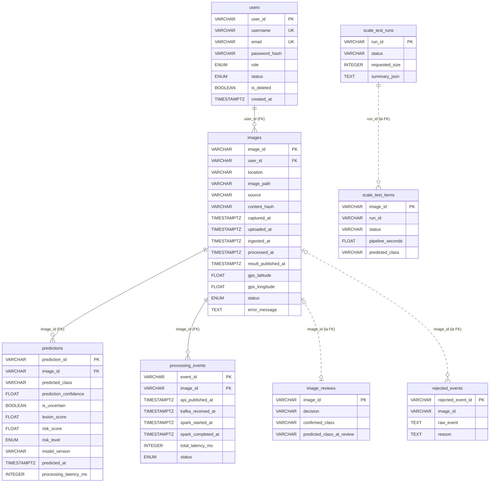
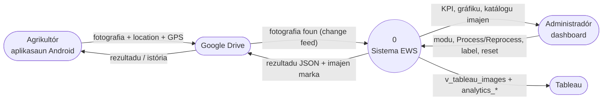
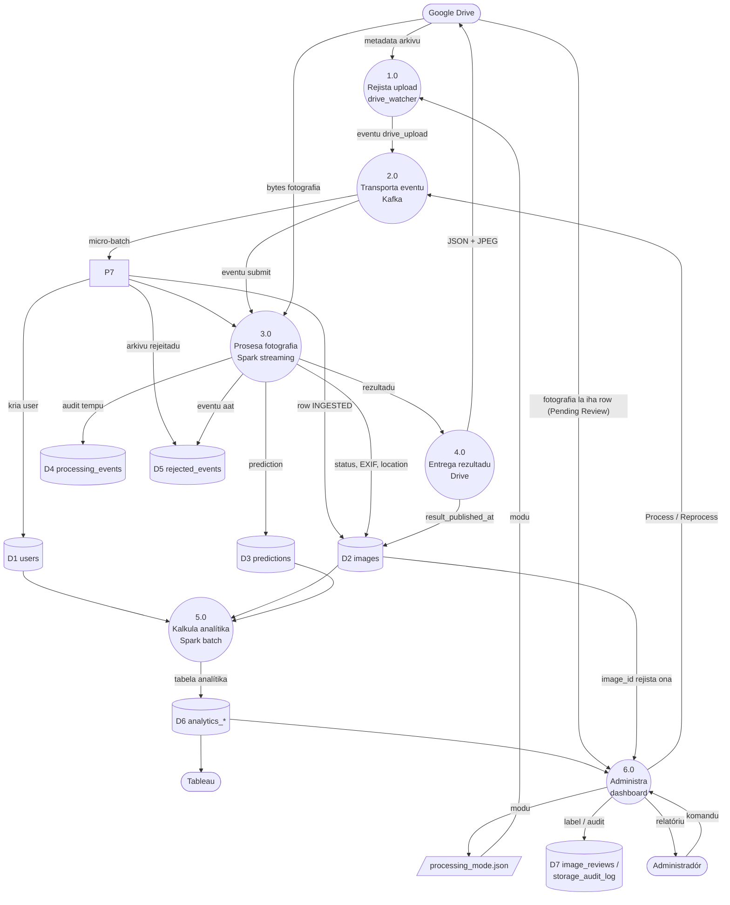

# 04 — Modulu Base de Dadus PostgreSQL, ERD no DFD

*Sistema Crop Disease Early Warning System (EWS) — dokumentasaun téknika ba base de dadus. Fonte úniku: kódigu iha repozitóriu (commit `9ed46d4` + ajusta deep test, 2026-10-24). Kódigu hotu iha dokumentu ne'e mak kópia husi arkivu loloos, ho númeru liña. Password sira troka ho `***`.*

{{coverage storage/database.py 1-744}}
{{coverage storage/init_db.py 1-60}}
{{coverage storage/schema.sql 1-335}}
{{coverage docker-compose.yml 52-75}}

## A. Introdusaun no Objetivu

Base de dadus PostgreSQL 16 mak **sistema rejistu** (*system of record*). Kafka lori eventu de'it no Google Drive rai fotografia, maibé estadu fotografia ida-idak (INGESTED → PROCESSING → COMPLETED/FAILED), rezultadu CNN, *audit* tempu no númeru analítika hotu hela iha ne'e. Bainhira eventu Kafka lakon, `requeue_stuck` harii fali eventu husi base de dadus. Row fotografia iha de'it depois Spark rejista nia (`spark/ingestion.py`): Drive watcher la iha base de dadus, no fotografia ne'ebé hein iha modu MANUAL sei arkivu Drive de'it ("pending" = Drive menus base de dadus).

**Problema ne'ebé modulu ne'e rezolve:**

- Prosesu barak (Spark streaming, Spark analítika, dashboard, Tableau, `requeue_stuck`) presiza dadus hanesan iha tempu hanesan.
- Rezultadu tenke *idempotent*: replay Spark la bele kria prediction rua.
- Dashboard no Tableau presiza númeru hanesan.

**Tekonolojia:** SQLAlchemy ORM (Python). `DATABASE_URL` hili PostgreSQL (produsaun, Docker) ka SQLite (dezenvolvimentu/teste); kódigu seluk la depende ba ida ne'ebé.

## B. Arkivu Fonte Loloos

| Arkivu | Liña | Konteúdu |
|---|---|---|
| `storage/database.py` | 744 | Enum 4, modelu ORM 16 (tabela), `engine`, `SessionLocal`, migrasaun, view 2, `init_db` |
| `storage/init_db.py` | 60 | Kria tabela no konta ADMIN dahuluk |
| `storage/schema.sql` | 335 | DDL PostgreSQL ekivalente (ba revizaun no relatóriu) |
| `docker-compose.yml` (servisu `postgres`) | 52–75 | PostgreSQL 16 iha Docker |

**Tabela 16 no view 2:**

| Grupu | Tabela / view | Sé mak hakerek | Sé mak lee |
|---|---|---|---|
| Kore | `users` | Spark *ingestion* (agrikultór foun), dashboard, `init_db.py` | hotu |
| Kore | `images` | Spark *ingestion* (kria), Spark (status, EXIF, location), dashboard | Spark, dashboard, analítika |
| Kore | `predictions` | Spark `persist_result` | dashboard, analítika, Tableau |
| Audit | `processing_events` | Spark `persist_result` | dashboard (performance) |
| Audit | `rejected_events` | Spark (*ingestion* no prosesu) | dashboard |
| Teste | `scale_test_runs`, `scale_test_items` | `scalability/` | página teste |
| Admin | `image_reviews` | página "Label photos" | catalog view |
| Admin | `storage_audit_log` | limpeza / reset | dashboard |
| Analítika | `analytics_summary`, `analytics_disease_distribution`, `analytics_risk_distribution`, `analytics_high_risk_by_location`, `analytics_disease_trend`, `analytics_disease_daily`, `batch_location_daily_summary` | Spark `batch_analytics` | dashboard, Tableau |
| View | `v_tableau_images` | `init_db` | Tableau (`tableau_reader`) |
| View | `v_admin_image_catalog` | `init_db` | dashboard Image management |

## C. Arkitetura: ERD no DFD

### C.1 ERD (Entity–Relationship Diagram)

Liña **kontínua** = *foreign key* loloos. Liña **pontu-pontu** = ligasaun lójika tuir `image_id`/`run_id` **la ho** *constraint* (tabela ne'e tenke sobrevive *factory reset*).

Tabela mesak (la iha relasaun, la iha FK):

| Tabela | Xave primária | Koluna prinsipál |
|---|---|---|
>>>>
<<<<
    P1((1.0 Rejista upload drive_watcher))
    P2((2.0 Transporta eventu Kafka))
====
    P1((1.0 Deteta upload drive_watcher))
    P2((2.0 Transporta eventu Kafka))
    P7((3.1 Rejista upload Spark ingestion))
| `storage_audit_log` | `audit_id` | `action`, `category`, `target`, `reason`, `outcome`, `detail`, `performed_by`, `created_at` |
| `analytics_summary` | `summary_id` (sempre 1) | `total_users`, `total_images`, `total_healthy`, `total_diseased`, `total_uncertain`, `total_unclassified`, `total_high_risk`, `total_processed`, `total_failed`, `submissions_24h`, `active_farmers_24h`, `most_detected_disease`, `avg_*`, `generated_at` |
| `analytics_disease_distribution` | `predicted_class` | `photos`, `generated_at` |
| `analytics_risk_distribution` | `risk_level` | `photos`, `generated_at` |
| `analytics_high_risk_by_location` | `location` | `high`, `total`, `high_pct`, `generated_at` |
| `analytics_disease_trend` | `(location, day, predicted_class)` | `photos`, `generated_at` |
| `analytics_disease_daily` | `(day, predicted_class)` | `photos`, `generated_at` |
| `batch_location_daily_summary` | `(location, summary_date)` | `total_images`, `total_healthy`, `total_diseased`, `avg_risk_score`, `high_risk_count`, `generated_at` |

Spark rekalkula tabela analítika tomak (`batch_analytics`), entaun sira la presiza FK.

**Kardinalidade:** `users` 1 — N `images` (agrikultór ida, fotografia barak); `images` 1 — N `predictions` (normalmente 1; *replay* tuan bele husik rua, analítika foti foun liu); `images` 1 — N `processing_events` (tentativa ida-idak); `images` 1 — 0..1 `image_reviews`.

### C.2 DFD Kontestu (Nível 0)

### C.3 DFD Nível 1

| Prosesu | Kódigu | Input | Output |
|---|---|---|---|
| 1.0 | `kafka/drive_watcher.publish_drive_file` | metadata Drive, `processing_mode.json` | eventu `drive_upload` (la iha base de dadus) |
| 2.0 | `kafka/producer.ResilientBackend`, broker | eventu | micro-batch |
| 3.1 | `spark/ingestion.register_upload` | eventu `drive_upload` | D1, D2, D5 |
| 3.0 | `spark/streaming_job`, `spark/preprocessing` | micro-batch, bytes | D2, D3, D4, D5 |
| 4.0 | `publish_result_to_drive` | rezultadu | Drive, D2 |
| 5.0 | `spark/batch_analytics` | D1, D2, D3 | D6 |
| 6.0 | `dashboard/` | komandu admin, D2, D6, Drive | D7, `processing_mode.json`, eventu |

## D. Esplikasaun Kódigu ba Kódigu

### D.1 Servisu `postgres` iha `docker-compose.yml` (liña 52–75)

{{code docker-compose.yml 52-75}}

- Imajen `postgres:16`; `restart: unless-stopped`.
- `POSTGRES_USER`, `POSTGRES_PASSWORD` (iha dokumentu ne'e `***`), `POSTGRES_DB: crop_disease`.
- Liña 61–64: porta liga de'it ba `127.0.0.1` — base de dadus la nakloke ba rede Wi-Fi.
- Volume `crop_disease_pg_data` — dadus sobrevive restart kontentór.
- `healthcheck` ho `pg_isready` kada 5 s.

### D.2 `storage/database.py`

#### D.2.1 Docstring módulu (liña 1–32)

{{code storage/database.py 1-32}}

- Backend hili ho `DATABASE_URL` de'it (PostgreSQL ka SQLite); módulu seluk liu ORM, nune'e muda base de dadus = muda variavel ida.
- Lista tabela prinsipál. Liña 26–31: tabela antigu `fields`/`field_users` hasai; troka ho `location` testu livre.

#### D.2.2 Import, `Base`, ajuda (liña 34–57)

{{code storage/database.py 34-57}}

- `declarative_base()` — klase baze ba modelu ORM hotu (herança).
- `now_utc()` — `datetime` UTC ho fuso-oráriu (timestamp hotu rai UTC).
- `new_uuid()` — xave primária testu UUID4 (la'ós númeru sequensiál; telefone mós bele kria `image_id`).

#### D.2.3 Enum sira (liña 59–88)

{{code storage/database.py 59-88}}

- `Role` (USER, ADMIN), `UserStatus` (PENDING_VERIFICATION, ACTIVE, INACTIVE, SUSPENDED), `RiskLevel` (LOW, MEDIUM, HIGH), `ProcessingStatus`.
- `class X(str, enum.Enum)` — **herança múltiplu**: membru mak `str` no `Enum`, nune'e bele kompara ho testu no rai iha JSON.
- **Ciclu vida `ProcessingStatus`** (liña 79–87): `INGESTED` (Spark rejista, ka Reprocess haruka fali) → `PROCESSING` (Spark hahú) → `COMPLETED` ka `FAILED`.
- Komentáriu liña 80–83: row iha de'it depois Spark rejista fotografia (`spark/ingestion.register_upload`); fotografia ne'ebé hein iha modu MANUAL sei arkivu Drive de'it. Tipu ENUM PostgreSQL sei iha label tuan `UPLOADED` / `PENDING_REVIEW` (PostgreSQL la bele hamoos label enum la ho harii fali tipu); row ida la uza sira (deep check 2026-10-24: 0 row).

#### D.2.4 Tabela `users` (liña 90–126)

{{code storage/database.py 90-126}}

- `user_id` PK UUID; `username` UNIQUE + indeks; `email` UNIQUE; `password_hash` (hash de'it, nunka password).
- `role`, `status` — `Enum(...)` SQLAlchemy (iha PostgreSQL = tipu ENUM nativu).
- Koluna verifikasaun Gmail (API REST hasai tiha ona; rai ba row tuan). Hash kódigu de'it.
- **Soft delete:** `is_deleted`, `deleted_at` (row la hamoos).
- `updated_at` ho `onupdate=now_utc`.
- `relationship("Image", back_populates="user")` — navegasaun objetu `user.images`.

#### D.2.5 Tabela `images` (liña 128–191)

{{code storage/database.py 128-191}}

- `image_id` PK (telefone kria UUID); `user_id` **FK** → `users.user_id`.
- `location` testu livre (la'ós kontrolu asesu).
- `image_path` — `gdrive:<file id>` ba Drive ka dalan lokál; `source` (`android_drive_upload`, `scalability_test`, …).
- `content_hash` — SHA-256 (duplikadu).
- **Pipeline timestamp:** `captured_at` (EXIF ka telefone; `captured_at_source`), `uploaded_at` (Google, la'ós telefone), `ingested_at` (Spark rejista), `processed_at` (Spark remata), `result_published_at` (rezultadu to'o Drive; `NULL` = telefone seidauk simu).
- Metadata EXIF: GPS (`gps_source` `exif`/`device`), kámara, tamañu.
- `status` (default **INGESTED**), `error_message`.
- `relationship(... cascade="all, delete-orphan")` — hamoos imajen iha ORM hamoos mós nia prediction no evento.
- Indeks 5: `location`, `user_id`, `captured_at`, `uploaded_at`, `content_hash` (filtru dashboard, kontrola duplikadu).

#### D.2.6 Tabela `predictions` (liña 193–235)

{{code storage/database.py 193-235}}

- `image_id` FK → `images`.
- **Klasifikasaun CNN** (`predicted_class`, `prediction_confidence`, `is_uncertain`) separadu husi **risku** (`risk_score`, `risk_level`).
- `lesion_score` = 1 − P(healthy). `discoloration_pct`, `texture_irregularity`, `leaf_area_affected_pct` sempre `NULL` agora (heurístika hasai; koluna rai ba row tuan).
- `model_version`, `predicted_at`, `processing_latency_ms` (ingested → predicted).
- Indeks 4: `image_id`, `predicted_class`, `risk_level`, `predicted_at`.

#### D.2.7 Tabela `processing_events` (liña 237–261)

{{code storage/database.py 237-261}}

- *Audit* performance kada tentativa prosesu: `api_published_at` (publika Kafka), `kafka_received_at` (Spark simu), `spark_started_at`, `spark_completed_at`, `prediction_started_at/completed_at`, `total_latency_ms`, `status`.
- *Append-only*: replay aumenta row foun (la dedupe).

#### D.2.8 `rejected_events` (liña 263–277)

{{code storage/database.py 263-277}}

- Tabela *dead-letter*: eventu ka arkivu ne'ebé la sai `Image`/`ProcessingEvent` — eventu ho koluna falta, arkivu Drive la husi aplikasaun (`image_id` la'ós UUID), `image_id` ne'ebé pertense ba arkivu seluk (`register_upload` → `"conflict"`). `image_id` bele la iha (la FK); `raw_event` JSON; `reason` obrigatóriu.
- Tabela `system_settings` la iha ona: nia rai de'it modu prosesu, ne'ebé agora iha `storage/processing_mode.json` (Drive watcher lee la ho base de dadus). `init_db` hamoos tabela ne'e (D.2.15).

#### D.2.9 Tabela teste eskalabilidade (liña 279–348)

{{code storage/database.py 279-348}}

- `ScaleTestRun` — run ida: status (PREPARING → RUNNING → COMPLETED/INCOMPLETE/FAILED/ABORTED), `phase`, `pid`, konfigurasaun no rezumu JSON.
- `ScaleTestItem` — fotografia ida iha run: timestamp, `timings_json`, `pipeline_seconds`, rezultadu CNN teste (de'it iha ne'e, nunka ba agrikultór), fatin no GPS. Indeks `(run_id, status)`.
- La iha FK ba `images`: medida sobrevive *factory reset*.
- *Nota onestu:* komentáriu liña 280–285 deskreve dezeñu antigu (fotografia teste liu pipeline normál); agora teste iha topic no prosesu rasik (`scalability/`).

#### D.2.10 `image_reviews` no `storage_audit_log` (liña 350–388)

{{code storage/database.py 350-388}}

- `image_reviews` — desizaun administradór iha "Label photos": `labelled` (ho `confirmed_class`) ka `discarded`; `predicted_class_at_review` ba komparasaun. Separadu husi prediction: prediction modelu nunka sai label konfirmadu. La FK (sobrevive reset).
- `storage_audit_log` — asaun destrutivu hotu (limpeza, repara, reset): `action`, `target`, `reason`, `outcome`, `performed_by`. Reset nunka hamoos.

#### D.2.11 Tabela analítika (liña 390–487)

{{code storage/database.py 390-487}}

- Tabela 7 ne'ebé Spark `batch_analytics` hakerek (D.2 iha 01_spark_module). Xave primária natural: `summary_id` (sempre 1), `predicted_class`, `risk_level`, `location`, `(location, day, predicted_class)`, `(day, predicted_class)`, `(location, summary_date)`.
- `BigInteger` ba kontajen; `generated_at` iha kada row.
- `ANALYTICS_TABLES` — lista naran (uza ba grant Tableau).

#### D.2.13 *Engine* no sesaun (liña 489–509)

{{code storage/database.py 489-509}}

- SQLite: `check_same_thread=False` (thread barak).
- PostgreSQL: `pool_pre_ping=True` — kontrola koneksaun molok uza; depois kontentór restart, koneksaun mate troka automátiku (uluk fotografia FAILED).
- SQLite: `PRAGMA journal_mode=WAL` — leitór (Tableau) no hakerek (Spark) bele halai hamutuk.
- `SessionLocal = sessionmaker(...)` — *factory* sesaun; `autoflush=False`, `autocommit=False` (commit esplísitu).

#### D.2.14 Lista migrasaun koluna (liña 511–558)

{{code storage/database.py 511-558}}

- `create_all` kria de'it **tabela** ne'ebé la iha, la'ós **koluna** foun iha tabela ne'ebé iha ona. Lista sira ne'e mak koluna foun kada tabela, ho tipu DDL.

#### D.2.15 Migrasaun: `_add_missing_columns`, `_drop_field_feature`, `_drop_system_settings` (liña 559–601)

{{code storage/database.py 559-601}}

- `_add_missing_columns` (liña 559–571) — `inspect(engine)` lee koluna atuál; koluna falta → `ALTER TABLE ... ADD COLUMN`. PostgreSQL: `DEFAULT 0` troka ba `DEFAULT FALSE`.
- `_drop_field_feature` (liña 574–594) — hasai `images.field_id` no tabela `field_users`/`fields` (PostgreSQL ho `CASCADE`).
- `_drop_system_settings` (liña 597–601) — `DROP TABLE IF EXISTS system_settings`. Seguru bolu dala barak; base de dadus foun la iha tabela ne'e. Teste 2026-10-24: SQLite foun no SQLite ho tabela tuan → tabela la iha; PostgreSQL live → hamoos depois restart.

#### D.2.16 View `v_tableau_images` no login `tableau_reader` (liña 604–676)

{{code storage/database.py 604-676}}

- `local(col)` — PostgreSQL: `(col AT TIME ZONE 'UTC') + INTERVAL '9 hours'` (hora Timor-Leste); SQLite: `datetime(col, '+9 hours')`.
- View: CTE `latest` ho `ROW_NUMBER() OVER (PARTITION BY image_id ORDER BY predicted_at DESC, prediction_id DESC)` → prediction foun liu kada imajen; `LEFT JOIN` ho `images` no `users`; hasai teste eskalabilidade.
- `DROP VIEW` + `CREATE VIEW` kada `init_db` (tuir *schema*).
- `_ensure_tableau_reader` — PostgreSQL no password iha: `CREATE`/`ALTER ROLE ... LOGIN PASSWORD ... NOSUPERUSER NOCREATEDB NOCREATEROLE`; `GRANT CONNECT`, `USAGE`, `SELECT` ba view no tabela `images`, `predictions`, analítika. **Nunka `users`** (hash password no email). Password escape `'` → `''`.

#### D.2.17 View `v_admin_image_catalog` (liña 678–718)

{{code storage/database.py 678-718}}

- Katálogu administradór: imajen agrikultór kada ida + agrikultór (email, naran, status) + prediction foun liu + desizaun revizaun (`LEFT JOIN image_reviews`). Tempu hela UTC (dashboard troka). `CAST(... AS VARCHAR)` ba enum.

#### D.2.18 `init_db` (liña 720–742)

{{code storage/database.py 720-742}}

- `create_all` → migrasaun koluna ba tabela 5.
- Liña 726–734: bainhira koluna `result_published_at` foin aumenta, fotografia COMPLETED tuan hetan `processed_at` (sira entrega ona; la trata hanesan "seidauk iha Drive").
- Liña 738–742: transasaun ida: hasai `fields`, hasai `system_settings`, kria view rua.
- **Idempotent:** bele bolu dala barak (Spark, analítika, dashboard, `requeue_stuck` bolu iha hahú). Drive watcher **la** bolu (nia la iha base de dadus).

### D.3 `storage/init_db.py` (liña 1–60)

{{code storage/init_db.py 1-60}}

- `init_db()` uluk.
- `users` la mamuk → skip.
- `BOOTSTRAP_ADMIN_PASSWORD` la iha → la kria admin (la iha password default).
- Kria ADMIN ho `hash_password` (hash, la'ós testu), `email_verified=True` (konta konfigurasaun).

### D.4 `storage/schema.sql` — DDL PostgreSQL

*Nota:* arkivu ne'e **ekivalente** ba modelu ORM, maibé ho diferensa ida: ORM kria `role`, `status`, `risk_level` hanesan tipu **ENUM nativu** PostgreSQL; `schema.sql` uza `VARCHAR` ho `CHECK (... IN (...))`. Regra valór hanesan. Aplikasaun uza ORM (`init_db`), la'ós arkivu ne'e.

#### D.4.1 `users` (liña 1–31)

{{code storage/schema.sql 1-31}}

- `CREATE TABLE IF NOT EXISTS`; `PRIMARY KEY`, `UNIQUE NOT NULL`; `CHECK` ba `role`/`status`; `TIMESTAMPTZ` ho `DEFAULT now()`.

#### D.4.2 `images` no indeks (liña 32–69)

{{code storage/schema.sql 32-69}}

- `REFERENCES users(user_id)` — FK. `DOUBLE PRECISION` ba GPS. `CHECK` ba status 4 (`INGESTED`, `PROCESSING`, `COMPLETED`, `FAILED`), default `'INGESTED'`. Indeks 5 (`CREATE INDEX IF NOT EXISTS`).

#### D.4.3 `predictions` (liña 70–96)

{{code storage/schema.sql 70-96}}

- `REFERENCES images(image_id)`; `CHECK risk_level IN ('LOW','MEDIUM','HIGH')`; indeks 4.

#### D.4.4 `processing_events` no `rejected_events` (liña 97–121)

{{code storage/schema.sql 97-121}}

- `processing_events.image_id` FK ba `images`; `CHECK` status 4 hanesan `images`.
- `rejected_events` la iha FK (`image_id` bele la iha).

#### D.4.5 Tabela teste (liña 123–173)

{{code storage/schema.sql 123-173}}

#### D.4.6 Tabela analítika (liña 174–244)

{{code storage/schema.sql 174-244}}

- Xave primária komposta: `PRIMARY KEY (location, day, predicted_class)` etc.

#### D.4.7 `image_reviews` no `storage_audit_log` (liña 245–271)

{{code storage/schema.sql 245-271}}

#### D.4.8 View rua (liña 272–335)

{{code storage/schema.sql 272-335}}

- Forma PostgreSQL ne'ebé `init_db` produz (offset fiksu `9 hours`). `CREATE OR REPLACE VIEW`.

## E. Análize OOP

| Konseitu | Iha kódigu? | Ezemplu loloos |
|---|---|---|
| **Klase no objetu** | Sim | Modelu ORM 16 (`User`, `Image`, `Prediction`, …); objetu = row ida (`session.get(Image, id)`). |
| **`__init__` / konstrutór** | Implísitu | `declarative_base` fó konstrutór ho argumentu naran (`Image(image_id=..., status=...)`); kódigu la defini `__init__`. |
| **Atributu** | Sim | `Column(...)` = atributu klase ne'ebé sai koluna; `relationship(...)` = atributu navegasaun (`image.user`, `user.images`). |
| **Métodu** | Uitoan | Modelu la iha métodu rasik; funsaun módulu (`init_db`, `_add_missing_columns`). |
| **Herança** | Sim | Modelu hotu `(Base)`; enum `(str, enum.Enum)` (herança múltiplu). |
| **Polimorfizmu** | La implementa | La iha *polymorphic inheritance* SQLAlchemy. |
| **Enkapsulamentu** | Sim | Sesaun no SQL subar iha ORM; funsaun ho `_` (`_add_missing_columns`, `_create_tableau_view`) interna. |
| **Abstrasaun** | Sim | ORM subar diferensa PostgreSQL/SQLite; `init_db` subar migrasaun. |
| **Kompozisaun / asosiasaun** | Sim | `User` 1–N `Image` 1–N `Prediction`/`ProcessingEvent` (`relationship`, `cascade="all, delete-orphan"`). |
| **Padraun dezeñu** | Sim | *Active Record / Data Mapper* (ORM), *Unit of Work* (`Session` + `commit`), *Factory* (`sessionmaker`), *Repository-like views* (`v_tableau_images`, `v_admin_image_catalog`), *Soft delete*, *Dead-letter table*, *Audit log*, *Schema migration* manuál. |

## F. Integrasaun

| Komponente | Asesu | Tabela prinsipál |
|---|---|---|
| Drive watcher | **la iha** | — (lee Drive, publika Kafka; modu husi `processing_mode.json`) |
| Spark streaming | SQLAlchemy, hakerek | `users` (agrikultór foun), `images` (kria + update), `predictions`, `processing_events`, `rejected_events` |
| Spark analítika | JDBC lee + hakerek | lee `images`/`predictions`/`users`; hakerek `analytics_*` |
| Dashboard | SQLAlchemy / pandas | hotu (lee), `image_reviews`, `storage_audit_log`, `users`; Pending Review kompara Drive ho `images.image_id` |
| Tableau | login `tableau_reader` (lee-de'it) | `v_tableau_images`, `images`, `predictions`, `analytics_*` |
| `requeue_stuck` | SQLAlchemy | `images` (harii fali eventu; `--from-drive` buka fotografia Drive ne'ebé la iha row) |

## G. Tratamentu Erru no Konfiabilidade

- **Idempoténsia:** `persist_result` hamoos prediction tuan molok insere (iha transasaun ida ho update imajen no audit).
- **Integridade referensiál:** FK `images.user_id`, `predictions.image_id`, `processing_events.image_id`. Tabela ne'ebé tenke sobrevive reset (`image_reviews`, `scale_test_*`, `rejected_events`) la iha FK, ho intensaun.
- **Koneksaun mate:** `pool_pre_ping`.
- **Migrasaun seguru:** `init_db` idempotent; `ADD COLUMN` de'it ba koluna falta; `DROP TABLE IF EXISTS`.
- **Rejistu paralelu:** `images.image_id` PK no `users.username` UNIQUE — *thread* rua ne'ebé rejista hanesan: ida manán, ida hetan `IntegrityError` no lee row ne'ebé iha ona (`register_upload`, `get_or_create_farmer`; hadi'a 2026-10-24).
- **Seguransa:** porta 127.0.0.1 de'it; password ADMIN ho hash; login Tableau lee-de'it no la asesu `users`; password husi variavel ambiente.
- **Limitasaun:** migrasaun manuál (la iha Alembic); `schema.sql` tenke atualiza ho liman (ENUM vs `CHECK`); tipu ENUM PostgreSQL sei iha label tuan rua (`UPLOADED`, `PENDING_REVIEW`) ne'ebé la uza; login `tableau_reader` bele lee tabela `images`/`predictions` tomak (inklui GPS no `user_id`), la'ós view de'it — deep test 2026-10-24 hatudu, presiza konfirma se ne'e intensaun; timestamp SQLite *naive* (kódigu kompensa ho `_as_aware_utc`); prediction rua bele iha ba imajen ida (view no analítika foti foun liu).

## H. Rezumu no Pergunta Akadémiku

**Rezumu.** PostgreSQL 16 (Docker, 127.0.0.1) ho tabela 16 no view 2 mak sistema rejistu. Spark mak hakerek row fotografia foun (Drive watcher la iha base de dadus). Tabela kore `users` → `images` → `predictions`/`processing_events` ho FK; tabela audit/admin no teste la ho FK atu sobrevive reset; tabela analítika 7 Spark rekalkula. ORM SQLAlchemy kria no migra tabela (`init_db`), no view rua fó prediction foun liu kada imajen ba Tableau no dashboard.

**P1. Tanba sa UUID testu hanesan xave primária?**
> Telefone kria `image_id` molok upload (naran arkivu Drive mak `<image_id>.jpg`), entaun xave tenke kria iha fatin seluk la ho base de dadus. UUID4 la iha konflitu no la hatudu númeru fotografia.

**P2. Oinsá base de dadus prevene prediction duplikadu?**
> La ho *constraint* UNIQUE: `persist_result` hamoos prediction ba `image_id` molok insere, iha transasaun ida. View no analítika uza `ROW_NUMBER()` ba prediction foun liu se row tuan iha.

**P3. Tanba sa `image_reviews` no `scale_test_items` la iha FK?**
> Sira tenke sobrevive *factory reset* (hamoos `images`). FK sei obriga hamoos sira ka bloke reset.

**P4. Saida mak diferensa entre `predictions` no `image_reviews`?**
> `predictions` = saida modelu (bele sala). `image_reviews` = label administradór konfirma. Separadu atu prediction nunka sai dadus treinu la ho konfirmasaun.

**P5. Oinsá ita kalkula latênsia pipeline?**
> `images`: `uploaded_at` (Google) → `ingested_at` (Spark rejista) → `processed_at`; `predictions.processing_latency_ms` (ingested → predicted); `processing_events` ho timestamp Spark kada tentativa. `analytics_summary` fó média.

**P6. Tanba sa view Tableau troka oras?**
> Rai UTC; Tableau tenke hatudu hora Timor-Leste hanesan dashboard: `(col AT TIME ZONE 'UTC') + INTERVAL '9 hours'`.

**P7. Oinsá migrasaun halo la ho Alembic?**
> `init_db` inspeksiona koluna no halai `ALTER TABLE ADD COLUMN` ba koluna falta, `DROP TABLE IF EXISTS` ba tabela ne'ebé la uza ona (`fields`, `system_settings`), no kria fali view. Simples no idempotent; limitasaun: la iha istória versaun no *downgrade*.

**P8. Normalizasaun ne'ebé?**
> Tabela kore iha 3NF: dadus utilizadór iha `users`, metadata fotografia iha `images`, saida modelu iha `predictions`. Tabela analítika mak **desnormalizadu ho intensaun** (kalkula tiha ona ba lee lalais).

**P9. Oinsá Tableau la bele haree password?**
> Login `tableau_reader` hetan `SELECT` de'it ba view no tabela imajen/prediction/analítika; nunka `users`. `NOSUPERUSER NOCREATEDB NOCREATEROLE`.

**P10. Tanba sa la iha tabela `system_settings` ona?**
> Nia rai de'it modu AUTOMATIC/MANUAL. Drive watcher sai *stateless* (la iha base de dadus), entaun modu muda ba arkivu `storage/processing_mode.json` ne'ebé watcher lee direta. Tabela ne'e sai la uza; `init_db` hamoos nia (`_drop_system_settings`).

**P11. Saida mak akontese bainhira PostgreSQL restart?**
> `pool_pre_ping` troka koneksaun mate. Spark: erru iha liur `try` hapara batch no restart halo replay; dadus la lakon tanba checkpoint Kafka.
