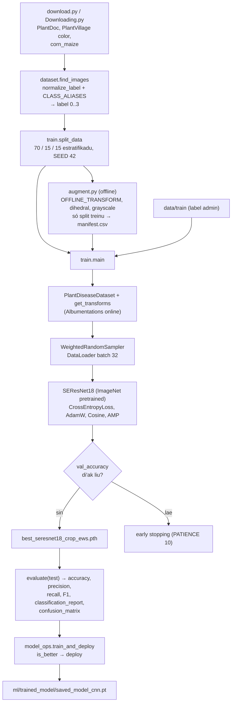
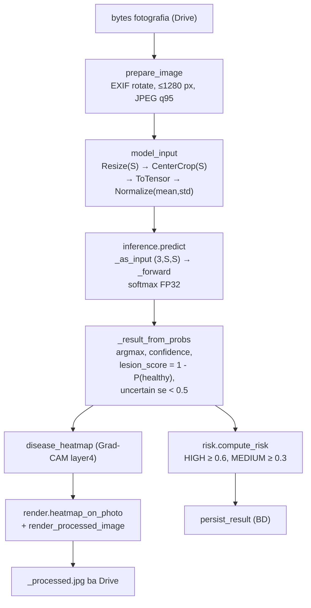
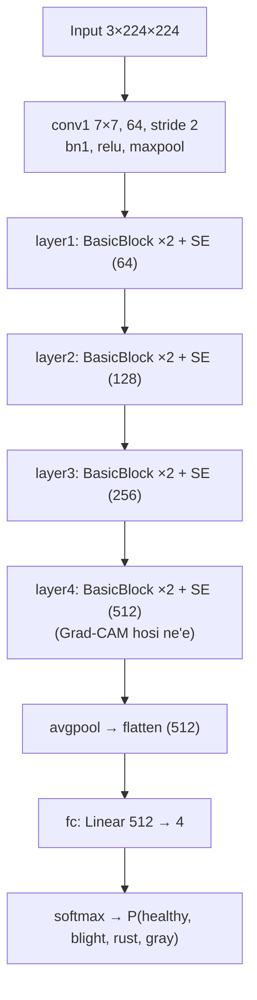
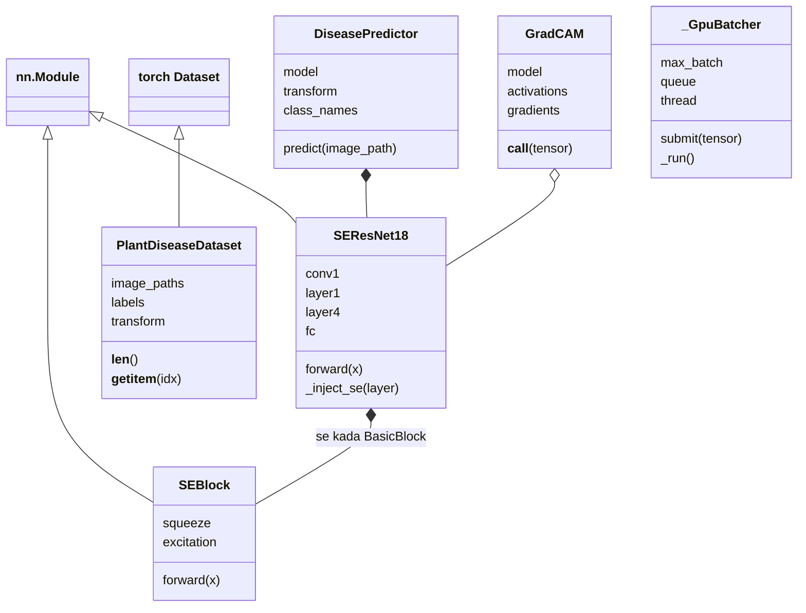

# 05 — Modulu Machine Learning: SE-ResNet-18 CNN

*Sistema Crop Disease Early Warning System (EWS) — dokumentasaun téknika ba modelu CNN SE-ResNet-18: dadus, preprocessing imajen, augmentation Albumentations, arkitetura, ekuasaun matemátika, treinu, avaliasaun, inferénsia iha sistema, Grad-CAM no regra risku. Ba estudante ne'ebé foin hahú programasaun. Fonte úniku: kódigu iha repozitóriu sistema (branch `main`, commit `302818f`) no projetu treinu `crop_disease_ews` (`TRAINING_PROJECT_DIR`). Kódigu hotu kópia automátiku ho númeru liña.*

{{coverage @train/download.py 1-64}}
{{coverage @train/Downloading.py 1-6}}
{{coverage @train/dataset.py 1-273}}
{{coverage @train/augment.py 1-247}}
{{coverage @train/model.py 1-204}}
{{coverage @train/train.py 1-1167}}
{{coverage @train/predict.py 1-240}}
{{coverage @train/gradcam.py 1-560}}
{{coverage dashboard/model_ops.py 1-181}}
{{coverage config/settings.py 50-67 96-102 126-127}}
{{coverage spark/preprocessing.py 144-185}}
{{coverage ml/se_resnet.py 1-60}}
{{coverage ml/inference.py 1-348}}
{{coverage ml/risk.py 1-19}}
{{coverage ml/render.py 1-78}}

> **Oinsá lee.** Bloku kódigu kada ida tuir pasu 9: (1) Kódigu orijinál, (2) Objetivu, (3) Fundamentu Python, (4) Esplikasaun liña-ba-liña, (5) Walkthrough ezekusaun, (6) Tipu dadus, (7) Ligasaun OOP, (8) Impaktu integrasaun, (9) Checkpoint ba principiante. Etiketa: *Implementadu*, *Inferidu*, *Teoria*, *Ezemplu ilustrativu*. Dalan arkivu ho `crop_disease_ews/` mak projetu treinu (separadu husi repozitóriu sistema).

## A. Introdusaun no Objetivu

### A.1 Papél modelu iha sistema

Modelu **SE-ResNet-18** mak *Convolutional Neural Network* (CNN) ne'ebé simu imajen tahan batar no fó probabilidade ba klase 4: **healthy**, **northern_leaf_blight** (iha treinu: `Blight`), **common_rust**, **gray_leaf_spot**. Modulu ne'e iha parte rua:

| Parte | Fatin | Saida |
|---|---|---|
| **Treinu** (offline) | projetu `crop_disease_ews` | `download.py` → `dataset.py` → `augment.py` → `model.py` → `train.py` → checkpoint `best_seresnet18_crop_ews.pth`; `predict.py`, `gradcam.py` ba teste/esplikasaun |
| **Deploy** | `dashboard/model_ops.py` | Kontrola, konverte naran klase, rai `ml/trained_model/saved_model_cnn.pt` (auto-deploy se di'ak liu) |
| **Inferénsia** (online) | `spark/preprocessing.model_input` + `ml/inference.py` + `ml/se_resnet.py` | Spark prepara tensor → CNN fó probabilidade → klase, konfiansa, `lesion_score`, `is_uncertain` |
| **Risku** | `ml/risk.py` | `lesion_score` → LOW/MEDIUM/HIGH |
| **Esplikasaun vizuál** | `ml/inference.disease_heatmap` + `ml/render.py` | Grad-CAM vermelhu iha fotografia ba agrikultór |

### A.2 Problema ne'ebé modulu ne'e rezolve

Agrikultór la iha espesialista moras besik. CNN klasifika fotografia iha segundu balun. Problema téknika no solusaun iha kódigu:

- **Dadus husi fonte barak no la balansu** → `CLASS_ALIASES` hamutuk naran, `WeightedRandomSampler` balansu klase.
- **Fotografia laboratóriu vs kampu** → augmentation forte (lus, sombra, blur, rotasaun) no kópia ekstra ba healthy kampu.
- **Dadus vaza entre split** → split 70/15/15 estratifikadu ho `SEED=42`; augmentation no fotografia revizaun só ba treinu.
- **Modelu la seguru** → limite konfiansa: okos limite → `"uncertain"` no risku la to'o HIGH.
- **Modelu foun la di'ak liu** → auto-deploy só se akurásia teste (ka validasaun) aas liu.
- **Konfiansa ba modelu** → Grad-CAM hatudu fatin ne'ebé modelu haree.

### A.3 Fundamentu Python (foun iha modulu ne'e)

Modulu 01–04 hanorin ona tipu, klase, `self`, `__init__`, herança, `with`, decorator. **Lembra:** klase = molde; objetu = buat harii husi molde; `super().__init__()` bolu konstrutór klase inan. Konseitu **foun**:

1. **NumPy array** — lista númeru multi-dimensaun lalais: `np.array([1,2])`, `arr.shape`, `np.bincount`, `np.concatenate`, `np.median`.
2. **Imajen hanesan array** — OpenCV (`cv2.imread`) fó array `[H, W, 3]` ho orden kór **BGR**; `cv2.cvtColor(img, cv2.COLOR_BGR2RGB)` troka ba RGB.
3. **Tensor PyTorch** — hanesan array maibé bele halai iha GPU no kalkula gradiente: `x.to(device)`, `x.shape`, `x.unsqueeze(0)` (aumenta dimensaun batch).
4. **`nn.Module`** — klase baze ba kamada rede neural. Sub-klase define `__init__` (kamada) no `forward(self, x)` (kálkulu). Bolu `model(x)` → PyTorch bolu `forward`.
5. **`Dataset` no `DataLoader`** — `Dataset` define `__len__` no `__getitem__(idx)`; `DataLoader` halibur elementu ba *batch* (grupu, ezemplu 32).
6. **Métodu espesiál `__len__`, `__getitem__`** — halo objetu hahalok hanesan lista (`len(ds)`, `ds[0]`).
7. **`with torch.no_grad():`** / **`torch.inference_mode()`** — hamate kálkulu gradiente (inferénsia lalais).
8. **`@staticmethod`** — métodu la presiza `self`.
9. **Atribui métodu ba objetu** (`block.forward = forward_with_se`) — troka hahalok objetu iha tempu ezekusaun (*monkey patching*).
10. **Argumentu default iha closure** (`def f(x, block=block)`) — "kaer" valór agora (evita erru *late binding* iha loop).
11. **`*_` iha unpacking** — `a, b, *_ = f()` foti rua dahuluk, soe seluk.
12. **`queue.Queue`** no **`Future`** — fila thread-safe; promesa rezultadu (`set_result`, `set_exception`).
13. **Rekursaun** — funsaun bolu nia an (`_forward_safely` fahe batch ba metade).

### A.4 Matemátika (Teoria + implementasaun)

**1. Normalizasaun piksel** (`ToTensor` + `Normalize`, Spark `model_input`; Albumentations `A.Normalize` + `ToTensorV2` iha treinu). Ba kanál $c \in \{R, G, B\}$:

$$x_c = \frac{p_c}{255}, \qquad \hat{x}_c = \frac{x_c - \mu_c}{\sigma_c}$$

ho $\mu = (0.485, 0.456, 0.406)$ no $\sigma = (0.229, 0.224, 0.225)$ (ImageNet). Símbolu: $p_c$ = valór piksel 0–255; $x_c$ = valór 0–1; $\mu_c$ = média kanál; $\sigma_c$ = desviu padraun; $\hat{x}_c$ = valór normalizadu (input CNN).

**2. Konvolusaun (Teoria).** Kamada `Conv2d` kalkula $y = W * x + b$ — filtru $W$ la'o iha imajen no deteta padraun (rohan, kór, mancha).

**3. Bloku Squeeze-and-Excitation (SE)** (`SEBlock`). Ba mapa feature $U \in \mathbb{R}^{C \times H \times W}$:

$$z_c = \frac{1}{H W}\sum_{i=1}^{H}\sum_{j=1}^{W} U_c(i,j) \quad \text{(squeeze)}$$

$$s = \sigma\big(W_2\,\delta(W_1 z)\big), \quad W_1 \in \mathbb{R}^{\frac{C}{r}\times C},\; W_2 \in \mathbb{R}^{C\times\frac{C}{r}} \quad \text{(excitation)}$$

$$\tilde{U}_c = s_c \cdot U_c \quad \text{(scale)}$$

Símbolu: $z_c$ = média kanál $c$; $\delta$ = ReLU; $\sigma$ = sigmoid (0–1); $r = 16$ = `reduction`; $s_c$ = peze atensaun kanál $c$.

**4. Bloku residuál ho SE** (`forward_with_se`): $y = \text{ReLU}\big(\text{SE}(\text{BN}(\text{Conv}(\text{ReLU}(\text{BN}(\text{Conv}(x)))))) + \text{shortcut}(x)\big)$.

**5. Softmax** (`F.softmax`, `torch.softmax`). Ba *logits* $z_1..z_K$ ($K = 4$):

$$P(y = k \mid x) = \frac{e^{z_k}}{\sum_{j=1}^{K} e^{z_j}}$$

Probabilidade hotu entre 0–1 no soma = 1.

**6. Cross-entropy loss** (`nn.CrossEntropyLoss`). Ba batch ho $N$ imajen, klase loos $y_i$:

$$\mathcal{L} = -\frac{1}{N}\sum_{i=1}^{N} \log P(y = y_i \mid x_i)$$

Se modelu fó probabilidade 0.9 ba klase loos: $-\log 0.9 \approx 0.105$ (ki'ik, di'ak); se 0.1: $-\log 0.1 \approx 2.303$ (boot, aat).

**7. AdamW** (`torch.optim.AdamW`, `LEARNING_RATE = 3e-4`, `WEIGHT_DECAY = 1e-2`) — optimizador ne'ebé adapta pasu kada parámetru no hamenus peze ho *decoupled weight decay*: $\theta \leftarrow \theta - \eta\left(\frac{\hat m}{\sqrt{\hat v}+\epsilon} + \lambda\theta\right)$.

**8. Cosine annealing** (`CosineAnnealingLR`, $T_{max} = 25$): $\eta_t = \eta_{min} + \tfrac{1}{2}(\eta_0 - \eta_{min})\left(1 + \cos\frac{t\pi}{T_{max}}\right)$ — learning rate tun neineik ho forma kosinus.

**9. Peze sampler balansu** (`create_weighted_sampler`): $w_k = \dfrac{1}{n_k}$ ($n_k$ = imajen klase $k$); kada imajen hetan peze klase nian, entaun klase ki'ik foti dala barak liu.

**10. Métrika avaliasaun** (`sklearn`). Ba klase $k$: $TP_k$ = loos pozitivu, $FP_k$ = falsu pozitivu, $FN_k$ = falsu negativu.

$$\text{Accuracy} = \frac{\#\text{prediksaun loos}}{N}$$

$$\text{Precision}_k = \frac{TP_k}{TP_k + FP_k}, \qquad \text{Recall}_k = \frac{TP_k}{TP_k + FN_k}, \qquad F1_k = \frac{2\,\text{Precision}_k\,\text{Recall}_k}{\text{Precision}_k + \text{Recall}_k}$$

`average="weighted"`: $M_{weighted} = \sum_k \frac{n_k}{N} M_k$ ($n_k$ = *support* klase $k$).

**11. Grad-CAM** (`GradCAM.__call__`, `disease_heatmap`). Ba klase $c$ ho score $y^c$ no mapa feature $A^k$ husi `layer4`:

$$\alpha_k^c = \frac{1}{Z}\sum_{i}\sum_{j}\frac{\partial y^c}{\partial A^k_{ij}}, \qquad L^c_{\text{Grad-CAM}} = \text{ReLU}\Big(\sum_k \alpha_k^c A^k\Big)$$

**12. `lesion_score` no regra risku** (`_result_from_probs`, `compute_risk`):

$$\text{lesion\_score} = \text{clip}\big(1 - P(\text{healthy}),\,0,\,1\big)$$

$$\text{risk\_level} = \begin{cases} \text{HIGH} & \text{se } s \ge 0.6 \\ \text{MEDIUM} & \text{se } 0.3 \le s < 0.6 \\ \text{LOW} & \text{se } s < 0.3 \end{cases}$$

ho $s$ = `risk_score` = `lesion_score` (desimál 3); se `is_uncertain` no HIGH → MEDIUM. Limite husi `RISK_THRESHOLDS` (default 0.6 / 0.3).

**13. Uncertain**: se $\max_k P(y=k\mid x) < \tau$ → `predicted_class = "uncertain"`; sistema $\tau$ = `MODEL_CONFIDENCE_THRESHOLD` (default 0.5). (`predict.py` treinu uza $\tau = 0.60$ — valór diferente.)

## B. Arkivu Fonte Loloos

| Arkivu | Liña | Klase / funsaun | Serbisu |
|---|---|---|---|
| `crop_disease_ews/download.py` | 64 | `download_datasets` | Download PlantDoc + PlantVillage (kagglehub) |
| `crop_disease_ews/Downloading.py` | 6 | — | Download "corn-or-maize-leaf-disease-dataset" |
| `crop_disease_ews/dataset.py` | 273 | `CLASS_NAMES`, `CLASS_ALIASES`, `normalize_label`, `find_images`, `get_transforms`, `PlantDiseaseDataset` | Buka imajen, label, Albumentations, Dataset |
| `crop_disease_ews/augment.py` | 247 | `OFFLINE_TRANSFORM`, `to_grayscale`, `dihedral`, `make_copies`, `main` | Augmentation offline (kópia iha disku) |
| `crop_disease_ews/model.py` | 204 | `SEBlock`, `SEResNet18` | Arkitetura (treinu) |
| `crop_disease_ews/train.py` | 1167 | `split_data`, `load_augmented`, `create_weighted_sampler`, `train_one_epoch`, `evaluate`, `plot_history`, `save_confusion_matrix`, `main` | Treinu + avaliasaun |
| `crop_disease_ews/predict.py` | 240 | `DiseasePredictor` | Prediksaun imajen ida (teste) |
| `crop_disease_ews/gradcam.py` | 560 | `GradCAM`, helper, `main` | Esplikasaun modelu iha split teste |
| `dashboard/model_ops.py` | 181 | `info`, `deploy`, `swap_in`, `is_better`, `train_and_deploy` | Deploy modelu ba sistema |
| `config/settings.py` | 50–67, 96–102, 126–127 | `IMAGE_MODEL`, `RISK_THRESHOLDS`, `ANALYSIS_MAX_PX` | Konfigurasaun |
| `spark/preprocessing.py` | 144–185 | `model_input`, `model_input_preview`, `_prepared_rgb`, `prepare_image` | Preprocessing (Spark) |
| `ml/se_resnet.py` | 60 | `SEBlock`, `SEResNet18` | Arkitetura (sistema) |
| `ml/inference.py` | 348 | `_load_trained_model`, `predict`, `_GpuBatcher`, `_result_from_probs`, `disease_heatmap`, `model_version` | Inferénsia |
| `ml/risk.py` | 19 | `compute_risk` | Regra risku |
| `ml/render.py` | 78 | `render_processed_image`, `heatmap_on_photo` | Imajen ba agrikultór |

**Dependénsia:** PyTorch, torchvision, Albumentations, OpenCV (`cv2`), NumPy, scikit-learn, Matplotlib, kagglehub, Pillow.

**Rezultadu teste loloos** (`crop_disease_ews/results/classification_report.txt`, 2026-10-03, imajen teste 646):

| Klase | Precision | Recall | F1 | Support |
|---|---|---|---|---|
| Healthy | 0.98 | 1.00 | 0.99 | 181 |
| Blight | 0.89 | 0.94 | 0.92 | 181 |
| Common_Rust | 1.00 | 0.94 | 0.97 | 198 |
| Gray_Leaf_Spot | 0.86 | 0.86 | 0.86 | 86 |
| **accuracy** | | | **0.95** | 646 |
| macro avg | 0.93 | 0.93 | 0.93 | 646 |
| weighted avg | 0.95 | 0.95 | 0.95 | 646 |

## C. Arkitetura no Fluxu Ezekusaun

### C.1 Pipeline treinu

### C.2 Pipeline inferénsia iha sistema

### C.3 Arkitetura SE-ResNet-18

Dimensaun kanál (64/128/256/512) mai husi arkitetura padraun ResNet-18 torchvision (*Teoria*; kódigu foti `block.conv2.out_channels` automátiku).

### C.4 Trasu konkretu: imajen → rezultadu

*Ezemplu ilustrativu* (valór probabilidade); funsaun no regra loloos.

| Pasu | Funsaun | Input | Output |
|---|---|---|---|
| 1 | `prepare_image` | JPEG 4000×3000 | JPEG 1280×960 vertikál |
| 2 | `model_input` | JPEG 1280×960 | tensor `[3, 224, 224]` normalizadu (`img_size` = 224 husi checkpoint) |
| 3 | `_as_input` | tensor | kontrola forma `(3, 224, 224)` |
| 4 | `_forward` | batch `[1, 3, 224, 224]` | logits `[1, 4]` → softmax `[0.02, 0.95, 0.01, 0.02]` |
| 5 | `_result_from_probs` | probabilidade | `predicted_class = "northern_leaf_blight"`, `confidence = 0.95`, `lesion_score = 1 - 0.02 = 0.98`, `is_uncertain = False` (0.95 ≥ 0.5) |
| 6 | `compute_risk` | `lesion_score = 0.98` | `(0.98, "HIGH")` (0.98 ≥ 0.6) |
| 7 | `disease_heatmap` | tensor | mapa `7×7` (layer4) |
| 8 | `heatmap_on_photo` + `render_processed_image` | mapa + JPEG | JPEG ≤600 px ho vermelhu no banner "northern leaf blight 95% Risk: HIGH" |

**Diferensa treinu vs sistema (Implementadu):** validasaun/teste treinu uza `A.Resize(224, 224)` (squeeze); sistema uza `Resize(224)` + `CenterCrop(224)` (koto klaran). Docstring `model_input` hatete centre crop fó 95.67% vs squeeze 94.74% iha split teste. Limite uncertain: treinu `predict.py` 0.60, sistema 0.5.

## D. Esplikasaun Kódigu-ba-Kódigu

### D.1 Download dadus

#### D.1.1 `download.py` — konfigurasaun no PlantDoc

**1. Kódigu orijinál**

{{code @train/download.py 1-33}}

**2. Objetivu**

Download dataset PlantDoc husi Kaggle (`kagglehub`) no kopia ba `data/plantdoc`.

**3. Fundamentu Python**

`os.path.join` harii dalan; `os.makedirs(..., exist_ok=True)`; `shutil.copytree(src, dst, dirs_exist_ok=True)` kopia pasta tomak.

**4. Esplikasaun liña-ba-liña**

- **Liña 1** — `import os`.
- **Liña 2** — `import shutil` — kopia pasta.
- **Liña 3** — `import kagglehub` — download dataset Kaggle.
- **Liña 6** — `DATA_DIR = "data"`.
- **Liña 8** — `PLANTDOC_DEST = os.path.join(DATA_DIR, "plantdoc")`.
- **Liña 9** — `PLANTVILLAGE_DEST = os.path.join(DATA_DIR, "plantvillage")`.
- **Liña 12** — `def download_datasets():`
- **Liña 14** — `os.makedirs(DATA_DIR, exist_ok=True)`.
- **Liña 16–18** — Komentáriu seksaun PlantDoc.
- **Liña 19** — `print("\n--- Downloading PlantDoc ---")`.
- **Liña 21–23** — `plantdoc_path = kagglehub.dataset_download("abdulhasibuddin/plant-doc-dataset")` — download (cache) no fó dalan.
- **Liña 25** — `print(f"PlantDoc downloaded to: {plantdoc_path}")`.
- **Liña 27** — `if not os.path.exists(PLANTDOC_DEST):` — se seidauk kopia:
- **Liña 28–32** — `shutil.copytree(plantdoc_path, PLANTDOC_DEST, dirs_exist_ok=True)`.

**5. Walkthrough ezekusaun**

Dala uluk: download → `~/.cache/kagglehub/...` → kopia ba `data/plantdoc`. Dala rua: `data/plantdoc` iha → la kopia.

**6. Tipu dadus**

`DATA_DIR`, `PLANTDOC_DEST`, `PLANTVILLAGE_DEST`, `plantdoc_path`: `str`.

**7. Ligasaun OOP**

Not implemented in the current codebase. (Script funsaun.)

**8. Impaktu integrasaun**

`train.DATASET_DIRS` uza `data/plantdoc`.

**9. Checkpoint ba principiante**

**P:** Tanba sá kontrola `os.path.exists(PLANTDOC_DEST)`?
**R:** Atu la kopia dataset dala rua (neineik no la presiza).

#### D.1.2 `download.py` — PlantVillage no `__main__`

**1. Kódigu orijinál**

{{code @train/download.py 34-64}}

**2. Objetivu**

Download PlantVillage, kopia, hatudu sumáriu; bloku `__main__` kaer erru.

**3. Fundamentu Python**

`try/except Exception as e` iha `__main__`.

**4. Esplikasaun liña-ba-liña**

- **Liña 34–36** — Komentáriu seksaun PlantVillage.
- **Liña 37** — `print("\n--- Downloading PlantVillage ---")`.
- **Liña 39–41** — `plantvillage_path = kagglehub.dataset_download("emware/plantvillage-diseased-dataset")`.
- **Liña 43** — `print(...)`.
- **Liña 45** — `if not os.path.exists(PLANTVILLAGE_DEST):`
- **Liña 46–50** — `shutil.copytree(...)`.
- **Liña 52** — `print("\nDatasets retrieved successfully!")`.
- **Liña 54** — `print(f"PlantDoc:     {PLANTDOC_DEST}")`.
- **Liña 55** — `print(f"PlantVillage: {PLANTVILLAGE_DEST}")`.
- **Liña 58** — `if __name__ == "__main__":`
- **Liña 59** — `try:`
- **Liña 60** — `download_datasets()`.
- **Liña 62** — `except Exception as e:`
- **Liña 63** — `print("\nError downloading datasets:")`.
- **Liña 64** — `print(e)`.

**5. Walkthrough ezekusaun**

`python download.py` → pasta rua iha `data/`. Internet la iha → "Error downloading datasets:" + erru.

**6. Tipu dadus**

`plantvillage_path`: `str`; `e`: `Exception`.

**7. Ligasaun OOP**

Not implemented in the current codebase.

**8. Impaktu integrasaun**

`train.DATASET_DIRS` uza `"data/plantvillage/plantvillage dataset/color"` de'it (komentáriu train.py liña 56–57: grayscale/segmented mak kópia folha hanesan — sei vaza entre split).

**9. Checkpoint ba principiante**

**P:** Tanba sá treinu la uza pasta `segmented` PlantVillage?
**R:** Imajen `segmented` mak folha hanesan ho `color` (fundu hasai). Se kópia ida iha treinu no ida iha teste, akurásia teste sei aas falsu (data leakage). (`gradcam.py` uza `segmented` só hanesan máskara.)

#### D.1.3 `Downloading.py`

**1. Kódigu orijinál**

{{code @train/Downloading.py 1-6}}

**2. Objetivu**

Download dataset "corn-or-maize-leaf-disease-dataset" (versaun foun liu) no hatudu dalan.

**3. Fundamentu Python**

Script nível modulu (la iha funsaun).

**4. Esplikasaun liña-ba-liña**

- **Liña 1** — `import kagglehub`.
- **Liña 3** — Komentáriu: download versaun foun liu.
- **Liña 4** — `path = kagglehub.dataset_download("smaranjitghose/corn-or-maize-leaf-disease-dataset")`.
- **Liña 6** — `print("Path to dataset files:", path)`.

**5. Walkthrough ezekusaun**

Fó dalan cache. Kódigu la kopia automátiku; `train.DATASET_DIRS` hatudu `data/corn_maize` (komentáriu: imajen ne'ebé la iha ona iha PlantDoc/PlantVillage) — Inferidu: kopia/filtra ho liman.

**6. Tipu dadus**

`path`: `str`.

**7. Ligasaun OOP**

Not implemented in the current codebase.

**8. Impaktu integrasaun**

`data/corn_maize` mós uza iha `augment.FIELD_HEALTHY_DIR` (fotografia kampu healthy).

**9. Checkpoint ba principiante**

**P:** Script ne'e kopia dadus ba `data/`?
**R:** Lae; nia só download no print dalan.

### D.2 `dataset.py` — imajen, label no Albumentations

#### D.2.1 Import, `IMAGE_EXTENSIONS`, `CLASS_NAMES`, `normalize_label`

**1. Kódigu orijinál**

{{code @train/dataset.py 1-44}}

**2. Objetivu**

Import biblioteka; define estensaun imajen aseita, naran klase 4 (orden = índise label), no funsaun normaliza naran pasta.

**3. Fundamentu Python**

`str.lower()`, `str.replace()`; tuple `IMAGE_EXTENSIONS` (bele uza iha `str.endswith(tuple)`).

**4. Esplikasaun liña-ba-liña**

- **Liña 1** — `import os`.
- **Liña 2** — `import cv2` — OpenCV.
- **Liña 3** — `import numpy as np`.
- **Liña 5** — `from torch.utils.data import Dataset`.
- **Liña 7** — `import albumentations as A`.
- **Liña 8** — `from albumentations.pytorch import ToTensorV2` — array → tensor PyTorch.
- **Liña 11–13** — Komentáriu seksaun konfigurasaun.
- **Liña 15** — `IMAGE_EXTENSIONS = (`
- **Liña 16** — `".jpg",`
- **Liña 17** — `".jpeg",`
- **Liña 18** — `".png",`
- **Liña 19** — `".bmp",`
- **Liña 20** — `".webp"`
- **Liña 21** — `)`.
- **Liña 24** — Komentáriu: muda tuir klase projetu.
- **Liña 25** — `CLASS_NAMES = [`
- **Liña 26** — `"Healthy",` — índise 0.
- **Liña 27** — `"Blight",` — 1.
- **Liña 28** — `"Common_Rust",` — 2.
- **Liña 29** — `"Gray_Leaf_Spot"` — 3.
- **Liña 30** — Komentáriu: `"Pest_Damage"` — tau fali bainhira iha imajen peste.
- **Liña 31** — `]`.
- **Liña 34–36** — Komentáriu seksaun normalizasaun label.
- **Liña 38** — `def normalize_label(label):`
- **Liña 40** — `label = label.lower()`.
- **Liña 41** — `label = label.replace("-", "_")`.
- **Liña 42** — `label = label.replace(" ", "_")`.
- **Liña 44** — `return label`.

**5. Walkthrough ezekusaun**

`normalize_label("Northern Leaf-Blight")` → `"northern_leaf_blight"`.

**6. Tipu dadus**

`IMAGE_EXTENSIONS`: `tuple[str, ...]`; `CLASS_NAMES`: `list[str]`; `normalize_label(str) -> str`.

**7. Ligasaun OOP**

Not implemented in the current codebase (bloku ne'e).

**8. Impaktu integrasaun**

`CLASS_NAMES` rai iha checkpoint (`"class_names"`); `model_ops.CLASS_NAME_MAP` konverte ba naran sistema.

**9. Checkpoint ba principiante**

**P:** Tanba sá orden `CLASS_NAMES` importante?
**R:** Label mak índise iha lista (`Healthy` = 0...). Modelu fó probabilidade tuir orden ne'e; muda orden = interpretasaun sala.

#### D.2.2 `CLASS_ALIASES` no `find_images`

**1. Kódigu orijinál**

{{code @train/dataset.py 47-123}}

**2. Objetivu**

Mapa naran pasta husi dataset diferente ba klase 4. `find_images` la'o iha pasta hotu (`os.walk`), foti imajen ne'ebé naran pasta inan iha `CLASS_ALIASES` no klase iha `CLASS_NAMES`, no fó lista dalan + label.

**3. Fundamentu Python**

- **`os.walk(dir)`** — fó `(root, dirs, files)` ba kada pasta (rekursivu).
- **`continue`** — salta.
- **`list.index(x)`** — pozisaun.

**4. Esplikasaun liña-ba-liña**

- **Liña 47–49** — Komentáriu seksaun aliases.
- **Liña 51** — `CLASS_ALIASES = {`
- **Liña 53** — `"healthy": "Healthy",`
- **Liña 55** — `"blight": "Blight",`
- **Liña 56** — `"northern_leaf_blight": "Blight",`
- **Liña 57** — `"northern_leaf_blight_maize": "Blight",`
- **Liña 59** — `"common_rust": "Common_Rust",`
- **Liña 60** — `"common_rust_maize": "Common_Rust",`
- **Liña 61** — `"rust": "Common_Rust",`
- **Liña 63** — `"gray_leaf_spot": "Gray_Leaf_Spot",`
- **Liña 64** — `"grey_leaf_spot": "Gray_Leaf_Spot",`
- **Liña 66** — `"pest_damage": "Pest_Damage",`
- **Liña 67** — `"pest": "Pest_Damage",`
- **Liña 68** — `"insect_damage": "Pest_Damage"` — klase ne'e la iha `CLASS_NAMES`, entaun salta.
- **Liña 69** — `}`.
- **Liña 72–74** — Komentáriu seksaun buka imajen.
- **Liña 76** — `def find_images(dataset_directories):`
- **Liña 78** — `image_paths = []`.
- **Liña 79** — `labels = []`.
- **Liña 81** — `for dataset_dir in dataset_directories:`
- **Liña 83** — `if not os.path.exists(dataset_dir):`
- **Liña 85–88** — `print(f"WARNING: Dataset directory does not exist: {dataset_dir}")`.
- **Liña 90** — `continue`.
- **Liña 92** — `print(f"\nScanning: {dataset_dir}")`.
- **Liña 94** — `for root, _, files in os.walk(dataset_dir):`
- **Liña 96** — `for file in files:`
- **Liña 98** — `if not file.lower().endswith(IMAGE_EXTENSIONS):`
- **Liña 99** — `continue`.
- **Liña 101** — `image_path = os.path.join(root, file)`.
- **Liña 103** — Komentáriu: uza pasta inan hanesan label.
- **Liña 104** — `parent_folder = os.path.basename(root)`.
- **Liña 106** — `normalized = normalize_label(parent_folder)`.
- **Liña 108** — `if normalized not in CLASS_ALIASES:`
- **Liña 109** — `continue`.
- **Liña 111** — `class_name = CLASS_ALIASES[normalized]`.
- **Liña 113** — `if class_name not in CLASS_NAMES:`
- **Liña 114** — `continue`.
- **Liña 116** — `label = CLASS_NAMES.index(class_name)`.
- **Liña 118** — `image_paths.append(image_path)`.
- **Liña 119** — `labels.append(label)`.
- **Liña 121** — `print(f"\nFound {len(image_paths)} usable images.")`.
- **Liña 123** — `return image_paths, labels`.

**5. Walkthrough ezekusaun**

*Ezemplu ilustrativu:* `data/plantdoc/train/Corn rust leaf/x.jpg` → pasta `"Corn rust leaf"` → `"corn_rust_leaf"` → la iha aliases → salta. `data/corn_maize/Common_Rust/y.jpg` → `"common_rust"` → `"Common_Rust"` → label 2.

**6. Tipu dadus**

`CLASS_ALIASES`: `dict[str, str]`; `find_images(list[str]) -> tuple[list[str], list[int]]`.

**7. Ligasaun OOP**

Not implemented in the current codebase.

**8. Impaktu integrasaun**

`train.main`, `augment.main`, `gradcam.main` bolu `find_images(DATASET_DIRS)`; `train.main` mós bolu ho `["data/train"]` (label admin).

**9. Checkpoint ba principiante**

**P:** Saida mak label ba imajen iha pasta `Grey_Leaf_Spot`?
**R:** `normalize_label` → `"grey_leaf_spot"` → alias `"Gray_Leaf_Spot"` → índise 3.

#### D.2.3 `get_transforms` — augmentation treinu (Albumentations)

**1. Kódigu orijinál**

{{code @train/dataset.py 126-178}}

**2. Objetivu**

Pipeline augmentation **online** ba treinu (kada epoch imajen hetan transformasaun aleatóriu foun): koto/hadi'ak aleatóriu, flip, rotasaun, shift/scale/rotate, kór, sombra, sharpen.

**3. Fundamentu Python**

`A.Compose([...])` — lista transformasaun; kada ida ho `p` (probabilidade aplika).

**4. Esplikasaun liña-ba-liña**

- **Liña 126–128** — Komentáriu seksaun augmentation.
- **Liña 130** — `def get_transforms(img_size=224, is_train=True):`
- **Liña 132** — `if is_train:`
- **Liña 134** — `return A.Compose([`
- **Liña 136** — Komentáriu: augmentation espasiál.
- **Liña 137–141** — `A.RandomResizedCrop(size=(img_size, img_size), scale=(0.7, 1.0), p=1.0)` — koto área 70–100% no hadi'ak ba 224×224 (sempre).
- **Liña 143** — `A.HorizontalFlip(p=0.5)`.
- **Liña 145** — `A.VerticalFlip(p=0.5)`.
- **Liña 147** — `A.RandomRotate90(p=0.5)` — 0/90/180/270°.
- **Liña 149–154** — `A.ShiftScaleRotate(shift_limit=0.1, scale_limit=0.1, rotate_limit=30, p=0.5)` — muda ±10%, eskala ±10%, roda ±30°.
- **Liña 156** — Komentáriu: kondisaun lus.
- **Liña 157–163** — `A.ColorJitter(brightness=0.3, contrast=0.3, saturation=0.3, hue=0.15, p=0.7)`.
- **Liña 165** — Komentáriu: sombra iha liur.
- **Liña 166–171** — `A.RandomShadow(num_shadows_limit=(1, 3), shadow_dimension=5, shadow_intensity_range=(0.3, 0.7), p=0.5)`.
- **Liña 173** — Komentáriu: sharpen.
- **Liña 174–178** — `A.Sharpen(alpha=(0.2, 0.5), lightness=(0.5, 1.0), p=0.3)`.

**5. Walkthrough ezekusaun**

*Ezemplu ilustrativu:* imajen 256×256 → koto 200×200 → 224×224 → flip horizontal (50%) → roda 90° (50%) → kór (70%) → sombra (50%)... Kada epoch imajen hanesan sai diferente — modelu aprende variasaun.

**6. Tipu dadus**

`img_size`: `int`; `is_train`: `bool`; return `A.Compose`.

**7. Ligasaun OOP**

Kada `A.X(...)` mak **objetu** klase transformasaun Albumentations; `A.Compose` kaer lista objetu (**komposisaun**, padraun *Pipeline*). Objetu `Compose` bele bolu (`transform(image=img)`) — iha `__call__`.

**8. Impaktu integrasaun**

`PlantDiseaseDataset.__getitem__` aplika; `train.main` harii ho `is_train=True` ba treinu.

**9. Checkpoint ba principiante**

**P:** Diferensa augmentation **online** (ne'e) no **offline** (`augment.py`)?
**R:** Online: transformasaun aleatóriu foun kada vez imajen lee (la rai). Offline: kópia rai iha disku dala ida (aumenta dataset).

#### D.2.4 `get_transforms` — blur/noise, normalize, validasaun

**1. Kódigu orijinál**

{{code @train/dataset.py 180-222}}

**2. Objetivu**

Termina pipeline treinu (blur/ruídu, normalizasaun ImageNet, tensor) no define pipeline validasaun/teste (Resize + Normalize + tensor, la aleatóriu).

**3. Fundamentu Python**

`A.OneOf([...], p=0.4)` — hili transformasaun **ida** husi lista (ho probabilidade 40%).

**4. Esplikasaun liña-ba-liña**

- **Liña 180** — Komentáriu: blur/ruídu.
- **Liña 181** — `A.OneOf([`
- **Liña 182–184** — `A.GaussianBlur(blur_limit=(3, 7)),`
- **Liña 186–188** — `A.MotionBlur(blur_limit=(3, 7)),` — blur movimentu (liman nakdoko).
- **Liña 190–192** — `A.GaussNoise(std_range=(0.01, 0.05))` — ruídu.
- **Liña 194** — `], p=0.4),`
- **Liña 196** — Komentáriu: normalizasaun ImageNet.
- **Liña 197–200** — `A.Normalize(mean=[0.485, 0.456, 0.406], std=[0.229, 0.224, 0.225])` — formula A.4.1 (Albumentations divide ho 255 uluk).
- **Liña 202** — `ToTensorV2()` — `[H, W, 3]` → tensor `[3, H, W]`.
- **Liña 204** — `])`.
- **Liña 206** — `else:` — validasaun/teste.
- **Liña 208** — `return A.Compose([`
- **Liña 210–213** — `A.Resize(height=img_size, width=img_size)` — hadi'ak direta ba 224×224 (proporsaun la mantein).
- **Liña 215–218** — `A.Normalize(mean=[...], std=[...])`.
- **Liña 220** — `ToTensorV2()`.
- **Liña 222** — `])`.

**5. Walkthrough ezekusaun**

Imajen validasaun 256×192 → `Resize` 224×224 (squeeze) → normaliza → tensor `[3, 224, 224]`. Piksel R=153 → $(153/255 - 0.485)/0.229 \approx 0.502$.

**6. Tipu dadus**

Return `A.Compose`; output `transform(image=img)["image"]` = `torch.Tensor` float32 `[3, 224, 224]`.

**7. Ligasaun OOP**

`OneOf` mós objetu ne'ebé kaer objetu seluk (komposisaun aninhada).

**8. Impaktu integrasaun**

`predict.DiseasePredictor` no `gradcam.main` uza `is_train=False`. Sistema (Spark) la uza Albumentations — uza torchvision `Resize + CenterCrop` (D.10.1).

**9. Checkpoint ba principiante**

**P:** Tanba sá validasaun la uza augmentation aleatóriu?
**R:** Avaliasaun tenke konsistente: imajen hanesan tenke fó rezultadu hanesan kada epoch atu kompara modelu.

#### D.2.5 Klase `PlantDiseaseDataset`

**1. Kódigu orijinál**

{{code @train/dataset.py 225-273}}

**2. Objetivu**

Dataset PyTorch: rai lista dalan + label + transformasaun; `__getitem__` lee imajen, konverte BGR → RGB, aplika transformasaun, fó `(tensor, label)`.

**3. Fundamentu Python**

- **Herança** `class PlantDiseaseDataset(Dataset)`.
- **`__len__`** no **`__getitem__`** — protokolu sekuénsia.

**4. Esplikasaun liña-ba-liña**

- **Liña 225–227** — Komentáriu seksaun dataset PyTorch.
- **Liña 229** — `class PlantDiseaseDataset(Dataset):`
- **Liña 231–236** — `def __init__(self, image_paths, labels, transform=None):`
- **Liña 238** — `self.image_paths = image_paths`.
- **Liña 239** — `self.labels = labels`.
- **Liña 240** — `self.transform = transform`.
- **Liña 242** — `def __len__(self):`
- **Liña 244** — `return len(self.image_paths)`.
- **Liña 246** — `def __getitem__(self, idx):`
- **Liña 248** — `image_path = self.image_paths[idx]`.
- **Liña 250** — `image = cv2.imread(image_path)` — BGR `uint8` ka `None`.
- **Liña 252** — `if image is None:`
- **Liña 254–256** — `raise RuntimeError(f"Could not read image: {image_path}")`.
- **Liña 258–261** — `image = cv2.cvtColor(image, cv2.COLOR_BGR2RGB)`.
- **Liña 263** — `label = self.labels[idx]`.
- **Liña 265** — `if self.transform:`
- **Liña 267–269** — `augmented = self.transform(image=image)`.
- **Liña 271** — `image = augmented["image"]`.
- **Liña 273** — `return image, label`.

**5. Walkthrough ezekusaun**

`ds = PlantDiseaseDataset(["a.jpg"], [1], get_transforms(224, False))`; `len(ds)` → 1; `ds[0]` → `(tensor[3,224,224], 1)`. `DataLoader` bolu `ds[i]` ba 32 índise → batch `[32, 3, 224, 224]` + label `[32]`.

**6. Tipu dadus**

| Naran | Tipu |
|---|---|
| `self.image_paths` | `list[str]` |
| `self.labels` | `numpy.ndarray` ka `list[int]` |
| `self.transform` | `A.Compose` ka `None` |
| `__getitem__` return | `tuple[torch.Tensor, int]` |

**7. Ligasaun OOP**

- **Herança implementadu**: `PlantDiseaseDataset(Dataset)`.
- **Polimorfizmu (override)**: `__len__`, `__getitem__` substitui métodu abstratu `Dataset` — `DataLoader` uza objetu la hatene klase espesífiku.
- **`__init__` / `self`**: atributu instánsia 3.
- **Komposisaun**: objetu kaer objetu `transform`.
- **Enkapsulamentu**: lójika lee/transforma subar iha `__getitem__`.

**8. Impaktu integrasaun**

`train.main` harii objetu 3 (train/val/test); `DataLoader` uza.

**9. Checkpoint ba principiante**

**P:** Tanba sá `cv2.cvtColor(..., BGR2RGB)` presiza?
**R:** OpenCV lee kór ho orden BGR; modelu ImageNet (no normalizasaun `mean/std`) hein RGB.

### D.3 `augment.py` — augmentation offline

#### D.3.1 Import no konfigurasaun

**1. Kódigu orijinál**

{{code @train/augment.py 1-42}}

**2. Objetivu**

Import biblioteka no reuza konfigurasaun husi `train.py` (`DATASET_DIRS`, pasta augmented, `SEED`, `split_data`) atu kópia augmentation mai **só** husi split treinu. Define kuantidade kópia no regra ba healthy kampu no grayscale.

**3. Fundamentu Python**

`import csv`, `hashlib` (MD5 ba naran úniku). Import husi script seluk (`from train import ...`).

**4. Esplikasaun liña-ba-liña**

- **Liña 1** — `import csv` — hakerek manifest.
- **Liña 2** — `import hashlib`.
- **Liña 3** — `import os`.
- **Liña 4** — `import shutil`.
- **Liña 6** — `import cv2`.
- **Liña 7** — `import numpy as np`.
- **Liña 9** — `import albumentations as A`.
- **Liña 11–14** — `from dataset import (find_images, CLASS_NAMES)`.
- **Liña 16–22** — `from train import (DATASET_DIRS, AUGMENTED_DIR, AUGMENTED_MANIFEST, SEED, split_data)`.
- **Liña 25–27** — Komentáriu seksaun konfigurasaun.
- **Liña 29** — Komentáriu: kópia kada imajen treinu (1 = dataset dobru).
- **Liña 30** — `COPIES_PER_IMAGE = 1`.
- **Liña 32–33** — Komentáriu: fotografia kampu batar healthy uitoan, entaun kada ida hetan rotasaun/flip 8 iha kór plus kópia grayscale ekstra.
- **Liña 34** — `FIELD_HEALTHY_DIR = os.path.normpath("data/corn_maize")`.
- **Liña 35** — `FIELD_HEALTHY_GRAY_COPIES = 2`.
- **Liña 37–38** — Komentáriu: kópia regulár sai grayscale ho probabilidade ne'e, atu grayscale la'ós sinál Healthy de'it (kópia healthy kampu 2/10 gray).
- **Liña 39** — `GRAYSCALE_PROBABILITY = 0.15`.
- **Liña 41** — `JPEG_QUALITY = 95`.

**5. Walkthrough ezekusaun**

Imajen treinu 3000 → kópia ~3000 (1 kada ida) + kópia ekstra ba healthy kampu (10 kada ida: 8 rotasaun + 2 gray).

**6. Tipu dadus**

`COPIES_PER_IMAGE`, `FIELD_HEALTHY_GRAY_COPIES`, `JPEG_QUALITY`: `int`; `GRAYSCALE_PROBABILITY`: `float`; `FIELD_HEALTHY_DIR`: `str`.

**7. Ligasaun OOP**

Not implemented in the current codebase (bloku ne'e).

**8. Impaktu integrasaun**

Reuza `split_data` husi `train.py` garante split hanesan (SEED 42).

**9. Checkpoint ba principiante**

**P:** Tanba sá kópia grayscale mós ba klase seluk?
**R:** Se só healthy iha grayscale, modelu bele aprende "grayscale = healthy" (atalhu sala). Grayscale 15% ba hotu evita ida ne'e.

#### D.3.2 `OFFLINE_TRANSFORM`, `rng`, `to_grayscale`, `dihedral`

**1. Kódigu orijinál**

{{code @train/augment.py 44-107}}

**2. Objetivu**

Pipeline Albumentations ba kópia offline (mantein tamañu orijinál), jeradór aleatóriu ho seed, konversaun grayscale, no transformasaun "dihedral" 8 (rotasaun 90° × flip).

**3. Fundamentu Python**

`np.random.default_rng(SEED)` — jeradór aleatóriu reprodutivel; `np.rot90`, `np.fliplr`; `np.ascontiguousarray` (memória kontínua ba OpenCV); `%` (resto).

**4. Esplikasaun liña-ba-liña**

- **Liña 44–46** — Komentáriu seksaun augmentation offline.
- **Liña 48–49** — Komentáriu: mantein tamañu orijinál; resize/crop no normaliza halo online iha `train.py`.
- **Liña 50** — `OFFLINE_TRANSFORM = A.Compose([`
- **Liña 52** — `A.HorizontalFlip(p=0.5),`
- **Liña 54** — `A.VerticalFlip(p=0.5),`
- **Liña 56** — `A.RandomRotate90(p=0.5),`
- **Liña 58–64** — `A.Affine(translate_percent=(-0.1, 0.1), scale=(0.9, 1.1), rotate=(-30, 30), border_mode=cv2.BORDER_REFLECT_101, p=0.7)` — rohan prenxe ho reflesaun.
- **Liña 66–72** — `A.ColorJitter(brightness=0.3, contrast=0.3, saturation=0.3, hue=0.05, p=0.8)`.
- **Liña 74–79** — `A.RandomShadow(num_shadows_limit=(1, 3), shadow_dimension=5, shadow_intensity_range=(0.3, 0.7), p=0.4)`.
- **Liña 81** — `A.OneOf([`
- **Liña 82** — `A.GaussianBlur(blur_limit=(3, 5)),`
- **Liña 83** — `A.MotionBlur(blur_limit=(3, 5)),`
- **Liña 84** — `A.GaussNoise(std_range=(0.01, 0.04))`
- **Liña 85** — `], p=0.3)`.
- **Liña 87** — `], seed=SEED)` — Compose ho seed (reprodutivel).
- **Liña 89** — `rng = np.random.default_rng(SEED)`.
- **Liña 92** — `def to_grayscale(image):`
- **Liña 94** — `gray = cv2.cvtColor(image, cv2.COLOR_BGR2GRAY)`.
- **Liña 96** — `return cv2.cvtColor(gray, cv2.COLOR_GRAY2BGR)` — kanál 3 fali (formatu hanesan).
- **Liña 99** — `def dihedral(image, k):`
- **Liña 101** — Komentáriu: k = 0..7: rotasaun 90° haat, kada ida ho no la ho flip.
- **Liña 102** — `image = np.rot90(image, k % 4)`.
- **Liña 104** — `if k >= 4:`
- **Liña 105** — `image = np.fliplr(image)`.
- **Liña 107** — `return np.ascontiguousarray(image)`.

**5. Walkthrough ezekusaun**

`dihedral(img, 5)` → roda 90° × (5 % 4 = 1) → flip esquerda-direita. `to_grayscale(img)` → `[H, W, 3]` ho kanál 3 hanesan.

**6. Tipu dadus**

`OFFLINE_TRANSFORM`: `A.Compose`; `rng`: `numpy.random.Generator`; `to_grayscale(ndarray) -> ndarray`; `dihedral(ndarray, int) -> ndarray`.

**7. Ligasaun OOP**

Komposisaun objetu Albumentations (haree D.2.3).

**8. Impaktu integrasaun**

`make_copies` uza funsaun sira ne'e.

**9. Checkpoint ba principiante**

**P:** Tanba sá `OFFLINE_TRANSFORM` la iha `Resize`/`Normalize`?
**R:** Kópia rai iha disku ho tamañu orijinál; `train.py` halo resize/crop no normaliza online (komentáriu liña 48–49).

#### D.3.3 `make_copies`

**1. Kódigu orijinál**

{{code @train/augment.py 110-149}}

**2. Objetivu**

Harii lista `(sufiksu, imajen)`: ba healthy kampu → rotasaun/flip 8 + grayscale 2; ba seluk → `COPIES_PER_IMAGE` kópia, ho grayscale ho probabilidade 15%.

**3. Fundamentu Python**

List comprehension ho f-string sufiksu; `rng.random()` (0–1); `+=` iha string.

**4. Esplikasaun liña-ba-liña**

- **Liña 110** — `def make_copies(image, source_path, class_name):`
- **Liña 112** — Komentáriu: fó lista `(suffix, augmented image)`.
- **Liña 113–116** — `is_field_healthy = (class_name == "Healthy" and os.path.normpath(source_path).startswith(FIELD_HEALTHY_DIR))`.
- **Liña 118** — `if is_field_healthy:`
- **Liña 120–123** — `copies = [(f"rot{k}", OFFLINE_TRANSFORM(image=dihedral(image, k))["image"]) for k in range(8)]`.
- **Liña 125** — `for g in range(FIELD_HEALTHY_GRAY_COPIES):`
- **Liña 127** — `augmented = OFFLINE_TRANSFORM(image=image)["image"]`.
- **Liña 129** — `copies.append((f"gray{g + 1}", to_grayscale(augmented)))`.
- **Liña 131** — `return copies` — kópia 10.
- **Liña 133** — `copies = []`.
- **Liña 135** — `for copy in range(COPIES_PER_IMAGE):`
- **Liña 137** — `augmented = OFFLINE_TRANSFORM(image=image)["image"]`.
- **Liña 139** — `suffix = f"aug{copy + 1}"`.
- **Liña 141** — `if rng.random() < GRAYSCALE_PROBABILITY:`
- **Liña 143** — `augmented = to_grayscale(augmented)`.
- **Liña 145** — `suffix += "_gray"`.
- **Liña 147** — `copies.append((suffix, augmented))`.
- **Liña 149** — `return copies`.

**5. Walkthrough ezekusaun**

Healthy kampu → `["rot0", ..., "rot7", "gray1", "gray2"]`. Blight → `["aug1"]` (85%) ka `["aug1_gray"]` (15%).

**6. Tipu dadus**

Return `list[tuple[str, numpy.ndarray]]`.

**7. Ligasaun OOP**

Bolu objetu `OFFLINE_TRANSFORM(image=...)` — objetu "callable".

**8. Impaktu integrasaun**

`main` bolu kada imajen treinu.

**9. Checkpoint ba principiante**

**P:** Kópia hira ba fotografia healthy kampu ida?
**R:** 10: rotasaun/flip 8 + grayscale 2.

#### D.3.4 `main` — hakerek kópia no manifest

**1. Kódigu orijinál**

{{code @train/augment.py 152-247}}

**2. Objetivu**

Buka imajen, split (hanesan `train.py`), hamoos pasta augmented tuan, harii kópia kada imajen treinu, rai JPEG, no hakerek `manifest.csv` (dalan kópia, dalan fonte, klase).

**3. Fundamentu Python**

`train_paths, train_labels, *_ = split_data(...)`; `csv.DictWriter`; `hashlib.md5(...).hexdigest()[:8]`; `(i + 1) % 500 == 0` (progresu).

**4. Esplikasaun liña-ba-liña**

- **Liña 152–154** — Komentáriu seksaun main.
- **Liña 156** — `def main():`
- **Liña 158** — `image_paths, labels = find_images(DATASET_DIRS)`.
- **Liña 160** — `labels = np.array(labels)`.
- **Liña 162–165** — `train_paths, train_labels, *_ = split_data(image_paths, labels)` — split treinu de'it.
- **Liña 167** — Komentáriu: hahú moos atu kópia tuan husi split tuan la hela.
- **Liña 168** — `if os.path.exists(AUGMENTED_DIR):`
- **Liña 170** — `shutil.rmtree(AUGMENTED_DIR)`.
- **Liña 172** — `for class_name in CLASS_NAMES:`
- **Liña 174–177** — `os.makedirs(os.path.join(AUGMENTED_DIR, class_name), exist_ok=True)`.
- **Liña 179** — `print(f"\nAugmenting {len(train_paths)} training images...")`.
- **Liña 181** — `rows = []`.
- **Liña 183–185** — `for i, (source_path, label) in enumerate(zip(train_paths, train_labels)):`
- **Liña 187** — `image = cv2.imread(source_path)`.
- **Liña 189** — `if image is None:`
- **Liña 191** — `print(f"WARNING: could not read {source_path}")`.
- **Liña 193** — `continue`.
- **Liña 195** — `class_name = CLASS_NAMES[label]`.
- **Liña 197** — Komentáriu: hash dalan fonte mantein naran úniku entre dataset.
- **Liña 198–200** — `stem = os.path.splitext(os.path.basename(source_path))[0]`.
- **Liña 202–204** — `tag = hashlib.md5(source_path.encode()).hexdigest()[:8]`.
- **Liña 206** — `for suffix, augmented in make_copies(image, source_path, class_name):`
- **Liña 208–212** — `aug_path = os.path.join(AUGMENTED_DIR, class_name, f"{stem}_{tag}_{suffix}.jpg")`.
- **Liña 214–218** — `cv2.imwrite(aug_path, augmented, [cv2.IMWRITE_JPEG_QUALITY, JPEG_QUALITY])`.
- **Liña 220–224** — `rows.append({"aug_path": ..., "source_path": ..., "class_name": ...})`.
- **Liña 226** — `if (i + 1) % 500 == 0:`
- **Liña 228** — `print(f"  {i + 1}/{len(train_paths)}")`.
- **Liña 230** — `with open(AUGMENTED_MANIFEST, "w", newline="") as file:`
- **Liña 232–235** — `writer = csv.DictWriter(file, fieldnames=["aug_path", "source_path", "class_name"])`.
- **Liña 237** — `writer.writeheader()`.
- **Liña 239** — `writer.writerows(rows)`.
- **Liña 241** — `print(f"\nWrote {len(rows)} augmented images to {AUGMENTED_DIR}")`.
- **Liña 243** — `print(f"Manifest: {AUGMENTED_MANIFEST}")`.
- **Liña 246** — `if __name__ == "__main__":`
- **Liña 247** — `main()`.

**5. Walkthrough ezekusaun**

*Ezemplu ilustrativu:* `data/plantdoc/train/Blight/abc.jpg` → `data/augmented/Blight/abc_3f2a9c1d_aug1.jpg` + liña manifest `{aug_path, source_path, "Blight"}`.

**6. Tipu dadus**

`rows`: `list[dict[str, str]]`; `tag`: `str` (karakter 8).

**7. Ligasaun OOP**

`csv.DictWriter` mak objetu ho métodu `writeheader`, `writerows`.

**8. Impaktu integrasaun**

`train.load_augmented` lee manifest no aseita só kópia ho `source_path` iha split treinu.

**9. Checkpoint ba principiante**

**P:** Tanba sá rai `source_path` iha manifest?
**R:** Atu `train.py` kontrola katak kópia ida mai husi imajen treinu (la'ós validasaun/teste) — evita data leakage.

### D.4 `model.py` — SE-ResNet-18 (treinu)

#### D.4.1 Klase `SEBlock`

**1. Kódigu orijinál**

{{code @train/model.py 1-66}}

**2. Objetivu**

Bloku Squeeze-and-Excitation: kalkula peze atensaun ba kada kanál (0–1) no multiplika mapa feature — modelu aprende kanál ida ne'ebé importante (formula A.4.3).

**3. Fundamentu Python**

`class SEBlock(nn.Module)`; `super().__init__()`; `nn.Sequential(...)` (kamada tuir malu); `x.size()`; `y.view(...)` (muda forma); `//` (divizaun inteiru).

**4. Esplikasaun liña-ba-liña**

- **Liña 1** — `import torch`.
- **Liña 2** — `import torch.nn as nn`.
- **Liña 3** — `import torchvision.models as models`.
- **Liña 6–8** — Komentáriu seksaun SE.
- **Liña 10** — `class SEBlock(nn.Module):`
- **Liña 12–16** — `def __init__(self, channels, reduction=16):`
- **Liña 18** — `super().__init__()` — inisializa `nn.Module`.
- **Liña 20–23** — `reduced_channels = max(channels // reduction, 1)` — ezemplu 64 // 16 = 4.
- **Liña 25** — `self.squeeze = nn.AdaptiveAvgPool2d(1)` — média espasiál → `[B, C, 1, 1]`.
- **Liña 27** — `self.excitation = nn.Sequential(`
- **Liña 29–33** — `nn.Linear(channels, reduced_channels, bias=False),` — $W_1$.
- **Liña 35** — `nn.ReLU(inplace=True),` — $\delta$.
- **Liña 37–41** — `nn.Linear(reduced_channels, channels, bias=False),` — $W_2$.
- **Liña 43** — `nn.Sigmoid()` — $\sigma$ → 0–1.
- **Liña 44** — `)`.
- **Liña 46** — `def forward(self, x):`
- **Liña 48** — `batch_size, channels, _, _ = x.size()`.
- **Liña 50** — `y = self.squeeze(x)`.
- **Liña 52–55** — `y = y.view(batch_size, channels)` — `[B, C]`.
- **Liña 57** — `y = self.excitation(y)` — peze `[B, C]`.
- **Liña 59–64** — `y = y.view(batch_size, channels, 1, 1)`.
- **Liña 66** — `return x * y` — multiplika kada kanál (broadcast).

**5. Walkthrough ezekusaun**

$x$ forma `[32, 64, 56, 56]` → squeeze `[32, 64, 1, 1]` → `[32, 64]` → Linear 64→4 → ReLU → Linear 4→64 → Sigmoid → `[32, 64, 1, 1]` → `x * y` `[32, 64, 56, 56]`.

**6. Tipu dadus**

`channels`, `reduction`, `reduced_channels`: `int`; `x`, `y`: `torch.Tensor`; `forward` return `torch.Tensor` (forma hanesan `x`).

**7. Ligasaun OOP**

- **Herança**: `SEBlock(nn.Module)`.
- **`super().__init__()`** obrigatóriu atu `nn.Module` rejista sub-kamada.
- **Komposisaun**: objetu na'in `squeeze` (`AdaptiveAvgPool2d`) no `excitation` (`Sequential` ho Linear/ReLU/Linear/Sigmoid).
- **Polimorfizmu (override)**: `forward` substitui métodu `nn.Module`; `block(x)` bolu `forward` liuhusi `__call__` herda.

**8. Impaktu integrasaun**

`SEResNet18._inject_se` harii `SEBlock` ba kada bloku residuál.

**9. Checkpoint ba principiante**

**P:** Tanba sá `Sigmoid` iha rohan?
**R:** Atu peze kada kanál entre 0 no 1 — 0 = hamate kanál, 1 = mantein tomak.

#### D.4.2 `SEResNet18.__init__`

**1. Kódigu orijinál**

{{code @train/model.py 69-123}}

**2. Objetivu**

Harii SE-ResNet-18: foti ResNet-18 torchvision (ho peze ImageNet se `pretrained=True`), reuza kamada, injeta SE iha layer 4, no troka kamada final ba klase `num_classes`.

**3. Fundamentu Python**

`models.ResNet18_Weights.DEFAULT` — peze treina ona; `base_resnet.fc.in_features` — 512.

**4. Esplikasaun liña-ba-liña**

- **Liña 69–71** — Komentáriu seksaun SE-RESNET18.
- **Liña 73** — `class SEResNet18(nn.Module):`
- **Liña 75–79** — `def __init__(self, num_classes, pretrained=True):`
- **Liña 81** — `super().__init__()`.
- **Liña 83** — `if pretrained:`
- **Liña 85–87** — `weights = (models.ResNet18_Weights.DEFAULT)` — *transfer learning* ImageNet.
- **Liña 89** — `else:`
- **Liña 91** — `weights = None`.
- **Liña 93–95** — `base_resnet = models.resnet18(weights=weights)`.
- **Liña 97** — `self.conv1 = base_resnet.conv1` — 7×7, 64.
- **Liña 98** — `self.bn1 = base_resnet.bn1`.
- **Liña 99** — `self.relu = base_resnet.relu`.
- **Liña 100** — `self.maxpool = base_resnet.maxpool`.
- **Liña 102–104** — `self.layer1 = self._inject_se(base_resnet.layer1)`.
- **Liña 106–108** — `self.layer2 = self._inject_se(base_resnet.layer2)`.
- **Liña 110–112** — `self.layer3 = self._inject_se(base_resnet.layer3)`.
- **Liña 114–116** — `self.layer4 = self._inject_se(base_resnet.layer4)`.
- **Liña 118** — `self.avgpool = base_resnet.avgpool`.
- **Liña 120–123** — `self.fc = nn.Linear(base_resnet.fc.in_features, num_classes)` — 512 → 4 (foun, aleatóriu).

**5. Walkthrough ezekusaun**

`SEResNet18(num_classes=4, pretrained=True)` → download peze ImageNet (dala uluk) → modelu ho kamada final 512→4.

**6. Tipu dadus**

`num_classes`: `int`; `pretrained`: `bool`; `weights`: `ResNet18_Weights ka None`; atributu sira: `nn.Module`.

**7. Ligasaun OOP**

- **Komposisaun**: `SEResNet18` na'in kamada hotu (conv1, layer1–4, fc). Naran atributu (`conv1`, `layer1`...) mak chave iha `state_dict` — tenke hanesan ho `ml/se_resnet.py` atu peze karrega.
- **Reuza objetu** husi `base_resnet` (agregasaun ba sub-módulu).

**8. Impaktu integrasaun**

`train.main` harii ho `pretrained=True`; `predict`/`gradcam` ho `pretrained=False` (karrega checkpoint).

**9. Checkpoint ba principiante**

**P:** Saida mak *transfer learning* iha ne'e?
**R:** Hahú ho peze ne'ebé aprende ona husi ImageNet (imajen miliaun), depois treina fali ba moras batar — presiza dadus uitoan liu no aprende lalais.

#### D.4.3 `_inject_se` no `forward`

**1. Kódigu orijinál**

{{code @train/model.py 125-204}}

**2. Objetivu**

`_inject_se`: ba kada bloku residuál, aumenta `block.se` no troka `block.forward` ho versaun ne'ebé aplika SE molok soma shortcut (formula A.4.4). `forward`: kálkulu modelu tomak.

**3. Fundamentu Python**

- **Funsaun iha loop ho default `block=block`** — kaer bloku agora (la'ós ikus).
- **Troka métodu objetu** (`block.forward = forward_with_se`).
- **`nn.Sequential(*lista)`** — unpack lista ba argumentu.
- **`torch.flatten(x, 1)`** — `[B, 512, 1, 1]` → `[B, 512]`.
- **`out += identity`** — soma residuál.

**4. Esplikasaun liña-ba-liña**

- **Liña 125–127** — Komentáriu: aumenta SE ba bloku residuál hotu.
- **Liña 129** — `def _inject_se(self, layer):`
- **Liña 131** — `modified_blocks = []`.
- **Liña 133** — `for block in layer:` — `BasicBlock` 2 kada layer.
- **Liña 135** — `channels = block.conv2.out_channels`.
- **Liña 137–138** — Komentáriu: atribui hanesan sub-módulu atu `.to(device)`, `parameters()` no `state_dict()` inklui.
- **Liña 139–142** — `block.se = SEBlock(channels=channels, reduction=16)`.
- **Liña 144–147** — `def forward_with_se(x, block=block):`
- **Liña 149** — `identity = x`.
- **Liña 151** — `out = block.conv1(x)`.
- **Liña 152** — `out = block.bn1(out)`.
- **Liña 153** — `out = block.relu(out)`.
- **Liña 155** — `out = block.conv2(out)`.
- **Liña 156** — `out = block.bn2(out)`.
- **Liña 158** — Komentáriu: atensaun kanál.
- **Liña 159** — `out = block.se(out)`.
- **Liña 161** — `if block.downsample is not None:` — dimensaun muda:
- **Liña 163** — `identity = block.downsample(x)`.
- **Liña 165** — `out += identity` — koneksaun residuál.
- **Liña 167** — `out = block.relu(out)`.
- **Liña 169** — `return out`.
- **Liña 171** — `block.forward = forward_with_se`.
- **Liña 173** — `modified_blocks.append(block)`.
- **Liña 175–177** — `return nn.Sequential(*modified_blocks)`.
- **Liña 179–181** — Komentáriu seksaun forward.
- **Liña 183** — `def forward(self, x):`
- **Liña 185** — `x = self.conv1(x)`.
- **Liña 186** — `x = self.bn1(x)`.
- **Liña 187** — `x = self.relu(x)`.
- **Liña 188** — `x = self.maxpool(x)`.
- **Liña 190** — `x = self.layer1(x)`.
- **Liña 191** — `x = self.layer2(x)`.
- **Liña 192** — `x = self.layer3(x)`.
- **Liña 193** — `x = self.layer4(x)`.
- **Liña 195** — `x = self.avgpool(x)`.
- **Liña 197–200** — `x = torch.flatten(x, 1)`.
- **Liña 202** — `x = self.fc(x)` — logits `[B, 4]`.
- **Liña 204** — `return x`.

**5. Walkthrough ezekusaun**

Forma: `[1, 3, 224, 224]` → conv1 `[1, 64, 112, 112]` → maxpool `[1, 64, 56, 56]` → layer1 `[1, 64, 56, 56]` → layer2 `[1, 128, 28, 28]` → layer3 `[1, 256, 14, 14]` → layer4 `[1, 512, 7, 7]` → avgpool `[1, 512, 1, 1]` → flatten `[1, 512]` → fc `[1, 4]`. (Forma ResNet-18 padraun — *Teoria*.)

**6. Tipu dadus**

`layer`: `nn.Sequential`; `block`: `torchvision BasicBlock`; `forward` return `torch.Tensor` `[B, num_classes]` (logits).

**7. Ligasaun OOP**

- **Monkey patching**: `block.forward = forward_with_se` troka hahalok **objetu ida** (la'ós klase `BasicBlock`) — polimorfizmu dinámiku Python.
- **Closure** ho default argumentu: kada funsaun kaer nia `block`.
- **Komposisaun**: `block.se` sai sub-módulu bloku.

**8. Impaktu integrasaun**

`ml/se_resnet.py` repete lójika ne'e (versaun badak) ho naran atributu hanesan; `state_dict` husi treinu karrega iha sistema.

**9. Checkpoint ba principiante**

**P:** Tanba sá `def forward_with_se(x, block=block)` no la'ós `def forward_with_se(x)`?
**R:** La ho `block=block`, funsaun hotu sei uza `block` ikus husi loop (late binding). Default argumentu kaer valór kada volta.

### D.5 `train.py` — treinu no avaliasaun

#### D.5.1 Import no konfigurasaun (hiperparámetru)

**1. Kódigu orijinál**

{{code @train/train.py 1-81}}

**2. Objetivu**

Import biblioteka treinu/métrika no define hiperparámetru: `SEED=42`, `IMG_SIZE=224`, `BATCH_SIZE=32`, `EPOCHS=25`, `LEARNING_RATE=3e-4`, `WEIGHT_DECAY=1e-2`, `NUM_WORKERS=4`, `PATIENCE=10`; pasta dataset, revizaun, augmented, checkpoint, rezultadu.

**3. Fundamentu Python**

Notasaun sientífika `3e-4` = 0.0003. Konstante MAIÚSKULU.

**4. Esplikasaun liña-ba-liña**

- **Liña 1** — `import csv`.
- **Liña 2** — `import os`.
- **Liña 3** — `import random`.
- **Liña 4** — `import sys` — `sys.argv` ba `--resume`.
- **Liña 6** — `import numpy as np`.
- **Liña 7** — `import matplotlib.pyplot as plt` — gráfiku.
- **Liña 9** — `import torch`.
- **Liña 10** — `import torch.nn as nn`.
- **Liña 12** — `from torch.utils.data import DataLoader`.
- **Liña 13** — `from torch.utils.data import WeightedRandomSampler`.
- **Liña 15** — `from sklearn.model_selection import train_test_split`.
- **Liña 17–24** — Métrika sklearn: `accuracy_score`, `precision_score`, `recall_score`, `f1_score`, `classification_report`, `confusion_matrix`.
- **Liña 26–31** — Husi `dataset`: `find_images`, `PlantDiseaseDataset`, `get_transforms`, `CLASS_NAMES`.
- **Liña 33** — `from model import SEResNet18`.
- **Liña 36–38** — Komentáriu seksaun konfigurasaun.
- **Liña 40** — `SEED = 42`.
- **Liña 42** — `IMG_SIZE = 224`.
- **Liña 44** — `BATCH_SIZE = 32`.
- **Liña 46** — `EPOCHS = 25`.
- **Liña 48** — `LEARNING_RATE = 3e-4`.
- **Liña 50** — `WEIGHT_DECAY = 1e-2`.
- **Liña 52** — `NUM_WORKERS = 4` — prosesu paralelu lee imajen.
- **Liña 54** — `PATIENCE = 10` — early stopping.
- **Liña 56–57** — Komentáriu: PlantVillage "color" de'it; "grayscale" no "segmented" mak kópia folha hanesan no sei vaza entre split.
- **Liña 58** — `DATASET_DIRS = [`
- **Liña 59** — `"data/plantdoc",`
- **Liña 60** — `"data/plantvillage/plantvillage dataset/color",`
- **Liña 61** — Komentáriu: só imajen ne'ebé la iha ona iha PlantDoc/PlantVillage.
- **Liña 62** — `"data/corn_maize"`
- **Liña 63** — `]`.
- **Liña 65–67** — Komentáriu: fotografia agrikultór ne'ebé admin label iha dashboard (`data/train/<class>/`); split treinu de'it, nunka val/test, atu akurásia teste kompara entre run.
- **Liña 68** — `REVIEWED_DIR = "data/train"`.
- **Liña 70** — Komentáriu: kópia augmented husi `augment.py` (split treinu de'it).
- **Liña 71** — `AUGMENTED_DIR = "data/augmented"`.
- **Liña 73–76** — `AUGMENTED_MANIFEST = os.path.join(AUGMENTED_DIR, "manifest.csv")`.
- **Liña 78** — `CHECKPOINT_DIR = "checkpoints"`.
- **Liña 80** — `RESULTS_DIR = "results"`.

**5. Walkthrough ezekusaun**

Import `train` husi `augment.py`/`gradcam.py` halai de'it liña 1–81 no definisaun funsaun (la treina, tanba `main()` iha `__main__`).

**6. Tipu dadus**

Hiperparámetru `int`/`float`; `DATASET_DIRS`: `list[str]`; pasta: `str`.

**7. Ligasaun OOP**

Not implemented in the current codebase (bloku ne'e).

**8. Impaktu integrasaun**

`REVIEWED_DIR` = `config.settings.LABELLED_TRAIN_DIR` (sistema hakerek fotografia label ba ne'e). `IMG_SIZE` rai iha checkpoint → `input_spec` sistema.

**9. Checkpoint ba principiante**

**P:** Saida mak `PATIENCE = 10`?
**R:** Se akurásia validasaun la di'ak liu durante epoch 10 tuir malu, treinu para (early stopping).

#### D.5.2 `set_seed`, `get_device`, `split_data`

**1. Kódigu orijinál**

{{code @train/train.py 83-156}}

**2. Objetivu**

Seed ba reprodutibilidade; hili GPU/CPU; fahe dadus 70/15/15 estratifikadu.

**3. Fundamentu Python**

`train_test_split(..., stratify=labels)` — proporsaun klase hanesan iha split hotu. Return tuple 6.

**4. Esplikasaun liña-ba-liña**

- **Liña 83–85** — Komentáriu seksaun seed.
- **Liña 87** — `def set_seed(seed):`
- **Liña 89** — `random.seed(seed)`.
- **Liña 91** — `np.random.seed(seed)`.
- **Liña 93** — `torch.manual_seed(seed)`.
- **Liña 95** — `torch.cuda.manual_seed_all(seed)`.
- **Liña 98–100** — Komentáriu seksaun device.
- **Liña 102** — `def get_device():`
- **Liña 104** — `if torch.cuda.is_available():`
- **Liña 106** — `device = torch.device("cuda")`.
- **Liña 108** — `print("\nGPU detected:")`.
- **Liña 109–111** — `print(torch.cuda.get_device_name(0))`.
- **Liña 113** — `else:`
- **Liña 115** — `device = torch.device("cpu")`.
- **Liña 117** — `print("\nCUDA GPU not detected.")`.
- **Liña 118** — `print("Training on CPU.")`.
- **Liña 120** — `return device`.
- **Liña 123–125** — Komentáriu seksaun split.
- **Liña 127** — `def split_data(image_paths, labels):`
- **Liña 129–130** — Komentáriu: 70/15/15 estratifikadu; `augment.py` uza funsaun hanesan atu kópia mai husi treinu de'it.
- **Liña 132–140** — `train_paths, temp_paths, train_labels, temp_labels = train_test_split(image_paths, labels, test_size=0.30, random_state=SEED, stratify=labels)` — 70% treinu, 30% temp.
- **Liña 142–150** — `val_paths, test_paths, val_labels, test_labels = train_test_split(temp_paths, temp_labels, test_size=0.50, random_state=SEED, stratify=temp_labels)` — temp fahe 15% / 15%.
- **Liña 152–156** — `return (train_paths, train_labels, val_paths, val_labels, test_paths, test_labels)`.

**5. Walkthrough ezekusaun**

*Ezemplu ilustrativu:* imajen 4300 → treinu ~3010, validasaun ~645, teste ~645. (Relatóriu loloos: teste 646.)

**6. Tipu dadus**

`get_device() -> torch.device`; `split_data(list, ndarray) -> tuple` (lista dalan + array label × 3).

**7. Ligasaun OOP**

`torch.device` mak objetu. Not implemented in the current codebase: klase konfigurasaun treinu.

**8. Impaktu integrasaun**

`augment.py` no `gradcam.py` import `split_data` — split hanesan iha fatin hotu (seed 42).

**9. Checkpoint ba principiante**

**P:** Tanba sá `stratify`?
**R:** Atu kada split iha proporsaun klase hanesan (ezemplu Gray_Leaf_Spot uitoan iha treinu, validasaun no teste hotu).

#### D.5.3 `load_augmented`

**1. Kódigu orijinál**

{{code @train/train.py 159-213}}

**2. Objetivu**

Lee `manifest.csv` no aumenta kópia augmented ba treinu — só se imajen fonte iha split treinu, klase válidu, no arkivu iha. Protesaun kontra data leakage.

**3. Fundamentu Python**

Set comprehension; `csv.DictReader`; kondisaun `or` naruk iha parénteze.

**4. Esplikasaun liña-ba-liña**

- **Liña 159–161** — Komentáriu seksaun.
- **Liña 163** — `def load_augmented(train_paths):`
- **Liña 165** — `if not os.path.exists(AUGMENTED_MANIFEST):`
- **Liña 167–171** — `print(...)` — la iha dadus augmented; halai `augment.py`.
- **Liña 173** — `return [], []`.
- **Liña 175–178** — `train_set = {os.path.normpath(p) for p in train_paths}`.
- **Liña 180** — `aug_paths = []`.
- **Liña 182** — `aug_labels = []`.
- **Liña 184** — `skipped = 0`.
- **Liña 186** — `with open(AUGMENTED_MANIFEST, newline="") as file:`
- **Liña 188** — `for row in csv.DictReader(file):`
- **Liña 190** — Komentáriu: nunka husik kópia imajen val/test tama treinu.
- **Liña 191–196** — `if (normpath(row["source_path"]) not in train_set or row["class_name"] not in CLASS_NAMES or not os.path.exists(row["aug_path"])):`
- **Liña 198** — `skipped += 1`.
- **Liña 200** — `continue`.
- **Liña 202** — `aug_paths.append(row["aug_path"])`.
- **Liña 204–206** — `aug_labels.append(CLASS_NAMES.index(row["class_name"]))`.
- **Liña 208–211** — `print(f"\nAugmented copies added to training: {len(aug_paths)} (skipped {skipped})")`.
- **Liña 213** — `return aug_paths, aug_labels`.

**5. Walkthrough ezekusaun**

Manifest liña 3500; 20 ho fonte ne'ebé agora iha validasaun (split muda) → `skipped = 20`.

**6. Tipu dadus**

Return `tuple[list[str], list[int]]`; `train_set`: `set[str]`.

**7. Ligasaun OOP**

`csv.DictReader` — objetu iteravel.

**8. Impaktu integrasaun**

`main` bolu depois split.

**9. Checkpoint ba principiante**

**P:** Saida mak "data leakage"?
**R:** Bainhira informasaun husi dadus teste tama iha treinu (ezemplu kópia imajen teste) — akurásia teste sai aas falsu.

#### D.5.4 `create_weighted_sampler`

**1. Kódigu orijinál**

{{code @train/train.py 216-266}}

**2. Objetivu**

Sampler ne'ebé foti imajen klase ki'ik dala barak liu: peze kada imajen = $1/n_k$ (formula A.4.9).

**3. Fundamentu Python**

`np.bincount(labels, minlength=K)` — konta kada label; `np.zeros(K, dtype=np.float64)`; list comprehension; `torch.DoubleTensor`.

**4. Esplikasaun liña-ba-liña**

- **Liña 216–218** — Komentáriu seksaun sampler balansu.
- **Liña 220** — `def create_weighted_sampler(labels):`
- **Liña 222** — `labels = np.array(labels)`.
- **Liña 224–227** — `class_counts = np.bincount(labels, minlength=len(CLASS_NAMES))`.
- **Liña 229** — `print("\nClass distribution:")`.
- **Liña 231** — `for i, class_name in enumerate(CLASS_NAMES):`
- **Liña 233–236** — `print(f"{class_name}: {class_counts[i]}")`.
- **Liña 238–241** — `class_weights = np.zeros(len(CLASS_NAMES), dtype=np.float64)`.
- **Liña 243** — `for i in range(len(CLASS_NAMES)):`
- **Liña 245** — `if class_counts[i] > 0:` — evita divizaun ho zero.
- **Liña 247–249** — `class_weights[i] = (1.0 / class_counts[i])`.
- **Liña 251–256** — `sample_weights = np.array([class_weights[label] for label in labels])`.
- **Liña 258–264** — `sampler = WeightedRandomSampler(weights=torch.DoubleTensor(sample_weights), num_samples=len(sample_weights), replacement=True)` — foti ho reposisaun.
- **Liña 266** — `return sampler`.

**5. Walkthrough ezekusaun**

*Ezemplu ilustrativu:* klase `[1000, 1000, 1000, 400]` → peze `[0.001, 0.001, 0.001, 0.0025]` → klase ikus foti ~2.5× liu kada imajen → kada epoch klase hotu aparese ~hanesan.

**6. Tipu dadus**

`class_counts`: `ndarray[int]`; `class_weights`, `sample_weights`: `ndarray[float64]`; return `WeightedRandomSampler`.

**7. Ligasaun OOP**

Harii objetu `WeightedRandomSampler` (klase PyTorch) ne'ebé `DataLoader` uza.

**8. Impaktu integrasaun**

`main` haruka ba `DataLoader(..., sampler=train_sampler)`.

**9. Checkpoint ba principiante**

**P:** Tanba sá `replacement=True`?
**R:** Atu imajen klase ki'ik bele foti dala barak iha epoch ida (sein ida ne'e, la bele balansu).

#### D.5.5 `train_one_epoch`

**1. Kódigu orijinál**

{{code @train/train.py 269-356}}

**2. Objetivu**

Treina epoch ida: kada batch → forward → loss (cross-entropy) → backward ho AMP scaler → optimizer step; akumula loss no prediksaun; fó loss média no akurásia.

**3. Fundamentu Python**

- **`model.train()`** — modu treinu (dropout/batchnorm aprende).
- **`optimizer.zero_grad(set_to_none=True)`** — hamoos gradiente.
- **`with torch.amp.autocast(...)`** — presizaun mista (FP16) iha GPU.
- **`scaler.scale(loss).backward()`** — backpropagation ho eskala (evita underflow FP16).
- **`loss.item()`** — tensor → `float`.
- **`torch.argmax(outputs, dim=1)`** — klase ho score boot liu.
- **`.detach().cpu().numpy()`** — tensor GPU → array NumPy.

**4. Esplikasaun liña-ba-liña**

- **Liña 269–271** — Komentáriu seksaun treina epoch ida.
- **Liña 273–280** — `def train_one_epoch(model, dataloader, optimizer, criterion, scaler, device):`
- **Liña 282** — `model.train()`.
- **Liña 284** — `running_loss = 0.0`.
- **Liña 286** — `predictions = []`.
- **Liña 288** — `targets = []`.
- **Liña 290** — `for images, labels in dataloader:` — batch `[32, 3, 224, 224]`.
- **Liña 292–295** — `images = images.to(device, non_blocking=True)`.
- **Liña 297–300** — `labels = labels.to(device, non_blocking=True)`.
- **Liña 302–304** — `optimizer.zero_grad(set_to_none=True)`.
- **Liña 306–309** — `with torch.amp.autocast(device_type=device.type, enabled=device.type == "cuda"):`
- **Liña 311** — `outputs = model(images)` — logits `[32, 4]`.
- **Liña 313–316** — `loss = criterion(outputs, labels)` — formula A.4.6.
- **Liña 318** — `scaler.scale(loss).backward()` — kalkula gradiente.
- **Liña 320** — `scaler.step(optimizer)` — atualiza peze (AdamW).
- **Liña 322** — `scaler.update()`.
- **Liña 324–327** — `running_loss += (loss.item() * images.size(0))` — loss total (média × imajen).
- **Liña 329–332** — `preds = torch.argmax(outputs, dim=1)`.
- **Liña 334–338** — `predictions.extend(preds.detach().cpu().numpy())`.
- **Liña 340–344** — `targets.extend(labels.detach().cpu().numpy())`.
- **Liña 346–349** — `epoch_loss = (running_loss / len(dataloader.dataset))`.
- **Liña 351–354** — `epoch_accuracy = accuracy_score(targets, predictions)`.
- **Liña 356** — `return epoch_loss, epoch_accuracy`.

**5. Walkthrough ezekusaun**

*Ezemplu ilustrativu:* batch ida: label loos `[1, 0, 2, ...]`, logits → softmax → probabilidade klase loos média 0.7 → loss ≈ $-\log 0.7 = 0.357$; gradiente → peze muda uitoan. Epoch remata: `(0.31, 0.89)`.

**6. Tipu dadus**

| Naran | Tipu |
|---|---|
| `model` | `SEResNet18` |
| `dataloader` | `DataLoader` |
| `optimizer` | `torch.optim.AdamW` |
| `criterion` | `nn.CrossEntropyLoss` |
| `scaler` | `torch.amp.GradScaler` |
| `device` | `torch.device` |
| return | `tuple[float, float]` |

**7. Ligasaun OOP**

Funsaun ne'e kolabora ho objetu 5 (modelu, loader, optimizer, criterion, scaler) — sira hotu objetu PyTorch ho métodu (`model.train()`, `optimizer.zero_grad()`, `scaler.step()`). `criterion(outputs, labels)` — objetu "callable".

**8. Impaktu integrasaun**

`main` bolu kada epoch.

**9. Checkpoint ba principiante**

**P:** Tanba sá `optimizer.zero_grad()` kada batch?
**R:** PyTorch soma gradiente automátiku; la hamoos, gradiente batch anterior sei kahur.

#### D.5.6 `evaluate`

**1. Kódigu orijinál**

{{code @train/train.py 359-432}}

**2. Objetivu**

Avalia modelu (validasaun ka teste) la ho treina: loss média, akurásia, label loos no prediksaun.

**3. Fundamentu Python**

`model.eval()` — modu avaliasaun (batchnorm uza statístika rai); `with torch.no_grad():` — la kalkula gradiente.

**4. Esplikasaun liña-ba-liña**

- **Liña 359–361** — Komentáriu seksaun validasaun.
- **Liña 363–368** — `def evaluate(model, dataloader, criterion, device):`
- **Liña 370** — `model.eval()`.
- **Liña 372** — `running_loss = 0.0`.
- **Liña 374** — `predictions = []`.
- **Liña 376** — `targets = []`.
- **Liña 378** — `with torch.no_grad():`
- **Liña 380** — `for images, labels in dataloader:`
- **Liña 382–385** — `images = images.to(device, non_blocking=True)`.
- **Liña 387–390** — `labels = labels.to(device, non_blocking=True)`.
- **Liña 392–395** — `with torch.amp.autocast(device_type=device.type, enabled=device.type == "cuda"):`
- **Liña 397** — `outputs = model(images)`.
- **Liña 399–402** — `loss = criterion(outputs, labels)`.
- **Liña 404–407** — `running_loss += (loss.item() * images.size(0))`.
- **Liña 409–412** — `preds = torch.argmax(outputs, dim=1)`.
- **Liña 414–416** — `predictions.extend(preds.cpu().numpy())`.
- **Liña 418–420** — `targets.extend(labels.cpu().numpy())`.
- **Liña 422–425** — `loss = (running_loss / len(dataloader.dataset))`.
- **Liña 427–430** — `accuracy = accuracy_score(targets, predictions)`.
- **Liña 432** — `return loss, accuracy, targets, predictions`.

**5. Walkthrough ezekusaun**

Validasaun 645 imajen → `(0.15, 0.96, [...], [...])` (*ezemplu ilustrativu*).

**6. Tipu dadus**

Return `tuple[float, float, list[int], list[int]]`.

**7. Ligasaun OOP**

Hanesan D.5.5.

**8. Impaktu integrasaun**

`main` bolu ba validasaun kada epoch no ba teste ikus.

**9. Checkpoint ba principiante**

**P:** Diferensa `model.train()` no `model.eval()`?
**R:** `train()` halo BatchNorm atualiza statístika no Dropout ativu; `eval()` uza statístika rai no hamate Dropout — rezultadu estável.

#### D.5.7 `plot_history`

**1. Kódigu orijinál**

{{code @train/train.py 435-523}}

**2. Objetivu**

Rai gráfiku loss no akurásia (treinu vs validasaun) kada epoch: `loss_curve.png`, `accuracy_curve.png`.

**3. Fundamentu Python**

Matplotlib: `plt.figure()`, `plt.plot(x, y, label=...)`, `plt.legend()`, `plt.savefig()`, `plt.close()`.

**4. Esplikasaun liña-ba-liña**

- **Liña 435–437** — Komentáriu seksaun.
- **Liña 439–442** — `def plot_history(history, output_dir):`
- **Liña 444–447** — `epochs = range(1, len(history["train_loss"]) + 1)`.
- **Liña 449–451** — Komentáriu loss.
- **Liña 453** — `plt.figure()`.
- **Liña 455–459** — `plt.plot(epochs, history["train_loss"], label="Train Loss")`.
- **Liña 461–465** — `plt.plot(epochs, history["val_loss"], label="Validation Loss")`.
- **Liña 467** — `plt.xlabel("Epoch")`.
- **Liña 469** — `plt.ylabel("Loss")`.
- **Liña 471** — `plt.title("Training and Validation Loss")`.
- **Liña 473** — `plt.legend()`.
- **Liña 475** — `plt.tight_layout()`.
- **Liña 477–482** — `plt.savefig(os.path.join(output_dir, "loss_curve.png"))`.
- **Liña 484** — `plt.close()`.
- **Liña 486–488** — Komentáriu akurásia.
- **Liña 490** — `plt.figure()`.
- **Liña 492–496** — `plt.plot(epochs, history["train_accuracy"], label="Train Accuracy")`.
- **Liña 498–502** — `plt.plot(epochs, history["val_accuracy"], label="Validation Accuracy")`.
- **Liña 504** — `plt.xlabel("Epoch")`.
- **Liña 506** — `plt.ylabel("Accuracy")`.
- **Liña 508–510** — `plt.title("Training and Validation Accuracy")`.
- **Liña 512** — `plt.legend()`.
- **Liña 514** — `plt.tight_layout()`.
- **Liña 516–521** — `plt.savefig(os.path.join(output_dir, "accuracy_curve.png"))`.
- **Liña 523** — `plt.close()`.

**5. Walkthrough ezekusaun**

Epoch 25 → gráfiku 2 iha `results/`. Se val loss sa'e maibé train loss tun → overfitting.

**6. Tipu dadus**

`history`: `dict[str, list[float]]`; `output_dir`: `str`; return `None`.

**7. Ligasaun OOP**

Matplotlib API "state machine" (`plt.*`) — la uza objetu esplísitu.

**8. Impaktu integrasaun**

Gráfiku hatudu iha relatóriu/dashboard "Model training".

**9. Checkpoint ba principiante**

**P:** Oinsá gráfiku ajuda hatene overfitting?
**R:** Bainhira loss treinu kontinua tun maibé loss validasaun sa'e, modelu "hanoin" dadus treinu duke aprende jenerál.

#### D.5.8 `save_confusion_matrix`

**1. Kódigu orijinál**

{{code @train/train.py 526-590}}

**2. Objetivu**

Kalkula no rai matriz konfuzaun (liña = klase loos, koluna = prediksaun) ho númeru iha kada kaixa.

**3. Fundamentu Python**

`confusion_matrix(targets, predictions, labels=range(K))`; `cm.shape`; loop aninhadu `for i ... for j ...`.

**4. Esplikasaun liña-ba-liña**

- **Liña 526–528** — Komentáriu seksaun.
- **Liña 530–534** — `def save_confusion_matrix(targets, predictions, output_dir):`
- **Liña 536–540** — `cm = confusion_matrix(targets, predictions, labels=range(len(CLASS_NAMES)))`.
- **Liña 542–544** — `plt.figure(figsize=(8, 6))`.
- **Liña 546** — `plt.imshow(cm)`.
- **Liña 548** — `plt.title("Confusion Matrix")`.
- **Liña 550** — `plt.colorbar()`.
- **Liña 552–557** — `plt.xticks(range(len(CLASS_NAMES)), CLASS_NAMES, rotation=45, ha="right")`.
- **Liña 559–562** — `plt.yticks(range(len(CLASS_NAMES)), CLASS_NAMES)`.
- **Liña 564** — `plt.xlabel("Predicted")`.
- **Liña 566** — `plt.ylabel("Actual")`.
- **Liña 568** — Komentáriu: hakerek valór.
- **Liña 569** — `for i in range(cm.shape[0]):`
- **Liña 571** — `for j in range(cm.shape[1]):`
- **Liña 573–579** — `plt.text(j, i, str(cm[i, j]), ha="center", va="center")`.
- **Liña 581** — `plt.tight_layout()`.
- **Liña 583–588** — `plt.savefig(os.path.join(output_dir, "confusion_matrix.png"))`.
- **Liña 590** — `plt.close()`.

**5. Walkthrough ezekusaun**

Husi relatóriu loloos: Gray_Leaf_Spot support 86, recall 0.86 → ~74 loos, ~12 sala (Inferidu; konfuzaun ho Blight posível — numeru loloos iha `confusion_matrix.png`).

**6. Tipu dadus**

`cm`: `ndarray[int]` `[4, 4]`; return `None`.

**7. Ligasaun OOP**

Not implemented in the current codebase.

**8. Impaktu integrasaun**

`main` bolu depois teste.

**9. Checkpoint ba principiante**

**P:** Saida mak diagonál matriz konfuzaun?
**R:** Prediksaun loos (klase loos = klase prediksaun). Fora diagonál = erru.

#### D.5.9 `main` — seed, pasta, buka imajen, split, augmented, revizaun

**1. Kódigu orijinál**

{{code @train/train.py 593-692}}

**2. Objetivu**

Prepara treinu: seed, pasta, device, buka imajen (erru se zero), split, aumenta kópia augmented no fotografia agrikultór label (treinu de'it), hatudu tamañu split.

**3. Fundamentu Python**

Unpacking tuple 6 ho parénteze; `np.concatenate([a, b])`; `list(a) + b`.

**4. Esplikasaun liña-ba-liña**

- **Liña 593–595** — Komentáriu seksaun main.
- **Liña 597** — `def main():`
- **Liña 599** — `set_seed(SEED)`.
- **Liña 601–604** — `os.makedirs(CHECKPOINT_DIR, exist_ok=True)`.
- **Liña 606–609** — `os.makedirs(RESULTS_DIR, exist_ok=True)`.
- **Liña 611** — `device = get_device()`.
- **Liña 613–615** — Komentáriu: buka imajen.
- **Liña 617** — `print("\n--- Searching datasets ---")`.
- **Liña 619–621** — `image_paths, labels = find_images(DATASET_DIRS)`.
- **Liña 623** — `if len(image_paths) == 0:`
- **Liña 625–629** — `raise RuntimeError("\nNo usable images found.\nCheck your dataset directories and CLASS_ALIASES in dataset.py.")`.
- **Liña 631** — `labels = np.array(labels)`.
- **Liña 633–635** — Komentáriu: split.
- **Liña 637–641** — `(train_paths, train_labels, val_paths, val_labels, test_paths, test_labels) = split_data(image_paths, labels)`.
- **Liña 643–645** — Komentáriu: aumenta kópia offline (treinu de'it).
- **Liña 647–649** — `aug_paths, aug_labels = load_augmented(train_paths)`.
- **Liña 651** — `train_paths = list(train_paths) + aug_paths`.
- **Liña 653–656** — `train_labels = np.concatenate([train_labels, np.array(aug_labels, dtype=train_labels.dtype)])`.
- **Liña 658–660** — Komentáriu: aumenta fotografia agrikultór revizaun admin (treinu de'it).
- **Liña 662** — `if os.path.exists(REVIEWED_DIR):`
- **Liña 664–666** — `reviewed_paths, reviewed_labels = find_images([REVIEWED_DIR])`.
- **Liña 668** — `train_paths = list(train_paths) + reviewed_paths`.
- **Liña 670–673** — `train_labels = np.concatenate([train_labels, np.array(reviewed_labels, dtype=train_labels.dtype)])`.
- **Liña 675–678** — `print(f"Reviewed farmer photos added: {len(reviewed_paths)}")`.
- **Liña 680** — `print("\nDataset split:")`.
- **Liña 682–684** — `print(f"Training:   {len(train_paths)}")`.
- **Liña 686–688** — `print(f"Validation: {len(val_paths)}")`.
- **Liña 690–692** — `print(f"Testing:    {len(test_paths)}")`.

**5. Walkthrough ezekusaun**

*Ezemplu ilustrativu:* imajen 4300 → treinu 3010 + augmented 3500 + revizaun 40 = 6550; validasaun 645; teste 646 (loloos).

**6. Tipu dadus**

`image_paths`: `list[str]`; `labels`, `train_labels`: `ndarray`; `device`: `torch.device`.

**7. Ligasaun OOP**

Not implemented in the current codebase (bloku ne'e).

**8. Impaktu integrasaun**

Fotografia revizaun mai husi pájina "Label photos" sistema (`LABELLED_TRAIN_DIR`) — siklu feedback agrikultór → modelu.

**9. Checkpoint ba principiante**

**P:** Tanba sá fotografia revizaun la tama validasaun/teste?
**R:** Atu akurásia teste kompara entre run: teste hela hanesan (komentáriu liña 65–67).

#### D.5.10 Dataset objetu no DataLoader

**1. Kódigu orijinál**

{{code @train/train.py 694-762}}

**2. Objetivu**

Harii objetu `PlantDiseaseDataset` 3 (transformasaun treinu vs validasaun/teste), sampler balansu, no `DataLoader` 3.

**3. Fundamentu Python**

Argumentu ho naran; `pin_memory=device.type == "cuda"` (bool husi komparasaun); `persistent_workers=NUM_WORKERS > 0`.

**4. Esplikasaun liña-ba-liña**

- **Liña 694–696** — Komentáriu: objetu dataset.
- **Liña 698–705** — `train_dataset = PlantDiseaseDataset(train_paths, train_labels, transform=get_transforms(IMG_SIZE, is_train=True))`.
- **Liña 707–714** — `val_dataset = PlantDiseaseDataset(val_paths, val_labels, transform=get_transforms(IMG_SIZE, is_train=False))`.
- **Liña 716–723** — `test_dataset = PlantDiseaseDataset(test_paths, test_labels, transform=get_transforms(IMG_SIZE, is_train=False))`.
- **Liña 725–727** — Komentáriu: sampler balansu.
- **Liña 729–731** — `train_sampler = create_weighted_sampler(train_labels)`.
- **Liña 733–735** — Komentáriu: DataLoader.
- **Liña 737–744** — `train_loader = DataLoader(train_dataset, batch_size=BATCH_SIZE, sampler=train_sampler, num_workers=NUM_WORKERS, pin_memory=..., persistent_workers=...)`.
- **Liña 746–753** — `val_loader = DataLoader(val_dataset, batch_size=BATCH_SIZE, shuffle=False, ...)`.
- **Liña 755–762** — `test_loader = DataLoader(test_dataset, batch_size=BATCH_SIZE, shuffle=False, ...)`.

**5. Walkthrough ezekusaun**

`for images, labels in train_loader:` → kada iterasaun batch `[32, 3, 224, 224]` (prosesu 4 lee imajen paralelu).

**6. Tipu dadus**

`*_dataset`: `PlantDiseaseDataset`; `train_sampler`: `WeightedRandomSampler`; `*_loader`: `DataLoader`.

**7. Ligasaun OOP**

Harii **objetu** husi klase projetu (`PlantDiseaseDataset`) no biblioteka (`DataLoader`). `DataLoader` **kaer** dataset no sampler (komposisaun/agregasaun).

**8. Impaktu integrasaun**

Loader 3 uza iha loop treinu (D.5.13) no teste (D.5.14).

**9. Checkpoint ba principiante**

**P:** Tanba sá `shuffle=False` ba validasaun no teste?
**R:** Orden la importa ba avaliasaun; orden fixu halo rezultadu reprodutivel.

#### D.5.11 Modelu, loss, optimizer, scheduler, scaler, istória

**1. Kódigu orijinál**

{{code @train/train.py 764-839}}

**2. Objetivu**

Harii modelu (ImageNet pretrained) iha device, loss cross-entropy, optimizer AdamW, scheduler cosine, scaler AMP, dict istória, no dalan checkpoint (best + last).

**3. Fundamentu Python**

`model.parameters()` — parámetru hotu ne'ebé bele aprende; dict ho lista mamuk.

**4. Esplikasaun liña-ba-liña**

- **Liña 764–766** — Komentáriu: modelu.
- **Liña 768** — `print("\n--- Creating SE-ResNet18 ---")`.
- **Liña 770–773** — `model = SEResNet18(num_classes=len(CLASS_NAMES), pretrained=True)`.
- **Liña 775** — `model = model.to(device)`.
- **Liña 777–779** — Komentáriu: loss.
- **Liña 781** — `criterion = nn.CrossEntropyLoss()` — softmax + log-likelihood negativu (A.4.6).
- **Liña 783–785** — Komentáriu: optimizer.
- **Liña 787–791** — `optimizer = torch.optim.AdamW(model.parameters(), lr=LEARNING_RATE, weight_decay=WEIGHT_DECAY)` (A.4.7).
- **Liña 793–795** — Komentáriu: scheduler.
- **Liña 797–800** — `scheduler = torch.optim.lr_scheduler.CosineAnnealingLR(optimizer, T_max=EPOCHS)` (A.4.8).
- **Liña 802–804** — Komentáriu: AMP scaler.
- **Liña 806–809** — `scaler = torch.amp.GradScaler("cuda", enabled=device.type == "cuda")` — CPU: hamate.
- **Liña 811–813** — Komentáriu: istória treinu.
- **Liña 815** — `history = {`
- **Liña 817** — `"train_loss": [],`
- **Liña 818** — `"val_loss": [],`
- **Liña 820** — `"train_accuracy": [],`
- **Liña 821** — `"val_accuracy": []`
- **Liña 822** — `}`.
- **Liña 824** — `best_val_accuracy = 0.0`.
- **Liña 826** — `epochs_without_improvement = 0`.
- **Liña 828–831** — `best_model_path = os.path.join(CHECKPOINT_DIR, "best_seresnet18_crop_ews.pth")`.
- **Liña 833** — Komentáriu: estadu treinu tomak, rai kada epoch ba `--resume`.
- **Liña 834–837** — `last_model_path = os.path.join(CHECKPOINT_DIR, "last_seresnet18_crop_ews.pth")`.
- **Liña 839** — `start_epoch = 0`.

**5. Walkthrough ezekusaun**

Learning rate tuir cosine: epoch 0 → 3e-4; epoch 12.5 → 1.5e-4; epoch 25 → ~0.

**6. Tipu dadus**

`model`: `SEResNet18`; `criterion`: `CrossEntropyLoss`; `optimizer`: `AdamW`; `scheduler`: `CosineAnnealingLR`; `scaler`: `GradScaler`; `history`: `dict[str, list[float]]`.

**7. Ligasaun OOP**

**Komposisaun objetu**: `optimizer` kaer referénsia ba parámetru modelu; `scheduler` kaer `optimizer` — objetu kolabora (scheduler muda `lr` optimizer).

**8. Impaktu integrasaun**

Checkpoint `best_...pth` mak input ba `model_ops.deploy`.

**9. Checkpoint ba principiante**

**P:** Tanba sá rai checkpoint rua (best no last)?
**R:** `best` = modelu di'ak liu (ba deploy). `last` = estadu tomak epoch ikus (ba kontinua treinu ho `--resume`).

#### D.5.12 Resume (`--resume`)

**1. Kódigu orijinál**

{{code @train/train.py 841-895}}

**2. Objetivu**

Se `--resume`, karrega estadu tomak husi `last_...pth` (modelu, optimizer, scheduler, istória, best, epoch). Se só iha `best_...pth` tuan, karrega peze no avansa scheduler. Hatudu inísiu treinu.

**3. Fundamentu Python**

`"--resume" in sys.argv`; `torch.load(path, map_location=device)`; `model.load_state_dict(...)`.

**4. Esplikasaun liña-ba-liña**

- **Liña 841–843** — Komentáriu: resume (`python train.py --resume`).
- **Liña 845** — `if "--resume" in sys.argv:`
- **Liña 847** — `if os.path.exists(last_model_path):`
- **Liña 849–852** — `state = torch.load(last_model_path, map_location=device)`.
- **Liña 854** — `model.load_state_dict(state["model_state_dict"])`.
- **Liña 855** — `optimizer.load_state_dict(state["optimizer_state_dict"])`.
- **Liña 856** — `scheduler.load_state_dict(state["scheduler_state_dict"])`.
- **Liña 858** — `history = state["history"]`.
- **Liña 859** — `best_val_accuracy = state["best_val_accuracy"]`.
- **Liña 860–862** — `epochs_without_improvement = state["epochs_without_improvement"]`.
- **Liña 863** — `start_epoch = state["epoch"]`.
- **Liña 865** — `elif os.path.exists(best_model_path):`
- **Liña 867–869** — Komentáriu: checkpoint tuan iha peze de'it: hahú fali husi epoch di'ak liu ho optimizer foun no scheduler avansa.
- **Liña 870–873** — `state = torch.load(best_model_path, map_location=device)`.
- **Liña 875** — `model.load_state_dict(state["model_state_dict"])`.
- **Liña 877** — `best_val_accuracy = state["val_accuracy"]`.
- **Liña 878** — `start_epoch = state["epoch"]`.
- **Liña 880** — `for _ in range(start_epoch):`
- **Liña 881** — `scheduler.step()`.
- **Liña 883** — `else:`
- **Liña 885** — `print("\nNo checkpoint to resume from.")`.
- **Liña 887–891** — `print(f"\nResuming after epoch {start_epoch} (best val accuracy {best_val_accuracy * 100:.2f}%)")`.
- **Liña 893** — `print("\n======================================")`.
- **Liña 894** — `print("STARTING TRAINING")`.
- **Liña 895** — `print("======================================")`.

**5. Walkthrough ezekusaun**

Treinu para iha epoch 12 (laptop mate) → `python train.py --resume` → karrega estadu → loop hahú husi epoch 13.

**6. Tipu dadus**

`state`: `dict`; `start_epoch`: `int`.

**7. Ligasaun OOP**

`load_state_dict` mak métodu objetu (modelu, optimizer, scheduler) — **polimorfizmu**: objetu diferente iha métodu ho naran hanesan.

**8. Impaktu integrasaun**

`model_ops.train_and_deploy` haruka `--resume` se konfigurasaun husu (`cfg["resume"]`).

**9. Checkpoint ba principiante**

**P:** Tanba sá avansa `scheduler.step()` iha checkpoint tuan?
**R:** Atu learning rate hanesan ho epoch ne'ebé treinu para (cosine depende ba epoch).

#### D.5.13 Loop treinu, rai modelu di'ak liu, early stopping

**1. Kódigu orijinál**

{{code @train/train.py 897-1020}}

**2. Objetivu**

Kada epoch: treina, avalia validasaun, scheduler step, rai istória, print métrika, rai `best` se val accuracy aas liu, rai `last` beibeik, para se la di'ak liu durante `PATIENCE` epoch.

**3. Fundamentu Python**

`for epoch in range(start_epoch, EPOCHS)`; `torch.save(dict, path)`; `break`.

**4. Esplikasaun liña-ba-liña**

- **Liña 897–899** — Komentáriu: loop treinu.
- **Liña 901** — `for epoch in range(start_epoch, EPOCHS):`
- **Liña 903–906** — `print(f"\nEpoch {epoch + 1}/{EPOCHS}")`.
- **Liña 908–915** — `train_loss, train_accuracy = train_one_epoch(model, train_loader, optimizer, criterion, scaler, device)`.
- **Liña 917–922** — `val_loss, val_accuracy, _, _ = evaluate(model, val_loader, criterion, device)`.
- **Liña 924** — `scheduler.step()`.
- **Liña 926–928** — `history["train_loss"].append(train_loss)`.
- **Liña 930–932** — `history["val_loss"].append(val_loss)`.
- **Liña 934–936** — `history["train_accuracy"].append(train_accuracy)`.
- **Liña 938–940** — `history["val_accuracy"].append(val_accuracy)`.
- **Liña 942–945** — `print(f"Train Loss: {train_loss:.4f}")`.
- **Liña 947–950** — `print(f"Train Accuracy: {train_accuracy * 100:.2f}%")`.
- **Liña 952–955** — `print(f"Validation Loss: {val_loss:.4f}")`.
- **Liña 957–960** — `print(f"Validation Accuracy: {val_accuracy * 100:.2f}%")`.
- **Liña 962–964** — Komentáriu: rai modelu di'ak liu.
- **Liña 966** — `if val_accuracy > best_val_accuracy:`
- **Liña 968** — `best_val_accuracy = val_accuracy`.
- **Liña 970** — `epochs_without_improvement = 0`.
- **Liña 972–985** — `torch.save({"model_state_dict": model.state_dict(), "class_names": CLASS_NAMES, "img_size": IMG_SIZE, "val_accuracy": val_accuracy, "epoch": epoch + 1}, best_model_path)` — checkpoint ho metadata.
- **Liña 987–989** — `print("✓ Best model saved.")`.
- **Liña 991** — `else:`
- **Liña 993** — `epochs_without_improvement += 1`.
- **Liña 995–1008** — `torch.save({"model_state_dict": ..., "optimizer_state_dict": ..., "scheduler_state_dict": ..., "history": history, "best_val_accuracy": ..., "epochs_without_improvement": ..., "epoch": epoch + 1}, last_model_path)`.
- **Liña 1010–1012** — Komentáriu: early stopping.
- **Liña 1014** — `if epochs_without_improvement >= PATIENCE:`
- **Liña 1016–1018** — `print("\nEarly stopping triggered.")`.
- **Liña 1020** — `break`.

**5. Walkthrough ezekusaun**

*Ezemplu ilustrativu:* epoch 1 val 0.85 → best; epoch 2 0.90 → best; ... epoch 15 0.9598 → best; epoch 16–25 la di'ak liu → epoch 25 (EPOCHS) remata (ka early stop se PATIENCE to'o molok).

**6. Tipu dadus**

`train_loss`, `val_loss`: `float`; `train_accuracy`, `val_accuracy`: `float` (0–1); checkpoint: `dict`.

**7. Ligasaun OOP**

`model.state_dict()` — métodu ne'ebé fó dict parámetru (naran atributu → tensor). Naran sira ne'e (`layer1.0.se.excitation.0.weight`...) tenke hanesan iha `ml/se_resnet.py`.

**8. Impaktu integrasaun**

Linha print ("Train Loss: ...", "Validation Accuracy: ...") lee husi pájina dashboard "Model training" (log).

**9. Checkpoint ba principiante**

**P:** Bainhira mak `best_seresnet18_crop_ews.pth` atualiza?
**R:** De'it bainhira akurásia validasaun epoch ne'e **aas liu** best anterior.

#### D.5.14 Karrega best, teste final, métrika

**1. Kódigu orijinál**

{{code @train/train.py 1022-1115}}

**2. Objetivu**

Rai gráfiku istória, karrega modelu best, avalia iha split teste, kalkula precision/recall/F1 *weighted* (formula A.4.10), print.

**3. Fundamentu Python**

`precision_score(targets, predictions, average="weighted", zero_division=0)`.

**4. Esplikasaun liña-ba-liña**

- **Liña 1022–1024** — Komentáriu: gráfiku istória.
- **Liña 1026–1029** — `plot_history(history, RESULTS_DIR)`.
- **Liña 1031–1033** — Komentáriu: karrega modelu best.
- **Liña 1035–1037** — `print("\nLoading best model...")`.
- **Liña 1039–1042** — `checkpoint = torch.load(best_model_path, map_location=device)`.
- **Liña 1044–1046** — `model.load_state_dict(checkpoint["model_state_dict"])`.
- **Liña 1048–1050** — Komentáriu: teste final.
- **Liña 1052–1054** — `print("\n======================================")`.
- **Liña 1056–1058** — `print("FINAL TEST RESULTS")`.
- **Liña 1060–1062** — `print("======================================")`.
- **Liña 1064–1069** — `test_loss, test_accuracy, targets, predictions = evaluate(model, test_loader, criterion, device)`.
- **Liña 1071–1076** — `precision = precision_score(targets, predictions, average="weighted", zero_division=0)`.
- **Liña 1078–1083** — `recall = recall_score(...)`.
- **Liña 1085–1090** — `f1 = f1_score(...)`.
- **Liña 1092–1095** — `print(f"\nTest Loss: {test_loss:.4f}")`.
- **Liña 1097–1100** — `print(f"Test Accuracy: {test_accuracy * 100:.2f}%")`.
- **Liña 1102–1105** — `print(f"Precision: {precision * 100:.2f}%")`.
- **Liña 1107–1110** — `print(f"Recall: {recall * 100:.2f}%")`.
- **Liña 1112–1115** — `print(f"F1-Score: {f1 * 100:.2f}%")`.

**5. Walkthrough ezekusaun**

Loloos (relatóriu 2026-10-03): akurásia teste 0.95, weighted precision/recall/F1 0.95 (arredonda 2 desimál). Kálkulu F1 Gray_Leaf_Spot: $2 \cdot 0.86 \cdot 0.86 / (0.86 + 0.86) = 0.86$.

**6. Tipu dadus**

`test_loss`, `test_accuracy`, `precision`, `recall`, `f1`: `float`; `targets`, `predictions`: `list[int]`.

**7. Ligasaun OOP**

Not implemented in the current codebase (funsaun sklearn).

**8. Impaktu integrasaun**

`model_ops._test_metrics` lee liña "Test Accuracy: ...", "Precision: ..." husi log atu deside auto-deploy.

**9. Checkpoint ba principiante**

**P:** Tanba sá avalia ho modelu **best** no la'ós modelu epoch ikus?
**R:** Modelu ikus bele overfit; best mak ida ne'ebé di'ak liu iha validasaun — rezultadu teste representa modelu ne'ebé sei deploy.

#### D.5.15 Classification report, matriz konfuzaun, remata

**1. Kódigu orijinál**

{{code @train/train.py 1117-1167}}

**2. Objetivu**

Print no rai `classification_report.txt` (precision/recall/F1/support kada klase), rai matriz konfuzaun, print liña remata ("Training completed.").

**3. Fundamentu Python**

`with open(path, "w") as file: file.write(report)`.

**4. Esplikasaun liña-ba-liña**

- **Liña 1117–1119** — Komentáriu: classification report.
- **Liña 1121** — `print("\nClassification Report:")`.
- **Liña 1123–1129** — `report = classification_report(targets, predictions, labels=range(len(CLASS_NAMES)), target_names=CLASS_NAMES, zero_division=0)`.
- **Liña 1131** — `print(report)`.
- **Liña 1133–1139** — `with open(os.path.join(RESULTS_DIR, "classification_report.txt"), "w") as file:`
- **Liña 1141** — `file.write(report)`.
- **Liña 1143–1145** — Komentáriu: matriz konfuzaun.
- **Liña 1147–1151** — `save_confusion_matrix(targets, predictions, RESULTS_DIR)`.
- **Liña 1153–1155** — `print("\nTraining completed.")` — `model_ops` buka testu ne'e.
- **Liña 1157–1159** — `print(f"Best model: {best_model_path}")`.
- **Liña 1161–1163** — `print(f"Results: {RESULTS_DIR}")`.
- **Liña 1166** — `if __name__ == "__main__":`
- **Liña 1167** — `main()`.

**5. Walkthrough ezekusaun**

Haree tabela B (relatóriu loloos).

**6. Tipu dadus**

`report`: `str`.

**7. Ligasaun OOP**

Not implemented in the current codebase.

**8. Impaktu integrasaun**

`model_ops.train_and_deploy` kontrola `"Training completed." in log_text` molok deploy.

**9. Checkpoint ba principiante**

**P:** Saida mak "support" iha relatóriu?
**R:** Númeru imajen teste kada klase (ezemplu Gray_Leaf_Spot 86).

### D.6 `predict.py` — prediksaun imajen ida (projetu treinu)

#### D.6.1 Konfigurasaun no `DiseasePredictor.__init__`

**1. Kódigu orijinál**

{{code @train/predict.py 1-92}}

**2. Objetivu**

Klase ne'ebé karrega checkpoint, harii SE-ResNet-18 la ho peze ImageNet, karrega peze treina, prepara transformasaun validasaun, no rai limite konfiansa 0.60.

**3. Fundamentu Python**

Klase ho `__init__` ho parámetru default; `checkpoint.get("class_names", CLASS_NAMES)`; `torch.nn.functional as F`.

**4. Esplikasaun liña-ba-liña**

- **Liña 1** — `import cv2`.
- **Liña 2** — `import torch`.
- **Liña 3** — `import torch.nn.functional as F`.
- **Liña 5–8** — `from dataset import (get_transforms, CLASS_NAMES)`.
- **Liña 10** — `from model import SEResNet18`.
- **Liña 13–15** — Komentáriu seksaun konfigurasaun.
- **Liña 17–20** — `MODEL_PATH = ("checkpoints/" "best_seresnet18_crop_ews.pth")` — string rua kombina.
- **Liña 22** — `CONFIDENCE_THRESHOLD = 0.60`.
- **Liña 24** — `IMG_SIZE = 224`.
- **Liña 27–29** — Komentáriu seksaun predictor.
- **Liña 31** — `class DiseasePredictor:`
- **Liña 33–37** — `def __init__(self, model_path=MODEL_PATH, confidence_threshold=CONFIDENCE_THRESHOLD):`
- **Liña 39–43** — `self.device = torch.device("cuda" if torch.cuda.is_available() else "cpu")`.
- **Liña 45–47** — `self.confidence_threshold = (confidence_threshold)`.
- **Liña 49–51** — Komentáriu: karrega checkpoint.
- **Liña 53–56** — `checkpoint = torch.load(model_path, map_location=self.device)`.
- **Liña 58–61** — `class_names = checkpoint.get("class_names", CLASS_NAMES)`.
- **Liña 63** — `self.class_names = class_names`.
- **Liña 65–67** — Komentáriu: harii modelu.
- **Liña 69–72** — `self.model = SEResNet18(num_classes=len(self.class_names), pretrained=False)`.
- **Liña 74–76** — `self.model.load_state_dict(checkpoint["model_state_dict"])`.
- **Liña 78–80** — `self.model.to(self.device)`.
- **Liña 82** — `self.model.eval()`.
- **Liña 84–86** — Komentáriu: transformasaun.
- **Liña 88–91** — `self.transform = get_transforms(img_size=IMG_SIZE, is_train=False)`.

**5. Walkthrough ezekusaun**

`p = DiseasePredictor()` → karrega `checkpoints/best_seresnet18_crop_ews.pth` → `p.class_names = ["Healthy", "Blight", "Common_Rust", "Gray_Leaf_Spot"]`.

**6. Tipu dadus**

| Atributu | Tipu |
|---|---|
| `self.device` | `torch.device` |
| `self.confidence_threshold` | `float` |
| `self.class_names` | `list[str]` |
| `self.model` | `SEResNet18` |
| `self.transform` | `A.Compose` |

**7. Ligasaun OOP**

- **Klase + `__init__`**: atributu instánsia 5.
- **Komposisaun**: objetu `DiseasePredictor` na'in objetu `SEResNet18` no `Compose` (moris hamutuk).
- **Enkapsulamentu**: chamadór só bolu `predict(path)`.

**8. Impaktu integrasaun**

Ba teste iha projetu treinu de'it. Sistema uza `ml/inference.py` (la'ós klase ne'e).

**9. Checkpoint ba principiante**

**P:** Tanba sá `pretrained=False` iha ne'e?
**R:** Peze ImageNet la presiza — peze treina hotu karrega husi checkpoint iha liña 74–76.

#### D.6.2 `DiseasePredictor.predict` no `__main__`

**1. Kódigu orijinál**

{{code @train/predict.py 93-240}}

**2. Objetivu**

Lee imajen, preprocess, inferénsia (softmax), top-3, klase di'ak liu, aplika limite konfiansa ("Uncertain" se < 0.60), fó dict.

**3. Fundamentu Python**

`tensor.unsqueeze(0)` — `[3,224,224]` → `[1,3,224,224]`; `torch.topk(probs, k, dim=1)`; `.item()`; `zip`.

**4. Esplikasaun liña-ba-liña**

- **Liña 93–95** — Komentáriu seksaun predict.
- **Liña 97** — `def predict(self, image_path):`
- **Liña 99–101** — `image = cv2.imread(image_path)`.
- **Liña 103** — `if image is None:`
- **Liña 105–108** — `raise RuntimeError(f"Could not read image: {image_path}")`.
- **Liña 110–113** — `image = cv2.cvtColor(image, cv2.COLOR_BGR2RGB)`.
- **Liña 115–117** — Komentáriu: preprocess.
- **Liña 119–121** — `augmented = self.transform(image=image)`.
- **Liña 123–125** — `tensor = augmented["image"].unsqueeze(0)`.
- **Liña 127–129** — `tensor = tensor.to(self.device)`.
- **Liña 131–133** — Komentáriu: inferénsia.
- **Liña 135** — `with torch.no_grad():`
- **Liña 137–139** — `outputs = self.model(tensor)`.
- **Liña 141–144** — `probabilities = F.softmax(outputs, dim=1)` (A.4.5).
- **Liña 146–148** — Komentáriu: prediksaun top.
- **Liña 150–159** — `confidence_values, indices = (torch.topk(probabilities, k=min(3, len(self.class_names)), dim=1))`.
- **Liña 161** — `top_predictions = []`.
- **Liña 163–166** — `for confidence, index in zip(confidence_values[0], indices[0]):`
- **Liña 168–179** — `top_predictions.append({"disease": self.class_names[index.item()], "confidence": round(confidence.item() * 100, 2)})`.
- **Liña 181–183** — Komentáriu: prediksaun di'ak liu.
- **Liña 185–187** — `confidence = confidence_values[0, 0].item()`.
- **Liña 189–191** — `predicted_index = indices[0, 0].item()`.
- **Liña 193–195** — `predicted_class = self.class_names[predicted_index]`.
- **Liña 197–199** — Komentáriu: limite konfiansa.
- **Liña 201** — `if confidence < self.confidence_threshold:`
- **Liña 203** — `final_prediction = "Uncertain"`.
- **Liña 205** — `else:`
- **Liña 207** — `final_prediction = predicted_class`.
- **Liña 209** — `return {`
- **Liña 211** — `"disease": final_prediction,`
- **Liña 213** — `"raw_prediction": predicted_class,`
- **Liña 215–218** — `"confidence": round(confidence * 100, 2),`
- **Liña 220–221** — `"top_predictions": top_predictions`
- **Liña 222** — `}`.
- **Liña 225–227** — Komentáriu seksaun teste.
- **Liña 229** — `if __name__ == "__main__":`
- **Liña 231** — `predictor = DiseasePredictor()`.
- **Liña 233** — `image_path = "test_image.jpg"`.
- **Liña 235–237** — `result = predictor.predict(image_path)`.
- **Liña 239** — `print("\nPrediction:")`.
- **Liña 240** — `print(result)`.

**5. Walkthrough ezekusaun**

*Ezemplu ilustrativu:* probabilidade `[0.02, 0.55, 0.40, 0.03]` → top-3 Blight 55%, Common_Rust 40%, Gray 3% → 0.55 < 0.60 → `{"disease": "Uncertain", "raw_prediction": "Blight", "confidence": 55.0, ...}`. (Iha sistema ho limite 0.5, imajen hanesan sai `northern_leaf_blight`.)

**6. Tipu dadus**

`image_path`: `str`; `tensor`: `Tensor [1,3,224,224]`; `probabilities`: `Tensor [1,4]`; return `dict` (`disease: str`, `raw_prediction: str`, `confidence: float` (%), `top_predictions: list[dict]`).

**7. Ligasaun OOP**

Métodu instánsia uza estadu objetu (`self.model`, `self.transform`, `self.class_names`, `self.confidence_threshold`).

**8. Impaktu integrasaun**

Lójika "uncertain" hanesan ho sistema (`_result_from_probs`), maibé limite diferente (0.60 vs 0.5) no output konfiansa iha persentajen.

**9. Checkpoint ba principiante**

**P:** Tanba sá `unsqueeze(0)`?
**R:** Modelu hein batch `[B, 3, H, W]`. Imajen ida mak `[3, H, W]`; `unsqueeze(0)` aumenta dimensaun batch B = 1.

### D.7 `gradcam.py` — esplika modelu (projetu treinu)

#### D.7.1 Konfigurasaun no klase `GradCAM`

**1. Kódigu orijinál**

{{code @train/gradcam.py 1-100}}

**2. Objetivu**

Klase Grad-CAM ho *hook*: rai ativasaun `layer4` (forward) no gradiente (backward); bolu objetu → mapa calor ba klase prediksaun (formula A.4.11).

**3. Fundamentu Python**

- **Hook PyTorch**: `register_forward_hook(f)` — PyTorch bolu `f(module, inputs, output)` kada forward; `tensor.register_hook(g)` — bolu `g(grad)` bainhira backward.
- **`__call__`** — objetu bele bolu.
- **`matplotlib.use("Agg")`** — hakerek gráfiku ba arkivu la ho janela.

**4. Esplikasaun liña-ba-liña**

- **Liña 1** — `import csv`.
- **Liña 2** — `import os`.
- **Liña 3** — `import random`.
- **Liña 5** — `import cv2`.
- **Liña 6** — `import numpy as np`.
- **Liña 8** — `import matplotlib`.
- **Liña 9** — `matplotlib.use("Agg")`.
- **Liña 10** — `import matplotlib.pyplot as plt`.
- **Liña 12** — `import torch`.
- **Liña 13** — `import torch.nn.functional as F`.
- **Liña 15–19** — `from dataset import (find_images, get_transforms, CLASS_NAMES)`.
- **Liña 21** — `from model import SEResNet18`.
- **Liña 23–29** — `from train import (DATASET_DIRS, IMG_SIZE, RESULTS_DIR, SEED, split_data)`.
- **Liña 32–34** — Komentáriu seksaun konfigurasaun.
- **Liña 36** — `MODEL_PATH = "checkpoints/best_seresnet18_crop_ews.pth"`.
- **Liña 38** — `OUTPUT_DIR = os.path.join(RESULTS_DIR, "gradcam")`.
- **Liña 40** — `SAMPLES_PER_CLASS = 8`.
- **Liña 42–43** — Komentáriu: PlantVillage iha kópia fundu-hasai ba kada fotografia "color"; fó máskara folha ezatu.
- **Liña 44** — `PV_COLOR = os.path.normpath("plantvillage dataset/color")`.
- **Liña 45** — `PV_SEGMENTED = os.path.normpath("plantvillage dataset/segmented")`.
- **Liña 48–50** — Komentáriu seksaun Grad-CAM.
- **Liña 52** — `class GradCAM:`
- **Liña 54** — `def __init__(self, model, target_layer):`
- **Liña 56** — `self.model = model`.
- **Liña 58** — `self.activations = None`.
- **Liña 59** — `self.gradients = None`.
- **Liña 61** — `target_layer.register_forward_hook(self._save)` — métodu objetu hanesan callback.
- **Liña 63** — `def _save(self, module, inputs, output):`
- **Liña 65** — `self.activations = output.detach()` — $A^k$.
- **Liña 67** — Komentáriu: prediksaun `no_grad` mós liu iha ne'e.
- **Liña 68** — `if output.requires_grad:`
- **Liña 69** — `output.register_hook(self._save_gradient)`.
- **Liña 71** — `def _save_gradient(self, grad):`
- **Liña 73** — `self.gradients = grad.detach()` — $\partial y^c / \partial A^k$.
- **Liña 75** — `def __call__(self, tensor):`
- **Liña 77** — `self.model.zero_grad()`.
- **Liña 79** — `outputs = self.model(tensor)` — hook rai ativasaun.
- **Liña 81** — `probabilities = F.softmax(outputs, dim=1)[0]`.
- **Liña 83** — `class_index = probabilities.argmax().item()`.
- **Liña 85** — `outputs[0, class_index].backward()` — gradiente ba score klase.
- **Liña 87** — Komentáriu: peze kanál = gradiente média kada kanál.
- **Liña 88** — `weights = self.gradients.mean(dim=(2, 3), keepdim=True)` — $\alpha_k^c$.
- **Liña 90** — `cam = F.relu((weights * self.activations).sum(dim=1))[0]` — $L^c$.
- **Liña 92** — `cam = cam / (cam.max() + 1e-8)` — normaliza 0–1.
- **Liña 94–98** — `cam = cv2.resize(cam.cpu().numpy(), (IMG_SIZE, IMG_SIZE), interpolation=cv2.INTER_LINEAR)` — 7×7 → 224×224.
- **Liña 100** — `return cam, class_index, probabilities.detach().cpu().numpy()`.

**5. Walkthrough ezekusaun**

`gc = GradCAM(model, model.layer4)`; `cam, idx, p = gc(tensor)` → `cam` `224×224` (0–1), `idx = 1` (Blight), `p = [0.01, 0.97, ...]`.

**6. Tipu dadus**

| Naran | Tipu |
|---|---|
| `self.activations`, `self.gradients` | `Tensor [1, 512, 7, 7]` ka `None` |
| `__call__` return | `tuple[ndarray [224,224], int, ndarray [4]]` |

**7. Ligasaun OOP**

- **Klase + estadu**: `activations`/`gradients` rai entre hook no `__call__`.
- **Observer/hook pattern**: objetu rejista métodu (`self._save`) iha kamada PyTorch; PyTorch "notifika" bainhira forward/backward.
- **`__call__`**: objetu hahalok hanesan funsaun.
- Nota: versaun sistema (`disease_heatmap`) **la uza hook** (thread-safe) — D.12.6.

**8. Impaktu integrasaun**

`main` (D.7.4) uza ba imajen teste hotu.

**9. Checkpoint ba principiante**

**P:** Tanba sá `ReLU` iha formula Grad-CAM?
**R:** Atu hatudu de'it área ne'ebé **aumenta** score klase (influénsia pozitivu); valór negativu sai 0.

#### D.7.2 Helper: fonte, lee, máskara folha, hasai folha

**1. Kódigu orijinál**

{{code @train/gradcam.py 103-201}}

**2. Objetivu**

Funsaun ajuda: hatene fonte (lab/field), lee RGB, hetan máskara folha husi imajen PlantVillage `segmented` (indexa naran arkivu), no harii imajen "fundu de'it" (folha hamoos ho kór median fundu).

**3. Fundamentu Python**

Dict globál ba cache (`EXACT_INDEX`, `SHORT_INDEX`); `dict.setdefault(k, []).append(v)`; operasaun morfolójika OpenCV (`morphologyEx`, `dilate`); indexasaun boolean NumPy (`image[grown == 0]`).

**4. Esplikasaun liña-ba-liña**

- **Liña 103–105** — Komentáriu seksaun helper.
- **Liña 107** — `def source_of(path):`
- **Liña 109** — `parts = os.path.normpath(path).split(os.sep)`.
- **Liña 111** — `if "plantvillage" in parts:`
- **Liña 112** — `return "lab"`.
- **Liña 114** — `return "field"`.
- **Liña 117** — `def load_rgb(path):`
- **Liña 119** — `image = cv2.imread(path)`.
- **Liña 121** — `if image is None:`
- **Liña 122** — `raise RuntimeError(f"Could not read image: {path}")`.
- **Liña 124** — `return cv2.cvtColor(image, cv2.COLOR_BGR2RGB)`.
- **Liña 127** — `def mask_keys(path):`
- **Liña 129–131** — Komentáriu: naran segmented `"<name>_final_masked.jpg"`, dalaruma ho prefiksu `"<uuid>___"` no letra diferente; fó (chave ezatu, chave la ho prefiksu).
- **Liña 132** — `stem = os.path.splitext(os.path.basename(path))[0].lower()`.
- **Liña 134** — `stem = stem.replace("_final_masked", "")`.
- **Liña 136** — `folder = os.path.basename(os.path.dirname(path))`.
- **Liña 138** — `return (folder, stem), (folder, stem.split("___")[-1])`.
- **Liña 141** — `EXACT_INDEX = {}`.
- **Liña 142** — `SHORT_INDEX = {}`.
- **Liña 145** — `def load_leaf_mask(color_path):`
- **Liña 147** — `if not EXACT_INDEX:` — indexa dala ida.
- **Liña 149–151** — `root = os.path.dirname(os.path.dirname(os.path.normpath(color_path))).replace(PV_COLOR, PV_SEGMENTED)`.
- **Liña 153** — `for folder, _, files in os.walk(root):`
- **Liña 154** — `for file in files:`
- **Liña 155** — `path = os.path.join(folder, file)`.
- **Liña 156** — `exact, short = mask_keys(path)`.
- **Liña 157** — `EXACT_INDEX[exact] = path`.
- **Liña 158** — `SHORT_INDEX.setdefault(short, []).append(path)`.
- **Liña 160** — `exact, short = mask_keys(color_path)`.
- **Liña 162** — `segmented_path = EXACT_INDEX.get(exact)`.
- **Liña 164** — Komentáriu: uza naran la ho prefiksu só se úniku.
- **Liña 165** — `if segmented_path is None and len(SHORT_INDEX.get(short, [])) == 1:`
- **Liña 166** — `segmented_path = SHORT_INDEX[short][0]`.
- **Liña 168** — `if segmented_path is None:`
- **Liña 169** — `return None, None`.
- **Liña 171** — `segmented = cv2.imread(segmented_path)`.
- **Liña 173** — `if segmented is None:`
- **Liña 174** — `return None, None`.
- **Liña 176** — `mask = (segmented.max(axis=2) > 25).astype(np.uint8)` — piksel la metan = folha.
- **Liña 178** — Komentáriu: hasai pontu JPEG iha fundu metan.
- **Liña 179–183** — `mask = cv2.morphologyEx(mask, cv2.MORPH_OPEN, np.ones((5, 5), np.uint8))`.
- **Liña 185** — `return mask, cv2.cvtColor(segmented, cv2.COLOR_BGR2RGB)`.
- **Liña 188** — `def remove_leaf(image, mask):`
- **Liña 190–191** — Komentáriu: imajen fundu de'it: folha (+ margen) pinta ho kór median fundu fotografia.
- **Liña 192** — `grown = cv2.dilate(mask, np.ones((15, 15), np.uint8))` — máskara boot uitoan.
- **Liña 194** — `background = image[grown == 0]` — piksel fundu.
- **Liña 196** — `result = image.copy()`.
- **Liña 198** — `if len(background) > 0:`
- **Liña 199** — `result[grown == 1] = np.median(background, axis=0)`.
- **Liña 201** — `return result`.

**5. Walkthrough ezekusaun**

Imajen PlantVillage `color/Corn_(maize)___healthy/abc.JPG` → buka `segmented/.../abc_final_masked.jpg` → máskara → `remove_leaf` → imajen ho fundu de'it.

**6. Tipu dadus**

`source_of -> str`; `load_rgb -> ndarray`; `mask_keys -> tuple[tuple, tuple]`; `load_leaf_mask -> tuple[ndarray|None, ndarray|None]`; `remove_leaf -> ndarray`.

**7. Ligasaun OOP**

Not implemented in the current codebase (funsaun + cache globál).

**8. Impaktu integrasaun**

`main` uza atu teste se modelu haree folha ka fundu (teste "leaf-only / background-only").

**9. Checkpoint ba principiante**

**P:** Tanba sá teste "background only"?
**R:** Se modelu fó klase loos ho konfiansa aas maske folha la iha, signifika nia aprende husi fundu (atalhu) — la'ós husi moras.

#### D.7.3 `overlay`, `save_grid`, `save_ablation_grid`, `mean`

**1. Kódigu orijinál**

{{code @train/gradcam.py 204-305}}

**2. Objetivu**

Kombina imajen + heatmap (kór JET), rai grade figura (orijinál iha leten, Grad-CAM iha okos; títulu verde se loos, vermelhu se sala), grade ablasaun (orijinál / folha de'it / fundu de'it), no média seguru.

**3. Fundamentu Python**

`cv2.applyColorMap`; `np.uint8(0.55 * a + 0.45 * b)`; `plt.subplots(..., squeeze=False)`; `divmod(i, columns)`; `axes.flat`.

**4. Esplikasaun liña-ba-liña**

- **Liña 204** — `def overlay(image, cam):`
- **Liña 206** — `image = cv2.resize(image, (IMG_SIZE, IMG_SIZE))`.
- **Liña 208–211** — `heatmap = cv2.applyColorMap(np.uint8(255 * cam), cv2.COLORMAP_JET)`.
- **Liña 213** — `heatmap = cv2.cvtColor(heatmap, cv2.COLOR_BGR2RGB)`.
- **Liña 215** — `return np.uint8(0.55 * image + 0.45 * heatmap)` — kombina 55/45.
- **Liña 218** — `def save_grid(rows, title, path, columns=6):`
- **Liña 220** — Komentáriu: kada item: orijinál (leten) iha Grad-CAM (okos).
- **Liña 221** — `if not rows:`
- **Liña 222** — `return`.
- **Liña 224** — `grid_rows = int(np.ceil(len(rows) / columns))`.
- **Liña 226–231** — `figure, axes = plt.subplots(grid_rows * 2, columns, figsize=(columns * 2.4, grid_rows * 5.0), squeeze=False)`.
- **Liña 233** — `for axis in axes.flat:`
- **Liña 234** — `axis.axis("off")`.
- **Liña 236** — `for i, row in enumerate(rows):`
- **Liña 238** — `r, c = divmod(i, columns)`.
- **Liña 240** — `top = axes[r * 2, c]`.
- **Liña 241** — `bottom = axes[r * 2 + 1, c]`.
- **Liña 243** — `top.imshow(cv2.resize(row["image"], (IMG_SIZE, IMG_SIZE)))`.
- **Liña 244–247** — `top.set_title(f"true: {row['true']}\n[{row['source']}]", fontsize=8)`.
- **Liña 249** — `bottom.imshow(overlay(row["image"], row["cam"]))`.
- **Liña 251** — `color = "green" if row["true"] == row["pred"] else "red"`.
- **Liña 253–257** — `bottom.set_title(f"pred: {row['pred']} {row['confidence']:.0f}%", fontsize=8, color=color)`.
- **Liña 259** — `figure.suptitle(title)`.
- **Liña 261** — `figure.tight_layout()`.
- **Liña 263** — `figure.savefig(path, dpi=110)`.
- **Liña 265** — `plt.close(figure)`.
- **Liña 268** — `def save_ablation_grid(rows, path):`
- **Liña 270** — `if not rows:`
- **Liña 271** — `return`.
- **Liña 273–278** — `figure, axes = plt.subplots(len(rows), 3, figsize=(7.5, len(rows) * 2.6), squeeze=False)`.
- **Liña 280** — `for axis_row, row in zip(axes, rows):`
- **Liña 282** — `panels = [`
- **Liña 283** — `(row["image"], f"original\n{row['pred']} {row['confidence']:.0f}%"),`
- **Liña 284** — `(row["leaf_only_image"], f"leaf only\n..."),`
- **Liña 285** — `(row["bg_only_image"], f"background only\n..."),`
- **Liña 286** — `]`.
- **Liña 288** — `for axis, (image, text) in zip(axis_row, panels):`
- **Liña 290** — `axis.imshow(cv2.resize(image, (IMG_SIZE, IMG_SIZE)))`.
- **Liña 291** — `axis.set_title(text, fontsize=8)`.
- **Liña 292** — `axis.axis("off")`.
- **Liña 294** — `figure.suptitle("Lab images: leaf vs background test")`.
- **Liña 296** — `figure.tight_layout()`.
- **Liña 298** — `figure.savefig(path, dpi=110)`.
- **Liña 300** — `plt.close(figure)`.
- **Liña 303** — `def mean(values):`
- **Liña 305** — `return float(np.mean(values)) if values else float("nan")` — lista mamuk → NaN.

**5. Walkthrough ezekusaun**

`save_grid(8 imajen, "Grad-CAM: Blight", ".../gradcam_Blight.png", columns=4)` → grade liña 4 × koluna 4 (imajen 8 × 2 painél).

**6. Tipu dadus**

`overlay -> ndarray uint8`; `save_grid`, `save_ablation_grid -> None`; `mean -> float`.

**7. Ligasaun OOP**

Matplotlib API objetu: `figure`, `axes` (objetu `Figure`/`Axes` ho métodu `imshow`, `set_title`, `savefig`).

**8. Impaktu integrasaun**

Figura iha `results/gradcam/` ba relatóriu.

**9. Checkpoint ba principiante**

**P:** Saida mak títulu vermelhu iha grade?
**R:** Prediksaun sala (`true != pred`).

#### D.7.4 `main` — Grad-CAM iha split teste

**1. Kódigu orijinál**

{{code @train/gradcam.py 308-406}}

**2. Objetivu**

Karrega modelu iha CPU, harii `GradCAM(model, model.layer4)`, split teste hanesan `train.py`, no ba kada imajen teste: Grad-CAM, prediksaun, no (ba imajen lab ho máskara) % calor iha folha, % área folha, prediksaun folha-de'it no fundu-de'it.

**3. Fundamentu Python**

Funsaun lokál `to_tensor`, `classify`; `*_, test_paths, test_labels = split_data(...)`.

**4. Esplikasaun liña-ba-liña**

- **Liña 308–310** — Komentáriu seksaun main.
- **Liña 312** — `def main():`
- **Liña 314** — `os.makedirs(OUTPUT_DIR, exist_ok=True)`.
- **Liña 316** — `device = torch.device("cpu")`.
- **Liña 318** — `checkpoint = torch.load(MODEL_PATH, map_location=device)`.
- **Liña 320** — `class_names = checkpoint.get("class_names", CLASS_NAMES)`.
- **Liña 322** — `model = SEResNet18(num_classes=len(class_names), pretrained=False)`.
- **Liña 324** — `model.load_state_dict(checkpoint["model_state_dict"])`.
- **Liña 326** — `model.eval()`.
- **Liña 328** — `grad_cam = GradCAM(model, model.layer4)`.
- **Liña 330** — `transform = get_transforms(img_size=IMG_SIZE, is_train=False)`.
- **Liña 332** — `def to_tensor(image):`
- **Liña 333** — `return transform(image=image)["image"].unsqueeze(0)`.
- **Liña 335** — `def classify(image):`
- **Liña 336** — `with torch.no_grad():`
- **Liña 337** — `probabilities = F.softmax(model(to_tensor(image)), dim=1)[0]`.
- **Liña 338** — `index = probabilities.argmax().item()`.
- **Liña 339** — `return class_names[index], probabilities[index].item() * 100`.
- **Liña 341–343** — Komentáriu: split teste hanesan `train.py`.
- **Liña 345** — `image_paths, labels = find_images(DATASET_DIRS)`.
- **Liña 347–350** — `*_, test_paths, test_labels = split_data(image_paths, np.array(labels))`.
- **Liña 352** — `print(f"\nRunning Grad-CAM on {len(test_paths)} test images...")`.
- **Liña 354** — `rows = []`.
- **Liña 356** — `for i, (path, label) in enumerate(zip(test_paths, test_labels)):`
- **Liña 358** — `image = load_rgb(path)`.
- **Liña 360** — `cam, pred_index, probabilities = grad_cam(to_tensor(image))`.
- **Liña 362–374** — `row = {"path", "source", "true", "pred", "confidence", "image", "cam", "heat_on_leaf": None, "leaf_area": None, "leaf_only_pred": None, "bg_only_pred": None}`.
- **Liña 376** — `if row["source"] == "lab":`
- **Liña 378** — `mask, segmented = load_leaf_mask(path)`.
- **Liña 380** — `if mask is not None:`
- **Liña 382–386** — `small_mask = cv2.resize(mask, (IMG_SIZE, IMG_SIZE), interpolation=cv2.INTER_NEAREST)`.
- **Liña 388–390** — `row["heat_on_leaf"] = float((cam * small_mask).sum() / (cam.sum() + 1e-8)) * 100` — % calor iha folha.
- **Liña 392** — `row["leaf_area"] = float(small_mask.mean()) * 100` — % imajen ne'ebé folha.
- **Liña 394** — `background_only = remove_leaf(image, mask)`.
- **Liña 396** — `row["leaf_only_image"] = segmented`.
- **Liña 397** — `row["bg_only_image"] = background_only`.
- **Liña 399** — `row["leaf_only_pred"], row["leaf_only_conf"] = classify(segmented)`.
- **Liña 400** — `row["bg_only_pred"], row["bg_only_conf"] = classify(background_only)`.
- **Liña 402** — `rows.append(row)`.
- **Liña 404** — `if (i + 1) % 100 == 0:`
- **Liña 405** — `print(f"  {i + 1}/{len(test_paths)}")`.

**5. Walkthrough ezekusaun**

*Ezemplu ilustrativu:* imajen lab Blight: `heat_on_leaf = 82%`, `leaf_area = 45%` → calor iha folha liu área folha → modelu haree folha (di'ak). `bg_only_pred = "Healthy"` → fundu la fó Blight (di'ak).

**6. Tipu dadus**

`rows`: `list[dict]`; `cam`: `ndarray [224,224]`; `small_mask`: `ndarray uint8`.

**7. Ligasaun OOP**

Uza objetu `grad_cam` (klase `GradCAM`) hanesan funsaun (`grad_cam(tensor)` → `__call__`).

**8. Impaktu integrasaun**

Rezultadu ba figura/relatóriu (D.7.5).

**9. Checkpoint ba principiante**

**P:** Saida mak `heat_on_leaf` signifika?
**R:** Persentajen mapa Grad-CAM ne'ebé monu iha folha. Se boot liu `leaf_area`, modelu fokus ba folha.

#### D.7.5 Figura, CSV no relatóriu Grad-CAM

**1. Kódigu orijinál**

{{code @train/gradcam.py 407-560}}

**2. Objetivu**

Rai grade kada klase (sample 8), grade imajen sala, grade ablasaun (2 kada klase), CSV kada imajen, no relatóriu testu: (1) akurásia teste tuir fonte (lab/field), (2) fokus Grad-CAM iha imajen lab, (3) teste folha-de'it/fundu-de'it.

**3. Fundamentu Python**

`random.Random(SEED)` — jeradór lokál; `rng.sample(lista, k)`; `csv.DictWriter(..., extrasaction="ignore")`; formatu alinhamentu `f"{x:<16}"`, `f"{x:>18}"`; `sorted(..., key=lambda x: -x[1])`; `"\n".join(lines)`.

**4. Esplikasaun liña-ba-liña**

- **Liña 407–409** — Komentáriu: figura.
- **Liña 411** — `rng = random.Random(SEED)`.
- **Liña 413** — `for class_name in class_names:`
- **Liña 415** — `class_rows = [r for r in rows if r["true"] == class_name]`.
- **Liña 417–420** — `sample = rng.sample(class_rows, min(SAMPLES_PER_CLASS, len(class_rows)))`.
- **Liña 422–427** — `save_grid(sample, f"Grad-CAM: {class_name}", os.path.join(OUTPUT_DIR, f"gradcam_{class_name}.png"), columns=4)`.
- **Liña 429** — `wrong = [r for r in rows if r["true"] != r["pred"]]`.
- **Liña 431–435** — `save_grid(wrong, f"Grad-CAM: misclassified test images ({len(wrong)})", os.path.join(OUTPUT_DIR, "gradcam_misclassified.png"))`.
- **Liña 437** — `ablation_rows = []`.
- **Liña 439** — `for class_name in class_names:`
- **Liña 441–444** — `tested = [r for r in rows if r["true"] == class_name and r["bg_only_pred"]]`.
- **Liña 446** — `ablation_rows += rng.sample(tested, min(2, len(tested)))`.
- **Liña 448–451** — `save_ablation_grid(ablation_rows, os.path.join(OUTPUT_DIR, "leaf_vs_background.png"))`.
- **Liña 453–455** — Komentáriu: CSV kada imajen.
- **Liña 457–461** — `fields = ["path", "source", "true", "pred", "confidence", "heat_on_leaf", "leaf_area", "leaf_only_pred", "bg_only_pred"]`.
- **Liña 463–467** — `with open(os.path.join(OUTPUT_DIR, "gradcam_per_image.csv"), "w", newline="") as file:`
- **Liña 469** — `writer = csv.DictWriter(file, fieldnames=fields, extrasaction="ignore")` — ignora chave seluk (imajen, cam).
- **Liña 471** — `writer.writeheader()`.
- **Liña 473** — `writer.writerows(rows)`.
- **Liña 475–477** — Komentáriu: relatóriu.
- **Liña 479** — `lines = []`.
- **Liña 481** — `lines.append("1. TEST ACCURACY BY SOURCE")`.
- **Liña 482** — `lines.append(f"{'class':<16}{'lab':>18}{'field':>18}")`.
- **Liña 484** — `for class_name in class_names:`
- **Liña 486** — `cells = []`.
- **Liña 488** — `for source in ("lab", "field"):`
- **Liña 490–493** — `group = [r for r in rows if r["true"] == class_name and r["source"] == source]`.
- **Liña 495** — `if group:`
- **Liña 496** — `correct = sum(r["pred"] == class_name for r in group)` — `True` = 1.
- **Liña 497** — `cells.append(f"{correct}/{len(group)} ({100 * correct / len(group):.1f}%)")`.
- **Liña 498** — `else:`
- **Liña 499** — `cells.append("no images")`.
- **Liña 501** — `lines.append(f"{class_name:<16}{cells[0]:>18}{cells[1]:>18}")`.
- **Liña 503** — `lab_rows = [r for r in rows if r["heat_on_leaf"] is not None]`.
- **Liña 505** — `lines.append("")`.
- **Liña 506** — `lines.append("2. GRAD-CAM FOCUS ON LAB IMAGES")`.
- **Liña 507** — `lines.append("   (share of heatmap on the leaf vs share of image that is leaf;")`.
- **Liña 508** — `lines.append("    heat well above area = model looks at the leaf)")`.
- **Liña 509** — `lines.append(f"{'class':<16}{'n':>5}{'heat on leaf':>15}{'leaf area':>12}")`.
- **Liña 511** — `for class_name in class_names:`
- **Liña 513** — `group = [r for r in lab_rows if r["true"] == class_name]`.
- **Liña 515** — `if group:`
- **Liña 516–520** — `lines.append(f"{class_name:<16}{len(group):>5}{mean([...heat_on_leaf...]):>14.1f}%{mean([...leaf_area...]):>11.1f}%")`.
- **Liña 522** — `lines.append("")`.
- **Liña 523** — `lines.append("3. LEAF-ONLY / BACKGROUND-ONLY TEST (lab images)")`.
- **Liña 524** — `lines.append("   leaf only: background blacked out -> should stay correct")`.
- **Liña 525** — `lines.append("   background only: leaf erased -> should NOT give the true class confidently")`.
- **Liña 526** — `lines.append(f"{'class':<16}{'leaf-only acc':>15}   background-only predictions")`.
- **Liña 528** — `for class_name in class_names:`
- **Liña 530** — `group = [r for r in lab_rows if r["true"] == class_name]`.
- **Liña 532** — `if not group:`
- **Liña 533** — `continue`.
- **Liña 535** — `leaf_acc = 100 * mean([r["leaf_only_pred"] == class_name for r in group])`.
- **Liña 537** — `counts = {}`.
- **Liña 539** — `for r in group:`
- **Liña 540** — `counts[r["bg_only_pred"]] = counts.get(r["bg_only_pred"], 0) + 1`.
- **Liña 542–545** — `spread = ", ".join(f"{name} {count}" for name, count in sorted(counts.items(), key=lambda x: -x[1]))`.
- **Liña 547** — `lines.append(f"{class_name:<16}{leaf_acc:>14.1f}%   {spread}")`.
- **Liña 549** — `report = "\n".join(lines)`.
- **Liña 551** — `print("\n" + report)`.
- **Liña 553** — `with open(os.path.join(OUTPUT_DIR, "gradcam_report.txt"), "w") as file:`
- **Liña 554** — `file.write(report + "\n")`.
- **Liña 556** — `print(f"\nSaved figures and report to {OUTPUT_DIR}")`.
- **Liña 559** — `if __name__ == "__main__":`
- **Liña 560** — `main()`.

**5. Walkthrough ezekusaun**

*Ezemplu ilustrativu* liña relatóriu: `Blight          85/90 (94.4%)     84/91 (92.3%)`. (Valór loloos iha `results/gradcam/gradcam_report.txt` — la reprodús iha ne'e.)

**6. Tipu dadus**

`rng`: `random.Random`; `lines`: `list[str]`; `counts`: `dict[str, int]`; `report`: `str`.

**7. Ligasaun OOP**

`random.Random(SEED)` — objetu jeradór lokál (la muda jeradór globál).

**8. Impaktu integrasaun**

Evidénsia ba relatóriu akadémiku: modelu haree folha, la'ós fundu.

**9. Checkpoint ba principiante**

**P:** Tanba sá relatóriu fahe akurásia tuir "lab" no "field"?
**R:** Fotografia laboratóriu (fundu uniforme) fasil liu; fotografia kampu reprezenta situasaun loloos agrikultór. Fahe hatudu se modelu jeneraliza.

### D.8 `dashboard/model_ops.py` — deploy modelu ba sistema

#### D.8.1 Docstring, import, `CLASS_NAME_MAP`, `info`

**1. Kódigu orijinál**

{{code dashboard/model_ops.py 1-30}}

**2. Objetivu**

Serbisu checkpoint ba pájina "Model training", halai hanesan prosesu rasik (torch labele import depois pandas/pyarrow iha Windows). Mapa naran klase treinu → sistema. `info` fó metadata checkpoint (la ho peze).

**3. Fundamentu Python**

Dict comprehension ho filtru: `{k: v for k, v in ck.items() if not k.endswith("state_dict")}`. `torch.load(..., weights_only=True)` — karrega seguru (la halai kódigu arbitráriu).

**4. Esplikasaun liña-ba-liña**

- **Liña 1–3** — Docstring: serbisu checkpoint ba pájina Model training, prosesu rasik (torch labele import depois pandas/pyarrow iha Windows); print JSON.
- **Liña 4** — Liña mamuk docstring.
- **Liña 5** — Uza: `python -m dashboard.model_ops info <checkpoint>`.
- **Liña 6** — Uza: `python -m dashboard.model_ops deploy <best> <deployed> <backup dir> <extra json>`.
- **Liña 7** — Remata docstring.
- **Liña 9** — `import json`.
- **Liña 10** — `import os`.
- **Liña 11** — `import re`.
- **Liña 12** — `import shutil`.
- **Liña 13** — `import sys`.
- **Liña 14** — `from datetime import datetime`.
- **Liña 15** — `from pathlib import Path`.
- **Liña 17** — Komentáriu: naran klase projetu treinu → naran sistema.
- **Liña 18** — `CLASS_NAME_MAP = {`
- **Liña 19** — `"Healthy": "healthy",`
- **Liña 20** — `"Blight": "northern_leaf_blight",`
- **Liña 21** — `"Common_Rust": "common_rust",`
- **Liña 22** — `"Gray_Leaf_Spot": "gray_leaf_spot",`
- **Liña 23** — `}`.
- **Liña 26** — `def info(path: str) -> dict:`
- **Liña 27** — Docstring: buat hotu iha checkpoint exetu peze.
- **Liña 28** — `import torch`.
- **Liña 29** — `ck = torch.load(path, map_location="cpu", weights_only=True)`.
- **Liña 30** — `return {k: v for k, v in ck.items() if not k.endswith("state_dict")}`.

**5. Walkthrough ezekusaun**

`info("checkpoints/best_seresnet18_crop_ews.pth")` → `{"class_names": ["Healthy", ...], "img_size": 224, "val_accuracy": 0.96, "epoch": 15}` (*ezemplu ilustrativu* ba valór).

**6. Tipu dadus**

`CLASS_NAME_MAP`: `dict[str, str]`; `info(str) -> dict`.

**7. Ligasaun OOP**

Not implemented in the current codebase.

**8. Impaktu integrasaun**

Naran klase sistema (`northern_leaf_blight`...) mak naran ne'ebé rai iha `predictions.predicted_class` no hatudu iha dashboard/Android.

**9. Checkpoint ba principiante**

**P:** Tanba sá `weights_only=True`?
**R:** `torch.load` normál bele halai kódigu Python iha arkivu (risku seguransa). `weights_only=True` karrega tensor/tipu simples de'it.

#### D.8.2 `deploy` no `swap_in`

**1. Kódigu orijinál**

{{code dashboard/model_ops.py 33-80}}

**2. Objetivu**

Exporta checkpoint best ba formatu sistema (`state_dict`, `architecture="se_resnet18"`, naran klase sistema, `img_size`, `mean`, `std`, metadata), **kontrola** katak modelu karrega no halai (input zero), rai ba `.tmp`, depois backup modelu atuál no troka.

**3. Fundamentu Python**

`{**extra}` kombina dict; `torch.zeros(1, 3, S, S)`; `shutil.copy2` (kopia ho metadata); `os.replace` (atómiku); f-string ho formatu data `f"{datetime.now():%Y%m%d_%H%M%S}"`.

**4. Esplikasaun liña-ba-liña**

- **Liña 33** — `def deploy(best: str, deployed: str, backup_dir: str, extra: dict) -> dict:`
- **Liña 34–35** — Docstring: exporta checkpoint best, kontrola nia karrega no halai, backup modelu atuál, depois troka.
- **Liña 36** — `import torch`.
- **Liña 37** — `from ml.se_resnet import SEResNet18`.
- **Liña 39** — `best, deployed, backup_dir = Path(best), Path(deployed), Path(backup_dir)`.
- **Liña 40** — `ck = torch.load(best, map_location="cpu", weights_only=True)`.
- **Liña 41** — `class_names = [CLASS_NAME_MAP.get(c, c.lower()) for c in ck["class_names"]]`.
- **Liña 42** — `exported = {`
- **Liña 43** — `"state_dict": ck["model_state_dict"],` — chave muda (`model_state_dict` → `state_dict`).
- **Liña 44** — `"architecture": "se_resnet18",`
- **Liña 45** — `"class_names": class_names,`
- **Liña 46** — `"healthy_class_name": "healthy",`
- **Liña 47** — `"img_size": ck.get("img_size", 224),`
- **Liña 48** — `"mean": [0.485, 0.456, 0.406],`
- **Liña 49** — `"std": [0.229, 0.224, 0.225],`
- **Liña 50** — Komentáriu: ba rastreabilidade de'it.
- **Liña 51** — `"trained_epoch": ck.get("epoch"),`
- **Liña 52** — `"val_accuracy": ck.get("val_accuracy"),`
- **Liña 53** — `"source_checkpoint": str(best),`
- **Liña 54** — `"source_modified_at": datetime.fromtimestamp(best.stat().st_mtime).isoformat(timespec="seconds"),`
- **Liña 55** — `"deployed_at": datetime.now().isoformat(timespec="seconds"),`
- **Liña 56** — `**extra,` — ezemplu `test_metrics`, `deployed_by`.
- **Liña 57** — `}`.
- **Liña 59** — Komentáriu: rejeita buat ne'ebé `ml/inference.py` la bele karrega.
- **Liña 60** — `model = SEResNet18(num_classes=len(class_names))`.
- **Liña 61** — `model.load_state_dict(exported["state_dict"])` — erru se naran kamada la hanesan.
- **Liña 62** — `model.eval()`.
- **Liña 63** — `with torch.no_grad():`
- **Liña 64** — `model(torch.zeros(1, 3, exported["img_size"], exported["img_size"]))` — teste forward.
- **Liña 66** — `deployed.parent.mkdir(parents=True, exist_ok=True)`.
- **Liña 67** — `tmp = deployed.with_suffix(".pt.tmp")`.
- **Liña 68** — `torch.save(exported, tmp)`.
- **Liña 69** — `return {"backup": swap_in(tmp, deployed, backup_dir), "class_names": class_names}`.
- **Liña 72** — `def swap_in(tmp: Path, deployed: Path, backup_dir: Path) -> str:`
- **Liña 73** — Docstring: backup modelu atuál, depois muda `tmp` ba fatin; fó dalan backup.
- **Liña 74** — `backup = ""`.
- **Liña 75** — `if deployed.exists():`
- **Liña 76** — `backup_dir.mkdir(exist_ok=True)`.
- **Liña 77** — `backup = str(backup_dir / f"{deployed.stem}_{datetime.now():%Y%m%d_%H%M%S}.pt")`.
- **Liña 78** — `shutil.copy2(deployed, backup)`.
- **Liña 79** — `os.replace(tmp, deployed)` — atómiku; inferénsia haree arkivu foun (hot-reload, D.12.1).
- **Liña 80** — `return backup`.

**5. Walkthrough ezekusaun**

`deploy("checkpoints/best_...pth", "ml/trained_model/saved_model_cnn.pt", "ml/trained_model/backups", {"deployed_by": "auto"})` → kontrola OK → backup `saved_model_cnn_20261029_221500.pt` (*ezemplu*) → troka → `{"backup": "...", "class_names": ["healthy", "northern_leaf_blight", "common_rust", "gray_leaf_spot"]}`.

**6. Tipu dadus**

`exported`: `dict`; `model`: `SEResNet18` (sistema); `deploy -> dict`; `swap_in -> str`.

**7. Ligasaun OOP**

Harii objetu `SEResNet18` (`ml/se_resnet.py`) atu **valida** — kontratu entre klase treinu no klase sistema (naran atributu hanesan).

**8. Impaktu integrasaun**

Arkivu `saved_model_cnn.pt` = `IMAGE_MODEL["weights_path"]` default (D.9). `ml/inference._load_trained_model` deteta mudansa (mtime/size/inode) no karrega fali.

**9. Checkpoint ba principiante**

**P:** Tanba sá teste `model(torch.zeros(...))` molok troka?
**R:** Atu garante modelu foun karrega no halai; se la, deploy falla molok troka modelu ne'ebé funsiona.

#### D.8.3 `utf8_env`, `detached_popen`, `_test_metrics`, `is_better`

**1. Kódigu orijinál**

{{code dashboard/model_ops.py 83-131}}

**2. Objetivu**

Ambiente UTF-8 ba prosesu oan; hahú prosesu background separadu husi dashboard; lee métrika teste husi log `train.py`; deside se modelu foun di'ak liu (akurásia teste, ka validasaun).

**3. Fundamentu Python**

`subprocess.Popen(...)`; regex `rf"^{label}: ([\d.]+)"` ho `re.M`; walrus iha `if`; funsaun lokál; type hint `tuple[bool, str]`, `dict | None`.

**4. Esplikasaun liña-ba-liña**

- **Liña 83** — `def utf8_env() -> dict:`
- **Liña 84–86** — Docstring: ambiente ho stdio UTF-8: `train.py` print "✓"; la ho ida ne'e Python Windows hakerek stdout redireksiona iha cp1252 no monu.
- **Liña 87** — `return {**os.environ, "PYTHONIOENCODING": "utf-8", "PYTHONUTF8": "1"}`.
- **Liña 90** — `def detached_popen(argv: list, log_path, cwd):`
- **Liña 91–92** — Docstring: hahú `argv` iha background, separadu husi dashboard (grupu prosesu rasik, la ho janela), stdout/stderr iha `log_path`.
- **Liña 93** — `import subprocess`.
- **Liña 94–95** — `kwargs = ({"creationflags": CREATE_NEW_PROCESS_GROUP | CREATE_NO_WINDOW} if sys.platform == "win32" else {"start_new_session": True})`.
- **Liña 96** — `with open(log_path, "wb") as log:`
- **Liña 97–98** — `return subprocess.Popen(argv, cwd=cwd, stdout=log, stderr=subprocess.STDOUT, stdin=subprocess.DEVNULL, env=utf8_env(), **kwargs)`.
- **Liña 101** — `def _test_metrics(log_text: str) -> dict:`
- **Liña 102–103** — Docstring: rezultadu teste ne'ebé `train.py` print iha rohan (liña hanesan `_parse_log` pájina lee), iha persentajen.
- **Liña 104** — `out = {}`.
- **Liña 105–106** — `for key, label in (("loss", "Test Loss"), ("accuracy", "Test Accuracy"), ("precision", "Precision"), ("recall", "Recall"), ("f1", "F1-Score")):`
- **Liña 107** — `if m := re.search(rf"^{label}: ([\d.]+)", log_text, re.M):`
- **Liña 108** — `out[key] = float(m.group(1))`.
- **Liña 109** — `return out`.
- **Liña 112** — `def is_better(new: dict, current: dict | None) -> tuple[bool, str]:`
- **Liña 113–116** — Docstring: se modelu foun tenke troka modelu deploy; kompara akurásia teste se rua iha, se lae validasaun; modelu deploy la ho rua sempre troka; empate mantein modelu atuál.
- **Liña 117** — `def test_acc(m):`
- **Liña 118** — `return (m.get("test_metrics") or {}).get("accuracy")`.
- **Liña 120** — `def val_acc(m):` — komentáriu: rai hanesan fraksaun iha checkpoint.
- **Liña 121** — `return None if m.get("val_accuracy") is None else m["val_accuracy"] * 100`.
- **Liña 123** — `if current is None:`
- **Liña 124** — `return True, "no model was deployed"`.
- **Liña 125** — `for label, get in (("test accuracy", test_acc), ("validation accuracy", val_acc)):`
- **Liña 126** — `a, b = get(new), get(current)`.
- **Liña 127** — `if a is not None and b is not None:`
- **Liña 128** — `if a > b:` — aas liu (la'ós hanesan).
- **Liña 129** — `return True, f"{label} {a:.2f}% > {b:.2f}% of the model in use"`.
- **Liña 130** — `return False, f"{label} {a:.2f}% is not better than {b:.2f}% of the model in use"`.
- **Liña 131** — `return True, "the model in use has no recorded accuracy"`.

**5. Walkthrough ezekusaun**

Log ho "Test Accuracy: 95.20%" → `_test_metrics` → `{"accuracy": 95.2, ...}`. `is_better({"test_metrics": {"accuracy": 95.2}}, {"test_metrics": {"accuracy": 94.58}})` → `(True, "test accuracy 95.20% > 94.58% of the model in use")` (*ezemplu ilustrativu*).

**6. Tipu dadus**

`utf8_env -> dict[str, str]`; `detached_popen -> subprocess.Popen`; `_test_metrics -> dict[str, float]`; `is_better -> tuple[bool, str]`.

**7. Ligasaun OOP**

`subprocess.Popen` — objetu prosesu. Funsaun `test_acc`/`val_acc` haruka hanesan valór iha tuple (first-class function — padraun *Strategy* simples).

**8. Impaktu integrasaun**

Pájina dashboard "Model training" bolu `detached_popen` ba `python -m dashboard.model_ops train <json>`.

**9. Checkpoint ba principiante**

**P:** Se akurásia hanesan (empate), modelu foun troka?
**R:** Lae — `a > b` tenke loos; empate mantein modelu atuál.

#### D.8.4 `train_and_deploy` no `__main__`

**1. Kódigu orijinál**

{{code dashboard/model_ops.py 134-181}}

**2. Objetivu**

Halai `train.py` (prosesu oan), lee log; se treinu remata, lee métrika teste, kompara ho modelu atuál, no deploy automátiku se di'ak liu. Bloku `__main__` lee komando (`info`, `deploy`, `train`) no print JSON.

**3. Fundamentu Python**

`subprocess.run(...).returncode`; `command, *args = sys.argv[1:]`; `raise SystemExit(kódigu)`.

**4. Esplikasaun liña-ba-liña**

- **Liña 134** — `def train_and_deploy(cfg: dict) -> int:`
- **Liña 135–139** — Docstring: halai `train.py`, depois deploy automátiku checkpoint best se manán modelu atuál; pájina hahú ida ne'e separadu; stdout prosesu ne'e mak log; liña ikus "Auto-deploy: ..."; oho prosesu (Stop training) = la deploy.
- **Liña 140** — `import subprocess`.
- **Liña 141** — `argv = [cfg["python"], "-u", cfg["script"]] + (["--resume"] if cfg["resume"] else [])`.
- **Liña 142** — `code = subprocess.run(argv, cwd=cfg["cwd"], stdin=subprocess.DEVNULL, env=utf8_env()).returncode`.
- **Liña 143** — `log_text = Path(cfg["log"]).read_text(encoding="utf-8", errors="replace")`.
- **Liña 144** — `if code != 0 or "Training completed." not in log_text:`
- **Liña 145** — `print("\nAuto-deploy: skipped — training did not finish.", flush=True)`.
- **Liña 146** — `return code or 1`.
- **Liña 147** — `try:`
- **Liña 148** — `test_metrics = _test_metrics(log_text)`.
- **Liña 149** — `new = {**info(cfg["best"]), "test_metrics": test_metrics or None}`.
- **Liña 150** — `current = info(cfg["deployed"]) if Path(cfg["deployed"]).exists() else None`.
- **Liña 151** — `better, reason = is_better(new, current)`.
- **Liña 152** — `if not better:`
- **Liña 153** — `print(f"\nAuto-deploy: kept the model in use — {reason}.", flush=True)`.
- **Liña 154** — `return 0`.
- **Liña 155–156** — `deploy(cfg["best"], cfg["deployed"], cfg["backup_dir"], {"test_metrics": test_metrics or None, "deployed_by": "auto (after training)"})`.
- **Liña 157** — `print(f"\nAuto-deploy: deployed the new model — {reason}.", flush=True)`.
- **Liña 158** — `except Exception as e:`
- **Liña 159** — `print(f"\nAuto-deploy: failed, the model in use was not changed — {e}", flush=True)`.
- **Liña 160** — `return 1`.
- **Liña 161** — `return 0`.
- **Liña 164** — `if __name__ == "__main__":`
- **Liña 165–168** — Komentáriu: log no leitór JSON pájina hein UTF-8 ("—" iha liña Auto-deploy); la ho ida ne'e stdout redireksiona Windows mak cp1252.
- **Liña 169** — `for _stream in (sys.stdout, sys.stderr):`
- **Liña 170** — `if hasattr(_stream, "reconfigure"):`
- **Liña 171** — `_stream.reconfigure(encoding="utf-8")`.
- **Liña 172** — `command, *args = sys.argv[1:]`.
- **Liña 173** — `if command == "info":`
- **Liña 174** — `result = info(args[0])`.
- **Liña 175** — `elif command == "deploy":`
- **Liña 176** — `result = deploy(args[0], args[1], args[2], json.loads(args[3]))`.
- **Liña 177** — `elif command == "train":`
- **Liña 178** — `raise SystemExit(train_and_deploy(json.loads(args[0])))`.
- **Liña 179** — `else:`
- **Liña 180** — `raise SystemExit(f"unknown command {command!r}")`.
- **Liña 181** — `print(json.dumps(result))`.

**5. Walkthrough ezekusaun**

Admin klik "Train" → `python -m dashboard.model_ops train '{"python": ..., "script": "train.py", ...}'` → treinu ~oras → "Training completed." → akurásia teste 95.2 > 94.58 → deploy → "Auto-deploy: deployed the new model — test accuracy 95.20% > 94.58% ..." (*ezemplu*). Spark foti modelu foun iha fotografia tuirmai.

**6. Tipu dadus**

`cfg`: `dict` (`python`, `script`, `cwd`, `resume`, `log`, `best`, `deployed`, `backup_dir`); return `int`.

**7. Ligasaun OOP**

Not implemented in the current codebase (funsaun).

**8. Impaktu integrasaun**

Liga projetu treinu (`train.py`) ho sistema (`ml/trained_model/saved_model_cnn.pt`). Fotografia label husi agrikultór → treinu foun → modelu di'ak liu → deploy automátiku.

**9. Checkpoint ba principiante**

**P:** Saida mak akontese se admin hapara treinu iha klaran?
**R:** `train.py` la print "Training completed." → "Auto-deploy: skipped" → modelu atuál la muda.

### D.9 `config/settings.py` — konfigurasaun modelu

#### D.9.1 `IMAGE_MODEL`, `RISK_THRESHOLDS`, `ANALYSIS_MAX_PX`

**1. Kódigu orijinál**

{{code config/settings.py 50-67}}

{{code config/settings.py 96-102}}

{{code config/settings.py 126-127}}

**2. Objetivu**

Konfigurasaun modelu: dalan peze, limite konfiansa (0.5), device, batch GPU, presizaun, pin memory, thread; limite risku (0.6 / 0.3); tamañu maximu imajen analiza (1280).

**3. Fundamentu Python**

Dict ho valór husi `os.getenv(...)` konverte tipu (`float`, `int`, `.lower() == "true"`).

**4. Esplikasaun liña-ba-liña**

- **Liña 50–52** — Komentáriu seksaun modelu ML.
- **Liña 53** — `IMAGE_MODEL = {`
- **Liña 54** — Komentáriu: CNN treina halo análize hotu; la iha modelu = prosesa falla.
- **Liña 55** — `"weights_path"` — `MODEL_PATH` ka `ml/trained_model/saved_model_cnn.pt`.
- **Liña 56** — `"confidence_threshold"` — `MODEL_CONFIDENCE_THRESHOLD`, default `0.5`.
- **Liña 57** — Komentáriu: `"auto"` = GPU se PyTorch haree, se lae CPU.
- **Liña 58** — `"device"` — default `"auto"`.
- **Liña 59** — Komentáriu: velosidade: batch fotografia iha pasajen GPU ida (>1), fp16 iha GPU, memória pinned.
- **Liña 60** — `"batch_size"` — default `1` (batch hamate).
- **Liña 61** — `"batch_wait_ms"` — default `5`.
- **Liña 62** — `"precision"` — default `"fp32"`.
- **Liña 63** — `"pin_memory"` — default `false`; komentáriu: mede ona: la iha ganha.
- **Liña 64** — Komentáriu: thread CPU kada prosesu bainhira modelu iha GPU.
- **Liña 65** — `"torch_threads"` — default `1`.
- **Liña 66** — Komentáriu: klase moras mai husi arkivu modelu, nunka husi ne'e.
- **Liña 67** — `}`.
- **Liña 96–98** — Komentáriu seksaun limite risku (`ml/risk.py`).
- **Liña 99** — `RISK_THRESHOLDS = {`
- **Liña 100** — `"high": float(os.getenv("RISK_THRESHOLD_HIGH", "0.6")),`
- **Liña 101** — `"medium": float(os.getenv("RISK_THRESHOLD_MEDIUM", "0.3")),`
- **Liña 102** — `}`.
- **Liña 126** — Komentáriu: sisi naruk kópia ne'ebé Spark analiza.
- **Liña 127** — `ANALYSIS_MAX_PX = int(os.getenv("ANALYSIS_MAX_PX", "1280"))`.

**5. Walkthrough ezekusaun**

La iha variavel ambiente: limite uncertain 0.5, HIGH ≥ 0.6, MEDIUM ≥ 0.3, CPU/GPU automátiku, batch 1, FP32.

**6. Tipu dadus**

`IMAGE_MODEL`: `dict[str, object]`; `RISK_THRESHOLDS`: `dict[str, float]`; `ANALYSIS_MAX_PX`: `int`.

**7. Ligasaun OOP**

Not implemented in the current codebase.

**8. Impaktu integrasaun**

`ml/inference.py` lee `IMAGE_MODEL`; `ml/risk.py` lee `RISK_THRESHOLDS`; `spark/preprocessing.prepare_image` lee `ANALYSIS_MAX_PX`.

**9. Checkpoint ba principiante**

**P:** Tanba sá klase moras la define iha konfigurasaun?
**R:** Klase rai iha arkivu modelu (`class_names`); modelu foun ho klase foun funsiona kedas la ho muda konfigurasaun (komentáriu liña 66).

### D.10 `spark/preprocessing.py` — preprocessing ba CNN

#### D.10.1 `model_input`, `model_input_preview`, `_prepared_rgb`, `prepare_image`

**1. Kódigu orijinál**

{{code spark/preprocessing.py 144-185}}

**2. Objetivu**

Spark mak na'in preprocessing: imajen vertikál ≤1280 px la ho EXIF (`prepare_image`), depois tensor CNN: `Resize(S)` (sisi badak) → `CenterCrop(S)` → `ToTensor` → `Normalize(mean, std)` ho `S`, `mean`, `std` husi checkpoint (`input_spec`). Docstring: centre crop 95.67% vs squeeze 94.74%.

**3. Fundamentu Python**

`transforms.Compose([...])` (torchvision); import lazy; objetu "callable".

**4. Esplikasaun liña-ba-liña**

- **Liña 144** — `def model_input(original_bytes: bytes, prepared_bytes: bytes = None):`
- **Liña 145–146** — Docstring: tensor input CNN: hadi'ak sisi badak ba S, koto centre S×S, normaliza; centre crop di'ak liu squeeze (95.67% vs 94.74%).
- **Liña 147** — `from torchvision import transforms`.
- **Liña 148** — `spec = input_spec()` — husi checkpoint deploy.
- **Liña 149** — `size = spec["img_size"]` — 224.
- **Liña 150** — `img = _prepared_rgb(original_bytes, prepared_bytes)`.
- **Liña 151** — `to_model = transforms.Compose([`
- **Liña 152** — `transforms.Resize(size),` — sisi badak = 224 (proporsaun mantein).
- **Liña 153** — `transforms.CenterCrop(size),` — 224×224 klaran.
- **Liña 154** — `transforms.ToTensor(),` — `/255`, `[3, H, W]`.
- **Liña 155** — `transforms.Normalize(mean=spec["mean"], std=spec["std"]),` — formula A.4.1.
- **Liña 156** — `])`.
- **Liña 157** — `return to_model(img)`.
- **Liña 160** — `def model_input_preview(original_bytes: bytes, prepared_bytes: bytes = None):`
- **Liña 161** — Docstring: kuadradu ne'ebé CNN haree, hanesan imajen (molok normaliza).
- **Liña 162** — `from torchvision import transforms`.
- **Liña 163** — `size = input_spec()["img_size"]`.
- **Liña 164** — `img = _prepared_rgb(original_bytes, prepared_bytes)`.
- **Liña 165** — `return transforms.CenterCrop(size)(transforms.Resize(size)(img))`.
- **Liña 168** — `def _prepared_rgb(original_bytes, prepared_bytes=None):`
- **Liña 169** — `data = prepared_bytes if prepared_bytes is not None else prepare_image(original_bytes)`.
- **Liña 170** — `return ImageOps.exif_transpose(PILImage.open(BytesIO(data)).convert("RGB"))`.
- **Liña 173** — `def prepare_image(image_bytes: bytes) -> bytes:`
- **Liña 174–175** — Docstring: vertikál, maximu `ANALYSIS_MAX_PX`, re-encode la ho EXIF; pasu hotu hahú husi kópia ne'e; imajen la bele lee fó fali la muda.
- **Liña 176** — `try:`
- **Liña 177** — `img = PILImage.open(BytesIO(image_bytes))`.
- **Liña 178** — `img.draft("RGB", (ANALYSIS_MAX_PX, ANALYSIS_MAX_PX))`.
- **Liña 179** — `img = ImageOps.exif_transpose(img).convert("RGB")`.
- **Liña 180** — `except Exception:`
- **Liña 181** — `return image_bytes`.
- **Liña 182** — `img.thumbnail((ANALYSIS_MAX_PX, ANALYSIS_MAX_PX))`.
- **Liña 183** — `buf = BytesIO()`.
- **Liña 184** — `img.save(buf, format="JPEG", quality=95)`.
- **Liña 185** — `return buf.getvalue()`.

**5. Walkthrough ezekusaun**

JPEG 4000×3000 (EXIF orientation 6) → `prepare_image` → 960×1280 vertikál → `Resize(224)` → 224×299 → `CenterCrop(224)` → 224×224 → `ToTensor` → `Normalize` → `[3, 224, 224]`. Kompara treinu validasaun: `A.Resize(224, 224)` → 224×224 squeeze (folha "nakdedok").

**6. Tipu dadus**

`model_input -> torch.Tensor [3, S, S]`; `model_input_preview -> PIL.Image`; `_prepared_rgb -> PIL.Image`; `prepare_image -> bytes`.

**7. Ligasaun OOP**

Komposisaun objetu torchvision (`Compose` kaer transformasaun 4).

**8. Impaktu integrasaun**

Bolu husi `spark/streaming_job.process_event` (Modulu 01); output ba `ml/inference.predict`. `_as_input` (D.12.3) kontrola forma.

**9. Checkpoint ba principiante**

**P:** Tanba sá preprocessing iha Spark no la'ós iha `ml/inference.py`?
**R:** Dezeñu responsabilidade: Spark = preprocessing + rai imajen; CNN = klasifika de'it (docstring `ml/inference.py`: "No preprocessing here"). Spark mós rai kuadradu ne'ebé CNN haree (`store_processed_image`).

### D.11 `ml/se_resnet.py` — SE-ResNet-18 (sistema)

#### D.11.1 `SEBlock` (sistema)

**1. Kódigu orijinál**

{{code ml/se_resnet.py 1-26}}

**2. Objetivu**

Versaun badak `SEBlock` hanesan treinu — naran atributu (`squeeze`, `excitation`) tenke hanesan atu peze karrega.

**3. Fundamentu Python**

Type hint `channels: int`; chaining `self.excitation(self.squeeze(x).view(b, c)).view(b, c, 1, 1)`.

**4. Esplikasaun liña-ba-liña**

- **Liña 1–3** — Docstring: SE-ResNet18, modelu ne'ebé projetu treinu treina; naran kamada tenke hanesan `model.py` treinu atu peze rai karrega.
- **Liña 4** — Remata docstring.
- **Liña 6** — `import torch`.
- **Liña 7** — `import torch.nn as nn`.
- **Liña 8** — `from torchvision import models`.
- **Liña 11** — `class SEBlock(nn.Module):`
- **Liña 12** — `def __init__(self, channels: int, reduction: int = 16):`
- **Liña 13** — `super().__init__()`.
- **Liña 14** — `reduced = max(channels // reduction, 1)`.
- **Liña 15** — `self.squeeze = nn.AdaptiveAvgPool2d(1)`.
- **Liña 16** — `self.excitation = nn.Sequential(`
- **Liña 17** — `nn.Linear(channels, reduced, bias=False),` — índise 0 iha Sequential.
- **Liña 18** — `nn.ReLU(inplace=True),` — 1.
- **Liña 19** — `nn.Linear(reduced, channels, bias=False),` — 2.
- **Liña 20** — `nn.Sigmoid(),` — 3.
- **Liña 21** — `)`.
- **Liña 23** — `def forward(self, x):`
- **Liña 24** — `b, c, _, _ = x.size()`.
- **Liña 25** — `y = self.excitation(self.squeeze(x).view(b, c)).view(b, c, 1, 1)`.
- **Liña 26** — `return x * y`.

**5. Walkthrough ezekusaun**

Hanesan D.4.1; chave `state_dict` ezemplu `layer1.0.se.excitation.0.weight` hanesan iha treinu no sistema.

**6. Tipu dadus**

Hanesan D.4.1.

**7. Ligasaun OOP**

Herança `nn.Module`; komposisaun; override `forward`. **Duplikasaun intensionál** ho treinu (projetu rua separadu) — kontratu mak naran atributu.

**8. Impaktu integrasaun**

`SEResNet18._inject_se` (sistema) harii.

**9. Checkpoint ba principiante**

**P:** Tanba sá orden kamada iha `Sequential` importante?
**R:** Chave `state_dict` uza índise (`excitation.0`, `excitation.2`); orden diferente = peze la karrega.

#### D.11.2 `SEResNet18` (sistema)

**1. Kódigu orijinál**

{{code ml/se_resnet.py 29-60}}

**2. Objetivu**

SE-ResNet-18 sistema: la ho peze ImageNet (peze mai husi checkpoint), SE injeta iha layer 4, `forward` badak.

**3. Fundamentu Python**

`@staticmethod`; atribuisaun múltipla `self.a, self.b = x, y`; funsaun aninhada.

**4. Esplikasaun liña-ba-liña**

- **Liña 29** — `class SEResNet18(nn.Module):`
- **Liña 30** — `def __init__(self, num_classes: int):`
- **Liña 31** — `super().__init__()`.
- **Liña 32** — `base = models.resnet18(weights=None)`.
- **Liña 33** — `self.conv1, self.bn1, self.relu, self.maxpool = base.conv1, base.bn1, base.relu, base.maxpool`.
- **Liña 34** — `self.layer1 = self._inject_se(base.layer1)`.
- **Liña 35** — `self.layer2 = self._inject_se(base.layer2)`.
- **Liña 36** — `self.layer3 = self._inject_se(base.layer3)`.
- **Liña 37** — `self.layer4 = self._inject_se(base.layer4)`.
- **Liña 38** — `self.avgpool = base.avgpool`.
- **Liña 39** — `self.fc = nn.Linear(base.fc.in_features, num_classes)`.
- **Liña 41** — `@staticmethod`.
- **Liña 42** — `def _inject_se(layer):`
- **Liña 43** — `for block in layer:`
- **Liña 44** — `block.se = SEBlock(block.conv2.out_channels)`.
- **Liña 46** — `def forward_with_se(x, block=block):`
- **Liña 47** — `identity = x`.
- **Liña 48** — `out = block.relu(block.bn1(block.conv1(x)))`.
- **Liña 49** — `out = block.se(block.bn2(block.conv2(out)))`.
- **Liña 50** — `if block.downsample is not None:`
- **Liña 51** — `identity = block.downsample(x)`.
- **Liña 52** — `return block.relu(out + identity)`.
- **Liña 54** — `block.forward = forward_with_se`.
- **Liña 55** — `return layer` — (treinu fó `nn.Sequential(*blocks)` foun; rezultadu hanesan).
- **Liña 57** — `def forward(self, x):`
- **Liña 58** — `x = self.maxpool(self.relu(self.bn1(self.conv1(x))))`.
- **Liña 59** — `x = self.layer4(self.layer3(self.layer2(self.layer1(x))))`.
- **Liña 60** — `return self.fc(torch.flatten(self.avgpool(x), 1))`.

**5. Walkthrough ezekusaun**

`SEResNet18(num_classes=4)` → `load_state_dict(checkpoint["state_dict"])` → modelu hanesan treinu.

**6. Tipu dadus**

`num_classes`: `int`; `forward -> Tensor [B, num_classes]`.

**7. Ligasaun OOP**

`@staticmethod` — métodu la uza `self` (diferente husi treinu ne'ebé uza métodu instánsia). Komposisaun, monkey patching hanesan D.4.3.

**8. Impaktu integrasaun**

`ml/inference._load_checkpoint` (architecture `se_resnet18`) no `model_ops.deploy` harii.

**9. Checkpoint ba principiante**

**P:** Tanba sá `weights=None` iha sistema?
**R:** Peze tomak mai husi checkpoint treina; peze ImageNet la presiza (no evita download iha laptop sistema).

### D.12 `ml/inference.py` — CNN iha sistema

#### D.12.1 Docstring, cache modelu (hot-reload)

**1. Kódigu orijinál**

{{code ml/inference.py 1-48}}

**2. Objetivu**

CNN karrega modelu treina no klasifika fotografia ne'ebé Spark prepara ona (la iha preprocessing iha ne'e). Cache modelu ho chave `(dalan, mtime, size, inode)` — se arkivu modelu muda (deploy foun), karrega fali automátiku.

**3. Fundamentu Python**

Dict hanesan cache; `threading.Lock`; `os.stat` (`st_mtime_ns`, `st_size`, `st_ino`); aumenta atributu ba funsaun (`_load_trained_model.cache_clear = _cache_clear`) — funsaun mak objetu.

**4. Esplikasaun liña-ba-liña**

- **Liña 1–3** — Docstring: CNN karrega modelu treina no klasifika fotografia ne'ebé Spark prepara ona; la iha preprocessing iha ne'e.
- **Liña 4** — Liña mamuk docstring.
- **Liña 5–7** — Arkivu modelu foun foti automátiku; `predict()` fó `predicted_class`, konfiansa, `lesion_score` (= 1 - P(healthy)) no `is_uncertain`.
- **Liña 8** — Remata docstring.
- **Liña 10** — `import os`.
- **Liña 11** — `import threading`.
- **Liña 12** — `from pathlib import Path`.
- **Liña 14** — `from config.settings import IMAGE_MODEL`.
- **Liña 16** — Komentáriu: klase reporta bainhira konfiansa okos limite.
- **Liña 17** — `UNCERTAIN_CLASS = "uncertain"`.
- **Liña 20** — `class ModelNotAvailable(Exception):`
- **Liña 21** — Docstring: hamosu bainhira la hetan checkpoint.
- **Liña 24** — `_model_cache = {"key": None, "value": None}`.
- **Liña 25** — `_model_cache_lock = threading.Lock()`.
- **Liña 28** — `def _load_trained_model():`
- **Liña 29** — Docstring: modelu karrega, cache; karrega fali bainhira arkivu muda.
- **Liña 30** — `weights_path = IMAGE_MODEL["weights_path"]`.
- **Liña 31** — `try:`
- **Liña 32** — `st = os.stat(weights_path)`.
- **Liña 33** — `key = (weights_path, st.st_mtime_ns, st.st_size, st.st_ino)`.
- **Liña 34** — `except OSError:` — arkivu la iha.
- **Liña 35** — `key = (weights_path, None)`.
- **Liña 36** — `with _model_cache_lock:`
- **Liña 37** — `if _model_cache["key"] != key:` — muda (ka dala uluk):
- **Liña 38** — `_model_cache["value"] = _load_checkpoint(weights_path)`.
- **Liña 39** — `_model_cache["key"] = key`.
- **Liña 40** — `return _model_cache["value"]`.
- **Liña 43** — `def _cache_clear() -> None:`
- **Liña 44** — `with _model_cache_lock:`
- **Liña 45** — `_model_cache.update(key=None, value=None)`.
- **Liña 48** — `_load_trained_model.cache_clear = _cache_clear` — API hanesan `lru_cache`.

**5. Walkthrough ezekusaun**

Fotografia dahuluk → karrega modelu (~segundu). Fotografia tuirmai → chave hanesan → cache. `model_ops.deploy` troka arkivu → mtime muda → fotografia tuirmai karrega modelu foun (hot-reload la ho restart Spark).

**6. Tipu dadus**

`_model_cache`: `dict`; `key`: `tuple`; return `dict` (modelu karrega).

**7. Ligasaun OOP**

**Herança**: `ModelNotAvailable(Exception)`. Cache nível modulu ho lock (singleton prátiku ba modelu). Funsaun ho atributu (`cache_clear`) — duck typing ho API `lru_cache`.

**8. Impaktu integrasaun**

`input_spec`, `predict`, `disease_heatmap`, `model_version` bolu `_load_trained_model()`.

**9. Checkpoint ba principiante**

**P:** Tanba sá chave cache inklui `st_mtime_ns` no `st_size`?
**R:** Atu deteta arkivu modelu foun (deploy) — se tempu ka tamañu muda, karrega fali.

#### D.12.2 Device no `_load_checkpoint`

**1. Kódigu orijinál**

{{code ml/inference.py 51-131}}

**2. Objetivu**

Hili GPU/CPU; karrega checkpoint (erru klaru se la iha), harii arkitetura (`resnet18` ka `se_resnet18`), karrega peze, rai `input_spec` (`img_size`, `mean`, `std`), naran klase, klase healthy, no versaun modelu.

**3. Fundamentu Python**

`checkpoint.get(k, default)`; list comprehension `[float(v) for v in ...]`; `elif`; `raise ModelNotAvailable(...)`.

**4. Esplikasaun liña-ba-liña**

- **Liña 51** — `def _pick_device(torch):`
- **Liña 52** — Docstring: GPU bainhira iha (auto/cuda), se lae CPU.
- **Liña 53** — `wanted = IMAGE_MODEL.get("device", "auto")`.
- **Liña 54** — `if wanted in ("auto", "cuda") and torch.cuda.is_available():`
- **Liña 55** — `return torch.device("cuda")`.
- **Liña 56** — `if wanted == "cuda":`
- **Liña 57–58** — `print(...)` — `MODEL_DEVICE=cuda` maibé PyTorch la haree GPU; uza CPU.
- **Liña 59** — `return torch.device("cpu")`.
- **Liña 62** — `def _device_name(torch, device) -> str:`
- **Liña 63** — `return f"GPU ({torch.cuda.get_device_name(device)})" if device.type == "cuda" else "CPU"`.
- **Liña 66** — `def _load_checkpoint(weights_path: str):`
- **Liña 67** — `if not os.path.exists(weights_path):`
- **Liña 68–72** — `raise ModelNotAvailable(...)` — la iha checkpoint; treina no deploy husi pájina Model training, ka hatudu `MODEL_PATH`.
- **Liña 74** — `import torch`.
- **Liña 75** — `from torchvision import models`.
- **Liña 77** — `checkpoint = torch.load(weights_path, map_location="cpu")`.
- **Liña 79** — `architecture = checkpoint.get("architecture", "resnet18")`.
- **Liña 80** — `class_names = checkpoint["class_names"]`.
- **Liña 81** — `if architecture == "resnet18":`
- **Liña 82** — `model = models.resnet18(weights=None)`.
- **Liña 83** — `model.fc = torch.nn.Linear(model.fc.in_features, len(class_names))`.
- **Liña 84** — `elif architecture == "se_resnet18":` — modelu deploy agora.
- **Liña 85** — `from ml.se_resnet import SEResNet18`.
- **Liña 86** — `model = SEResNet18(num_classes=len(class_names))`.
- **Liña 87** — `else:`
- **Liña 88–92** — `raise ModelNotAvailable(...)` — arkitetura la suporta.
- **Liña 93** — `model.load_state_dict(checkpoint["state_dict"])`.
- **Liña 94** — `device = _pick_device(torch)`.
- **Liña 95** — `model.to(device).eval()`.
- **Liña 96** — `threads = int(IMAGE_MODEL.get("torch_threads", 0) or 0)`.
- **Liña 97** — `if threads > 0 and device.type == "cuda":`
- **Liña 98** — Komentáriu: thread CPU uitoan: Spark halai fotografia barak ona.
- **Liña 99** — `torch.set_num_threads(threads)`.
- **Liña 101** — Komentáriu: input ne'ebé modelu hein (`input_spec`).
- **Liña 102** — `img_size = int(checkpoint.get("img_size", 224))`.
- **Liña 103** — `mean = [float(v) for v in checkpoint.get("mean", [0.485, 0.456, 0.406])]`.
- **Liña 104** — `std = [float(v) for v in checkpoint.get("std", [0.229, 0.224, 0.225])]`.
- **Liña 106** — `healthy_class_name = checkpoint.get("healthy_class_name", "healthy")`.
- **Liña 107** — `if healthy_class_name not in class_names:`
- **Liña 108–112** — `print(...)` — aviszu: `healthy_class_name` la iha `class_names`; kontrola checkpoint.
- **Liña 114–115** — `print(...)` — "Loaded trained model from ... (classes: ...) on CPU/GPU".
- **Liña 117** — Komentáriu: tempu deploy hatene modelu rua ho naran arkivu hanesan.
- **Liña 118** — `deployed = checkpoint.get("deployed_at") or checkpoint.get("source_modified_at")`.
- **Liña 119** — `if not deployed:`
- **Liña 120** — `from datetime import datetime`.
- **Liña 121** — `deployed = datetime.fromtimestamp(os.path.getmtime(weights_path)).isoformat(timespec="seconds")`.
- **Liña 123** — `return {`
- **Liña 124** — `"model": model,`
- **Liña 125** — `"device": device,`
- **Liña 126** — `"input_spec": {"img_size": img_size, "mean": mean, "std": std},`
- **Liña 127** — `"class_names": class_names,`
- **Liña 128** — `"healthy_class_name": healthy_class_name,`
- **Liña 129** — `"version": f"cnn-{architecture}:{Path(weights_path).name}@{deployed}",`
- **Liña 130** — `}`.

**5. Walkthrough ezekusaun**

Checkpoint husi `model_ops.deploy` → `architecture="se_resnet18"`, `class_names=["healthy","northern_leaf_blight","common_rust","gray_leaf_spot"]` → versaun `"cnn-se_resnet18:saved_model_cnn.pt@2026-10-29T22:15:00"` (*ezemplu tempu*).

**6. Tipu dadus**

Return `dict`: `model` (`nn.Module`), `device` (`torch.device`), `input_spec` (`dict`), `class_names` (`list[str]`), `healthy_class_name` (`str`), `version` (`str`). Exception `ModelNotAvailable`.

**7. Ligasaun OOP**

**Polimorfizmu**: `model` bele objetu `torchvision.ResNet` ka `SEResNet18` — kódigu tuirmai uza hanesan (`model(batch)`). Padraun **Factory** simples (hili klase tuir `architecture`).

**8. Impaktu integrasaun**

`input_spec` → Spark `model_input` (D.10.1); `version` → `predictions.model_version`.

**9. Checkpoint ba principiante**

**P:** Saida mak akontese se arkivu modelu la iha?
**R:** `ModelNotAvailable` → `process_event` falla → fotografia `FAILED` ho mensajen klaru (nunka rezultadu falsu).

#### D.12.3 `input_spec`, `_as_input`, `_precision`, `_forward`, `_forward_safely`

**1. Kódigu orijinál**

{{code ml/inference.py 133-185}}

**2. Objetivu**

Fó espesifikasaun input; kontrola forma tensor; hili presizaun (fp16 só iha GPU); forward ho softmax FP32; se GPU *out-of-memory*, fahe batch ba metade (rekursaun).

**3. Fundamentu Python**

`torch.as_tensor(x, dtype=torch.float32)`; `torch.stack(lista)` → batch; `torch.inference_mode()`; `torch.autocast(...)`; rekursaun.

**4. Esplikasaun liña-ba-liña**

- **Liña 133** — `def input_spec() -> dict:`
- **Liña 134** — Docstring: `{"img_size", "mean", "std"}` ne'ebé modelu deploy hein.
- **Liña 135** — `return dict(_load_trained_model()["input_spec"])` — kópia (chamadór labele muda cache).
- **Liña 138** — `def _as_input(loaded, model_input):`
- **Liña 139** — Docstring: fotografia prepara hanesan tensor; rejeita forma sala.
- **Liña 140** — `import torch`.
- **Liña 141** — `tensor = torch.as_tensor(model_input, dtype=torch.float32)`.
- **Liña 142** — `size = loaded["input_spec"]["img_size"]`.
- **Liña 143** — `if tuple(tensor.shape) != (3, size, size):`
- **Liña 144–145** — `raise ValueError(...)` — forma tenke `(3, S, S)`; prepara ho `spark.preprocessing.model_input`.
- **Liña 146** — `return tensor`.
- **Liña 149** — `def _precision(loaded) -> str:`
- **Liña 150** — Docstring: `"fp16"` só iha GPU bainhira konfigura, se lae `"fp32"`.
- **Liña 151** — `wanted = str(IMAGE_MODEL.get("precision", "fp32")).lower()`.
- **Liña 152** — `return "fp16" if wanted == "fp16" and loaded["device"].type == "cuda" else "fp32"`.
- **Liña 155** — `def _forward(loaded, batch, precision: str = None, pin_memory: bool = None):`
- **Liña 156** — Docstring: probabilidade klase ba batch (softmax sempre FP32).
- **Liña 157** — `import torch`.
- **Liña 158** — `precision = precision or _precision(loaded)`.
- **Liña 159** — `pin_memory = IMAGE_MODEL.get("pin_memory", True) if pin_memory is None else pin_memory`.
- **Liña 160** — `device = loaded["device"]`.
- **Liña 161** — `if device.type == "cuda" and pin_memory:`
- **Liña 162** — `batch = batch.pin_memory().to(device, non_blocking=True)`.
- **Liña 163** — `else:`
- **Liña 164** — `batch = batch.to(device)`.
- **Liña 165** — `with torch.inference_mode():`
- **Liña 166–167** — `with torch.autocast(device_type="cuda", dtype=torch.float16, enabled=(precision == "fp16" and device.type == "cuda")):`
- **Liña 168** — `logits = loaded["model"](batch)`.
- **Liña 169** — `return torch.softmax(logits.float(), dim=1).cpu()` — formula A.4.5.
- **Liña 172** — `def _forward_safely(loaded, tensors: list, precision: str = None) -> list:`
- **Liña 173** — Docstring: `_forward`, fahe batch ba metade bainhira GPU out-of-memory.
- **Liña 174** — `import torch`.
- **Liña 175** — `try:`
- **Liña 176** — `probs = _forward(loaded, torch.stack(tensors), precision)`.
- **Liña 177** — `return list(probs)` — lista tensor `[K]` kada fotografia.
- **Liña 178** — `except torch.cuda.OutOfMemoryError:`
- **Liña 179** — `torch.cuda.empty_cache()`.
- **Liña 180** — `if len(tensors) == 1:`
- **Liña 181** — `raise` — fotografia ida mós la kabe.
- **Liña 182** — `half = len(tensors) // 2`.
- **Liña 183** — `_batcher_note_oom(loaded, len(tensors))`.
- **Liña 184** — `return _forward_safely(loaded, tensors[:half], precision) + _forward_safely(loaded, tensors[half:], precision)`.

**5. Walkthrough ezekusaun**

Tensor `[3, 224, 224]` → `_as_input` OK → `torch.stack([t])` → `[1, 3, 224, 224]` → logits `[1, 4]` → softmax `[[0.02, 0.95, 0.01, 0.02]]` → `list` → `[tensor([0.02, 0.95, 0.01, 0.02])]`. Tensor `[3, 256, 256]` → `ValueError`.

**6. Tipu dadus**

`input_spec -> dict`; `_as_input -> Tensor`; `_precision -> str`; `_forward -> Tensor [B, K]` (CPU); `_forward_safely -> list[Tensor]`.

**7. Ligasaun OOP**

`loaded["model"](batch)` — bolu objetu modelu (polimorfizmu `nn.Module.__call__`).

**8. Impaktu integrasaun**

`_probabilities` (D.12.4) bolu `_forward_safely` ka batcher.

**9. Checkpoint ba principiante**

**P:** Tanba sá softmax iha FP32 maske modelu halai FP16?
**R:** Presizaun numériku: FP16 bele fó erru arredonda iha exponensiál; `logits.float()` garante probabilidade loos.

#### D.12.4 `_GpuBatcher`, `_batcher_note_oom`, `_batcher`, `_probabilities`

**1. Kódigu orijinál**

{{code ml/inference.py 187-264}}

**2. Objetivu**

Thread ida jere GPU: fotografia husi thread Spark barak hamutuk ba batch ida (lalais liu), kada fotografia hetan rezultadu rasik liuhusi `Future`. Se out-of-memory, batch tuirmai ki'ik liu. `_probabilities` uza batcher (se `batch_size > 1`) ka forward direta, no mede tempu.

**3. Fundamentu Python**

- **Klase ho thread** (`threading.Thread(target=self._run, daemon=True)`).
- **`queue.Queue`**: `put`, `get(timeout=...)`, `get_nowait()`, `queue.Empty`.
- **`Future`**: `set_result`, `set_exception`, `done()`, `result()`.
- **`except BaseException`** — kaer hotu (inklui KeyboardInterrupt) atu thread la mate no chamadór hetan erru.

**4. Esplikasaun liña-ba-liña**

- **Liña 187–188** — Komentáriu: thread ida halai GPU: fotografia husi thread Spark sira hamutuk ba batch ida (lalais liu pasajen ki'ik barak); kada fotografia hetan rezultadu rasik.
- **Liña 189** — `class _GpuBatcher:`
- **Liña 190** — `def __init__(self, loaded, max_batch: int, wait_ms: float):`
- **Liña 191** — `import queue`.
- **Liña 192** — `self.loaded = loaded`.
- **Liña 193** — `self.max_batch = max(1, int(max_batch))`.
- **Liña 194** — `self.wait = max(0.0, float(wait_ms)) / 1000.0` — segundu.
- **Liña 195** — `self.queue = queue.Queue()`.
- **Liña 196** — `self.thread = threading.Thread(target=self._run, name="cnn-gpu-batcher", daemon=True)`.
- **Liña 197** — `self.thread.start()`.
- **Liña 199** — `def submit(self, tensor):`
- **Liña 200** — `from concurrent.futures import Future`.
- **Liña 201** — `fut = Future()`.
- **Liña 202** — `self.queue.put((tensor, fut))`.
- **Liña 203** — `return fut`.
- **Liña 205** — `def _run(self):`
- **Liña 206** — `import queue`.
- **Liña 207** — `import time`.
- **Liña 208** — `while True:`
- **Liña 209** — `items = [self.queue.get()]` — hein fotografia dahuluk.
- **Liña 210** — `deadline = time.monotonic() + self.wait`.
- **Liña 211** — `while len(items) < self.max_batch:`
- **Liña 212** — `remaining = deadline - time.monotonic()`.
- **Liña 213** — `try:`
- **Liña 214** — `items.append(self.queue.get(timeout=remaining) if remaining > 0 else self.queue.get_nowait())`.
- **Liña 215** — `except queue.Empty:`
- **Liña 216** — `break` — la iha tan; halai batch.
- **Liña 217** — `try:`
- **Liña 218** — `probs = _forward_safely(self.loaded, [t for t, _ in items])`.
- **Liña 219** — `for (_, fut), p in zip(items, probs):`
- **Liña 220** — `fut.set_result((p, len(items)))`.
- **Liña 221** — `except BaseException as e:` — komentáriu: fotografia hotu ne'ebé hein hetan erru.
- **Liña 222** — `for _, fut in items:`
- **Liña 223** — `if not fut.done():`
- **Liña 224** — `fut.set_exception(e)`.
- **Liña 227** — `_batcher_lock = threading.Lock()`.
- **Liña 230** — `def _batcher_note_oom(loaded, size: int) -> None:`
- **Liña 231** — Docstring: depois erru out-of-memory, batch tuirmai ki'ik liu.
- **Liña 232** — `with _batcher_lock:`
- **Liña 233** — `b = loaded.get("batcher")`.
- **Liña 234** — `if b is not None and b.max_batch >= size:`
- **Liña 235** — `b.max_batch = max(1, size // 2)`.
- **Liña 236–237** — `print(...)` — CUDA out of memory; batch agora maximu N.
- **Liña 240** — `def _batcher(loaded):`
- **Liña 241** — Docstring: batcher ba modelu ne'e, ka `None` bainhira batch hamate.
- **Liña 242** — `size = int(IMAGE_MODEL.get("batch_size", 1) or 1)`.
- **Liña 243** — `if size <= 1:`
- **Liña 244** — `return None` — default (batch 1).
- **Liña 245** — `with _batcher_lock:`
- **Liña 246** — `if loaded.get("batcher") is None:`
- **Liña 247** — `loaded["batcher"] = _GpuBatcher(loaded, size, IMAGE_MODEL.get("batch_wait_ms", 5))`.
- **Liña 248** — `return loaded["batcher"]`.
- **Liña 251** — `def _probabilities(loaded, model_input, timings: dict = None):`
- **Liña 252** — Docstring: (probabilidade, tamañu batch) ba fotografia ida; prenxe `timings` se fó.
- **Liña 253** — `import time`.
- **Liña 254** — `t0 = time.perf_counter()`.
- **Liña 255** — `tensor = _as_input(loaded, model_input)`.
- **Liña 256** — `t1 = time.perf_counter()`.
- **Liña 257** — `batcher = _batcher(loaded)`.
- **Liña 258** — `if batcher is not None:`
- **Liña 259** — `out = batcher.submit(tensor).result()` — hein thread GPU.
- **Liña 260** — `else:`
- **Liña 261** — `out = _forward_safely(loaded, [tensor])[0], 1`.
- **Liña 262** — `if timings is not None:`
- **Liña 263** — `timings["input_s"], timings["forward_s"] = round(t1 - t0, 4), round(time.perf_counter() - t1, 4)`.
- **Liña 264** — `return out`.

**5. Walkthrough ezekusaun**

*Ezemplu ilustrativu* (`MODEL_BATCH_SIZE=8`): thread Spark 8 submit fotografia iha 5 ms → batcher halibur 8 → forward ida `[8, 3, 224, 224]` → kada `Future` hetan `(probs_i, 8)`. Default (batch 1): `_forward_safely` direta.

**6. Tipu dadus**

| Naran | Tipu |
|---|---|
| `_GpuBatcher.max_batch` | `int` |
| `_GpuBatcher.wait` | `float` (segundu) |
| `_GpuBatcher.queue` | `queue.Queue[tuple[Tensor, Future]]` |
| `submit` return | `Future[tuple[Tensor, int]]` |
| `_probabilities` return | `tuple[Tensor, int]` |

**7. Ligasaun OOP**

- **Klase `_GpuBatcher`**: `__init__` ho atributu instánsia 5; métodu `submit` (publiku) no `_run` (privadu).
- **Komposisaun**: objetu na'in `Queue` no `Thread`; thread halai métodu objetu (`target=self._run`).
- **Padraun Producer–Consumer** (thread Spark produz, thread GPU konsume) + **Future/Promise**.
- **Enkapsulamentu**: kompleksidade batch subar; chamadór uza `submit(...).result()`.

**8. Impaktu integrasaun**

`predict` (D.12.5) bolu `_probabilities`. Thread Spark 8 (`SPARK_PARALLEL_PHOTOS`) bele partilla GPU ho batcher.

**9. Checkpoint ba principiante**

**P:** Tanba sá `set_exception` ba Future hotu bainhira erru?
**R:** Atu thread Spark ne'ebé hein `result()` la hein ba nafatin — sira simu erru no fotografia sai `FAILED`.

#### D.12.5 `predict` no `_result_from_probs`

**1. Kódigu orijinál**

{{code ml/inference.py 267-308}}

**2. Objetivu**

Klasifika fotografia ida: probabilidade → klase (argmax), konfiansa, `lesion_score = 1 - P(healthy)`, `is_uncertain` (konfiansa < limite) → se uncertain, klase = `"uncertain"`. Aumenta informasaun inferénsia (batch, presizaun, tempu).

**3. Fundamentu Python**

`int(torch.argmax(probs))`; `float(probs[i])`; `class_names.index(...)`; `round(max(0.0, min(1.0, x)), 3)` (clip).

**4. Esplikasaun liña-ba-liña**

- **Liña 267** — `def predict(model_input) -> dict:`
- **Liña 268** — Docstring: klasifika fotografia prepara ida.
- **Liña 269** — `loaded = _load_trained_model()`.
- **Liña 270** — `timings = {}`.
- **Liña 271** — `probs, batch_size = _probabilities(loaded, model_input, timings)`.
- **Liña 272** — `result = _result_from_probs(loaded, probs)`.
- **Liña 273** — `result["inference"] = {"batch_size": batch_size, "precision": _precision(loaded), **timings}`.
- **Liña 274** — `return result`.
- **Liña 277** — `def _result_from_probs(loaded, probs) -> dict:`
- **Liña 278** — Docstring: probabilidade → klase, konfiansa, `lesion_score`, `is_uncertain`.
- **Liña 279** — `import torch`.
- **Liña 280** — `class_names = loaded["class_names"]`.
- **Liña 281** — `healthy_class_name = loaded["healthy_class_name"]`.
- **Liña 283** — `top_idx = int(torch.argmax(probs))`.
- **Liña 284** — `predicted_class = class_names[top_idx]`.
- **Liña 285** — `predicted_class_confidence = float(probs[top_idx])`.
- **Liña 287** — `if healthy_class_name in class_names:`
- **Liña 288** — `p_healthy = float(probs[class_names.index(healthy_class_name)])`.
- **Liña 289** — `else:`
- **Liña 290** — `p_healthy = float(probs[top_idx]) if predicted_class == healthy_class_name else 0.0`.
- **Liña 291** — `lesion_score = round(max(0.0, min(1.0, 1.0 - p_healthy)), 3)` — formula A.4.12.
- **Liña 293** — Komentáriu: la seguru atu temi moras: reporta "uncertain" (risku limita okos HIGH).
- **Liña 294** — `confidence_threshold = IMAGE_MODEL.get("confidence_threshold", 0.5)`.
- **Liña 295** — `is_uncertain = predicted_class_confidence < confidence_threshold`.
- **Liña 296** — `if is_uncertain:`
- **Liña 297** — `predicted_class = UNCERTAIN_CLASS`.
- **Liña 299** — `return {`
- **Liña 300** — `"lesion_score": lesion_score,`
- **Liña 301** — `"discoloration_pct": None,` — feature la kalkula (modelu CNN de'it).
- **Liña 302** — `"texture_irregularity": None,`
- **Liña 303** — `"leaf_area_affected_pct": None,`
- **Liña 304** — `"model_confidence": round(predicted_class_confidence, 3),`
- **Liña 305** — `"predicted_class": predicted_class,`
- **Liña 306** — `"predicted_class_confidence": round(predicted_class_confidence, 3),`
- **Liña 307** — `"is_uncertain": is_uncertain,`
- **Liña 308** — `}`.

**5. Walkthrough ezekusaun**

| probs (healthy, nlb, rust, gray) | klase | konfiansa | lesion_score | uncertain |
|---|---|---|---|---|
| `[0.02, 0.95, 0.01, 0.02]` | northern_leaf_blight | 0.95 | 0.98 | False |
| `[0.90, 0.05, 0.03, 0.02]` | healthy | 0.90 | 0.10 | False |
| `[0.30, 0.40, 0.20, 0.10]` | uncertain | 0.40 | 0.70 | True |

(*Ezemplu ilustrativu*.) Kazu ikus: risku 0.70 ≥ 0.6 → HIGH, maibé uncertain → MEDIUM (D.13).

**6. Tipu dadus**

`predict -> dict` (chave 9 + `inference`); `lesion_score`, konfiansa: `float` (desimál 3); `is_uncertain`: `bool`.

**7. Ligasaun OOP**

Not implemented in the current codebase (funsaun ho dict `loaded`).

**8. Impaktu integrasaun**

`process_event` (Modulu 01) uza `predicted_class`, `predicted_class_confidence`, feature, `is_uncertain`, `inference`. `discoloration_pct` etc. rai `NULL` iha BD.

**9. Checkpoint ba principiante**

**P:** Tanba sá `lesion_score` uza `1 - P(healthy)` no la'ós konfiansa moras?
**R:** Ida ne'e mak probabilidade total "la'ós healthy" (moras ruma) — risku la depende ba moras ida ne'ebé mak aas liu.

#### D.12.6 `disease_heatmap` no `model_version`

**1. Kódigu orijinál**

{{code ml/inference.py 311-348}}

**2. Objetivu**

Grad-CAM thread-safe (la ho hook): kalkula `layer4` features no logits manualmente, gradiente klase top ho `torch.autograd.grad`, peze kanál = gradiente média, mapa = ReLU(soma). Fó `None` ba folha healthy. `model_version` fó string versaun.

**3. Fundamentu Python**

`torch.enable_grad()`; `torch.autograd.grad(saída, input)` fó tuple gradiente (`grads, = ...` unpack elementu ida).

**4. Esplikasaun liña-ba-liña**

- **Liña 311** — `def disease_heatmap(model_input):`
- **Liña 312–313** — Docstring: Grad-CAM: fatin iha input ne'ebé modelu haree moras (mapa 2-D ki'ik), ka `None` ba folha healthy; kalkula la ho hook, entaun thread-safe.
- **Liña 314** — `loaded = _load_trained_model()`.
- **Liña 316** — `import torch`.
- **Liña 317** — `import torch.nn.functional as F`.
- **Liña 319** — `model = loaded["model"]`.
- **Liña 320** — `class_names = loaded["class_names"]`.
- **Liña 321** — `healthy_class_name = loaded["healthy_class_name"]`.
- **Liña 323** — `tensor = _as_input(loaded, model_input).unsqueeze(0).to(loaded["device"])`.
- **Liña 325** — Komentáriu: sempre FP32: gradiente FP16 sei muda mapa; fotografia ida.
- **Liña 326** — `with torch.enable_grad():`
- **Liña 327** — `x = model.maxpool(model.relu(model.bn1(model.conv1(tensor))))`.
- **Liña 328** — `feats = model.layer4(model.layer3(model.layer2(model.layer1(x))))` — $A^k$ `[1, 512, 7, 7]`.
- **Liña 329** — `logits = model.fc(torch.flatten(model.avgpool(feats), 1))`.
- **Liña 330** — `top_idx = int(torch.argmax(logits[0]))`.
- **Liña 331** — `if class_names[top_idx] == healthy_class_name:`
- **Liña 332** — `return None` — healthy: la iha área moras.
- **Liña 333** — `grads, = torch.autograd.grad(logits[0, top_idx], feats)` — $\partial y^c/\partial A^k$.
- **Liña 335** — `weights = grads.mean(dim=(2, 3), keepdim=True)` — komentáriu: peze ida kada kanál ($\alpha_k^c$).
- **Liña 336** — `cam = F.relu((weights * feats).sum(dim=1, keepdim=True)).detach()`.
- **Liña 337** — `if float(cam.max()) <= 0:`
- **Liña 338** — `return None`.
- **Liña 340** — `return cam[0, 0].cpu().numpy()` — `7×7`.
- **Liña 343** — `def model_version() -> str:`
- **Liña 344** — Docstring: modelu ida ne'ebé halo prediksaun: `"cnn-<architecture>:<file>@<deployed_at>"`.
- **Liña 345** — `try:`
- **Liña 346** — `return _load_trained_model()["version"]`.
- **Liña 347** — `except Exception:` — komentáriu: ezemplu `ModelNotAvailable`, ka modelu falsu iha teste.
- **Liña 348** — `return f"cnn-resnet18:{Path(IMAGE_MODEL['weights_path']).name}"`.

**5. Walkthrough ezekusaun**

Fotografia blight → `cam` `7×7` ho valór aas iha área mancha → `render.heatmap_on_photo` estende ba fotografia. Fotografia healthy → `None` → la iha vermelhu.

**6. Tipu dadus**

`disease_heatmap -> ndarray [h, w] ka None`; `model_version -> str`.

**7. Ligasaun OOP**

Asesu direta ba sub-módulu objetu modelu (`model.layer4`, `model.fc`) — depende ba **naran atributu** (kontratu ho `SEResNet18`/ResNet torchvision).

**8. Impaktu integrasaun**

`process_event` (Modulu 01 D.2.7) bolu se fotografia Drive no la uncertain; `_warm_up_model` mós bolu.

**9. Checkpoint ba principiante**

**P:** Tanba sá versaun sistema la uza hook hanesan `gradcam.py`?
**R:** Hook rai estadu iha objetu partilla; thread Spark barak sei kahur malu. Kálkulu manuál ho variavel lokál (`feats`, `grads`) thread-safe.

### D.13 `ml/risk.py` — regra risku

#### D.13.1 `compute_risk`

**1. Kódigu orijinál**

{{code ml/risk.py 1-19}}

**2. Objetivu**

Nivel risku husi klasifikasaun CNN: limite regra (`RISK_THRESHOLDS`) ba probabilidade moras (`lesion_score`). Prediksaun uncertain nunka HIGH.

**3. Fundamentu Python**

`next((x for x in seq if kond), default)` — elementu dahuluk ne'ebé loos, ka default; `min(max(v, 0), 1)` clip.

**4. Esplikasaun liña-ba-liña**

- **Liña 1–4** — Docstring: nivel risku husi klasifikasaun CNN (manuál DIT seksaun 26): limite regra (`RISK_THRESHOLDS`) ba probabilidade modelu katak folha moras.
- **Liña 5** — Remata docstring.
- **Liña 7** — `from config.settings import RISK_THRESHOLDS`.
- **Liña 10** — `def compute_risk(features: dict, is_uncertain: bool = False) -> tuple:`
- **Liña 11–12** — Docstring: `(risk_score, LOW/MEDIUM/HIGH)` husi P(diseased); uncertain nunka HIGH.
- **Liña 13** — `score = round(min(max(features.get("lesion_score") or 0.0, 0.0), 1.0), 3)`.
- **Liña 15** — `level = next((lvl for lvl in ("HIGH", "MEDIUM") if score >= RISK_THRESHOLDS[lvl.lower()]), "LOW")` — kontrola HIGH uluk, depois MEDIUM.
- **Liña 16** — `if is_uncertain and level == "HIGH":`
- **Liña 17** — `level = "MEDIUM"`.
- **Liña 19** — `return score, level`.

**5. Walkthrough ezekusaun**

| `lesion_score` | `is_uncertain` | rezultadu |
|---|---|---|
| 0.98 | False | `(0.98, "HIGH")` |
| 0.45 | False | `(0.45, "MEDIUM")` |
| 0.10 | False | `(0.1, "LOW")` |
| 0.70 | True | `(0.7, "MEDIUM")` |
| `None` | False | `(0.0, "LOW")` |

**6. Tipu dadus**

`features`: `dict`; `is_uncertain`: `bool`; return `tuple[float, str]`.

**7. Ligasaun OOP**

Not implemented in the current codebase. Regra (rule-based system) iha funsaun puru.

**8. Impaktu integrasaun**

`process_event` bolu (Modulu 01 D.2.7); `risk_level` rai iha `predictions`, haruka ba Drive, konta iha analítika (`total_high_risk`).

**9. Checkpoint ba principiante**

**P:** Tanba sá loop kontrola `"HIGH"` molok `"MEDIUM"`?
**R:** Score ne'ebé ≥ 0.6 mós ≥ 0.3; kontrola HIGH uluk garante nivel aas liu manán.

### D.14 `ml/render.py` — imajen ba agrikultór

#### D.14.1 `render_processed_image`

**1. Kódigu orijinál**

{{code ml/render.py 1-60}}

**2. Objetivu**

Desenha fotografia ho Grad-CAM vermelhu (área moras) no banner (klase, konfiansa, risku, legenda), hanesan JPEG ki'ik (≤600 px).

**3. Fundamentu Python**

Pillow (`Image`, `ImageDraw`, `ImageFont`); NumPy blend $out = (1-a)\cdot img + a\cdot vermelhu$; `[..., None]` aumenta eixu; `np.clip`.

**4. Esplikasaun liña-ba-liña**

- **Liña 1–3** — Docstring: imajen ho marka ne'ebé agrikultór haree: fotografia ho Grad-CAM CNN vermelhu no banner ho klase, konfiansa no risku; desenhu de'it.
- **Liña 4** — Remata docstring.
- **Liña 6** — `from io import BytesIO`.
- **Liña 7** — `from PIL import Image, ImageDraw, ImageFont, ImageOps`.
- **Liña 8** — `import numpy as np`.
- **Liña 10** — `PROCESSED_MAX_PX = 600` — komentáriu: arkivu ki'ik iha Drive (~30–50 KB).
- **Liña 11** — `LESION_RGB = (220, 20, 60)` — vermelhu.
- **Liña 12** — `HEAT_FLOOR = 0.35` — komentáriu: valór Grad-CAM okos ne'e la pinta.
- **Liña 15** — `def _banner_font(size: int):`
- **Liña 16** — `try:`
- **Liña 17** — `return ImageFont.load_default(size=size)` — Pillow ≥ 10.1.
- **Liña 18** — `except TypeError:`
- **Liña 19** — `return ImageFont.load_default()`.
- **Liña 22** — `def render_processed_image(image_bytes: bytes, prediction: dict, heatmap=None) -> bytes:`
- **Liña 23** — Docstring: fotografia ho `heatmap` vermelhu no banner, hanesan JPEG ki'ik.
- **Liña 24** — `img = ImageOps.exif_transpose(Image.open(BytesIO(image_bytes)).convert("RGB"))`.
- **Liña 25** — `img.thumbnail((PROCESSED_MAX_PX, PROCESSED_MAX_PX))`.
- **Liña 26** — `out = np.asarray(img).astype(np.float32)`.
- **Liña 28** — `if heatmap is not None:`
- **Liña 29–30** — `heat = np.asarray(Image.fromarray(np.asarray(heatmap, dtype=np.float32)).resize(img.size, Image.BILINEAR))`.
- **Liña 31** — `strength = np.clip((heat - HEAT_FLOOR) / (1 - HEAT_FLOOR), 0, 1)`.
- **Liña 32** — `a = (0.65 * strength)[..., None]` — opasidade maximu 65%.
- **Liña 33** — `out = (1 - a) * out + a * np.array(LESION_RGB)`.
- **Liña 34** — `marked = Image.fromarray(out.clip(0, 255).astype(np.uint8))`.
- **Liña 36** — Komentáriu: banner: klase · konfiansa · risku, plus legenda kór.
- **Liña 37** — `w, h = marked.size`.
- **Liña 38** — `font_size = max(14, w // 28)`.
- **Liña 39** — `font = _banner_font(font_size)`.
- **Liña 40** — `banner_h = int(font_size * 3.2)`.
- **Liña 41** — `canvas = Image.new("RGB", (w, h + banner_h), (30, 30, 30))`.
- **Liña 42** — `canvas.paste(marked, (0, banner_h))`.
- **Liña 43** — `draw = ImageDraw.Draw(canvas)`.
- **Liña 45** — `cls = (prediction.get("predicted_class") or "unknown").replace("_", " ")`.
- **Liña 46** — `conf = prediction.get("prediction_confidence")`.
- **Liña 47** — `risk = prediction.get("risk_level") or "UNKNOWN"`.
- **Liña 48** — `line1 = f"{cls}" + (f"  {conf * 100:.0f}%" if isinstance(conf, (int, float)) else "") + f"   Risk: {risk}"`.
- **Liña 49** — `pad = font_size // 2`.
- **Liña 50** — `draw.text((pad, pad), line1, fill=(255, 255, 255), font=font)`.
- **Liña 52** — `if heatmap is not None:`
- **Liña 53** — `y2 = pad + int(font_size * 1.4)`.
- **Liña 54** — `box = font_size`.
- **Liña 55** — `draw.rectangle([pad, y2, pad + box, y2 + box], fill=LESION_RGB)`.
- **Liña 56** — `draw.text((pad + box + pad, y2), "disease area (model)", fill=(230, 230, 230), font=font)`.
- **Liña 58** — `buf = BytesIO()`.
- **Liña 59** — `canvas.save(buf, format="JPEG", quality=75)`.
- **Liña 60** — `return buf.getvalue()`.

**5. Walkthrough ezekusaun**

JPEG 1280×960 + `{"predicted_class": "northern_leaf_blight", "prediction_confidence": 0.95, "risk_level": "HIGH"}` + heatmap → 600×450 + banner 14×3.2 ≈ 70 px → testu "northern leaf blight  95%   Risk: HIGH" + kaixa vermelhu "disease area (model)".

**6. Tipu dadus**

`image_bytes`: `bytes`; `prediction`: `dict`; `heatmap`: `ndarray ka None`; return `bytes` (JPEG).

**7. Ligasaun OOP**

Objetu Pillow (`Image`, `ImageDraw.Draw`) ho métodu (`paste`, `text`, `rectangle`, `save`).

**8. Impaktu integrasaun**

`process_event` (Modulu 01) → `result["processed_image_jpeg"]` → `publish_result_to_drive` (`<image_id>_processed.jpg`, Modulu 03) → Android hatudu.

**9. Checkpoint ba principiante**

**P:** Tanba sá `HEAT_FLOOR = 0.35`?
**R:** Atu pinta de'it área ho atensaun modelu aas; valór ki'ik (ruídu) la pinta, entaun imajen klaru.

#### D.14.2 `heatmap_on_photo`

**1. Kódigu orijinál**

{{code ml/render.py 63-78}}

**2. Objetivu**

Estende mapa Grad-CAM (`7×7`) ba kuadradu klaran ne'ebé CNN haree (CenterCrop), no tau zero iha liur — atu vermelhu monu iha fatin loloos iha fotografia tomak.

**3. Fundamentu Python**

`torch.as_tensor(cam)[None, None]` — `[1, 1, h, w]`; `F.interpolate(..., mode="bilinear")`; slicing NumPy `heat[top:top+side, left:left+side] = cam`.

**4. Esplikasaun liña-ba-liña**

- **Liña 63** — `def heatmap_on_photo(cam, prepared_bytes: bytes):`
- **Liña 64** — Docstring: estende Grad-CAM iha kuadradu klaran ne'ebé CNN haree; 0 iha fatin seluk.
- **Liña 65** — `if cam is None:`
- **Liña 66** — `return None`.
- **Liña 67** — `import numpy as np`.
- **Liña 68** — `import torch`.
- **Liña 69** — `import torch.nn.functional as F`.
- **Liña 70** — `w, h = ImageOps.exif_transpose(Image.open(BytesIO(prepared_bytes))).size`.
- **Liña 71** — `side = min(w, h)` — kuadradu klaran (hanesan CenterCrop depois Resize sisi badak).
- **Liña 72** — `cam = torch.as_tensor(cam, dtype=torch.float32)[None, None]`.
- **Liña 73** — `cam = F.interpolate(cam, size=(side, side), mode="bilinear", align_corners=False)[0, 0]`.
- **Liña 74** — `cam = (cam / cam.max()).numpy()` — normaliza 0–1.
- **Liña 75** — `heat = np.zeros((h, w), dtype=np.float32)`.
- **Liña 76** — `top, left = (h - side) // 2, (w - side) // 2`.
- **Liña 77** — `heat[top:top + side, left:left + side] = cam`.
- **Liña 78** — `return heat`.

**5. Walkthrough ezekusaun**

Imajen prepara 960×1280 → `side = 960` → cam 7×7 → 960×960 → `heat` 1280×960 ho cam iha `top = 160` to'o 1120, liur = 0.

**6. Tipu dadus**

`cam`: `ndarray ka None`; `prepared_bytes`: `bytes`; return `ndarray [h, w] float32 ka None`.

**7. Ligasaun OOP**

Not implemented in the current codebase.

**8. Impaktu integrasaun**

`process_event`: `heatmap_on_photo(disease_heatmap(cnn_input), image_bytes)` → `render_processed_image`.

**9. Checkpoint ba principiante**

**P:** Tanba sá liur kuadradu klaran hetan zero?
**R:** CNN haree de'it kuadradu klaran (CenterCrop); la iha informasaun atensaun ba parte seluk fotografia.

## E. Analize OOP

### E.1 Klase iha modulu ML

| Klase | Arkivu | Herda | `__init__` | Métodu prinsipál |
|---|---|---|---|---|
| `PlantDiseaseDataset` | `dataset.py` 229 | `torch.utils.data.Dataset` | sin | `__len__`, `__getitem__` |
| `SEBlock` (treinu) | `model.py` 10 | `nn.Module` | sin | `forward` |
| `SEResNet18` (treinu) | `model.py` 73 | `nn.Module` | sin | `_inject_se`, `forward` |
| `DiseasePredictor` | `predict.py` 31 | `object` | sin | `predict` |
| `GradCAM` | `gradcam.py` 52 | `object` | sin | `_save`, `_save_gradient`, `__call__` |
| `SEBlock` (sistema) | `ml/se_resnet.py` 11 | `nn.Module` | sin | `forward` |
| `SEResNet18` (sistema) | `ml/se_resnet.py` 29 | `nn.Module` | sin | `_inject_se` (`@staticmethod`), `forward` |
| `ModelNotAvailable` | `ml/inference.py` 20 | `Exception` | herda | — |
| `_GpuBatcher` | `ml/inference.py` 189 | `object` | sin | `submit`, `_run` |

### E.2 Diagrama klase

### E.3 Prinsípiu OOP — evidénsia

| Konseitu | Iha? | Evidénsia |
|---|---|---|
| Klase no objetu | Sin | Klase 9 (E.1); objetu: `model = SEResNet18(...)`, `train_dataset = PlantDiseaseDataset(...)`, `grad_cam = GradCAM(...)` |
| `__init__` / `self` | Sin | Klase hotu iha `__init__` exetu `ModelNotAvailable` |
| `super().__init__()` | Sin | `SEBlock`, `SEResNet18` (rua versaun) — obrigatóriu ba `nn.Module` |
| Herança | Sin | `nn.Module` (4), `Dataset` (1), `Exception` (1) |
| **Polimorfizmu (override)** | Sin | `forward` (PyTorch bolu liuhusi `__call__`); `__len__`/`__getitem__` (DataLoader); `torchvision.ResNet` vs `SEResNet18` uza hanesan iha `_load_checkpoint` |
| Métodu espesiál | Sin | `__len__`, `__getitem__`, `__call__` (`GradCAM`) |
| Monkey patching | Sin | `block.forward = forward_with_se` (`_inject_se`) |
| Enkapsulamentu | Sin | `DiseasePredictor.predict` subar preprocessing+inferénsia; `_GpuBatcher._run` privadu |
| Abstrasaun | Sin | `nn.Module`/`Dataset` mak abstrasaun biblioteka; `predict(model_input)` subar cache, batch, device |
| **Komposisaun** | Sin | `SEResNet18` na'in kamada + `SEBlock`; `DiseasePredictor` na'in modelu + transform; `_GpuBatcher` na'in `Queue` + `Thread`; `A.Compose`/`transforms.Compose` kaer transformasaun |
| Agregasaun | Sin | `GradCAM` kaer referénsia modelu ne'ebé `main` harii |
| Padraun Observer/Hook | Sin | `register_forward_hook`, `register_hook` (`GradCAM`) |
| Padraun Producer–Consumer / Future | Sin | `_GpuBatcher` |
| Padraun Factory | Sin (funsaun) | `_load_checkpoint` hili arkitetura |
| Padraun Strategy (simples) | Sin | `is_better` loop ho funsaun `test_acc`/`val_acc` |
| `@staticmethod` | Sin | `ml/se_resnet.SEResNet18._inject_se` |
| Klase abstrata rasik | Not implemented in the current codebase. | Projetu la define `abc.ABC` |
| Interface/Protocol | Not implemented in the current codebase. | — |

**Nota aprendizajen Python — tanba sá `forward` no la'ós `__call__`?** `nn.Module.__call__` (herda) halo serbisu ekstra (hook, modu) no depois bolu `forward`. Sub-klase override `forward`; ita bolu `model(x)` (la'ós `model.forward(x)`) atu hook funsiona.

## F. Integrasaun

| Husi | Ba | Saida | Kódigu |
|---|---|---|---|
| Kaggle | projetu treinu | dataset | `download.py`, `Downloading.py` |
| Dashboard "Label photos" (sistema) | `data/train/<class>` | fotografia label | `LABELLED_TRAIN_DIR` → `train.REVIEWED_DIR` |
| Spark (sistema) | `data/review` | fotografia ba revizaun | `save_for_review` → `REVIEW_DIR` |
| `train.py` | `model_ops` | checkpoint + log métrika | `best_seresnet18_crop_ews.pth`, "Test Accuracy: ..." |
| `model_ops` | `ml/trained_model/saved_model_cnn.pt` | modelu sistema | `deploy`, `swap_in` |
| Arkivu modelu | `ml/inference` | modelu (hot-reload) | `_load_trained_model` |
| `ml/inference` | Spark | `input_spec` | `model_input` |
| Spark | `ml/inference` | tensor `[3,S,S]` | `predict`, `disease_heatmap` |
| `ml/inference` | `ml/risk` | `lesion_score`, `is_uncertain` | `compute_risk` |
| `ml/render` | Drive (Modulu 03) | `_processed.jpg` | `render_processed_image` |
| Rezultadu | PostgreSQL (Modulu 04) | `predicted_class`, `risk_*`, `model_version` | `persist_result` |

**Siklu moris modelu:** dadus → treinu → avaliasaun → auto-deploy → inferénsia → fotografia agrikultór → revizaun admin → `data/train` → treinu foun.

## G. Tratamentu Erru no Konfiabilidade

| Mekanizmu | Detallu |
|---|---|
| Data leakage | Split estratifikadu seed 42; augmentation/revizaun treinu de'it; `load_augmented` kontrola `source_path`; PlantVillage `color` de'it |
| Klase la balansu | `WeightedRandomSampler` (peze $1/n_k$) |
| Overfitting | Augmentation online + offline, weight decay, early stopping (`PATIENCE=10`), rai best tuir validasaun |
| Resume treinu | `last_...pth` ho estadu tomak; `--resume` |
| Imajen la bele lee | `RuntimeError` (Dataset, predict); `augment` salta ho aviszu |
| Modelu la iha | `ModelNotAvailable` → fotografia `FAILED` |
| Arkitetura la suporta | `ModelNotAvailable` ho mensajen |
| Forma input sala | `_as_input` → `ValueError` |
| GPU out-of-memory | `_forward_safely` fahe batch; `_batcher_note_oom` hamenus batch |
| Erru iha batcher | `set_exception` ba Future hotu |
| Modelu la seguru | `is_uncertain` → `"uncertain"`; risku maximu MEDIUM |
| Deploy aat | `deploy` kontrola load + forward molok troka; backup; `os.replace` atómiku |
| Auto-deploy la di'ak liu | `is_better` (empate mantein); treinu la remata → skip |
| Hot-reload | chave `(path, mtime, size, inode)` |
| Thread-safety Grad-CAM | `disease_heatmap` la ho hook |

**Limitasaun (kódigu atuál):**

- **Preprocessing treinu ≠ sistema**: validasaun/teste treinu `A.Resize(224,224)` (squeeze); sistema `Resize + CenterCrop`. Akurásia relatóriu (0.95) mai husi squeeze; docstring sistema temi 95.67% (crop) vs 94.74% (squeeze) — avaliasaun ne'e la iha kódigu repozitóriu ne'e (Inferidu: halo separadu).
- **Limite uncertain diferente**: `predict.py` 0.60; sistema 0.5.
- **Feature imajen** (`discoloration_pct`, `texture_irregularity`, `leaf_area_affected_pct`) sempre `None` — Not implemented in the current codebase (CNN de'it).
- **Klase `Pest_Damage`** iha aliases maibé la iha `CLASS_NAMES` — Not implemented in the current codebase.
- **Kalibrasaun probabilidade** (temperature scaling): Not implemented in the current codebase.
- **Gray_Leaf_Spot** iha F1 ki'ik liu (0.86) no support ki'ik liu (86).
- **Dataset `corn_maize`** prepara ho liman (Inferidu).

## H. Sumáriu no Pergunta Akadémiku

### H.1 Sumáriu

SE-ResNet-18 = ResNet-18 (ImageNet transfer learning) + bloku Squeeze-and-Excitation iha bloku residuál hotu, kamada final 512→4. Treinu: dataset PlantDoc + PlantVillage color + corn_maize, label husi pasta (`CLASS_ALIASES`), split 70/15/15 estratifikadu, augmentation Albumentations online (RandomResizedCrop, flip, rotate, ColorJitter, RandomShadow, Sharpen, blur/noise) no offline (Affine, dihedral, grayscale), normalizasaun ImageNet, `WeightedRandomSampler`, cross-entropy, AdamW (3e-4, wd 1e-2), cosine annealing, AMP, early stopping, best tuir val accuracy. Teste: akurásia 0.95, weighted F1 0.95 (646 imajen). `model_ops` auto-deploy se di'ak liu. Sistema: Spark prepara tensor (Resize + CenterCrop + Normalize), `ml/inference` softmax → klase, konfiansa, `lesion_score = 1 - P(healthy)`, uncertain (< 0.5); `ml/risk` HIGH ≥ 0.6, MEDIUM ≥ 0.3 (uncertain la HIGH); Grad-CAM + `ml/render` ba agrikultór.

### H.2 Pergunta no resposta

**P1. Saida mak SE block halo, matemátikamente?**
R: Squeeze: $z_c = \frac{1}{HW}\sum U_c$; excitation: $s = \sigma(W_2\,\text{ReLU}(W_1 z))$ ho $r = 16$; scale: $\tilde U_c = s_c U_c$. Implementa iha `SEBlock.forward` (`AdaptiveAvgPool2d(1)` → Linear → ReLU → Linear → Sigmoid → `x * y`).

**P2. Oinsá projetu evita data leakage?**
R: `split_data` estratifikadu ho `SEED=42` reuza iha `train.py`, `augment.py`, `gradcam.py`; kópia augmented aseita só se `source_path` iha split treinu; fotografia revizaun só treinu; PlantVillage `segmented/grayscale` la uza ba treinu.

**P3. Hakerek formula cross-entropy no esplika valór.**
R: $\mathcal{L} = -\frac{1}{N}\sum_i \log P(y_i \mid x_i)$; probabilidade klase loos 0.9 → 0.105; 0.1 → 2.303. `nn.CrossEntropyLoss` kombina log-softmax no NLL.

**P4. Tanba sá precision/recall "weighted"?**
R: Klase la balansu (Gray_Leaf_Spot 86 vs Common_Rust 198); weighted média tuir support ($\sum_k \frac{n_k}{N} M_k$). Macro média (0.93) hatudu klase ki'ik nia influénsia boot liu.

**P5. Kompara augmentation online no offline iha projetu.**
R: Online (`get_transforms(is_train=True)`): aleatóriu kada epoch, inklui RandomResizedCrop + Normalize + ToTensorV2. Offline (`augment.py`): kópia rai iha disku (Affine, flip, ColorJitter, shadow, blur), healthy kampu hetan dihedral 8 + gray 2; tamañu orijinál mantein.

**P6. Saida mak `lesion_score` no oinsá liga ho risku?**
R: $1 - P(\text{healthy})$, clip 0–1, desimál 3. `compute_risk`: ≥ 0.6 HIGH, ≥ 0.3 MEDIUM, seluk LOW; uncertain HIGH → MEDIUM.

**P7. Oinsá sistema troka modelu la ho restart Spark?**
R: `model_ops.deploy` hakerek `.tmp` no `os.replace`; `_load_trained_model` kompara chave `(path, mtime_ns, size, inode)` kada chamada — muda → karrega fali.

**P8. Diferensa Grad-CAM treinu no sistema?**
R: Treinu (`GradCAM`) uza hook forward/backward (estadu iha objetu). Sistema (`disease_heatmap`) kalkula `feats`/`logits` manualmente no `torch.autograd.grad` — thread-safe; fó `None` ba healthy.

**P9. Preprocessing treinu no sistema hanesan?**
R: La kompletu: normalizasaun hanesan (ImageNet mean/std, `img_size` 224 husi checkpoint), maibé validasaun treinu uza squeeze `A.Resize(224,224)` no sistema uza `Resize(224) + CenterCrop(224)`.

**P10. Saida mak akontese bainhira modelu la seguru?**
R: Konfiansa < 0.5 → `predicted_class = "uncertain"`, `is_uncertain = True`, risku maximu MEDIUM, la iha heatmap (`process_event` la bolu `disease_heatmap` ba uncertain).

**P11. Tanba sá `WeightedRandomSampler` ho `replacement=True`?**
R: Peze $1/n_k$ foti klase ki'ik dala barak; reposisaun permite imajen klase ki'ik repete iha epoch ida.

**P12. Iha ne'ebé herança no polimorfizmu loloos iha modulu ne'e?**
R: `SEBlock`/`SEResNet18(nn.Module)` override `forward`; `PlantDiseaseDataset(Dataset)` override `__len__`/`__getitem__`; `ModelNotAvailable(Exception)`. `_load_checkpoint` uza `ResNet` ka `SEResNet18` ho interface hanesan.
