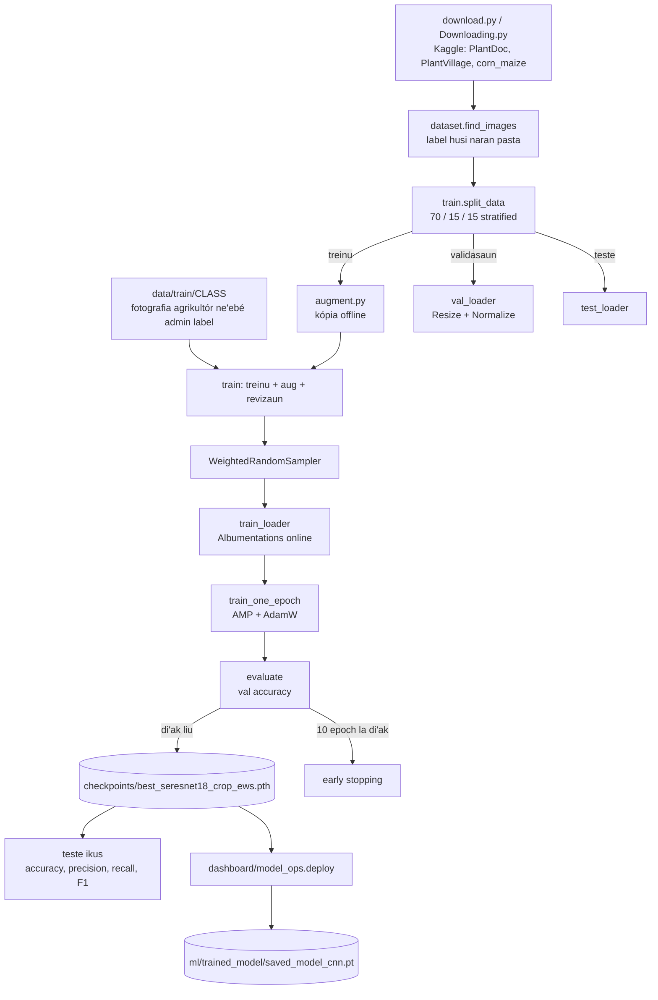
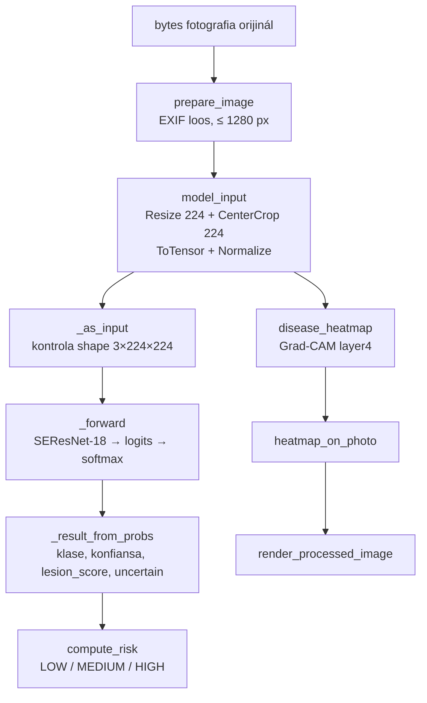

# 05 — Modulu Machine Learning: Modelu CNN SEResNet-18

*Sistema Crop Disease Early Warning System (EWS) — dokumentasaun téknika ba modelu CNN. Fonte úniku: kódigu iha repozitóriu (commit `89a25f1`, 2026-10-24) no projetu treinu separadu `crop_disease_ews` (`TRAINING_PROJECT_DIR`, la'ós repozitóriu git). Kódigu hotu iha dokumentu ne'e mak kópia husi arkivu loloos, ho númeru liña.*

{{coverage @train/dataset.py 1-273}}
{{coverage @train/augment.py 1-247}}
{{coverage @train/model.py 1-204}}
{{coverage @train/train.py 1-1167}}
{{coverage @train/predict.py 1-240}}
{{coverage @train/gradcam.py 1-560}}
{{coverage @train/download.py 1-64}}
{{coverage @train/Downloading.py 1-6}}
{{coverage ml/inference.py 1-461}}
{{coverage ml/se_resnet.py 1-69}}
{{coverage ml/render.py 1-66}}
{{coverage dashboard/model_ops.py 1-168}}
{{coverage config/settings.py 70-103}}
{{coverage spark/preprocessing.py 321-437}}

## A. Introdusaun no Objetivu

Modulu ne'e mak "matan" sistema: **Convolutional Neural Network (CNN)** ida ne'ebé haree fotografia folla batar (maize) no fó klase haat:

| Klase iha treinu | Klase iha sistema | Signifikadu |
|---|---|---|
| `Healthy` | `healthy` | Folla saudável |
| `Blight` | `northern_leaf_blight` | Moras *Northern Leaf Blight* |
| `Common_Rust` | `common_rust` | Moras *Common Rust* (ferruzen) |
| `Gray_Leaf_Spot` | `gray_leaf_spot` | Moras *Gray Leaf Spot* |

Konfiansa < 0.5 → sistema hatudu `uncertain` duké fó naran moras ida ho fraku.

**Arkitetura:** **SEResNet-18** — ResNet-18 (pre-treinu iha ImageNet) ho bloku **Squeeze-and-Excitation (SE)** iha bloku residual ida-idak. Modelu ne'ebé deploy agora: `architecture: se_resnet18`, epoch 10, *validation accuracy* 95.98% (`ml/trained_model/saved_model_cnn.pt`).

**Parte rua:**

1. **Treinu** (projetu `crop_disease_ews`, liur repozitóriu): download dataset, *augmentation* offline (Albumentations), fahe 70/15/15, treinu ho AdamW + *cosine schedule* + *mixed precision*, avalia (accuracy, precision, recall, F1), Grad-CAM.
2. **Inferénsia** (sistema, `ml/`): Spark prepara tensor (`model_input`), `ml/inference.predict` klasifika, `compute_risk` fó risku, `ml/render.py` desenha imajen marka. `dashboard/model_ops.py` mak ponte: troka checkpoint treinu ba formatu sistema no deploy.

**Saida mak la iha:** la iha *pest damage* (klase komentáriu tiha); modelu la rejeita fotografia ne'ebé la'ós batar (fotografia hotu hetan klase ida ka `uncertain`); akurasia ~96% mak iha dadus dataset nian, la'ós iha fotografia agrikultór loloos.

## B. Arkivu Fonte Loloos

| Arkivu | Liña | Klase / funsaun | Papél |
|---|---|---|---|
| `crop_disease_ews/download.py` | 64 | `download_datasets` | Download PlantDoc no PlantVillage (Kaggle) |
| `crop_disease_ews/Downloading.py` | 6 | — | Download dataset *corn-or-maize* |
| `crop_disease_ews/dataset.py` | 273 | `find_images`, `get_transforms`, `PlantDiseaseDataset` | Label, Albumentations, Dataset PyTorch |
| `crop_disease_ews/augment.py` | 247 | `make_copies`, `dihedral`, `main` | *Augmentation* offline (split treinu de'it) |
| `crop_disease_ews/model.py` | 204 | `SEBlock`, `SEResNet18` | Arkitetura |
| `crop_disease_ews/train.py` | 1167 | `split_data`, `create_weighted_sampler`, `train_one_epoch`, `evaluate`, `main` | Treinu no avaliasaun |
| `crop_disease_ews/predict.py` | 240 | `DiseasePredictor` | Predisaun mesak (teste) |
| `crop_disease_ews/gradcam.py` | 560 | `GradCAM`, `load_leaf_mask`, `main` | Analiza fatin ne'ebé modelu haree |
| `dashboard/model_ops.py` | 168 | `deploy`, `is_better`, `train_and_deploy` | Exporta no deploy checkpoint |
| `config/settings.py` | 70–103 | `IMAGE_MODEL` | Konfigurasaun inferénsia |
| `spark/preprocessing.py` | 321–437 | `model_input`, `prepare_image`, `compute_risk` | *Preprocessing* imajen no risku |
| `ml/se_resnet.py` | 69 | `SEBlock`, `SEResNet18` | Kópia arkitetura iha sistema |
| `ml/inference.py` | 461 | `predict`, `disease_heatmap`, `_GpuBatcher`, … | Inferénsia |
| `ml/render.py` | 66 | `render_processed_image` | Imajen marka ba agrikultór |

**Dependénsia (`requirements.txt` treinu):** `torch`, `torchvision`, `opencv-python`, `albumentations`, `scikit-learn`, `matplotlib`, `seaborn`, `numpy`, `pandas`, `kagglehub`, `Pillow`.

**Hyperparámetru (`train.py` liña 40–54):** `SEED = 42`, `IMG_SIZE = 224`, `BATCH_SIZE = 32`, `EPOCHS = 25`, `LEARNING_RATE = 3e-4`, `WEIGHT_DECAY = 1e-2`, `NUM_WORKERS = 4`, `PATIENCE = 10`.

## C. Arkitetura, Fluxu no Matemátika

### C.1 Pipeline treinu

### C.2 Pipeline inferénsia (iha sistema)

### C.3 Matemátika

Simbolu: $x$ = valór pixel; $c$ = kanál (R, G, B); $K$ = númeru klase (4); $z_k$ = *logit* ba klase $k$; $p_k$ = probabilidade; $y$ = klase loloos; $N$ = númeru imajen.

**1. Normalizasaun pixel.** `ToTensor` troka pixel 0–255 ba $[0, 1]$; depois `Normalize` ho média no desviu padraun ImageNet:

$$x'_c = \frac{x_c / 255 - \mu_c}{\sigma_c}, \qquad \mu = (0.485,\ 0.456,\ 0.406),\quad \sigma = (0.229,\ 0.224,\ 0.225)$$

**2. Resize no centre crop (inferénsia).** Ba imajen $W \times H$ ho $S = 224$: lados badak sai $S$, $s = S / \min(W, H)$, tamañu foun $(\lfloor sW \rfloor, \lfloor sH \rfloor)$; depois foti kuadradu $S \times S$ iha klaran:

$$\text{left} = \operatorname{round}\!\left(\frac{W' - S}{2}\right), \qquad \text{top} = \operatorname{round}\!\left(\frac{H' - S}{2}\right)$$

**3. Bloku Squeeze-and-Excitation.** Ba mapa karakterístika $U \in \mathbb{R}^{C \times H \times W}$, ho redusaun $r = 16$:

$$z_c = \frac{1}{H W} \sum_{i=1}^{H} \sum_{j=1}^{W} U_c(i, j) \qquad \text{(squeeze: média global)}$$

$$s = \sigma\big(W_2\, \delta(W_1 z)\big), \quad W_1 \in \mathbb{R}^{\frac{C}{r} \times C},\ W_2 \in \mathbb{R}^{C \times \frac{C}{r}} \qquad \text{(excitation)}$$

$$\tilde{U}_c = s_c \cdot U_c \qquad \text{(scale)}$$

$\delta$ = ReLU, $\sigma$ = sigmoid. Kada kanál hetan pezu $s_c \in (0, 1)$: modelu aprende kanál ne'ebé importante.

**4. Bloku residual ho SE.** $\mathcal{F}$ = conv–BN–ReLU–conv–BN:

$$y = \operatorname{ReLU}\big(\operatorname{SE}(\mathcal{F}(x)) + \operatorname{shortcut}(x)\big)$$

**5. Softmax.** Husi *logits* $z \in \mathbb{R}^{K}$:

$$p_k = \frac{e^{z_k}}{\sum_{j=1}^{K} e^{z_j}}, \qquad \sum_{k} p_k = 1$$

**6. Cross-entropy loss** (`nn.CrossEntropyLoss`, média iha batch $B$):

$$\mathcal{L} = -\frac{1}{B} \sum_{n=1}^{B} \log p_{n, y_n}$$

**7. AdamW** (`lr` $\eta = 3\times10^{-4}$, *weight decay* $\lambda = 10^{-2}$, $\beta_1 = 0.9$, $\beta_2 = 0.999$ default PyTorch):

$$m_t = \beta_1 m_{t-1} + (1-\beta_1) g_t, \qquad v_t = \beta_2 v_{t-1} + (1-\beta_2) g_t^2$$

$$\hat m_t = \frac{m_t}{1-\beta_1^t}, \quad \hat v_t = \frac{v_t}{1-\beta_2^t}, \qquad \theta_t = \theta_{t-1} - \eta \left( \frac{\hat m_t}{\sqrt{\hat v_t} + \epsilon} + \lambda\, \theta_{t-1} \right)$$

**8. Cosine annealing** (`T_max = 25` epoch, $\eta_{\min} = 0$):

$$\eta_e = \eta_{\min} + \tfrac{1}{2}(\eta_0 - \eta_{\min})\left(1 + \cos\frac{e\,\pi}{T_{\max}}\right)$$

**9. Weighted sampler.** Klase $k$ ho imajen $n_k$: pezu kada imajen $w_i = 1 / n_{y_i}$. Probabilidade foti imajen $i$:

$$P(i) = \frac{w_i}{\sum_j w_j}$$

Nune'e klase ida-idak mosu kuaze hanesan iha treinu, maske dataset la balansu.

**10. Grad-CAM** (layer4, klase $c$ ho *score* $z_c$, mapa $A^k$):

$$\alpha_k^c = \frac{1}{Z} \sum_{i} \sum_{j} \frac{\partial z_c}{\partial A^k_{ij}}, \qquad L^c = \operatorname{ReLU}\!\left(\sum_k \alpha_k^c A^k\right)$$

**11. Lesion score no risku** (`_result_from_probs`, `compute_risk`):

$$\text{lesion\_score} = 1 - p_{\text{healthy}}, \qquad \text{risk} = \begin{cases} \text{HIGH} & \text{lesion\_score} \ge 0.6 \\ \text{MEDIUM} & 0.3 \le \text{lesion\_score} < 0.6 \\ \text{LOW} & \text{lesion\_score} < 0.3 \end{cases}$$

Se $\max_k p_k < 0.5$ → klase `uncertain` no risku maximu MEDIUM.

**12. Métrika avaliasaun** (`train.py`, `average="weighted"`). Ba klase $k$: $TP_k$ (loos pozitivu), $FP_k$ (falsu pozitivu), $FN_k$ (falsu negativu), $n_k$ (suporte):

$$\text{Accuracy} = \frac{1}{N}\sum_{n=1}^{N} \mathbb{1}[\hat y_n = y_n]$$

$$P_k = \frac{TP_k}{TP_k + FP_k}, \qquad R_k = \frac{TP_k}{TP_k + FN_k}, \qquad F1_k = \frac{2 P_k R_k}{P_k + R_k}$$

$$\text{Precision}_w = \sum_k \frac{n_k}{N} P_k, \qquad \text{Recall}_w = \sum_k \frac{n_k}{N} R_k, \qquad F1_w = \sum_k \frac{n_k}{N} F1_k$$

**Rezultadu loloos** (`results/classification_report.txt`, treinu ikus 2026-10-03, *test split* 646 imajen, avaliasaun ho `Resize`): Test Accuracy 94.58%, Precision 94.74%, Recall 94.58%, F1 94.61%.

| Klase | Precision | Recall | F1 | Suporte |
|---|---|---|---|---|
| Healthy | 0.98 | 1.00 | 0.99 | 181 |
| Blight | 0.89 | 0.94 | 0.92 | 181 |
| Common_Rust | 1.00 | 0.94 | 0.97 | 198 |
| Gray_Leaf_Spot | 0.86 | 0.86 | 0.86 | 86 |

Sukat fali 2026-10-24 (`model_input` docstring): *centre crop* 95.67% kontra *squeeze* 94.74% iha *test split* hanesan; fotografia natureza 78: 78.2% kontra 70.5%.

### C.4 Tamañu no fonte dadus treinu (kontrola 2026-10-24)

Kontajen husi log treinu (`train_log_gpu.txt`, `train_log_gpu_resume.txt`) no husi arkivu iha disku (regra hanesan `find_images`):

| Fonte | Tipu fotografia | Healthy | Blight | Common_Rust | Gray_Leaf_Spot | Total |
|---|---|---|---|---|---|---|
| PlantVillage `color` | laboratóriu (fundu simples) | 1,162 | 985 | 1,192 | 513 | 3,852 (89%) |
| PlantDoc | natureza | 0 | 189 | 105 | 55 | 349 |
| corn_maize | natureza | 48 | 30 | 19 | 6 | 103 |
| **Total orijinál** | | **1,210** | **1,204** | **1,316** | **574** | **4,304** (log: 4,305) |

| Split | Imajen |
|---|---|
| Treinu (70%) | 3,013 orijinál + 3,301 kópia *augmented* = **6,314** |
| Validasaun (15%) | 646 |
| Teste (15%) | 646 |

**Konkluzaun onestu:**

- Dataset **ki'ik**: orijinál 4,305 de'it. Kópia *augmented* 3,301 la'ós fotografia foun — sira mak *flip*, rotasaun no kór husi fotografia treinu hanesan.
- **89% mak fotografia laboratóriu** (PlantVillage). *Test split* mós maioria laboratóriu, entaun akurasia ~95–96% mak **otimista** ba fotografia agrikultór; iha fotografia natureza 78, akurasia 78.2%.
- **Healthy natureza uitoan liu:** 1,162 husi 1,210 Healthy mak laboratóriu; natureza 48 de'it (PlantDoc la iha batar saudável).
- **Gray_Leaf_Spot** mak klase ki'ik liu (574), no nia F1 mak ki'ik liu (0.86).
- **Modelu deploy la uza fotografia agrikultór:** 3,013 + 3,301 = 6,314 ezatu, entaun `data/train` la kontribui. Fotografia revizadu 25 iha `data/train` (Healthy 22, northern_leaf_blight 2, gray_leaf_spot 1) hotu kria depois treinu (2026-10-03 21:26 → 2026-10-10); sira sei tama de'it iha treinu tuir mai.

## D. Esplikasaun Kódigu ba Kódigu

### D.1 Download dataset

#### D.1.1 `download.py` (liña 1–64)

{{code @train/download.py 1-64}}

- `kagglehub.dataset_download(...)` download dataset husi Kaggle ba *cache* lokál, fila dalan.
- Dataset rua: **PlantDoc** (`abdulhasibuddin/plant-doc-dataset`, fotografia natureza) no **PlantVillage** (`emware/plantvillage-diseased-dataset`, fotografia laboratóriu).
- `shutil.copytree(..., dirs_exist_ok=True)` kopia ba `data/plantdoc` no `data/plantvillage` se seidauk iha.
- Erru (rede, Kaggle) → hakerek mensajen, la hapara ho *traceback*.

#### D.1.2 `Downloading.py` (liña 1–6)

{{code @train/Downloading.py 1-6}}

- Download dataset **corn-or-maize leaf disease** (`smaranjitghose/...`). Dadus ne'e tama `data/corn_maize` (fotografia saudável natureza barak liu).

### D.2 `dataset.py` — label, transformasaun, Dataset

#### D.2.1 Import no klase (liña 1–31)

{{code @train/dataset.py 1-31}}

- `cv2` (OpenCV) lee imajen; `albumentations as A` ba transformasaun; `ToTensorV2` troka `numpy` HWC ba tensor CHW.
- `IMAGE_EXTENSIONS` — tipu arkivu aseita.
- `CLASS_NAMES` — klase haat; **orden** ne'e mak índise klase (0 = Healthy, 1 = Blight, 2 = Common_Rust, 3 = Gray_Leaf_Spot). `Pest_Damage` komentáriu tiha (la iha imajen).

#### D.2.2 Normalizasaun label no alias (liña 34–69)

{{code @train/dataset.py 34-69}}

- `normalize_label` — letra ki'ik, `-` no espasu sai `_`. Ezemplu: `"Northern Leaf Blight"` → `"northern_leaf_blight"`.
- `CLASS_ALIASES` — naran pasta husi dataset oioin → klase ida. Ezemplu: `rust`, `common_rust_maize` → `Common_Rust`; `grey_leaf_spot` → `Gray_Leaf_Spot`.

#### D.2.3 `find_images` (liña 72–123)

{{code @train/dataset.py 72-123}}

- `os.walk` liu pasta hotu; label = **naran pasta inan** (`os.path.basename(root)`).
- Pasta la iha alias ka klase la iha `CLASS_NAMES` → skip (ezemplu pasta tomate iha PlantVillage).
- **Valór retorna:** `(image_paths, labels)` ho label hanesan índise.

#### D.2.4 `get_transforms` — treinu (liña 126–204)

{{code @train/dataset.py 126-204}}

*Augmentation* **online** (foun kada epoch) ho Albumentations:

| Transformasaun | Parámetru | Probabilidade | Objetivu |
|---|---|---|---|
| `RandomResizedCrop` | 224×224, `scale=(0.7, 1.0)` | 1.0 | Ko'a 70–100% area no redimensiona |
| `HorizontalFlip` / `VerticalFlip` | — | 0.5 / 0.5 | Folla bele iha diresaun hotu |
| `RandomRotate90` | — | 0.5 | Rotasaun 90° |
| `ShiftScaleRotate` | shift 0.1, scale 0.1, rotate 30° | 0.5 | Fotografia la loos |
| `ColorJitter` | brightness/contrast/saturation 0.3, hue 0.15 | 0.7 | Naroman oioin |
| `RandomShadow` | 1–3 sombra, intensidade 0.3–0.7 | 0.5 | Sombra iha to'os |
| `Sharpen` | alpha 0.2–0.5 | 0.3 | Kamera oioin |
| `OneOf(GaussianBlur, MotionBlur, GaussNoise)` | blur 3–7, noise std 0.01–0.05 | 0.4 | Fotografia la klaru / ruidu |
| `Normalize` | média/desviu ImageNet | 1.0 | Fórmula C.3.1 |
| `ToTensorV2` | — | 1.0 | `numpy` → tensor |

#### D.2.5 `get_transforms` — validasaun/teste (liña 205–222)

{{code @train/dataset.py 205-222}}

- La iha *augmentation*: `Resize(224, 224)` (**squeeze**, proporsaun la mantein) + `Normalize` + `ToTensorV2`.
- *Nota:* sistema iha produsaun uza *centre crop* (`model_input`), la'ós squeeze — sukat di'ak liu (C.3).

#### D.2.6 `PlantDiseaseDataset` (liña 225–273)

{{code @train/dataset.py 225-273}}

- Klase herda husi `torch.utils.data.Dataset`.
- `__init__` — atributu `image_paths`, `labels`, `transform`.
- `__len__` — númeru imajen (DataLoader presiza).
- `__getitem__(idx)` — `cv2.imread` (BGR), erru se la bele lee, `cvtColor` BGR → **RGB**, aplika transformasaun, fila `(tensor, label)`.

### D.3 `augment.py` — *augmentation* offline

#### D.3.1 Import no konfigurasaun (liña 1–41)

{{code @train/augment.py 1-41}}

- Uza `split_data` husi `train.py` → kópia mai **de'it husi split treinu** (validasaun/teste la kontamina).
- `COPIES_PER_IMAGE = 1` (dataset sai dala rua).
- Fotografia saudável natureza (`data/corn_maize`) uitoan → kada ida hetan rotasaun/flip 8 + kópia *grayscale* 2.
- `GRAYSCALE_PROBABILITY = 0.15` — kópia normál balun mós *grayscale*, nune'e "grayscale" la sai sinál ba Healthy de'it.

#### D.3.2 `OFFLINE_TRANSFORM` (liña 44–89)

{{code @train/augment.py 44-89}}

- Rai tamañu orijinál (resize/crop/normaliza halo depois iha `train.py`).
- `Affine` (translate ±10%, scale 0.9–1.1, rotate ±30°, `BORDER_REFLECT_101` — borda reflete, la iha borda metan), `ColorJitter` (hue 0.05), `RandomShadow`, `OneOf` blur/noise.
- `seed=SEED` no `rng = np.random.default_rng(SEED)` → rezultadu bele repete.

#### D.3.3 `to_grayscale`, `dihedral`, `make_copies` (liña 92–149)

{{code @train/augment.py 92-149}}

- `to_grayscale` — BGR → gray → BGR (kanál 3 nafatin).
- `dihedral(image, k)` — grupu dihedral 8: rotasaun 0/90/180/270° (`np.rot90`), ho/la ho *flip* (`k >= 4`).
- `make_copies` — fotografia saudável natureza: kópia 8 (`rot0`–`rot7`) + gray 2; seluk: kópia `COPIES_PER_IMAGE`, 15% gray. Fila lista `(sufiksu, imajen)`.

#### D.3.4 `main` (liña 152–247)

{{code @train/augment.py 152-247}}

- Buka imajen, fahe (split hanesan `train.py`), hamoos `data/augmented` tuan (kópia husi split antigu la hela).
- Kada imajen treinu: naran `"<stem>_<md5[:8]>_<sufiksu>.jpg"` (hash dalan → naran úniku entre dataset), hakerek JPEG kualidade 95.
- `manifest.csv` — `aug_path`, `source_path`, `class_name` (`train.py` uza atu konfirma kópia mai husi treinu).

### D.4 `model.py` — SEResNet-18

#### D.4.1 `SEBlock` (liña 1–66)

{{code @train/model.py 1-66}}

- **Klase** herda `nn.Module`; `__init__(channels, reduction=16)`; `super().__init__()`.
- `reduced_channels = max(channels // 16, 1)`.
- `self.squeeze = nn.AdaptiveAvgPool2d(1)` — média global ($z_c$, C.3.3).
- `self.excitation` — `Linear(C → C/16)` → `ReLU` → `Linear(C/16 → C)` → `Sigmoid` (fórmula $s$).
- `forward(x)` — `(B, C, H, W)` → squeeze `(B, C, 1, 1)` → `view(B, C)` → excitation → `view(B, C, 1, 1)` → `x * y` (*broadcast*, scale kada kanál).

#### D.4.2 `SEResNet18.__init__` (liña 69–123)

{{code @train/model.py 69-123}}

- `pretrained=True` → pezu `ResNet18_Weights.DEFAULT` (ImageNet) — *transfer learning*.
- Foti kamada husi ResNet-18: `conv1` (7×7, 64), `bn1`, `relu`, `maxpool`.
- `layer1`–`layer4` liu `_inject_se` (SE iha bloku hotu).
- `fc = nn.Linear(512, num_classes)` — kamada klasifikasaun foun (4 saida).

#### D.4.3 `_inject_se` (liña 125–177)

{{code @train/model.py 125-177}}

- Kada `BasicBlock`: `block.se = SEBlock(block.conv2.out_channels)` — rejista hanesan *submodule* (tama `parameters()`, `state_dict()`, `.to(device)`).
- `forward_with_se(x, block=block)` — *closure*; `block=block` iha argumentu default kaer bloku atuál (la'ós ikus).
- Orden: `conv1 → bn1 → relu → conv2 → bn2 → **se** → (+ identity/downsample) → relu` (fórmula C.3.4).
- `block.forward = forward_with_se` — troka métodu objetu (*monkey patching*).

#### D.4.4 `forward` (liña 179–204)

{{code @train/model.py 179-204}}

- Tensor `(B, 3, 224, 224)` → conv1/bn/relu/maxpool `(B, 64, 56, 56)` → layer1 `(64, 56)` → layer2 `(128, 28)` → layer3 `(256, 14)` → layer4 `(512, 7, 7)` → avgpool `(512, 1, 1)` → `flatten` `(B, 512)` → `fc` `(B, 4)` *logits*.

### D.5 `train.py` — treinu

#### D.5.1 Import no konfigurasaun (liña 1–81)

{{code @train/train.py 1-81}}

- Hyperparámetru (B). `DATASET_DIRS`: PlantDoc, PlantVillage **color** de'it (liña 56–57: `grayscale`/`segmented` mak kópia folla hanesan → *leakage* entre split), `corn_maize`.
- `REVIEWED_DIR = "data/train"` — fotografia agrikultór ne'ebé admin label iha dashboard; **treinu de'it**, nunka val/teste.
- `AUGMENTED_DIR`, `AUGMENTED_MANIFEST`, `CHECKPOINT_DIR`, `RESULTS_DIR`.

#### D.5.2 `set_seed` no `get_device` (liña 83–121)

{{code @train/train.py 83-121}}

- *Seed* 42 ba `random`, `numpy`, `torch`, CUDA — rezultadu bele repete.
- GPU CUDA se iha, se lae CPU.

#### D.5.3 `split_data` (liña 123–157)

{{code @train/train.py 123-157}}

- `train_test_split` dala rua, `stratify` (proporsaun klase hanesan iha split hotu), `random_state=SEED`: 70% treinu, 30% → metade val (15%), metade teste (15%).

#### D.5.4 `load_augmented` (liña 159–213)

{{code @train/train.py 159-213}}

- Lee `manifest.csv`; aseita kópia de'it se `source_path` iha split treinu atuál, klase válidu no arkivu iha. **Prevene *data leakage***: kópia husi imajen val/teste nunka tama treinu.

#### D.5.5 `create_weighted_sampler` (liña 216–266)

{{code @train/train.py 216-266}}

- `np.bincount` — kontajen kada klase.
- `class_weights[k] = 1 / n_k`; `sample_weights` kada imajen.
- `WeightedRandomSampler(..., replacement=True)` — fórmula C.3.9.

#### D.5.6 `train_one_epoch` (liña 269–356)

{{code @train/train.py 269-356}}

- `model.train()` — BatchNorm/Dropout modu treinu.
- Kada batch: `.to(device, non_blocking=True)`; `optimizer.zero_grad(set_to_none=True)`.
- `torch.amp.autocast` — **mixed precision** (FP16 iha GPU) ba lalais no memória ki'ik.
- `loss = criterion(outputs, labels)` — cross-entropy (C.3.6).
- `scaler.scale(loss).backward()` → `scaler.step(optimizer)` → `scaler.update()` — `GradScaler` multiplika loss atu gradiente FP16 la sai zero (*underflow*).
- `running_loss += loss.item() * batch` — loss média kada imajen; `argmax` → predisaun; `accuracy_score`.

#### D.5.7 `evaluate` (liña 359–432)

{{code @train/train.py 359-432}}

- `model.eval()` no `torch.no_grad()` — la kalkula gradiente. Fila `loss, accuracy, targets, predictions`.

#### D.5.8 `plot_history` (liña 435–524)

{{code @train/train.py 435-524}}

- Gráfiku `loss_curve.png` no `accuracy_curve.png` (treinu vs validasaun) ho `matplotlib`.

#### D.5.9 `save_confusion_matrix` (liña 526–590)

{{code @train/train.py 526-590}}

- `confusion_matrix(targets, predictions)` — liña = klase loloos, koluna = predisaun; hakerek valór iha kada kaixa; `confusion_matrix.png`.

#### D.5.10 `main` — dadus (liña 593–693)

{{code @train/train.py 593-693}}

- Kria pasta, hili device, `find_images` (la iha imajen → erru), `split_data`, aumenta kópia offline no fotografia revizaun ba **treinu de'it**, imprime tamañu split.

#### D.5.11 `main` — Dataset no DataLoader (liña 694–762)

{{code @train/train.py 694-762}}

- Treinu: transformasaun `is_train=True`; val/teste: `is_train=False`.
- `train_loader` ho `sampler` (la `shuffle`); val/teste `shuffle=False`. `pin_memory` iha GPU; `persistent_workers` (worker 4 la kria fali kada epoch).

#### D.5.12 `main` — modelu, loss, optimizer, scheduler, estadu (liña 764–839)

{{code @train/train.py 764-839}}

- `SEResNet18(num_classes=4, pretrained=True)`.
- `nn.CrossEntropyLoss()`, `AdamW(lr=3e-4, weight_decay=1e-2)` (C.3.7), `CosineAnnealingLR(T_max=25)` (C.3.8), `GradScaler("cuda")`.
- `history` (loss/accuracy kada epoch), `best_val_accuracy`, `epochs_without_improvement`; checkpoint **best** (pezu + `class_names`, `img_size`, `val_accuracy`, `epoch`) no **last** (estadu tomak ba `--resume`).

#### D.5.13 `main` — `--resume` (liña 841–895)

{{code @train/train.py 841-895}}

- `last_...pth` iha → kontinua ho pezu, optimizer, scheduler, istória no kontador. Checkpoint tuan (`best` de'it) → pezu + scheduler `step()` to'o epoch ne'e.

#### D.5.14 `main` — *loop* treinu (liña 897–1020)

{{code @train/train.py 897-1020}}

- Kada epoch: `train_one_epoch`, `evaluate` (val), `scheduler.step()`, rai istória, imprime.
- `val_accuracy > best` → rai **best** no reseta kontador; se lae kontador +1.
- Rai **last** kada epoch.
- **Early stopping:** `epochs_without_improvement >= PATIENCE (10)` → hapara.

#### D.5.15 `main` — teste ikus (liña 1022–1069)

{{code @train/train.py 1022-1069}}

- Gráfiku istória; load **best** (la'ós ikus); `evaluate` iha **test split** (dala ida de'it).

#### D.5.16 `main` — métrika no relatóriu (liña 1071–1167)

{{code @train/train.py 1071-1167}}

- `precision_score`, `recall_score`, `f1_score` ho `average="weighted"`, `zero_division=0` (C.3.12).
- `classification_report` (kada klase) → `results/classification_report.txt`; `confusion_matrix.png`.
- Liña `"Training completed."` — `dashboard/model_ops.train_and_deploy` buka liña ne'e.

### D.6 `predict.py` — predisaun mesak

#### D.6.1 `DiseasePredictor.__init__` (liña 1–92)

{{code @train/predict.py 1-92}}

- `CONFIDENCE_THRESHOLD = 0.60` (*nota:* sistema uza 0.5 iha `IMAGE_MODEL`).
- Klase ho `__init__`: device, load checkpoint, `class_names` husi checkpoint, `SEResNet18(pretrained=False)` + `load_state_dict`, `eval()`, transformasaun validasaun.

#### D.6.2 `predict` no teste (liña 93–240)

{{code @train/predict.py 93-240}}

- Lee → RGB → transforma → `unsqueeze(0)` (batch 1) → `softmax` → `torch.topk(k=3)`.
- Konfiansa < 0.60 → `"Uncertain"`. Fila `disease`, `raw_prediction`, `confidence` (%), `top_predictions`.
- *Nota:* sistema la uza arkivu ne'e; sistema uza `ml/inference.py` (D.9).

### D.7 `gradcam.py` — analiza fatin ne'ebé modelu haree

#### D.7.1 Import no konfigurasaun (liña 1–46)

{{code @train/gradcam.py 1-46}}

- `matplotlib.use("Agg")` — desenha la ho janela.
- PlantVillage iha kópia `segmented` (fundu hasai) → máskara folla loloos ba fotografia laboratóriu.

#### D.7.2 Klase `GradCAM` (liña 48–100)

{{code @train/gradcam.py 48-100}}

- `__init__` rejista *forward hook* iha `target_layer` (`layer4`).
- `_save` — rai ativasaun; se presiza gradiente, rejista *hook* tensor `_save_gradient`.
- `__call__` (objetu bele bolu hanesan funsaun) — forward, klase `argmax`, `backward()` husi *score* klase ne'e, pezu kanál = média gradiente, `ReLU(Σ pezu × ativasaun)`, normaliza ba [0, 1], redimensiona 224 (C.3.10).

#### D.7.3 Ajuda: fonte, máskara folla, hasai folla (liña 103–201)

{{code @train/gradcam.py 103-201}}

- `source_of` — `lab` (PlantVillage) ka `field`.
- `mask_keys`, `load_leaf_mask` — buka kópia `segmented` ba fotografia `color` (indeks ho naran ezatu ka la ho prefiksu UUID); máskara = pixel > 25; `morphologyEx OPEN` hasai *speckle*.
- `remove_leaf` — pinta folla (ho margen 15 px) ho kór média fundu → imajen "fundu de'it".

#### D.7.4 Desenhu no `mean` (liña 204–305)

{{code @train/gradcam.py 204-305}}

- `overlay` — `COLORMAP_JET`, 55% imajen + 45% mapa.
- `save_grid` — orijinál (leten) + Grad-CAM (okos), verde se loos, mean se sala.
- `save_ablation_grid` — orijinál / folla de'it / fundu de'it.

#### D.7.5 `main` — kalkula (liña 308–406)

{{code @train/gradcam.py 308-406}}

- CPU; load modelu; `GradCAM(model, model.layer4)`.
- *Test split* hanesan `train.py`.
- Kada imajen: Grad-CAM; ba `lab` ho máskara: `heat_on_leaf` = % mapa iha folla, `leaf_area` = % imajen ne'ebé folla, no klasifika folla de'it / fundu de'it.

#### D.7.6 `main` — figura no CSV (liña 407–473)

{{code @train/gradcam.py 407-473}}

- Grid kada klase (8 sample), grid imajen sala, grid *ablation* (2 kada klase), `gradcam_per_image.csv`.

#### D.7.7 `main` — relatóriu (liña 475–560)

{{code @train/gradcam.py 475-560}}

- (1) Akurasia kada fonte (lab vs field). (2) `heat on leaf` vs `leaf area` — mapa boot liu area = modelu haree folla. (3) Teste folla de'it (tenke loos) no fundu de'it (la bele fó klase loos ho konfiansa) — kontrola se modelu aprende **fundu** duké moras.

### D.8 Ponte treinu → sistema: `dashboard/model_ops.py`

#### D.8.1 Docstring, `CLASS_NAME_MAP`, `info` (liña 1–39)

{{code dashboard/model_ops.py 1-39}}

- Halai iha prosesu separadu: iha Windows, import `torch` depois `pyarrow` (pandas) falla ("WinError 1114").
- `CLASS_NAME_MAP` — naran klase treinu → naran sistema (`Blight` → `northern_leaf_blight`).
- `info(path)` — metadata checkpoint hotu exetu pezu (`weights_only=True`: load seguru, la ezekuta kódigu pickle).

#### D.8.2 `deploy` (liña 41–85)

{{code dashboard/model_ops.py 41-85}}

- Exporta formatu sistema: `state_dict`, `architecture: "se_resnet18"`, `class_names` troka, `healthy_class_name`, `img_size`, `mean`/`std`, no traseabilidade (`trained_epoch`, `val_accuracy`, `source_checkpoint`, `deployed_at`).
- **Kontrola molok deploy:** kria `SEResNet18`, `load_state_dict`, halai tensor zero `(1, 3, 224, 224)` — modelu ne'ebé la load la bele deploy.
- Hakerek `.pt.tmp`, rai *backup* modelu atuál, depois `os.replace` (atómiku). `ml/inference` haree arkivu muda no load fali.

#### D.8.3 `_test_metrics` no `is_better` (liña 87–118)

{{code dashboard/model_ops.py 87-118}}

- `_test_metrics` — lee "Test Accuracy: …" etc. husi log treinu (regex).
- `is_better` — kompara *test accuracy* (se rua iha), se lae *validation accuracy*; hanesan → rai modelu atuál.

#### D.8.4 `train_and_deploy` no CLI (liña 120–168)

{{code dashboard/model_ops.py 120-168}}

- Halai `train.py` (ho `--resume` opsionál); la remata ("Training completed." la iha) → la deploy.
- Di'ak liu → `deploy(...)` ho `deployed_by: "auto (after training)"`; erru → modelu atuál la muda.

### D.9 Konfigurasaun `IMAGE_MODEL` (config/settings.py liña 70–103)

{{code config/settings.py 70-103}}

- `weights_path` — `ml/trained_model/saved_model_cnn.pt`.
- `confidence_threshold` 0.5 — iha okos → `uncertain`.
- `device` `auto` (GPU se iha).
- `batch_size` 1, `precision` fp32 (default: predisaun hanesan uluk); `torch_threads` 1.
- Klase mai husi checkpoint, la hakerek iha kódigu.

### D.10 Spark prepara input CNN (spark/preprocessing.py liña 321–437)

#### D.10.1 `model_input`, `model_input_preview`, `heatmap_on_photo`, `_prepared_rgb` (liña 321–391)

{{code spark/preprocessing.py 321-391}}

- `model_input` — `Resize(224)` (lados badak) → `CenterCrop(224)` → `ToTensor` → `Normalize(mean, std)` husi checkpoint (fórmula C.3.1–C.3.2). Spark mak halo *preprocessing* hotu; CNN klasifika de'it.
- Docstring liña 330–335: tanba sa *crop* (C.3, rezultadu).
- `heatmap_on_photo` — Grad-CAM 7×7 → `F.interpolate` bilinear ba kuadradu, normaliza, tau iha klaran fotografia.

#### D.10.2 `prepare_image` no `compute_risk` (liña 392–437)

{{code spark/preprocessing.py 392-437}}

- `prepare_image` — dekode JPEG *draft* (eskala ki'ik), EXIF loos, RGB, ≤ 1280 px, JPEG 95.
- `compute_risk` — fórmula C.3.11; `uncertain` la bele HIGH.

### D.11 `ml/se_resnet.py` — arkitetura iha sistema (liña 1–69)

{{code ml/se_resnet.py 1-69}}

- Kópia arkitetura treinu, la import husi projetu treinu. Naran `state_dict` tenke **hanesan** (`block.se`, `conv1`, `layer1`–`4`, `fc`).
- `SEResNet18(num_classes)` — `weights=None` (pezu mai husi checkpoint).
- `_inject_se` ho `@staticmethod` (la presiza `self`); fila `layer` rasik.
- Naran kamada hanesan torchvision, nune'e Grad-CAM manuál iha `disease_heatmap` funsiona.

### D.12 `ml/inference.py` — inferénsia

#### D.12.1 Docstring (liña 1–48)

{{code ml/inference.py 1-48}}

- CNN la halo *preprocessing*; Spark prepara tensor `(3, 224, 224)`.
- Formatu checkpoint (liña 22–33). *Nota onestu:* komentáriu liña 27 hateten `"resnet18"` mak ida de'it ne'ebé suporta — kódigu (liña 129–138) suporta mós `se_resnet18`, no modelu deploy mak `se_resnet18`.
- Saida: `lesion_score = 1 − P(healthy)`, `predicted_class`, konfiansa; koluna heurístika `None`.

#### D.12.2 Konstante, *cache* modelu (liña 50–96)

{{code ml/inference.py 50-96}}

- `UNCERTAIN_CLASS = "uncertain"`; `ModelNotAvailable`.
- `_load_trained_model` — *cache* ho xave `(dalan, mtime_ns, size, inode)`: arkivu troka (deploy) → load fali automátiku iha predisaun tuir mai (la presiza restart Spark). `_model_cache_lock` — *thread* ida de'it mak load.

#### D.12.3 Device no `_load_checkpoint` (liña 98–188)

{{code ml/inference.py 98-188}}

- `_pick_device` — `auto`/`cuda` + GPU iha → CUDA; `cuda` la ho GPU → CPU ho avizu.
- `_load_checkpoint` — la iha arkivu → `ModelNotAvailable`; `torch.load(map_location="cpu")`; kria `resnet18` ka `SEResNet18` tuir `architecture`; `load_state_dict`; `.to(device).eval()`; `set_num_threads`.
- `input_spec` husi checkpoint (img_size, mean, std); `healthy_class_name` kontrola.
- `version` = `"cnn-<architecture>:<arkivu>@<deployed_at>"` (traseabilidade iha `predictions.model_version`).

#### D.12.4 `input_spec` no `_as_input` (liña 190–212)

{{code ml/inference.py 190-212}}

- `input_spec()` — kontratu ba Spark.
- `_as_input` — `torch.as_tensor(float32)`; *shape* la'ós `(3, S, S)` → `ValueError` (input prepara sala nunka klasifika).

#### D.12.5 `_precision`, `_forward`, `_forward_safely` (liña 214–260)

{{code ml/inference.py 214-260}}

- `_precision` — `fp16` de'it iha CUDA no se husu.
- `_forward` — batch ba device; `torch.inference_mode()` (la iha *autograd*); `autocast` FP16 se presiza; **softmax iha FP32** (C.3.5); fila probabilidade iha CPU.
- `_forward_safely` — CUDA *out of memory* → fahe batch metade-metade (rekursivu) to'o foto ida.

#### D.12.6 `_GpuBatcher` (liña 262–335)

{{code ml/inference.py 262-335}}

- Se `batch_size > 1`: *thread* ida na'in GPU; *thread* fotografia haruka tensor ba `queue` no simu `Future`. Batcher hein to'o `batch_wait_ms` atu kombina to'o `max_batch` → *forward pass* ida; kada fotografia hetan nia rezultadu rasik.
- Komentáriu liña 265–270: 8 *thread* ho batch 1 = 128 ms kada forward vs 18 ms mesak.
- `_batcher_note_oom` — depois OOM, batch tuir mai ki'ik liu.

#### D.12.7 `_probabilities`, `predict`, `_result_from_probs` (liña 337–404)

{{code ml/inference.py 337-404}}

- `_probabilities` — `_as_input` + forward (batcher ka direta); sukat `input_s`, `forward_s`.
- `predict(model_input)` — API públiku ba Spark.
- `_result_from_probs` — `argmax` (klase), konfiansa, `p_healthy`, `lesion_score = clamp(1 − p_healthy)` arredonda 3; konfiansa < 0.5 → `uncertain` (C.3.11).

#### D.12.8 `disease_heatmap` no `model_version` (liña 406–461)

{{code ml/inference.py 406-461}}

- Grad-CAM **la ho hook**: halai kamada ResNet ida-idak ho liman, `torch.autograd.grad(logit_top, feats)` — *thread* barak la estraga estadu *hook* malu.
- Klase top `healthy` → `None` (mapa "saudável" sei parese moras iha imajen marka).
- Pezu kanál = média gradiente; `ReLU(Σ)`; máximu ≤ 0 → `None`. Fila mapa 7×7 (C.3.10).
- `model_version` — string traseabilidade; sem modelu → forma antigu.
- *Nota:* docstring liña 407 hateten "ResNet-18"; modelu deploy mak SEResNet-18 (naran kamada hanesan, kódigu funsiona ba rua).

### D.13 `ml/render.py` — imajen marka (liña 1–66)

{{code ml/render.py 1-66}}

- Desenhu de'it; la deside buat ida.
- Redimensiona ≤ 600 px (~30–50 KB).
- Mapa Grad-CAM redimensiona bilinear; valór < 0.35 la pinta; `strength = clip((heat − 0.35)/0.65, 0, 1)`; kór = `(1 − 0.65·s)·pixel + 0.65·s·vermellu`.
- Banner: klase, konfiansa %, risku, no legenda "disease area (model)". JPEG kualidade 75.

## E. Análize OOP

| Konseitu | Iha kódigu? | Ezemplu loloos |
|---|---|---|
| **Klase no objetu** | Sim | `SEBlock`, `SEResNet18` (treinu no sistema), `PlantDiseaseDataset`, `DiseasePredictor`, `GradCAM`, `_GpuBatcher`, `ModelNotAvailable`. |
| **`__init__` / konstrutór** | Sim | `SEBlock.__init__(channels, reduction)`, `SEResNet18.__init__(num_classes, pretrained)`, `PlantDiseaseDataset.__init__`, `DiseasePredictor.__init__` (load modelu), `GradCAM.__init__` (rejista hook), `_GpuBatcher.__init__` (kria *thread*). |
| **Atributu** | Sim | `self.squeeze`, `self.excitation`, `self.layer1…4`, `self.fc`, `self.image_paths`, `self.activations`, `self.gradients`, `self.queue`. |
| **Métodu** | Sim | `forward`, `_inject_se`, `__len__`, `__getitem__`, `predict`, `__call__`, `submit`, `_run`. |
| **Herança** | Sim | `nn.Module` → `SEBlock`, `SEResNet18`; `Dataset` → `PlantDiseaseDataset`; `Exception` → `ModelNotAvailable`. |
| **Polimorfizmu** | Sim | *Overriding* `forward`, `__len__`, `__getitem__` (PyTorch bolu sira); `__call__` (`GradCAM` hanesan funsaun); `block.forward` troka iha runtime. |
| **Enkapsulamentu** | Sim | `_inject_se`, `_save`, `_run`, `_load_checkpoint` (interna); `predict` / `disease_heatmap` mak API públiku. |
| **Abstrasaun** | Sim | `predict(model_input)` subar device, batch, precision; `Dataset` subar lee/transforma. |
| **Kompozisaun** | Sim | `SEResNet18` **iha** kamada ResNet + `SEBlock` iha bloku ida-idak; `nn.Sequential`; `_GpuBatcher` iha `Queue` + `Thread`. |
| **Padraun dezeñu** | Sim | *Transfer learning*, *Decorator-like* (SE injeta iha bloku), *Monkey patching* (`block.forward`), *Observer/hook* (`register_forward_hook`), *Cache with invalidation* (mtime), *Producer–consumer* (`_GpuBatcher`), *Future*, *Strategy* (`architecture`), *Atomic deploy* (`os.replace`). |

## F. Integrasaun

| Husi | Ba | Dadus | Oinsá |
|---|---|---|---|
| Kaggle | `data/` | dataset | `kagglehub` |
| Dashboard "Label photos" | `data/train/<class>` | fotografia agrikultór ho label | treinu de'it |
| `train.py` | `checkpoints/best_…pth` | pezu + metadata | `torch.save` |
| `model_ops.deploy` | `ml/trained_model/saved_model_cnn.pt` | checkpoint formatu sistema | `os.replace` |
| Spark `model_input` | `ml.inference.predict` | tensor `(3, 224, 224)` | chamada Python |
| `predict` | `compute_risk`, `persist_result` | klase, konfiansa, lesion_score | `dict` |
| `disease_heatmap` | `heatmap_on_photo` → `render_processed_image` | mapa Grad-CAM | `numpy` |
| `render` | Google Drive | JPEG marka | `publish_result_to_drive` |

## G. Tratamentu Erru no Konfiabilidade

| Situasaun | Kódigu | Rezultadu |
|---|---|---|
| La iha checkpoint | `_load_checkpoint` | `ModelNotAvailable`; Spark la hahú; nunka predisaun falsu |
| Arkitetura la koñese | `_load_checkpoint` | `ModelNotAvailable` ho mensajen |
| Input *shape* sala | `_as_input` | `ValueError` |
| CUDA out of memory | `_forward_safely` | fahe batch; batch tuir mai ki'ik |
| Modelu foun deploy | `_load_trained_model` (mtime) | load fali automátiku |
| Deploy modelu aat | `model_ops.deploy` (teste forward) | la deploy; modelu atuál hela |
| Treinu la remata | `train_and_deploy` | la deploy |
| Imajen la bele lee (treinu) | `__getitem__` | `RuntimeError` |
| Konfiansa ki'ik | `_result_from_probs` | `uncertain`, risku ≤ MEDIUM |
| *Data leakage* | `split_data` + `load_augmented` + PlantVillage `color` de'it + revizaun treinu de'it | val/teste la kontamina |

**Limitasaun:** dataset ki'ik (4,305 orijinál, 89% laboratóriu PlantVillage; haree C.4); fotografia natureza 78: 78.2% (crop); modelu deploy la uza fotografia agrikultór. Gray_Leaf_Spot F1 0.86 (suporte 86, mai husi fonte seluk). La rejeita fotografia la'ós batar. Avaliasaun treinu uza `Resize` (squeeze) maibé produsaun uza *centre crop*. `predict.py` (0.60) no sistema (0.5) iha *threshold* diferente. Komentáriu `ml/inference.py` liña 27 no 407 tuan (hateten ResNet-18).

## H. Rezumu no Pergunta Akadémiku

**Rezumu.** SEResNet-18 (ResNet-18 ImageNet + bloku SE iha bloku residual hotu) klasifika folla batar ba klase 4. Treinu ho fotografia orijinál 4,305 de'it (89% laboratóriu). Treinu: dataset Kaggle + fotografia agrikultór revizadu, fahe 70/15/15 stratified, *augmentation* offline no online (Albumentations), *weighted sampler*, cross-entropy, AdamW, cosine annealing, AMP, *early stopping*. Teste: 94.58% accuracy (weighted F1 94.61%). Sistema: Spark prepara tensor (resize + centre crop + normaliza), `ml/inference` klasifika ho softmax, risku husi `1 − P(healthy)`, Grad-CAM hatudu fatin moras.

**P1. Tanba sa SE block?**
> SE aprende pezu kada kanál ($s_c$, C.3.3): modelu bele hamaka'as kanál ne'ebé hatudu sinál moras no hamenus seluk, ho parámetru uitoan de'it ($2C^2/r$ kada bloku).

**P2. Tanba sa *transfer learning*?**
> Dataset ki'ik (rihun balun). Pezu ImageNet fó ona karakterístika jerál (borda, tekstura); treinu adapta de'it ba folla batar — konverjénsia lalais no akurasia di'ak liu.

**P3. Oinsá prevene *overfitting*?**
> *Augmentation* (offline + online), *weight decay* 0.01 (AdamW), *early stopping* (paciénsia 10), no hili modelu tuir *validation accuracy*.

**P4. Oinsá prevene *data leakage*?**
> Fahe dala ida ho seed fiksu; kópia offline husi treinu de'it (`manifest.csv` + `load_augmented`); PlantVillage `color` de'it (`grayscale`/`segmented` mak folla hanesan); fotografia revizaun treinu de'it.

**P5. Tanba sa *weighted* precision/recall/F1?**
> Klase la balansu (Gray_Leaf_Spot 86 vs Common_Rust 198 iha teste). `weighted` pondera tuir suporte $n_k/N$ (C.3.12); `classification_report` hatudu mós kada klase no *macro*.

**P6. Saida mak diferensa entre konfiansa no risku?**
> Konfiansa = $\max_k p_k$ (modelu seguru ka lae). Risku = $1 - p_{\text{healthy}}$ ho *threshold* 0.3/0.6 — "healthy" ho konfiansa boot = risku ki'ik.

**P7. Tanba sa *centre crop* iha produsaun maske treinu avalia ho *squeeze*?**
> Sukat: *test split* 95.67% (crop) vs 94.74% (squeeze); natureza 78.2% vs 70.5%. Squeeze deforma folla iha fotografia luan.

**P8. Oinsá Grad-CAM funsiona?**
> Gradiente *score* klase kona-ba ativasaun `layer4` (7×7×512) fó pezu kada kanál ($\alpha_k^c$, média gradiente); `ReLU(Σ α·A)` hatudu area ne'ebé hasa'e *score* (C.3.10). `gradcam.py` mós sukat se mapa iha folla duké fundu.

**P9. Oinsá deploy modelu foun la ho hapara sistema?**
> `model_ops.deploy` teste modelu, rai *backup*, `os.replace` atómiku; `ml/inference` haree `mtime`/tamañu muda no load fali iha predisaun tuir mai.

**P10. Dadus ki'ik hanesan ne'e naton ka lae?**
> Ba prova-konseitu, sim: *transfer learning* ImageNet halo modelu aprende husi orijinál 4,305. Maibé 89% mak fotografia laboratóriu no Healthy natureza 48 de'it, entaun akurasia 95% la reprezenta to'os. Pasu tuir mai: treinu fali ho fotografia agrikultór revizadu (`data/train`, ida ne'ebé seidauk tama modelu deploy) no fotografia natureza barak liu.

**P11. Tanba sa *mixed precision*?**
> FP16 iha GPU (RTX 3050) lalais no uza memória uitoan; `GradScaler` multiplika loss atu gradiente ki'ik la sai zero. Inferénsia sistema default FP32 (predisaun hanesan uluk).
