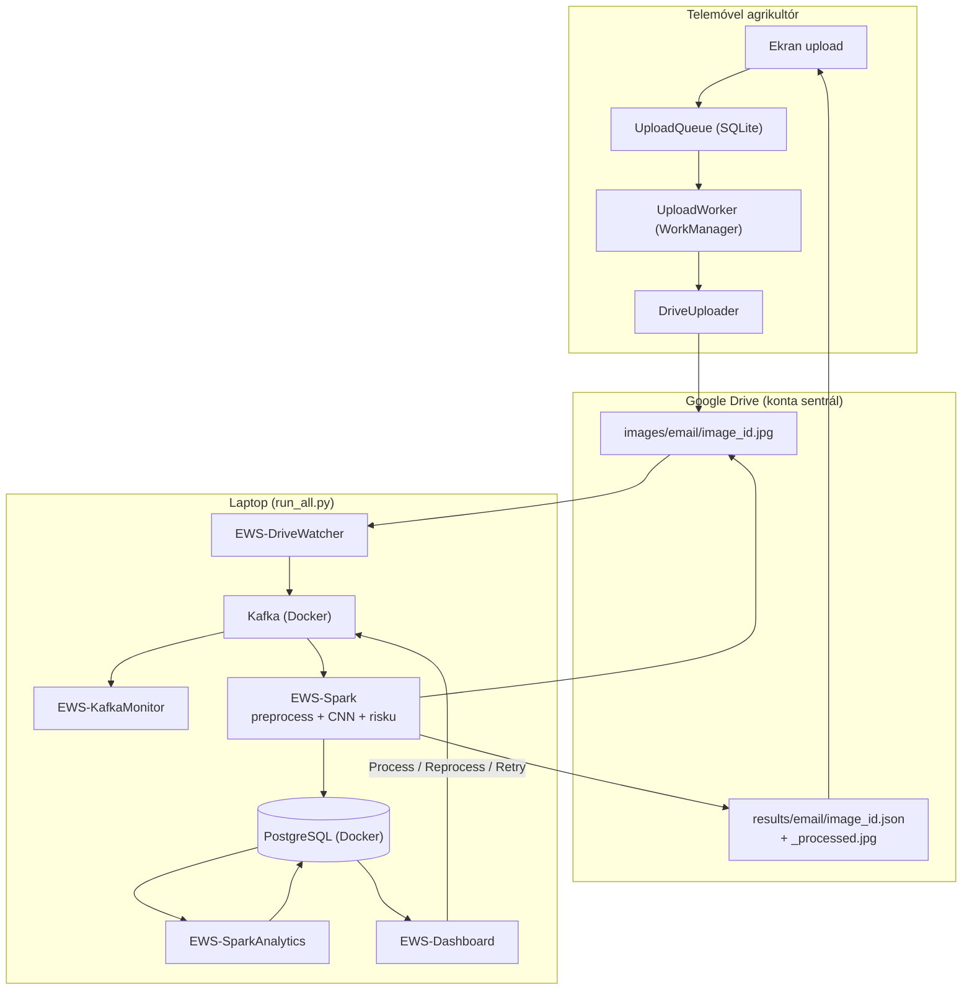
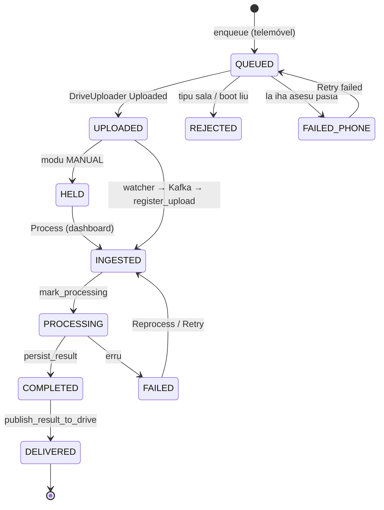
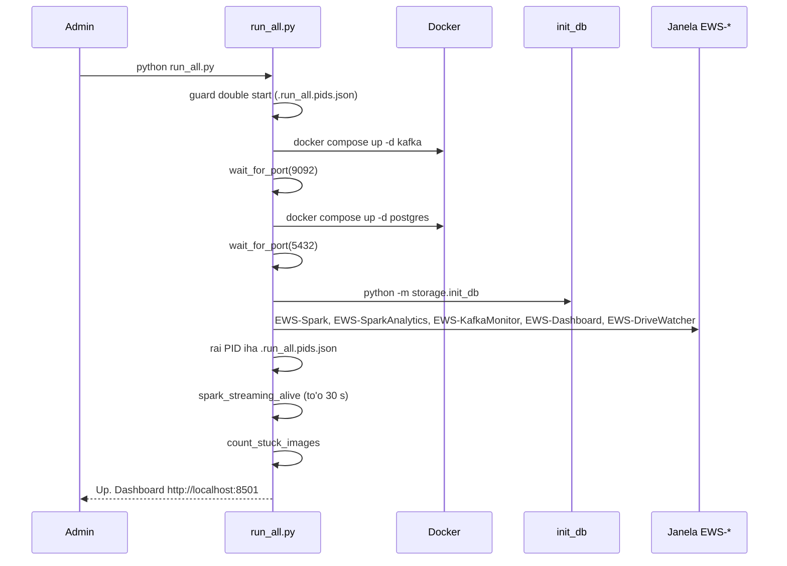
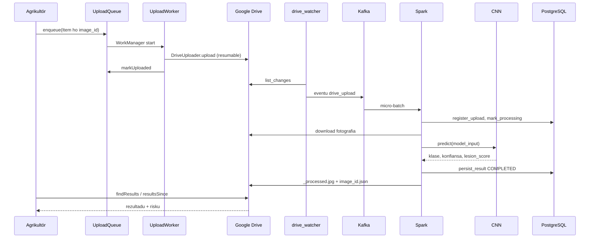
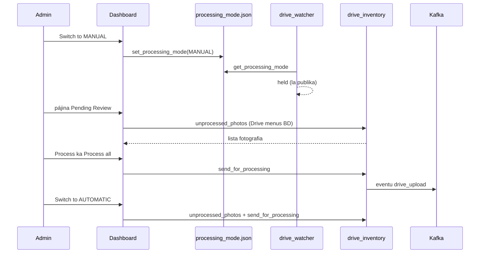
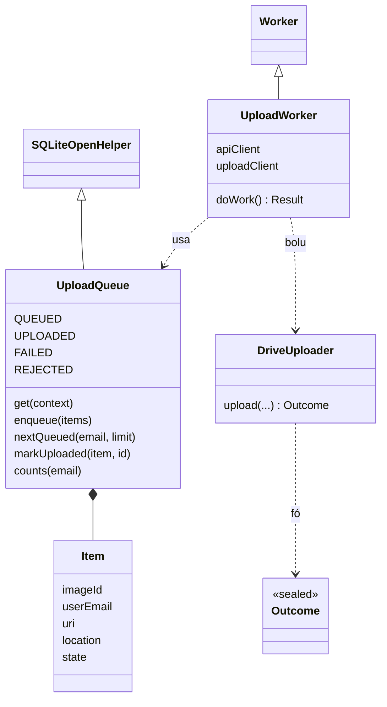

# 06 — Modulu Integrasaun Fim-ba-Fim (End-to-End)

*Sistema Crop Disease Early Warning System (EWS) — dokumentasaun téknika ba fluxu tomak: husi agrikultór foti fotografia iha telemóvel to'o rezultadu fila ba telemóvel, inklui oinsá hahú sistema (`run_all.py`), fila upload Android, dashboard admin (modu MANUAL, Process, Reprocess, Retry), no pontu entrega importante iha Spark. Ba estudante ne'ebé foin hahú programasaun. Fonte úniku: kódigu iha repozitóriu (branch `main`, commit `302818f`).*

{{coverage run_all.py 1-328}}
{{coverage android_app/app/src/main/java/com/cropdisease/app/UploadQueue.kt 1-249}}
{{coverage android_app/app/src/main/java/com/cropdisease/app/UploadWorker.kt 1-207}}
{{coverage dashboard/app.py 213-263 552-560 574-649}}
{{coverage dashboard/image_management_page.py 204-207 226-239}}
{{coverage storage/pipeline_submit.py 26-57}}
{{coverage spark/streaming_job.py 203-299}}

> **Oinsá lee.** Bloku kódigu kada ida tuir pasu 9: (1) Kódigu orijinál, (2) Objetivu, (3) Fundamentu Python (ba Kotlin: fundamentu Kotlin), (4) Esplikasaun liña-ba-liña, (5) Walkthrough ezekusaun, (6) Tipu dadus, (7) Ligasaun OOP, (8) Impaktu integrasaun, (9) Checkpoint ba principiante. Etiketa: *Implementadu*, *Inferidu*, *Teoria*, *Ezemplu ilustrativu*. Modulu 01–05 esplika kada komponente ho detallu; modulu ne'e hatudu oinsá sira liga.

## A. Introdusaun no Objetivu

### A.1 Papél modulu ne'e

Modulu ne'e hatán pergunta "saida mak akontese, tuir orden, bainhira agrikultór haruka fotografia ida?" no "oinsá sistema hahú?". Komponente sira:

| # | Komponente | Fatin | Janela / prosesu |
|---|---|---|---|
| 1 | Aplikasaun Android (fila upload + worker) | `UploadQueue.kt`, `UploadWorker.kt`, `DriveUploader.kt` | telemóvel |
| 2 | Google Drive | pasta `images/<email>`, `results/<email>` | nuvem |
| 3 | Drive watcher | `kafka/drive_watcher.py` | `EWS-DriveWatcher` |
| 4 | Kafka (Docker) | `docker-compose.yml` | container |
| 5 | Monitor Kafka | `kafka/monitor.py` | `EWS-KafkaMonitor` |
| 6 | Spark streaming + CNN | `spark/streaming_job.py`, `ml/` | `EWS-Spark` |
| 7 | Spark analítika | `spark/batch_analytics.py --watch` | `EWS-SparkAnalytics` |
| 8 | PostgreSQL (Docker) | `docker-compose.yml` | container |
| 9 | Dashboard (Streamlit) | `dashboard/app.py` | `EWS-Dashboard` (http://localhost:8501) |
| 10 | Lansadór | `run_all.py` | terminál |

### A.2 Problema ne'ebé modulu ne'e rezolve

- **Komponente barak atu hahú** → `run_all.py` hahú hotu ho orden loloos (Docker → BD → serbisu), kada ida iha janela rasik, rai PID, no hapara hotu ho `--stop`.
- **Upload rihun iha rede la estável** → `UploadQueue` (SQLite iha telemóvel) + `UploadWorker` (WorkManager, foreground, retry, paralelu 3).
- **Admin hakarak kontrola** → modu MANUAL: fotografia hein iha Drive; "Process", "Process all", "Switch to AUTOMATIC".
- **Fotografia falla** → "Reprocess"/"Retry processing" → eventu `submit` foun.

### A.3 Fundamentu Python no Kotlin (foun iha modulu ne'e)

**Lembra** (Modulu 01–05): klase, objetu, `self`, `__init__`, herança, `with`, thread, JSON, enum, Kotlin `object`/`data class`/`sealed class`/null-safety.

**Python**

1. **`subprocess.Popen(...)`** — hahú programa seluk no la hein; **`subprocess.run(...)`** — hahú no hein (fó `returncode`, `stdout`).
2. **`shutil.which("docker")`** — buka programa iha `PATH` (ka `None`).
3. **`socket.connect_ex((host, port))`** — `0` se port loke.
4. **`os.kill(pid, 0)`** — kontrola prosesu moris (Linux); `tasklist`/`taskkill` iha Windows.
5. **Streamlit (Teoria)** — dashboard web husi script Python. Script halai fali tomak kada interasaun. `st.button(...)` fó `True` iha execusaun ne'ebé ema klik; `st.rerun()` halai fali script; `st.session_state` rai valór entre execusaun; `@st.cache_data(ttl=60)` rai rezultadu funsaun 60 s; `@st.fragment(run_every=N)` halai parte ida kada N segundu.

**Kotlin**

| Kotlin | Signifika |
|---|---|
| `class A private constructor(...) : B(...)` | konstrutór privadu (labele harii husi liur) + herança |
| `companion object { ... }` | membru "estátiku" klase (hanesan atributu/métodu klase Python) |
| `@Volatile` + `synchronized(this) { }` | singleton thread-safe (double-checked locking) |
| `override fun onCreate(...)` | troka métodu klase inan |
| `SQLiteOpenHelper` | klase Android ba base de dadus SQLite lokál |
| `db.beginTransaction()/setTransactionSuccessful()/endTransaction()` | transasaun |
| `ContentValues().apply { put(...) }` | "dict" valór ba SQLite; `apply` konfigura objetu |
| `fun Cursor.toItem(): Item` | *extension function* — aumenta métodu ba klase seluk |
| `buildList { add(...) }` | harii lista |
| `Worker` / `WorkManager` / `Result.success()/retry()/failure()` | serbisu background Android ne'ebé moris liu app taka no reboot |
| `Executors.newFixedThreadPool(3)`, `Callable`, `invokeAll` | pool thread Java |
| `for ((a, b) in lista) when (b) { is X -> ... }` | destructuring + `when` ba tipu |

## B. Arkivu Fonte Loloos

| Arkivu | Liña | Klase / funsaun | Serbisu |
|---|---|---|---|
| `run_all.py` | 328 | `start_service`, `pid_alive`, `stop_pid`, `read_pid_file`, `find_service_windows`, `spark_streaming_alive`, `count_stuck_images`, `port_in_use`, `wait_for_port`, `main` | Hahú/hapara sistema tomak |
| `UploadQueue.kt` | 249 | `class UploadQueue : SQLiteOpenHelper`, `Item`, `Counts` | Fila upload permanente iha telemóvel |
| `UploadWorker.kt` | 207 | `class UploadWorker : Worker` | Upload background ho notifikasaun |
| `dashboard/app.py` | 213–263, 552–560, 574–649 | `_switch_to_automatic_and_drain`, `_pending_drive_photos`, botaun modu, Reprocess, pájina Pending Review | Kontrola admin |
| `dashboard/image_management_page.py` | 204–207, 226–239 | botaun Retry, `_retry` | Retry fotografia FAILED |
| `storage/pipeline_submit.py` | 26–57 | `UPLOAD_REJECTED_PREFIX`, `NotResubmittable`, `is_upload_rejected`, `submit_image_for_processing` | Haruka fali ba Kafka |
| `spark/streaming_job.py` | 203–299 | `process_and_persist`, `foreach_batch_sink`, `_upload_result`, `_process_one` | Pontu entrega Spark |

## C. Arkitetura no Fluxu Ezekusaun

### C.1 Arkitetura jerál



### C.2 Estadu fotografia (husi telemóvel to'o rezultadu)



(`QUEUED/UPLOADED/REJECTED/FAILED_PHONE` = estadu iha `UploadQueue` telemóvel; `HELD` = la publika iha watcher; `INGESTED...COMPLETED/FAILED` = `images.status` iha PostgreSQL; `DELIVERED` = `result_published_at` iha.)

### C.3 Sekuénsia: hahú sistema (`run_all.py`)



### C.4 Sekuénsia: fotografia ida (modu AUTOMATIC)



### C.5 Sekuénsia: modu MANUAL no Process



### C.6 Trasu ho tempu (*Ezemplu ilustrativu*)

Tempu sira iha ne'e mak ilustrativu (la mede iha sesaun ne'e); orden no funsaun loloos.

| t (s) | Fatin | Asaun |
|---|---|---|
| 0.0 | Telemóvel | `UploadQueue.enqueue` (image_id `a1b2...`) |
| 0.1 | Telemóvel | `UploadWorker.doWork` → token → `myFolders` |
| 0.3–3.0 | Telemóvel → Drive | `uploadImage` resumable (2.4 MB) |
| 3.0 | Telemóvel | `markUploaded`, notifikasaun "1 of 1" |
| 3.0–6.0 | Laptop | watcher `list_changes` (kada 1–3 s) hetan arkivu |
| 6.1 | Laptop | eventu → Kafka (offset 57); monitor hakerek liña |
| 7.0 | Laptop | Spark micro-batch (trigger 1 s) |
| 7.1 | Laptop | `register_upload` (`INGESTED`), `mark_processing` |
| 7.1–8.3 | Laptop | download Drive (paralelu ho `clean_event`) |
| 8.5 | Laptop | `prepare_image` + `model_input` |
| 8.6 | Laptop | CNN `predict` → `northern_leaf_blight` 0.95 |
| 8.9 | Laptop | Grad-CAM + `render_processed_image` |
| 9.0 | Laptop | `persist_result` → `COMPLETED` |
| 9.0–10.5 | Laptop → Drive | `_upload_result` → `_processed.jpg` + `.json` |
| ≤ 40 | Laptop | `batch_analytics.watch` (kada 30 s) atualiza `analytics_*` |
| depois | Telemóvel | `resultsSince` → rezultadu iha ekran |

## D. Esplikasaun Kódigu-ba-Kódigu

### D.1 `run_all.py` — hahú no hapara sistema

#### D.1.1 Docstring, import, konstante

**1. Kódigu orijinál**

{{code run_all.py 1-27}}

**2. Objetivu**

Esplika opsaun liña komando no define pasta raiz, arkivu PID (`.run_all.pids.json`) no se sistema mak Windows.

**3. Fundamentu Python**

`Path(__file__).resolve().parent` — pasta arkivu ne'e; `sys.platform == "win32"`.

**4. Esplikasaun liña-ba-liña**

- **Liña 1–4** — Docstring: hahú sistema imajen tomak, kada parte iha janela rasik: Kafka (Docker), Spark streaming, Spark analítika, dashboard no Drive watcher; konfigurasaun husi `.env`.
- **Liña 5** — Liña mamuk docstring.
- **Liña 6** — `python run_all.py` — hahú hotu.
- **Liña 7** — `--no-kafka` — broker halai ona.
- **Liña 8** — `--no-spark` — salta Spark (no analítika).
- **Liña 9** — `--no-analytics` — salta analítika de'it.
- **Liña 10** — `--no-drive` — salta watcher.
- **Liña 11** — `--reset` — factory reset uluk (mantein utilizadór).
- **Liña 12** — `--stop` — hapara buat hotu ne'ebé nia hahú.
- **Liña 13** — Remata docstring.
- **Liña 15** — `import argparse`.
- **Liña 16** — `import json`.
- **Liña 17** — `import os`.
- **Liña 18** — `import socket`.
- **Liña 19** — `import subprocess`.
- **Liña 20** — `import sys`.
- **Liña 21** — `import time`.
- **Liña 22** — `from pathlib import Path`.
- **Liña 23** — `from shutil import which`.
- **Liña 25** — `ROOT = Path(__file__).resolve().parent`.
- **Liña 26** — `PID_FILE = ROOT / ".run_all.pids.json"`.
- **Liña 27** — `IS_WINDOWS = sys.platform == "win32"`.

**5. Walkthrough ezekusaun**

Iha laptop Windows: `IS_WINDOWS = True`, `PID_FILE = A:\final\crop_disease_image_system\.run_all.pids.json`.

**6. Tipu dadus**

`ROOT`, `PID_FILE`: `Path`; `IS_WINDOWS`: `bool`.

**7. Ligasaun OOP**

Not implemented in the current codebase.

**8. Impaktu integrasaun**

Pontu tama sistema tomak.

**9. Checkpoint ba principiante**

**P:** Saida mak arkivu `.run_all.pids.json`?
**R:** Lista prosesu ne'ebé `run_all.py` hahú (naran + PID), atu `--stop` bele hapara sira.

#### D.1.2 `start_service`, `pid_alive`, `stop_pid`

**1. Kódigu orijinál**

{{code run_all.py 30-72}}

**2. Objetivu**

Hahú komando iha janela konsola rasik ho títulu; kontrola se PID moris; hapara prosesu (no oan sira).

**3. Fundamentu Python**

`subprocess.Popen(..., creationflags=subprocess.CREATE_NEW_CONSOLE)`; `start_new_session=True` (Linux); `os.killpg(os.getpgid(pid), signal.SIGTERM)` — hapara grupu prosesu.

**4. Esplikasaun liña-ba-liña**

- **Liña 30–32** — Komentáriu seksaun helper prosesu.
- **Liña 33** — `def start_service(name: str, argv: list[str]) -> dict:`
- **Liña 34** — Docstring: hahú `argv` iha janela konsola rasik; fó `{name, pid}`.
- **Liña 35** — `if IS_WINDOWS:`
- **Liña 36** — Komentáriu: janela ho títulu ne'ebé hela loke depois crash; `taskkill /T` depois hapara oan mós.
- **Liña 37** — `inner = " ".join(argv)`.
- **Liña 38–42** — `proc = subprocess.Popen(f'cmd /k "title {name} && {inner}"', cwd=ROOT, creationflags=subprocess.CREATE_NEW_CONSOLE)` — `cmd /k` mantein janela loke.
- **Liña 43** — `else:`
- **Liña 44** — `proc = subprocess.Popen(argv, cwd=ROOT, start_new_session=True)`.
- **Liña 45** — `print(f"  started {name:<14} pid {proc.pid}")`.
- **Liña 46** — `return {"name": name, "pid": proc.pid}`.
- **Liña 49** — `def pid_alive(pid: int) -> bool:`
- **Liña 50** — `if IS_WINDOWS:`
- **Liña 51–54** — `out = subprocess.run(["tasklist", "/FI", f"PID eq {pid}", "/NH"], capture_output=True, text=True).stdout`.
- **Liña 55** — `return str(pid) in out`.
- **Liña 56** — `try:`
- **Liña 57** — `os.kill(pid, 0)` — sinál 0: kontrola de'it.
- **Liña 58** — `return True`.
- **Liña 59** — `except OSError:`
- **Liña 60** — `return False`.
- **Liña 63** — `def stop_pid(pid: int) -> None:`
- **Liña 64** — `if IS_WINDOWS:`
- **Liña 65–66** — `subprocess.run(["taskkill", "/PID", str(pid), "/T", "/F"], capture_output=True)` — `/T` árvore, `/F` forsa.
- **Liña 67** — `else:`
- **Liña 68** — `import signal`.
- **Liña 69** — `try:`
- **Liña 70** — `os.killpg(os.getpgid(pid), signal.SIGTERM)`.
- **Liña 71** — `except OSError:`
- **Liña 72** — `pass`.

**5. Walkthrough ezekusaun**

`start_service("EWS-Spark", ["python", "-m", "spark.streaming_job"])` → janela foun naran "EWS-Spark" → `{"name": "EWS-Spark", "pid": 12345}` (*ezemplu PID*).

**6. Tipu dadus**

`start_service -> dict`; `pid_alive -> bool`; `stop_pid -> None`; `proc`: `subprocess.Popen`.

**7. Ligasaun OOP**

`subprocess.Popen` mak klase biblioteka; `proc.pid` atributu objetu.

**8. Impaktu integrasaun**

`main` hahú serbisu 5 ho `start_service`; `--stop` uza `pid_alive` + `stop_pid`.

**9. Checkpoint ba principiante**

**P:** Tanba sá `cmd /k` no la'ós `cmd /c`?
**R:** `/k` mantein janela loke depois komando remata (ka monu) — ema bele lee erru.

#### D.1.3 PID file, janela, saúde Spark, fotografia hein, port

**1. Kódigu orijinál**

{{code run_all.py 75-136}}

**2. Objetivu**

Lee arkivu PID (seguru); buka janela "EWS-*" tuir títulu (Windows) bainhira arkivu PID aat; kontrola prosesu Spark loloos; konta fotografia hein/la entrega; kontrola no hein port.

**3. Fundamentu Python**

`json.loads(...read_text(encoding="utf-8-sig"))` (aseita BOM); PowerShell husi Python; `str.partition(" ")`; `with socket.socket(...) as s:`.

**4. Esplikasaun liña-ba-liña**

- **Liña 75** — `def read_pid_file() -> dict | None:`
- **Liña 76** — Docstring: rekord `{kafka, services}`, ka `None` se la iha/aat.
- **Liña 77** — `try:`
- **Liña 78** — `saved = json.loads(PID_FILE.read_text(encoding="utf-8-sig"))`.
- **Liña 79** — `except (OSError, ValueError):`
- **Liña 80** — `return None`.
- **Liña 81** — `return saved if isinstance(saved, dict) else None`.
- **Liña 84** — `def find_service_windows() -> list[dict]:`
- **Liña 85** — Docstring: Windows: janela "EWS-<naran>", buka tuir títulu (bainhira arkivu PID la bele lee).
- **Liña 86** — `if not IS_WINDOWS:`
- **Liña 87** — `return []`.
- **Liña 88–94** — `out = subprocess.run(["powershell", "-NoProfile", "-Command", "Get-CimInstance Win32_Process -Filter \"Name='cmd.exe'\" | Where-Object CommandLine -match 'title EWS-' | ForEach-Object {...}"], capture_output=True, text=True).stdout`.
- **Liña 95** — `found = []`.
- **Liña 96** — `for line in out.splitlines():`
- **Liña 97** — `pid, _, cmdline = line.strip().partition(" ")`.
- **Liña 98** — `if pid.isdigit() and "title EWS-" in cmdline:`
- **Liña 99** — `name = cmdline.split("title ", 1)[1].split()[0].strip('"&')`.
- **Liña 100** — `found.append({"name": name, "pid": int(pid)})`.
- **Liña 101** — `return found`.
- **Liña 104** — `def spark_streaming_alive() -> bool:`
- **Liña 105–106** — Docstring: prosesu Python job Spark halai duni? (PID rai mak janela cmd, ne'ebé moris depois crash.)
- **Liña 107** — `from storage.reset import spark_job_running`.
- **Liña 108** — `running = spark_job_running()`.
- **Liña 109** — `return True if running is None else running` — komentáriu: la bele hatene — la alarme falsu.
- **Liña 112** — `def count_stuck_images() -> dict | None:`
- **Liña 113–114** — Docstring: `{"waiting", "undelivered"}` fotografia tuan liu minutu 2, ka `None` se BD la bele lee.
- **Liña 115** — `try:`
- **Liña 116** — `from storage.database import SessionLocal`.
- **Liña 117** — `from storage.requeue_stuck import count_owed`.
- **Liña 118** — `with SessionLocal() as s:`
- **Liña 119** — `return count_owed(s)`.
- **Liña 120** — `except Exception:`
- **Liña 121** — `return None`.
- **Liña 124** — `def port_in_use(port: int) -> bool:`
- **Liña 125** — `with socket.socket(socket.AF_INET, socket.SOCK_STREAM) as s:`
- **Liña 126** — `s.settimeout(0.5)`.
- **Liña 127** — `return s.connect_ex(("127.0.0.1", port)) == 0`.
- **Liña 130** — `def wait_for_port(port: int, timeout: int) -> bool:`
- **Liña 131** — `deadline = time.time() + timeout`.
- **Liña 132** — `while time.time() < deadline:`
- **Liña 133** — `if port_in_use(port):`
- **Liña 134** — `return True`.
- **Liña 135** — `time.sleep(2)`.
- **Liña 136** — `return False`.

**5. Walkthrough ezekusaun**

`wait_for_port(9092, 60)` → kontrola kada 2 s → Kafka loke iha 12 s → `True`. `count_stuck_images()` → `{"waiting": 0, "undelivered": 2}` (*ezemplu*).

**6. Tipu dadus**

`read_pid_file -> dict | None`; `find_service_windows -> list[dict]`; `spark_streaming_alive -> bool`; `count_stuck_images -> dict | None`; `port_in_use`, `wait_for_port -> bool`.

**7. Ligasaun OOP**

`socket.socket` mak context manager.

**8. Impaktu integrasaun**

Funsaun saúde (`spark_streaming_alive`, `count_stuck_images`) uza `storage.reset` no `storage.requeue_stuck`.

**9. Checkpoint ba principiante**

**P:** Tanba sá `spark_streaming_alive` la uza `pid_alive` ho PID janela?
**R:** PID rai mak janela `cmd` ne'ebé hela loke maske Spark monu; presiza kontrola prosesu Python loloos.

#### D.1.4 `main` — argumentu, modu `--stop`, guarda hahú dala rua

**1. Kódigu orijinál**

{{code run_all.py 139-188}}

**2. Objetivu**

Lee opsaun; se `--stop`, hapara serbisu hotu (no Kafka se nia hahú) no hamoos arkivu PID; se lae, la husik hahú dala rua bainhira serbisu sira halai hela.

**3. Fundamentu Python**

`argparse` ho `help=argparse.SUPPRESS` (opsaun subar); `a or b` iha `prev = read_pid_file() or {...}`.

**4. Esplikasaun liña-ba-liña**

- **Liña 139–141** — Komentáriu seksaun main.
- **Liña 142** — `def main() -> int:`
- **Liña 143–144** — `p = argparse.ArgumentParser(description=__doc__, formatter_class=...)`.
- **Liña 145** — `--no-kafka`.
- **Liña 146** — `--no-spark`.
- **Liña 147–148** — `--no-analytics`.
- **Liña 149** — `--no-dashboard`.
- **Liña 150** — `--no-mail` — komentáriu: opsaun tuan; aseita, la halo buat ida.
- **Liña 151** — `--no-drive`.
- **Liña 152–153** — `--no-kafka-monitor`.
- **Liña 154** — `--reset`.
- **Liña 155** — `--stop`.
- **Liña 156** — `args = p.parse_args()`.
- **Liña 158** — Komentáriu: modu stop.
- **Liña 159** — `if args.stop:`
- **Liña 160** — `if not PID_FILE.exists():`
- **Liña 161** — `print("Nothing to stop - no .run_all.pids.json found.")`.
- **Liña 162** — `return 0`.
- **Liña 163** — `saved = read_pid_file()`.
- **Liña 164** — `if saved is None:`
- **Liña 165** — `print(...)` — arkivu aat; buka janela EWS-*.
- **Liña 166** — `saved = {"kafka": False, "services": find_service_windows()}`.
- **Liña 167** — `for s in saved.get("services", []):`
- **Liña 168** — `if pid_alive(s["pid"]):`
- **Liña 169** — `stop_pid(s["pid"])`.
- **Liña 170** — `print(f"stopped {s['name']} (pid {s['pid']})")`.
- **Liña 171** — `else:`
- **Liña 172** — `print(f"{s['name']} (pid {s['pid']}) was not running")`.
- **Liña 173** — `if saved.get("kafka"):` — Kafka hahú husi `run_all`:
- **Liña 174** — `print("stopping Kafka broker (docker compose down)...")`.
- **Liña 175** — `subprocess.run(["docker", "compose", "down"], cwd=ROOT, capture_output=True)`.
- **Liña 176** — `PID_FILE.unlink()`.
- **Liña 177** — `print("All stopped.")`.
- **Liña 178** — `return 0`.
- **Liña 180** — Komentáriu: guarda kontra hahú dala rua.
- **Liña 181** — `if PID_FILE.exists():`
- **Liña 182** — `prev = read_pid_file() or {"services": find_service_windows()}`.
- **Liña 183** — `alive = [s for s in prev.get("services", []) if pid_alive(s["pid"])]`.
- **Liña 184** — `if alive:`
- **Liña 185** — `names = ", ".join(s["name"] for s in alive)`.
- **Liña 186** — `print(f"Some components are already running ({names}). Run 'python run_all.py --stop' first.")`.
- **Liña 187** — `return 1`.
- **Liña 188** — `PID_FILE.unlink()` — komentáriu: arkivu tuan, hotu mate.

**5. Walkthrough ezekusaun**

`python run_all.py --stop` → hapara EWS-Spark, EWS-SparkAnalytics... → `docker compose down` (se `kafka: true`) → "All stopped.". `python run_all.py` dala rua → "Some components are already running (...)".

**6. Tipu dadus**

`args`: `argparse.Namespace`; `saved`, `prev`: `dict`; `alive`: `list[dict]`; return `int`.

**7. Ligasaun OOP**

`ArgumentParser`/`Namespace` objetu biblioteka.

**8. Impaktu integrasaun**

`docker compose down` hapara Kafka **no** PostgreSQL (volume mantein dadus).

**9. Checkpoint ba principiante**

**P:** Tanba sá guarda hahú dala rua importante?
**R:** Spark rua lee topic hanesan no hakerek BD hanesan — bele prosesa fotografia dala rua no harii konflitu.

#### D.1.5 Dependénsia, Kafka, PostgreSQL, `init_db`, reset

**1. Kódigu orijinál**

{{code run_all.py 190-251}}

**2. Objetivu**

Kontrola pakote Python; hahú Kafka (se port 9092 la loke no Docker iha) no hein; hahú PostgreSQL (se `DATABASE_URL` PostgreSQL) no hein; halai `storage.init_db`; opsionál factory reset (inklui hamamuk topic Kafka).

**3. Fundamentu Python**

`subprocess.run([sys.executable, "-c", "import streamlit, sqlalchemy"]).returncode` — kontrola import iha prosesu separadu.

**4. Esplikasaun liña-ba-liña**

- **Liña 190** — Komentáriu: kontrola dependénsia.
- **Liña 191** — `if subprocess.run([sys.executable, "-c", "import streamlit, sqlalchemy"]).returncode != 0:`
- **Liña 192** — `print("Python dependencies are missing. Run:  pip install -r requirements.txt")`.
- **Liña 193** — `return 1`.
- **Liña 195** — Komentáriu: 1. broker Kafka.
- **Liña 196** — `started_kafka = False`.
- **Liña 197** — `if not args.no_kafka:`
- **Liña 198** — `if port_in_use(9092):`
- **Liña 199** — `print("Kafka already reachable on localhost:9092 - not starting another broker.")`.
- **Liña 200** — `elif not which("docker"):`
- **Liña 201** — `print(...)` — `docker` la iha PATH; salta.
- **Liña 202** — `else:`
- **Liña 203** — `print("Starting Kafka broker (docker compose up -d kafka)...")`.
- **Liña 204** — `if subprocess.run(["docker", "compose", "up", "-d", "kafka"], cwd=ROOT).returncode != 0:`
- **Liña 205** — `print(...)` — compose falla; kontinua la ho broker.
- **Liña 206** — `else:`
- **Liña 207** — `print("Waiting for Kafka on localhost:9092...")`.
- **Liña 208** — `started_kafka = wait_for_port(9092, 60)`.
- **Liña 209–210** — `print("Kafka is up." if started_kafka else "Kafka did not come up within 60s; continuing anyway.")`.
- **Liña 211** — `elif not args.no_spark:`
- **Liña 212–213** — `print(...)` — `--no-kafka` maibé Spark liga: Spark presiza broker.
- **Liña 215** — Komentáriu: 1b. PostgreSQL (só bainhira `DATABASE_URL` uza).
- **Liña 216** — `from config.settings import DATABASE_URL`.
- **Liña 217** — `use_pg = DATABASE_URL.startswith("postgresql")`.
- **Liña 218** — `if use_pg:`
- **Liña 219** — `if port_in_use(5432):`
- **Liña 220** — `print("PostgreSQL already reachable on localhost:5432.")`.
- **Liña 221** — `elif not which("docker"):`
- **Liña 222** — `print(...)`.
- **Liña 223** — `else:`
- **Liña 224** — `print("Starting PostgreSQL (docker compose up -d postgres)...")`.
- **Liña 225** — `if subprocess.run(["docker", "compose", "up", "-d", "postgres"], cwd=ROOT).returncode != 0:`
- **Liña 226–227** — `print(...)` — la bele hahú; kontrola Docker no internet (dala uluk `docker pull postgres:16`).
- **Liña 228** — `return 1`.
- **Liña 229** — `print("Waiting for PostgreSQL on localhost:5432...")`.
- **Liña 230** — `if not wait_for_port(5432, 60):`
- **Liña 231** — `print("PostgreSQL did not come up within 60s - aborting.")`.
- **Liña 232** — `return 1`.
- **Liña 233** — `time.sleep(3)` — komentáriu: port loke momentu molok aseita login.
- **Liña 234** — `print("PostgreSQL is up.")`.
- **Liña 235** — `else:`
- **Liña 236** — `print("Database: SQLite file (storage/app.db) - no database server needed.")`.
- **Liña 238** — Komentáriu: 2. init BD (+ reset opsionál).
- **Liña 239** — `print("Initializing database (python -m storage.init_db)...")`.
- **Liña 240** — `if subprocess.run([sys.executable, "-m", "storage.init_db"], cwd=ROOT).returncode != 0:`
- **Liña 241** — `print("init_db failed - aborting.")`.
- **Liña 242** — `return 1`.
- **Liña 243** — `if args.reset:`
- **Liña 244** — `print("Factory-resetting pipeline data (keeps users/admins)...")`.
- **Liña 245** — Komentáriu: hamamuk mós topic Kafka, se lae Spark replay mensajen tuan hotu.
- **Liña 246** — `reset_cmd = [sys.executable, "-m", "storage.reset", "--yes"]`.
- **Liña 247** — `if not args.no_kafka:`
- **Liña 248** — `reset_cmd.append("--kafka")`.
- **Liña 249** — `if subprocess.run(reset_cmd, cwd=ROOT).returncode != 0:`
- **Liña 250** — `print("reset failed - aborting.")`.
- **Liña 251** — `return 1`.

**5. Walkthrough ezekusaun**

Docker Desktop mate: `docker compose up -d kafka` falla → "continuing without a broker"; `docker compose up -d postgres` falla → `return 1` (aborta). Docker moris: Kafka ~10 s, PostgreSQL ~5 s + 3 s.

**6. Tipu dadus**

`started_kafka`, `use_pg`: `bool`; `reset_cmd`: `list[str]`.

**7. Ligasaun OOP**

Not implemented in the current codebase.

**8. Impaktu integrasaun**

Orden importante: BD tenke iha molok `init_db`; `init_db` tenke halai molok Spark/dashboard.

**9. Checkpoint ba principiante**

**P:** Tanba sá Kafka falla la aborta, maibé PostgreSQL falla aborta?
**R:** La ho Kafka, produtór uza fila lokál (fallback) no dashboard funsiona; la ho base de dadus, komponente hotu la funsiona.

#### D.1.6 Lansa komponente no rai PID

**1. Kódigu orijinál**

{{code run_all.py 253-289}}

**2. Objetivu**

Hahú serbisu long-running tuir opsaun: EWS-Spark, EWS-SparkAnalytics (PostgreSQL de'it), EWS-KafkaMonitor, EWS-Dashboard (se port 8501 livre), EWS-DriveWatcher (se Drive konfigura). Rai lista PID.

**3. Fundamentu Python**

`services: list[dict] = []` (annotation variavel); `not (a or b)`.

**4. Esplikasaun liña-ba-liña**

- **Liña 253** — Komentáriu: 3. lansa komponente long-running.
- **Liña 254** — `print("\nLaunching components:")`.
- **Liña 255** — `services: list[dict] = []`.
- **Liña 257** — `if not args.no_spark:`
- **Liña 258** — `services.append(start_service("EWS-Spark", ["python", "-m", "spark.streaming_job"]))`.
- **Liña 260** — `if not (args.no_spark or args.no_analytics):`
- **Liña 261** — `if use_pg:`
- **Liña 262** — `services.append(start_service("EWS-SparkAnalytics", ["python", "-m", "spark.batch_analytics", "--watch"]))`.
- **Liña 263** — `else:`
- **Liña 264–265** — `print(...)` — salta analítika: lee BD ho JDBC (presiza PostgreSQL); gráfiku dashboard mamuk iha SQLite.
- **Liña 267** — `if not args.no_kafka_monitor:`
- **Liña 268** — `services.append(start_service("EWS-KafkaMonitor", ["python", "-m", "kafka.monitor"]))`.
- **Liña 270** — `if not args.no_dashboard:`
- **Liña 271** — `if port_in_use(8501):`
- **Liña 272** — `print(...)` — port 8501 uza ona.
- **Liña 273** — `else:`
- **Liña 274–275** — `services.append(start_service("EWS-Dashboard", ["python", "-m", "streamlit", "run", "dashboard/app.py"]))`.
- **Liña 277** — `if not args.no_drive:`
- **Liña 278** — `from storage import drive_client`.
- **Liña 279** — `if drive_client.is_configured():` — token + ID pasta iha.
- **Liña 280** — `services.append(start_service("EWS-DriveWatcher", ["python", "-m", "kafka.drive_watcher"]))`.
- **Liña 281** — `else:`
- **Liña 282–283** — `print(...)` — salta watcher; halai `scripts/drive_authorize.py`.
- **Liña 285** — `if not services:`
- **Liña 286** — `print("Nothing was started.")`.
- **Liña 287** — `return 0`.
- **Liña 289** — `PID_FILE.write_text(json.dumps({"kafka": started_kafka, "services": services}, indent=2))`.

**5. Walkthrough ezekusaun**

*Ezemplu ilustrativu* `.run_all.pids.json`:

```json
{"kafka": true, "services": [
  {"name": "EWS-Spark", "pid": 12345}, {"name": "EWS-SparkAnalytics", "pid": 12346},
  {"name": "EWS-KafkaMonitor", "pid": 12347}, {"name": "EWS-Dashboard", "pid": 12348},
  {"name": "EWS-DriveWatcher", "pid": 12349}]}
```

**6. Tipu dadus**

`services`: `list[dict[str, str|int]]`.

**7. Ligasaun OOP**

Not implemented in the current codebase.

**8. Impaktu integrasaun**

Prosesu 5 ne'e mak komponente Modulu 01 (Spark, analítika), 02 (monitor, watcher), 03 (watcher Drive), dashboard.

**9. Checkpoint ba principiante**

**P:** Tanba sá analítika Spark la hahú ho SQLite?
**R:** Analítika lee/hakerek BD ho JDBC; projetu la iha driver JDBC SQLite (Modulu 01 D.4.2).

#### D.1.7 Kontrola Spark, fotografia hein, relatóriu

**1. Kódigu orijinál**

{{code run_all.py 291-328}}

**2. Objetivu**

Hein to'o ~30 s atu kontrola katak job Spark moris (aviszu se lae); hatudu fotografia hein/la entrega ho komando atu limpa; hatudu enderesu dashboard.

**3. Fundamentu Python**

`for _ in range(15)` + `break`; `if stuck and (a or b)`.

**4. Esplikasaun liña-ba-liña**

- **Liña 291** — Komentáriu: 3b. kontrola konsumidór Spark moris duni.
- **Liña 292** — Komentáriu: konsumidór mate husik upload hela `INGESTED`, entaun hatete agora.
- **Liña 293** — `if not args.no_spark:`
- **Liña 294** — `print("\nWaiting for the Spark streaming job to come up...")`.
- **Liña 295** — `alive = False`.
- **Liña 296** — `for _ in range(15):` — komentáriu: ~30 s; dala uluk mós rezolve pakote Kafka.
- **Liña 297** — `time.sleep(2)`.
- **Liña 298** — `if spark_streaming_alive():`
- **Liña 299** — `alive = True`.
- **Liña 300** — `break`.
- **Liña 301** — `if alive:`
- **Liña 302** — `print("  Spark streaming job is running.")`.
- **Liña 303** — `else:`
- **Liña 304** — `print("  WARNING: no live 'python -m spark.streaming_job' process detected.")`.
- **Liña 305** — `print("           Check the EWS-Spark console window for a traceback.")`.
- **Liña 306** — `print("           While it's down, uploads will pile up at status INGESTED.")`.
- **Liña 308** — Komentáriu: 3c. hatudu buat ne'ebé hela ingested-maibé-la-prosesa.
- **Liña 309** — `stuck = count_stuck_images()`.
- **Liña 310** — `if stuck and (stuck["waiting"] or stuck["undelivered"]):`
- **Liña 311–312** — `print(...)` — N imajen hein la prosesa no M rezultadu la to'o Drive; atu limpa:
- **Liña 313** — `python -m storage.requeue_stuck --all` — publika fali (Spark tenke moris).
- **Liña 314** — `--all --inline` — prosesa agora iha prosesu.
- **Liña 315** — `--from-drive` — fotografia Drive ne'ebé Spark seidauk rejista.
- **Liña 317** — Komentáriu: 4. relatóriu.
- **Liña 318** — `print("\nUp. Open:")`.
- **Liña 319** — `if not args.no_dashboard:`
- **Liña 320** — `print("  Dashboard  http://localhost:8501")`.
- **Liña 321** — `print("  Android    talks only to Google Drive - no ngrok or port forwarding needed")`.
- **Liña 323** — `print("\nStop everything with:  python run_all.py --stop")`.
- **Liña 324** — `return 0`.
- **Liña 327** — `if __name__ == "__main__":`
- **Liña 328** — `sys.exit(main())`.

**5. Walkthrough ezekusaun**

Hahú normál → "Spark streaming job is running." → "Up. Open: Dashboard http://localhost:8501". Java la iha → Spark monu → "WARNING: no live ... process detected."

**6. Tipu dadus**

`alive`: `bool`; `stuck`: `dict | None`.

**7. Ligasaun OOP**

Not implemented in the current codebase.

**8. Impaktu integrasaun**

`requeue_stuck` (haree Modulu 01 `_auto_resend`) mós halai automátiku iha Spark kada 300 s.

**9. Checkpoint ba principiante**

**P:** Tanba sá Android "la presiza ngrok"?
**R:** Telemóvel ko'alia de'it ho Google Drive; laptop la presiza IP publiku.

### D.2 `UploadQueue.kt` — fila upload iha telemóvel

*Nota:* bloku Kotlin; pasu 3 esplika fundamentu Kotlin (tabela A.3).

#### D.2.1 Header, singleton, `Item`, `Counts`

**1. Kódigu orijinál**

{{code android_app/app/src/main/java/com/cropdisease/app/UploadQueue.kt 1-71}}

**2. Objetivu**

Fila fotografia ba upload, rai iha telemóvel (SQLite privadu) atu upload rihun moris liu app taka, telemóvel restart ka rede monu. Kada liña hetan `image_id` bainhira tama fila no mantein iha kada retry. Define estadu 4, singleton thread-safe, no klase dadus `Item` no `Counts`.

**3. Fundamentu Python**

*(Kotlin)* `class UploadQueue private constructor(...) : SQLiteOpenHelper(context, "upload_queue.db", null, 1)` — herança + konstrutór privadu; `companion object` — membru klase; `@Volatile` + `synchronized` — singleton thread-safe; `?:` + `.also { }`; `val done get() = total - queued` — propriedade kalkula.

**4. Esplikasaun liña-ba-liña**

- **Liña 1** — `package com.cropdisease.app`.
- **Liña 3** — `import android.content.ContentValues`.
- **Liña 4** — `import android.content.Context`.
- **Liña 5** — `import android.content.Intent` — flag permisaun.
- **Liña 6** — `import android.database.Cursor`.
- **Liña 7** — `import android.database.sqlite.SQLiteDatabase`.
- **Liña 8** — `import android.database.sqlite.SQLiteOpenHelper`.
- **Liña 9** — `import android.net.Uri`.
- **Liña 10** — `import java.io.File`.
- **Liña 12–30** — KDoc: fotografia hein upload ba Google Drive, rai iha telemóvel (SQLite ki'ik iha armazenamentu privadu app), atu upload fotografia rihun moris liu app taka, telemóvel restart ka rede monu; `UploadWorker` serbisu iha background; ekran upload só aumenta no hatudu progresu. Kada liña hetan `image_id` bainhira tama no mantein iha kada retry — `DriveUploader` buka `<image_id>.jpg` iha Drive molok haruka fali, entaun fotografia nunka iha Drive (no Spark) dala rua. Fotografia LA kopia bainhira app bele mantein asesu lee (permisaun uri persiste, ka pasta "Choose folder"); só fotografia kámara no fotografia galeria ne'ebé asesu labele mantein rai iha `filesDir/upload_queue/` — hamoos depois upload. Liña kada konta Google (`user_email`): worker só upload liña utilizadór ne'ebé login, ho nia token, ba nia pasta.
- **Liña 31–32** — `class UploadQueue private constructor(private val context: Context) : SQLiteOpenHelper(context, "upload_queue.db", null, 1) {` — base de dadus `upload_queue.db` versaun 1.
- **Liña 34** — `companion object {`
- **Liña 35** — `const val QUEUED = "QUEUED"`.
- **Liña 36** — `const val UPLOADED = "UPLOADED"`.
- **Liña 37** — `const val FAILED = "FAILED"` — komentáriu: bele koko fali ("Retry failed").
- **Liña 38** — `const val REJECTED = "REJECTED"` — komentáriu: la'ós fotografia útil — koko fali la ajuda.
- **Liña 40** — `@Volatile private var instance: UploadQueue? = null` — thread hotu haree valór foun.
- **Liña 42** — `fun get(context: Context): UploadQueue = instance ?: synchronized(this) {` — se iha ona, fó; se lae, tama lock.
- **Liña 43** — `instance ?: UploadQueue(context.applicationContext).also { instance = it }` — kontrola fali, harii, rai.
- **Liña 44** — `}`.
- **Liña 46** — KDoc: fatin kópia fila (fotografia kámara, galeria la bele kopia).
- **Liña 47** — `fun ownedDir(context: Context) = File(context.filesDir, "upload_queue")`.
- **Liña 48** — `}` — remata companion.
- **Liña 50** — `data class Item(`
- **Liña 51** — `val imageId: String,` — UUID.
- **Liña 52** — `val userEmail: String,`
- **Liña 53** — `val uri: String,` — enderesu fotografia.
- **Liña 54** — `val displayName: String,`
- **Liña 55** — `val mimeType: String,`
- **Liña 56** — `val location: String?,`
- **Liña 57** — `val gpsLat: Double? = null,`
- **Liña 58** — `val gpsLon: Double? = null,`
- **Liña 59** — `val gpsAccM: Float? = null,`
- **Liña 60** — KDoc: uri mak kópia rasik iha `ownedDir` — hamoos depois upload.
- **Liña 61** — `val ownedFile: Boolean = false,`
- **Liña 62** — KDoc: pasta ("Choose folder") ne'ebé fotografia ne'e lee liuhusi.
- **Liña 63** — `val treeUri: String? = null,`
- **Liña 64** — `val state: String = QUEUED,`
- **Liña 65** — `val error: String? = null,`
- **Liña 66** — `val driveFileId: String? = null,`
- **Liña 67** — `)`.
- **Liña 69** — `data class Counts(val total: Int, val queued: Int, val uploaded: Int, val failed: Int, val rejected: Int) {`
- **Liña 70** — `val done get() = total - queued` — "X of N" iha notifikasaun.
- **Liña 71** — `}`.

**5. Walkthrough ezekusaun**

`UploadQueue.get(ctx)` dala uluk → harii objetu → rai iha `instance`; dala tuirmai → objetu hanesan. `Counts(total=10, queued=3, ...)` → `done = 7`.

**6. Tipu dadus**

| Naran | Tipu |
|---|---|
| `QUEUED`... | `String` (`const`) |
| `instance` | `UploadQueue?` |
| `Item.*` | `String`, `String?`, `Double?`, `Float?`, `Boolean` |
| `Counts.done` | `Int` |

**7. Ligasaun OOP**

- **Herança**: `UploadQueue : SQLiteOpenHelper` (klase Android).
- **Singleton** ho konstrutór privadu + `companion object.get` + double-checked locking.
- **Data class** `Item`, `Counts` (valór imutável).
- **Enkapsulamentu**: `private val context`, konstrutór privadu.

**8. Impaktu integrasaun**

`UploadWorker` lee fila; `DriveUploader.upload` simu `Item`.

**9. Checkpoint ba principiante**

**P:** Tanba sá `image_id` harii bainhira tama fila (la'ós bainhira upload)?
**R:** Atu retry hotu uza ID hanesan; `findImage` hetan fotografia ne'ebé upload ona → la iha duplikadu iha Drive no Spark.

#### D.2.2 Tabela SQLite, `enqueue`, `nextQueued`, `hasQueued`

**1. Kódigu orijinál**

{{code android_app/app/src/main/java/com/cropdisease/app/UploadQueue.kt 73-135}}

**2. Objetivu**

Harii tabela `queue` + índise; aumenta fotografia ba fila iha transasaun (ignora `image_id` repete); se la iha buat ida hein, hamoos liña tuan uluk (progresu "X of N" foun); foti fotografia hein tuir orden; kontrola se iha fotografia hein.

**3. Fundamentu Python**

*(Kotlin)* `override fun onCreate(db: SQLiteDatabase)`; string multi-liña `"""..."""`; `db.insertWithOnConflict(..., CONFLICT_IGNORE)`; `try { } finally { db.endTransaction() }`; `rawQuery(...).use { it.moveToFirst() }`.

**4. Esplikasaun liña-ba-liña**

- **Liña 73** — `override fun onCreate(db: SQLiteDatabase) {` — Android bolu bainhira base de dadus foun.
- **Liña 74** — `db.execSQL(`
- **Liña 75** — `"""CREATE TABLE queue (`
- **Liña 76** — `image_id TEXT PRIMARY KEY,`
- **Liña 77** — `user_email TEXT NOT NULL,`
- **Liña 78** — `uri TEXT NOT NULL,`
- **Liña 79** — `display_name TEXT NOT NULL,`
- **Liña 80** — `mime_type TEXT NOT NULL,`
- **Liña 81** — `location TEXT,`
- **Liña 82** — `gps_lat REAL, gps_lon REAL, gps_acc REAL,`
- **Liña 83** — `owned_file INTEGER NOT NULL DEFAULT 0,`
- **Liña 84** — `tree_uri TEXT,`
- **Liña 85** — `state TEXT NOT NULL,`
- **Liña 86** — `error TEXT,`
- **Liña 87** — `drive_file_id TEXT`
- **Liña 88** — `)"""`.
- **Liña 89** — `)`.
- **Liña 90** — `db.execSQL("CREATE INDEX queue_user_state ON queue(user_email, state)")`.
- **Liña 91** — `}`.
- **Liña 93** — `override fun onUpgrade(db: SQLiteDatabase, oldVersion: Int, newVersion: Int) {}` — versaun 1 de'it (la iha migrasaun).
- **Liña 95–99** — KDoc: aumenta fotografia; se la iha buat hein ba utilizadór ne'e, hamoos liña upload tuan (remata) uluk, entaun progresu "X of N" ba fotografia desde fila mamuk ikus.
- **Liña 100** — `fun enqueue(items: List<Item>) {`
- **Liña 101** — `if (items.isEmpty()) return`.
- **Liña 102** — `val email = items.first().userEmail`.
- **Liña 103** — `val db = writableDatabase`.
- **Liña 104** — `if (!hasQueued(email)) clearFinished(email)`.
- **Liña 105** — `db.beginTransaction()`.
- **Liña 106** — `try {`
- **Liña 107** — `for (item in items) {`
- **Liña 108** — `db.insertWithOnConflict("queue", null, ContentValues().apply {`
- **Liña 109** — `put("image_id", item.imageId)`.
- **Liña 110** — `put("user_email", item.userEmail)`.
- **Liña 111** — `put("uri", item.uri)`.
- **Liña 112** — `put("display_name", item.displayName)`.
- **Liña 113** — `put("mime_type", item.mimeType)`.
- **Liña 114** — `put("location", item.location)`.
- **Liña 115** — `item.gpsLat?.let { put("gps_lat", it) }`.
- **Liña 116** — `item.gpsLon?.let { put("gps_lon", it) }`.
- **Liña 117** — `item.gpsAccM?.let { put("gps_acc", it) }`.
- **Liña 118** — `put("owned_file", if (item.ownedFile) 1 else 0)`.
- **Liña 119** — `put("tree_uri", item.treeUri)`.
- **Liña 120** — `put("state", QUEUED)`.
- **Liña 121** — `}, SQLiteDatabase.CONFLICT_IGNORE)` — `image_id` repete → ignora.
- **Liña 122** — `}`.
- **Liña 123** — `db.setTransactionSuccessful()`.
- **Liña 124** — `} finally {`
- **Liña 125** — `db.endTransaction()` — commit (se susesu) ka rollback.
- **Liña 126** — `}`.
- **Liña 127** — `}`.
- **Liña 129** — `fun nextQueued(email: String, limit: Int): List<Item> = query(`
- **Liña 130** — `"user_email = ? AND state = ?", arrayOf(email, QUEUED), limit` — parámetru `?` (seguru).
- **Liña 131** — `)`.
- **Liña 133** — `fun hasQueued(email: String): Boolean = readableDatabase.rawQuery(`
- **Liña 134** — `"SELECT 1 FROM queue WHERE user_email = ? AND state = ? LIMIT 1", arrayOf(email, QUEUED)`.
- **Liña 135** — `).use { it.moveToFirst() }` — `true` se iha liña.

**5. Walkthrough ezekusaun**

Agrikultór hili fotografia 50 → `enqueue(50 Item)` → transasaun ida → liña 50 `QUEUED`. `nextQueued(email, 12)` → 12 dahuluk tuir `rowid`.

**6. Tipu dadus**

`enqueue(List<Item>)` → `Unit`; `nextQueued` → `List<Item>`; `hasQueued` → `Boolean`.

**7. Ligasaun OOP**

**Polimorfizmu (override)**: `onCreate`, `onUpgrade` substitui métodu abstratu `SQLiteOpenHelper`. `writableDatabase`/`readableDatabase` — propriedade herda.

**8. Impaktu integrasaun**

Ekran upload bolu `enqueue` no `UploadWorker.start`.

**9. Checkpoint ba principiante**

**P:** Tanba sá transasaun iha `enqueue`?
**R:** Liña hotu tama hamutuk (lalais no konsistente); se erru, la iha liña sorin-balun.

#### D.2.3 `usesTree`, `counts`, `items`, `mark*`, `retryFailed`, `clearFinished`

**1. Kódigu orijinál**

{{code android_app/app/src/main/java/com/cropdisease/app/UploadQueue.kt 137-191}}

**2. Objetivu**

Kontrola pasta sei uza; konta liña tuir estadu (progresu); foti liña tuir `image_id`; marka UPLOADED/REJECTED/FAILED; tau fali FAILED ba fila; hamoos liña remata.

**3. Fundamentu Python**

*(Kotlin)* `GROUP BY` + `while (c.moveToNext())`; `byState[QUEUED] ?: 0`; `chunked(500)`; `joinToString(",") { "?" }`.

**4. Esplikasaun liña-ba-liña**

- **Liña 137** — KDoc: loos bainhira fotografia hein (ka bele koko fali) sei lee liuhusi pasta ne'e.
- **Liña 138** — `fun usesTree(treeUri: String): Boolean = readableDatabase.rawQuery(`
- **Liña 139** — `"SELECT 1 FROM queue WHERE tree_uri = ? AND state IN (?, ?) LIMIT 1", arrayOf(treeUri, QUEUED, FAILED)`.
- **Liña 140** — `).use { it.moveToFirst() }`.
- **Liña 142** — `fun counts(email: String): Counts {`
- **Liña 143** — `val byState = mutableMapOf<String, Int>()`.
- **Liña 144** — `readableDatabase.rawQuery(`
- **Liña 145** — `"SELECT state, COUNT(*) FROM queue WHERE user_email = ? GROUP BY state", arrayOf(email)`.
- **Liña 146** — `).use { c -> while (c.moveToNext()) byState[c.getString(0)] = c.getInt(1) }`.
- **Liña 147** — `return Counts(`
- **Liña 148** — `total = byState.values.sum(),`
- **Liña 149** — `queued = byState[QUEUED] ?: 0,`
- **Liña 150** — `uploaded = byState[UPLOADED] ?: 0,`
- **Liña 151** — `failed = byState[FAILED] ?: 0,`
- **Liña 152** — `rejected = byState[REJECTED] ?: 0,`
- **Liña 153** — `)`.
- **Liña 154** — `}`.
- **Liña 156** — KDoc: liña atuál ba `image_id` sira ne'e (ba liña rezultadu inline).
- **Liña 157** — `fun items(imageIds: Collection<String>): Map<String, Item> {`
- **Liña 158** — `if (imageIds.isEmpty()) return emptyMap()`.
- **Liña 159** — `val out = mutableMapOf<String, Item>()`.
- **Liña 160** — `for (chunk in imageIds.chunked(500)) {`
- **Liña 161** — `val marks = chunk.joinToString(",") { "?" }` — "?,?,?...".
- **Liña 162** — `for (item in query("image_id IN ($marks)", chunk.toTypedArray(), null)) out[item.imageId] = item`.
- **Liña 163** — `}`.
- **Liña 164** — `return out`.
- **Liña 165** — `}`.
- **Liña 167** — `fun markUploaded(item: Item, driveFileId: String) {`
- **Liña 168** — `update(item.imageId, UPLOADED, null, driveFileId)`.
- **Liña 169** — `releaseSource(item)` — liberta permisaun/kópia.
- **Liña 170** — `}`.
- **Liña 172** — `fun markRejected(item: Item, error: String) {`
- **Liña 173** — `update(item.imageId, REJECTED, error, null)`.
- **Liña 174** — `releaseSource(item)`.
- **Liña 175** — `}`.
- **Liña 177** — KDoc: mantein fonte fotografia, atu "Retry failed" bele haruka fali.
- **Liña 178** — `fun markFailed(item: Item, error: String) = update(item.imageId, FAILED, error, null)`.
- **Liña 180** — KDoc: tau fali fotografia FAILED hotu utilizadór ne'e ba fila; fó kuantu.
- **Liña 181** — `fun retryFailed(email: String): Int = writableDatabase.update(`
- **Liña 182** — `"queue", ContentValues().apply { put("state", QUEUED); putNull("error") },`
- **Liña 183** — `"user_email = ? AND state = ?", arrayOf(email, FAILED)`.
- **Liña 184** — `)`.
- **Liña 186** — KDoc: hasai liña remata (liberta buat ne'ebé liña FAILED kaer hela).
- **Liña 187** — `private fun clearFinished(email: String) {`
- **Liña 188** — `val failed = query("user_email = ? AND state = ?", arrayOf(email, FAILED), null)`.
- **Liña 189** — `writableDatabase.delete("queue", "user_email = ? AND state != ?", arrayOf(email, QUEUED))`.
- **Liña 190** — `for (item in failed) releaseSource(item)` — komentáriu: depois delete, atu pasta sira konta hanesan la uza.
- **Liña 191** — `}`.

**5. Walkthrough ezekusaun**

Upload 10: 8 UPLOADED, 1 FAILED, 1 REJECTED → `counts` = `Counts(10, 0, 8, 1, 1)` → notifikasaun "8 uploaded, 2 failed". "Retry failed" → `retryFailed` → 1 liña ba `QUEUED`.

**6. Tipu dadus**

`usesTree -> Boolean`; `counts -> Counts`; `items -> Map<String, Item>`; `retryFailed -> Int`.

**7. Ligasaun OOP**

Métodu publiku (API fila) vs `private` (`clearFinished`) — enkapsulamentu formál.

**8. Impaktu integrasaun**

`UploadWorker` bolu `markUploaded/Rejected/Failed`, `counts`.

**9. Checkpoint ba principiante**

**P:** Tanba sá `markFailed` la bolu `releaseSource`?
**R:** Fotografia FAILED bele haruka fali ("Retry failed"); presiza mantein asesu ba fonte.

#### D.2.4 `releaseSource`, `update`, `query`, `Cursor.toItem`

**1. Kódigu orijinál**

{{code android_app/app/src/main/java/com/cropdisease/app/UploadQueue.kt 193-249}}

**2. Objetivu**

Liberta fonte fotografia bainhira la presiza (hamoos kópia rasik; liberta permisaun uri; liberta permisaun pasta bainhira la iha fotografia hein ne'ebé uza); atualiza estadu; query jenériku; konverte liña `Cursor` ba `Item`.

**3. Fundamentu Python**

*(Kotlin)* `when { kond -> ... }`; extension function `private fun Cursor.toItem()`; funsaun lokál `fun str(col: String) = ...`; `buildList { while (...) add(...) }`; `error?.take(300)`.

**4. Esplikasaun liña-ba-liña**

- **Liña 193–196** — KDoc: husik fotografia bainhira la presiza: kópia rasik hamoos, permisaun lee persiste liberta (Android fó app ida númeru limitadu), no permisaun pasta liberta bainhira fotografia hein la lee liuhusi nia.
- **Liña 197** — `private fun releaseSource(item: Item) {`
- **Liña 198** — `val uri = Uri.parse(item.uri)`.
- **Liña 199** — `try {`
- **Liña 200** — `when {`
- **Liña 201** — `item.ownedFile -> uri.path?.let { File(it).delete() }`.
- **Liña 202** — `item.treeUri != null -> {`
- **Liña 203–205** — `if (!usesTree(item.treeUri)) context.contentResolver.releasePersistableUriPermission(Uri.parse(item.treeUri), Intent.FLAG_GRANT_READ_URI_PERMISSION)`.
- **Liña 206** — `}`.
- **Liña 207–209** — `else -> context.contentResolver.releasePersistableUriPermission(uri, Intent.FLAG_GRANT_READ_URI_PERMISSION)`.
- **Liña 210** — `}`.
- **Liña 211** — `} catch (e: Exception) {`
- **Liña 212** — Komentáriu: la kaer buat ida (ezemplu permisaun nunka persiste) — di'ak.
- **Liña 213** — `}`.
- **Liña 214** — `}`.
- **Liña 216** — `private fun update(imageId: String, state: String, error: String?, driveFileId: String?) {`
- **Liña 217** — `writableDatabase.update("queue", ContentValues().apply {`
- **Liña 218** — `put("state", state)`.
- **Liña 219** — `put("error", error?.take(300))`.
- **Liña 220** — `if (driveFileId != null) put("drive_file_id", driveFileId)`.
- **Liña 221** — `}, "image_id = ?", arrayOf(imageId))`.
- **Liña 222** — `}`.
- **Liña 224** — `private fun query(where: String, args: Array<String>, limit: Int?): List<Item> =`
- **Liña 225** — `readableDatabase.query(`
- **Liña 226** — `"queue", null, where, args, null, null, "rowid", limit?.toString()` — orden tuir `rowid` (orden tama).
- **Liña 227** — `).use { c -> buildList { while (c.moveToNext()) add(c.toItem()) } }`.
- **Liña 229** — `private fun Cursor.toItem(): Item {`
- **Liña 230** — `fun str(col: String) = getColumnIndexOrThrow(col).let { if (isNull(it)) null else getString(it) }`.
- **Liña 231** — `fun dbl(col: String) = getColumnIndexOrThrow(col).let { if (isNull(it)) null else getDouble(it) }`.
- **Liña 232** — `return Item(`
- **Liña 233** — `imageId = str("image_id")!!,`
- **Liña 234** — `userEmail = str("user_email")!!,`
- **Liña 235** — `uri = str("uri")!!,`
- **Liña 236** — `displayName = str("display_name")!!,`
- **Liña 237** — `mimeType = str("mime_type")!!,`
- **Liña 238** — `location = str("location"),`
- **Liña 239** — `gpsLat = dbl("gps_lat"),`
- **Liña 240** — `gpsLon = dbl("gps_lon"),`
- **Liña 241** — `gpsAccM = dbl("gps_acc")?.toFloat(),`
- **Liña 242** — `ownedFile = getInt(getColumnIndexOrThrow("owned_file")) == 1,`
- **Liña 243** — `treeUri = str("tree_uri"),`
- **Liña 244** — `state = str("state")!!,`
- **Liña 245** — `error = str("error"),`
- **Liña 246** — `driveFileId = str("drive_file_id"),`
- **Liña 247** — `)`.
- **Liña 248** — `}`.
- **Liña 249** — `}` — remata klase.

**5. Walkthrough ezekusaun**

Fotografia kámara (`ownedFile = true`) UPLOADED → `releaseSource` → hamoos `filesDir/upload_queue/<id>.jpg`. Fotografia galeria → liberta permisaun uri.

**6. Tipu dadus**

`releaseSource -> Unit`; `update -> Unit`; `query -> List<Item>`; `Cursor.toItem -> Item`.

**7. Ligasaun OOP**

**Extension function** `Cursor.toItem()` — aumenta métodu ba klase Android `Cursor` la ho herda (Kotlin espesífiku). Métodu `private` — enkapsulamentu.

**8. Impaktu integrasaun**

Android limita númeru permisaun uri persiste ba app ida — liberta importante ba upload rihun.

**9. Checkpoint ba principiante**

**P:** Saida mak extension function?
**R:** Funsaun ne'ebé hakerek "hanesan" métodu klase seluk (`cursor.toItem()`) maske klase ne'e la iha nia. Python la iha ida ne'e (Teoria).

### D.3 `UploadWorker.kt` — upload background

#### D.3.1 Header, konstante, `start`, `resumeIfPending`, `enqueue`

**1. Kódigu orijinál**

{{code android_app/app/src/main/java/com/cropdisease/app/UploadWorker.kt 1-71}}

**2. Objetivu**

Upload fila utilizadór ba Drive iha background (WorkManager), hanesan serbisu foreground ho notifikasaun "Uploading X of N"; kontinua bainhira app taka; WorkManager hahú fali depois reboot, rede fila, ka falla (backoff). Define naran serbisu, kanál notifikasaun, paralelismu 3, no oinsá hahú.

**3. Fundamentu Python**

*(Kotlin)* `class UploadWorker(context: Context, params: WorkerParameters) : Worker(context, params)`; `companion object`; `Thread { ... }.start()`; Builder WorkManager (`Constraints`, `BackoffPolicy.EXPONENTIAL`); `ExistingWorkPolicy.APPEND_OR_REPLACE` / `KEEP`.

**4. Esplikasaun liña-ba-liña**

- **Liña 1** — `package com.cropdisease.app`.
- **Liña 3** — `import android.Manifest`.
- **Liña 4** — `import android.app.NotificationChannel`.
- **Liña 5** — `import android.app.NotificationManager`.
- **Liña 6** — `import android.app.PendingIntent`.
- **Liña 7** — `import android.content.Context`.
- **Liña 8** — `import android.content.Intent`.
- **Liña 9** — `import android.content.pm.PackageManager`.
- **Liña 10** — `import android.content.pm.ServiceInfo`.
- **Liña 11** — `import android.os.Build`.
- **Liña 12** — `import androidx.core.app.NotificationCompat`.
- **Liña 13** — `import androidx.core.app.NotificationManagerCompat`.
- **Liña 14** — `import androidx.core.content.ContextCompat`.
- **Liña 15** — `import androidx.work.BackoffPolicy`.
- **Liña 16** — `import androidx.work.Constraints`.
- **Liña 17** — `import androidx.work.ExistingWorkPolicy`.
- **Liña 18** — `import androidx.work.ForegroundInfo`.
- **Liña 19** — `import androidx.work.NetworkType`.
- **Liña 20** — `import androidx.work.OneTimeWorkRequest`.
- **Liña 21** — `import androidx.work.WorkManager`.
- **Liña 22** — `import androidx.work.Worker`.
- **Liña 23** — `import androidx.work.WorkerParameters`.
- **Liña 24** — `import okhttp3.OkHttpClient`.
- **Liña 25** — `import java.util.concurrent.Callable`.
- **Liña 26** — `import java.util.concurrent.Executors`.
- **Liña 27** — `import java.util.concurrent.TimeUnit`.
- **Liña 29–39** — KDoc: upload buat hotu iha `UploadQueue` utilizadór ba Google Drive iha background (WorkManager), serbisu foreground ho notifikasaun "Uploading X of N" — kontinua bainhira app taka; WorkManager hahú fali depois reboot, bainhira rede fila (halai só bainhira online), ka depois falla (backoff). Só transporte muda ba ne'e: kada fotografia sai `/images/<email>/<image_id>.jpg` rasik iha Drive, watcher laptop → Kafka → Spark hanesan uluk.
- **Liña 40** — `class UploadWorker(context: Context, params: WorkerParameters) : Worker(context, params) {`
- **Liña 42** — `companion object {`
- **Liña 43** — `private const val UNIQUE_WORK = "photo-upload"`.
- **Liña 44** — `private const val CHANNEL_ID = "uploads"`.
- **Liña 45** — `private const val PROGRESS_NOTIFICATION_ID = 1001`.
- **Liña 46** — `private const val DONE_NOTIFICATION_ID = 1002`.
- **Liña 47–49** — Komentáriu: fotografia haruka ba Drive iha tempu hanesan; sobrepoin balun subar round-trip iha link neineik; barak liu fahe largura banda hanesan no konvida rate limit Drive.
- **Liña 50** — `private const val PARALLELISM = 3`.
- **Liña 52** — KDoc: hahú (ka kontinua depois) upload buat ne'ebé iha fila.
- **Liña 53** — `fun start(context: Context) = enqueue(context, ExistingWorkPolicy.APPEND_OR_REPLACE)`.
- **Liña 55–56** — KDoc: garante fila tuan (app oho, login expira...) serbisu hela; la halo buat ida se serbisu ona.
- **Liña 57** — `fun resumeIfPending(context: Context) {`
- **Liña 58** — `val email = SessionStore(context).email ?: return`.
- **Liña 59** — `Thread {` — SQLite la iha thread UI.
- **Liña 60** — `if (UploadQueue.get(context).hasQueued(email)) enqueue(context, ExistingWorkPolicy.KEEP)`.
- **Liña 61** — `}.start()`.
- **Liña 62** — `}`.
- **Liña 64** — `private fun enqueue(context: Context, policy: ExistingWorkPolicy) {`
- **Liña 65** — `val request = OneTimeWorkRequest.Builder(UploadWorker::class.java)`.
- **Liña 66** — `.setConstraints(Constraints.Builder().setRequiredNetworkType(NetworkType.CONNECTED).build())` — só ho rede.
- **Liña 67** — `.setBackoffCriteria(BackoffPolicy.EXPONENTIAL, 30, TimeUnit.SECONDS)` — retry 30 s, 60 s, 120 s...
- **Liña 68** — `.build()`.
- **Liña 69** — `WorkManager.getInstance(context).enqueueUniqueWork(UNIQUE_WORK, policy, request)` — serbisu úniku.
- **Liña 70** — `}`.
- **Liña 71** — `}` — remata companion.

**5. Walkthrough ezekusaun**

Ekran upload → `UploadWorker.start(ctx)` → WorkManager hein rede → `doWork()`. App loke fali depois reboot → `resumeIfPending` → se iha `QUEUED`, `KEEP` (la duplika serbisu).

**6. Tipu dadus**

Konstante `String`/`Int`; `request`: `OneTimeWorkRequest`; `policy`: `ExistingWorkPolicy`.

**7. Ligasaun OOP**

- **Herança**: `UploadWorker : Worker` (AndroidX).
- **Companion object**: métodu "estátiku" `start`, `resumeIfPending`.
- **Builder**: `OneTimeWorkRequest.Builder`, `Constraints.Builder`.

**8. Impaktu integrasaun**

WorkManager garante upload kontinua maske agrikultór taka app — importante iha rede rurál.

**9. Checkpoint ba principiante**

**P:** Tanba sá `enqueueUniqueWork`?
**R:** Atu iha serbisu upload ida de'it iha tempu ida (la iha worker rua upload fotografia hanesan).

#### D.3.2 Cliente HTTP, `doWork`, `signInNeeded`

**1. Kódigu orijinál**

{{code android_app/app/src/main/java/com/cropdisease/app/UploadWorker.kt 73-145}}

**2. Objetivu**

Serbisu prinsipál: hetan utilizadór no fila, hatudu progresu, hetan token no pasta Drive, upload fotografia iha grupu (paralelu 3, 12 kada volta), marka rezultadu, atualiza istória lokál, trata login/rede, no notifikasaun remata.

**3. Fundamentu Python**

*(Kotlin)* `override fun doWork(): Result`; `?: return ...`; `try { } catch { return ... } ?: run { ... }`; `pool.invokeAll(lista Callable).map { it.get() }`; `for ((item, outcome) in results) when (outcome) { is X -> ... }`; `isStopped` (propriedade herda).

**4. Esplikasaun liña-ba-liña**

- **Liña 73** — `private val apiClient = OkHttpClient()`.
- **Liña 74** — Komentáriu: upload fotografia bele naruk liu chamada API normál iha konesaun rurál neineik.
- **Liña 75** — `private val uploadClient = apiClient.newBuilder()`.
- **Liña 76** — `.writeTimeout(120, TimeUnit.SECONDS)`.
- **Liña 77** — `.readTimeout(60, TimeUnit.SECONDS)`.
- **Liña 78** — `.build()`.
- **Liña 80** — `override fun doWork(): Result {`
- **Liña 81** — `val ctx = applicationContext`.
- **Liña 82** — `val session = SessionStore(ctx)`.
- **Liña 83** — `val email = session.email ?: return Result.success()` — komentáriu: logout: liña hein ba utilizadór ne'e.
- **Liña 84** — `val queue = UploadQueue.get(ctx)`.
- **Liña 85** — `if (!queue.hasQueued(email)) return Result.success()`.
- **Liña 87** — `showProgress(queue.counts(email))`.
- **Liña 88** — `val token = DriveAuth.accessTokenBlocking(ctx) ?: return signInNeeded(queue, email)`.
- **Liña 89** — `val folders = try {`
- **Liña 90** — `session.folders(apiClient, token)` — `DriveRest.myFolders` (Modulu 03).
- **Liña 91** — `} catch (e: Exception) {`
- **Liña 92** — `return Result.retry()` — komentáriu: offline / Drive problema.
- **Liña 93** — `} ?: run {` — `null` = admin seidauk partilla pasta.
- **Liña 94** — `notifyDone(ctx.getString(R.string.upload_done_no_access))`.
- **Liña 95** — `return Result.failure()`.
- **Liña 96** — `}`.
- **Liña 98** — `val history = HistoryStore(ctx, email)`.
- **Liña 99** — `val pool = Executors.newFixedThreadPool(PARALLELISM)`.
- **Liña 100** — `try {`
- **Liña 101** — `while (!isStopped) {`
- **Liña 102** — `val batch = queue.nextQueued(email, PARALLELISM * 4)` — 12.
- **Liña 103** — `if (batch.isEmpty()) break`.
- **Liña 104** — `val results = pool.invokeAll(batch.map { item ->`
- **Liña 105** — `Callable { item to DriveUploader.upload(ctx, uploadClient, apiClient, item, folders) }`.
- **Liña 106** — `}).map { it.get() }` — hein hotu; lista `Pair<Item, Outcome>`.
- **Liña 108** — `var transient = false`.
- **Liña 109** — `var signIn = false`.
- **Liña 110** — `val nowPending = mutableListOf<org.json.JSONObject>()`.
- **Liña 111** — `for ((item, outcome) in results) when (outcome) {`
- **Liña 112** — `is DriveUploader.Outcome.Uploaded -> {`
- **Liña 113** — `queue.markUploaded(item, outcome.driveFileId)`.
- **Liña 114** — `nowPending.add(history.pendingItem(item.imageId, outcome.driveFileId, item.location))` — istória "pending".
- **Liña 115** — `}`.
- **Liña 116** — `is DriveUploader.Outcome.Rejected -> queue.markRejected(item, outcome.error)`.
- **Liña 117** — `is DriveUploader.Outcome.Failed -> queue.markFailed(item, outcome.error)`.
- **Liña 118** — `is DriveUploader.Outcome.Transient -> transient = true` — hela `QUEUED`.
- **Liña 119** — `DriveUploader.Outcome.SignInNeeded -> signIn = true` — `object` (la presiza `is`).
- **Liña 120** — `}`.
- **Liña 121** — `history.merge(nowPending)` — komentáriu: rai ida kada volta, la'ós kada fotografia.
- **Liña 122** — `showProgress(queue.counts(email))`.
- **Liña 123** — `if (signIn) return signInNeeded(queue, email)`.
- **Liña 124** — `if (transient) return Result.retry()` — komentáriu: WorkManager koko fali depois; liña hela fila.
- **Liña 125** — `}`.
- **Liña 126** — `} finally {`
- **Liña 127** — `pool.shutdownNow()`.
- **Liña 128** — `}`.
- **Liña 129** — `if (isStopped) return Result.retry()`.
- **Liña 131** — `val counts = queue.counts(email)`.
- **Liña 132** — `notifyDone(`
- **Liña 133** — `if (counts.failed + counts.rejected == 0)`.
- **Liña 134** — `ctx.getString(R.string.upload_done_all, counts.uploaded)`.
- **Liña 135** — `else`.
- **Liña 136** — `ctx.getString(R.string.upload_done_some_failed, counts.uploaded, counts.failed + counts.rejected)`.
- **Liña 137** — `)`.
- **Liña 138** — `return Result.success()`.
- **Liña 139** — `}`.
- **Liña 141** — KDoc: husik fotografia iha fila: loke app depois login kontinua.
- **Liña 142** — `private fun signInNeeded(queue: UploadQueue, email: String): Result {`
- **Liña 143** — `notifyDone(applicationContext.getString(R.string.upload_paused_sign_in, queue.counts(email).queued))`.
- **Liña 144** — `return Result.failure()`.
- **Liña 145** — `}`.

**5. Walkthrough ezekusaun**

Fotografia 30: volta 1 (12, paralelu 3) → 12 Uploaded; volta 2 → 11 Uploaded + 1 Transient → `Result.retry()` → WorkManager hein 30 s → `doWork` fali → kontinua 7 sira seluk.

**6. Tipu dadus**

`email`: `String`; `token`: `String`; `folders`: `DriveRest.Folders`; `pool`: `ExecutorService`; `results`: `List<Pair<Item, Outcome>>`; return `Result`.

**7. Ligasaun OOP**

- **Polimorfizmu**: `when (outcome) { is Uploaded -> ... }` — hili hahalok tuir sub-klase `sealed class Outcome`.
- **Override** `doWork` (métodu abstratu `Worker`).
- **Komposisaun**: worker na'in `apiClient`, `uploadClient`.

**8. Impaktu integrasaun**

`DriveUploader.upload` (Modulu 03 D.9.3) → Drive → watcher (Modulu 02). Istória "pending" atualiza ho `resultsSince` depois (Modulu 03 D.9.9).

**9. Checkpoint ba principiante**

**P:** Diferensa `Result.retry()` no `Result.failure()`?
**R:** `retry` — WorkManager koko fali depois (backoff); `failure` — para (presiza intervensaun: login ka asesu pasta).

#### D.3.3 Notifikasaun

**1. Kódigu orijinál**

{{code android_app/app/src/main/java/com/cropdisease/app/UploadWorker.kt 147-207}}

**2. Objetivu**

Harii kanál notifikasaun (Android 8+), intent atu loke app, notifikasaun progresu foreground ("Uploading X of N"), no notifikasaun remata (Android 13+ presiza permisaun).

**3. Fundamentu Python**

*(Kotlin)* `Build.VERSION.SDK_INT >= ...`; Builder `NotificationCompat.Builder(...)...build()`; `setForegroundAsync(info).get()`; `or` (bitwise ba flag).

**4. Esplikasaun liña-ba-liña**

- **Liña 147** — Komentáriu seksaun notifikasaun.
- **Liña 149** — `private fun ensureChannel() {`
- **Liña 150** — `if (Build.VERSION.SDK_INT >= Build.VERSION_CODES.O) {`
- **Liña 151** — `val manager = applicationContext.getSystemService(NotificationManager::class.java)`.
- **Liña 152–154** — `manager.createNotificationChannel(NotificationChannel(CHANNEL_ID, ..., NotificationManager.IMPORTANCE_LOW))`.
- **Liña 155** — `}`.
- **Liña 156** — `}`.
- **Liña 158** — `private fun openAppIntent(): PendingIntent = PendingIntent.getActivity(`
- **Liña 159** — `applicationContext, 0,`
- **Liña 160** — `Intent(applicationContext, MainActivity::class.java).addFlags(Intent.FLAG_ACTIVITY_SINGLE_TOP),`
- **Liña 161** — `PendingIntent.FLAG_UPDATE_CURRENT or PendingIntent.FLAG_IMMUTABLE,`
- **Liña 162** — `)`.
- **Liña 164–166** — KDoc: halai serbisu foreground ho notifikasaun "Uploading X of N"; se Android la permite agora, upload kontinua hanesan serbisu background normál.
- **Liña 167** — `private fun showProgress(counts: UploadQueue.Counts) {`
- **Liña 168** — `ensureChannel()`.
- **Liña 169** — `val notification = NotificationCompat.Builder(applicationContext, CHANNEL_ID)`.
- **Liña 170** — `.setSmallIcon(android.R.drawable.stat_sys_upload)`.
- **Liña 171** — `.setContentTitle(...upload_notification_title)`.
- **Liña 172** — `.setContentText(...upload_progress, counts.done, counts.total)`.
- **Liña 173** — `.setProgress(counts.total, counts.done, false)`.
- **Liña 174** — `.setOngoing(true)`.
- **Liña 175** — `.setOnlyAlertOnce(true)`.
- **Liña 176** — `.setContentIntent(openAppIntent())`.
- **Liña 177** — `.build()`.
- **Liña 178** — `val info = if (Build.VERSION.SDK_INT >= Build.VERSION_CODES.Q)`.
- **Liña 179** — `ForegroundInfo(PROGRESS_NOTIFICATION_ID, notification, ServiceInfo.FOREGROUND_SERVICE_TYPE_DATA_SYNC)`.
- **Liña 180** — `else`.
- **Liña 181** — `ForegroundInfo(PROGRESS_NOTIFICATION_ID, notification)`.
- **Liña 182** — `try {`
- **Liña 183** — `setForegroundAsync(info).get()`.
- **Liña 184** — `} catch (e: Exception) {`
- **Liña 185** — Komentáriu: la permite husi background agora — kontinua la ho nia.
- **Liña 186** — `}`.
- **Liña 187** — `}`.
- **Liña 189** — `private fun notifyDone(text: String) {`
- **Liña 190** — `val ctx = applicationContext`.
- **Liña 191** — `if (Build.VERSION.SDK_INT >= 33 &&`
- **Liña 192** — `ContextCompat.checkSelfPermission(ctx, Manifest.permission.POST_NOTIFICATIONS) != PackageManager.PERMISSION_GRANTED`.
- **Liña 193** — `) return`.
- **Liña 194** — `ensureChannel()`.
- **Liña 195** — `NotificationManagerCompat.from(ctx).notify(`
- **Liña 196** — `DONE_NOTIFICATION_ID,`
- **Liña 197** — `NotificationCompat.Builder(ctx, CHANNEL_ID)`.
- **Liña 198** — `.setSmallIcon(android.R.drawable.stat_sys_upload_done)`.
- **Liña 199** — `.setContentTitle(...)`.
- **Liña 200** — `.setContentText(text)`.
- **Liña 201** — `.setStyle(NotificationCompat.BigTextStyle().bigText(text))`.
- **Liña 202** — `.setAutoCancel(true)`.
- **Liña 203** — `.setContentIntent(openAppIntent())`.
- **Liña 204** — `.build()`.
- **Liña 205** — `)`.
- **Liña 206** — `}`.
- **Liña 207** — `}` — remata klase.

**5. Walkthrough ezekusaun**

Upload 30 → notifikasaun "Uploading 12 of 30" (barra) → remata "30 photos uploaded" (*testu ilustrativu*; testu loloos iha `strings.xml`).

**6. Tipu dadus**

`notification`: `Notification`; `info`: `ForegroundInfo`; métodu → `Unit` ka `PendingIntent`.

**7. Ligasaun OOP**

Padraun **Builder** (NotificationCompat); métodu `private` (enkapsulamentu).

**8. Impaktu integrasaun**

Foreground service evita Android oho upload naruk.

**9. Checkpoint ba principiante**

**P:** Tanba sá upload uza notifikasaun foreground?
**R:** Android bele hapara serbisu background naruk; foreground (ho notifikasaun) hatudu ba utilizadór no Android katak serbisu importante.

### D.4 Dashboard — kontrola admin

#### D.4.1 Modu AUTOMATIC / MANUAL (`dashboard/app.py` 213–263)

**1. Kódigu orijinál**

{{code dashboard/app.py 213-263}}

**2. Objetivu**

Hatudu modu agora iha sidebar no botaun atu troka. MANUAL → AUTOMATIC: haruka fotografia hotu ne'ebé hein (Drive menus BD). Lista fotografia hein cache 60 s.

**3. Fundamentu Python**

Streamlit (A.3.5): `st.sidebar.*`, `st.button` (`True` bainhira klik), `st.rerun()`, `st.session_state.pop(...)`, `@st.cache_data(ttl=60, show_spinner=...)`, `_pending_drive_photos.clear()` (hamoos cache).

**4. Esplikasaun liña-ba-liña**

- **Liña 213–216** — Komentáriu seksaun: modu AUTOMATIC/MANUAL (`storage/processing_mode.json`); MANUAL: fotografia hein iha Drive no Pending Review lista sira.
- **Liña 217** — `def _switch_to_automatic_and_drain():`
- **Liña 218** — Docstring: troka ba AUTOMATIC no haruka fotografia hotu ne'ebé hein; fó (released, failed).
- **Liña 219** — `set_processing_mode(ProcessingMode.AUTOMATIC)` — uluk, atu watcher kontinua.
- **Liña 220** — `with SessionLocal() as s:`
- **Liña 221** — `waiting = drive_inventory.unprocessed_photos(s)`.
- **Liña 222** — `released, failed = drive_inventory.send_for_processing(waiting, get_backend(KAFKA_TOPIC))`.
- **Liña 223** — `_pending_drive_photos.clear()` — hamoos cache.
- **Liña 224** — `return released, failed`.
- **Liña 227** — `@st.cache_data(ttl=60, show_spinner="Checking Google Drive…")`.
- **Liña 228** — `def _pending_drive_photos() -> list:`
- **Liña 229–230** — Docstring: fotografia agrikultór iha Drive ne'ebé Spark seidauk rejista (`[]` se Drive la bele asesu); cache minutu ida (lista presiza segundu).
- **Liña 231** — `if not drive_client.is_configured():`
- **Liña 232** — `return []`.
- **Liña 233** — `try:`
- **Liña 234** — `with SessionLocal() as s:`
- **Liña 235** — `return drive_inventory.unprocessed_photos(s)`.
- **Liña 236** — `except Exception:` — komentáriu: Drive problema: la hatudu buat ida volta ne'e.
- **Liña 237** — `return []`.
- **Liña 240** — `current_mode = get_processing_mode()`.
- **Liña 242** — `st.sidebar.divider()`.
- **Liña 243** — `st.sidebar.markdown(f"**Processing mode** &nbsp; `{current_mode.value}`")`.
- **Liña 245** — `_mode_msg = st.session_state.pop("_mode_switch_msg", None)` — mensajen husi execusaun anterior.
- **Liña 246** — `if _mode_msg:`
- **Liña 247** — `st.sidebar.success(_mode_msg)`.
- **Liña 249** — `if current_mode == ProcessingMode.AUTOMATIC:`
- **Liña 250** — `st.sidebar.caption("Uploads are queued for the CNN pipeline immediately.")`.
- **Liña 251** — `if st.sidebar.button("Switch to MANUAL", icon="🔀"):`
- **Liña 252** — `set_processing_mode(ProcessingMode.MANUAL)`.
- **Liña 253** — `st.rerun()`.
- **Liña 254** — `else:`
- **Liña 255–256** — `st.sidebar.caption(...)` — upload hela iha Drive no hein iha Pending Review to'o Process; troka AUTOMATIC haruka hotu.
- **Liña 257** — `if st.sidebar.button("Switch to AUTOMATIC", icon="🔀"):`
- **Liña 258** — `released, failed = _switch_to_automatic_and_drain()`.
- **Liña 259** — `msg = f"Switched to AUTOMATIC — sent {released} waiting photo(s)"`.
- **Liña 260** — `if failed:`
- **Liña 261** — `msg += f", {failed} failed to publish"`.
- **Liña 262** — `st.session_state["_mode_switch_msg"] = msg + "."` — hatudu depois rerun.
- **Liña 263** — `st.rerun()`.

**5. Walkthrough ezekusaun**

Modu MANUAL, fotografia 5 hein → admin klik "Switch to AUTOMATIC" → `set_processing_mode(AUTOMATIC)` → `send_for_processing(5)` → `(5, 0)` → rerun → "Switched to AUTOMATIC — sent 5 waiting photo(s).".

**6. Tipu dadus**

`current_mode`: `ProcessingMode`; `_switch_to_automatic_and_drain -> tuple[int, int]`; `_pending_drive_photos -> list[tuple[dict, str]]`.

**7. Ligasaun OOP**

`@st.cache_data` mak decorator ne'ebé fó objetu ho métodu `.clear()`. `ProcessingMode` enum.

**8. Impaktu integrasaun**

Watcher lee arkivu modu kada fotografia (Modulu 03 D.6.1); eventu ne'ebé haruka hanesan ho watcher (`build_drive_event`).

**9. Checkpoint ba principiante**

**P:** Tanba sá `set_processing_mode(AUTOMATIC)` molok haruka fotografia hein?
**R:** Atu fotografia foun ne'ebé mai durante haruka mós publika husi watcher (la hela iha MANUAL).

#### D.4.2 Botaun Reprocess (`dashboard/app.py` 552–560)

**1. Kódigu orijinál**

{{code dashboard/app.py 552-560}}

**2. Objetivu**

Ba fotografia `FAILED` (exetu upload rejeitadu iha rejistu), botaun "Reprocess" haruka fali ba pipeline.

**3. Fundamentu Python**

`try/except` ho `st.success`/`st.error`; `key=f"reprocess_{img.image_id}"` (chave úniku Streamlit).

**4. Esplikasaun liña-ba-liña**

- **Liña 552** — Komentáriu: Reprocess, exetu upload rejeita iha rejistu.
- **Liña 553** — `if img.status == ProcessingStatus.FAILED and not is_upload_rejected(img):`
- **Liña 554** — `if st.button("Reprocess", icon="🔄", key=f"reprocess_{img.image_id}"):`
- **Liña 555** — `try:`
- **Liña 556** — `submit_image_for_processing(session, img)` — D.5.1.
- **Liña 557** — `st.success("Re-queued.")`.
- **Liña 558** — `st.rerun()`.
- **Liña 559** — `except Exception as e:`
- **Liña 560** — `st.error(f"Couldn't re-queue: {e}")`.

**5. Walkthrough ezekusaun**

Fotografia FAILED ("Image file not found in Google Drive...") → Reprocess → `INGESTED` + eventu `submit` → Spark prosesa fali.

**6. Tipu dadus**

`img`: `Image` (ORM); `session`: `Session`.

**7. Ligasaun OOP**

Lee atributu objetu ORM (`img.status`, `img.image_id`).

**8. Impaktu integrasaun**

Eventu `submit` → Kafka → Spark (`_process_one` → `replay_state` = `None` tanba la'ós COMPLETED).

**9. Checkpoint ba principiante**

**P:** Tanba sá upload rejeitadu la iha botaun Reprocess?
**R:** Upload rejeitadu iha rejistu (ezemplu email la autoriza) — haruka fali sei falla hanesan; `submit_image_for_processing` mós hamosu `NotResubmittable`.

#### D.4.3 Pájina Pending Review (`dashboard/app.py` 574–649)

**1. Kódigu orijinál**

{{code dashboard/app.py 574-649}}

**2. Objetivu**

Lista fotografia iha pasta Drive agrikultór ne'ebé seidauk haruka (modu MANUAL), foun uluk, ho paginasaun 24, thumbnail, no botaun "Process" (ida) ka "Process all". Fotografia haruka husi pájina ne'e subar to'o Spark rejista. Kontrola mudansa kada `_REFRESH_SECONDS`.

**3. Fundamentu Python**

Funsaun lokál (closure ba `sent`); `st.session_state.setdefault(k, set())`; `@st.fragment(run_every=...)`; `-(-a // b)` (divizaun arredonda ba leten); `st.columns([4, 1])`; `with st.container(border=True):`.

**4. Esplikasaun liña-ba-liña**

- **Liña 574** — `elif page == "Pending Review":`
- **Liña 575** — `st.subheader("Photos waiting in Google Drive")`.
- **Liña 576–581** — `st.caption(...)` — iha MANUAL watcher la haruka buat ida; lista mak fotografia hotu iha pasta Drive agrikultór ne'ebé seidauk haruka; Process haruka ba Kafka — eventu hanesan modu automátiku — no Spark rejista no analiza.
- **Liña 583** — Komentáriu: haruka husi pájina ne'e maibé seidauk rejista: subar.
- **Liña 584** — `sent = st.session_state.setdefault("_sent_pending", set())`.
- **Liña 586** — `def _waiting() -> list:`
- **Liña 587–588** — `return [(m, f) for m, f in reversed(_pending_drive_photos()) if (m.get("appProperties") or {}).get("image_id") not in sent]` — foun uluk.
- **Liña 590** — `def _waiting_ids(photos) -> list:`
- **Liña 591** — `return [(m.get("appProperties") or {}).get("image_id") for m, _ in photos]`.
- **Liña 593** — `def _send(photos) -> tuple:`
- **Liña 594** — `result = drive_inventory.send_for_processing(photos, get_backend(KAFKA_TOPIC))`.
- **Liña 595** — `sent.update(_waiting_ids(photos))`.
- **Liña 596** — `_pending_drive_photos.clear()`.
- **Liña 597** — `return result`.
- **Liña 599** — Komentáriu: kontrola barata kada `_REFRESH_SECONDS`; desenha fali só bainhira lista muda.
- **Liña 600** — `if _REFRESH_SECONDS > 0:`
- **Liña 601** — `@st.fragment(run_every=_REFRESH_SECONDS)`.
- **Liña 602** — `def _watch_waiting(shown: list):`
- **Liña 603** — `if _waiting_ids(_waiting()) != shown:`
- **Liña 604** — `st.rerun(scope="app")`.
- **Liña 605** — `st.caption("🔄 Checks Google Drive for new uploads about once a minute.")`.
- **Liña 607** — `waiting = _waiting()`.
- **Liña 608** — `if _REFRESH_SECONDS > 0:`
- **Liña 609** — `_watch_waiting(_waiting_ids(waiting))`.
- **Liña 611** — `if not waiting:`
- **Liña 612** — `st.success(f"Nothing is waiting. Current mode: `{get_processing_mode().value}`.")`.
- **Liña 613** — `else:`
- **Liña 614** — `st.write(f"**{len(waiting)}** photo(s) awaiting processing.")`.
- **Liña 615** — `if st.button(f"Process all {len(waiting)}", icon="⚡", type="primary"):`
- **Liña 616** — `ok, fail = _send(waiting)`.
- **Liña 617** — `st.success(f"Sent {ok} photo(s)." + (f" {fail} failed." if fail else ""))`.
- **Liña 618** — `st.rerun()`.
- **Liña 620** — `st.divider()`.
- **Liña 621** — `per_page = 24`.
- **Liña 622** — `pages = max(1, -(-len(waiting) // per_page))` — ezemplu 50 → 3 pájina.
- **Liña 623** — `page_no = int(st.number_input("Page", 1, pages, 1, key="pending_page")) if pages > 1 else 1`.
- **Liña 624** — `if pages > 1:`
- **Liña 625** — `st.caption(f"Page {page_no} of {pages}, newest first.")`.
- **Liña 626** — `for meta, folder_email in waiting[(page_no - 1) * per_page: page_no * per_page]:`
- **Liña 627** — `props = meta.get("appProperties") or {}`.
- **Liña 628** — `image_id = props.get("image_id")`.
- **Liña 629** — `with st.container(border=True):`
- **Liña 630** — `c1, c2 = st.columns([4, 1])`.
- **Liña 631** — `with c1:`
- **Liña 632** — `st.markdown(f"`{image_id}`")`.
- **Liña 633** — `uploaded = drive_inventory.uploaded_at(meta)`.
- **Liña 634–637** — `st.caption(f"{location} · {folder_email} · uploaded {format_local(uploaded)}")`.
- **Liña 638** — `photo = _drive_thumbnail(meta["id"])`.
- **Liña 639** — `if photo is not None:`
- **Liña 640** — `st.image(photo, width=180)`.
- **Liña 641** — `else:`
- **Liña 642** — `st.caption("(image file not found in Google Drive)")`.
- **Liña 643** — `if c2.button("Process", key=f"process_{image_id}", type="primary"):`
- **Liña 644** — `ok, _ = _send([(meta, folder_email)])`.
- **Liña 645** — `if ok:`
- **Liña 646** — `st.success(f"Sent {image_id[:8]}… to the pipeline.")`.
- **Liña 647** — `st.rerun()`.
- **Liña 648** — `else:`
- **Liña 649** — `st.error("Failed to send it to Kafka — see the dashboard console.")`.

**5. Walkthrough ezekusaun**

*Ezemplu ilustrativu:* fotografia 30 hein → pájina 2 (24 + 6) → admin klik "Process" ba ida → `send_for_processing` → `(1, 0)` → subar husi lista → Spark rejista → `unprocessed_photos` la fó tan.

**6. Tipu dadus**

`sent`: `set[str]`; `waiting`: `list[tuple[dict, str]]`; `pages`, `page_no`, `per_page`: `int`.

**7. Ligasaun OOP**

Closure `_waiting`/`_send` kaer `sent` (objetu `set` iha `session_state`). Streamlit `container`/`columns` mak context manager.

**8. Impaktu integrasaun**

Kálkulu "PENDING = Drive menus BD" husi `drive_inventory` (Modulu 03 D.6.2).

**9. Checkpoint ba principiante**

**P:** Tanba sá rai `sent` iha `session_state`?
**R:** Script Streamlit halai fali kada klik; `session_state` mantein lista fotografia ne'ebé haruka ona atu sira la hatudu fali molok Spark rejista.

#### D.4.4 Retry husi Image management (`dashboard/image_management_page.py`)

**1. Kódigu orijinál**

{{code dashboard/image_management_page.py 204-207}}

{{code dashboard/image_management_page.py 226-239}}

**2. Objetivu**

Botaun "Retry processing" ba fotografia FAILED (la'ós upload rejeitadu); `_retry` kontrola fali katak fotografia sei FAILED molok haruka.

**3. Fundamentu Python**

Kondisaun ho `and` naruk iha parénteze; import lokál.

**4. Esplikasaun liña-ba-liña**

- **Liña 204** — `if (row["status"] == "FAILED"`
- **Liña 205** — `and not (row["error_message"] or "").startswith(UPLOAD_REJECTED_PREFIX)`
- **Liña 206** — `and st.button("Retry processing", icon="🔄", key="im_retry")):`
- **Liña 207** — `_retry(row["image_id"])`.
- **Liña 226** — `def _retry(image_id: str):`
- **Liña 227** — Docstring: haruka imajen FAILED ba pipeline fali (só se sei FAILED).
- **Liña 228** — `from storage.pipeline_submit import submit_image_for_processing`.
- **Liña 229** — `with SessionLocal() as s:`
- **Liña 230** — `img = s.get(Image, image_id)`.
- **Liña 231** — `if img is None or img.status != ProcessingStatus.FAILED:` — status muda ona (ezemplu Spark prosesa).
- **Liña 232** — `st.session_state["im_msg"] = "Not retried: the image is no longer FAILED."`.
- **Liña 233** — `else:`
- **Liña 234** — `try:`
- **Liña 235** — `submit_image_for_processing(s, img)`.
- **Liña 236** — `st.session_state["im_msg"] = f"Sent {image_id[:8]}… to the pipeline again."`.
- **Liña 237** — `except Exception as e:`
- **Liña 238** — `st.session_state["im_msg"] = f"Could not queue it: {e}"`.
- **Liña 239** — `st.rerun()`.

**5. Walkthrough ezekusaun**

Admin abre detallu fotografia FAILED → "Retry processing" → "Sent a1b2c3d4… to the pipeline again.".

**6. Tipu dadus**

`row`: `pandas.Series` (husi `v_admin_image_catalog`, Inferidu); `image_id`: `str`.

**7. Ligasaun OOP**

Objetu ORM `Image` husi `s.get`.

**8. Impaktu integrasaun**

Hanesan Reprocess (D.4.2) — dalan rua ba funsaun ida (`submit_image_for_processing`).

**9. Checkpoint ba principiante**

**P:** Tanba sá `_retry` kontrola fali `status != FAILED`?
**R:** Pájina bele tuan (status muda entre hatudu no klik); kontrola fali evita haruka fotografia COMPLETED.

### D.5 `storage/pipeline_submit.py` — haruka fali ba Kafka

#### D.5.1 Upload rejeitadu no `submit_image_for_processing`

**1. Kódigu orijinál**

{{code storage/pipeline_submit.py 26-57}}

**2. Objetivu**

Regra upload rejeitadu (`"Upload rejected: "`) no funsaun ne'ebé Reprocess/Retry/Process uza: marka `INGESTED` (commit uluk), publika eventu `submit`; erru publika → `FAILED`.

**3. Fundamentu Python**

Herança exception; `raise` re-raise.

**4. Esplikasaun liña-ba-liña**

- **Liña 26** — Komentáriu: prefiksu `error_message` ba upload rejeita iha rejistu.
- **Liña 27** — `UPLOAD_REJECTED_PREFIX = "Upload rejected: "`.
- **Liña 30** — `class NotResubmittable(ValueError):`
- **Liña 31** — Docstring: upload rejeitadu; labele analiza.
- **Liña 34** — `def is_upload_rejected(image) -> bool:`
- **Liña 35–36** — `return (image.status == ProcessingStatus.FAILED and (image.error_message or "").startswith(UPLOAD_REJECTED_PREFIX))`.
- **Liña 39** — `def submit_image_for_processing(session, image, backend=None) -> None:`
- **Liña 40–41** — Docstring: marka INGESTED, depois publika; erru publika → FAILED + re-raise; rejeita upload rejeitadu.
- **Liña 42** — `if is_upload_rejected(image):`
- **Liña 43** — `raise NotResubmittable(f"{image.error_message} — this upload can't be processed")`.
- **Liña 44** — `backend = backend or get_backend(KAFKA_TOPIC)`.
- **Liña 45** — Komentáriu: commit INGESTED molok publika, atu rezultadu Spark labele troka.
- **Liña 46** — `if image.status == ProcessingStatus.FAILED:`
- **Liña 47** — `image.status = ProcessingStatus.INGESTED`.
- **Liña 48** — `image.error_message = None`.
- **Liña 49** — `image.ingested_at = now_utc()`.
- **Liña 50** — `session.commit()`.
- **Liña 51** — `try:`
- **Liña 52** — `backend.send(build_upload_event(image))`.
- **Liña 53** — `except Exception as e:`
- **Liña 54** — `image.status = ProcessingStatus.FAILED`.
- **Liña 55** — `image.error_message = f"Kafka publish failed: {e}"`.
- **Liña 56** — `session.commit()`.
- **Liña 57** — `raise`.

**5. Walkthrough ezekusaun**

Haree Modulu 02 D.4.2.

**6. Tipu dadus**

`session`: `Session`; `image`: `Image`; return `None`; exception `NotResubmittable`, erru backend.

**7. Ligasaun OOP**

`NotResubmittable(ValueError)` — herança; `backend` — duck typing.

**8. Impaktu integrasaun**

Dashboard (D.4.2, D.4.4) no `requeue_stuck` bolu.

**9. Checkpoint ba principiante**

**P:** Saida mak "race" ne'ebé commit-uluk evita?
**R:** Se publika uluk, Spark bele hakerek COMPLETED molok commit `INGESTED` — commit tarde sei troka rezultadu.

### D.6 `spark/streaming_job.py` — pontu entrega Spark

#### D.6.1 `process_and_persist`, `foreach_batch_sink`, `_upload_result`

**1. Kódigu orijinál**

{{code spark/streaming_job.py 203-256}}

**2. Objetivu**

Husi perspetiva fim-ba-fim: `process_and_persist` mak fatin rezultadu tama BD (COMPLETED/FAILED); `foreach_batch_sink` mak fatin Kafka entrega batch ba Python no fatin Spark "commit" (depois upload Drive hotu); `_upload_result` mak fatin rezultadu sai ba Drive.

**3. Fundamentu Python**

Haree Modulu 01 D.2.8–D.2.9.

**4. Esplikasaun liña-ba-liña**

- **Liña 203** — `def process_and_persist(event: dict, rejected_reason: str = None, **stamps) -> tuple:` — entrega Spark → BD.
- **Liña 204–205** — Docstring: `process_event`, depois rai COMPLETED ka FAILED; nunka hamosu erru; fó `(result, status, error)`.
- **Liña 206** — `result = None`.
- **Liña 207** — `try:`
- **Liña 208** — `if rejected_reason:`
- **Liña 209** — `raise InvalidEvent(rejected_reason)`.
- **Liña 210** — `result = process_event(event)` — preprocess + CNN + risku.
- **Liña 211** — `persist_result(event, result, ProcessingStatus.COMPLETED, **stamps)` — **BD**.
- **Liña 212** — `return result, ProcessingStatus.COMPLETED, None`.
- **Liña 213** — `except Exception as e:`
- **Liña 214–215** — `print(...)` — "Invalid event, skipping" ka "Processing failed for ...".
- **Liña 216** — `try:`
- **Liña 217** — `persist_result(event, None, ProcessingStatus.FAILED, error_message=str(e), **stamps)` — **BD** FAILED.
- **Liña 218** — `except Exception as db_error:` — fotografia hela PROCESSING; `requeue_stuck` koko fali.
- **Liña 219** — `print(...)`.
- **Liña 220** — `return result, ProcessingStatus.FAILED, str(e)`.
- **Liña 223** — `def foreach_batch_sink(batch_df, batch_id):` — entrega Kafka → Python.
- **Liña 224** — `if batch_df.isEmpty():`
- **Liña 225** — `return`.
- **Liña 226** — Komentáriu: hasai duplikadu tuir `image_id`.
- **Liña 227** — `named = col("image_id").isNotNull() & (col("image_id") != "")`.
- **Liña 228** — `deduped = batch_df.filter(named).dropDuplicates(["image_id"]).unionByName(batch_df.filter(~named))`.
- **Liña 229** — `events = [row.asDict() for row in deduped.collect()]`.
- **Liña 230** — `started = time.monotonic()`.
- **Liña 231** — `live_log.batch_started(batch_id, len(events))`.
- **Liña 232** — `if len(events) <= 1 or SPARK_PARALLEL_PHOTOS <= 1:`
- **Liña 233** — `uploads = [_process_one(event) for event in events]`.
- **Liña 234** — `else:`
- **Liña 235** — `with ThreadPoolExecutor(max_workers=min(SPARK_PARALLEL_PHOTOS, len(events))) as pool:`
- **Liña 236** — `uploads = list(pool.map(_process_one, events))`.
- **Liña 237** — Komentáriu: commit batch só depois upload Drive hotu koko ona, atu crash halo replay.
- **Liña 238** — `statuses = [upload.result() if upload is not None else None for upload in uploads]`.
- **Liña 239** — `failed = [...]` — `image_id` FAILED.
- **Liña 240** — `if resent := resend_duplicates_of(failed):`
- **Liña 241** — `live_log.say(...)`.
- **Liña 242–244** — `live_log.batch_committed(batch_id, ok=..., failed=..., skipped=..., seconds=...)`.
- **Liña 247** — `_UPLOADS = ThreadPoolExecutor(max_workers=max(1, SPARK_DRIVE_UPLOAD_WORKERS), thread_name_prefix="drive-upload")`.
- **Liña 250** — `def _upload_result(event, status, error, processed_image):` — entrega Spark → Drive.
- **Liña 251** — Docstring: haruka rezultadu ida ba Drive; nunka hamosu erru; fó status fotografia.
- **Liña 252** — `started = time.monotonic()`.
- **Liña 253** — `file_id = publish_result_to_drive_safely(event, status, error, processed_image=processed_image)` — **Drive**.
- **Liña 254** — `if is_drive_path(event.get("image_path") or ""):`
- **Liña 255** — `live_log.result_delivered(event, file_id is not None, time.monotonic() - started)`.
- **Liña 256** — `return status`.

**5. Walkthrough ezekusaun**

Haree C.6 t = 7.0–10.5 s.

**6. Tipu dadus**

Haree Modulu 01 D.2.8–D.2.9.

**7. Ligasaun OOP**

Haree Modulu 01.

**8. Impaktu integrasaun**

Pontu entrega 3: Kafka → Python (`foreach_batch_sink`), Spark → BD (`persist_result`), Spark → Drive (`_upload_result`).

**9. Checkpoint ba principiante**

**P:** Iha ne'ebé mak Spark "konfirma" katak batch remata?
**R:** Bainhira `foreach_batch_sink` remata (depois upload Drive hotu hein) — Spark hakerek checkpoint offset.

#### D.6.2 `_process_one` — kada fotografia

**1. Kódigu orijinál**

{{code spark/streaming_job.py 259-299}}

**2. Objetivu**

Husi perspetiva fim-ba-fim: fatin eventu Kafka sai liña BD (`register_upload`), fatin replay salta (`replay_state`), fatin status sai `PROCESSING` (dashboard haree "iha prosesu"), no fatin upload Drive tama background.

**3. Fundamentu Python**

Haree Modulu 01 D.2.10.

**4. Esplikasaun liña-ba-liña**

- **Liña 259** — `def _process_one(event: dict):`
- **Liña 260–261** — Docstring: fotografia ida; upload Drive iha background; fó Future ka `None`; nunka hamosu erru.
- **Liña 262** — `if event.get("run_id"):` — eventu teste antigu:
- **Liña 263–264** — `print(...)`.
- **Liña 265** — `return None`.
- **Liña 266** — `rejected_reason = event.pop("rejected_reason", None)`.
- **Liña 267** — `raw_value = event.pop("raw_value", None)`.
- **Liña 268** — `if rejected_reason and not event.get("image_id"):`
- **Liña 269** — `event["raw_value"] = raw_value`.
- **Liña 270–271** — `if (event.get("kind") == DRIVE_UPLOAD and all(event.get(f) for f in ("image_id", "image_path", "owner_email"))):`
- **Liña 272** — Komentáriu: upload rejeita mós hetan liña no falla ho razaun.
- **Liña 273** — `try:`
- **Liña 274** — `outcome = register_upload(event)` — **eventu → liña `images` (INGESTED)** + agrikultór foun.
- **Liña 275** — `except InvalidEvent as e:`
- **Liña 276** — `outcome, rejected_reason = "new", str(e)`.
- **Liña 277** — `if outcome != "new":`
- **Liña 278–279** — `why = (...)`.
- **Liña 280–281** — `print(...)`.
- **Liña 282** — `return None`.
- **Liña 283** — `state = replay_state(event.get("image_id"))`.
- **Liña 284** — `if state == "completed":`
- **Liña 285** — `print(...)`.
- **Liña 286** — `return None` — replay salta.
- **Liña 287** — `if state == "result_missing":`
- **Liña 288** — `print(...)` — COMPLETED maibé la iha Drive; prosesa fali.
- **Liña 289** — `kafka_received_at = datetime.now(timezone.utc)`.
- **Liña 290** — `photo_started = time.monotonic()`.
- **Liña 291** — `image_id = event.get("image_id")`.
- **Liña 292** — `if image_id:`
- **Liña 293** — `mark_processing(image_id)` — **status PROCESSING**.
- **Liña 294** — `spark_started_at = datetime.now(timezone.utc)`.
- **Liña 295–296** — `result, status, error = process_and_persist(event, rejected_reason, kafka_received_at=..., spark_started_at=...)`.
- **Liña 297** — `live_log.photo_done(...)` — liña konsola EWS-Spark.
- **Liña 298** — `processed = result.get("processed_image_jpeg") if result else None`.
- **Liña 299** — `return _UPLOADS.submit(_upload_result, event, status, error, processed)` — upload Drive background.

**5. Walkthrough ezekusaun**

Haree C.6 t = 7.1–9.0 s.

**6. Tipu dadus**

Haree Modulu 01 D.2.10.

**7. Ligasaun OOP**

Haree Modulu 01 D.2.10.

**8. Impaktu integrasaun**

Liga Kafka (eventu), PostgreSQL (`register_upload`, `mark_processing`, `persist_result`), CNN (`process_event`), Drive (`_upload_result`).

**9. Checkpoint ba principiante**

**P:** Tanba sá status muda ba `PROCESSING` molok `process_and_persist`?
**R:** Atu dashboard hatudu fotografia "iha prosesu" durante download + CNN (segundu balun), no `requeue_stuck` hatene fotografia ne'ebé hela iha estadu ne'e.

## E. Analize OOP

### E.1 Klase iha fluxu fim-ba-fim

| Klase | Fatin | Herda | Papél |
|---|---|---|---|
| `UploadQueue` | `UploadQueue.kt` | `SQLiteOpenHelper` | Fila permanente (singleton) |
| `UploadQueue.Item`, `UploadQueue.Counts` | `UploadQueue.kt` | `data class` | Dadus fotografia / kontajen |
| `UploadWorker` | `UploadWorker.kt` | `Worker` | Serbisu background |
| `DriveUploader.Outcome` (+5) | Modulu 03 | `sealed class` | Rezultadu upload polimórfiku |
| `NotResubmittable` | `pipeline_submit.py` | `ValueError` | Erru upload rejeitadu |
| `InvalidEvent` | Modulu 01 | `Exception` | Erru eventu |
| `ProcessingMode`, `ProcessingStatus` | Modulu 03/04 | `str`, `Enum` | Estadu |
| Klase ORM `Image`... | Modulu 04 | `Base` | Liña BD |
| `run_all.py` | — | — | Not implemented in the current codebase (funsaun de'it) |

### E.2 Kolaborasaun objetu



### E.3 Prinsípiu OOP — evidénsia

| Konseitu | Iha? | Evidénsia |
|---|---|---|
| Klase no objetu | Sin | `UploadQueue.get(ctx)` (objetu ida), `Item(...)`, `UploadWorker` (WorkManager harii) |
| Konstrutór | Sin | Kotlin konstrutór primáriu; `UploadQueue` **privadu** |
| Herança | Sin | `UploadQueue : SQLiteOpenHelper`, `UploadWorker : Worker`, `NotResubmittable(ValueError)` |
| Override | Sin | `onCreate`, `onUpgrade`, `doWork` |
| Polimorfizmu | Sin | `when (outcome) { is Uploaded ... }`; `backend.send` (duck typing) iha `submit_image_for_processing`/`send_for_processing` |
| Enkapsulamentu | Sin | Kotlin `private` (`update`, `query`, `releaseSource`, `clearFinished`, `toItem`); Python `_` (`_send`, `_retry`) |
| Singleton | Sin | `UploadQueue.get` (double-checked locking); `object DriveUploader`/`DriveAuth` |
| Komposisaun | Sin | `UploadWorker` na'in cliente OkHttp; `UploadQueue` jere liña `Item` |
| Extension function | Sin (Kotlin) | `Cursor.toItem()` |
| Builder | Uza husi biblioteka | WorkManager, Notification, OkHttp |
| Padraun Command/Queue | Sin (prinsípiu) | `UploadQueue` rai "komando upload" atu ezekuta depois |
| Klase orquestradór Python (`run_all`) | Not implemented in the current codebase. | Funsaun procedural |

**Nota aprendizajen Python — orkestradór orientadu ba objetu (Teoria):** `run_all.py` bele hakerek ho `class Service: def start(self): ...; def stop(self): ...` no lista objetu `Service`. Kódigu atuál uza dict `{"name", "pid"}` no funsaun — simples ba script.

## F. Integrasaun

| Pasu | Husi → Ba | Mekanizmu | Modulu detallu |
|---|---|---|---|
| 1 | Ekran → `UploadQueue` | `enqueue` (SQLite) | 06 D.2 |
| 2 | `UploadWorker` → Drive | `DriveUploader` + `DriveRest.uploadImage` | 03 D.9 |
| 3 | Drive → watcher | `list_changes` | 02 D.3, 03 D.5 |
| 4 | Watcher → Kafka | `ResilientBackend.send` | 02 D.2 |
| 5 | Kafka → Spark | `readStream` + `parse_events` | 01 D.2 |
| 6 | Spark → BD | `register_upload`, `mark_processing`, `persist_result` | 01, 04 |
| 7 | Spark → Drive (download) | `load_image_bytes` | 03 D.3–D.4 |
| 8 | Spark → CNN | `model_input` → `predict` | 01 D.3, 05 D.10–D.12 |
| 9 | Spark → Drive (rezultadu) | `publish_result_to_drive` | 03 D.7 |
| 10 | BD → analítika | `batch_analytics.watch` | 01 D.4 |
| 11 | BD → dashboard/Tableau | `analytics_reader`, view | 01 D.6, 04 |
| 12 | Drive → telemóvel | `findResults`, `resultsSince`, `myHistory` | 03 D.9 |
| 13 | Dashboard → Kafka | Process / Reprocess / Retry / Switch AUTOMATIC | 06 D.4–D.5 |
| 14 | Dashboard → treinu → modelu | Label photos → `train.py` → `model_ops` | 05 |

## G. Tratamentu Erru no Konfiabilidade (fim-ba-fim)

| Falla | Resposta | Fatin |
|---|---|---|
| Telemóvel offline | WorkManager `CONNECTED` constraint; liña hela `QUEUED` | `UploadWorker.enqueue` |
| Upload monu iha klaran | Retry 4 + `findImage` (la duplika) | `DriveUploader` |
| Token expira | Retry ho token foun; `SignInNeeded` → notifikasaun | `DriveUploader`, `UploadWorker` |
| App taka / reboot | Fila SQLite + WorkManager | `UploadQueue`, `UploadWorker` |
| Pasta la partilla | `Result.failure()` + notifikasaun "no access" | `UploadWorker.doWork` |
| Kafka mate | Fila lokál + `drain` | Modulu 02 |
| Spark mate | Mensajen hela iha Kafka; `run_all` aviszu; `requeue_stuck` | `run_all` D.1.7 |
| Fotografia hela PROCESSING/INGESTED | `_auto_resend` kada 300 s | Modulu 01 |
| Rezultadu la to'o Drive | `result_published_at` NULL → `replay_state` "result_missing" | Modulu 01/03 |
| Fotografia FAILED | Reprocess / Retry processing | D.4.2, D.4.4 |
| Upload rejeitadu | La iha botaun; `NotResubmittable` | D.5.1 |
| Admin hakarak kontrola | Modu MANUAL + Pending Review | D.4.1, D.4.3 |
| Komponente hahú dala rua | Guarda PID | `run_all` D.1.4 |
| Docker la iha | Aviszu; PostgreSQL falla → aborta | `run_all` D.1.5 |

**Limitasaun:**

- `run_all.py` iha Windows uza janela `cmd`; reinisia automátiku komponente ne'ebé monu: Not implemented in the current codebase (aviszu de'it).
- Notifikasaun *push* husi laptop ba telemóvel bainhira rezultadu prontu: Not implemented in the current codebase — telemóvel buka rezultadu iha Drive.
- Monitorizasaun sentralizada (métrika/alerta): Not implemented in the current codebase — janela konsola + dashboard.
- Tempu fim-ba-fim depende ba polling (watcher 1–3 s, Spark trigger 1 s, analítika 30 s, telemóvel `resultsSince`).

## H. Sumáriu no Pergunta Akadémiku

### H.1 Sumáriu

`run_all.py` hahú Kafka + PostgreSQL (Docker), `init_db`, no janela 5 (Spark, analítika, monitor, dashboard, watcher), rai PID, kontrola Spark moris, no hatudu fotografia hein. Agrikultór hili fotografia → `UploadQueue` (SQLite, `image_id` fixu) → `UploadWorker` (WorkManager, paralelu 3, retry) → `DriveUploader` → Drive. Watcher (change feed) → Kafka (`drive_upload`) → Spark (`register_upload` → `mark_processing` → download → preprocess → CNN → risku → `persist_result` → `publish_result_to_drive`) → telemóvel lee rezultadu. Analítika Spark atualiza dashboard kada 30 s. Admin kontrola ho modu MANUAL (Pending Review, Process), Reprocess no Retry (eventu `submit`).

### H.2 Pergunta no resposta

**P1. Liste pasu sira fotografia ida liu husi telemóvel to'o rezultadu.**
R: `enqueue` → `UploadWorker.doWork` → `DriveUploader.upload` → Drive `images/<email>/<id>.jpg` → `scan_changes` → `publish_drive_file` → Kafka → `parse_events` → `foreach_batch_sink` → `_process_one` (`register_upload`, `replay_state`, `mark_processing`) → `process_event` (download, EXIF, `prepare_image`, `model_input`, `predict`, `compute_risk`, Grad-CAM, render) → `persist_result` → `_upload_result` → Drive `results/<email>/` → `resultsSince`/`myHistory`.

**P2. Oinsá sistema garante fotografia ida la analiza dala rua?**
R: `image_id` fixu husi telemóvel; `findImage` molok upload fali; watcher `_PUBLISHED`; `register_upload` "duplicate"; `dropDuplicates(image_id)`; `replay_state` "completed"; `persist_result` delete-then-insert; `_ResultFolderIndex` PATCH.

**P3. Saida mak akontese se laptop mate durante fotografia iha PROCESSING?**
R: Batch la commit (Spark hein upload hotu) → restart → Spark lee fali offset → `replay_state` = `None` (la'ós COMPLETED) → prosesa fali. Se eventu lakon, `_auto_resend`/`requeue_stuck` haruka fali fotografia `PROCESSING`/`INGESTED` tuan.

**P4. Diferensa modu AUTOMATIC no MANUAL iha kódigu?**
R: Watcher `publish_drive_file` kontrola `get_processing_mode()`; MANUAL → `"held"`. Dashboard Pending Review uza `drive_inventory.unprocessed_photos` (Drive menus BD) no `send_for_processing` (eventu hanesan watcher).

**P5. Tanba sá `run_all.py` hein Spark to'o 30 s?**
R: Dala uluk Spark download pakote Kafka Maven; Spark mate signifika upload hela `INGESTED` — aviszu sedu ajuda admin.

**P6. Oinsá telemóvel hatene rezultadu prontu?**
R: Telemóvel buka iha Drive (`findResults`, `resultsSince` ho `modifiedTime`) — lee appProperties sumáriu ne'ebé `publish_result_to_drive` hakerek. Push notification: Not implemented in the current codebase.

**P7. Tanba sá `UploadWorker` uza `Result.retry()` ba `Transient` maibé `Result.failure()` ba `SignInNeeded`?**
R: Rede/Drive bele di'ak fali (WorkManager koko fali ho backoff); login presiza utilizadór (koko fali la ajuda); fotografia hela `QUEUED` no `resumeIfPending` kontinua depois login.

**P8. Iha ne'ebé herança Kotlin aparese iha modulu ne'e?**
R: `UploadQueue : SQLiteOpenHelper` (override `onCreate`/`onUpgrade`), `UploadWorker : Worker` (override `doWork`); `Outcome` sealed (Modulu 03).

**P9. Saida mak funsaun `submit_image_for_processing` iha fluxu?**
R: Dalan úniku ba haruka fali fotografia ne'ebé iha BD: Reprocess, Retry, requeue — commit `INGESTED` uluk, depois eventu `submit`.

**P10. Komponente hira mak `run_all.py` hahú no saida mak sira?**
R: Container 2 (Kafka, PostgreSQL) + janela to'o 5: `EWS-Spark`, `EWS-SparkAnalytics` (PostgreSQL de'it), `EWS-KafkaMonitor`, `EWS-Dashboard` (port 8501 livre), `EWS-DriveWatcher` (Drive konfigura).
