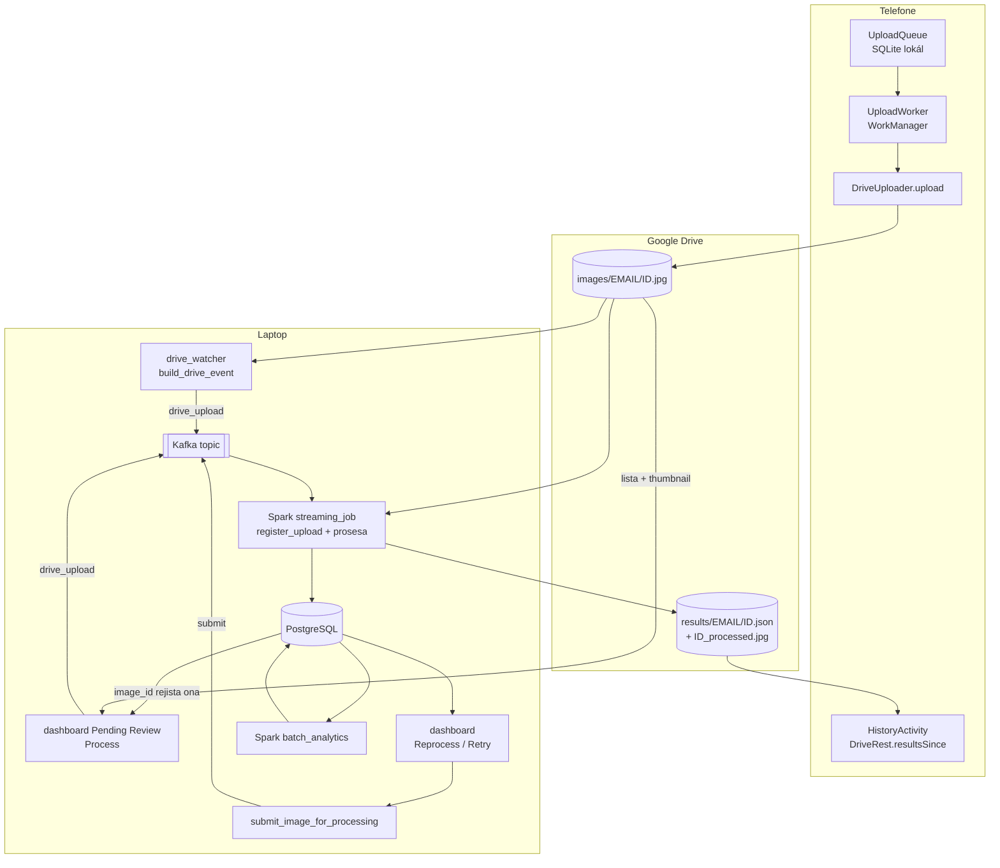
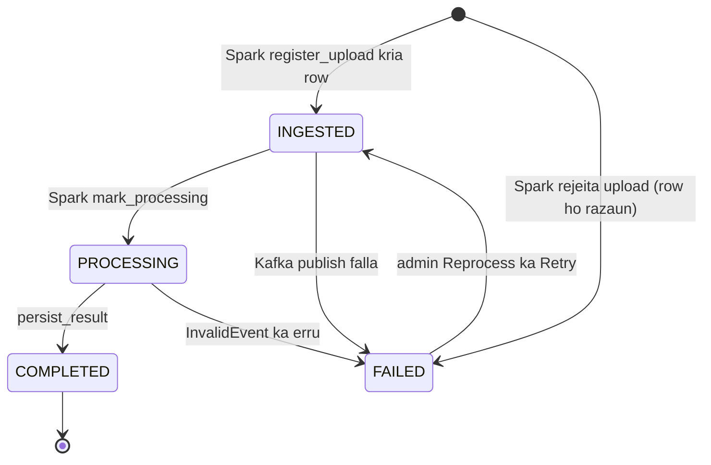
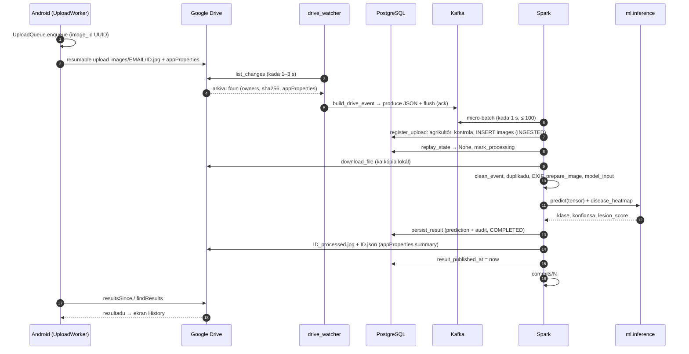
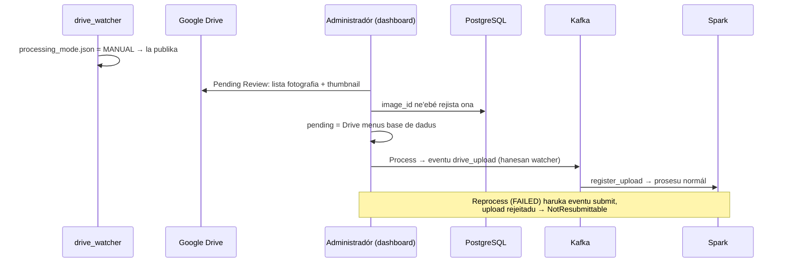
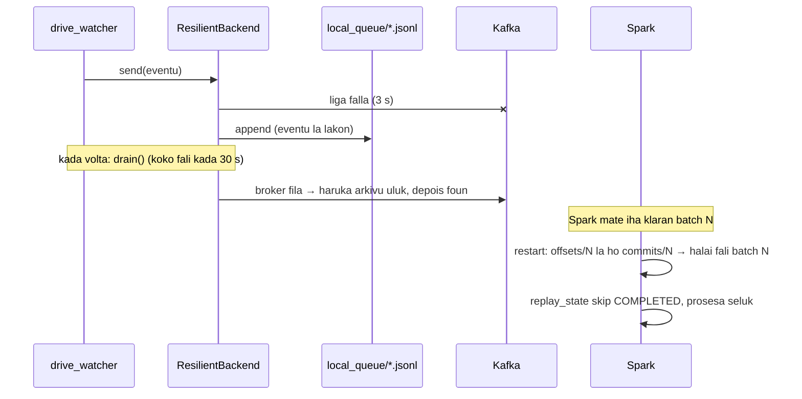
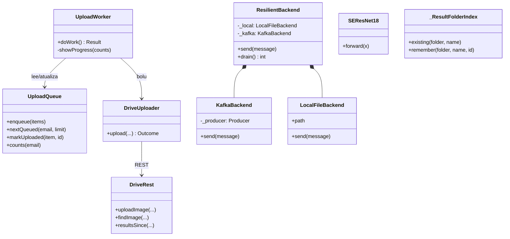

# 06 — Modulu Integrasaun End-to-End

*Sistema Crop Disease Early Warning System (EWS) — dokumentasaun téknika ba fluxu tomak, husi telefone to'o rezultadu. Fonte úniku: kódigu iha repozitóriu (commit `9ed46d4` + ajusta deep test, 2026-10-24). Kódigu hotu iha dokumentu ne'e mak kópia husi arkivu loloos, ho númeru liña.*

{{coverage run_all.py 1-374}}
{{coverage android_app/app/src/main/java/com/cropdisease/app/UploadQueue.kt 1-249}}
{{coverage android_app/app/src/main/java/com/cropdisease/app/UploadWorker.kt 1-207}}
{{coverage dashboard/app.py 227-260 626-638 654-733}}
{{coverage dashboard/image_management_page.py 243-257}}
{{coverage storage/pipeline_submit.py 56-87}}
{{coverage spark/streaming_job.py 199-231 266-284 304-333}}
{{coverage spark/preprocessing.py 828-862}}

## A. Introdusaun no Objetivu

Modulu 01–05 esplika komponente ida-idak. Modulu ne'e hatudu oinsá sira **servisu hamutuk**: fotografia ida husi telefone agrikultór to'o rezultadu iha nia telefone fali, no saida mak akontese bainhira parte ida falla.

**Komponente no prosesu (iha laptop ida):**

| Prosesu / janela | Komandu | Papél |
|---|---|---|
| Kafka (Docker) | `docker compose up -d kafka` | Transporte eventu, `localhost:9092` (laptop de'it) |
| PostgreSQL (Docker) | `docker compose up -d postgres` | Sistema rejistu, `127.0.0.1:5432` |
| `EWS-DriveWatcher` | `python -m kafka.drive_watcher` | Deteta upload Drive → Kafka (la iha base de dadus) |
| `EWS-Spark` | `python -m spark.streaming_job` | Rejista no prosesa fotografia |
| `EWS-SparkAnalytics` | `python -m spark.batch_analytics --watch` | Kalkula analítika dashboard |
| `EWS-KafkaMonitor` | `python -m kafka.monitor` | Haree Kafka (lee-de'it) |
| `EWS-Dashboard` | `streamlit run dashboard/app.py` | Administradór, `http://localhost:8501` |
| Telefone | aplikasaun Android | Upload ba Google Drive; lee rezultadu |

**Prinsípiu integrasaun:** komponente sira la koalia direta ba malu. Sira ko'alia liu **Google Drive** (telefone ↔ laptop), **Kafka** (watcher/dashboard → Spark) no **PostgreSQL** (estadu partilla). Tanba ne'e komponente ida bele mate no restart la ho lakon dadus.

**Sé mak halo saida (dezeñu 2026-10-24):**

| Komponente | Serbisu | La halo |
|---|---|---|
| Drive watcher | haree arkivu foun, publika eventu `drive_upload` (modu AUTOMATIC) | la iha base de dadus; la kontrola upload |
| Pending Review (MANUAL) | lista "fotografia Drive menus row base de dadus" (filter tuir `image_id`), "Process" publika eventu hanesan | la rai buat ida |
| Kafka | transporta eventu | — |
| Spark | rejista (agrikultór, kontrola upload, row INGESTED), duplikadu (`image_id` + SHA-256), prosesa, hakerek, entrega | — |

## B. Arkivu Fonte Loloos

| Arkivu | Liña | Papél iha integrasaun |
|---|---|---|
| `run_all.py` | 374 | Hahú/hapara komponente hotu, kontrola saúde |
| `android_app/.../UploadQueue.kt` | 249 | Fila upload iha telefone (SQLite lokál) |
| `android_app/.../UploadWorker.kt` | 207 | Upload iha *background* (WorkManager) |
| `dashboard/app.py` | 227–260, 626–638, 654–733 | Modu AUTOMATIC/MANUAL, Reprocess, Pending Review (Process) |
| `dashboard/image_management_page.py` | 243–257 | Retry imajen FAILED |
| `storage/pipeline_submit.py` | 56–87 | Haruka fali fotografia ne'ebé iha row (haree D.6) |
| `spark/streaming_job.py` | 199–231, 266–284, 304–333 | Batch, rejistu no fotografia ida (haree D.7) |
| `spark/preprocessing.py` | 828–862 | Entrega rezultadu (haree D.8) |

Detalle kada komponente: 01 (Spark), 02 (Kafka), 03 (Google Drive), 04 (base de dadus), 05 (modelu).

## C. Arkitetura no Fluxu Ezekusaun

### C.1 Fluxu tomak

### C.2 Ciclu vida status fotografia (`images.status`)

| Transisaun | Kódigu |
|---|---|
| (la iha row) → INGESTED | `spark/ingestion.register_upload` — eventu `drive_upload` husi watcher (AUTOMATIC), Pending Review "Process" / "Process all" / muda ba AUTOMATIC (MANUAL), ka `requeue_stuck --from-drive` |
| (la iha row) → FAILED | upload rejeitadu (konta la ativu, pasta seluk, naran, tipu, tamañu) ka `captured_at` iha futuru: row kria no falla ho razaun |
| FAILED → INGESTED | `submit_image_for_processing` (Reprocess, Retry) — eventu `submit` |
| INGESTED → PROCESSING | `mark_processing` |
| PROCESSING → COMPLETED / FAILED | `persist_result` |
| INGESTED → FAILED | publika Kafka falla |

`COMPLETED` ho `result_published_at` mamuk = rezultadu seidauk to'o Drive; *replay* ka `requeue_stuck` haruka fali. Fotografia iha modu MANUAL **la iha status**: nia arkivu Drive de'it to'o admin haruka. Tipu ENUM PostgreSQL sei iha label tuan `UPLOADED`/`PENDING_REVIEW`, maibé row ida la uza.

### C.3 Sequence: upload foun iha modu AUTOMATIC

### C.4 Sequence: modu MANUAL no Reprocess

### C.5 Sequence: Kafka mate no Spark restart

### C.6 Kolaborasaun objetu (Object Collaboration)

Funsaun sira ne'ebé ko'alia entre komponente (la'ós klase): `publish_drive_file` → `build_drive_event` → `ResilientBackend.send`; `foreach_batch_sink` → `_process_one` → `register_upload` → `process_event` → `ml.inference.predict` → `persist_result` → `publish_result_to_drive_safely`.

## D. Esplikasaun Kódigu ba Kódigu

### D.1 `run_all.py` — hahú sistema tomak

#### D.1.1 Docstring no konstante (liña 1–43)

{{code run_all.py 1-43}}

- Komponente lima ne'ebé hahú (liña 6–10) no opsaun `--no-kafka`, `--no-spark`, `--no-analytics`, `--no-drive`, `--reset`, `--stop`.
- Telefone ko'alia ho Google Drive de'it — la presiza ngrok ka *port forwarding* (liña 16–17).
- `PID_FILE = .run_all.pids.json` — rai prosesu ne'ebé hahú (ba `--stop`).

#### D.1.2 `start_service`, `pid_alive`, `stop_pid` (liña 46–94)

{{code run_all.py 46-94}}

- Windows: `cmd /k "title EWS-<naran> && ..."` iha janela foun (`CREATE_NEW_CONSOLE`); janela hela nakloke depois prosesu mate (erru bele lee). Linux: `start_new_session=True`.
- `pid_alive` — `tasklist` (Windows) ka `os.kill(pid, 0)`.
- `stop_pid` — `taskkill /T /F` (hapara cmd **no** python laran) ka `killpg SIGTERM`.

#### D.1.3 Lee PID, buka janela, saúde Spark, stuck (liña 96–158)

{{code run_all.py 96-158}}

- `read_pid_file` — arkivu aat → `None`.
- `find_service_windows` — PowerShell `Get-CimInstance Win32_Process` buka janela `title EWS-` (bainhira arkivu PID lakon).
- `spark_streaming_alive` — buka prosesu loloos `spark.streaming_job` (PID cmd sempre "moris"); la hatene → `True` (la fó alarme falsu).
- `count_stuck_images` — `requeue_stuck.count_owed`: fotografia INGESTED/PROCESSING ne'ebé sei hein, no rezultadu COMPLETED ne'ebé seidauk entrega ba Drive (tuan liu 2 min).

#### D.1.4 Ajuda porta (liña 160–178)

{{code run_all.py 160-178}}

- `port_in_use` — `connect_ex(("127.0.0.1", port)) == 0`; `wait_for_port` — kontrola kada 2 s to'o *timeout*; `which` — programa iha `PATH`.

#### D.1.5 `main` — opsaun no `--stop` (liña 180–219)

{{code run_all.py 180-219}}

- `--stop`: lee arkivu PID (ka buka janela), hapara kada servisu, `docker compose down` se Kafka hahú husi script ne'e, hamoos arkivu PID.

#### D.1.6 `main` — guarda no Kafka (liña 221–254)

{{code run_all.py 221-254}}

- Prosesu antigu sei moris → la hahú dala rua.
- Kontrola `streamlit`, `sqlalchemy` instala.
- Kafka: porta 9092 iha ona → la hahú; la iha `docker` → skip; se lae `docker compose up -d kafka` no hein to'o 60 s.

#### D.1.7 `main` — PostgreSQL, `init_db`, `--reset` (liña 256–293)

{{code run_all.py 256-293}}

- PostgreSQL de'it se `DATABASE_URL` uza nia: `docker compose up -d postgres`, hein porta 5432, depois 3 s (porta loke molok aseita login).
- `python -m storage.init_db` (tabela + admin).
- `--reset` → `storage.reset --yes --kafka` (Spark lee `earliest`, entaun topic tenke hamoos hamutuk ho checkpoint).

#### D.1.8 `main` — hahú servisu (liña 295–334)

{{code run_all.py 295-334}}

- Orden: `EWS-Spark`, `EWS-SparkAnalytics` (PostgreSQL de'it), `EWS-KafkaMonitor`, `EWS-Dashboard` (se porta 8501 livre), `EWS-DriveWatcher` (se Drive konfigura ona).
- Rai `{kafka, services}` iha arkivu PID.

#### D.1.9 `main` — kontrola saúde no relatóriu (liña 336–374)

{{code run_all.py 336-374}}

- Hein to'o ~30 s ba prosesu Spark; la iha → avizu (fotografia sei hela INGESTED).
- Liña 355–361: fotografia stuck → hatudu komandu `requeue_stuck` tolu: `--all` (publika fali), `--all --inline` (prosesa agora), `--from-drive` (fotografia Drive ne'ebé Spark nunka rejista).
- Imprime endereço dashboard.

### D.2 Telefone: `UploadQueue.kt` — fila upload

#### D.2.1 KDoc, konstante, *singleton* (liña 1–48)

{{code android_app/app/src/main/java/com/cropdisease/app/UploadQueue.kt 1-48}}

- Fila iha SQLite privadu telefone: upload rihun ida sobrevive aplikasaun taka, telefone restart, rede monu.
- `image_id` fiksu bainhira tama fila → retry la duplika (DriveUploader buka `<image_id>.jpg`).
- Fotografia la kopia se aplikasaun bele mantein asesu (*persisted uri*); kámera → kópia iha `filesDir/upload_queue/`, hamoos depois upload.
- Row kada konta Google (`user_email`).
- Estadu: `QUEUED`, `UPLOADED`, `FAILED` (bele retry), `REJECTED` (la retry).
- `get(context)` — *singleton* ho *double-checked locking* (`@Volatile` + `synchronized`).

#### D.2.2 `Item`, `Counts`, *schema* (liña 50–93)

{{code android_app/app/src/main/java/com/cropdisease/app/UploadQueue.kt 50-93}}

- `data class Item` — fotografia ida (uri, naran, tipu, lokalizasaun, GPS, estadu, id Drive).
- `Counts.done = total − queued`.
- `onCreate` — tabela `queue` (PK `image_id`) + indeks `(user_email, state)`.

#### D.2.3 `enqueue`, `nextQueued`, `hasQueued`, `usesTree`, `counts`, `items` (liña 95–165)

{{code android_app/app/src/main/java/com/cropdisease/app/UploadQueue.kt 95-165}}

- `enqueue` — se fila mamuk, hamoos row tuan uluk (progresu "X husi N" ba upload foun); insere iha transasaun ida; `CONFLICT_IGNORE` (`image_id` hanesan la tama dala rua).
- `nextQueued` — row `QUEUED` orden `rowid` (orden tama).
- `counts` — `GROUP BY state`.

#### D.2.4 Muda estadu no hasai fonte (liña 167–249)

{{code android_app/app/src/main/java/com/cropdisease/app/UploadQueue.kt 167-249}}

- `markUploaded`/`markRejected` — atualiza no `releaseSource` (hamoos kópia, husik permisaun uri; Android limita númeru permisaun).
- `markFailed` — rai fonte ba "Retry failed"; `retryFailed` — FAILED → QUEUED.
- `update` — erru limita 300 karakter.
- `Cursor.toItem` — row → `Item`.

### D.3 Telefone: `UploadWorker.kt` — upload iha *background*

#### D.3.1 KDoc no `companion object` (liña 1–71)

{{code android_app/app/src/main/java/com/cropdisease/app/UploadWorker.kt 1-71}}

- WorkManager: kontinua bainhira aplikasaun taka; hahú fali depois *reboot*, bainhira rede fila, ka depois falla (*backoff*).
- `PARALLELISM = 3` fotografia hamutuk (barak liu fahe *bandwidth* no hamosu *rate limit*).
- `start` — `APPEND_OR_REPLACE`; `resumeIfPending` — `KEEP` (la duplika serbisu).
- `enqueue` — `NetworkType.CONNECTED`, `BackoffPolicy.EXPONENTIAL` 30 s, `enqueueUniqueWork("photo-upload")`.

#### D.3.2 `doWork` (liña 73–139)

{{code android_app/app/src/main/java/com/cropdisease/app/UploadWorker.kt 73-139}}

- `uploadClient` ho *timeout* naruk (write 120 s) ba rede neineik iha foho.
- Login la iha → `success` (row hein utilizadór). Token la iha → `signInNeeded`. Pasta la iha → `failure` ho mensajen.
- *Loop*: foti `PARALLELISM × 4` row, `invokeAll` (thread 3) `DriveUploader.upload`; kada rezultadu: `Uploaded` → `markUploaded` + istória lokál "pending"; `Rejected`/`Failed` → marka; `Transient` → `Result.retry()`; `SignInNeeded` → hapara.
- `isStopped` (sistema hapara serbisu) → `retry`.
- Ikus: notifikasaun "hotu" ka "balun falla".

#### D.3.3 `signInNeeded` no notifikasaun (liña 141–207)

{{code android_app/app/src/main/java/com/cropdisease/app/UploadWorker.kt 141-207}}

- `showProgress` — *foreground service* (`DATA_SYNC`) ho "Uploading X of N"; Android la husik → kontinua hanesan serbisu background.
- `notifyDone` — Android 13+ presiza permisaun `POST_NOTIFICATIONS`.

### D.4 Dashboard: modu prosesamentu no lista Drive (dashboard/app.py liña 227–260)

{{code dashboard/app.py 227-260}}

- Komentáriu liña 227–232: modu rai iha `storage/processing_mode.json`, ne'ebé Drive watcher lee (watcher la iha base de dadus). Modu MANUAL: watcher la publika; fotografia hein iha Drive, no Pending Review lista sira ne'ebé seidauk iha row.
- `_switch_to_manual` (liña 233–234) — `set_processing_mode(MANUAL)`.
- `_switch_to_automatic_and_drain` (liña 237–245) — muda ba AUTOMATIC **no** haruka kedas fotografia Drive hotu ne'ebé seidauk iha row (`unprocessed_photos` + `send_for_processing`, eventu `drive_upload`); hamoos *cache*.
- `_pending_drive_photos` (liña 248–260) — `@st.cache_data(ttl=60)`: lista Drive tomak ~7 s ba fotografia ~650, entaun rai minutu ida. Drive la konfigura ka erru → `[]`.

### D.5 Dashboard: Reprocess, Process, Retry

#### D.5.1 Reprocess (dashboard/app.py liña 626–638)

{{code dashboard/app.py 626-638}}

- Botaun hatudu de'it ba **FAILED** ne'ebé la'ós upload rejeitadu husi Spark nia pasu *ingestion* (`is_upload_rejected`).
- `submit_image_for_processing` (D.6) — eventu `submit`.

#### D.5.2 Pending Review: Process / Process all (dashboard/app.py liña 654–733)

{{code dashboard/app.py 654-733}}

- Liña 655–661: pájina hatudu fotografia ne'ebé hein iha **Google Drive** (la'ós iha base de dadus).
- Liña 663–668: `_sent_pending` — fotografia ne'ebé haruka ona husi pájina ne'e subar to'o Spark rejista (lista Drive iha *cache* 60 s).
- Liña 673–677: `_send` — `send_for_processing` (eventu `drive_upload`, hanesan watcher), depois hamoos *cache*.
- Liña 682–691: *fragment* kontrola kada `_REFRESH_SECONDS` se lista muda; redesenha pájina de'it bainhira presiza.
- Liña 697–700: "Process all".
- Liña 703–707: pájina 24 fotografia (uluk lista tomak download fotografia ~650 no AppTest *timeout*).
- Liña 720–725: *thumbnail* Google (`_drive_thumbnail` → `drive_client.download_thumbnail`), KB balun duké fotografia tomak.
- Liña 726–732: "Process" ba fotografia ida.
- **Duplikadu:** pájina filter tuir `image_id`; Spark kaer fotografia hanesan ho `image_id` seluk (SHA-256). Teste live 2026-10-24: upload repete iha MANUAL → Process → FAILED "Duplicate photo".

#### D.5.3 Retry (dashboard/image_management_page.py liña 243–257)

{{code dashboard/image_management_page.py 243-257}}

- Lee fali estadu husi base de dadus (la fiar página): de'it se sei FAILED.

### D.6 Haruka fali fotografia ne'ebé iha row: `submit_image_for_processing` (storage/pipeline_submit.py liña 56–87)

{{code storage/pipeline_submit.py 56-87}}

- Reprocess, Retry no `requeue_stuck` bolu funsaun ida ne'e → eventu `submit` **hanesan**.
- Fotografia **foun** la liu iha ne'e: watcher, Pending Review no muda-ba-AUTOMATIC publika eventu `drive_upload` (`build_drive_event`).
- Upload rejeitadu → `NotResubmittable`; FAILED → INGESTED; commit molok publika; publika falla → FAILED "Kafka publish failed".

### D.7 Spark: batch no fotografia ida (spark/streaming_job.py)

#### D.7.1 `foreach_batch_sink` (liña 199–231)

{{code spark/streaming_job.py 199-231}}

- Batch commit de'it depois fotografia hotu iha base de dadus **no** upload Drive tenta tiha ona (`upload.result()`).

#### D.7.2 `_process_one` — *ingestion* fotografia foun (liña 266–284)

{{code spark/streaming_job.py 266-284}}

- Eventu `drive_upload` → `register_upload`: agrikultór (kria se foun), kontrola upload, skip duplikadu, row INGESTED. Ne'e mak fatin úniku ne'ebé fotografia foun sai row base de dadus (01_spark_module D.6).
- Upload rejeitadu, ka eventu ne'ebé `parse_events` rejeita tanba konteúdu (`captured_at` iha futuru), mós hetan row no sai FAILED — nune'e sai husi Pending Review.

#### D.7.3 `_process_one` — prosesu no entrega (liña 304–333)

{{code spark/streaming_job.py 304-333}}

- `process_event` → `persist_result` (COMPLETED) ka FAILED ho razaun; depois `_UPLOADS.submit(_upload_result, ...)`.

### D.8 Entrega rezultadu (spark/preprocessing.py liña 828–862)

{{code spark/preprocessing.py 828-862}}

- Pasta `results/<email>/`, `ID_processed.jpg` + `ID.json` (update iha fatin), `appProperties` summary, `result_published_at`.

### D.9 Trasu ezekusaun ho tempu (fotografia ida, modu AUTOMATIC)

| t (s) | Prosesu | Funsaun | Asaun | Status |
|---|---|---|---|---|
| 0.0 | Telefone | `UploadWorker.doWork` → `DriveUploader.upload` | upload `ID.jpg` | — |
| ≈1.5 | Watcher | `scan_changes` → `publish_drive_file` | `build_drive_event` + produce + flush | (la iha row) |
| ≤2.7 | Spark | `foreach_batch_sink` → `register_upload` | micro-batch, row foun | INGESTED |
| 2.7 | Spark | `mark_processing` | — | PROCESSING |
| 2.7–4.5 | Spark (thread download) | `download_file` | ~1.8 s | — |
| 4.6 | Spark | `prepare_image` → `model_input` → `predict` → `compute_risk` | ~0.3 s | — |
| 4.9 | Spark | `persist_result` | prediction + audit | COMPLETED |
| 4.9–6.3 | Spark (thread upload) | `publish_result_to_drive` | JSON + JPEG | `result_published_at` |
| 6.3 | Spark | `commits/N` | batch remata | — |
| ≤ 30 | Spark analytics | `watch` → `refresh` | tabela `analytics_*` | — |
| tuir mai | Telefone | `DriveRest.resultsSince` | hatudu rezultadu | — |

*(Tempu tipiku husi konsola; la'ós garantia. Deep test 2026-10-24 sukat iha sistema live: Google *change feed* hatudu upload foun depois mediana ~15 s (9–80 s) — ne'e mak etapa neineik liu; Spark rasik 1–8 s kada fotografia.)*

## E. Análize OOP

| Konseitu | Iha kódigu modulu ne'e? | Ezemplu loloos |
|---|---|---|
| **Klase no objetu** | Sim | `UploadQueue`, `UploadWorker`, `UploadQueue.Item`, `UploadQueue.Counts`; Python `run_all.py` la iha klase (prosedurál). |
| **Konstrutór** | Sim | `UploadQueue private constructor(context)` (privadu: obriga `get()`); `UploadWorker(context, params)`. |
| **Atributu** | Sim | `apiClient`, `uploadClient` (UploadWorker); `instance` (`@Volatile`). |
| **Métodu** | Sim | `enqueue`, `nextQueued`, `markUploaded`, `doWork`, `showProgress`. |
| **Herança** | Sim | `UploadQueue : SQLiteOpenHelper`, `UploadWorker : Worker`. |
| **Polimorfizmu** | Sim | *Override* `onCreate`, `onUpgrade`, `doWork`; `when (outcome)` ba `sealed class Outcome`. |
| **Enkapsulamentu** | Sim | `private fun update/query/releaseSource/clearFinished`; konstrutór privadu. |
| **Abstrasaun** | Sim | `get_backend` / `send_for_processing` subar Kafka/arkivu; WorkManager subar retry/rede. |
| **Kompozisaun** | Sim | `UploadWorker` uza `UploadQueue`, `DriveUploader`, `HistoryStore`, `SessionStore`. |
| **Padraun dezeñu** | Sim | *Singleton* (`UploadQueue.get`), *Work queue*, *Outbox* (fila telefone + `local_queue`), *Single gatekeeper* (Spark `register_upload` mak fatin úniku kria row fotografia), *Stateless producer* (watcher), *Supervisor* simples (`run_all.py`), *Claim check*, *Idempotent receiver*, *Saga* sem kompensasaun (status hanesan máquina estadu). |

## F. Integrasaun

| Komponente | Komunika ho | Kanál | Formatu |
|---|---|---|---|
| Telefone | Google Drive | HTTPS REST v3 (token agrikultór) | JPEG + `appProperties`; JSON rezultadu |
| Drive watcher | Google Drive | HTTPS REST v3 (token sentrál) | metadata |
| Drive watcher / dashboard | Kafka | TCP 9092 (laptop de'it) | JSON ~300–700 bytes |
| Dashboard Pending Review | Google Drive | HTTPS REST v3 | lista arkivu, *thumbnail* |
| Spark | Kafka | Structured Streaming | JSON |
| Spark | Google Drive | HTTPS REST v3 | bytes fotografia; JSON + JPEG |
| Spark | PostgreSQL | SQLAlchemy | prediction, audit |
| Spark analytics | PostgreSQL | JDBC | DataFrame |
| Dashboard / Tableau | PostgreSQL | SQLAlchemy / login lee-de'it | tabela, view |

**Porta:** 9092 (Kafka, `127.0.0.1` + `::1`), 5432 (PostgreSQL, 127.0.0.1), 8501 (dashboard), 4040 (Spark UI). Telefone la presiza porta ida iha laptop. *Nota seguransa (deep test 2026-10-24):* 8501 no 4040 rona iha interface rede hotu (la'ós laptop de'it); dashboard HTTP la ho limite tentativa login, no Spark UI la iha login.

## G. Tratamentu Erru no Konfiabilidade End-to-End

| Falla | Fatin | Saida mak akontese | Rekuperasaun |
|---|---|---|---|
| Telefone la iha rede | `UploadWorker` | row hela QUEUED | WorkManager koko fali (rede + backoff) |
| Resposta upload lakon | `DriveUploader` | `findImage` molok retry | la duplika |
| Watcher mate | — | arkivu hela iha Drive | *bookmark* + `scan_once` bainhira restart |
| Eventu lakon antes Spark rejista | — | fotografia iha Drive, la iha row | `requeue_stuck --from-drive` (Drive menus base de dadus) |
| Kafka mate | `ResilientBackend` | eventu ba `local_queue` | `drain()` automátiku (deep test: orden mantein, la lakon) |
| Agrikultór foun, fotografia barak paralelu | `get_or_create_farmer` | `IntegrityError` | lee konta ne'ebé iha ona (hadi'a 2026-10-24; uluk batch mate) |
| Spark mate | — | eventu hela iha Kafka; fotografia INGESTED/PROCESSING | restart → checkpoint; `run_all` avizu; `requeue_stuck` |
| Modelu la iha | `_warm_up_model` | Spark la hahú | deploy modelu |
| Drive mate bainhira entrega | `publish_result_to_drive_safely` | COMPLETED, `result_published_at` mamuk | *replay* ("result_missing") ka `requeue_stuck` |
| PostgreSQL restart | `pool_pre_ping` | koneksaun foun | automátiku |
| Analítika falla | `watch` | númeru antigu | koko fali iha 30 s |
| Topic hamoos maibé checkpoint hela | Spark `failOnDataLoss` | query hapara | *reset* hamoos rua hamutuk |

**Garantia ponta-ba-ponta:** *at-least-once* iha kada pasu (telefone retry, produtór flush/arkivu, Spark replay); efeitu **dala ida kada `image_id`** tanba `image_id` fiksu husi telefone, Spark `register_upload` (`"duplicate"`), `replay_state`, delete-then-insert, no update Drive iha fatin. Fotografia hanesan ho `image_id` seluk: `check_duplicate_by_hash` (SHA-256) — kópia ida de'it analiza.

## H. Rezumu no Pergunta Akadémiku

**Rezumu.** Telefone rai fotografia iha fila lokál no upload iha *background* ba pasta Drive agrikultór. Watcher deteta liu *change feed* no publika eventu ki'ik `drive_upload` ho metadata Drive ba Kafka (la iha base de dadus; modu MANUAL la publika, no Pending Review lista Drive menus base de dadus). Spark lee micro-batch, rejista fotografia foun (agrikultór, kontrola, duplikadu, row INGESTED), prosesa fotografia 8 paralelu (CNN SEResNet-18), hakerek ba PostgreSQL no entrega rezultadu ba Drive molok *commit*. Analítika Spark atualiza tabela dashboard. `run_all.py` hahú no hapara hotu no avizu bainhira Spark mate.

**P1. Oinsá fotografia ida la lakon iha dalan?**
> Kada pasu iha rai durável: fila SQLite telefone → Drive → topic Kafka (ka `local_queue`) → checkpoint Spark → row PostgreSQL (INGESTED → COMPLETED) → Drive. Status iha base de dadus hatudu fatin ne'ebé nia para, no `requeue_stuck` bele haruka fali husi ne'ebá; fotografia ne'ebé seidauk iha row (eventu lakon) → `requeue_stuck --from-drive`, tanba fotografia sei iha Drive.

**P2. Oinsá fotografia ida la prosesa dala rua?**
> `image_id` kria iha telefone no la muda; Spark `register_upload` skip arkivu Drive ne'ebé rejista ona; `replay_state` skip COMPLETED; `persist_result` delete-then-insert; Drive update iha fatin; fotografia hanesan ho `image_id` seluk → "Duplicate photo" (SHA-256).

**P3. Tanba sa la iha servidór API?**
> Google Drive mak interface úniku telefone: autentikasaun, armazenamentu no HTTPS husi Google; la iha porta nakloke iha laptop.

**P4. Saida mak modu MANUAL?**
> Watcher la publika; fotografia hela iha Drive de'it (base de dadus la iha row). Pending Review = fotografia Drive menus row base de dadus (`drive_inventory.unprocessed_photos`). Admin hili "Process" → eventu `drive_upload` hanesan watcher, no Spark rejista no prosesa. Muda ba AUTOMATIC haruka fotografia hein hotu.

**P5. Tanba sa Spark mak *gatekeeper*, la'ós watcher?**
> Fatin ida de'it kria row fotografia foun (`register_upload`), ho regra ida (agrikultór, pasta, naran, tipu, tamañu, duplikadu). Watcher sai simples no *stateless* (Drive → Kafka), no eventu lakon la hatama dadus aat: fotografia sei iha Drive no bele haruka fali. Eventu `drive_upload` hanesan husi dalan tolu (watcher, Pending Review, `--from-drive`); eventu `submit` ba Reprocess/Retry.

**P6. Latênsia ponta-ba-ponta hira?**
> Iha kondisaun di'ak ~6 s husi watcher haree upload to'o rezultadu iha Drive (D.9): batch ≤ 1 s, download ~1.8 s, CNN ~0.3 s, entrega ~1.4 s. Maibé Google *change feed* hatudu upload foun tarde: deep test 2026-10-24 sukat mediana ~15 s (9–80 s) husi upload to'o Spark rejista. Drive mak etapa neineik liu. Média loloos iha `analytics_summary.avg_end_to_end_latency_seconds`.

**P7. Komponente ida mate — sistema tomak hapara ka?**
> Lae. Komponente ko'alia liu fila durável (Drive, Kafka, PostgreSQL); eventu hein no kontinua bainhira komponente fila. `run_all.py` avizu bainhira Spark la moris.

**P8. Oinsá ita hatene saúde sistema?**
> `run_all.py` kontrola Spark no fotografia stuck; janela EWS-KafkaMonitor hatudu eventu; konsola Spark hatudu liña kada fotografia; dashboard System Status konta fotografia hein no la entrega (`count_owed`).

**P9. Limitasaun boot liu iha integrasaun?**
> Hotu iha laptop ida (Spark *local mode*, broker ida, PostgreSQL ida); Google Drive mak dependénsia esterna no kota; la iha monitorizasaun/alerta automátiku (log no dashboard de'it).

**P10. Oinsá eskala ba agrikultór rihun?**
> Detesaun la depende ba númeru agrikultór (*change feed* pedidu ida); Kafka ho partisaun barak no *replication*; Spark iha *cluster* ho *inference* iha *executor* ka servisu GPU; PostgreSQL ho *replica* lee. Fila telefone no WorkManager ona prontu ba upload barak.
