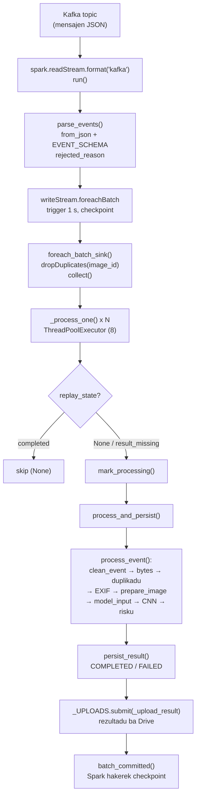
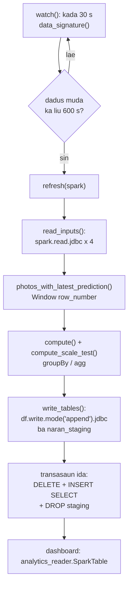
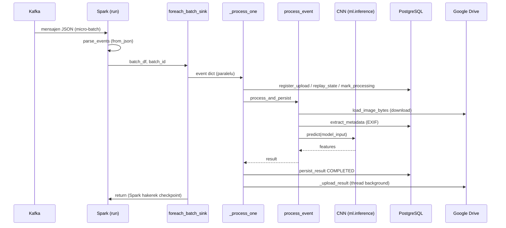

# 01 — Modulu Apache Spark & Streaming

*Sistema Crop Disease Early Warning System (EWS) — dokumentasaun téknika ba modulu Spark, hakerek ba estudante Enjeñaria Informátika ne'ebé foin hahú aprende Python. Fonte úniku: kódigu iha repozitóriu (branch `main`, commit `302818f`). Kódigu hotu iha dokumentu ne'e mak kópia automátiku husi arkivu loloos, ho númeru liña — la iha kódigu ne'ebé hakerek fali ka hamenus.*

{{coverage spark/session.py 1-30}}
{{coverage spark/streaming_job.py 1-360}}
{{coverage spark/preprocessing.py 1-233}}
{{coverage spark/batch_analytics.py 1-307}}
{{coverage spark/live_log.py 1-81}}
{{coverage spark/analytics_reader.py 1-102}}

> **Oinsá lee dokumentu ne'e.** Kada bloku kódigu iha seksaun D tuir pasu 9 ne'ebé hanesan: (1) Kódigu orijinál, (2) Objetivu, (3) Fundamentu Python, (4) Esplikasaun liña-ba-liña, (5) Walkthrough ezekusaun, (6) Tipu dadus, (7) Ligasaun OOP, (8) Impaktu integrasaun, (9) Checkpoint ba principiante. Se ita foin hahú Python, lee uluk seksaun **A.3 Fundamentu Python** — konseitu hotu ne'ebé kódigu Spark uza esplika iha ne'ebá ho ezemplu ki'ik.
>
> **Etiketa ne'ebé uza:** *Implementadu* = kódigu halo duni; *Inferidu* = ita dedús husi kódigu maibé kódigu la hakerek esplísitu; *Teoria* = esplikasaun jerál, la'ós kódigu projetu; *Ezemplu ilustrativu* = valór ne'ebé ita hili atu esplika, la'ós dadus loloos husi sistema.

## A. Introdusaun no Objetivu

### A.1 Papél Spark iha sistema

Sistema EWS ajuda agrikultór sira iha Timor-Leste atu deteta moras iha tahan batar (maize). Agrikultór foti fotografia ho telemóvel, aplikasaun Android haruka fotografia ba Google Drive, no sistema iha laptop analiza fotografia no haruka rezultadu fali ba Drive.

Iha sistema ne'e, kada komponente iha nia serbisu rasik:

| Komponente | Nia serbisu |
|---|---|
| Google Drive | fatin ne'ebé agrikultór haruka fotografia no simu rezultadu |
| `kafka/drive_watcher.py` + Kafka | hatene katak fotografia foun to'o ona, no lori **eventu** (mensajen JSON ki'ik) ba Spark |
| **Spark (modulu ne'e)** | simu eventu, kontrola (validasaun), foti fotografia, lee EXIF, **prepara imajen (preprocessing)**, rai imajen ne'ebé prosesa ona, no kalkula **analítika** hotu ba dashboard |
| CNN (`ml/inference.py`) | **klasifika** imajen (healthy, blight, gray_leaf_spot, ...) |
| `ml/risk.py` | kalkula nivel risku (LOW/MEDIUM/HIGH) |
| `storage/results.py` | rai rezultadu iha PostgreSQL no hakerek rezultadu ba Drive agrikultór |

Spark iha serbisu prinsipál **rua**:

1. **Streaming (tempu-real)** — `spark/streaming_job.py`. Spark Structured Streaming lee eventu husi Kafka topic. Eventu ida = fotografia ida. Spark halo *parsing* JSON → validasaun ho Spark SQL → iha `foreachBatch` nia prosesa kada fotografia: rejista → kontrola → foti imajen → EXIF → prepara imajen → CNN → risku → rai rezultadu → haruka ba Drive.
2. **Analítika (batch)** — `spark/batch_analytics.py`. Spark lee tabela PostgreSQL liuhusi **JDBC**, kalkula númeru hotu ne'ebé dashboard hatudu (total fotografia, distribuisaun moras, risku tuir fatin, tendénsia loron-loron), no hakerek fali tabela `analytics_*` liuhusi JDBC.

### A.2 Problema ne'ebé modulu ne'e rezolve

- **Fotografia barak to'o iha tempu hanesan.** Spark foti eventu iha *micro-batch* (grupu ki'ik) kada segundu 1 (`SPARK_TRIGGER_SECONDS = 1`), maximu eventu 100 kada batch (`SPARK_MAX_EVENTS_PER_BATCH = 100`), no prosesa to'o fotografia 8 iha paralelu (`SPARK_PARALLEL_PHOTOS = 8`). Valór sira ne'e mak *default* iha `config/settings.py`.
- **Eventu ida bele aat.** Spark la soe eventu aat: nia hatama razaun iha koluna `rejected_reason` no depois rai fotografia ne'e ho status `FAILED`, entaun la iha fotografia ida mak lakon.
- **Sistema bele monu.** Spark rai *checkpoint* (fatin ne'ebé Spark hakerek to'o ne'ebé nia lee ona). Se laptop mate, Spark hahú fali husi checkpoint — at-least-once delivery.
- **Dashboard presiza númeru loos.** Spark kalkula analítika hotu, no dashboard só lee tabela ne'ebé Spark hakerek (`spark/analytics_reader.py`).

### A.3 Fundamentu Python (aprende uluk molok lee kódigu)

Seksaun ne'e hanorin konseitu Python hotu ne'ebé kódigu Spark uza. Ezemplu sira iha ne'e mak **Ezemplu ilustrativu** — la'ós kódigu husi projetu.

**1. Variavel, valór no atribuisaun (assignment).** Variavel mak naran ida ne'ebé hatudu ba valór ida. Sinál `=` signifika "rai valór iha naran ne'e", la'ós "hanesan".

```python
total = 100          # int (númeru moris)
naran = "batar"      # str (testu)
konfiansa = 0.97     # float (númeru ho vírgula)
loos = True          # bool (True ka False)
la_iha = None        # None = "la iha valór"
```

**2. Tipu dadus prinsipál.**

| Tipu | Ezemplu | Signifika |
|---|---|---|
| `int` | `8` | númeru moris |
| `float` | `0.97` | númeru ho parte desimál |
| `str` | `"HIGH"` | testu |
| `bool` | `True` | loos/sala |
| `None` | `None` | la iha valór |
| `bytes` | `b"\xff\xd8"` | dadus binária (ezemplu: arkivu imajen JPEG) |
| `list` | `[1, 2, 3]` | lista ho orden, bele muda |
| `tuple` | `(0.8, "HIGH")` | lista ho orden, **labele** muda |
| `dict` | `{"image_id": "abc"}` | pár *chave → valór* |
| `set` | `{"a", "b"}` | grupu la ho orden, la iha repetisaun |

**3. String no f-string.** String ne'ebé hahú ho `f` bele tau variavel iha laran ho `{ }`. `!r` hatudu valór ho aspas (repr). `:.2f` hatudu númeru ho desimál 2.

```python
segundu = 1.23456
print(f"total {segundu:.2f}s")   # -> total 1.23s
```

**4. Lista, dicionáriu no `.get()`.** `d["chave"]` foti valór maibé fó erru `KeyError` se chave la iha; `d.get("chave")` fó `None` (ka valór *default*) se la iha.

```python
event = {"image_id": "abc", "location": None}
event["image_id"]          # "abc"
event.get("user_id")       # None (la fó erru)
event.get("x", "default")  # "default"
```

**5. Kondisaun (`if / elif / else`).** Python hili dalan ida tuir kondisaun. Indentasaun (espasu iha liña nia oin) hatudu liña sira ne'ebé pertense ba bloku ida.

**6. Loop (`for`) no compreensaun (comprehension).** `for x in lista:` repete ba kada elementu. Compreensaun mak forma badak atu harii lista ka dict:

```python
quadradu = [n * n for n in [1, 2, 3]]          # [1, 4, 9]
d = {k: 0 for k in ("a", "b")}                 # {"a": 0, "b": 0}
```

**7. Funsaun (`def`), parámetru, argumentu no `return`.** Funsaun mak bloku kódigu ho naran. Parámetru mak naran iha definisaun; argumentu mak valór ne'ebé ita haruka bainhira bolu. `return` fó rezultadu fali. Parámetru bele iha valór *default* (`console_progress: bool = True`). `*args` simu argumentu barak tuir orden; `**kwargs` simu argumentu ho naran barak.

```python
def soma(a, b=1):
    return a + b
soma(2)      # 3
soma(2, 5)   # 7
```

**8. Type hints.** `def f(event: dict) -> dict:` signifika "ita hein `event` mak dict no funsaun fó fali dict". Python **la kontrola** ida ne'e iha tempu ezekusaun — ne'e só informasaun ba ema no ferramenta sira.

**9. Import, modulu no pakote.** Arkivu `.py` ida = modulu. Pasta ho arkivu `.py` = pakote (ezemplu `spark/`). `import os` foti modulu tomak; `from x import y` foti naran ida husi modulu. Import bele mós iha funsaun nia laran (*lazy import*) atu modulu todan (ezemplu `pyspark`, `torch`) karrega só bainhira presiza.

**10. Exception (`try / except / finally / raise`).** Exception mak erru ne'ebé para kódigu. `try:` koko halo buat ruma; `except TipuErru as e:` kaer erru; `finally:` halai beibeik (iha erru ka lae); `raise` hamosu erru.

```python
try:
    x = int("abc")
except ValueError as e:
    print("la'ós númeru:", e)
finally:
    print("remata")
```

**11. Klase, objetu, `self` no `__init__`.** Klase mak planta (molde); objetu mak buat ida ne'ebé harii husi molde ne'e. `__init__` mak konstrutór — halai bainhira objetu foun moris. `self` mak objetu rasik.

```python
class Kontadór:
    def __init__(self, naran):
        self.naran = naran    # atributu instánsia
        self.valór = 0
    def aumenta(self):        # métodu
        self.valór += 1
k = Kontadór("fotografia")    # harii objetu
k.aumenta()                   # k.valór = 1
```

Klase ida bele **herda** husi klase seluk: `class InvalidEvent(Exception): pass` signifika `InvalidEvent` mak tipu `Exception` foun.

**12. Métodu espesiál `__call__`.** Se klase iha `__call__`, ita bele "bolu" objetu hanesan funsaun: `tabela()`.

**13. Decorator.** `@lru_cache(maxsize=4096)` iha leten `def` mak *decorator* — funsaun ida ne'ebé falun funsaun seluk atu aumenta hahalok. `lru_cache` rai rezultadu ba argumentu ida-idak, entaun bolu dala rua ho argumentu hanesan la halai fali kódigu.

**14. Context manager (`with`).** `with SessionLocal() as session:` loke rekursu (konesaun base de dadus) no taka automátiku bainhira bloku remata, maske iha erru. `with _LOCK:` foti *lock* no fó fali automátiku.

**15. Funsaun iha funsaun nia laran (closure) no `nonlocal`.** Funsaun bele define iha funsaun seluk nia laran no uza variavel husi funsaun ne'ebé falun nia. `nonlocal clock` husu Python atu muda variavel `clock` husi funsaun liur, la'ós harii variavel lokál foun.

**16. Operadór walrus `:=`.** `if sent := resend_owed(...):` atribui valór ba `sent` no kontrola nia iha tempu hanesan.

**17. Thread no `ThreadPoolExecutor`.** Thread mak "liña serbisu" ida ne'ebé halai iha tempu hanesan ho seluk iha programa ida nia laran. `ThreadPoolExecutor(max_workers=16)` mak grupu thread 16 ne'ebé prontu. `pool.submit(f, x)` fó serbisu ida no fó fali **Future** (promesa ida katak rezultadu sei mai); `future.result()` hein to'o rezultadu prontu. `pool.map(f, lista)` halai `f` ba kada elementu iha paralelu.

**18. Unpacking.** `a, b = (1, 2)` fahe tuple ba variavel rua. `{**d1, **d2}` kombina dict rua. `**stamps` iha chamada haruka pár hotu husi dict hanesan argumentu ho naran.

**19. Konseitu Spark báziku (Teoria).** *DataFrame* mak tabela distribuida (liña no koluna). *Lazy evaluation*: Spark la halai kálkulu bainhira ita hakerek `filter`/`select` — nia só halai bainhira presiza rezultadu (ezemplu `collect()`, `write`). *Column expression* (`col("x") == ""`) mak deskrisaun kálkulu, la'ós valór. *Structured Streaming* trata dadus ne'ebé mai beibeik hanesan tabela ne'ebé sempre aumenta liña.

## B. Arkivu Fonte Loloos

| Arkivu | Liña | Klase / funsaun prinsipál | Serbisu |
|---|---|---|---|
| `spark/session.py` | 30 | `kafka_session`, `KAFKA_PACKAGE` | Harii `SparkSession` ho konektór Kafka; workaround Hadoop iha Windows |
| `spark/streaming_job.py` | 360 | `EVENT_SCHEMA`, `parse_events`, `process_event`, `process_and_persist`, `foreach_batch_sink`, `_process_one`, `_upload_result`, `_warm_up_model`, `_auto_resend`, `run` | Job streaming: Kafka → parsing → validasaun → prosesa fotografia → rai → Drive |
| `spark/preprocessing.py` | 233 | `InvalidEvent`, `clean_event`, `_clean_drive_event`, `extract_metadata`, `model_input`, `prepare_image`, `store_processed_image`, `save_for_review`, `save_downloaded_photo`, `scale_test_run_for` | Spark nia serbisu ba fotografia ida: kontrola eventu, EXIF, preprocessing imajen |
| `spark/batch_analytics.py` | 307 | `jdbc_url_and_properties`, `read_inputs`, `photos_with_latest_prediction`, `compute`, `compute_scale_test`, `write_tables`, `refresh`, `watch` | Analítika batch ho JDBC: lee PostgreSQL, agregasaun, hakerek tabela `analytics_*` |
| `spark/live_log.py` | 81 | `say`, `farmer_label`, `photo_line`, `batch_started`, `photo_done`, `result_delivered`, `batch_committed` | Liña tempu-real iha janela konsola EWS-Spark |
| `spark/analytics_reader.py` | 102 | `SparkTable`, `images_with_predictions`, `kpi_summary` | Dashboard lee tabela ne'ebé Spark kalkula |

**Dependénsia esternu:** `pyspark` (Spark 3.5), pakote Maven `org.apache.spark:spark-sql-kafka-0-10_2.12:3.5.0` (konektór Kafka) no `org.postgresql:postgresql:42.7.3` (driver JDBC), `Pillow` (PIL, imajen), `torchvision` (transforms ba tensor), `SQLAlchemy` (ORM ba PostgreSQL), `pandas` (dashboard).

**Dependénsia internu:** `config/settings.py` (konfigurasaun), `kafka/config.py` (`KAFKA_BOOTSTRAP_SERVERS`, `KAFKA_TOPIC`), `storage/*` (base de dadus, Drive, rezultadu), `ml/*` (CNN, risku, desenhu).

## C. Arkitetura no Fluxu Ezekusaun

### C.1 Input, prosesu, output

| | Streaming (`streaming_job.py`) | Analítika (`batch_analytics.py`) |
|---|---|---|
| **Input** | Mensajen JSON iha Kafka topic (`KAFKA_TOPIC`) — referénsia ba fotografia (la'ós bytes imajen) | Tabela PostgreSQL `images`, `predictions`, `users`, `scale_test_items` (liuhusi JDBC) |
| **Prosesu** | `from_json` → regra validasaun Spark SQL → `foreachBatch` → `_process_one` kada fotografia (paralelu) | Window function (prediksaun foun liu), `groupBy` + `agg`, kontajen kondisionál |
| **Output** | Liña `predictions` + status `images` iha PostgreSQL (ORM SQLAlchemy); imajen PNG iha `PROCESSED_IMAGES_DIR`; rezultadu JSON + imajen iha Drive | Tabela `analytics_*` no `batch_location_daily_summary` (JDBC append ba `_staging`, depois troka iha transasaun ida) |

### C.2 Diagrama fluxu streaming



### C.3 Diagrama fluxu analítika



### C.4 Trasu konkretu: eventu ida husi Kafka to'o PostgreSQL

Valór sira iha tabela ne'e mak **Ezemplu ilustrativu** (identifikadór no email la'ós dadus loloos — dokumentu ne'e la hatudu dadus privadu agrikultór). Naran kampu, funsaun no regra mak loloos husi kódigu.

| Pasu | Funsaun (arkivu) | Dadus antes | Dadus depois |
|---|---|---|---|
| 1 | `build_drive_event` (`kafka/drive_watcher.py`) | metadata Drive | dict `{"kind": "drive_upload", "image_id": "a1b2c3d4", "image_path": "gdrive:1AbC...", "owner_email": "agrikultor@example.com", "uploaded_at": "2026-10-20T01:15:00Z", "location": "  aileu   vila ", ...}` |
| 2 | Produtór Kafka | dict | bytes JSON iha topic (kolumna `value`) |
| 3 | `parse_events` | `value` = bytes | liña ho kolumna `kind`, `image_id`, ..., `location = "Aileu Vila"`, `rejected_reason = null`, `raw_value = null` |
| 4 | `foreach_batch_sink` | DataFrame batch | lista Python `[{"kind": "drive_upload", "image_id": "a1b2c3d4", ...}]` |
| 5 | `_process_one` → `register_upload` | dict | liña `images` foun (`outcome = "new"`) |
| 6 | `replay_state` | `"a1b2c3d4"` | `None` (seidauk prosesa) |
| 7 | `mark_processing` | — | `images.status = PROCESSING` |
| 8 | `clean_event` | dict | dict validadu (`uploaded_at` ISO, `location` limpu, `user_id` iha) |
| 9 | `load_image_bytes` | `gdrive:1AbC...` | `bytes` JPEG (ezemplu 2.4 MB) |
| 10 | `extract_metadata` | bytes orijinál | `camera_make`, `gps_latitude`... iha liña `images` |
| 11 | `prepare_image` | JPEG 4000×3000 | JPEG maximu 1280 px (`ANALYSIS_MAX_PX`), vertikál, la iha EXIF |
| 12 | `model_input` | JPEG 1280×960 | tensor `torch.Tensor` forma `[3, S, S]` normalizadu (S = `img_size` husi modelu) |
| 13 | `run_model` (`ml/inference.predict`) | tensor | dict `{"predicted_class": "blight", "predicted_class_confidence": 0.97, "lesion_score": 0.97, ...}` |
| 14 | `compute_risk` | features | `(0.97, "HIGH")` |
| 15 | `persist_result` | result dict | liña `predictions` + `images.status = COMPLETED` |
| 16 | `_upload_result` | result | arkivu rezultadu iha Drive agrikultór |

### C.5 Diagrama sekuénsia


