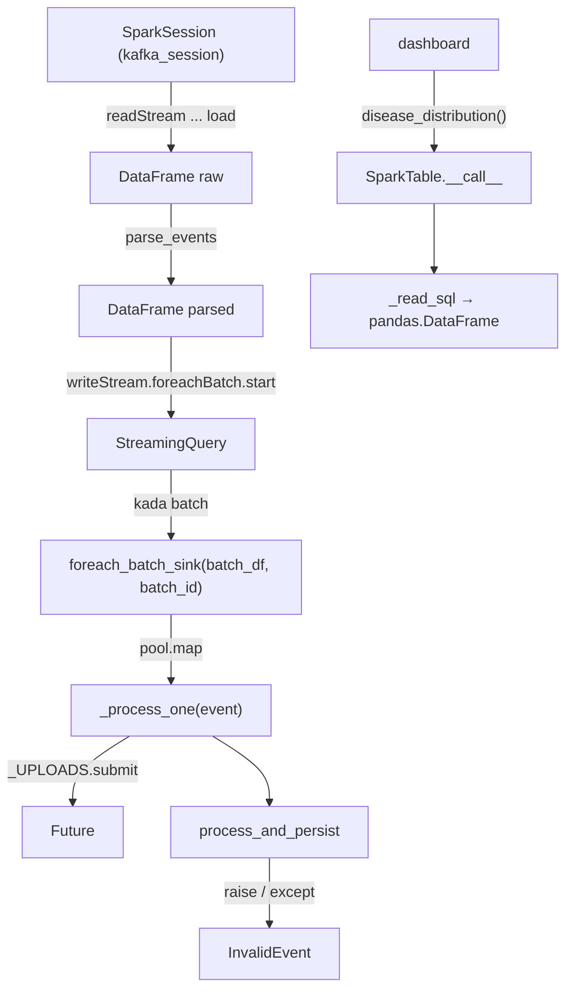

## E. Analize OOP (Object-Oriented Programming)

Seksaun ne'e hatudu OOP ne'ebé **loloos iha** kódigu Spark. Bainhira konseitu la iha, ita hakerek "Not implemented in the current codebase." no esplika teoria iha **Nota aprendizajen Python** — teoria ne'e la'ós implementasaun.

### E.1 Klase ne'ebé projetu define iha modulu Spark

| Klase | Arkivu | Herda husi | `__init__` | Atributu | Métodu | Uza iha |
|---|---|---|---|---|---|---|
| `InvalidEvent` | `spark/preprocessing.py` liña 45–46 | `Exception` | herda husi `Exception` | mensajen (herda, `e.args`) | la iha rasik | `raise` iha `clean_event`, `_clean_drive_event`, `_parse_timestamp`, `process_and_persist`; `except` iha `_process_one` |
| `SparkTable` | `spark/analytics_reader.py` liña 17–41 | `object` | sin (liña 21–23) | `name`, `cols`, `order_by`, `rename`, `dates` | `__call__` | objetu 8 iha liña 83–102, plus `kpi_summary` |

Klase seluk hotu ne'ebé kódigu Spark uza (`SparkSession`, `DataFrame`, `Column`, `Window`, `StructType`, `ThreadPoolExecutor`, `Future`, `Path`, `PIL.Image`, `Session` SQLAlchemy, klase ORM `Image`/`User`/`ScaleTestRun`...) mai husi biblioteka ka modulu projetu seluk (Modulu 04).

### E.2 Objetu: oinsá harii no uza

- **`SparkTable`**: harii iha nível modulu — `disease_distribution = SparkTable("analytics_disease_distribution", [...], ...)`. Python bolu `SparkTable.__init__(objetu_foun, "analytics_disease_distribution", ...)`; `self` = objetu foun. Bainhira dashboard hakerek `disease_distribution()`, Python bolu `SparkTable.__call__(disease_distribution)`.
- **`InvalidEvent`**: harii bainhira `raise InvalidEvent("Missing required field: user_id")`. Objetu erru sa'e liuhusi chamada funsaun to'o `except` ida kaer nia (`process_and_persist` liña 213).
- **Objetu nível modulu (komposisaun)**: `_DOWNLOADS` no `_UPLOADS` (`ThreadPoolExecutor`) iha `streaming_job.py`; `_LOCK` (`threading.Lock`) iha `live_log.py`. Modulu "na'in" objetu sira ne'e: moris bainhira import, moris to'o prosesu remata.
- **Objetu temporáriu**: `ThreadPoolExecutor` iha `foreach_batch_sink` liña 235 — `with` harii no taka nia iha batch ida nia laran.

### E.3 Trasu chamada métodu entre objetu



### E.4 Prinsípiu OOP — evidénsia husi kódigu

| Konseitu | Iha modulu Spark? | Evidénsia / esplikasaun |
|---|---|---|
| **Klase no objetu** | Sin | `SparkTable` (objetu 8), `InvalidEvent` |
| **Konstrutór `__init__`** | Sin | `SparkTable.__init__` rai parámetru 5 iha atributu instánsia |
| **`self`** | Sin | `self.name`, `self.cols` iha `SparkTable` |
| **Atributu instánsia** | Sin | `SparkTable.name/cols/order_by/rename/dates` |
| **Atributu klase** | Not implemented in the current codebase. | La iha variavel define iha `class` nia laran fora husi métodu |
| **Métodu instánsia** | Sin | `SparkTable.__call__` |
| **Métodu espesiál (dunder)** | Sin | `__init__`, `__call__` |
| **Herança** | Sin | `InvalidEvent(Exception)`; iha modulu seluk `UploadRejected(InvalidEvent)`, `DuplicateImage(InvalidEvent)` |
| **Polimorfizmu** | Sin (liuhusi herança no protokolu) | `except InvalidEvent` kaer mós sub-klase; `except Exception` kaer hotu no `isinstance(e, InvalidEvent)` hili mensajen; `SparkTable` objetu "callable" hanesan funsaun; `Column` biblioteka sobrekarga `|`, `&`, `~` |
| **Enkapsulamentu** | Parsiál | `SparkTable` subar SQL no tratamentu erru; naran ho `_` (`_process_one`, `_DOWNLOADS`, `_LOCK`) mak konvensaun "internu" — Python la blokeia asesu |
| **Abstrasaun** | Parsiál (prinsípiu dezeñu) | Funsaun `_count_if`, `_count_photos`, `_high_risk_by` subar detalle agregasaun; `process_event` subar pasu 10 iha naran ida. Klase abstrata (`abc.ABC`): Not implemented in the current codebase. |
| **Komposisaun** | Sin (nível modulu) | `streaming_job` na'in `_DOWNLOADS`, `_UPLOADS`; `live_log` na'in `_LOCK`; `Compose` torchvision kaer lista transformasaun (biblioteka) |
| **Padraun Builder** | Uza husi biblioteka | `SparkSession.builder...getOrCreate()`, `readStream...load()`, `writeStream...start()` |
| **Padraun Singleton** | Uza husi biblioteka | `getOrCreate()` fó SparkSession ida kada prosesu |
| **Callback / Strategy** | Sin | `foreachBatch(foreach_batch_sink)` — funsaun projetu haruka hanesan argumentu |
| **Thread pool (Concurrency pattern)** | Sin | `ThreadPoolExecutor` ba download, prosesa paralelu, upload |
| **Interface / Protocol formál** | Not implemented in the current codebase. | La iha `typing.Protocol` ka klase abstrata |
| **Dataclass** | Not implemented in the current codebase. | Eventu no rezultadu mak `dict` |

**Nota aprendizajen Python — atributu klase (Teoria, la'ós implementasaun):**

```python
class Ezemplu:
    kontadór = 0          # atributu klase: objetu hotu partilla
    def __init__(self):
        self.naran = "x"  # atributu instánsia: kada objetu iha rasik
```

**Nota aprendizajen Python — klase abstrata (Teoria):** `from abc import ABC, abstractmethod`; klase ho `@abstractmethod` labele harii objetu direta — sub-klase tenke implementa métodu. Projetu Spark la uza.

**Nota aprendizajen Python — dataclass (Teoria):** `@dataclass class Event: image_id: str; location: str = None` harii `__init__` automátiku. Kódigu atuál uza `dict` ba eventu tanba Spark `Row.asDict()` fó dict direta.

### E.5 Distinsaun: karakterístika Python formál vs prinsípiu dezeñu

- **Formál (Python)**: `class`, herança `(Exception)`, `__init__`, `__call__`, decorator `@lru_cache`, context manager `with`.
- **Prinsípiu dezeñu (la'ós sintaxe Python)**: separasaun responsabilidade (Kafka = eventu, Spark = preprocessing/analítika, CNN = klasifikasaun), idempotênsia (`replay_state`), abstrasaun liuhusi funsaun ajuda. Prinsípiu sira ne'e iha, maibé sira la presiza klase.

## F. Integrasaun ho Komponente Seluk

| Komponente | Direksaun | Saida mak troka | Kódigu |
|---|---|---|---|
| Kafka (Modulu 02) | Kafka → Spark | Mensajen JSON (`kind`, `image_id`, `image_path`, ...) | `run()` `readStream.format("kafka")`; `parse_events` |
| `storage/uploads.py` | Spark → BD | Rejistu upload Drive foun | `_process_one` → `register_upload` |
| `storage/results.py` | Spark ↔ BD | Kontrola replay, status PROCESSING, rai COMPLETED/FAILED | `replay_state`, `mark_processing`, `persist_result` |
| Google Drive (Modulu 03) | Drive → Spark | Bytes fotografia | `load_image_bytes` iha `_DOWNLOADS` |
| Google Drive (Modulu 03) | Spark → Drive | JSON rezultadu + imajen ho heatmap | `_upload_result` → `publish_result_to_drive_safely` |
| PostgreSQL (Modulu 04) | Spark (batch) ↔ BD | JDBC read 4 tabela; JDBC append ba `_staging`; transasaun troka | `read_inputs`, `write_tables` |
| CNN (Modulu 05) | Spark → CNN → Spark | Tensor `[3,S,S]` → dict feature | `model_input` → `run_model` |
| `ml/risk.py` (Modulu 05) | Spark → risku | `lesion_score` → `(score, level)` | `compute_risk` |
| Dashboard | BD → dashboard | Tabela `analytics_*` | `analytics_reader.SparkTable` |
| `run_all.py` (Modulu 06) | hahú prosesu | `python -m spark.streaming_job`, `python -m spark.batch_analytics --watch` | — |

**Fluxu dadus ida-ne'ebé kompletu** (haree C.4): Drive watcher → Kafka → `parse_events` → `foreach_batch_sink` → `_process_one` → `process_event` (Drive download, EXIF, `prepare_image`, `model_input`, CNN, risku) → `persist_result` (PostgreSQL) → `_upload_result` (Drive) → `batch_analytics.watch` hetan mudansa → `write_tables` → dashboard.

## G. Tratamentu Erru no Konfiabilidade

| Mekanizmu | Oinsá funsiona | Kódigu |
|---|---|---|
| Validasaun eskema | `from_json` ho `EVENT_SCHEMA`; JSON aat fó null, la monu | `parse_events` liña 87 |
| Validasaun regra Spark SQL | `rejected_reason` ba kampu falta, `owner_email`/`user_id`, `captured_at` futuru | `parse_events` liña 95–104 |
| Validasaun Python | Kampu, tempu ISO, futuru, `user_id` iha BD, dalan seguru, etiketa Drive | `clean_event`, `_clean_drive_event` |
| Eventu aat la lakon | Rai `FAILED` ho razaun; `raw_value` ba eventu la iha `image_id` | `process_and_persist`, `_process_one` liña 268–269 |
| At-least-once + idempotênsia | Checkpoint Spark; `replay_state` salta COMPLETED; `persist_result` troka prediksaun | `run()` liña 351; `_process_one` liña 283–288 |
| Duplikadu iha batch | `dropDuplicates(["image_id"])` | `foreach_batch_sink` liña 228 |
| Duplikadu konteúdu | `check_duplicate_by_hash` | `process_event` liña 156 |
| Commit depois upload | Hein `Future` upload hotu molok remata batch | `foreach_batch_sink` liña 238 |
| Re-send automátiku | Thread kada 300 s haruka fali fotografia ne'ebé hein > 600 s (maximu 50) | `_auto_resend` |
| Erru BD bainhira rai FAILED | Kaer; fotografia hela PROCESSING; `requeue_stuck` koko fali | `process_and_persist` liña 218–219 |
| Erru desenhu imajen | Kaer; diagnóstiku kontinua | `process_event` liña 197–198 |
| Erru rai kópia disku | Kaer; print de'it | `save_*`, `store_processed_image` |
| Analítika falla | Kaer; koko fali kada 30 s | `watch` liña 287–288 |
| Dashboard la iha tabela | DataFrame mamuk | `SparkTable.__call__` liña 33–34 |
| Leitór lee tabela mamuk | Staging + transasaun | `write_tables` |
| Log la monu | `UnicodeEncodeError`, `OSError` ignora | `say` |

**Limitasaun (Implementadu / Inferidu):**

- Streaming job la uza **Spark JDBC** ba rezultadu; nia uza SQLAlchemy kada fotografia. Spark JDBC write streaming: Not implemented in the current codebase.
- Prosesa fotografia akontese iha **driver** Spark (Python, `collect()` + thread), la'ós distribuidu iha executor (komentáriu liña 224: worker Python monu iha Windows). Ne'e limita eskala ba komputadór ida.
- *Exactly-once*: Not implemented in the current codebase — sistema uza at-least-once + idempotênsia.
- Dead-letter topic Kafka separadu: Not implemented in the current codebase — eventu rejeitadu rai iha tabela (`rejected_events`, `FAILED`).
- `analytics_disease_distribution`/`most_detected` konta mós klase `"uncertain"` hanesan klase (`most_detected` só hasai `"healthy"`).
- `watch` uza *polling* (30 s), la'ós notifikasaun BD.

## H. Sumáriu no Pergunta Akadémiku

### H.1 Sumáriu

Modulu Spark iha parte rua. **Streaming** (`streaming_job.py` + `preprocessing.py`): Spark Structured Streaming lee Kafka kada segundu, parse JSON ho `EVENT_SCHEMA`, valida ho Spark SQL (`rejected_reason`), depois iha `foreachBatch` prosesa fotografia to'o 8 iha paralelu — validasaun Python, download, EXIF, `prepare_image` (vertikál, ≤1280 px, la ho EXIF), `model_input` (Resize → CenterCrop → ToTensor → Normalize), CNN, risku, rai iha PostgreSQL (SQLAlchemy) no haruka ba Drive. Checkpoint + `replay_state` fó at-least-once seguru. **Analítika** (`batch_analytics.py`): Spark lee PostgreSQL ho JDBC, kalkula prediksaun foun liu ho Window, agregasaun `groupBy/agg` ba tabela 10, no hakerek ho JDBC `append` ba staging + transasaun troka. Dashboard lee ho `SparkTable`.

### H.2 Pergunta no resposta (nível profesór)

**P1. Spark hakerek rezultadu CNN ba PostgreSQL ho JDBC?**
R: Lae. Streaming job rai rezultadu ho SQLAlchemy (`persist_result`, `storage/results.py`) iha `foreach_batch_sink`. Spark JDBC uza de'it iha `batch_analytics.py`: `spark.read.jdbc` (lee) no `df.write.mode("append").jdbc(..._staging)` (hakerek).

**P2. Oinsá sistema garante katak eventu ne'ebé repete depois crash la halo prediksaun rua?**
R: (1) `dropDuplicates(["image_id"])` iha batch; (2) `replay_state` fó `"completed"` → `_process_one` salta; (3) se COMPLETED maibé rezultadu seidauk iha Drive (`"result_missing"`), prosesa fali no `persist_result` troka prediksaun tuan.

**P3. Tanba sá `foreach_batch_sink` hein Future upload hotu?**
R: Spark commit checkpoint bainhira funsaun remata. Hein garante katak se prosesu monu molok upload, batch sei repete (komentáriu liña 237).

**P4. Eventu JSON aat (la'ós JSON) akontese saida?**
R: `from_json` fó null ba kampu hotu → `rejected_reason = "Missing required field: image_id"` → `_process_one` rai `raw_value` → `process_and_persist` hamosu `InvalidEvent` → `persist_result(..., FAILED)`.

**P5. Formula normalizasaun iha `model_input`?**
R: Ba kada kanál $c$: $x'_c = \dfrac{x_c - \mu_c}{\sigma_c}$, ne'ebé $x_c \in [0,1]$ husi `ToTensor` ($x = \text{piksel}/255$), $\mu_c$ = `spec["mean"][c]`, $\sigma_c$ = `spec["std"][c]` husi checkpoint modelu.

**P6. Tanba sá `prepare_image` uza `draft` molok `thumbnail`?**
R: `draft` husu descodificadór JPEG atu descodifika iha rezolusaun ki'ik (lalais no poupa memória); `thumbnail` depois garante sisi boot ≤ `ANALYSIS_MAX_PX`.

**P7. `startingOffsets = "earliest"` la halo fotografia hotu prosesa fali bainhira restart?**
R: Lae. Opsaun ne'e uza só bainhira checkpoint la iha. Ho checkpoint, Spark kontinua husi offset ikus. Maske eventu tuan mai fali, `replay_state` salta COMPLETED.

**P8. Saida mak risku "race" iha `foreach_batch_sink` ho thread 8?**
R: Thread barak bolu BD no Drive iha tempu hanesan. Kódigu proteje: kada thread uza `SessionLocal()` rasik; `live_log` uza `_LOCK`; duplikadu `image_id` hasai molok paralelu. `check_duplicate_by_hash` uza lock rasik (`_DUPLICATE_LOCK` iha `storage/duplicates.py`).

**P9. Oinsá analítika garante "imajen ida konta dala ida"?**
R: `photos_with_latest_prediction` uza `row_number()` iha Window `partitionBy("image_id")` no hela `_rn == 1`, depois *left join* ho `images`.

**P10. Tanba sá `_local_day` presiza maske `spark.sql.session.timeZone = "UTC"`?**
R: Sesaun UTC halo kálkulu konsistente; `_local_day` aumenta `LOCAL_TZ_OFFSET_HOURS` esplísitu atu loron sai loron Timor-Leste, la depende ba fuso komputadór.

**P11. Se `SPARK_PARALLEL_PHOTOS = 1`, saida muda?**
R: Liña 232 loos → fotografia prosesa ida-ida iha thread prinsipál (`[_process_one(e) for e in events]`). Upload Drive kontinua iha `_UPLOADS` background.

**P12. Iha ne'ebé OOP herança loloos aparese iha modulu ne'e?**
R: `class InvalidEvent(Exception)`. Sub-klase `UploadRejected` no `DuplicateImage` (modulu `storage/`) herda husi `InvalidEvent`, entaun `except InvalidEvent` iha `_process_one` kaer sira hotu — polimorfizmu liuhusi herança.
