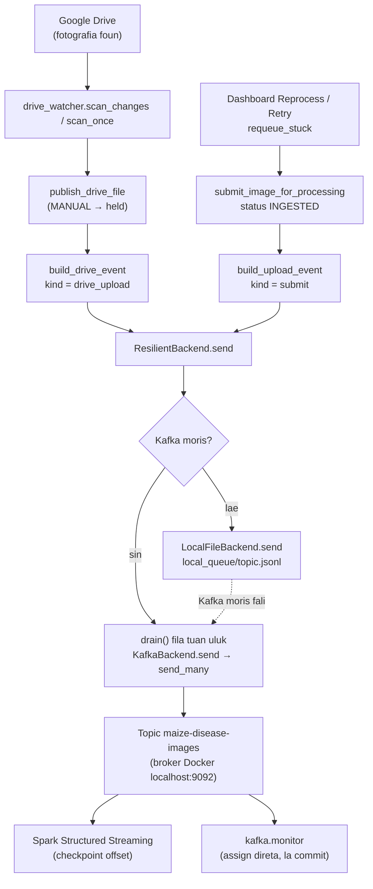
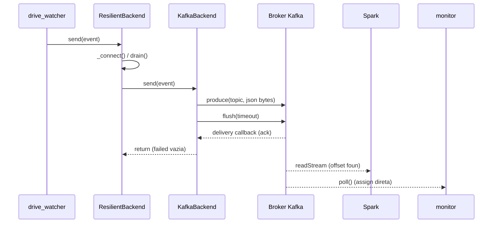

# 02 — Modulu Apache Kafka (Mensajen)

*Sistema Crop Disease Early Warning System (EWS) — dokumentasaun téknika ba modulu Kafka, hakerek ba estudante ne'ebé foin hahú aprende Python. Fonte úniku: kódigu iha repozitóriu (branch `main`, commit `302818f`). Kódigu hotu kópia automátiku husi arkivu loloos ho númeru liña; segredu (password) troka ho `***`.*

{{coverage kafka/config.py 1-28}}
{{coverage kafka/producer.py 1-221}}
{{coverage kafka/drive_watcher.py 1-256}}
{{coverage storage/pipeline_submit.py 1-70}}
{{coverage kafka/monitor.py 1-209}}
{{coverage docker-compose.yml 1-50}}

> **Oinsá lee.** Bloku kódigu kada ida tuir pasu 9: (1) Kódigu orijinál, (2) Objetivu, (3) Fundamentu Python, (4) Esplikasaun liña-ba-liña, (5) Walkthrough ezekusaun, (6) Tipu dadus, (7) Ligasaun OOP, (8) Impaktu integrasaun, (9) Checkpoint ba principiante. Etiketa: *Implementadu* (kódigu halo), *Inferidu* (dedús husi kódigu), *Teoria* (esplikasaun jerál), *Ezemplu ilustrativu* (valór hili atu esplika, la'ós dadus loloos).

## A. Introdusaun no Objetivu

### A.1 Papél Kafka iha sistema

Apache Kafka mak **sistema mensajen** (message broker): programa ida (*produtór*) hakerek mensajen ba **topic** (hanesan "kanál" ka "fila"), no programa seluk (*konsumidór*) lee mensajen husi topic. Iha EWS:

| Papél | Programa | Kódigu |
|---|---|---|
| Produtór 1 | Drive watcher — hatene fotografia foun iha Google Drive | `kafka/drive_watcher.py` |
| Produtór 2 | Reprocess / Retry / requeue — haruka fali fotografia ne'ebé iha ona iha base de dadus | `storage/pipeline_submit.py` |
| Biblioteka produtór | Haruka ba Kafka; se Kafka mate, rai iha fila arkivu lokál | `kafka/producer.py` |
| Konsumidór prinsipál | Spark Structured Streaming (Modulu 01) | `spark/streaming_job.py` |
| Konsumidór observadór | Janela `EWS-KafkaMonitor` (só lee, la commit) | `kafka/monitor.py` |
| Broker | Kafka 3.7.0 iha Docker (KRaft, nó ida) | `docker-compose.yml` |

**Importante:** mensajen Kafka lori **referénsia** ba fotografia (ID, dalan `gdrive:<id>`, metadata) — **nunka** bytes imajen. Spark mak foti imajen husi Drive.

### A.2 Problema ne'ebé Kafka rezolve

- **Separa produtór no konsumidór.** Watcher bele hatene fotografia foun maske Spark seidauk prontu; mensajen hein iha topic.
- **La lakon eventu.** Kafka rai mensajen iha disku (volume `kafka_data`); Spark lee tuir *offset* no rai checkpoint.
- **Kafka mate.** `ResilientBackend` rai eventu iha arkivu `storage/local_queue/<topic>.jsonl` no haruka hotu bainhira Kafka moris fali (`drain`).
- **Observasaun.** Monitor hatudu kada eventu iha konsola maibé la muda pozisaun lee Spark.

### A.3 Fundamentu Python (foun iha modulu ne'e)

Modulu 01 hanorin ona variavel, tipu, dict, lista, funsaun, klase, `self`, `__init__`, exception, `with`, thread, f-string, walrus `:=`. **Lembra badak:** klase = molde; objetu = buat ida harii husi molde; `self` = objetu rasik; `with` = loke no taka rekursu automátiku. Konseitu **foun** iha ne'e:

**1. Serializasaun JSON.** Konverte objetu Python ba testu (no fali).

```python
import json
event = {"image_id": "a1", "size_bytes": None}
texto = json.dumps(event)          # '{"image_id": "a1", "size_bytes": null}'
bytes_ = texto.encode("utf-8")     # b'{"image_id": ...}'  (Kafka haruka bytes)
fali = json.loads(texto)           # dict fali
```

`None` sai `null`; `True` sai `true`. `json.loads` hamosu `ValueError` (`json.JSONDecodeError`) se testu la'ós JSON.

**2. Arkivu: `open(path, mode)`.** `"a"` = append (aumenta iha rohan), `"r"` (default) = lee. `with open(...) as f:` taka arkivu automátiku. Loop `for line in f:` lee liña ida-ida.

**3. JSON Lines (`.jsonl`).** Arkivu ne'ebé kada liña mak JSON ida. Fasil atu aumenta (append) no lee liña ida-ida.

**4. Lock arkivu sistema operativu.** Thread lock (`threading.Lock`) proteje thread iha prosesu ida; **lock arkivu** (`msvcrt.locking` iha Windows, `fcntl.flock` iha Linux) proteje prosesu barak ne'ebé hakerek arkivu hanesan.

**5. Atributu klase.** Variavel ne'ebé define iha `class` nia laran (la'ós iha métodu). Objetu hotu partilla:

```python
class ResilientBackend:
    RETRY_SECONDS = 30          # atributu klase
    def __init__(self, topic):
        self.topic = topic      # atributu instánsia
```

`self.RETRY_SECONDS` lee atributu klase liuhusi objetu.

**6. Fábrika closure (closure factory).** Funsaun ne'ebé harii no fó fali funsaun foun ne'ebé "hanoin" valór:

```python
def _callback(index):
    def _on_delivery(err, msg):
        print(index, err)      # index "rai" iha funsaun laran
    return _on_delivery
cb0 = _callback(0)             # cb0 hanoin index = 0
```

**7. `enumerate(lista)`.** Fó pár `(índise, elementu)`: `for i, m in enumerate(["a","b"])` → `(0,"a")`, `(1,"b")`.

**8. `OrderedDict` no `Counter`** (`collections`). `OrderedDict` hanoin orden tama; `popitem(last=False)` hasai ida tuan liu. `Counter` mak dict ba kontajen: `c["x"] += 1` la presiza inisializa.

**9. Duck typing no `hasattr`.** "Se nia la'o hanesan pato no hakilar hanesan pato, nia mak pato." Kódigu la kontrola tipu objetu; nia kontrola se objetu iha métodu: `if hasattr(backend, "drain"): backend.drain()`.

**10. `socket.create_connection`.** Koko loke konesaun TCP ba host:port; hamosu `OSError` se la bele.

**11. String: `split`, `rpartition`, `strip`.** `"a:b:c".rpartition(":")` → `("a:b", ":", "c")` (fahe iha `:` ikus). `"[::1]".strip("[]")` → `"::1"`.

**12. `os.replace(a, b)` no `uuid.uuid4().hex`.** `os.replace` troka naran arkivu (atómiku); `uuid4().hex` fó testu aleatóriu úniku (karakter 32).

**13. `sys.path.insert(0, pasta)`.** Aumenta pasta ba lista fatin ne'ebé Python buka modulu (atu `import config` funsiona bainhira halai arkivu direta).

**14. Konseitu Kafka (Teoria).** *Topic* = naran fila mensajen. *Partition* = parte topic ida; mensajen iha partition ida iha orden. *Offset* = númeru pozisaun mensajen iha partition (0, 1, 2...). *Consumer group* = grupu konsumidór ne'ebé fahe partition no **commit** offset (rai to'o ne'ebé lee ona). *Acknowledgement (ack)* = broker konfirma katak simu mensajen. *Bootstrap server* = enderesu broker dahuluk ne'ebé cliente kontaktu.

## B. Arkivu Fonte Loloos

| Arkivu | Liña | Klase / funsaun | Serbisu |
|---|---|---|---|
| `kafka/config.py` | 28 | `bootstrap_address`, `broker_reachable` | Re-esporta konfigurasaun Kafka; kontrola broker moris |
| `kafka/producer.py` | 221 | `_append`, `_parse_lines`, `KafkaBackend`, `LocalFileBackend`, `ResilientBackend`, `get_backend` | Serializa no haruka eventu; fila lokál bainhira Kafka mate |
| `kafka/drive_watcher.py` | 256 | `build_drive_event`, `publish_drive_file`, `scan_once`, `scan_changes`, `start_change_feed`, `NoBookmark`, `next_interval`, `main` | Produtór: Drive → eventu `drive_upload` |
| `storage/pipeline_submit.py` | 70 | `build_upload_event`, `NotResubmittable`, `submit_image_for_processing`, `submit_all` | Produtór: base de dadus → eventu `submit` |
| `kafka/monitor.py` | 209 | `describe`, `TestTopicSummary`, `Assigner`, `consumer_config`, `run` | Konsumidór só-lee ba janela EWS-KafkaMonitor |
| `docker-compose.yml` | 1–50 | serbisu `kafka` | Broker Kafka 3.7.0 KRaft |

**Dependénsia esternu:** `confluent-kafka` (cliente Kafka C/librdkafka). Komentáriu `producer.py` liña 2–3: projetu la uza `kafka-python` tanba naran pakote `kafka` sei kahur ho pasta projetu `kafka/`.

**Konfigurasaun** (`config/settings.py` liña 45–48, valór default): `KAFKA_BOOTSTRAP_SERVERS = "localhost:9092"`, `KAFKA_TOPIC = "maize-disease-images"`, `KAFKA_USE_LOCAL_FALLBACK = True`, `LOCAL_QUEUE_DIR = <projetu>/storage/local_queue`.

## C. Arkitetura no Fluxu Ezekusaun

### C.1 Input, prosesu, output

| | Produtór | Konsumidór Spark | Monitor |
|---|---|---|---|
| **Input** | Metadata Drive (watcher) ka liña `images` (submit) | Mensajen iha topic | Mensajen iha topic |
| **Prosesu** | `build_*_event` → `json.dumps(...).encode("utf-8")` → `produce` → `flush` + callback ack | `from_json(value.cast("string"), EVENT_SCHEMA)` | `json.loads(value)` → `describe` |
| **Output** | Mensajen iha topic `maize-disease-images` (ka liña iha `local_queue/*.jsonl`) | Liña DataFrame (Modulu 01) | Liña konsola |

### C.2 Diagrama fluxu



### C.3 Estrutura payload (mensajen)

Kafka simu **bytes**. Bytes ne'e mak testu JSON UTF-8 husi dict Python. Mensajen la iha **key** (`produce(self.topic, payload, ...)` — la haruka key). Kampu tuir tipu eventu:

| Kampu | `drive_upload` (`build_drive_event`) | `submit` (`build_upload_event`) |
|---|---|---|
| `kind` | `"drive_upload"` | `"submit"` |
| `image_id` | `appProperties.image_id` | `image.image_id` |
| `user_id` | `None` (Spark hetan husi `owner_email`) | `image.user_id` |
| `drive_file_id` | ID arkivu | husi `image_path` se Drive, se lae `None` |
| `image_path` | `"gdrive:<id>"` | `image.image_path` |
| `uploaded_at` | `createdTime` Drive (relójiu Google) | `image.uploaded_at` ISO |
| `captured_at` | `appProperties.captured_at_client` | `image.captured_at` ISO |
| `location` | `appProperties.location` | `image.location` |
| `file_name`, `mime_type`, `size_bytes`, `owner_email`, `owner_name`, `folder_email`, `original_filename`, `content_hash`, `device_gps_lat`, `device_gps_lon` | sin | la iha |

*Ezemplu ilustrativu* (ID no email la loos):

```json
{"kind": "drive_upload", "image_id": "a1b2c3d4-0000-4000-8000-000000000001", "user_id": null,
 "drive_file_id": "1AbCdEf", "image_path": "gdrive:1AbCdEf", "file_name": "IMG_20261020.jpg",
 "mime_type": "image/jpeg", "size_bytes": "2457600", "owner_email": "agrikultor@example.com",
 "owner_name": "Agrikultor", "folder_email": "agrikultor@example.com",
 "uploaded_at": "2026-10-20T01:15:00.000Z", "captured_at": "2026-10-20T10:14:52+09:00",
 "location": "Aileu Vila", "original_filename": "IMG_20261020.jpg", "content_hash": "9f86d0...",
 "device_gps_lat": "-8.7281", "device_gps_lon": "125.5664"}
```

### C.4 Partition, consumer group no offset — saida mak implementa

| Konseitu | Iha kódigu | Detallu |
|---|---|---|
| Kriasaun topic esplísitu | Not implemented in the current codebase. | La iha `NewTopic`/`create_topics`. Topic harii automátiku husi broker bainhira mensajen dahuluk mai (Inferidu: konfigurasaun auto-create default Kafka). |
| Númeru partition | Not implemented in the current codebase (la konfigura). | `docker-compose.yml` la define `KAFKA_NUM_PARTITIONS`; Inferidu: default broker = 1. Kódigu monitor mós suporta partition barak (`for partition in info.partitions`). |
| Key mensajen | Not implemented in the current codebase. | `produce(topic, payload, callback=...)` — la iha key; librdkafka hili partition. |
| Consumer group Spark | Spark jere rasik | Spark Structured Streaming la commit offset ba Kafka group; nia rai offset iha **checkpoint** (`CHECKPOINT_DIR`). |
| Consumer group monitor | `group.id = "ews-kafka-monitor"` maibé `enable.auto.commit = False` no `incremental_assign` direta | La partisipa iha rebalance; la commit. |
| Consumer group teste eskala | `SCALABILITY_CONSUMER_GROUP = "scalability-test"` | Monitor lee de'it nia offset (`test_consumer_position`). |
| Ack produtór | Sin | Callback `_on_delivery` + `flush(timeout)`; mensajen la ack → erru |
| Replication | `KAFKA_OFFSETS_TOPIC_REPLICATION_FACTOR: 1` | Nó ida; la iha replikasaun. |

### C.5 Trasu konkretu: eventu ida husi publikasaun to'o konsumu

*Ezemplu ilustrativu* (valór); funsaun no regra loloos.

1. Agrikultór upload fotografia → Drive change feed hatudu arkivu foun.
2. `scan_changes` → `_publish_safely(meta, backend, "agrikultor@example.com")` → `publish_drive_file`.
3. `get_processing_mode()` = `AUTOMATIC` → `build_drive_event(meta, folder_email)` → dict (C.3).
4. `ResilientBackend.send(event)` → `_connect()` fó `KafkaBackend` → `drain()` (fila mamuk, 0) → `KafkaBackend.send(event)` → `send_many([event], timeout=10)`.
5. `json.dumps(event).encode("utf-8")` → bytes ~700 → `produce("maize-disease-images", payload, callback=_callback(0))` → `flush(10)` → broker ack → `acked = {0}` → `failed = {}`.
6. Konsola watcher: `[drive_watcher] new photo a1b2c3d4 from agrikultor@example.com (Aileu Vila) -> Kafka topic 'maize-disease-images' (Drive file 1AbCdEf)`.
7. Monitor: `[kafka 09:15:01] p0 offset 57: new photo a1b2c3d4 from agrikultor@example.com (Aileu Vila), uploaded 20/10/2026 10:15 TLT, Drive file -> waiting for Spark`.
8. Spark (trigger 1 s) lee offset 57 → `from_json` → `foreach_batch_sink` (Modulu 01).

### C.6 Diagrama sekuénsia


