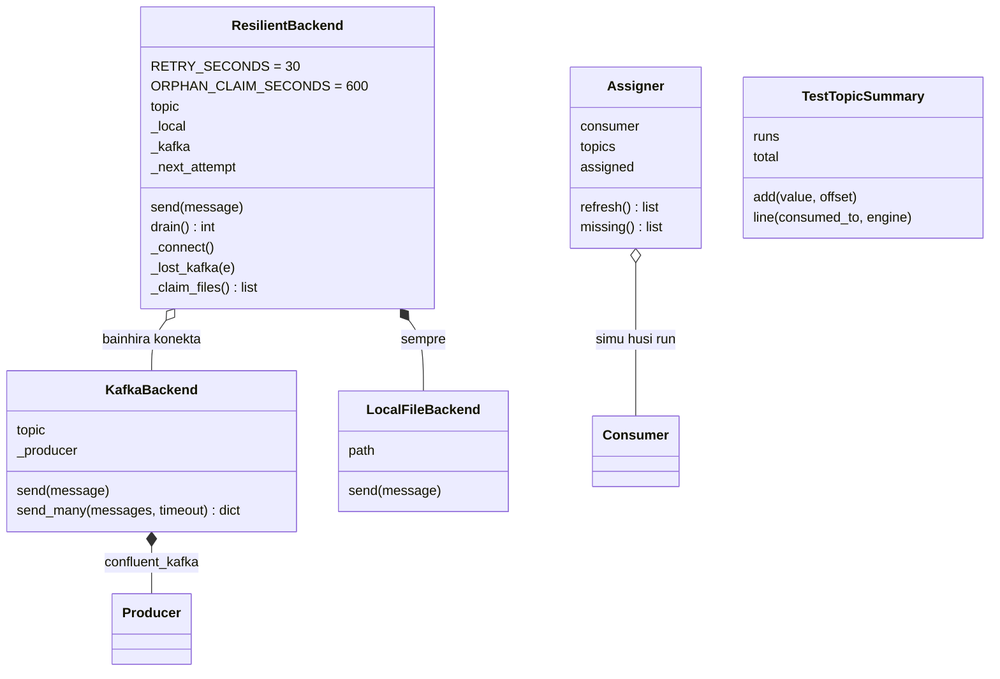

## E. Analize OOP

### E.1 Klase iha modulu Kafka

| Klase | Arkivu | Herda | `__init__` | Atributu | Métodu | Objetu harii iha |
|---|---|---|---|---|---|---|
| `KafkaBackend` | `kafka/producer.py` 51–91 | `object` | sin | `topic`, `_producer` | `send`, `send_many` | `ResilientBackend._connect`, `get_backend` |
| `LocalFileBackend` | `kafka/producer.py` 94–101 | `object` | sin | `path` | `send` | `ResilientBackend.__init__` |
| `ResilientBackend` | `kafka/producer.py` 104–217 | `object` | sin | klase: `RETRY_SECONDS`, `ORPHAN_CLAIM_SECONDS`; instánsia: `topic`, `_local`, `_kafka`, `_next_attempt` | `_connect`, `_lost_kafka`, `send`, `_claim_files`, `drain` | `get_backend` (default) |
| `NoBookmark` | `kafka/drive_watcher.py` 155–156 | `RuntimeError` | herda | — | — | `raise` iha `scan_changes` |
| `NotResubmittable` | `storage/pipeline_submit.py` 30–31 | `ValueError` | herda | — | — | `raise` iha `submit_image_for_processing` |
| `TestTopicSummary` | `kafka/monitor.py` 43–79 | `object` | sin | `runs`, `first`, `last`, `total`, `end_offset` | `add`, `line` | `monitor.run` |
| `Assigner` | `kafka/monitor.py` 95–127 | `object` | sin | `consumer`, `topics`, `from_start`, `assigned`, `first_check` | `refresh`, `missing` | `monitor.run` |

### E.2 Relasaun objetu



### E.3 Prinsípiu OOP — evidénsia

| Konseitu | Iha? | Evidénsia |
|---|---|---|
| Klase no objetu | Sin | Klase 7 iha tabela E.1 |
| `__init__` / `self` | Sin | `KafkaBackend.__init__` rai `self.topic`, `self._producer`; `ResilientBackend.__init__` harii `self._local` |
| Atributu instánsia | Sin | `_kafka`, `_next_attempt`, `assigned`... |
| **Atributu klase** | Sin | `ResilientBackend.RETRY_SECONDS = 30`, `ORPHAN_CLAIM_SECONDS = 600` (lee ho `self.RETRY_SECONDS`) |
| Herança | Sin (exception de'it) | `NoBookmark(RuntimeError)`, `NotResubmittable(ValueError)`. Herança entre backend: Not implemented in the current codebase. |
| **Polimorfizmu (duck typing)** | Sin | `KafkaBackend`, `LocalFileBackend`, `ResilientBackend` hotu iha `send(message)`; `publish_drive_file` no `submit_image_for_processing` bolu `backend.send(...)` la hatene klase. `hasattr(backend, "drain")` iha watcher. |
| Enkapsulamentu | Sin (konvensaun) | `_producer`, `_local`, `_kafka`, `_connect`, `_claim_files` — naran ho `_`; kódigu liur uza `send`/`drain` |
| Abstrasaun | Parsiál | `send(message)` subar Kafka/fila lokál/reconnect. Klase abstrata (`abc.ABC`) ka `Protocol`: Not implemented in the current codebase. |
| **Komposisaun** | Sin | `ResilientBackend` na'in `LocalFileBackend` (moris hamutuk) no `KafkaBackend` (troka bainhira lakon); `KafkaBackend` na'in `Producer`; `TestTopicSummary` na'in `Counter` |
| Agregasaun | Sin | `Assigner` kaer `Consumer` ne'ebé `run` harii no taka |
| Delegasaun | Sin | `ResilientBackend.send` → `kafka.send` ka `self._local.send` |
| Padraun Factory | Sin (funsaun) | `get_backend(topic)` hili klase tuir `KAFKA_USE_LOCAL_FALLBACK` |
| Padraun Proxy / Fallback | Sin (prinsípiu) | `ResilientBackend` iha interface hanesan `KafkaBackend` no hili destinu |
| Padraun Callback | Sin | `_callback(index)` → `_on_delivery` haruka ba `Producer.produce` |
| Padraun Retry / Circuit breaker simples | Sin (prinsípiu) | `_next_attempt` + `RETRY_SECONDS`: la koko konekta kada `send` bainhira Kafka mate |
| Dependency injection | Sin (prinsípiu) | Parámetru `backend=None` iha `publish_drive_file`, `submit_image_for_processing`, `scan_once` |

**Nota aprendizajen Python — klase baze abstrata ba backend (Teoria, la'ós implementasaun):**

```python
from abc import ABC, abstractmethod
class Backend(ABC):
    @abstractmethod
    def send(self, message: dict): ...
class KafkaBackend(Backend): ...
```

Ho ida ne'e, Python sei obriga kada backend implementa `send`. Kódigu atuál uza duck typing: la iha obrigasaun formál, maibé klase tolu iha `send` ho asinatura hanesan.

## F. Integrasaun

| Husi | Ba | Saida | Oinsá |
|---|---|---|---|
| Google Drive (Modulu 03) | `drive_watcher` | metadata arkivu (`id`, `owners`, `appProperties`, `createdTime`, `sha256Checksum`) | `drive_client.list_changes`, `list_files_in_folders` |
| `drive_watcher` | Kafka | eventu `drive_upload` (JSON UTF-8) | `ResilientBackend.send` |
| Dashboard / `requeue_stuck` (Modulu 06) | Kafka | eventu `submit` | `submit_image_for_processing` |
| `pipeline_submit` | PostgreSQL (Modulu 04) | status `INGESTED`/`FAILED`, `ingested_at`, `error_message` | ORM commit |
| Kafka | Spark (Modulu 01) | koluna `value` | `readStream.format("kafka")` + `from_json(EVENT_SCHEMA)` |
| Kafka | monitor | `value`, `partition`, `offset` | `Consumer.poll` + `json.loads` |
| Modu processing (Modulu 03) | `drive_watcher` | AUTOMATIC / MANUAL | `get_processing_mode()` |

**Kontratu dadus (data contract)** entre produtór no Spark: naran chave iha `build_drive_event`/`build_upload_event` = naran `StructField` iha `EVENT_SCHEMA`; valór hotu testu ka `null`.

## G. Tratamentu Erru no Konfiabilidade

| Situasaun | Resposta kódigu | Fatin |
|---|---|---|
| Broker mate bainhira hahú | `list_topics(timeout=3)` falla → `ResilientBackend` uza fila lokál, koko fali kada 30 s | `KafkaBackend.__init__`, `_connect` |
| Broker mate durante `send` | `_lost_kafka` → fila lokál | `ResilientBackend.send` |
| Mensajen la ack | Callback erru ka timeout → `failed` → `KafkaException` | `send_many`, `send` |
| Buffer produtór nakonu | `BufferError` → `poll(0.5)` → koko fali | `send_many` liña 84–85 |
| Kafka fila moris | `drain` haruka fila uluk (orden mantein) | `send` liña 140, watcher liña 228–229 |
| Kafka mate iha klaran `drain` | Eventu la haruka fila fali ba fila lokál | `drain` liña 200–212 |
| Liña JSON aat iha fila | Muda ba `<topic>.corrupt` | `drain` liña 190–194 |
| Prosesu rua drain hamutuk | Troka naran = lock; órfaun > 600 s kaer fali | `_claim_files` |
| Prosesu rua hakerek fila hamutuk | Lock thread + lock OS | `_append` |
| Arkivu Drive aat ida | `_publish_safely` kaer; scan kontinua | watcher |
| Rede monu | `except Exception` → print → kontinua | watcher `main` liña 249–250 |
| Bookmark lakon (reset) | `NoBookmark` → publika fali hotu | watcher liña 245–248 |
| Eventu publika dala rua | `_PUBLISHED` iha prosesu; Spark `register_upload` "duplicate" + `replay_state` | watcher, Modulu 01 |
| Publika `submit` falla | Liña `FAILED` ho "Kafka publish failed: ..." + re-raise | `submit_image_for_processing` |
| Monitor lee mensajen aat | "unreadable message (N bytes)" | `describe` |

**Limitasaun:**

- Spark **la lee** fila lokál (komentáriu `producer.py` liña 128): se Kafka mate no watcher mós mate, eventu hela iha arkivu to'o watcher/dashboard halai `drain`.
- La iha **key** mensajen no partition la konfigura (Inferidu: 1) — orden global depende ba partition ida.
- Seguransa Kafka (TLS, SASL, ACL): Not implemented in the current codebase — protesaun mak port localhost de'it (`docker-compose.yml` liña 24–31).
- Idempotent producer (`enable.idempotence`): Not implemented in the current codebase — duplikadu trata iha Spark.
- Schema Registry / Avro: Not implemented in the current codebase — JSON simples.
- Replikasaun: nó ida, `REPLICATION_FACTOR 1`.

## H. Sumáriu no Pergunta Akadémiku

### H.1 Sumáriu

Kafka mak "korreiu" entre Google Drive no Spark. Produtór rua (`drive_watcher` → `drive_upload`; `pipeline_submit` → `submit`) harii dict, **serializa** ho `json.dumps(...).encode("utf-8")`, no haruka ho `confluent_kafka.Producer.produce` + `flush` + callback ack. `ResilientBackend` rai eventu iha `local_queue/*.jsonl` bainhira broker mate no haruka fali ho orden (`drain`, lock troka naran, `.corrupt`). Spark **deserializa** ho `from_json(EVENT_SCHEMA)`; monitor ho `json.loads`. Broker mak Kafka 3.7.0 KRaft iha Docker, port localhost. Offset Spark iha checkpoint; monitor só-lee ho assign direta no `enable.auto.commit=False`.

### H.2 Pergunta no resposta

**P1. Formatu serializasaun saida, no iha ne'ebé deserializa?**
R: JSON UTF-8. Serializa iha `KafkaBackend.send_many` liña 79; deserializa iha Spark `from_json(col("value").cast("string"), EVENT_SCHEMA)` no iha `monitor.describe` (`json.loads`), no iha `_parse_lines` ba fila lokál.

**P2. Oinsá produtór hatene katak mensajen to'o broker?**
R: Callback `_on_delivery` (closure husi `_callback(index)`) rai ack iha `acked` ka erru iha `failed`; `flush(timeout)` hein; mensajen la iha resposta → "not acknowledged within Ns" → `send` hamosu `KafkaException`.

**P3. Partition hira topic iha, no tanba sá?**
R: Kódigu la konfigura partition no la harii topic esplísitu (Not implemented in the current codebase). Inferidu: topic harii automátiku ho default broker (1). Mensajen la iha key.

**P4. Spark uza consumer group?**
R: Spark Structured Streaming la commit offset ba consumer group Kafka; nia rai offset iha checkpoint (`CHECKPOINT_DIR`, Modulu 01). Monitor iha `group.id` maibé la commit no uza `incremental_assign`.

**P5. Saida mak akontese ba eventu bainhira Docker Kafka mate?**
R: `ResilientBackend.send` → `_connect` fó `None` → `LocalFileBackend.send` → liña iha `storage/local_queue/maize-disease-images.jsonl`. Bainhira Kafka moris, watcher `main` (liña 228–229) ka `send` tuirmai halai `drain`.

**P6. Oinsá prosesu rua la haruka fila hanesan dala rua?**
R: `_claim_files` troka naran arkivu ba `.draining-<uuid>` ho `os.replace` — ida de'it susesu. Seluk hetan `OSError` no salta.

**P7. Tanba sá `submit_image_for_processing` commit `INGESTED` molok publika?**
R: Atu Spark nia rezultadu `COMPLETED` labele troka husi commit tarde (komentáriu liña 45).

**P8. Modu MANUAL afeta Kafka oinsá?**
R: `publish_drive_file` fó `"held"` no la bolu `backend.send` — Kafka la simu buat ida to'o admin klik "Process" (eventu `submit`).

**P9. Diferensa payload `drive_upload` no `submit`?**
R: `drive_upload` kampu 18 ho `user_id = null` no metadata Drive (`owner_email`, `content_hash`...); `submit` kampu 8 ho `user_id` iha. Spark obriga `owner_email` ba `drive_upload` no `user_id` ba seluk.

**P10. Iha ne'ebé atributu klase aparese, no diferensa ho atributu instánsia?**
R: `ResilientBackend.RETRY_SECONDS = 30` no `ORPHAN_CLAIM_SECONDS = 600` — objetu hotu partilla. `_kafka`, `_next_attempt` mak atributu instánsia — kada objetu iha rasik.
