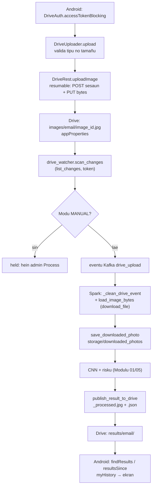
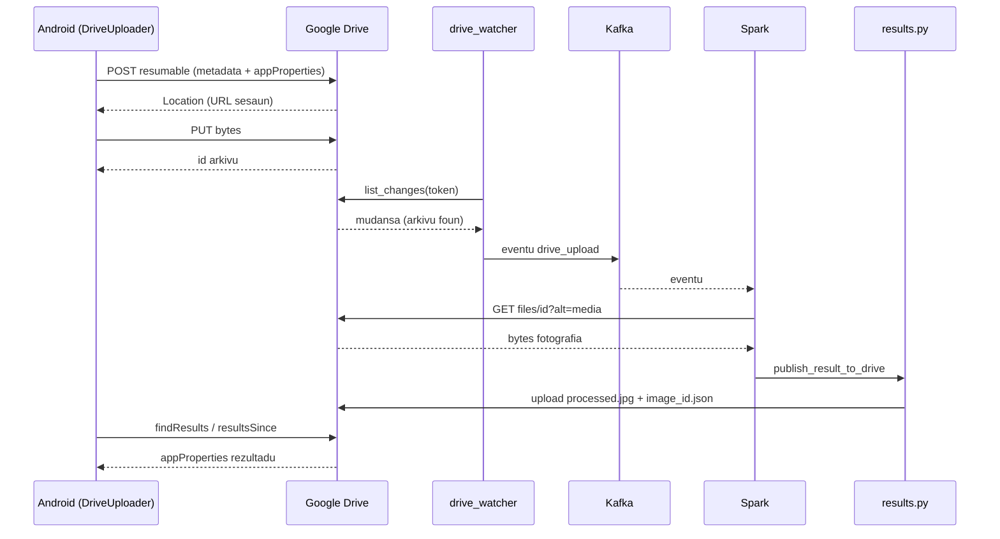

# 03 — Modulu Integrasaun Google Drive

*Sistema Crop Disease Early Warning System (EWS) — dokumentasaun téknika ba integrasaun Google Drive (laptop Python + aplikasaun Android Kotlin), ba estudante ne'ebé foin hahú programasaun. Fonte úniku: kódigu iha repozitóriu (branch `main`, commit `302818f`). Kódigu hotu kópia automátiku ho númeru liña. Token OAuth, client secret no password **la hatudu** iha dokumentu ne'e.*

{{coverage config/settings.py 141-166}}
{{coverage scripts/drive_authorize.py 1-66}}
{{coverage scripts/drive_share_user.py 1-33}}
{{coverage storage/drive_client.py 1-458}}
{{coverage storage/image_storage.py 1-109}}
{{coverage kafka/drive_watcher.py 1-256}}
{{coverage storage/processing_mode.py 1-38}}
{{coverage storage/drive_inventory.py 1-60}}
{{coverage storage/farmers.py 1-37}}
{{coverage spark/preprocessing.py 90-116 201-208}}
{{coverage spark/streaming_job.py 130-150}}
{{coverage storage/results.py 129-270}}
{{coverage storage/reset.py 99-153 227-234}}
{{coverage android_app/app/src/main/java/com/cropdisease/app/DriveAuth.kt 1-46}}
{{coverage android_app/app/src/main/java/com/cropdisease/app/DriveUploader.kt 1-121}}
{{coverage android_app/app/src/main/java/com/cropdisease/app/DriveRest.kt 1-346}}

> **Oinsá lee.** Bloku kódigu kada ida tuir pasu 9: (1) Kódigu orijinál, (2) Objetivu, (3) Fundamentu Python (ba Kotlin: fundamentu Kotlin), (4) Esplikasaun liña-ba-liña, (5) Walkthrough ezekusaun, (6) Tipu dadus, (7) Ligasaun OOP, (8) Impaktu integrasaun, (9) Checkpoint ba principiante. Etiketa: *Implementadu*, *Inferidu*, *Teoria*, *Ezemplu ilustrativu*.
>
> **Kódigu partilla.** `kafka/drive_watcher.py`, `spark/preprocessing.py` 90–116 no 201–208, no `spark/streaming_job.py` 130–150 mós esplika iha Modulu 01/02. Iha ne'e ita esplika fali husi **lado Google Drive** atu dokumentu ne'e bele lee mesak.

## A. Introdusaun no Objetivu

### A.1 Papél Google Drive iha sistema

Google Drive mak **fatin troka dadus** entre agrikultór (telemóvel Android) no laptop (Spark + CNN). Telemóvel no laptop la ko'alia direta; sira ko'alia liuhusi pasta Drive.

| Pasta (iha konta sentrál) | Na'in / asesu | Saida mak iha |
|---|---|---|
| `CropDiseaseEWS/images/<email>/` | Konta sentrál; partilla ho agrikultór ho papél **writer** | Fotografia `<image_id>.jpg` ne'ebé Android upload, ho `appProperties` (`image_id`, `location`, `gps_lat`...) |
| `CropDiseaseEWS/results/<email>/` | Konta sentrál; partilla ho agrikultór ho papél **reader** | `<image_id>.json` (rezultadu), `<image_id>_processed.jpg` (imajen ho heatmap), `_reset_marker.json` |

### A.2 Problema ne'ebé modulu ne'e rezolve

- **Agrikultór la iha server publiku.** Laptop la presiza IP publiku: telemóvel no laptop uza Google Drive.
- **Seguransa.** Kada agrikultór haree de'it nia pasta rasik (partilla ho email ida de'it). Telemóvel la rai password — Google fó *access token* badak.
- **Rede la estável (Timor-Leste).** Laptop koko fali chamada Drive (backoff ba 429/5xx, network retry); Android koko fali to'o dala 4 no buka fotografia molok upload fali (la iha duplikadu).
- **Rezultadu fila ba agrikultór.** Spark hakerek JSON + imajen ba `/results/<email>/`; Android lee sira.

### A.3 Fundamentu Python no Kotlin (foun iha modulu ne'e)

Modulu 01–02 hanorin ona variavel, dict, funsaun, klase, `self`, `__init__`, exception, herança, `with`, thread, JSON, atributu klase, duck typing. **Lembra:** klase = molde; objetu = buat harii husi molde; `raise` = hamosu erru; `try/except` = kaer erru. Konseitu **foun**:

**Python**

1. **`global`** — iha funsaun nia laran, `global _session` husu Python atu muda variavel nível modulu (la'ós harii variavel lokál).
2. **`super().__init__(message)`** — bolu konstrutór klase inan husi sub-klase.
3. **`Optional[int]`** (`typing`) — "int ka None".
4. **`lambda`** — funsaun badak la ho naran: `lambda attempt: _upload_once(...)`.
5. **`getattr(obj, "naran")`** — foti atributu/métodu ho naran iha string: `getattr(session, "get")` = `session.get`.
6. **`kwargs.setdefault("timeout", x)`** — tau valór se chave seidauk iha.
7. **`2 ** n`** — potênsia (2, 4, 8...). Backoff eksponensiál: hein dala rua liu kada koko.
8. **HTTP (Teoria).** Cliente haruka *request* (método `GET`/`POST`/`PATCH`) ba URL; server fó *response* ho kódigu status: 2xx = di'ak, 400 = pedidu aat, 401 = presiza login, 403 = la iha permisaun (ka rate limit), 404 = la iha, 429 = haruka barak liu, 5xx = erru server.
9. **OAuth 2.0 (Teoria).** Utilizadór husu Google fó **access token** (validu ~1 oras) no **refresh token** (atu hetan access token foun). Aplikasaun haruka `Authorization: Bearer <token>`. *Scope* = permisaun saida (`https://www.googleapis.com/auth/drive` = Drive tomak).
10. **`multipart/related`** — body HTTP ho parte rua (metadata JSON + bytes arkivu) fahe ho *boundary*.
11. **`raise ... from e`** — hamosu erru foun no rai erru orijinál hanesan kauza.
12. **Enum ho `str`**: `class ProcessingMode(str, enum.Enum)` — membru enum mós string (bele kompara ho `"MANUAL"` no serializa JSON).

**Kotlin (aplikasaun Android)**

| Kotlin | Signifika | Hanesan iha Python |
|---|---|---|
| `package com.cropdisease.app` | naran pakote | pasta pakote |
| `import a.b.C` | foti klase | `from a.b import C` |
| `object DriveAuth { ... }` | **singleton**: objetu ida de'it, harii automátiku | modulu Python ho funsaun |
| `fun f(x: Int): String` | funsaun ho tipu parámetru no return | `def f(x: int) -> str:` |
| `val x = 1` / `var y = 2` | `val` la bele muda; `var` bele muda | variavel |
| `const val A = "x"` | konstante tempu kompilasaun | `A = "x"` |
| `String?` | tipu ne'ebé bele `null` | `Optional[str]` |
| `a?.b` | se `a` null, rezultadu null (la erru) | `a.b if a is not None else None` |
| `a ?: b` | "Elvis": se `a` null, uza `b` | `a if a is not None else b` |
| `a!!` | obriga la null (erru se null) | — |
| `"Valór $x ${y.z}"` | string template | f-string |
| `data class Me(val email: String)` | klase dadus (`equals`, `toString` automátiku) | `@dataclass` |
| `sealed class Outcome` | klase ho sub-klase fixu (lista taka) | hierarkia klase |
| `when { kond -> ... }` | hanesan `if/elif` | `if/elif/else` |
| `x.use { ... }` | taka rekursu automátiku | `with` |
| `x.let { ... }` | halai bloku ho `it = x` (dalaruma ho `?.`) | — |
| `try { } catch (e: Exception) { }` | kaer erru | `try/except` |
| `for (i in 0 until n)` | 0..n-1 | `for i in range(n)` |
| `1L shl n` | shift bit (2ⁿ) | `1 << n` |
| `mutableMapOf("a" to 1)` | dict muda | `{"a": 1}` |

## B. Arkivu Fonte Loloos

| Arkivu | Liña | Klase / funsaun prinsipál | Serbisu |
|---|---|---|---|
| `config/settings.py` | 141–166 | `GOOGLE_DRIVE_*`, `_drive_folder_id` | Fatin token, client secret, ID pasta |
| `scripts/drive_authorize.py` | 66 | `main` | OAuth dala ida iha laptop; harii pasta `images`/`results` |
| `scripts/drive_share_user.py` | 33 | `main` | Harii no partilla pasta agrikultór |
| `storage/drive_client.py` | 458 | `DriveError`, `DriveNotConfigured`, `_authed_session`, `_request`, `_with_network_retry`, `get_file_metadata`, `download_file`, `upload_bytes`, `upload_json`, `list_changes`, `list_files_in_folders`, `user_folder_id`, `register_farmer`, `share_with`, `ensure_folder` | Modulu **úniku** ne'ebé ko'alia ho API Drive (REST v3) |
| `storage/image_storage.py` | 109 | `is_drive_path`, `to_drive_path`, `load_image_bytes`, `downloaded_photo_path`, `store_downloaded_photo` | Dalan `gdrive:<id>`, download, kópia lokál |
| `kafka/drive_watcher.py` | 256 | `scan_changes`, `scan_once`, `publish_drive_file`, `main` | Deteta upload foun iha Drive |
| `storage/processing_mode.py` | 38 | `ProcessingMode`, `get_processing_mode`, `set_processing_mode` | AUTOMATIC / MANUAL iha arkivu JSON |
| `storage/drive_inventory.py` | 60 | `farmer_photos`, `unprocessed_photos`, `send_for_processing` | Fotografia iha Drive ne'ebé seidauk iha base de dadus |
| `storage/farmers.py` | 37 | `get_or_create_farmer` | Konta agrikultór husi email na'in Drive |
| `spark/preprocessing.py` | 90–116, 201–208 | `_clean_drive_event`, `_registered_from_drive`, `save_downloaded_photo` | Kontrola arkivu Drive; rai kópia download |
| `spark/streaming_job.py` | 130–150 | parte `process_event` | Download Drive iha paralelu |
| `storage/results.py` | 129–270 | `publish_result_to_drive`, `_ResultFolderIndex`, `publish_result_to_drive_safely` | Hakerek rezultadu ba `/results/<email>/` |
| `storage/reset.py` | 99–153, 227–234 | `clear_drive_files`, `write_reset_markers`, `_clear_watcher_bookmark` | Factory reset Drive |
| `DriveAuth.kt` | 46 | `object DriveAuth` | Token OAuth iha telemóvel |
| `DriveUploader.kt` | 121 | `object DriveUploader`, `sealed class Outcome` | Upload fotografia ida ho retry |
| `DriveRest.kt` | 346 | `object DriveRest` | Chamada REST Drive husi Android |

**Dependénsia:** Python — `google-auth`, `google-auth-oauthlib` (`InstalledAppFlow`), `requests` (via `AuthorizedSession`). Android — Google Identity Services (`AuthorizationClient`), OkHttp, `org.json`.

## C. Arkitetura no Fluxu Ezekusaun

### C.1 Input, prosesu, output

| Fase | Input | Prosesu | Output |
|---|---|---|---|
| Setup (dala ida) | client secret JSON | `drive_authorize.py` → OAuth browser | token iha `GOOGLE_DRIVE_TOKEN_FILE`; ID pasta iha `google_drive_folders.json` |
| Rejistu agrikultór | email | `drive_share_user.py` → `register_farmer` | pasta `images/<email>` (writer) + `results/<email>` (reader) |
| Upload | fotografia telemóvel | `DriveUploader.upload` → `DriveRest.uploadImage` (resumable) | arkivu `<image_id>.jpg` ho `appProperties` |
| Deteta | change feed Drive | `drive_watcher.scan_changes` | eventu Kafka `drive_upload` |
| Download | `gdrive:<id>` | `load_image_bytes` → `download_file` (retry) | bytes orijinál + kópia `storage/downloaded_photos/<user>/<image>.jpg` |
| Entrega rezultadu | rezultadu BD | `publish_result_to_drive` → `upload_bytes`/`upload_json` | `<image_id>_processed.jpg`, `<image_id>.json` |
| Telemóvel lee | pasta results | `DriveRest.findResults`, `resultsSince`, `myHistory` | istória iha app |

### C.2 Diagrama fluxu

### C.3 Trasu konkretu: upload → detesaun → download → rezultadu

*Ezemplu ilustrativu* (ID, email no valór); funsaun no regra loloos.

1. Agrikultór hili fotografia; app harii `image_id = "a1b2c3d4-0000-4000-8000-000000000001"`.
2. `DriveUploader.upload`: tipu `image/jpeg`, 2.4 MB (< 15 MB); `properties = {"image_id": "a1b2...", "original_filename": "IMG_20261020.jpg", "location": "Aileu Vila", "gps_lat": "-8.728100", "gps_lon": "125.566400", "gps_acc_m": "12"}`.
3. `DriveAuth.accessTokenBlocking` → token. `DriveRest.uploadImage` → `POST .../upload/drive/v3/files?uploadType=resumable` → header `Location` (URL sesaun) → `PUT` bytes → `{"id": "1AbCdEf"}` → `Outcome.Uploaded("1AbCdEf")`.
4. Laptop: `drive_watcher.scan_changes` → `list_changes(token)` fó mudansa ho arkivu `1AbCdEf` iha pasta agrikultór → `publish_drive_file` → Kafka.
5. Spark: `_clean_drive_event` → `drive_file_id = "1AbCdEf"`; rejista ona → la husu Drive fali. `_DOWNLOADS.submit(load_image_bytes, "gdrive:1AbCdEf")` → `download_file("1AbCdEf")` → `GET .../files/1AbCdEf?alt=media` → bytes.
6. `save_downloaded_photo("u-9", "a1b2...", bytes)` → `storage/downloaded_photos/u-9/a1b2....jpg`.
7. CNN → `blight`, risku `HIGH` → `persist_result`.
8. `publish_result_to_drive` → `user_folder_id("agrikultor@example.com", "user_results")` → `upload_bytes("a1b2..._processed.jpg", ...)` → `upload_json("a1b2....json", payload, ..., summary)` → `images.result_published_at = agora`.
9. Android: `findResults(... ["a1b2..."])` → `{"a1b2...": "1XyZ..."}` → `myHistory` → item `outcome = "diseased"`, `prediction.predicted_class = "blight"`.

### C.4 Diagrama sekuénsia

