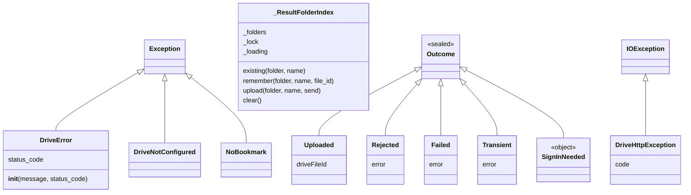

## E. Analize OOP

### E.1 Klase / objetu iha integrasaun Drive

| Klase / objetu | Arkivu | Tipu | Herda | Atributu / membru | Métodu |
|---|---|---|---|---|---|
| `DriveNotConfigured` | `storage/drive_client.py` 33 | klase exception | `Exception` | — | — |
| `DriveError` | `storage/drive_client.py` 37 | klase exception | `Exception` | `status_code` (instánsia) | `__init__` (bolu `super().__init__`) |
| `ProcessingMode` | `storage/processing_mode.py` 16 | enum | `str`, `enum.Enum` | `AUTOMATIC`, `MANUAL` | — |
| `NoBookmark` | `kafka/drive_watcher.py` 155 | klase exception | `RuntimeError` | — | — |
| `_ResultFolderIndex` | `storage/results.py` 219 | klase | `object` | `_folders`, `_lock`, `_loading` | `_index`, `existing`, `remember`, `upload`, `clear` |
| `_RESULT_FILES` | `storage/results.py` 260 | objetu (instánsia) | — | — | — |
| `_session` | `storage/drive_client.py` 81 | objetu `AuthorizedSession` | — | — | — |
| `DriveAuth` | `DriveAuth.kt` 24 | `object` (singleton) | — | `DRIVE_SCOPE` | `authorizationRequest`, `accessTokenBlocking` |
| `DriveUploader` | `DriveUploader.kt` 25 | `object` | — | `MAX_PHOTO_BYTES`, `ATTEMPTS`, `RETRY_BASE_DELAY_MS` | `upload`, `readPhotoBytes` |
| `Outcome` + 5 sub-klase | `DriveUploader.kt` 33–43 | `sealed class` | `Outcome` | `driveFileId` / `error` | — |
| `DriveRest` | `DriveRest.kt` 32 | `object` | — | URL, `JSON`, `FOLDER_MIME`, `RESET_MARKER_NAME` | `myFolders`, `uploadImage`, `findImage`, `findResults`, `resetMarker`, `myHistory`, `resultsSince`... |
| `DriveHttpException` | `DriveRest.kt` 38 | klase | `IOException` | `code` | — |
| `Me`, `Folders` | `DriveRest.kt` 40, 43 | `data class` | — | `email`, `displayName` / `imagesId`, `resultsId` | — |

### E.2 Diagrama klase

### E.3 Prinsípiu OOP — evidénsia

| Konseitu | Iha? | Evidénsia |
|---|---|---|
| Klase no objetu | Sin | `_ResultFolderIndex` → objetu `_RESULT_FILES`; Kotlin `data class Folders(...)` harii iha `myFolders` |
| `__init__` / konstrutór | Sin | `_ResultFolderIndex.__init__`; `DriveError.__init__`; konstrutór primáriu Kotlin `class DriveHttpException(val code: Int, ...)` |
| `super()` | Sin | `DriveError.__init__` → `super().__init__(message)`; Kotlin `: IOException(message)` |
| Herança | Sin | Exception Python 3; `ProcessingMode(str, Enum)` (herança múltipla); `Outcome` sealed ho sub-klase 5; `DriveHttpException : IOException` |
| Polimorfizmu | Sin | `except (DriveError, DriveNotConfigured)`; `when (outcome)` ba sub-klase `Outcome`; `getattr(session, method.lower())` |
| Enkapsulamentu | Sin | Python: `_folders`, `_lock`, `_session`, `_request` (konvensaun). Kotlin: `private` (`authed`, `execute`, `getJson`, `listFiles`, `historyItem`) — formál |
| Abstrasaun | Sin | `drive_client` subar HTTP/OAuth/retry atrás funsaun simples (`download_file`, `upload_json`); `Outcome` (tipu abstratu ba rezultadu upload) |
| Komposisaun | Sin | `_ResultFolderIndex` na'in `dict` + `Lock`; `_session` kaer `Credentials` |
| Singleton | Sin | Kotlin `object` (`DriveAuth`, `DriveUploader`, `DriveRest`); Python `_session` (lazy), `_RESULT_FILES` |
| Builder | Uza husi biblioteka | `AuthorizationRequest.builder()`, `Request.Builder()`, `HttpUrl.newBuilder()` |
| Retry / backoff | Sin (prinsípiu) | `_request`, `_with_network_retry`, `DriveUploader.upload` |
| Upsert idempotent | Sin (prinsípiu) | `upload_bytes` (buka → PATCH ka POST), `_ResultFolderIndex`, `findImage` molok upload fali |
| Double-checked locking | Sin | `user_folder_id`, `_ResultFolderIndex._index` |
| Klase abstrata formál | Not implemented in the current codebase. | La iha `abc.ABC` iha Python; Kotlin `sealed class Outcome` mak klase abstrata implísitu (labele harii direta) |
| Interface | Not implemented in the current codebase. | La iha `interface` Kotlin ka `Protocol` Python iha arkivu sira ne'e |
| Klase cliente Drive (Python) | Not implemented in the current codebase. | `drive_client` mak modulu ho funsaun + estadu modulu, la'ós klase |

**Nota aprendizajen Python — klase cliente (Teoria):** alternativa ba modulu `drive_client` mak `class DriveClient: def __init__(self, token_file): self._session = ...; def download_file(self, file_id): ...`. Ida ne'e permite objetu barak (konta barak). Projetu uza konta sentrál ida, entaun modulu ho variavel global `_session` sufisiente.

## F. Integrasaun

| Husi | Ba | Saida | Kódigu |
|---|---|---|---|
| Android | Drive images | Fotografia orijinál + appProperties | `DriveUploader.upload` → `DriveRest.uploadImage` |
| Drive images | Watcher | Metadata arkivu foun | `list_changes`, `list_files_in_folders` |
| Watcher | Kafka (Modulu 02) | Eventu `drive_upload` | `publish_drive_file` |
| Spark (Modulu 01) | Drive | Metadata (opsionál) + bytes | `_clean_drive_event` → `get_file_metadata`; `load_image_bytes` → `download_file` |
| Spark | Disku lokál | Kópia fotografia | `save_downloaded_photo` → `store_downloaded_photo` |
| Spark → `results.py` | Drive results | `_processed.jpg` + `.json` + appProperties | `publish_result_to_drive` |
| `results.py` | PostgreSQL (Modulu 04) | `images.result_published_at` | `_update_image` |
| Drive results | Android | Rezultadu + istória | `findResults`, `resultsSince`, `myHistory` |
| Dashboard (Modulu 06) | Arkivu modu | AUTOMATIC/MANUAL | `set_processing_mode` |
| Dashboard reset | Drive + watcher | Hamoos arkivu, marker, bookmark | `clear_drive_files`, `_clear_watcher_bookmark` |
| Drive results (marker) | Android | `reset_at` | `DriveRest.resetMarker` |

**Kontratu Python ↔ Kotlin:** naran arkivu `<image_id>.jpg`, `<image_id>.json`, `<image_id>_processed.jpg`, `_reset_marker.json`; chave appProperties (`image_id`, `location`, `gps_lat`, `gps_lon`, `kind`, `status`, `predicted_class`, `risk_level`, `prediction_confidence`...); `kind` pasta (`user_images`/`user_results`); regra retry (429/5xx/403 rate limit).

## G. Tratamentu Erru no Konfiabilidade

| Situasaun | Resposta | Fatin |
|---|---|---|
| Token/pasta seidauk iha | `DriveNotConfigured` ho mensajen "run scripts/drive_authorize.py"; watcher para | `drive_client`, watcher `main` |
| HTTP ≥ 400 | `DriveError` ho `status_code` | `_check` |
| 429 / 5xx / 403 rate limit | Backoff 1, 2, 4, 8, 16 s + jitter (koko 6) | `_request` |
| Konesaun monu / timeout | Retry 2 s, 4 s (koko 3) | `_with_network_retry` |
| Timeout ba chamada hotu | `(15, 60)` s | `_REQUEST_TIMEOUT`, `_GET_TIMEOUT` |
| Upload timeout (laptop) | Koko segundu buka uluk → PATCH (la duplika) | `upload_bytes` |
| Upload timeout (Android) | `findImage` molok upload fali | `DriveUploader.upload` |
| Token telemóvel expira (401) | Token foun koko tuirmai; ikus `SignInNeeded` | `DriveUploader.upload` |
| Fotografia la válidu | `Outcome.Rejected` (la koko fali) | `DriveUploader.upload` |
| ID Drive aat / injection | Regex + escape query | `_require_valid_id`, `_escape_query_value`, Kotlin `q()` |
| Dalan kópia lokál la seguru | `_SAFE_ID_RE` → `None`/`ValueError` | `image_storage` |
| Agrikultór foun, thread barak | Lock + double-check (pasta ida) | `user_folder_id` |
| Agrikultór foun, prosesu barak | `IntegrityError` → rollback → foti | `get_or_create_farmer` |
| Rezultadu replay | `_ResultFolderIndex` → PATCH arkivu hanesan | `publish_result_to_drive` |
| Drive falla bainhira entrega rezultadu | Log; rezultadu iha BD; `result_published_at` la iha → `replay_state` "result_missing" / `requeue_stuck` haruka fali | `publish_result_to_drive_safely` |
| Arkivu iha lixu / etiketa sala | `InvalidEvent` → `FAILED` | `_clean_drive_event` |
| Bookmark lakon | `NoBookmark` → publika hotu fali | watcher |
| Reset: arkivu la'ós na'in | `removeParents` duke trash | `clear_drive_files` |

**Limitasaun:**

- Scope Drive tomak (`auth/drive`) iha Android no laptop — komentáriu `DriveAuth.kt` hatete aseitavel ba projetu akadémiku iha modu Testing.
- Konta sentrál ida (single point of failure; kuota Drive ida).
- Polling change feed (1–3 s), la'ós *push notification* Drive (webhook): Not implemented in the current codebase.
- Upload resumable Android haruka bytes tomak iha `PUT` ida; *resume* depois konesaun monu (kontinua husi byte X): Not implemented in the current codebase — retry halo upload foun (depois `findImage`).
- Enkriptasaun adisionál ba fotografia iha Drive: Not implemented in the current codebase.

## H. Sumáriu no Pergunta Akadémiku

### H.1 Sumáriu

Google Drive mak "kaixa korreiu" entre agrikultór no laptop. Setup: `drive_authorize.py` (OAuth installed-app, token offline) + `drive_share_user.py` (pasta privadu images=writer, results=reader). Android: `DriveAuth` (token agrikultór), `DriveUploader` (valida, appProperties, retry 4, `findImage` anti-duplikadu), `DriveRest` (upload resumable, rezultadu, istória, reset marker). Laptop: `drive_client` (modulu úniku API Drive: sesaun OAuth ida, backoff, network retry, upsert, change feed, pasta agrikultór ho lock), watcher (change feed → Kafka), Spark (download + kópia lokál), `results.py` (JSON + imajen + appProperties sumáriu, `_ResultFolderIndex`), `reset.py` (hamoos + marker + bookmark).

### H.2 Pergunta no resposta

**P1. Oinsá laptop autentika ba Google Drive?**
R: OAuth 2.0 "installed app" (`InstalledAppFlow`, `access_type="offline"`, `prompt="consent"`) dala ida; token (access + refresh) rai iha `GOOGLE_DRIVE_TOKEN_FILE`. `_authed_session` lee token ho `Credentials.from_authorized_user_file` no harii `AuthorizedSession` ida ne'ebé refresh automátiku.

**P2. Telemóvel rai password ka token konta sentrál?**
R: Lae. `DriveAuth.accessTokenBlocking` husu Google Identity Services token badak ba konta agrikultór rasik. Pasta konta sentrál bele asesu tanba admin partilla (`register_farmer`).

**P3. Oinsá sistema evita fotografia ka rezultadu duplikadu iha Drive?**
R: Android: `findImage` molok upload fali. Laptop: `upload_bytes` koko segundu buka uluk; `_ResultFolderIndex` rai `naran → id` atu PATCH arkivu hanesan; `ensure_folder` buka molok harii; lock `user_folder_id` ba pasta.

**P4. Diferensa `_request` no `_with_network_retry`?**
R: `_request` koko fali bainhira Google **responde** 429/5xx/403-rate-limit (backoff eksponensiál, koko 6). `_with_network_retry` koko fali bainhira **la iha resposta** (konesaun monu, timeout; 2 s, 4 s, koko 3).

**P5. Saida mak `appProperties` no tanba sá importante?**
R: Pár chave-valór ki'ik (≤ 124 bytes) iha arkivu Drive. Android tau `image_id`, `location`, GPS iha fotografia; watcher lee sira atu harii eventu; Spark kontrola `image_id`; `results.py` tau sumáriu rezultadu atu Android lista hotu ho pedidu ida.

**P6. Oinsá watcher hatene fotografia foun ho lalais no barata?**
R: Change feed (`list_changes(token)`) — pedidu ida kada 1–3 s ba agrikultór hotu; bookmark rai iha `drive_watcher_state.json`. Scan tomak kada 600 s hanesan rede seguransa.

**P7. Saida mak akontese se Drive falla bainhira Spark hakerek rezultadu?**
R: `publish_result_to_drive_safely` log erru; rezultadu iha PostgreSQL ona; `result_published_at` la muda → `replay_state` fó "result_missing" (replay prosesa fali) no `_auto_resend`/`requeue_stuck` haruka fali.

**P8. Herança iha ne'ebé iha modulu ne'e?**
R: Python: `DriveError(Exception)` (ho `super().__init__` + `status_code`), `DriveNotConfigured(Exception)`, `NoBookmark(RuntimeError)`, `ProcessingMode(str, Enum)`. Kotlin: `DriveHttpException : IOException`, `sealed class Outcome` ho sub-klase 5.

**P9. Tanba sá reset hakerek `_reset_marker.json`?**
R: Telemóvel rai istória lokál. `DriveRest.resetMarker` lee `reset_at`; se foun, app hamoos istória no karrega fali husi Drive.

**P10. Tanba sá Android lee fotografia ho `setRequireOriginal`?**
R: Atu mantein tag EXIF GPS (Android hasai sira la ho permisaun `ACCESS_MEDIA_LOCATION`); Spark `extract_metadata` uza GPS EXIF.
