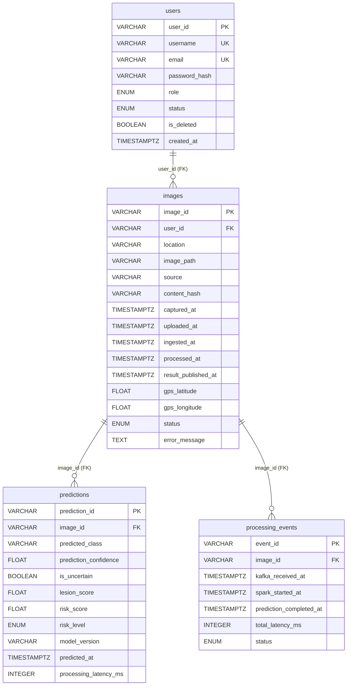
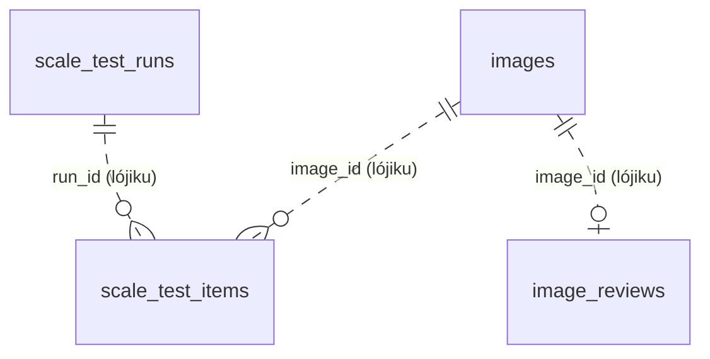
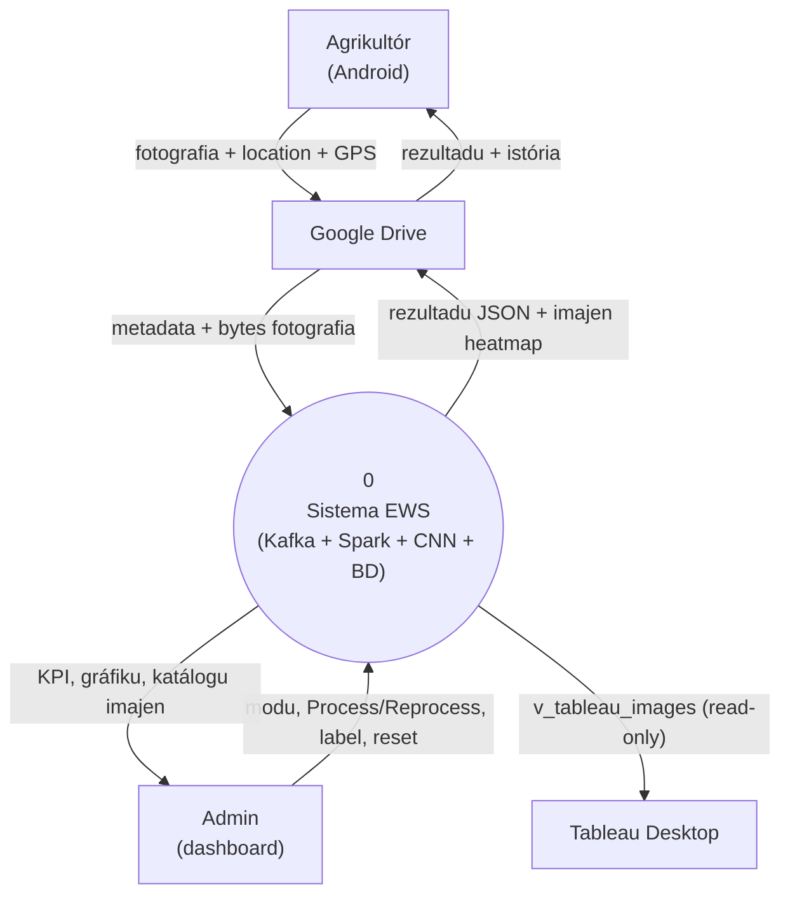
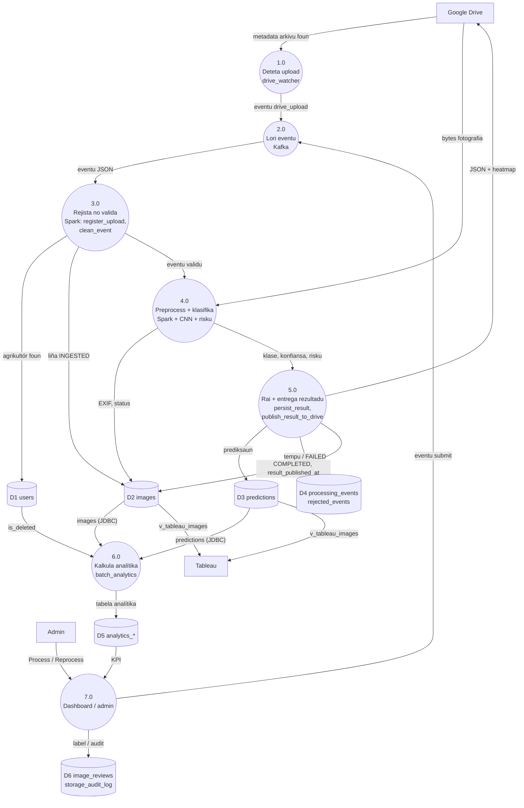

# 04 — Modulu Base de Dadus PostgreSQL, ERD no DFD

*Sistema Crop Disease Early Warning System (EWS) — dokumentasaun téknika ba base de dadus (PostgreSQL + SQLAlchemy), Entity-Relationship Diagram (ERD) no Data Flow Diagram (DFD), ba estudante ne'ebé foin hahú programasaun. Fonte úniku: kódigu iha repozitóriu (branch `main`, commit `302818f`). Password base de dadus troka ho `***`.*

{{coverage docker-compose.yml 52-75}}
{{coverage storage/database.py 1-654}}
{{coverage storage/init_db.py 1-51}}
{{coverage storage/schema.sql 1-363}}

> **Oinsá lee.** Bloku kódigu kada ida tuir pasu 9: (1) Kódigu orijinál, (2) Objetivu, (3) Fundamentu Python (ba SQL: fundamentu SQL), (4) Esplikasaun liña-ba-liña, (5) Walkthrough ezekusaun, (6) Tipu dadus, (7) Ligasaun OOP, (8) Impaktu integrasaun, (9) Checkpoint ba principiante. Etiketa: *Implementadu*, *Inferidu*, *Teoria*, *Ezemplu ilustrativu*.

## A. Introdusaun no Objetivu

### A.1 Papél base de dadus iha sistema

PostgreSQL 16 (iha Docker) mak memória permanente sistema: utilizadór, fotografia, prediksaun CNN, tempu kada pasu pipeline, eventu rejeitadu, rezultadu teste eskalabilidade, revizaun admin, auditoria armazenamentu, no tabela analítika ne'ebé Spark kalkula. Kódigu Python ko'alia ho base de dadus liuhusi **SQLAlchemy ORM** (`storage/database.py`): kada **klase** Python = **tabela**; kada **objetu** = **liña**.

| Grupu | Tabela | Na'in hakerek |
|---|---|---|
| Operasional | `users`, `images`, `predictions`, `processing_events`, `rejected_events` | Spark (`storage/uploads.py`, `storage/results.py`), dashboard, `init_db` |
| Teste eskalabilidade | `scale_test_runs`, `scale_test_items` | `scalability/` |
| Admin | `image_reviews`, `storage_audit_log` | Dashboard |
| Analítika (Spark de'it) | `analytics_summary`, `analytics_disease_distribution`, `analytics_risk_distribution`, `analytics_high_risk_by_location`, `analytics_disease_trend`, `analytics_disease_daily`, `batch_location_daily_summary` | `spark/batch_analytics.py` (JDBC) |
| Analítika teste | `analytics_scale_test_disease_by_location`, `analytics_scale_test_disease_distribution`, `analytics_scale_test_high_risk_by_location` | `spark/batch_analytics.py` |
| View | `v_tableau_images`, `v_admin_image_catalog` | `init_db()` harii fali |

Total: **tabela 19, view 2** (husi modelu ORM no `schema.sql`).

### A.2 Problema ne'ebé modulu ne'e rezolve

- **Dadus la lakon** bainhira laptop mate (volume Docker `crop_disease_pg_data`).
- **Kódigu ida ba base de dadus rua**: `DATABASE_URL` hili PostgreSQL (normál) ka SQLite (teste lokál) — kódigu seluk la muda.
- **Esquema evolui** la ho ferramenta migrasaun: `init_db()` harii tabela foun no aumenta koluna ne'ebé falta (`_add_missing_columns`).
- **BI seguru**: Tableau lee view `v_tableau_images` ho utilizadór *read-only* `tableau_reader` — nunka tabela `users` (email, hash password).
- **Imajen ida = prediksaun foun liu ida**: CTE `LATEST_PREDICTION_CTE` (`ROW_NUMBER()`) uza iha view, dashboard no Spark.

### A.3 Fundamentu Python no SQL (foun iha modulu ne'e)

Modulu 01–03 hanorin ona klase, `__init__`, herança, enum ho `str`, decorator, `with`, exception. **Lembra:** klase = molde; objetu = buat harii husi molde; herança = klase foun simu hotu husi klase inan. Konseitu **foun**:

**ORM SQLAlchemy (Python)**

1. **`Base = declarative_base()`** — klase baze; klase hotu ne'ebé herda `Base` sai tabela.
2. **`__tablename__ = "users"`** — **atributu klase** ho naran tabela.
3. **`Column(String, primary_key=True, default=new_uuid)`** — atributu klase ne'ebé deskreve koluna: tipu, chave primária, valór default (funsaun bolu bainhira liña foun).
4. **`ForeignKey("users.user_id")`** — koluna hatudu ba chave primária tabela seluk.
5. **`relationship("Image", back_populates="user")`** — atributu navegasaun objetu: `user.images` (lista) no `image.user` (objetu). Ne'e la'ós koluna.
6. **`cascade="all, delete-orphan"`** — hamoos imajen → hamoos mós nia prediksaun (iha ORM).
7. **`__table_args__ = (Index(...),)`** — índise ba buka lalais.
8. **Mixin** — klase ki'ik ne'ebé fó koluna komún: `class AnalyticsSummary(_SparkOutput, Base)` — **herança múltipla**.
9. **`create_engine(url)`** — objetu konesaun (pool). **`sessionmaker(bind=engine)`** — fábrika sesaun. **`session.get(Klase, id)`**, **`session.add(obj)`**, **`session.commit()`**.
10. **Decorator ho argumentu** — `@event.listens_for(engine, "connect")` rejista funsaun atu halai kada konesaun foun.
11. **Type hint jenériku** — `list[tuple[str, str]]`.

**SQL (Teoria)**

| SQL | Signifika |
|---|---|
| `CREATE TABLE IF NOT EXISTS t (...)` | harii tabela se seidauk iha |
| `PRIMARY KEY` | identifika liña úniku |
| `REFERENCES t(c)` / `FOREIGN KEY` | liga ba tabela seluk (integridade referensiál) |
| `UNIQUE`, `NOT NULL`, `DEFAULT`, `CHECK (...)` | regra valór |
| `CREATE INDEX` | buka lalais tuir koluna |
| `CREATE VIEW v AS SELECT ...` | "tabela virtuál" husi query |
| `WITH latest AS (...)` | CTE (sub-query ho naran) |
| `ROW_NUMBER() OVER (PARTITION BY x ORDER BY y DESC)` | númeru 1, 2, 3 kada grupu |
| `LEFT JOIN` | mantein liña hotu husi tabela karuk |
| `GRANT SELECT ON v TO r` | fó permisaun lee |
| `TIMESTAMPTZ` | tempu ho fuso |

**ERD (Teoria):** entidade (tabela), atributu (koluna), relasaun ho kardinalidade (`||--o{` = ida ba zero-ka-barak). **DFD (Teoria):** *entidade esternu* (kaixa), *prosesu* (sírkulu/kaixa ho númeru), *data store* (base de dadus/arkivu), *fluxu dadus* (seta ho naran). Kontestu (nível 0) = sistema hanesan prosesu ida; nível 1 = sistema fahe ba prosesu prinsipál.

## B. Arkivu Fonte Loloos

| Arkivu | Liña | Konteúdu |
|---|---|---|
| `docker-compose.yml` | 52–75 | Serbisu `postgres` (16), port localhost, volume, healthcheck |
| `storage/database.py` | 654 | Enum 4, modelu ORM 19, `engine`, `SessionLocal`, migrasaun koluna, `LATEST_PREDICTION_CTE`, view 2, `tableau_reader`, `init_db` |
| `storage/init_db.py` | 51 | `run()` — `init_db()` + admin dahuluk |
| `storage/schema.sql` | 363 | DDL PostgreSQL ekivalente (manuál / relatóriu) |

**Dependénsia:** `SQLAlchemy`, `psycopg2` (driver PostgreSQL ba SQLAlchemy), PostgreSQL 16, `config.settings` (`DATABASE_URL`, `LOCAL_TZ_OFFSET_HOURS`, `TABLEAU_DB_USER`, `TABLEAU_DB_PASSWORD`, `BOOTSTRAP_ADMIN_*`), `storage/auth.hash_password`.

## C. Arkitetura no Fluxu Ezekusaun

### C.1 Input, prosesu, output

| | Input | Prosesu | Output |
|---|---|---|---|
| Inisializa | `DATABASE_URL` | `init_db()`: `create_all` → `_add_missing_columns` → migrasaun → view 2 → `tableau_reader` | Tabela 19 + view 2 |
| Bootstrap admin | `BOOTSTRAP_ADMIN_*` | `init_db.run()` | Liña `users` ho `role=ADMIN` (se tabela mamuk) |
| Streaming (Modulu 01) | eventu Kafka | `register_upload`, `mark_processing`, `extract_metadata`, `persist_result` | `images`, `predictions`, `processing_events`, `rejected_events` |
| Analítika (Modulu 01) | tabela operasional (JDBC) | `batch_analytics` | tabela `analytics_*` |
| BI | view | Tableau / dashboard | relatóriu |

### C.2 ERD — relasaun ho chave estranjeira (FK)

Relasaun ne'ebé **implementa** ho `ForeignKey`/`REFERENCES`:

### C.3 Relasaun lójiku (la ho FK) no tabela mesak

Tabela sira ne'e **la iha FK** ho intensaun (komentáriu `database.py` liña 219–220 no 281–282: atu moris liu factory reset). Relasaun iha ne'e mak **lójiku** (naran koluna hanesan), la'ós FK.

| Tabela | Chave | Relasaun lójiku (la iha FK) |
|---|---|---|
| `rejected_events` | `rejected_event_id` | `image_id` bele la iha iha `images` |
| `scale_test_runs` | `run_id` | 1 → barak `scale_test_items.run_id` |
| `scale_test_items` | `image_id` | `image_id` = liña `images` teste; `source_image_id` = fotografia agrikultór orijinál |
| `image_reviews` | `image_id` | `image_id` = `images.image_id` |
| `storage_audit_log` | `audit_id` | — |
| `analytics_*` (7) | haree D | rezultadu Spark husi `images`/`predictions`/`users` |
| `analytics_scale_test_*` (3) | `run_id` + ... | rezultadu Spark husi `scale_test_items` |

### C.4 DFD — Kontestu (nível 0)

### C.5 DFD — Nível 1

### C.6 Trasu konkretu: liña sira ne'ebé fotografia ida harii

*Ezemplu ilustrativu* (valór); tabela/koluna loloos.

| Pasu | Kódigu | Tabela | Mudansa |
|---|---|---|---|
| 1 | `get_or_create_farmer` | `users` | `INSERT` (se agrikultór foun): `username=email`, `role='USER'`, `status='ACTIVE'` |
| 2 | `register_upload` | `images` | `INSERT`: `image_id='a1b2...'`, `image_path='gdrive:1AbC'`, `source='android_drive_upload'`, `status='INGESTED'`, `uploaded_at` |
| 3 | `mark_processing` | `images` | `UPDATE status='PROCESSING'` |
| 4 | `extract_metadata` | `images` | `UPDATE camera_make, gps_*, image_width...` |
| 5 | `persist_result` (COMPLETED) | `predictions` | `INSERT`: `predicted_class='blight'`, `prediction_confidence=0.97`, `risk_score=0.97`, `risk_level='HIGH'` |
| 6 | `persist_result` | `images` | `UPDATE status='COMPLETED', processed_at` |
| 7 | `persist_result` | `processing_events` | `INSERT` tempu `kafka_received_at`, `spark_started_at`... |
| 8 | `publish_result_to_drive` | `images` | `UPDATE result_published_at` |
| 9 | `batch_analytics.write_tables` | `analytics_*` | `DELETE` + `INSERT ... SELECT` husi `_staging` |

Se `image_id` la iha liña `images` (ezemplu eventu aat): `persist_result` hatama liña `rejected_events` ho `raw_event` (JSON eventu) no `reason` (`storage/results.py` liña 76–83). Replay: `persist_result` hamoos prediksaun tuan molok hatama foun (*delete-then-insert*, liña 103–104), entaun imajen ida iha prediksaun ida de'it husi streaming.
