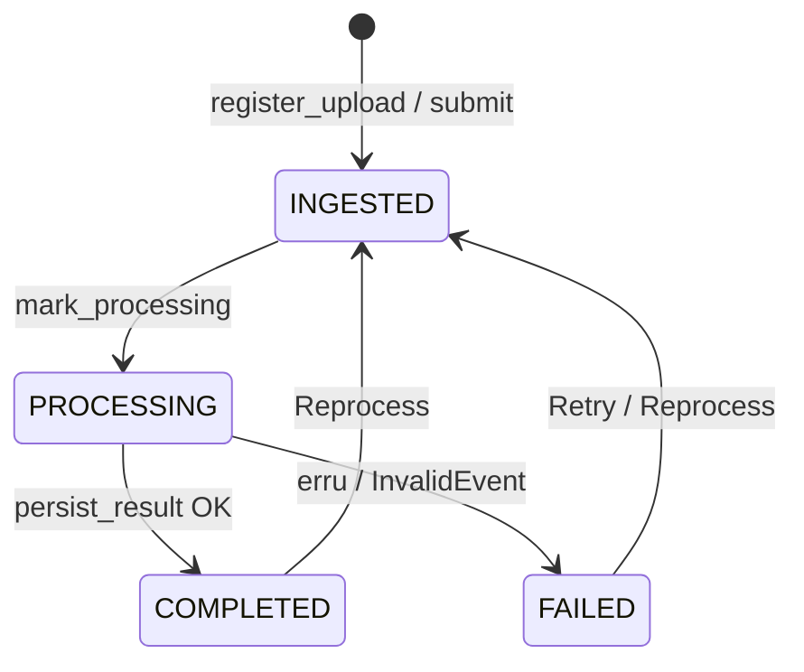

## D. Esplikasaun Kódigu-ba-Kódigu

### D.1 `docker-compose.yml` — serbisu PostgreSQL

#### D.1.1 Serbisu `postgres` no volume

**1. Kódigu orijinál**

{{code docker-compose.yml 52-75}}

**2. Objetivu**

Hahú PostgreSQL 16 iha Docker, ho utilizadór/password/base de dadus, port só iha localhost, volume atu dadus moris liu restart, no healthcheck.

**3. Fundamentu Python**

*(YAML)* `chave: valór`; lista ho `-`; indentasaun hatudu hierarkia. Password iha arkivu troka ho `***` iha dokumentu ne'e.

**4. Esplikasaun liña-ba-liña**

- **Liña 52** — `postgres:` — naran serbisu.
- **Liña 53** — `image: postgres:16`.
- **Liña 54** — `container_name: crop-disease-ews-postgres`.
- **Liña 55** — `restart: unless-stopped`.
- **Liña 56** — `environment:`.
- **Liña 57** — `POSTGRES_USER: ews_user` — utilizadór aplikasaun.
- **Liña 58** — `POSTGRES_PASSWORD: ***` — password (la hatudu).
- **Liña 59** — `POSTGRES_DB: crop_disease` — naran base de dadus.
- **Liña 60** — `ports:`.
- **Liña 61–63** — Komentáriu: liga ba localhost de'it: Spark, dashboard no Tableau Desktop hotu iha makina ne'e, entaun la iha razaun atu loke base de dadus (no nia password default) ba ema hotu iha Wi-Fi hanesan.
- **Liña 64** — `"127.0.0.1:5432:5432"`.
- **Liña 65** — `volumes:`.
- **Liña 66** — `crop_disease_pg_data:/var/lib/postgresql/data` — dadus iha volume ho naran.
- **Liña 67** — `healthcheck:`.
- **Liña 68** — `test: ["CMD-SHELL", "pg_isready -U ews_user -d crop_disease"]` — kontrola server prontu.
- **Liña 69** — `interval: 5s`.
- **Liña 70** — `timeout: 5s`.
- **Liña 71** — `retries: 10`.
- **Liña 73** — `volumes:` (nível leten) — deklara volume.
- **Liña 74** — `kafka_data:`.
- **Liña 75** — `crop_disease_pg_data:`.

**5. Walkthrough ezekusaun**

`docker compose up -d` → container `crop-disease-ews-postgres` → `pg_isready` kada 5 s to'o "healthy" → aplikasaun konekta `127.0.0.1:5432`.

**6. Tipu dadus**

YAML string/lista; port `5432`.

**7. Ligasaun OOP**

Not implemented in the current codebase. (Konfigurasaun.)

**8. Impaktu integrasaun**

`DATABASE_URL` (variavel ambiente) hatudu ba server ne'e; Spark JDBC (`jdbc:postgresql://127.0.0.1:5432/crop_disease`) no SQLAlchemy uza server hanesan.

**9. Checkpoint ba principiante**

**P:** Saida mak akontese ba dadus se ita halai `docker compose down`?
**R:** Dadus moris, tanba iha volume `crop_disease_pg_data` (hamoos de'it ho `down -v`).

### D.2 `storage/database.py` — modelu ORM

#### D.2.1 Docstring, import, `Base`, `now_utc`, `new_uuid`

**1. Kódigu orijinál**

{{code storage/database.py 1-28}}

**2. Objetivu**

Kamada base de dadus: modelu SQLAlchemy, engine no sesaun. Import tipu koluna, harii `Base` (klase inan ba modelu hotu), no funsaun default rua.

**3. Fundamentu Python**

`declarative_base()` fó **klase** (la'ós objetu). `text as sql_text` — naran seluk. Funsaun default (`now_utc`, `new_uuid`) haruka **la ho** `()` ba `Column(default=...)` atu bolu kada liña foun.

**4. Esplikasaun liña-ba-liña**

- **Liña 1–3** — Docstring: kamada base de dadus — modelu SQLAlchemy, engine no sesaun; `DATABASE_URL` hili PostgreSQL (normál) ka SQLite (teste lokál); buat seluk la muda.
- **Liña 4** — Remata docstring.
- **Liña 6** — `import enum`.
- **Liña 7** — `import uuid`.
- **Liña 8** — `from datetime import datetime, timezone`.
- **Liña 10–13** — Import SQLAlchemy: `create_engine`, `Column`, tipu (`String`, `Float`, `Integer`, `BigInteger`, `Date`, `DateTime`, `Enum`, `Text`, `Boolean`), `ForeignKey`, `Index`, `event`, `inspect`, `text` (naran `sql_text`).
- **Liña 14** — `declarative_base`, `sessionmaker`, `relationship`.
- **Liña 16–18** — `DATABASE_URL`, `LOCAL_TZ_OFFSET_HOURS`, `TABLEAU_DB_USER`, `TABLEAU_DB_PASSWORD` (segredu — valór la hatudu).
- **Liña 20** — `Base = declarative_base()`.
- **Liña 23** — `def now_utc() -> datetime:`
- **Liña 24** — `return datetime.now(timezone.utc)`.
- **Liña 27** — `def new_uuid() -> str:`
- **Liña 28** — `return str(uuid.uuid4())` — ezemplu `"9f1c2b7e-..."`.

**5. Walkthrough ezekusaun**

`new_uuid()` → `"3d6f4a2c-8b1e-4f0a-9c3d-2e7b5a1f0c9d"` (*ezemplu ilustrativu*). `now_utc()` → `datetime(..., tzinfo=UTC)`.

**6. Tipu dadus**

`Base`: klase (tipu `DeclarativeMeta`); `now_utc() -> datetime`; `new_uuid() -> str`.

**7. Ligasaun OOP**

`Base` mak **klase inan** ba modelu ORM hotu (herança). `declarative_base()` mak fábrika ne'ebé fó klase.

**8. Impaktu integrasaun**

Modulu hotu ne'ebé uza base de dadus import husi arkivu ne'e (`SessionLocal`, modelu, enum).

**9. Checkpoint ba principiante**

**P:** Tanba sá `default=new_uuid` no la'ós `default=new_uuid()`?
**R:** `new_uuid()` sei bolu **dala ida** bainhira klase define (UUID hanesan ba liña hotu). `new_uuid` (funsaun) bolu kada liña foun.

#### D.2.2 Enum `Role`, `UserStatus`, `RiskLevel`, `ProcessingStatus`

**1. Kódigu orijinál**

{{code storage/database.py 31-55}}

**2. Objetivu**

Define lista valór fixu ba papél utilizadór, status utilizadór, nivel risku, no status prosesa fotografia.

**3. Fundamentu Python**

`class X(str, enum.Enum)` — enum ne'ebé mós string (haree Modulu 03 D.6.1).

**4. Esplikasaun liña-ba-liña**

- **Liña 31** — `class Role(str, enum.Enum):`
- **Liña 32** — `USER = "USER"` — agrikultór.
- **Liña 33** — `ADMIN = "ADMIN"`.
- **Liña 36** — `class UserStatus(str, enum.Enum):`
- **Liña 37** — Komentáriu: `PENDING_VERIFICATION` só iha liña tuan (rejistu rasik hasai ona).
- **Liña 38** — `PENDING_VERIFICATION = "PENDING_VERIFICATION"`.
- **Liña 39** — `ACTIVE = "ACTIVE"`.
- **Liña 40** — `INACTIVE = "INACTIVE"`.
- **Liña 41** — `SUSPENDED = "SUSPENDED"`.
- **Liña 44** — `class RiskLevel(str, enum.Enum):`
- **Liña 45** — `LOW = "LOW"`.
- **Liña 46** — `MEDIUM = "MEDIUM"`.
- **Liña 47** — `HIGH = "HIGH"`.
- **Liña 50** — `class ProcessingStatus(str, enum.Enum):`
- **Liña 51** — Komentáriu: liña iha de'it bainhira Spark rejista fotografia.
- **Liña 52** — `INGESTED = "INGESTED"` — rejista husi Spark (ka haruka fali husi Reprocess).
- **Liña 53** — `PROCESSING = "PROCESSING"` — Spark/CNN foti.
- **Liña 54** — `COMPLETED = "COMPLETED"` — prediksaun rai.
- **Liña 55** — `FAILED = "FAILED"` — pasu ruma falla; haree `error_message`.

**5. Walkthrough ezekusaun**

Siklu moris fotografia: `INGESTED → PROCESSING → COMPLETED` ka `FAILED`; Retry: `FAILED → INGESTED` (`pipeline_submit`). `ProcessingStatus.COMPLETED.value` → `"COMPLETED"`.

**6. Tipu dadus**

Membru kada enum: tipu enum no `str`.

**7. Ligasaun OOP**

**Herança múltipla** (`str` + `Enum`). Kada membru mak **objetu singleton** (`ProcessingStatus.COMPLETED is ProcessingStatus("COMPLETED")` loos). Uza ho `Column(Enum(...))` — SQLAlchemy harii tipu ENUM iha PostgreSQL.

**8. Impaktu integrasaun**

`ProcessingStatus` uza husi Spark (`persist_result`, `mark_processing`), `pipeline_submit`, dashboard. `RiskLevel` husi `ml/risk` (`"HIGH"`...).

**9. Checkpoint ba principiante**

**P:** Tanba sá uza enum duke string livre?
**R:** Enum limita valór ba lista fixu — evita sala ortografia (ezemplu `"COMPLETE"`) no base de dadus rejeita valór la válidu.

#### D.2.3 Modelu `User`

**1. Kódigu orijinál**

{{code storage/database.py 58-86}}

**2. Objetivu**

Tabela `users`: identidade, papél, status, koluna verifikasaun Gmail (husi rejistu tuan; mantein), *soft delete*, tempu, no relasaun ba imajen.

**3. Fundamentu Python**

Atributu klase ho `Column(...)`: `unique=True`, `nullable=False`, `index=True`, `default=...`, `onupdate=now_utc` (atualiza automátiku bainhira liña muda). `relationship(..., back_populates=...)`.

**4. Esplikasaun liña-ba-liña**

- **Liña 58–60** — Komentáriu seksaun `users`.
- **Liña 61** — `class User(Base):`
- **Liña 62** — `__tablename__ = "users"`.
- **Liña 64** — `user_id = Column(String, primary_key=True, default=new_uuid)`.
- **Liña 65** — `username = Column(String, unique=True, nullable=False, index=True)` — agrikultór: email.
- **Liña 66** — `full_name = Column(String, nullable=True)`.
- **Liña 67** — `email = Column(String, unique=True, nullable=False)`.
- **Liña 68** — `password_hash = Column(String, nullable=False)` — hash de'it (nunka password).
- **Liña 69** — `role = Column(Enum(Role), nullable=False, default=Role.USER)`.
- **Liña 70** — `status = Column(Enum(UserStatus), nullable=False, default=UserStatus.ACTIVE)`.
- **Liña 72** — Komentáriu: verifikasaun Gmail (rejistu tuan; koluna mantein).
- **Liña 73** — `email_verified = Column(Boolean, nullable=False, default=False)`.
- **Liña 74** — `verification_code_hash = Column(String, nullable=True)`.
- **Liña 75** — `verification_code_expires_at = Column(DateTime(timezone=True), nullable=True)`.
- **Liña 76** — `verification_attempts = Column(Integer, nullable=False, default=0)`.
- **Liña 77** — `last_verification_sent_at = Column(DateTime(timezone=True), nullable=True)`.
- **Liña 79** — Komentáriu: soft delete.
- **Liña 80** — `is_deleted = Column(Boolean, nullable=False, default=False)`.
- **Liña 81** — `deleted_at = Column(DateTime(timezone=True), nullable=True)`.
- **Liña 83** — `created_at = Column(DateTime(timezone=True), default=now_utc, nullable=False)`.
- **Liña 84** — `updated_at = Column(..., default=now_utc, onupdate=now_utc, nullable=False)`.
- **Liña 86** — `images = relationship("Image", back_populates="user")` — `user.images` = lista imajen.

**5. Walkthrough ezekusaun**

*Ezemplu ilustrativu:* `User(username="agrikultor@example.com", email="agrikultor@example.com", password_hash="<hash>", role=Role.USER)` → `session.add` + `commit` → `user_id` = UUID foun; `status="ACTIVE"`; `created_at` = agora.

**6. Tipu dadus**

| Koluna | Python | PostgreSQL |
|---|---|---|
| `user_id`, `username`, `email`, `password_hash` | `str` | `VARCHAR` |
| `role` | `Role` | ENUM `role` |
| `status` | `UserStatus` | ENUM `userstatus` |
| `email_verified`, `is_deleted` | `bool` | `BOOLEAN` |
| `verification_attempts` | `int` | `INTEGER` |
| `*_at` | `datetime` | `TIMESTAMPTZ` |

**7. Ligasaun OOP**

- **Klase herda `Base`** → tabela.
- **Atributu klase** (`Column`) → koluna; bainhira objetu harii, SQLAlchemy halo sira hanesan **atributu instánsia** (`user.email`).
- `__init__` la hakerek: SQLAlchemy fó konstrutór automátiku ne'ebé simu argumentu ho naran koluna.
- **Relasaun objetu (agregasaun)**: `user.images` ↔ `image.user` (`back_populates`).

**8. Impaktu integrasaun**

Harii husi `farmers.get_or_create_farmer` (agrikultór) no `init_db.run` (admin). `batch_analytics` lee `user_id, is_deleted` de'it (privasidade).

**9. Checkpoint ba principiante**

**P:** Saida mak "soft delete"?
**R:** La hamoos liña; marka `is_deleted = True` no `deleted_at`. Dadus istória (imajen) mantein no admin bele restaura.

#### D.2.4 Modelu `Image`

**1. Kódigu orijinál**

{{code storage/database.py 89-140}}

**2. Objetivu**

Tabela `images`: fotografia ida = liña ida. Fatin, na'in, dalan (`gdrive:<id>`), fonte, hash, tempu kada etapa, metadata EXIF, status, erru, no relasaun ba prediksaun/eventu (cascade).

**3. Fundamentu Python**

`ForeignKey("users.user_id")`; `relationship(..., cascade="all, delete-orphan")`; `__table_args__` tuple ho `Index`.

**4. Esplikasaun liña-ba-liña**

- **Liña 89–91** — Komentáriu seksaun `images`.
- **Liña 92** — `class Image(Base):`
- **Liña 93** — `__tablename__ = "images"`.
- **Liña 95** — `image_id = Column(String, primary_key=True, default=new_uuid)` — iha prátika UUID husi Android.
- **Liña 96** — Komentáriu: naran fatin testu livre husi formuláriu (ezemplu munisípiu).
- **Liña 97** — `location = Column(String, nullable=True)`.
- **Liña 98** — `user_id = Column(String, ForeignKey("users.user_id"), nullable=False)`.
- **Liña 99** — `original_filename = Column(String, nullable=True)`.
- **Liña 100** — `image_path = Column(String, nullable=False)` — komentáriu formatu tuan `storage/images/YYYY/MM/DD/<uuid>.jpg`; foun `gdrive:<id>`.
- **Liña 101** — `source = Column(String, nullable=False, default="android_upload")` — `register_upload` hakerek `"android_drive_upload"`; teste `"scalability_test"`.
- **Liña 102** — Komentáriu: SHA-256 bytes fotografia, atu hatene fotografia hanesan haruka dala rua.
- **Liña 103** — `content_hash = Column(String, nullable=True)`.
- **Liña 105** — Komentáriu: tempu.
- **Liña 106** — `captured_at` — EXIF `DateTimeOriginal`, ka NULL.
- **Liña 107** — `captured_at_source` — `"exif"` | `"client_trusted"` | None.
- **Liña 108** — `uploaded_at` — `nullable=False`, default agora; komentáriu: server harii, nunka konfia cliente.
- **Liña 109** — `ingested_at` — tempu publika/konsume Kafka.
- **Liña 110** — `processed_at` — Spark remata.
- **Liña 111** — Komentáriu: bainhira rezultadu to'o Drive agrikultór; NULL = telemóvel seidauk iha.
- **Liña 112** — `result_published_at`.
- **Liña 114** — Komentáriu: metadata EXIF (`extract_metadata`); NULL se la iha.
- **Liña 115** — `gps_latitude = Column(Float, nullable=True)`.
- **Liña 116** — `gps_longitude`.
- **Liña 117** — `gps_altitude_m`.
- **Liña 118** — Komentáriu: `"exif"` (GPS fotografia, preferidu) ka `"device"` (posisaun telemóvel).
- **Liña 119** — `gps_source`.
- **Liña 120** — `camera_make`.
- **Liña 121** — `camera_model`.
- **Liña 122** — `image_width = Column(Integer, nullable=True)`.
- **Liña 123** — `image_height`.
- **Liña 125** — `status = Column(Enum(ProcessingStatus), nullable=False, default=ProcessingStatus.INGESTED)`.
- **Liña 126** — `error_message = Column(Text, nullable=True)`.
- **Liña 128** — `created_at`.
- **Liña 130** — `user = relationship("User", back_populates="images")`.
- **Liña 131** — `predictions = relationship("Prediction", back_populates="image", cascade="all, delete-orphan")`.
- **Liña 132** — `processing_events = relationship("ProcessingEvent", back_populates="image", cascade="all, delete-orphan")`.
- **Liña 134** — `__table_args__ = (`
- **Liña 135** — `Index("ix_images_location", "location"),`
- **Liña 136** — `Index("ix_images_user_id", "user_id"),`
- **Liña 137** — `Index("ix_images_captured_at", "captured_at"),`
- **Liña 138** — `Index("ix_images_uploaded_at", "uploaded_at"),`
- **Liña 139** — `Index("ix_images_content_hash", "content_hash"),` — buka duplikadu lalais.
- **Liña 140** — `)`.

**5. Walkthrough ezekusaun**

Haree C.6 pasu 2–4, 6, 8. `image.user.email` → email na'in (navegasaun objetu). `session.delete(image)` → ORM hamoos mós `image.predictions` no `image.processing_events` (cascade).

**6. Tipu dadus**

| Koluna | Python | PostgreSQL |
|---|---|---|
| `image_id`, `location`, `user_id`, `image_path`, `source`, `content_hash`, `gps_source`, `camera_*`, `captured_at_source` | `str` | `VARCHAR` |
| `*_at` | `datetime` | `TIMESTAMPTZ` |
| `gps_*` | `float` | `DOUBLE PRECISION` |
| `image_width/height` | `int` | `INTEGER` |
| `status` | `ProcessingStatus` | ENUM |
| `error_message` | `str` | `TEXT` |

**7. Ligasaun OOP**

**Komposisaun (ORM)**: `cascade="all, delete-orphan"` signifika `Image` "na'in" nia `Prediction` no `ProcessingEvent` — sira la moris mesak (moris-mate hamutuk). **Agregasaun**: `Image` ↔ `User` (user moris maske imajen hamoos).

**8. Impaktu integrasaun**

Tabela sentrál: Spark hakerek; dashboard, Tableau, `batch_analytics` lee; `pipeline_submit` haruka fali.

**9. Checkpoint ba principiante**

**P:** Tanba sá `uploaded_at` "nunka konfia cliente"?
**R:** Relójiu telemóvel bele sala; valór mai husi `createdTime` Google Drive (relójiu server).

#### D.2.5 Modelu `Prediction`

**1. Kódigu orijinál**

{{code storage/database.py 143-180}}

**2. Objetivu**

Tabela `predictions`: rezultadu CNN ba imajen ida — klase, konfiansa, uncertain, feature, risku, versaun modelu, tempu, latênsia.

**3. Fundamentu Python**

Hanesan D.2.3–D.2.4 (`Column`, `ForeignKey`, `relationship`, `Index`).

**4. Esplikasaun liña-ba-liña**

- **Liña 143–145** — Komentáriu seksaun `predictions`.
- **Liña 146** — `class Prediction(Base):`
- **Liña 147** — `__tablename__ = "predictions"`.
- **Liña 149** — `prediction_id = Column(String, primary_key=True, default=new_uuid)`.
- **Liña 150** — `image_id = Column(String, ForeignKey("images.image_id"), nullable=False)`.
- **Liña 152** — Komentáriu: klasifikasaun CNN.
- **Liña 153** — `predicted_class = Column(String, nullable=True)` — `healthy`, `blight`, `uncertain`...
- **Liña 154** — `prediction_confidence = Column(Float, nullable=True)`.
- **Liña 155** — Komentáriu: konfiansa okos limite: `predicted_class` = `"uncertain"`, risku la to'o HIGH.
- **Liña 156** — `is_uncertain = Column(Boolean, nullable=False, default=False)`.
- **Liña 158** — Komentáriu: feature imajen (agora só `lesion_score` prenxe).
- **Liña 159** — `lesion_score = Column(Float, nullable=True)` — probabilidade moras.
- **Liña 160** — `discoloration_pct`.
- **Liña 161** — `texture_irregularity`.
- **Liña 162** — `leaf_area_affected_pct`.
- **Liña 164** — Komentáriu: nivel risku (`ml/risk.py`).
- **Liña 165** — `risk_score = Column(Float, nullable=True)`.
- **Liña 166** — `risk_level = Column(Enum(RiskLevel), nullable=True)`.
- **Liña 168** — `model_version = Column(String, nullable=True)`.
- **Liña 169** — `predicted_at = Column(DateTime(timezone=True), nullable=True)`.
- **Liña 170** — `processing_latency_ms = Column(Integer, nullable=True)` — komentáriu: `ingested_at → predicted_at`.
- **Liña 171** — `created_at`.
- **Liña 173** — `image = relationship("Image", back_populates="predictions")`.
- **Liña 175** — `__table_args__ = (`
- **Liña 176** — `Index("ix_predictions_image_id", "image_id"),`
- **Liña 177** — `Index("ix_predictions_predicted_class", "predicted_class"),`
- **Liña 178** — `Index("ix_predictions_risk_level", "risk_level"),`
- **Liña 179** — `Index("ix_predictions_predicted_at", "predicted_at"),`
- **Liña 180** — `)`.

**5. Walkthrough ezekusaun**

*Ezemplu ilustrativu:* `Prediction(image_id="a1b2...", predicted_class="blight", prediction_confidence=0.97, lesion_score=0.97, risk_score=0.97, risk_level="HIGH", is_uncertain=False, model_version="se_resnet18-...", processing_latency_ms=3400)`.

**6. Tipu dadus**

`predicted_class`, `model_version`: `VARCHAR`; `*_score`, `*_pct`, `prediction_confidence`: `DOUBLE PRECISION`; `risk_level`: ENUM; `is_uncertain`: `BOOLEAN`; `processing_latency_ms`: `INTEGER`.

**7. Ligasaun OOP**

Klase herda `Base`; relasaun `image` ↔ `Image.predictions`.

**8. Impaktu integrasaun**

`persist_result` hakerek (delete-then-insert ba replay); `_prediction_to_dict` lee ba Drive; `batch_analytics` lee 7 koluna; view uza prediksaun foun liu.

**9. Checkpoint ba principiante**

**P:** Imajen ida bele iha prediksaun barak?
**R:** Esquema permite (FK la úniku), maibé `persist_result` hamoos prediksaun tuan molok hatama foun; view/analítika foti foun liu (`ROW_NUMBER() = 1`).

#### D.2.6 `ProcessingEvent` no `RejectedEvent`

**1. Kódigu orijinál**

{{code storage/database.py 183-215}}

**2. Objetivu**

`processing_events`: tempu pipeline kada prosesa fotografia (liña ida kada tentativa). `rejected_events`: eventu Kafka aat liu atu prosesa (tabela *dead-letter*).

**3. Fundamentu Python**

Hanesan modelu seluk. `RejectedEvent` **la iha** `ForeignKey` (`image_id` bele la iha).

**4. Esplikasaun liña-ba-liña**

- **Liña 183–185** — Komentáriu seksaun: `processing_events`: tempu pipeline kada fotografia.
- **Liña 186** — `class ProcessingEvent(Base):`
- **Liña 187** — `__tablename__ = "processing_events"`.
- **Liña 189** — `event_id = Column(String, primary_key=True, default=new_uuid)`.
- **Liña 190** — `image_id = Column(String, ForeignKey("images.image_id"), nullable=False)`.
- **Liña 191** — `api_published_at` — komentáriu: haruka ba Kafka.
- **Liña 192** — `kafka_received_at`.
- **Liña 193** — `spark_started_at`.
- **Liña 194** — `spark_completed_at`.
- **Liña 195** — `prediction_started_at`.
- **Liña 196** — `prediction_completed_at`.
- **Liña 197** — `total_latency_ms = Column(Integer, nullable=True)`.
- **Liña 198** — `status = Column(Enum(ProcessingStatus), ...)`.
- **Liña 199** — `error_message = Column(Text, nullable=True)`.
- **Liña 200** — `created_at`.
- **Liña 202** — `image = relationship("Image", back_populates="processing_events")`.
- **Liña 205–207** — Komentáriu seksaun: `rejected_events`: eventu Kafka aat liu (tabela dead-letter).
- **Liña 208** — `class RejectedEvent(Base):`
- **Liña 209** — `__tablename__ = "rejected_events"`.
- **Liña 211** — `rejected_event_id = Column(String, primary_key=True, default=new_uuid)`.
- **Liña 212** — `image_id = Column(String, nullable=True)` — komentáriu: bele la koresponde ba liña `Image`.
- **Liña 213** — `raw_event = Column(Text, nullable=True)` — komentáriu: JSON eventu.
- **Liña 214** — `reason = Column(Text, nullable=False)`.
- **Liña 215** — `created_at`.

**5. Walkthrough ezekusaun**

*Ezemplu ilustrativu:* `ProcessingEvent(image_id="a1b2...", kafka_received_at=t0, spark_started_at=t0+0.01s, spark_completed_at=t0+2.1s, total_latency_ms=2100, status="COMPLETED")`. Eventu la ho `image_id` → `RejectedEvent(image_id=None, raw_event='{"kind": "drive_upload", ...}', reason="Missing required field: image_id")`.

**6. Tipu dadus**

`*_at`: `TIMESTAMPTZ`; `total_latency_ms`: `INTEGER`; `raw_event`, `reason`: `TEXT`.

**7. Ligasaun OOP**

`ProcessingEvent` iha komposisaun ho `Image` (cascade). `RejectedEvent` mesak (la iha relasaun).

**8. Impaktu integrasaun**

`persist_result` hakerek rua (Modulu 01). Dashboard hatudu tempu no eventu rejeitadu.

**9. Checkpoint ba principiante**

**P:** Tanba sá `rejected_events.image_id` la iha FK?
**R:** Eventu aat bele iha `image_id` ne'ebé la iha iha `images` (ka la iha `image_id`). FK sei rejeita liña ne'e.
