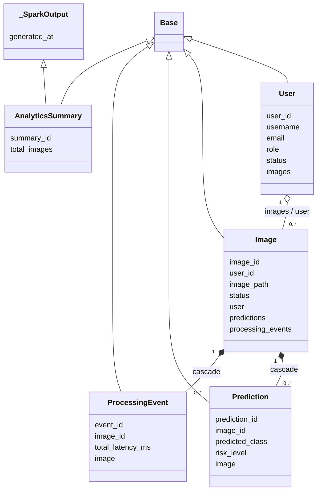

### D.4 `storage/schema.sql` — DDL PostgreSQL

*Nota:* bloku sira ne'e SQL. Pasu 3 "Fundamentu Python" iha ne'e esplika **fundamentu SQL** (haree tabela A.3).

#### D.4.1 Komentáriu no tabela `users`

**1. Kódigu orijinál**

{{code storage/schema.sql 1-30}}

**2. Objetivu**

Arkivu SQL ekivalente ba modelu ORM — ba setup manuál, revizaun, no kapítulu "Database Design" relatóriu. Tabela `users` ho `CHECK` ba papél no status.

**3. Fundamentu Python**

*(SQL)* `--` = komentáriu. `CHECK (kolom IN (...))` = regra valór. Iha ne'e enum mak `VARCHAR + CHECK`; ORM iha PostgreSQL harii tipu ENUM native (diferensa implementasaun; rezultadu valór hanesan).

**4. Esplikasaun liña-ba-liña**

- **Liña 1** — Komentáriu: esquema PostgreSQL EWS.
- **Liña 2–5** — Komentáriu: ekivalente ba modelu SQLAlchemy; aplikasaun (`init_db.py`) harii automátiku liuhusi ORM; arkivu ne'e ba setup manuál, revizaun no relatóriu.
- **Liña 7** — `CREATE TABLE IF NOT EXISTS users (`
- **Liña 8** — `user_id VARCHAR PRIMARY KEY,`
- **Liña 9** — `username VARCHAR UNIQUE NOT NULL,`
- **Liña 10** — `full_name VARCHAR,`
- **Liña 11** — `email VARCHAR UNIQUE NOT NULL,`
- **Liña 12** — `password_hash VARCHAR NOT NULL,`
- **Liña 13** — `role VARCHAR NOT NULL CHECK (role IN ('USER', 'ADMIN')),`
- **Liña 14** — `status VARCHAR NOT NULL DEFAULT 'ACTIVE'`
- **Liña 15** — `CHECK (status IN ('PENDING_VERIFICATION', 'ACTIVE', 'INACTIVE', 'SUSPENDED')),`
- **Liña 17** — Komentáriu: verifikasaun Gmail (feature rejistu).
- **Liña 18** — `email_verified BOOLEAN NOT NULL DEFAULT FALSE,`
- **Liña 19** — `verification_code_hash VARCHAR,` — komentáriu: hash de'it, nunka kódigu.
- **Liña 20** — `verification_code_expires_at TIMESTAMPTZ,`
- **Liña 21** — `verification_attempts INTEGER NOT NULL DEFAULT 0,`
- **Liña 22** — `last_verification_sent_at TIMESTAMPTZ,`
- **Liña 24** — Komentáriu: soft delete (feature CRUD admin).
- **Liña 25** — `is_deleted BOOLEAN NOT NULL DEFAULT FALSE,`
- **Liña 26** — `deleted_at TIMESTAMPTZ,`
- **Liña 28** — `created_at TIMESTAMPTZ NOT NULL DEFAULT now(),`
- **Liña 29** — `updated_at TIMESTAMPTZ NOT NULL DEFAULT now()`
- **Liña 30** — `);`

**5. Walkthrough ezekusaun**

`psql -f storage/schema.sql` → harii tabela se seidauk iha. `INSERT INTO users (..., role) VALUES (..., 'OWNER')` → erru CHECK.

**6. Tipu dadus**

`VARCHAR`, `BOOLEAN`, `INTEGER`, `TIMESTAMPTZ`.

**7. Ligasaun OOP**

Not implemented in the current codebase (SQL). Ekivalente ba klase `User` (D.2.3).

**8. Impaktu integrasaun**

Dokumentasaun/setup manuál; aplikasaun uza ORM.

**9. Checkpoint ba principiante**

**P:** Saida mak `DEFAULT now()`?
**R:** Se `INSERT` la fó valór, PostgreSQL tau tempu agora.

#### D.4.2 Tabela `images` no índise

**1. Kódigu orijinál**

{{code storage/schema.sql 32-68}}

**2. Objetivu**

Tabela `images` ho FK ba `users`, tempu, metadata EXIF, status ho `CHECK`, no índise 5.

**3. Fundamentu Python**

*(SQL)* `REFERENCES users(user_id)` = chave estranjeira. `CREATE INDEX IF NOT EXISTS ix ON t(c)`.

**4. Esplikasaun liña-ba-liña**

- **Liña 32** — `CREATE TABLE IF NOT EXISTS images (`
- **Liña 33** — `image_id VARCHAR PRIMARY KEY,`
- **Liña 34** — `location VARCHAR,` — fatin testu livre.
- **Liña 35** — `user_id VARCHAR NOT NULL REFERENCES users(user_id),`
- **Liña 36** — `original_filename VARCHAR,`
- **Liña 37** — `image_path VARCHAR NOT NULL,`
- **Liña 38** — `source VARCHAR NOT NULL DEFAULT 'android_upload',`
- **Liña 39** — `content_hash VARCHAR,` — SHA-256 ba deteta duplikadu.
- **Liña 41** — `captured_at TIMESTAMPTZ,` — EXIF ka NULL.
- **Liña 42** — `captured_at_source VARCHAR,` — `'exif'` | `'client_trusted'` | NULL.
- **Liña 43** — `uploaded_at TIMESTAMPTZ NOT NULL DEFAULT now(),` — `createdTime` Drive.
- **Liña 44** — `ingested_at TIMESTAMPTZ,`
- **Liña 45** — `processed_at TIMESTAMPTZ,`
- **Liña 46** — `result_published_at TIMESTAMPTZ,`
- **Liña 48** — Komentáriu: metadata husi EXIF orijinál (NULL se la iha).
- **Liña 49** — `gps_latitude DOUBLE PRECISION,`
- **Liña 50** — `gps_longitude DOUBLE PRECISION,`
- **Liña 51** — `gps_altitude_m DOUBLE PRECISION,`
- **Liña 52** — `gps_source VARCHAR,` — EXIF ka telemóvel.
- **Liña 53** — `camera_make VARCHAR,`
- **Liña 54** — `camera_model VARCHAR,`
- **Liña 55** — `image_width INTEGER,`
- **Liña 56** — `image_height INTEGER,`
- **Liña 58** — `status VARCHAR NOT NULL DEFAULT 'INGESTED'`
- **Liña 59** — `CHECK (status IN ('INGESTED','PROCESSING','COMPLETED','FAILED')),`
- **Liña 60** — `error_message TEXT,`
- **Liña 61** — `created_at TIMESTAMPTZ NOT NULL DEFAULT now()`
- **Liña 62** — `);`
- **Liña 64** — `CREATE INDEX IF NOT EXISTS ix_images_location ON images(location);`
- **Liña 65** — `CREATE INDEX IF NOT EXISTS ix_images_user_id ON images(user_id);`
- **Liña 66** — `CREATE INDEX IF NOT EXISTS ix_images_captured_at ON images(captured_at);`
- **Liña 67** — `CREATE INDEX IF NOT EXISTS ix_images_uploaded_at ON images(uploaded_at);`
- **Liña 68** — `CREATE INDEX IF NOT EXISTS ix_images_content_hash ON images(content_hash);`

**5. Walkthrough ezekusaun**

`INSERT INTO images (image_id, user_id, image_path) VALUES ('a1', 'la-iha', 'x')` → erru FK (utilizadór la iha).

**6. Tipu dadus**

Haree D.2.4.

**7. Ligasaun OOP**

Ekivalente ba klase `Image`.

**8. Impaktu integrasaun**

Hanesan D.2.4.

**9. Checkpoint ba principiante**

**P:** Saida mak FK `REFERENCES users(user_id)` garante?
**R:** Imajen ida labele iha `user_id` ne'ebé la iha iha `users` (integridade referensiál).

#### D.4.3 `predictions`, `processing_events`, `rejected_events`

**1. Kódigu orijinál**

{{code storage/schema.sql 70-121}}

**2. Objetivu**

DDL tabela operasional tolu tan ho FK, `CHECK` no índise.

**3. Fundamentu Python**

*(SQL)* Hanesan D.4.1–D.4.2.

**4. Esplikasaun liña-ba-liña**

- **Liña 70** — `CREATE TABLE IF NOT EXISTS predictions (`
- **Liña 71** — `prediction_id VARCHAR PRIMARY KEY,`
- **Liña 72** — `image_id VARCHAR NOT NULL REFERENCES images(image_id),`
- **Liña 74** — `predicted_class VARCHAR,`
- **Liña 75** — `prediction_confidence DOUBLE PRECISION,`
- **Liña 77** — `lesion_score DOUBLE PRECISION,`
- **Liña 78** — `discoloration_pct DOUBLE PRECISION,`
- **Liña 79** — `texture_irregularity DOUBLE PRECISION,`
- **Liña 80** — `leaf_area_affected_pct DOUBLE PRECISION,`
- **Liña 82** — `risk_score DOUBLE PRECISION,`
- **Liña 83** — `risk_level VARCHAR CHECK (risk_level IN ('LOW','MEDIUM','HIGH')),`
- **Liña 84** — `is_uncertain BOOLEAN NOT NULL DEFAULT FALSE,`
- **Liña 86** — `model_version VARCHAR,`
- **Liña 87** — `predicted_at TIMESTAMPTZ,`
- **Liña 88** — `processing_latency_ms INTEGER,`
- **Liña 89** — `created_at TIMESTAMPTZ NOT NULL DEFAULT now()`
- **Liña 90** — `);`
- **Liña 92** — `CREATE INDEX ... ix_predictions_image_id ON predictions(image_id);`
- **Liña 93** — `... ix_predictions_predicted_class ...`
- **Liña 94** — `... ix_predictions_risk_level ...`
- **Liña 95** — `... ix_predictions_predicted_at ...`
- **Liña 97** — `CREATE TABLE IF NOT EXISTS processing_events (`
- **Liña 98** — `event_id VARCHAR PRIMARY KEY,`
- **Liña 99** — `image_id VARCHAR NOT NULL REFERENCES images(image_id),`
- **Liña 100** — `api_published_at TIMESTAMPTZ,` — komentáriu: bainhira eventu publika ba Kafka (`ingested_at` imajen).
- **Liña 101** — `kafka_received_at TIMESTAMPTZ,` — komentáriu: bainhira sink `foreachBatch` Spark simu duni.
- **Liña 102** — `spark_started_at TIMESTAMPTZ,`
- **Liña 103** — `spark_completed_at TIMESTAMPTZ,`
- **Liña 104** — `prediction_started_at TIMESTAMPTZ,`
- **Liña 105** — `prediction_completed_at TIMESTAMPTZ,`
- **Liña 106** — `total_latency_ms INTEGER,`
- **Liña 107** — `status VARCHAR NOT NULL DEFAULT 'INGESTED'`
- **Liña 108** — `CHECK (status IN ('INGESTED','PROCESSING','COMPLETED','FAILED')),`
- **Liña 109** — `error_message TEXT,`
- **Liña 110** — `created_at TIMESTAMPTZ NOT NULL DEFAULT now()`
- **Liña 111** — `);`
- **Liña 113–114** — Komentáriu: eventu aat/la válidu rejeita molok ka durante Spark, rai ba rastreabilidade duke `print()`.
- **Liña 115** — `CREATE TABLE IF NOT EXISTS rejected_events (`
- **Liña 116** — `rejected_event_id VARCHAR PRIMARY KEY,`
- **Liña 117** — `image_id VARCHAR,` — bele la hanesan imajen ruma.
- **Liña 118** — `raw_event TEXT,`
- **Liña 119** — `reason TEXT NOT NULL,`
- **Liña 120** — `created_at TIMESTAMPTZ NOT NULL DEFAULT now()`
- **Liña 121** — `);`

**5. Walkthrough ezekusaun**

`INSERT INTO predictions (..., risk_level) VALUES (..., 'CRITICAL')` → erru CHECK.

**6. Tipu dadus**

Haree D.2.5–D.2.6.

**7. Ligasaun OOP**

Ekivalente ba `Prediction`, `ProcessingEvent`, `RejectedEvent`.

**8. Impaktu integrasaun**

Hanesan D.2.5–D.2.6.

**9. Checkpoint ba principiante**

**P:** Tanba sá `predictions.risk_level` permite NULL?
**R:** Liña `FAILED` (ka tuan) bele la iha risku; `CHECK` só aplika bainhira valór la NULL.

#### D.4.4 `scale_test_runs` no `scale_test_items`

**1. Kódigu orijinál**

{{code storage/schema.sql 123-172}}

**2. Objetivu**

DDL tabela teste eskalabilidade (la iha FK ba `images`, atu moris liu factory reset ka limpeza run).

**3. Fundamentu Python**

*(SQL)* Índise koluna rua: `ON scale_test_items (run_id, status)`.

**4. Esplikasaun liña-ba-liña**

- **Liña 123–126** — Komentáriu: run teste (`scalability/run.py`); fotografia teste iha liña `images` ho `source = 'scalability_test'`; tabela rua ne'e la iha FK ba `images` atu moris liu factory reset ka limpeza.
- **Liña 127** — `CREATE TABLE IF NOT EXISTS scale_test_runs (`
- **Liña 128** — `run_id VARCHAR PRIMARY KEY,`
- **Liña 129** — `status VARCHAR NOT NULL,`
- **Liña 130** — `phase VARCHAR,`
- **Liña 131** — `pid INTEGER,`
- **Liña 132** — `requested_size INTEGER NOT NULL,`
- **Liña 133** — `replay_of VARCHAR,`
- **Liña 134** — `publish_results BOOLEAN NOT NULL DEFAULT FALSE,`
- **Liña 135** — `drive_results_folder_id VARCHAR,`
- **Liña 136** — `config_json TEXT,`
- **Liña 137** — `selection_json TEXT,`
- **Liña 138** — `summary_json TEXT,`
- **Liña 139** — `error_message TEXT,`
- **Liña 140** — `data_cleaned_at TIMESTAMPTZ,`
- **Liña 141** — `started_at TIMESTAMPTZ NOT NULL DEFAULT now(),`
- **Liña 142** — `finished_at TIMESTAMPTZ`
- **Liña 143** — `);`
- **Liña 145** — `CREATE TABLE IF NOT EXISTS scale_test_items (`
- **Liña 146** — `image_id VARCHAR PRIMARY KEY,`
- **Liña 147** — `run_id VARCHAR NOT NULL,`
- **Liña 148** — `source_image_id VARCHAR NOT NULL,`
- **Liña 149** — `source_drive_file_id VARCHAR NOT NULL,`
- **Liña 150** — `source_user_id VARCHAR,`
- **Liña 151** — `local_copy_status VARCHAR,`
- **Liña 152** — `download_seconds DOUBLE PRECISION,`
- **Liña 153** — `size_bytes INTEGER,`
- **Liña 154** — `status VARCHAR NOT NULL,`
- **Liña 155** — `error_message TEXT,`
- **Liña 156** — `published_at TIMESTAMPTZ,`
- **Liña 157** — `spark_received_at TIMESTAMPTZ,`
- **Liña 158** — `completed_at TIMESTAMPTZ,`
- **Liña 159** — `timings_json TEXT,`
- **Liña 160** — `pipeline_seconds DOUBLE PRECISION,`
- **Liña 161** — `db_write_seconds DOUBLE PRECISION,`
- **Liña 162** — `drive_publish_seconds DOUBLE PRECISION,`
- **Liña 163** — `predicted_class VARCHAR,`
- **Liña 164** — `prediction_confidence DOUBLE PRECISION,`
- **Liña 165** — `is_uncertain BOOLEAN,`
- **Liña 166** — `risk_level VARCHAR,`
- **Liña 167** — `location VARCHAR,`
- **Liña 168** — `gps_latitude DOUBLE PRECISION,`
- **Liña 169** — `gps_longitude DOUBLE PRECISION`
- **Liña 170** — `);`
- **Liña 171** — `CREATE INDEX IF NOT EXISTS ix_scale_test_items_run_id ON scale_test_items (run_id);`
- **Liña 172** — `CREATE INDEX IF NOT EXISTS ix_scale_test_items_run_status ON scale_test_items (run_id, status);`

**5. Walkthrough ezekusaun**

Factory reset hamoos `images` maibé `scale_test_runs`/`items` hela (la iha FK atu bloke ka cascade).

**6. Tipu dadus**

Haree D.2.7.

**7. Ligasaun OOP**

Ekivalente ba `ScaleTestRun`, `ScaleTestItem`.

**8. Impaktu integrasaun**

Hanesan D.2.7.

**9. Checkpoint ba principiante**

**P:** Default `status` iha SQL no ORM hanesan?
**R:** Lae kompletu: SQL `status VARCHAR NOT NULL` la iha DEFAULT; ORM tau `"PREPARING"`/`"STAGED"` iha Python. Rezultadu hanesan bainhira aplikasaun hakerek.

#### D.4.5 Tabela analítika agrikultór

**1. Kódigu orijinál**

{{code storage/schema.sql 174-243}}

**2. Objetivu**

DDL tabela analítika 7 ne'ebé Spark hakerek: regra (imajen teste la tama, imajen ida konta dala ida ho prediksaun foun liu, fatin mamuk = "Unknown location", loron Timor-Leste).

**3. Fundamentu Python**

*(SQL)* Chave primária kompostu: `PRIMARY KEY (location, day, predicted_class)`.

**4. Esplikasaun liña-ba-liña**

- **Liña 174–179** — Komentáriu: analítika Spark (`batch_analytics.py` — metade batch objetivu 7; streaming mak `streaming_job.py`), dashboard lee (`analytics_reader.py`); Spark troka liña hotu kada run; regra teste/latest/Unknown location/loron Timor.
- **Liña 180** — `CREATE TABLE IF NOT EXISTS analytics_summary (`
- **Liña 181** — `summary_id INTEGER PRIMARY KEY,` — sempre 1.
- **Liña 182** — `total_users BIGINT NOT NULL,` — konta la hamoos.
- **Liña 183** — `total_images BIGINT NOT NULL,`
- **Liña 184** — `total_healthy BIGINT NOT NULL,`
- **Liña 185** — `total_diseased BIGINT NOT NULL,` — klasifika, la healthy, la uncertain.
- **Liña 186** — `total_uncertain BIGINT NOT NULL,`
- **Liña 187** — `total_unclassified BIGINT NOT NULL,` — seidauk prediksaun.
- **Liña 188** — `total_high_risk BIGINT NOT NULL,`
- **Liña 189** — `total_processed BIGINT NOT NULL,`
- **Liña 190** — `total_failed BIGINT NOT NULL,`
- **Liña 191** — `submissions_24h BIGINT NOT NULL,`
- **Liña 192** — `active_farmers_24h BIGINT NOT NULL,`
- **Liña 193** — `most_detected_disease VARCHAR,`
- **Liña 194** — `avg_processing_latency_ms DOUBLE PRECISION,` — ingested → predicted.
- **Liña 195** — `avg_capture_to_upload_seconds DOUBLE PRECISION,`
- **Liña 196** — `avg_upload_to_ingestion_seconds DOUBLE PRECISION,`
- **Liña 197** — `avg_end_to_end_latency_seconds DOUBLE PRECISION,` — uploaded → predicted.
- **Liña 198** — `generated_at TIMESTAMPTZ NOT NULL`
- **Liña 199** — `);`
- **Liña 200** — `CREATE TABLE IF NOT EXISTS analytics_disease_distribution (`
- **Liña 201** — `predicted_class VARCHAR PRIMARY KEY,`
- **Liña 202** — `photos BIGINT NOT NULL,`
- **Liña 203** — `generated_at TIMESTAMPTZ NOT NULL`
- **Liña 204** — `);`
- **Liña 205** — `CREATE TABLE IF NOT EXISTS analytics_risk_distribution (`
- **Liña 206** — `risk_level VARCHAR PRIMARY KEY,`
- **Liña 207** — `photos BIGINT NOT NULL,`
- **Liña 208** — `generated_at TIMESTAMPTZ NOT NULL`
- **Liña 209** — `);`
- **Liña 210** — `CREATE TABLE IF NOT EXISTS analytics_high_risk_by_location (`
- **Liña 211** — `location VARCHAR PRIMARY KEY,`
- **Liña 212** — `high BIGINT NOT NULL,`
- **Liña 213** — `total BIGINT NOT NULL,`
- **Liña 214** — `high_pct DOUBLE PRECISION NOT NULL,`
- **Liña 215** — `generated_at TIMESTAMPTZ NOT NULL`
- **Liña 216** — `);`
- **Liña 217** — `CREATE TABLE IF NOT EXISTS analytics_disease_trend (`
- **Liña 218** — `location VARCHAR NOT NULL,`
- **Liña 219** — `day DATE NOT NULL,`
- **Liña 220** — `predicted_class VARCHAR NOT NULL,`
- **Liña 221** — `photos BIGINT NOT NULL,`
- **Liña 222** — `generated_at TIMESTAMPTZ NOT NULL,`
- **Liña 223** — `PRIMARY KEY (location, day, predicted_class)`
- **Liña 224** — `);`
- **Liña 225** — `CREATE TABLE IF NOT EXISTS analytics_disease_daily (`
- **Liña 226** — `day DATE NOT NULL,`
- **Liña 227** — `predicted_class VARCHAR NOT NULL,`
- **Liña 228** — `photos BIGINT NOT NULL,`
- **Liña 229** — `generated_at TIMESTAMPTZ NOT NULL,`
- **Liña 230** — `PRIMARY KEY (day, predicted_class)`
- **Liña 231** — `);`
- **Liña 232** — Komentáriu: liña ida kada munisípiu kada loron upload, ba relatóriu/BI.
- **Liña 233** — `CREATE TABLE IF NOT EXISTS batch_location_daily_summary (`
- **Liña 234** — `location VARCHAR NOT NULL,`
- **Liña 235** — `summary_date DATE NOT NULL,`
- **Liña 236** — `total_images BIGINT NOT NULL,`
- **Liña 237** — `total_healthy BIGINT NOT NULL,`
- **Liña 238** — `total_diseased BIGINT NOT NULL,`
- **Liña 239** — `avg_risk_score DOUBLE PRECISION,`
- **Liña 240** — `high_risk_count BIGINT NOT NULL,`
- **Liña 241** — `generated_at TIMESTAMPTZ NOT NULL,`
- **Liña 242** — `PRIMARY KEY (location, summary_date)`
- **Liña 243** — `);`

**5. Walkthrough ezekusaun**

Spark `write_tables` harii `analytics_disease_trend_staging (LIKE analytics_disease_trend)` → JDBC append → `DELETE` + `INSERT ... SELECT` (Modulu 01 D.4.7).

**6. Tipu dadus**

Haree D.2.9–D.2.10.

**7. Ligasaun OOP**

Ekivalente ba klase analítika ho mixin.

**8. Impaktu integrasaun**

Spark hakerek, dashboard/Tableau lee.

**9. Checkpoint ba principiante**

**P:** Tanba sá kontajen uza `BIGINT`?
**R:** Spark `count()` fó `long` (64-bit); `BIGINT` hanesan tipu ne'e no la iha risku overflow.

#### D.4.6 Analítika teste, `image_reviews`, `storage_audit_log`

**1. Kódigu orijinál**

{{code storage/schema.sql 245-298}}

**2. Objetivu**

DDL tabela analítika teste 3 (kada run), revizaun admin, no auditoria armazenamentu.

**3. Fundamentu Python**

*(SQL)* Hanesan blokus anteriór.

**4. Esplikasaun liña-ba-liña**

- **Liña 245–247** — Komentáriu: figura moras pájina teste, kada run, husi `scale_test_items` (COMPLETED de'it); separadu husi analítika agrikultór; la partilla ho Tableau.
- **Liña 248** — `CREATE TABLE IF NOT EXISTS analytics_scale_test_disease_by_location (`
- **Liña 249** — `run_id VARCHAR NOT NULL,`
- **Liña 250** — `location VARCHAR NOT NULL,`
- **Liña 251** — `predicted_class VARCHAR NOT NULL,`
- **Liña 252** — `photos BIGINT NOT NULL,`
- **Liña 253** — `generated_at TIMESTAMPTZ NOT NULL,`
- **Liña 254** — `PRIMARY KEY (run_id, location, predicted_class)`
- **Liña 255** — `);`
- **Liña 256** — `CREATE TABLE IF NOT EXISTS analytics_scale_test_disease_distribution (`
- **Liña 257** — `run_id VARCHAR NOT NULL,`
- **Liña 258** — `predicted_class VARCHAR NOT NULL,`
- **Liña 259** — `photos BIGINT NOT NULL,`
- **Liña 260** — `generated_at TIMESTAMPTZ NOT NULL,`
- **Liña 261** — `PRIMARY KEY (run_id, predicted_class)`
- **Liña 262** — `);`
- **Liña 263** — `CREATE TABLE IF NOT EXISTS analytics_scale_test_high_risk_by_location (`
- **Liña 264** — `run_id VARCHAR NOT NULL,`
- **Liña 265** — `location VARCHAR NOT NULL,`
- **Liña 266** — `high BIGINT NOT NULL,`
- **Liña 267** — `total BIGINT NOT NULL,`
- **Liña 268** — `high_pct DOUBLE PRECISION NOT NULL,`
- **Liña 269** — `generated_at TIMESTAMPTZ NOT NULL,`
- **Liña 270** — `PRIMARY KEY (run_id, location)`
- **Liña 271** — `);`
- **Liña 273–275** — Komentáriu: desizaun revizaun admin kada imajen (Label photos): label KONFIRMA ka "discarded" — nunka prediksaun modelu; la iha FK ba `images`, entaun moris liu factory reset hanesan fotografia treinu.
- **Liña 276** — `CREATE TABLE IF NOT EXISTS image_reviews (`
- **Liña 277** — `image_id VARCHAR PRIMARY KEY,`
- **Liña 278** — `decision VARCHAR NOT NULL,` — `labelled` | `discarded`.
- **Liña 279** — `confirmed_class VARCHAR,`
- **Liña 280** — `predicted_class_at_review VARCHAR,`
- **Liña 281** — `reviewed_by VARCHAR,`
- **Liña 282** — `reviewed_at TIMESTAMPTZ NOT NULL DEFAULT now()`
- **Liña 283** — `);`
- **Liña 285–286** — Komentáriu: asaun armazenamentu destrutivu husi dashboard (limpeza cache, repara cache, factory reset); factory reset nunka hamoos.
- **Liña 287** — `CREATE TABLE IF NOT EXISTS storage_audit_log (`
- **Liña 288** — `audit_id VARCHAR PRIMARY KEY,`
- **Liña 289** — `action VARCHAR NOT NULL,`
- **Liña 290** — `category VARCHAR,`
- **Liña 291** — `target VARCHAR,`
- **Liña 292** — `reason TEXT,`
- **Liña 293** — `outcome VARCHAR NOT NULL,` — `done` | `skipped` | `failed` (ORM hatete mós `dry_run`).
- **Liña 294** — `detail TEXT,`
- **Liña 295** — `performed_by VARCHAR,`
- **Liña 296** — `created_at TIMESTAMPTZ NOT NULL DEFAULT now()`
- **Liña 297** — `);`
- **Liña 298** — `CREATE INDEX IF NOT EXISTS ix_storage_audit_log_created_at ON storage_audit_log (created_at);`

**5. Walkthrough ezekusaun**

Factory reset → `storage_audit_log` hetan liña `action='factory_reset'`; tabela ne'e rasik la hamoos.

**6. Tipu dadus**

Haree D.2.8, D.2.11.

**7. Ligasaun OOP**

Ekivalente ba klase korespondente.

**8. Impaktu integrasaun**

Hanesan D.2.8, D.2.11.

**9. Checkpoint ba principiante**

**P:** Tanba sá auditoria importante ba asaun destrutivu?
**R:** Atu hatene sé, bainhira no tanba sá hamoos arkivu — rastreabilidade no responsabilidade.

#### D.4.7 View rua

**1. Kódigu orijinál**

{{code storage/schema.sql 300-363}}

**2. Objetivu**

Forma PostgreSQL view rua ne'ebé `init_db()` harii: `v_tableau_images` (tempu +9 h) no `v_admin_image_catalog` (tempu UTC). Rua uza prediksaun foun liu no la inklui imajen teste.

**3. Fundamentu Python**

*(SQL)* `CREATE OR REPLACE VIEW`; CTE `WITH latest AS (...)`; `ROW_NUMBER() OVER (PARTITION BY ... ORDER BY ...)`; `AT TIME ZONE 'UTC'` + `INTERVAL '9 hours'`.

**4. Esplikasaun liña-ba-liña**

- **Liña 300–304** — Komentáriu: view; `database.py` harii fali rua kada `init_db()`; SQL iha okos mak forma PostgreSQL; rua foti prediksaun FOUN LIU (`predicted_at` foun liu, empate → `prediction_id`) no la inklui imajen teste.
- **Liña 306–307** — Komentáriu: Tableau Desktop lee (login read-only `tableau_reader`); tempu husi UTC ba Timor-Leste (UTC+9).
- **Liña 308** — `CREATE OR REPLACE VIEW v_tableau_images AS`
- **Liña 309** — `WITH latest AS (`
- **Liña 310** — `SELECT p.*,`
- **Liña 311** — `ROW_NUMBER() OVER (`
- **Liña 312** — `PARTITION BY p.image_id`
- **Liña 313** — `ORDER BY p.predicted_at DESC, p.prediction_id DESC` — **la iha** `NULLS LAST` (diferente husi `database.py` liña 540).
- **Liña 314** — `) AS rn`
- **Liña 315** — `FROM predictions p`
- **Liña 316** — `)`
- **Liña 317** — `SELECT`
- **Liña 318** — `i.image_id, i.location, i.source, i.status,`
- **Liña 319** — `u.username AS farmer_username,`
- **Liña 320** — `captured_at` + 9 h.
- **Liña 321** — `uploaded_at` + 9 h.
- **Liña 322** — `ingested_at` + 9 h.
- **Liña 323** — `processed_at` + 9 h.
- **Liña 324** — GPS no kámara.
- **Liña 325** — `predicted_class, prediction_confidence, is_uncertain`.
- **Liña 326** — `lesion_score, discoloration_pct, texture_irregularity`.
- **Liña 327** — `leaf_area_affected_pct, risk_score, risk_level`.
- **Liña 328** — `model_version`.
- **Liña 329** — `predicted_at` + 9 h.
- **Liña 330** — `processing_latency_ms`.
- **Liña 331** — `FROM images i`
- **Liña 332** — `LEFT JOIN latest l ON l.image_id = i.image_id AND l.rn = 1`
- **Liña 333** — `LEFT JOIN users u ON u.user_id = i.user_id`
- **Liña 334** — `WHERE i.source <> 'scalability_test';`
- **Liña 336–337** — Komentáriu: katálogu Image management dashboard (`storage/image_catalog.py`): imajen + agrikultór + prediksaun foun liu + revizaun; tempu UTC.
- **Liña 338** — `CREATE OR REPLACE VIEW v_admin_image_catalog AS`
- **Liña 339** — `WITH latest AS (`
- **Liña 340** — `SELECT p.*,`
- **Liña 341** — `ROW_NUMBER() OVER (`
- **Liña 342** — `PARTITION BY p.image_id`
- **Liña 343** — `ORDER BY p.predicted_at DESC, p.prediction_id DESC`
- **Liña 344** — `) AS rn`
- **Liña 345** — `FROM predictions p`
- **Liña 346** — `)`
- **Liña 347** — `SELECT`
- **Liña 348** — koluna imajen 6.
- **Liña 349** — `content_hash`, `status` (CAST), `error_message`.
- **Liña 350** — tempu 5.
- **Liña 351** — GPS/kámara 5.
- **Liña 352** — `image_width, image_height`.
- **Liña 353** — `farmer_email, farmer_name`.
- **Liña 354** — `farmer_status`.
- **Liña 355** — `farmer_deleted`.
- **Liña 356** — prediksaun 4.
- **Liña 357** — `risk_score`, `risk_level` (CAST), `model_version`, `predicted_at`.
- **Liña 358** — revizaun 4.
- **Liña 359** — `FROM images i`
- **Liña 360** — `LEFT JOIN latest l ...`
- **Liña 361** — `LEFT JOIN users u ...`
- **Liña 362** — `LEFT JOIN image_reviews r ON r.image_id = i.image_id`
- **Liña 363** — `WHERE i.source <> 'scalability_test';`

**5. Walkthrough ezekusaun**

Haree D.2.15–D.2.16.

**6. Tipu dadus**

View: koluna 26 (Tableau) no 37 (admin), konta husi lista SELECT.

**7. Ligasaun OOP**

Not implemented in the current codebase (SQL).

**8. Impaktu integrasaun**

Diferensa ki'ik ho `database.py`: `schema.sql` la iha `NULLS LAST`. Aplikasaun uza versaun `database.py` (ho `NULLS LAST`), tanba `init_db()` harii fali view kada vez.

**9. Checkpoint ba principiante**

**P:** Se ita halai `schema.sql` depois `init_db()`, view ida ne'ebé mak hela?
**R:** `CREATE OR REPLACE` husi `schema.sql` sei troka view; maibé `init_db()` tuirmai (ezemplu bainhira Spark hahú) sei harii fali versaun `database.py`.

## E. Analize OOP

### E.1 Klase iha modulu base de dadus

| Klase | Herda | Tipu | Uza ba |
|---|---|---|---|
| `Role`, `UserStatus`, `RiskLevel`, `ProcessingStatus` | `str`, `enum.Enum` | enum | valór fixu |
| `User`, `Image`, `Prediction`, `ProcessingEvent`, `RejectedEvent`, `ScaleTestRun`, `ScaleTestItem`, `ImageReview`, `StorageAuditLog` | `Base` | modelu ORM | tabela operasional |
| `_SparkOutput` | `object` | mixin | koluna `generated_at` |
| `AnalyticsSummary` + analítika 9 seluk | `_SparkOutput`, `Base` | modelu ORM | tabela Spark |

### E.2 Diagrama klase (ORM)

### E.3 Prinsípiu OOP — evidénsia

| Konseitu | Iha? | Evidénsia |
|---|---|---|
| Klase no objetu | Sin | Klase modelu 19; objetu = liña (`User(...)`, `Image(...)`) |
| `__init__` | Implísitu | SQLAlchemy fó konstrutór automátiku (argumentu ho naran koluna); kódigu projetu la hakerek `__init__` iha modelu |
| `self` | Implísitu | La iha métodu instánsia iha modelu |
| Atributu klase | Sin | `__tablename__`, `__table_args__`, `Column(...)` hotu; membru enum |
| Atributu instánsia | Sin (ORM) | `user.email`, `image.status` — SQLAlchemy halo `Column` sai atributu instánsia |
| Herança | Sin | Modelu hotu → `Base`; enum → `str` + `Enum` |
| **Herança múltipla / mixin** | Sin | `AnalyticsSummary(_SparkOutput, Base)` no analítika 9 seluk |
| Polimorfizmu | Parsiál | Membru enum hahalok hanesan `str` (`ProcessingStatus.COMPLETED == "COMPLETED"`); `Session.get(Klase, id)` funsiona ba klase hotu |
| Enkapsulamentu | Parsiál | SQL subar atrás ORM; funsaun interior `_add_missing_columns`, `_ensure_tableau_reader` (konvensaun `_`) |
| Abstrasaun | Sin | ORM abstrai SQL; `DATABASE_URL` abstrai PostgreSQL/SQLite |
| Komposisaun | Sin (ORM) | `Image` na'in `Prediction`/`ProcessingEvent` (`cascade="all, delete-orphan"`) |
| Agregasaun | Sin | `User` ↔ `Image` (`back_populates`, la iha cascade) |
| Factory | Sin | `sessionmaker` → `SessionLocal()`; `declarative_base()` |
| Observer | Sin | `@event.listens_for(engine, "connect")` (SQLite WAL) |
| Unit of Work / Identity Map | Uza husi biblioteka | `Session` rai mudansa no hakerek iha `commit()` |
| Repository pattern | Not implemented in the current codebase. | Kódigu uza `SessionLocal()` direta iha modulu barak |
| Migrasaun formál (Alembic) | Not implemented in the current codebase. | `_add_missing_columns` mak migrasaun simples |

**Nota aprendizajen Python — `__init__` iha modelu ORM (Teoria):** SQLAlchemy `declarative_base` fó `__init__(self, **kwargs)` ne'ebé tau kada argumentu ho naran koluna hanesan atributu. Tanba ne'e `User(username="x", email="y")` funsiona maske klase `User` la define `__init__`.

## F. Integrasaun

| Komponente | Tabela | Operasaun |
|---|---|---|
| Spark streaming (Modulu 01) | `users`, `images`, `predictions`, `processing_events`, `rejected_events` | INSERT/UPDATE liuhusi ORM |
| Spark batch (Modulu 01) | `images`, `predictions`, `users`, `scale_test_items` → `analytics_*` | JDBC read; JDBC append ba `_staging` + transasaun |
| Kafka produtór `submit` (Modulu 02) | `images` | UPDATE `INGESTED`/`FAILED` |
| Drive (Modulu 03) | `users` (`get_or_create_farmer`), `images.result_published_at` | INSERT/UPDATE |
| Dashboard (Modulu 06) | hotu + view admin | SELECT; INSERT `image_reviews`, `storage_audit_log`; reset |
| Tableau | `v_tableau_images`, `images`, `predictions`, `analytics_*` | SELECT (read-only) |
| `init_db` | esquema | DDL |

## G. Tratamentu Erru no Konfiabilidade

| Mekanizmu | Detallu |
|---|---|
| Integridade | `PRIMARY KEY`, `UNIQUE` (`username`, `email`), FK 3, `NOT NULL`, ENUM/`CHECK` |
| Idempotênsia esquema | `create_all`, `IF NOT EXISTS`, `_add_missing_columns` kontrola uluk, `DROP VIEW IF EXISTS` |
| Konesaun mate | `pool_pre_ping=True` (PostgreSQL) |
| Konkorrénsia SQLite | WAL; `check_same_thread=False` |
| Race agrikultór foun | `UNIQUE email` + `IntegrityError` → rollback (Modulu 03 D.6.3) |
| Replay prediksaun | delete-then-insert iha `persist_result` |
| Analítika la mamuk | staging + transasaun (Modulu 01 D.4.7) |
| Privasidade | `tableau_reader` la iha SELECT ba `users`; Spark lee koluna presiza de'it |
| Persisténsia | Volume Docker `crop_disease_pg_data` |
| Seguransa rede | Port `127.0.0.1:5432` de'it |

**Limitasaun:**

- `schema.sql` la hanesan 100% ho ORM: enum (`VARCHAR + CHECK` vs ENUM native), view la iha `NULLS LAST`, default `status` teste. Inferidu: base de dadus ne'ebé harii ho ORM iha tipu ENUM PostgreSQL (ezemplu `processingstatus`); se ENUM tuan iha valór antigu, nia hela (la kontrola iha sesaun ne'e tanba Docker la halai).
- Migrasaun la hamoos koluna tuan (só aumenta), exetu migrasaun espesífiku (`field_id`).
- FK la iha `ON DELETE CASCADE` iha nível base de dadus; cascade iha ORM de'it.
- Backup automátiku: Not implemented in the current codebase.
- Particionamentu / replikasaun PostgreSQL: Not implemented in the current codebase.

## H. Sumáriu no Pergunta Akadémiku

### H.1 Sumáriu

Base de dadus PostgreSQL 16 (Docker, localhost) ho tabela 19 no view 2. `storage/database.py` define enum 4 no modelu ORM ho SQLAlchemy (klase = tabela, objetu = liña), relasaun (`User`–`Image` agregasaun; `Image`–`Prediction`/`ProcessingEvent` komposisaun ho cascade), mixin `_SparkOutput` ba tabela analítika, engine ho `pool_pre_ping`, `SessionLocal`, migrasaun simples (`_add_missing_columns`), CTE `LATEST_PREDICTION_CTE`, view Tableau (+9 h, read-only, la ho `users`) no view admin. `init_db()` idempotent. `schema.sql` mak DDL ekivalente ba relatóriu. ERD hatudu FK 3 no relasaun lójiku; DFD kontestu no nível 1 hatudu fluxu Drive → Kafka → Spark → BD → dashboard/Tableau.

### H.2 Pergunta no resposta

**P1. FK hira iha esquema no ne'ebé?**
R: Tolu: `images.user_id → users`, `predictions.image_id → images`, `processing_events.image_id → images`. Tabela seluk la iha FK ho intensaun (teste, revizaun, rejeitadu, analítika).

**P2. Oinsá sistema garante "imajen ida konta dala ida"?**
R: `ROW_NUMBER() OVER (PARTITION BY image_id ORDER BY predicted_at DESC NULLS LAST, prediction_id DESC)` no filtra `rn = 1` (view, `analytics_reader`); Spark halo hanesan ho `Window`; streaming mós delete-then-insert.

**P3. Diferensa komposisaun no agregasaun iha ORM ne'e?**
R: `Image.predictions` ho `cascade="all, delete-orphan"` — prediksaun moris-mate ho imajen (komposisaun). `User.images` la iha cascade — imajen la hamoos bainhira utilizadór hamoos (soft delete) (agregasaun).

**P4. Saida mak mixin no iha ne'ebé uza?**
R: Klase ki'ik ne'ebé fó atributu ba klase seluk liuhusi herança múltipla. `_SparkOutput` fó `generated_at` ba tabela analítika 10 (`class AnalyticsSummary(_SparkOutput, Base)`).

**P5. Tanba sá `init_db()` presiza `_add_missing_columns`?**
R: `create_all` la aumenta koluna ba tabela ne'ebé iha ona. Funsaun ne'e kompara ho `inspect` no halai `ALTER TABLE ADD COLUMN`.

**P6. Oinsá Tableau asesu dadus la ho vaza email agrikultór?**
R: Login `tableau_reader` (NOSUPERUSER) ho SELECT de'it ba `v_tableau_images` + `images`, `predictions`, `analytics_*`. View hatudu `farmer_username`, la'ós email/hash; `users` la hetan GRANT.

**P7. Tanba sá tempu iha view Tableau aumenta oras 9?**
R: Tempu rai UTC; `(col AT TIME ZONE 'UTC') + INTERVAL '9 hours'` fó oras Timor-Leste la importa fuso Tableau.

**P8. Saida mak diferensa entre `schema.sql` no ORM?**
R: Enum (`VARCHAR + CHECK` vs ENUM native), view la iha `NULLS LAST`, default `status` teste iha Python. Aplikasaun uza ORM; `schema.sql` ba dokumentasaun/setup manuál.

**P9. DFD nível 1 iha prosesu hira no data store hira?**
R: Prosesu 7 (1.0 deteta upload … 7.0 dashboard) no data store 6 (D1 `users`, D2 `images`, D3 `predictions`, D4 eventu, D5 analítika, D6 revizaun/auditoria).

**P10. Saida mak akontese bainhira PostgreSQL restart durante Spark halai?**
R: `pool_pre_ping` troka konesaun mate. Se `persist_result` falla, `process_and_persist` kaer; fotografia hela `PROCESSING` no `_auto_resend`/`requeue_stuck` haruka fali (Modulu 01).
