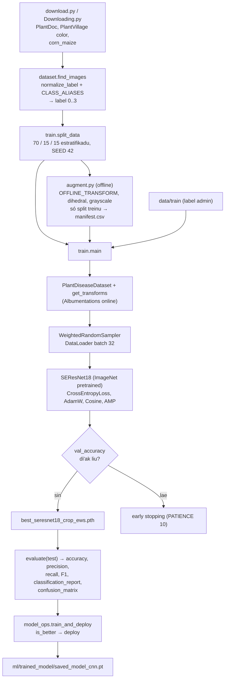
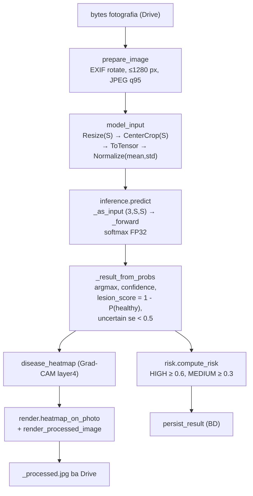
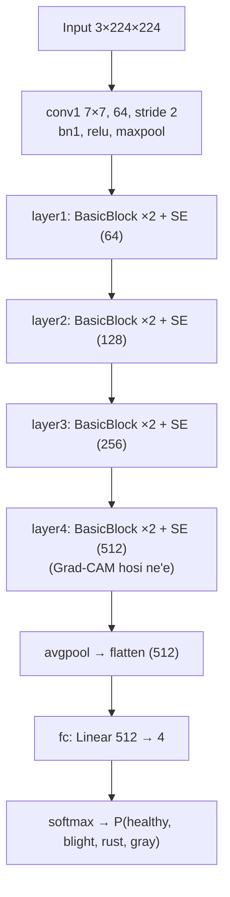

# 05 — Modulu Machine Learning: SE-ResNet-18 CNN

*Sistema Crop Disease Early Warning System (EWS) — dokumentasaun téknika ba modelu CNN SE-ResNet-18: dadus, preprocessing imajen, augmentation Albumentations, arkitetura, ekuasaun matemátika, treinu, avaliasaun, inferénsia iha sistema, Grad-CAM no regra risku. Ba estudante ne'ebé foin hahú programasaun. Fonte úniku: kódigu iha repozitóriu sistema (branch `main`, commit `302818f`) no projetu treinu `crop_disease_ews` (`TRAINING_PROJECT_DIR`). Kódigu hotu kópia automátiku ho númeru liña.*

{{coverage @train/download.py 1-64}}
{{coverage @train/Downloading.py 1-6}}
{{coverage @train/dataset.py 1-273}}
{{coverage @train/augment.py 1-247}}
{{coverage @train/model.py 1-204}}
{{coverage @train/train.py 1-1167}}
{{coverage @train/predict.py 1-240}}
{{coverage @train/gradcam.py 1-560}}
{{coverage dashboard/model_ops.py 1-181}}
{{coverage config/settings.py 50-67 96-102 126-127}}
{{coverage spark/preprocessing.py 144-185}}
{{coverage ml/se_resnet.py 1-60}}
{{coverage ml/inference.py 1-348}}
{{coverage ml/risk.py 1-19}}
{{coverage ml/render.py 1-78}}

> **Oinsá lee.** Bloku kódigu kada ida tuir pasu 9: (1) Kódigu orijinál, (2) Objetivu, (3) Fundamentu Python, (4) Esplikasaun liña-ba-liña, (5) Walkthrough ezekusaun, (6) Tipu dadus, (7) Ligasaun OOP, (8) Impaktu integrasaun, (9) Checkpoint ba principiante. Etiketa: *Implementadu*, *Inferidu*, *Teoria*, *Ezemplu ilustrativu*. Dalan arkivu ho `crop_disease_ews/` mak projetu treinu (separadu husi repozitóriu sistema).

## A. Introdusaun no Objetivu

### A.1 Papél modelu iha sistema

Modelu **SE-ResNet-18** mak *Convolutional Neural Network* (CNN) ne'ebé simu imajen tahan batar no fó probabilidade ba klase 4: **healthy**, **northern_leaf_blight** (iha treinu: `Blight`), **common_rust**, **gray_leaf_spot**. Modulu ne'e iha parte rua:

| Parte | Fatin | Saida |
|---|---|---|
| **Treinu** (offline) | projetu `crop_disease_ews` | `download.py` → `dataset.py` → `augment.py` → `model.py` → `train.py` → checkpoint `best_seresnet18_crop_ews.pth`; `predict.py`, `gradcam.py` ba teste/esplikasaun |
| **Deploy** | `dashboard/model_ops.py` | Kontrola, konverte naran klase, rai `ml/trained_model/saved_model_cnn.pt` (auto-deploy se di'ak liu) |
| **Inferénsia** (online) | `spark/preprocessing.model_input` + `ml/inference.py` + `ml/se_resnet.py` | Spark prepara tensor → CNN fó probabilidade → klase, konfiansa, `lesion_score`, `is_uncertain` |
| **Risku** | `ml/risk.py` | `lesion_score` → LOW/MEDIUM/HIGH |
| **Esplikasaun vizuál** | `ml/inference.disease_heatmap` + `ml/render.py` | Grad-CAM vermelhu iha fotografia ba agrikultór |

### A.2 Problema ne'ebé modulu ne'e rezolve

Agrikultór la iha espesialista moras besik. CNN klasifika fotografia iha segundu balun. Problema téknika no solusaun iha kódigu:

- **Dadus husi fonte barak no la balansu** → `CLASS_ALIASES` hamutuk naran, `WeightedRandomSampler` balansu klase.
- **Fotografia laboratóriu vs kampu** → augmentation forte (lus, sombra, blur, rotasaun) no kópia ekstra ba healthy kampu.
- **Dadus vaza entre split** → split 70/15/15 estratifikadu ho `SEED=42`; augmentation no fotografia revizaun só ba treinu.
- **Modelu la seguru** → limite konfiansa: okos limite → `"uncertain"` no risku la to'o HIGH.
- **Modelu foun la di'ak liu** → auto-deploy só se akurásia teste (ka validasaun) aas liu.
- **Konfiansa ba modelu** → Grad-CAM hatudu fatin ne'ebé modelu haree.

### A.3 Fundamentu Python (foun iha modulu ne'e)

Modulu 01–04 hanorin ona tipu, klase, `self`, `__init__`, herança, `with`, decorator. **Lembra:** klase = molde; objetu = buat harii husi molde; `super().__init__()` bolu konstrutór klase inan. Konseitu **foun**:

1. **NumPy array** — lista númeru multi-dimensaun lalais: `np.array([1,2])`, `arr.shape`, `np.bincount`, `np.concatenate`, `np.median`.
2. **Imajen hanesan array** — OpenCV (`cv2.imread`) fó array `[H, W, 3]` ho orden kór **BGR**; `cv2.cvtColor(img, cv2.COLOR_BGR2RGB)` troka ba RGB.
3. **Tensor PyTorch** — hanesan array maibé bele halai iha GPU no kalkula gradiente: `x.to(device)`, `x.shape`, `x.unsqueeze(0)` (aumenta dimensaun batch).
4. **`nn.Module`** — klase baze ba kamada rede neural. Sub-klase define `__init__` (kamada) no `forward(self, x)` (kálkulu). Bolu `model(x)` → PyTorch bolu `forward`.
5. **`Dataset` no `DataLoader`** — `Dataset` define `__len__` no `__getitem__(idx)`; `DataLoader` halibur elementu ba *batch* (grupu, ezemplu 32).
6. **Métodu espesiál `__len__`, `__getitem__`** — halo objetu hahalok hanesan lista (`len(ds)`, `ds[0]`).
7. **`with torch.no_grad():`** / **`torch.inference_mode()`** — hamate kálkulu gradiente (inferénsia lalais).
8. **`@staticmethod`** — métodu la presiza `self`.
9. **Atribui métodu ba objetu** (`block.forward = forward_with_se`) — troka hahalok objetu iha tempu ezekusaun (*monkey patching*).
10. **Argumentu default iha closure** (`def f(x, block=block)`) — "kaer" valór agora (evita erru *late binding* iha loop).
11. **`*_` iha unpacking** — `a, b, *_ = f()` foti rua dahuluk, soe seluk.
12. **`queue.Queue`** no **`Future`** — fila thread-safe; promesa rezultadu (`set_result`, `set_exception`).
13. **Rekursaun** — funsaun bolu nia an (`_forward_safely` fahe batch ba metade).

### A.4 Matemátika (Teoria + implementasaun)

**1. Normalizasaun piksel** (`ToTensor` + `Normalize`, Spark `model_input`; Albumentations `A.Normalize` + `ToTensorV2` iha treinu). Ba kanál $c \in \{R, G, B\}$:

$$x_c = \frac{p_c}{255}, \qquad \hat{x}_c = \frac{x_c - \mu_c}{\sigma_c}$$

ho $\mu = (0.485, 0.456, 0.406)$ no $\sigma = (0.229, 0.224, 0.225)$ (ImageNet). Símbolu: $p_c$ = valór piksel 0–255; $x_c$ = valór 0–1; $\mu_c$ = média kanál; $\sigma_c$ = desviu padraun; $\hat{x}_c$ = valór normalizadu (input CNN).

**2. Konvolusaun (Teoria).** Kamada `Conv2d` kalkula $y = W * x + b$ — filtru $W$ la'o iha imajen no deteta padraun (rohan, kór, mancha).

**3. Bloku Squeeze-and-Excitation (SE)** (`SEBlock`). Ba mapa feature $U \in \mathbb{R}^{C \times H \times W}$:

$$z_c = \frac{1}{H W}\sum_{i=1}^{H}\sum_{j=1}^{W} U_c(i,j) \quad \text{(squeeze)}$$

$$s = \sigma\big(W_2\,\delta(W_1 z)\big), \quad W_1 \in \mathbb{R}^{\frac{C}{r}\times C},\; W_2 \in \mathbb{R}^{C\times\frac{C}{r}} \quad \text{(excitation)}$$

$$\tilde{U}_c = s_c \cdot U_c \quad \text{(scale)}$$

Símbolu: $z_c$ = média kanál $c$; $\delta$ = ReLU; $\sigma$ = sigmoid (0–1); $r = 16$ = `reduction`; $s_c$ = peze atensaun kanál $c$.

**4. Bloku residuál ho SE** (`forward_with_se`): $y = \text{ReLU}\big(\text{SE}(\text{BN}(\text{Conv}(\text{ReLU}(\text{BN}(\text{Conv}(x)))))) + \text{shortcut}(x)\big)$.

**5. Softmax** (`F.softmax`, `torch.softmax`). Ba *logits* $z_1..z_K$ ($K = 4$):

$$P(y = k \mid x) = \frac{e^{z_k}}{\sum_{j=1}^{K} e^{z_j}}$$

Probabilidade hotu entre 0–1 no soma = 1.

**6. Cross-entropy loss** (`nn.CrossEntropyLoss`). Ba batch ho $N$ imajen, klase loos $y_i$:

$$\mathcal{L} = -\frac{1}{N}\sum_{i=1}^{N} \log P(y = y_i \mid x_i)$$

Se modelu fó probabilidade 0.9 ba klase loos: $-\log 0.9 \approx 0.105$ (ki'ik, di'ak); se 0.1: $-\log 0.1 \approx 2.303$ (boot, aat).

**7. AdamW** (`torch.optim.AdamW`, `LEARNING_RATE = 3e-4`, `WEIGHT_DECAY = 1e-2`) — optimizador ne'ebé adapta pasu kada parámetru no hamenus peze ho *decoupled weight decay*: $\theta \leftarrow \theta - \eta\left(\frac{\hat m}{\sqrt{\hat v}+\epsilon} + \lambda\theta\right)$.

**8. Cosine annealing** (`CosineAnnealingLR`, $T_{max} = 25$): $\eta_t = \eta_{min} + \tfrac{1}{2}(\eta_0 - \eta_{min})\left(1 + \cos\frac{t\pi}{T_{max}}\right)$ — learning rate tun neineik ho forma kosinus.

**9. Peze sampler balansu** (`create_weighted_sampler`): $w_k = \dfrac{1}{n_k}$ ($n_k$ = imajen klase $k$); kada imajen hetan peze klase nian, entaun klase ki'ik foti dala barak liu.

**10. Métrika avaliasaun** (`sklearn`). Ba klase $k$: $TP_k$ = loos pozitivu, $FP_k$ = falsu pozitivu, $FN_k$ = falsu negativu.

$$\text{Accuracy} = \frac{\#\text{prediksaun loos}}{N}$$

$$\text{Precision}_k = \frac{TP_k}{TP_k + FP_k}, \qquad \text{Recall}_k = \frac{TP_k}{TP_k + FN_k}, \qquad F1_k = \frac{2\,\text{Precision}_k\,\text{Recall}_k}{\text{Precision}_k + \text{Recall}_k}$$

`average="weighted"`: $M_{weighted} = \sum_k \frac{n_k}{N} M_k$ ($n_k$ = *support* klase $k$).

**11. Grad-CAM** (`GradCAM.__call__`, `disease_heatmap`). Ba klase $c$ ho score $y^c$ no mapa feature $A^k$ husi `layer4`:

$$\alpha_k^c = \frac{1}{Z}\sum_{i}\sum_{j}\frac{\partial y^c}{\partial A^k_{ij}}, \qquad L^c_{\text{Grad-CAM}} = \text{ReLU}\Big(\sum_k \alpha_k^c A^k\Big)$$

**12. `lesion_score` no regra risku** (`_result_from_probs`, `compute_risk`):

$$\text{lesion\_score} = \text{clip}\big(1 - P(\text{healthy}),\,0,\,1\big)$$

$$\text{risk\_level} = \begin{cases} \text{HIGH} & \text{se } s \ge 0.6 \\ \text{MEDIUM} & \text{se } 0.3 \le s < 0.6 \\ \text{LOW} & \text{se } s < 0.3 \end{cases}$$

ho $s$ = `risk_score` = `lesion_score` (desimál 3); se `is_uncertain` no HIGH → MEDIUM. Limite husi `RISK_THRESHOLDS` (default 0.6 / 0.3).

**13. Uncertain**: se $\max_k P(y=k\mid x) < \tau$ → `predicted_class = "uncertain"`; sistema $\tau$ = `MODEL_CONFIDENCE_THRESHOLD` (default 0.5). (`predict.py` treinu uza $\tau = 0.60$ — valór diferente.)

## B. Arkivu Fonte Loloos

| Arkivu | Liña | Klase / funsaun | Serbisu |
|---|---|---|---|
| `crop_disease_ews/download.py` | 64 | `download_datasets` | Download PlantDoc + PlantVillage (kagglehub) |
| `crop_disease_ews/Downloading.py` | 6 | — | Download "corn-or-maize-leaf-disease-dataset" |
| `crop_disease_ews/dataset.py` | 273 | `CLASS_NAMES`, `CLASS_ALIASES`, `normalize_label`, `find_images`, `get_transforms`, `PlantDiseaseDataset` | Buka imajen, label, Albumentations, Dataset |
| `crop_disease_ews/augment.py` | 247 | `OFFLINE_TRANSFORM`, `to_grayscale`, `dihedral`, `make_copies`, `main` | Augmentation offline (kópia iha disku) |
| `crop_disease_ews/model.py` | 204 | `SEBlock`, `SEResNet18` | Arkitetura (treinu) |
| `crop_disease_ews/train.py` | 1167 | `split_data`, `load_augmented`, `create_weighted_sampler`, `train_one_epoch`, `evaluate`, `plot_history`, `save_confusion_matrix`, `main` | Treinu + avaliasaun |
| `crop_disease_ews/predict.py` | 240 | `DiseasePredictor` | Prediksaun imajen ida (teste) |
| `crop_disease_ews/gradcam.py` | 560 | `GradCAM`, helper, `main` | Esplikasaun modelu iha split teste |
| `dashboard/model_ops.py` | 181 | `info`, `deploy`, `swap_in`, `is_better`, `train_and_deploy` | Deploy modelu ba sistema |
| `config/settings.py` | 50–67, 96–102, 126–127 | `IMAGE_MODEL`, `RISK_THRESHOLDS`, `ANALYSIS_MAX_PX` | Konfigurasaun |
| `spark/preprocessing.py` | 144–185 | `model_input`, `model_input_preview`, `_prepared_rgb`, `prepare_image` | Preprocessing (Spark) |
| `ml/se_resnet.py` | 60 | `SEBlock`, `SEResNet18` | Arkitetura (sistema) |
| `ml/inference.py` | 348 | `_load_trained_model`, `predict`, `_GpuBatcher`, `_result_from_probs`, `disease_heatmap`, `model_version` | Inferénsia |
| `ml/risk.py` | 19 | `compute_risk` | Regra risku |
| `ml/render.py` | 78 | `render_processed_image`, `heatmap_on_photo` | Imajen ba agrikultór |

**Dependénsia:** PyTorch, torchvision, Albumentations, OpenCV (`cv2`), NumPy, scikit-learn, Matplotlib, kagglehub, Pillow.

**Rezultadu teste loloos** (`crop_disease_ews/results/classification_report.txt`, 2026-10-03, imajen teste 646):

| Klase | Precision | Recall | F1 | Support |
|---|---|---|---|---|
| Healthy | 0.98 | 1.00 | 0.99 | 181 |
| Blight | 0.89 | 0.94 | 0.92 | 181 |
| Common_Rust | 1.00 | 0.94 | 0.97 | 198 |
| Gray_Leaf_Spot | 0.86 | 0.86 | 0.86 | 86 |
| **accuracy** | | | **0.95** | 646 |
| macro avg | 0.93 | 0.93 | 0.93 | 646 |
| weighted avg | 0.95 | 0.95 | 0.95 | 646 |

## C. Arkitetura no Fluxu Ezekusaun

### C.1 Pipeline treinu

### C.2 Pipeline inferénsia iha sistema

### C.3 Arkitetura SE-ResNet-18

Dimensaun kanál (64/128/256/512) mai husi arkitetura padraun ResNet-18 torchvision (*Teoria*; kódigu foti `block.conv2.out_channels` automátiku).

### C.4 Trasu konkretu: imajen → rezultadu

*Ezemplu ilustrativu* (valór probabilidade); funsaun no regra loloos.

| Pasu | Funsaun | Input | Output |
|---|---|---|---|
| 1 | `prepare_image` | JPEG 4000×3000 | JPEG 1280×960 vertikál |
| 2 | `model_input` | JPEG 1280×960 | tensor `[3, 224, 224]` normalizadu (`img_size` = 224 husi checkpoint) |
| 3 | `_as_input` | tensor | kontrola forma `(3, 224, 224)` |
| 4 | `_forward` | batch `[1, 3, 224, 224]` | logits `[1, 4]` → softmax `[0.02, 0.95, 0.01, 0.02]` |
| 5 | `_result_from_probs` | probabilidade | `predicted_class = "northern_leaf_blight"`, `confidence = 0.95`, `lesion_score = 1 - 0.02 = 0.98`, `is_uncertain = False` (0.95 ≥ 0.5) |
| 6 | `compute_risk` | `lesion_score = 0.98` | `(0.98, "HIGH")` (0.98 ≥ 0.6) |
| 7 | `disease_heatmap` | tensor | mapa `7×7` (layer4) |
| 8 | `heatmap_on_photo` + `render_processed_image` | mapa + JPEG | JPEG ≤600 px ho vermelhu no banner "northern leaf blight 95% Risk: HIGH" |

**Diferensa treinu vs sistema (Implementadu):** validasaun/teste treinu uza `A.Resize(224, 224)` (squeeze); sistema uza `Resize(224)` + `CenterCrop(224)` (koto klaran). Docstring `model_input` hatete centre crop fó 95.67% vs squeeze 94.74% iha split teste. Limite uncertain: treinu `predict.py` 0.60, sistema 0.5.
