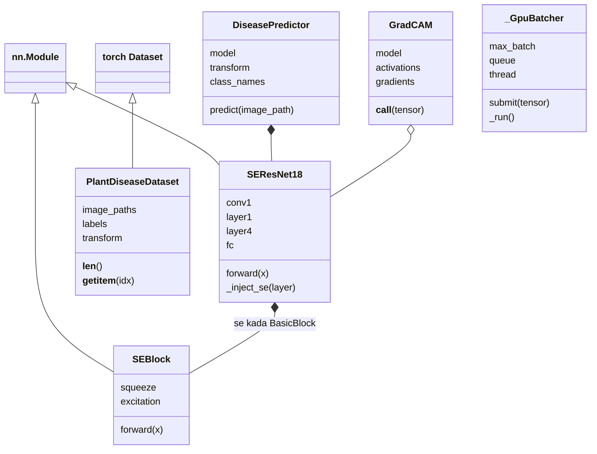

### D.12 `ml/inference.py` — CNN iha sistema

#### D.12.1 Docstring, cache modelu (hot-reload)

**1. Kódigu orijinál**

{{code ml/inference.py 1-48}}

**2. Objetivu**

CNN karrega modelu treina no klasifika fotografia ne'ebé Spark prepara ona (la iha preprocessing iha ne'e). Cache modelu ho chave `(dalan, mtime, size, inode)` — se arkivu modelu muda (deploy foun), karrega fali automátiku.

**3. Fundamentu Python**

Dict hanesan cache; `threading.Lock`; `os.stat` (`st_mtime_ns`, `st_size`, `st_ino`); aumenta atributu ba funsaun (`_load_trained_model.cache_clear = _cache_clear`) — funsaun mak objetu.

**4. Esplikasaun liña-ba-liña**

- **Liña 1–3** — Docstring: CNN karrega modelu treina no klasifika fotografia ne'ebé Spark prepara ona; la iha preprocessing iha ne'e.
- **Liña 4** — Liña mamuk docstring.
- **Liña 5–7** — Arkivu modelu foun foti automátiku; `predict()` fó `predicted_class`, konfiansa, `lesion_score` (= 1 - P(healthy)) no `is_uncertain`.
- **Liña 8** — Remata docstring.
- **Liña 10** — `import os`.
- **Liña 11** — `import threading`.
- **Liña 12** — `from pathlib import Path`.
- **Liña 14** — `from config.settings import IMAGE_MODEL`.
- **Liña 16** — Komentáriu: klase reporta bainhira konfiansa okos limite.
- **Liña 17** — `UNCERTAIN_CLASS = "uncertain"`.
- **Liña 20** — `class ModelNotAvailable(Exception):`
- **Liña 21** — Docstring: hamosu bainhira la hetan checkpoint.
- **Liña 24** — `_model_cache = {"key": None, "value": None}`.
- **Liña 25** — `_model_cache_lock = threading.Lock()`.
- **Liña 28** — `def _load_trained_model():`
- **Liña 29** — Docstring: modelu karrega, cache; karrega fali bainhira arkivu muda.
- **Liña 30** — `weights_path = IMAGE_MODEL["weights_path"]`.
- **Liña 31** — `try:`
- **Liña 32** — `st = os.stat(weights_path)`.
- **Liña 33** — `key = (weights_path, st.st_mtime_ns, st.st_size, st.st_ino)`.
- **Liña 34** — `except OSError:` — arkivu la iha.
- **Liña 35** — `key = (weights_path, None)`.
- **Liña 36** — `with _model_cache_lock:`
- **Liña 37** — `if _model_cache["key"] != key:` — muda (ka dala uluk):
- **Liña 38** — `_model_cache["value"] = _load_checkpoint(weights_path)`.
- **Liña 39** — `_model_cache["key"] = key`.
- **Liña 40** — `return _model_cache["value"]`.
- **Liña 43** — `def _cache_clear() -> None:`
- **Liña 44** — `with _model_cache_lock:`
- **Liña 45** — `_model_cache.update(key=None, value=None)`.
- **Liña 48** — `_load_trained_model.cache_clear = _cache_clear` — API hanesan `lru_cache`.

**5. Walkthrough ezekusaun**

Fotografia dahuluk → karrega modelu (~segundu). Fotografia tuirmai → chave hanesan → cache. `model_ops.deploy` troka arkivu → mtime muda → fotografia tuirmai karrega modelu foun (hot-reload la ho restart Spark).

**6. Tipu dadus**

`_model_cache`: `dict`; `key`: `tuple`; return `dict` (modelu karrega).

**7. Ligasaun OOP**

**Herança**: `ModelNotAvailable(Exception)`. Cache nível modulu ho lock (singleton prátiku ba modelu). Funsaun ho atributu (`cache_clear`) — duck typing ho API `lru_cache`.

**8. Impaktu integrasaun**

`input_spec`, `predict`, `disease_heatmap`, `model_version` bolu `_load_trained_model()`.

**9. Checkpoint ba principiante**

**P:** Tanba sá chave cache inklui `st_mtime_ns` no `st_size`?
**R:** Atu deteta arkivu modelu foun (deploy) — se tempu ka tamañu muda, karrega fali.

#### D.12.2 Device no `_load_checkpoint`

**1. Kódigu orijinál**

{{code ml/inference.py 51-131}}

**2. Objetivu**

Hili GPU/CPU; karrega checkpoint (erru klaru se la iha), harii arkitetura (`resnet18` ka `se_resnet18`), karrega peze, rai `input_spec` (`img_size`, `mean`, `std`), naran klase, klase healthy, no versaun modelu.

**3. Fundamentu Python**

`checkpoint.get(k, default)`; list comprehension `[float(v) for v in ...]`; `elif`; `raise ModelNotAvailable(...)`.

**4. Esplikasaun liña-ba-liña**

- **Liña 51** — `def _pick_device(torch):`
- **Liña 52** — Docstring: GPU bainhira iha (auto/cuda), se lae CPU.
- **Liña 53** — `wanted = IMAGE_MODEL.get("device", "auto")`.
- **Liña 54** — `if wanted in ("auto", "cuda") and torch.cuda.is_available():`
- **Liña 55** — `return torch.device("cuda")`.
- **Liña 56** — `if wanted == "cuda":`
- **Liña 57–58** — `print(...)` — `MODEL_DEVICE=cuda` maibé PyTorch la haree GPU; uza CPU.
- **Liña 59** — `return torch.device("cpu")`.
- **Liña 62** — `def _device_name(torch, device) -> str:`
- **Liña 63** — `return f"GPU ({torch.cuda.get_device_name(device)})" if device.type == "cuda" else "CPU"`.
- **Liña 66** — `def _load_checkpoint(weights_path: str):`
- **Liña 67** — `if not os.path.exists(weights_path):`
- **Liña 68–72** — `raise ModelNotAvailable(...)` — la iha checkpoint; treina no deploy husi pájina Model training, ka hatudu `MODEL_PATH`.
- **Liña 74** — `import torch`.
- **Liña 75** — `from torchvision import models`.
- **Liña 77** — `checkpoint = torch.load(weights_path, map_location="cpu")`.
- **Liña 79** — `architecture = checkpoint.get("architecture", "resnet18")`.
- **Liña 80** — `class_names = checkpoint["class_names"]`.
- **Liña 81** — `if architecture == "resnet18":`
- **Liña 82** — `model = models.resnet18(weights=None)`.
- **Liña 83** — `model.fc = torch.nn.Linear(model.fc.in_features, len(class_names))`.
- **Liña 84** — `elif architecture == "se_resnet18":` — modelu deploy agora.
- **Liña 85** — `from ml.se_resnet import SEResNet18`.
- **Liña 86** — `model = SEResNet18(num_classes=len(class_names))`.
- **Liña 87** — `else:`
- **Liña 88–92** — `raise ModelNotAvailable(...)` — arkitetura la suporta.
- **Liña 93** — `model.load_state_dict(checkpoint["state_dict"])`.
- **Liña 94** — `device = _pick_device(torch)`.
- **Liña 95** — `model.to(device).eval()`.
- **Liña 96** — `threads = int(IMAGE_MODEL.get("torch_threads", 0) or 0)`.
- **Liña 97** — `if threads > 0 and device.type == "cuda":`
- **Liña 98** — Komentáriu: thread CPU uitoan: Spark halai fotografia barak ona.
- **Liña 99** — `torch.set_num_threads(threads)`.
- **Liña 101** — Komentáriu: input ne'ebé modelu hein (`input_spec`).
- **Liña 102** — `img_size = int(checkpoint.get("img_size", 224))`.
- **Liña 103** — `mean = [float(v) for v in checkpoint.get("mean", [0.485, 0.456, 0.406])]`.
- **Liña 104** — `std = [float(v) for v in checkpoint.get("std", [0.229, 0.224, 0.225])]`.
- **Liña 106** — `healthy_class_name = checkpoint.get("healthy_class_name", "healthy")`.
- **Liña 107** — `if healthy_class_name not in class_names:`
- **Liña 108–112** — `print(...)` — aviszu: `healthy_class_name` la iha `class_names`; kontrola checkpoint.
- **Liña 114–115** — `print(...)` — "Loaded trained model from ... (classes: ...) on CPU/GPU".
- **Liña 117** — Komentáriu: tempu deploy hatene modelu rua ho naran arkivu hanesan.
- **Liña 118** — `deployed = checkpoint.get("deployed_at") or checkpoint.get("source_modified_at")`.
- **Liña 119** — `if not deployed:`
- **Liña 120** — `from datetime import datetime`.
- **Liña 121** — `deployed = datetime.fromtimestamp(os.path.getmtime(weights_path)).isoformat(timespec="seconds")`.
- **Liña 123** — `return {`
- **Liña 124** — `"model": model,`
- **Liña 125** — `"device": device,`
- **Liña 126** — `"input_spec": {"img_size": img_size, "mean": mean, "std": std},`
- **Liña 127** — `"class_names": class_names,`
- **Liña 128** — `"healthy_class_name": healthy_class_name,`
- **Liña 129** — `"version": f"cnn-{architecture}:{Path(weights_path).name}@{deployed}",`
- **Liña 130** — `}`.

**5. Walkthrough ezekusaun**

Checkpoint husi `model_ops.deploy` → `architecture="se_resnet18"`, `class_names=["healthy","northern_leaf_blight","common_rust","gray_leaf_spot"]` → versaun `"cnn-se_resnet18:saved_model_cnn.pt@2026-10-29T22:15:00"` (*ezemplu tempu*).

**6. Tipu dadus**

Return `dict`: `model` (`nn.Module`), `device` (`torch.device`), `input_spec` (`dict`), `class_names` (`list[str]`), `healthy_class_name` (`str`), `version` (`str`). Exception `ModelNotAvailable`.

**7. Ligasaun OOP**

**Polimorfizmu**: `model` bele objetu `torchvision.ResNet` ka `SEResNet18` — kódigu tuirmai uza hanesan (`model(batch)`). Padraun **Factory** simples (hili klase tuir `architecture`).

**8. Impaktu integrasaun**

`input_spec` → Spark `model_input` (D.10.1); `version` → `predictions.model_version`.

**9. Checkpoint ba principiante**

**P:** Saida mak akontese se arkivu modelu la iha?
**R:** `ModelNotAvailable` → `process_event` falla → fotografia `FAILED` ho mensajen klaru (nunka rezultadu falsu).

#### D.12.3 `input_spec`, `_as_input`, `_precision`, `_forward`, `_forward_safely`

**1. Kódigu orijinál**

{{code ml/inference.py 133-185}}

**2. Objetivu**

Fó espesifikasaun input; kontrola forma tensor; hili presizaun (fp16 só iha GPU); forward ho softmax FP32; se GPU *out-of-memory*, fahe batch ba metade (rekursaun).

**3. Fundamentu Python**

`torch.as_tensor(x, dtype=torch.float32)`; `torch.stack(lista)` → batch; `torch.inference_mode()`; `torch.autocast(...)`; rekursaun.

**4. Esplikasaun liña-ba-liña**

- **Liña 133** — `def input_spec() -> dict:`
- **Liña 134** — Docstring: `{"img_size", "mean", "std"}` ne'ebé modelu deploy hein.
- **Liña 135** — `return dict(_load_trained_model()["input_spec"])` — kópia (chamadór labele muda cache).
- **Liña 138** — `def _as_input(loaded, model_input):`
- **Liña 139** — Docstring: fotografia prepara hanesan tensor; rejeita forma sala.
- **Liña 140** — `import torch`.
- **Liña 141** — `tensor = torch.as_tensor(model_input, dtype=torch.float32)`.
- **Liña 142** — `size = loaded["input_spec"]["img_size"]`.
- **Liña 143** — `if tuple(tensor.shape) != (3, size, size):`
- **Liña 144–145** — `raise ValueError(...)` — forma tenke `(3, S, S)`; prepara ho `spark.preprocessing.model_input`.
- **Liña 146** — `return tensor`.
- **Liña 149** — `def _precision(loaded) -> str:`
- **Liña 150** — Docstring: `"fp16"` só iha GPU bainhira konfigura, se lae `"fp32"`.
- **Liña 151** — `wanted = str(IMAGE_MODEL.get("precision", "fp32")).lower()`.
- **Liña 152** — `return "fp16" if wanted == "fp16" and loaded["device"].type == "cuda" else "fp32"`.
- **Liña 155** — `def _forward(loaded, batch, precision: str = None, pin_memory: bool = None):`
- **Liña 156** — Docstring: probabilidade klase ba batch (softmax sempre FP32).
- **Liña 157** — `import torch`.
- **Liña 158** — `precision = precision or _precision(loaded)`.
- **Liña 159** — `pin_memory = IMAGE_MODEL.get("pin_memory", True) if pin_memory is None else pin_memory`.
- **Liña 160** — `device = loaded["device"]`.
- **Liña 161** — `if device.type == "cuda" and pin_memory:`
- **Liña 162** — `batch = batch.pin_memory().to(device, non_blocking=True)`.
- **Liña 163** — `else:`
- **Liña 164** — `batch = batch.to(device)`.
- **Liña 165** — `with torch.inference_mode():`
- **Liña 166–167** — `with torch.autocast(device_type="cuda", dtype=torch.float16, enabled=(precision == "fp16" and device.type == "cuda")):`
- **Liña 168** — `logits = loaded["model"](batch)`.
- **Liña 169** — `return torch.softmax(logits.float(), dim=1).cpu()` — formula A.4.5.
- **Liña 172** — `def _forward_safely(loaded, tensors: list, precision: str = None) -> list:`
- **Liña 173** — Docstring: `_forward`, fahe batch ba metade bainhira GPU out-of-memory.
- **Liña 174** — `import torch`.
- **Liña 175** — `try:`
- **Liña 176** — `probs = _forward(loaded, torch.stack(tensors), precision)`.
- **Liña 177** — `return list(probs)` — lista tensor `[K]` kada fotografia.
- **Liña 178** — `except torch.cuda.OutOfMemoryError:`
- **Liña 179** — `torch.cuda.empty_cache()`.
- **Liña 180** — `if len(tensors) == 1:`
- **Liña 181** — `raise` — fotografia ida mós la kabe.
- **Liña 182** — `half = len(tensors) // 2`.
- **Liña 183** — `_batcher_note_oom(loaded, len(tensors))`.
- **Liña 184** — `return _forward_safely(loaded, tensors[:half], precision) + _forward_safely(loaded, tensors[half:], precision)`.

**5. Walkthrough ezekusaun**

Tensor `[3, 224, 224]` → `_as_input` OK → `torch.stack([t])` → `[1, 3, 224, 224]` → logits `[1, 4]` → softmax `[[0.02, 0.95, 0.01, 0.02]]` → `list` → `[tensor([0.02, 0.95, 0.01, 0.02])]`. Tensor `[3, 256, 256]` → `ValueError`.

**6. Tipu dadus**

`input_spec -> dict`; `_as_input -> Tensor`; `_precision -> str`; `_forward -> Tensor [B, K]` (CPU); `_forward_safely -> list[Tensor]`.

**7. Ligasaun OOP**

`loaded["model"](batch)` — bolu objetu modelu (polimorfizmu `nn.Module.__call__`).

**8. Impaktu integrasaun**

`_probabilities` (D.12.4) bolu `_forward_safely` ka batcher.

**9. Checkpoint ba principiante**

**P:** Tanba sá softmax iha FP32 maske modelu halai FP16?
**R:** Presizaun numériku: FP16 bele fó erru arredonda iha exponensiál; `logits.float()` garante probabilidade loos.

#### D.12.4 `_GpuBatcher`, `_batcher_note_oom`, `_batcher`, `_probabilities`

**1. Kódigu orijinál**

{{code ml/inference.py 187-264}}

**2. Objetivu**

Thread ida jere GPU: fotografia husi thread Spark barak hamutuk ba batch ida (lalais liu), kada fotografia hetan rezultadu rasik liuhusi `Future`. Se out-of-memory, batch tuirmai ki'ik liu. `_probabilities` uza batcher (se `batch_size > 1`) ka forward direta, no mede tempu.

**3. Fundamentu Python**

- **Klase ho thread** (`threading.Thread(target=self._run, daemon=True)`).
- **`queue.Queue`**: `put`, `get(timeout=...)`, `get_nowait()`, `queue.Empty`.
- **`Future`**: `set_result`, `set_exception`, `done()`, `result()`.
- **`except BaseException`** — kaer hotu (inklui KeyboardInterrupt) atu thread la mate no chamadór hetan erru.

**4. Esplikasaun liña-ba-liña**

- **Liña 187–188** — Komentáriu: thread ida halai GPU: fotografia husi thread Spark sira hamutuk ba batch ida (lalais liu pasajen ki'ik barak); kada fotografia hetan rezultadu rasik.
- **Liña 189** — `class _GpuBatcher:`
- **Liña 190** — `def __init__(self, loaded, max_batch: int, wait_ms: float):`
- **Liña 191** — `import queue`.
- **Liña 192** — `self.loaded = loaded`.
- **Liña 193** — `self.max_batch = max(1, int(max_batch))`.
- **Liña 194** — `self.wait = max(0.0, float(wait_ms)) / 1000.0` — segundu.
- **Liña 195** — `self.queue = queue.Queue()`.
- **Liña 196** — `self.thread = threading.Thread(target=self._run, name="cnn-gpu-batcher", daemon=True)`.
- **Liña 197** — `self.thread.start()`.
- **Liña 199** — `def submit(self, tensor):`
- **Liña 200** — `from concurrent.futures import Future`.
- **Liña 201** — `fut = Future()`.
- **Liña 202** — `self.queue.put((tensor, fut))`.
- **Liña 203** — `return fut`.
- **Liña 205** — `def _run(self):`
- **Liña 206** — `import queue`.
- **Liña 207** — `import time`.
- **Liña 208** — `while True:`
- **Liña 209** — `items = [self.queue.get()]` — hein fotografia dahuluk.
- **Liña 210** — `deadline = time.monotonic() + self.wait`.
- **Liña 211** — `while len(items) < self.max_batch:`
- **Liña 212** — `remaining = deadline - time.monotonic()`.
- **Liña 213** — `try:`
- **Liña 214** — `items.append(self.queue.get(timeout=remaining) if remaining > 0 else self.queue.get_nowait())`.
- **Liña 215** — `except queue.Empty:`
- **Liña 216** — `break` — la iha tan; halai batch.
- **Liña 217** — `try:`
- **Liña 218** — `probs = _forward_safely(self.loaded, [t for t, _ in items])`.
- **Liña 219** — `for (_, fut), p in zip(items, probs):`
- **Liña 220** — `fut.set_result((p, len(items)))`.
- **Liña 221** — `except BaseException as e:` — komentáriu: fotografia hotu ne'ebé hein hetan erru.
- **Liña 222** — `for _, fut in items:`
- **Liña 223** — `if not fut.done():`
- **Liña 224** — `fut.set_exception(e)`.
- **Liña 227** — `_batcher_lock = threading.Lock()`.
- **Liña 230** — `def _batcher_note_oom(loaded, size: int) -> None:`
- **Liña 231** — Docstring: depois erru out-of-memory, batch tuirmai ki'ik liu.
- **Liña 232** — `with _batcher_lock:`
- **Liña 233** — `b = loaded.get("batcher")`.
- **Liña 234** — `if b is not None and b.max_batch >= size:`
- **Liña 235** — `b.max_batch = max(1, size // 2)`.
- **Liña 236–237** — `print(...)` — CUDA out of memory; batch agora maximu N.
- **Liña 240** — `def _batcher(loaded):`
- **Liña 241** — Docstring: batcher ba modelu ne'e, ka `None` bainhira batch hamate.
- **Liña 242** — `size = int(IMAGE_MODEL.get("batch_size", 1) or 1)`.
- **Liña 243** — `if size <= 1:`
- **Liña 244** — `return None` — default (batch 1).
- **Liña 245** — `with _batcher_lock:`
- **Liña 246** — `if loaded.get("batcher") is None:`
- **Liña 247** — `loaded["batcher"] = _GpuBatcher(loaded, size, IMAGE_MODEL.get("batch_wait_ms", 5))`.
- **Liña 248** — `return loaded["batcher"]`.
- **Liña 251** — `def _probabilities(loaded, model_input, timings: dict = None):`
- **Liña 252** — Docstring: (probabilidade, tamañu batch) ba fotografia ida; prenxe `timings` se fó.
- **Liña 253** — `import time`.
- **Liña 254** — `t0 = time.perf_counter()`.
- **Liña 255** — `tensor = _as_input(loaded, model_input)`.
- **Liña 256** — `t1 = time.perf_counter()`.
- **Liña 257** — `batcher = _batcher(loaded)`.
- **Liña 258** — `if batcher is not None:`
- **Liña 259** — `out = batcher.submit(tensor).result()` — hein thread GPU.
- **Liña 260** — `else:`
- **Liña 261** — `out = _forward_safely(loaded, [tensor])[0], 1`.
- **Liña 262** — `if timings is not None:`
- **Liña 263** — `timings["input_s"], timings["forward_s"] = round(t1 - t0, 4), round(time.perf_counter() - t1, 4)`.
- **Liña 264** — `return out`.

**5. Walkthrough ezekusaun**

*Ezemplu ilustrativu* (`MODEL_BATCH_SIZE=8`): thread Spark 8 submit fotografia iha 5 ms → batcher halibur 8 → forward ida `[8, 3, 224, 224]` → kada `Future` hetan `(probs_i, 8)`. Default (batch 1): `_forward_safely` direta.

**6. Tipu dadus**

| Naran | Tipu |
|---|---|
| `_GpuBatcher.max_batch` | `int` |
| `_GpuBatcher.wait` | `float` (segundu) |
| `_GpuBatcher.queue` | `queue.Queue[tuple[Tensor, Future]]` |
| `submit` return | `Future[tuple[Tensor, int]]` |
| `_probabilities` return | `tuple[Tensor, int]` |

**7. Ligasaun OOP**

- **Klase `_GpuBatcher`**: `__init__` ho atributu instánsia 5; métodu `submit` (publiku) no `_run` (privadu).
- **Komposisaun**: objetu na'in `Queue` no `Thread`; thread halai métodu objetu (`target=self._run`).
- **Padraun Producer–Consumer** (thread Spark produz, thread GPU konsume) + **Future/Promise**.
- **Enkapsulamentu**: kompleksidade batch subar; chamadór uza `submit(...).result()`.

**8. Impaktu integrasaun**

`predict` (D.12.5) bolu `_probabilities`. Thread Spark 8 (`SPARK_PARALLEL_PHOTOS`) bele partilla GPU ho batcher.

**9. Checkpoint ba principiante**

**P:** Tanba sá `set_exception` ba Future hotu bainhira erru?
**R:** Atu thread Spark ne'ebé hein `result()` la hein ba nafatin — sira simu erru no fotografia sai `FAILED`.

#### D.12.5 `predict` no `_result_from_probs`

**1. Kódigu orijinál**

{{code ml/inference.py 267-308}}

**2. Objetivu**

Klasifika fotografia ida: probabilidade → klase (argmax), konfiansa, `lesion_score = 1 - P(healthy)`, `is_uncertain` (konfiansa < limite) → se uncertain, klase = `"uncertain"`. Aumenta informasaun inferénsia (batch, presizaun, tempu).

**3. Fundamentu Python**

`int(torch.argmax(probs))`; `float(probs[i])`; `class_names.index(...)`; `round(max(0.0, min(1.0, x)), 3)` (clip).

**4. Esplikasaun liña-ba-liña**

- **Liña 267** — `def predict(model_input) -> dict:`
- **Liña 268** — Docstring: klasifika fotografia prepara ida.
- **Liña 269** — `loaded = _load_trained_model()`.
- **Liña 270** — `timings = {}`.
- **Liña 271** — `probs, batch_size = _probabilities(loaded, model_input, timings)`.
- **Liña 272** — `result = _result_from_probs(loaded, probs)`.
- **Liña 273** — `result["inference"] = {"batch_size": batch_size, "precision": _precision(loaded), **timings}`.
- **Liña 274** — `return result`.
- **Liña 277** — `def _result_from_probs(loaded, probs) -> dict:`
- **Liña 278** — Docstring: probabilidade → klase, konfiansa, `lesion_score`, `is_uncertain`.
- **Liña 279** — `import torch`.
- **Liña 280** — `class_names = loaded["class_names"]`.
- **Liña 281** — `healthy_class_name = loaded["healthy_class_name"]`.
- **Liña 283** — `top_idx = int(torch.argmax(probs))`.
- **Liña 284** — `predicted_class = class_names[top_idx]`.
- **Liña 285** — `predicted_class_confidence = float(probs[top_idx])`.
- **Liña 287** — `if healthy_class_name in class_names:`
- **Liña 288** — `p_healthy = float(probs[class_names.index(healthy_class_name)])`.
- **Liña 289** — `else:`
- **Liña 290** — `p_healthy = float(probs[top_idx]) if predicted_class == healthy_class_name else 0.0`.
- **Liña 291** — `lesion_score = round(max(0.0, min(1.0, 1.0 - p_healthy)), 3)` — formula A.4.12.
- **Liña 293** — Komentáriu: la seguru atu temi moras: reporta "uncertain" (risku limita okos HIGH).
- **Liña 294** — `confidence_threshold = IMAGE_MODEL.get("confidence_threshold", 0.5)`.
- **Liña 295** — `is_uncertain = predicted_class_confidence < confidence_threshold`.
- **Liña 296** — `if is_uncertain:`
- **Liña 297** — `predicted_class = UNCERTAIN_CLASS`.
- **Liña 299** — `return {`
- **Liña 300** — `"lesion_score": lesion_score,`
- **Liña 301** — `"discoloration_pct": None,` — feature la kalkula (modelu CNN de'it).
- **Liña 302** — `"texture_irregularity": None,`
- **Liña 303** — `"leaf_area_affected_pct": None,`
- **Liña 304** — `"model_confidence": round(predicted_class_confidence, 3),`
- **Liña 305** — `"predicted_class": predicted_class,`
- **Liña 306** — `"predicted_class_confidence": round(predicted_class_confidence, 3),`
- **Liña 307** — `"is_uncertain": is_uncertain,`
- **Liña 308** — `}`.

**5. Walkthrough ezekusaun**

| probs (healthy, nlb, rust, gray) | klase | konfiansa | lesion_score | uncertain |
|---|---|---|---|---|
| `[0.02, 0.95, 0.01, 0.02]` | northern_leaf_blight | 0.95 | 0.98 | False |
| `[0.90, 0.05, 0.03, 0.02]` | healthy | 0.90 | 0.10 | False |
| `[0.30, 0.40, 0.20, 0.10]` | uncertain | 0.40 | 0.70 | True |

(*Ezemplu ilustrativu*.) Kazu ikus: risku 0.70 ≥ 0.6 → HIGH, maibé uncertain → MEDIUM (D.13).

**6. Tipu dadus**

`predict -> dict` (chave 9 + `inference`); `lesion_score`, konfiansa: `float` (desimál 3); `is_uncertain`: `bool`.

**7. Ligasaun OOP**

Not implemented in the current codebase (funsaun ho dict `loaded`).

**8. Impaktu integrasaun**

`process_event` (Modulu 01) uza `predicted_class`, `predicted_class_confidence`, feature, `is_uncertain`, `inference`. `discoloration_pct` etc. rai `NULL` iha BD.

**9. Checkpoint ba principiante**

**P:** Tanba sá `lesion_score` uza `1 - P(healthy)` no la'ós konfiansa moras?
**R:** Ida ne'e mak probabilidade total "la'ós healthy" (moras ruma) — risku la depende ba moras ida ne'ebé mak aas liu.

#### D.12.6 `disease_heatmap` no `model_version`

**1. Kódigu orijinál**

{{code ml/inference.py 311-348}}

**2. Objetivu**

Grad-CAM thread-safe (la ho hook): kalkula `layer4` features no logits manualmente, gradiente klase top ho `torch.autograd.grad`, peze kanál = gradiente média, mapa = ReLU(soma). Fó `None` ba folha healthy. `model_version` fó string versaun.

**3. Fundamentu Python**

`torch.enable_grad()`; `torch.autograd.grad(saída, input)` fó tuple gradiente (`grads, = ...` unpack elementu ida).

**4. Esplikasaun liña-ba-liña**

- **Liña 311** — `def disease_heatmap(model_input):`
- **Liña 312–313** — Docstring: Grad-CAM: fatin iha input ne'ebé modelu haree moras (mapa 2-D ki'ik), ka `None` ba folha healthy; kalkula la ho hook, entaun thread-safe.
- **Liña 314** — `loaded = _load_trained_model()`.
- **Liña 316** — `import torch`.
- **Liña 317** — `import torch.nn.functional as F`.
- **Liña 319** — `model = loaded["model"]`.
- **Liña 320** — `class_names = loaded["class_names"]`.
- **Liña 321** — `healthy_class_name = loaded["healthy_class_name"]`.
- **Liña 323** — `tensor = _as_input(loaded, model_input).unsqueeze(0).to(loaded["device"])`.
- **Liña 325** — Komentáriu: sempre FP32: gradiente FP16 sei muda mapa; fotografia ida.
- **Liña 326** — `with torch.enable_grad():`
- **Liña 327** — `x = model.maxpool(model.relu(model.bn1(model.conv1(tensor))))`.
- **Liña 328** — `feats = model.layer4(model.layer3(model.layer2(model.layer1(x))))` — $A^k$ `[1, 512, 7, 7]`.
- **Liña 329** — `logits = model.fc(torch.flatten(model.avgpool(feats), 1))`.
- **Liña 330** — `top_idx = int(torch.argmax(logits[0]))`.
- **Liña 331** — `if class_names[top_idx] == healthy_class_name:`
- **Liña 332** — `return None` — healthy: la iha área moras.
- **Liña 333** — `grads, = torch.autograd.grad(logits[0, top_idx], feats)` — $\partial y^c/\partial A^k$.
- **Liña 335** — `weights = grads.mean(dim=(2, 3), keepdim=True)` — komentáriu: peze ida kada kanál ($\alpha_k^c$).
- **Liña 336** — `cam = F.relu((weights * feats).sum(dim=1, keepdim=True)).detach()`.
- **Liña 337** — `if float(cam.max()) <= 0:`
- **Liña 338** — `return None`.
- **Liña 340** — `return cam[0, 0].cpu().numpy()` — `7×7`.
- **Liña 343** — `def model_version() -> str:`
- **Liña 344** — Docstring: modelu ida ne'ebé halo prediksaun: `"cnn-<architecture>:<file>@<deployed_at>"`.
- **Liña 345** — `try:`
- **Liña 346** — `return _load_trained_model()["version"]`.
- **Liña 347** — `except Exception:` — komentáriu: ezemplu `ModelNotAvailable`, ka modelu falsu iha teste.
- **Liña 348** — `return f"cnn-resnet18:{Path(IMAGE_MODEL['weights_path']).name}"`.

**5. Walkthrough ezekusaun**

Fotografia blight → `cam` `7×7` ho valór aas iha área mancha → `render.heatmap_on_photo` estende ba fotografia. Fotografia healthy → `None` → la iha vermelhu.

**6. Tipu dadus**

`disease_heatmap -> ndarray [h, w] ka None`; `model_version -> str`.

**7. Ligasaun OOP**

Asesu direta ba sub-módulu objetu modelu (`model.layer4`, `model.fc`) — depende ba **naran atributu** (kontratu ho `SEResNet18`/ResNet torchvision).

**8. Impaktu integrasaun**

`process_event` (Modulu 01 D.2.7) bolu se fotografia Drive no la uncertain; `_warm_up_model` mós bolu.

**9. Checkpoint ba principiante**

**P:** Tanba sá versaun sistema la uza hook hanesan `gradcam.py`?
**R:** Hook rai estadu iha objetu partilla; thread Spark barak sei kahur malu. Kálkulu manuál ho variavel lokál (`feats`, `grads`) thread-safe.

### D.13 `ml/risk.py` — regra risku

#### D.13.1 `compute_risk`

**1. Kódigu orijinál**

{{code ml/risk.py 1-19}}

**2. Objetivu**

Nivel risku husi klasifikasaun CNN: limite regra (`RISK_THRESHOLDS`) ba probabilidade moras (`lesion_score`). Prediksaun uncertain nunka HIGH.

**3. Fundamentu Python**

`next((x for x in seq if kond), default)` — elementu dahuluk ne'ebé loos, ka default; `min(max(v, 0), 1)` clip.

**4. Esplikasaun liña-ba-liña**

- **Liña 1–4** — Docstring: nivel risku husi klasifikasaun CNN (manuál DIT seksaun 26): limite regra (`RISK_THRESHOLDS`) ba probabilidade modelu katak folha moras.
- **Liña 5** — Remata docstring.
- **Liña 7** — `from config.settings import RISK_THRESHOLDS`.
- **Liña 10** — `def compute_risk(features: dict, is_uncertain: bool = False) -> tuple:`
- **Liña 11–12** — Docstring: `(risk_score, LOW/MEDIUM/HIGH)` husi P(diseased); uncertain nunka HIGH.
- **Liña 13** — `score = round(min(max(features.get("lesion_score") or 0.0, 0.0), 1.0), 3)`.
- **Liña 15** — `level = next((lvl for lvl in ("HIGH", "MEDIUM") if score >= RISK_THRESHOLDS[lvl.lower()]), "LOW")` — kontrola HIGH uluk, depois MEDIUM.
- **Liña 16** — `if is_uncertain and level == "HIGH":`
- **Liña 17** — `level = "MEDIUM"`.
- **Liña 19** — `return score, level`.

**5. Walkthrough ezekusaun**

| `lesion_score` | `is_uncertain` | rezultadu |
|---|---|---|
| 0.98 | False | `(0.98, "HIGH")` |
| 0.45 | False | `(0.45, "MEDIUM")` |
| 0.10 | False | `(0.1, "LOW")` |
| 0.70 | True | `(0.7, "MEDIUM")` |
| `None` | False | `(0.0, "LOW")` |

**6. Tipu dadus**

`features`: `dict`; `is_uncertain`: `bool`; return `tuple[float, str]`.

**7. Ligasaun OOP**

Not implemented in the current codebase. Regra (rule-based system) iha funsaun puru.

**8. Impaktu integrasaun**

`process_event` bolu (Modulu 01 D.2.7); `risk_level` rai iha `predictions`, haruka ba Drive, konta iha analítika (`total_high_risk`).

**9. Checkpoint ba principiante**

**P:** Tanba sá loop kontrola `"HIGH"` molok `"MEDIUM"`?
**R:** Score ne'ebé ≥ 0.6 mós ≥ 0.3; kontrola HIGH uluk garante nivel aas liu manán.

### D.14 `ml/render.py` — imajen ba agrikultór

#### D.14.1 `render_processed_image`

**1. Kódigu orijinál**

{{code ml/render.py 1-60}}

**2. Objetivu**

Desenha fotografia ho Grad-CAM vermelhu (área moras) no banner (klase, konfiansa, risku, legenda), hanesan JPEG ki'ik (≤600 px).

**3. Fundamentu Python**

Pillow (`Image`, `ImageDraw`, `ImageFont`); NumPy blend $out = (1-a)\cdot img + a\cdot vermelhu$; `[..., None]` aumenta eixu; `np.clip`.

**4. Esplikasaun liña-ba-liña**

- **Liña 1–3** — Docstring: imajen ho marka ne'ebé agrikultór haree: fotografia ho Grad-CAM CNN vermelhu no banner ho klase, konfiansa no risku; desenhu de'it.
- **Liña 4** — Remata docstring.
- **Liña 6** — `from io import BytesIO`.
- **Liña 7** — `from PIL import Image, ImageDraw, ImageFont, ImageOps`.
- **Liña 8** — `import numpy as np`.
- **Liña 10** — `PROCESSED_MAX_PX = 600` — komentáriu: arkivu ki'ik iha Drive (~30–50 KB).
- **Liña 11** — `LESION_RGB = (220, 20, 60)` — vermelhu.
- **Liña 12** — `HEAT_FLOOR = 0.35` — komentáriu: valór Grad-CAM okos ne'e la pinta.
- **Liña 15** — `def _banner_font(size: int):`
- **Liña 16** — `try:`
- **Liña 17** — `return ImageFont.load_default(size=size)` — Pillow ≥ 10.1.
- **Liña 18** — `except TypeError:`
- **Liña 19** — `return ImageFont.load_default()`.
- **Liña 22** — `def render_processed_image(image_bytes: bytes, prediction: dict, heatmap=None) -> bytes:`
- **Liña 23** — Docstring: fotografia ho `heatmap` vermelhu no banner, hanesan JPEG ki'ik.
- **Liña 24** — `img = ImageOps.exif_transpose(Image.open(BytesIO(image_bytes)).convert("RGB"))`.
- **Liña 25** — `img.thumbnail((PROCESSED_MAX_PX, PROCESSED_MAX_PX))`.
- **Liña 26** — `out = np.asarray(img).astype(np.float32)`.
- **Liña 28** — `if heatmap is not None:`
- **Liña 29–30** — `heat = np.asarray(Image.fromarray(np.asarray(heatmap, dtype=np.float32)).resize(img.size, Image.BILINEAR))`.
- **Liña 31** — `strength = np.clip((heat - HEAT_FLOOR) / (1 - HEAT_FLOOR), 0, 1)`.
- **Liña 32** — `a = (0.65 * strength)[..., None]` — opasidade maximu 65%.
- **Liña 33** — `out = (1 - a) * out + a * np.array(LESION_RGB)`.
- **Liña 34** — `marked = Image.fromarray(out.clip(0, 255).astype(np.uint8))`.
- **Liña 36** — Komentáriu: banner: klase · konfiansa · risku, plus legenda kór.
- **Liña 37** — `w, h = marked.size`.
- **Liña 38** — `font_size = max(14, w // 28)`.
- **Liña 39** — `font = _banner_font(font_size)`.
- **Liña 40** — `banner_h = int(font_size * 3.2)`.
- **Liña 41** — `canvas = Image.new("RGB", (w, h + banner_h), (30, 30, 30))`.
- **Liña 42** — `canvas.paste(marked, (0, banner_h))`.
- **Liña 43** — `draw = ImageDraw.Draw(canvas)`.
- **Liña 45** — `cls = (prediction.get("predicted_class") or "unknown").replace("_", " ")`.
- **Liña 46** — `conf = prediction.get("prediction_confidence")`.
- **Liña 47** — `risk = prediction.get("risk_level") or "UNKNOWN"`.
- **Liña 48** — `line1 = f"{cls}" + (f"  {conf * 100:.0f}%" if isinstance(conf, (int, float)) else "") + f"   Risk: {risk}"`.
- **Liña 49** — `pad = font_size // 2`.
- **Liña 50** — `draw.text((pad, pad), line1, fill=(255, 255, 255), font=font)`.
- **Liña 52** — `if heatmap is not None:`
- **Liña 53** — `y2 = pad + int(font_size * 1.4)`.
- **Liña 54** — `box = font_size`.
- **Liña 55** — `draw.rectangle([pad, y2, pad + box, y2 + box], fill=LESION_RGB)`.
- **Liña 56** — `draw.text((pad + box + pad, y2), "disease area (model)", fill=(230, 230, 230), font=font)`.
- **Liña 58** — `buf = BytesIO()`.
- **Liña 59** — `canvas.save(buf, format="JPEG", quality=75)`.
- **Liña 60** — `return buf.getvalue()`.

**5. Walkthrough ezekusaun**

JPEG 1280×960 + `{"predicted_class": "northern_leaf_blight", "prediction_confidence": 0.95, "risk_level": "HIGH"}` + heatmap → 600×450 + banner 14×3.2 ≈ 70 px → testu "northern leaf blight  95%   Risk: HIGH" + kaixa vermelhu "disease area (model)".

**6. Tipu dadus**

`image_bytes`: `bytes`; `prediction`: `dict`; `heatmap`: `ndarray ka None`; return `bytes` (JPEG).

**7. Ligasaun OOP**

Objetu Pillow (`Image`, `ImageDraw.Draw`) ho métodu (`paste`, `text`, `rectangle`, `save`).

**8. Impaktu integrasaun**

`process_event` (Modulu 01) → `result["processed_image_jpeg"]` → `publish_result_to_drive` (`<image_id>_processed.jpg`, Modulu 03) → Android hatudu.

**9. Checkpoint ba principiante**

**P:** Tanba sá `HEAT_FLOOR = 0.35`?
**R:** Atu pinta de'it área ho atensaun modelu aas; valór ki'ik (ruídu) la pinta, entaun imajen klaru.

#### D.14.2 `heatmap_on_photo`

**1. Kódigu orijinál**

{{code ml/render.py 63-78}}

**2. Objetivu**

Estende mapa Grad-CAM (`7×7`) ba kuadradu klaran ne'ebé CNN haree (CenterCrop), no tau zero iha liur — atu vermelhu monu iha fatin loloos iha fotografia tomak.

**3. Fundamentu Python**

`torch.as_tensor(cam)[None, None]` — `[1, 1, h, w]`; `F.interpolate(..., mode="bilinear")`; slicing NumPy `heat[top:top+side, left:left+side] = cam`.

**4. Esplikasaun liña-ba-liña**

- **Liña 63** — `def heatmap_on_photo(cam, prepared_bytes: bytes):`
- **Liña 64** — Docstring: estende Grad-CAM iha kuadradu klaran ne'ebé CNN haree; 0 iha fatin seluk.
- **Liña 65** — `if cam is None:`
- **Liña 66** — `return None`.
- **Liña 67** — `import numpy as np`.
- **Liña 68** — `import torch`.
- **Liña 69** — `import torch.nn.functional as F`.
- **Liña 70** — `w, h = ImageOps.exif_transpose(Image.open(BytesIO(prepared_bytes))).size`.
- **Liña 71** — `side = min(w, h)` — kuadradu klaran (hanesan CenterCrop depois Resize sisi badak).
- **Liña 72** — `cam = torch.as_tensor(cam, dtype=torch.float32)[None, None]`.
- **Liña 73** — `cam = F.interpolate(cam, size=(side, side), mode="bilinear", align_corners=False)[0, 0]`.
- **Liña 74** — `cam = (cam / cam.max()).numpy()` — normaliza 0–1.
- **Liña 75** — `heat = np.zeros((h, w), dtype=np.float32)`.
- **Liña 76** — `top, left = (h - side) // 2, (w - side) // 2`.
- **Liña 77** — `heat[top:top + side, left:left + side] = cam`.
- **Liña 78** — `return heat`.

**5. Walkthrough ezekusaun**

Imajen prepara 960×1280 → `side = 960` → cam 7×7 → 960×960 → `heat` 1280×960 ho cam iha `top = 160` to'o 1120, liur = 0.

**6. Tipu dadus**

`cam`: `ndarray ka None`; `prepared_bytes`: `bytes`; return `ndarray [h, w] float32 ka None`.

**7. Ligasaun OOP**

Not implemented in the current codebase.

**8. Impaktu integrasaun**

`process_event`: `heatmap_on_photo(disease_heatmap(cnn_input), image_bytes)` → `render_processed_image`.

**9. Checkpoint ba principiante**

**P:** Tanba sá liur kuadradu klaran hetan zero?
**R:** CNN haree de'it kuadradu klaran (CenterCrop); la iha informasaun atensaun ba parte seluk fotografia.

## E. Analize OOP

### E.1 Klase iha modulu ML

| Klase | Arkivu | Herda | `__init__` | Métodu prinsipál |
|---|---|---|---|---|
| `PlantDiseaseDataset` | `dataset.py` 229 | `torch.utils.data.Dataset` | sin | `__len__`, `__getitem__` |
| `SEBlock` (treinu) | `model.py` 10 | `nn.Module` | sin | `forward` |
| `SEResNet18` (treinu) | `model.py` 73 | `nn.Module` | sin | `_inject_se`, `forward` |
| `DiseasePredictor` | `predict.py` 31 | `object` | sin | `predict` |
| `GradCAM` | `gradcam.py` 52 | `object` | sin | `_save`, `_save_gradient`, `__call__` |
| `SEBlock` (sistema) | `ml/se_resnet.py` 11 | `nn.Module` | sin | `forward` |
| `SEResNet18` (sistema) | `ml/se_resnet.py` 29 | `nn.Module` | sin | `_inject_se` (`@staticmethod`), `forward` |
| `ModelNotAvailable` | `ml/inference.py` 20 | `Exception` | herda | — |
| `_GpuBatcher` | `ml/inference.py` 189 | `object` | sin | `submit`, `_run` |

### E.2 Diagrama klase

### E.3 Prinsípiu OOP — evidénsia

| Konseitu | Iha? | Evidénsia |
|---|---|---|
| Klase no objetu | Sin | Klase 9 (E.1); objetu: `model = SEResNet18(...)`, `train_dataset = PlantDiseaseDataset(...)`, `grad_cam = GradCAM(...)` |
| `__init__` / `self` | Sin | Klase hotu iha `__init__` exetu `ModelNotAvailable` |
| `super().__init__()` | Sin | `SEBlock`, `SEResNet18` (rua versaun) — obrigatóriu ba `nn.Module` |
| Herança | Sin | `nn.Module` (4), `Dataset` (1), `Exception` (1) |
| **Polimorfizmu (override)** | Sin | `forward` (PyTorch bolu liuhusi `__call__`); `__len__`/`__getitem__` (DataLoader); `torchvision.ResNet` vs `SEResNet18` uza hanesan iha `_load_checkpoint` |
| Métodu espesiál | Sin | `__len__`, `__getitem__`, `__call__` (`GradCAM`) |
| Monkey patching | Sin | `block.forward = forward_with_se` (`_inject_se`) |
| Enkapsulamentu | Sin | `DiseasePredictor.predict` subar preprocessing+inferénsia; `_GpuBatcher._run` privadu |
| Abstrasaun | Sin | `nn.Module`/`Dataset` mak abstrasaun biblioteka; `predict(model_input)` subar cache, batch, device |
| **Komposisaun** | Sin | `SEResNet18` na'in kamada + `SEBlock`; `DiseasePredictor` na'in modelu + transform; `_GpuBatcher` na'in `Queue` + `Thread`; `A.Compose`/`transforms.Compose` kaer transformasaun |
| Agregasaun | Sin | `GradCAM` kaer referénsia modelu ne'ebé `main` harii |
| Padraun Observer/Hook | Sin | `register_forward_hook`, `register_hook` (`GradCAM`) |
| Padraun Producer–Consumer / Future | Sin | `_GpuBatcher` |
| Padraun Factory | Sin (funsaun) | `_load_checkpoint` hili arkitetura |
| Padraun Strategy (simples) | Sin | `is_better` loop ho funsaun `test_acc`/`val_acc` |
| `@staticmethod` | Sin | `ml/se_resnet.SEResNet18._inject_se` |
| Klase abstrata rasik | Not implemented in the current codebase. | Projetu la define `abc.ABC` |
| Interface/Protocol | Not implemented in the current codebase. | — |

**Nota aprendizajen Python — tanba sá `forward` no la'ós `__call__`?** `nn.Module.__call__` (herda) halo serbisu ekstra (hook, modu) no depois bolu `forward`. Sub-klase override `forward`; ita bolu `model(x)` (la'ós `model.forward(x)`) atu hook funsiona.

## F. Integrasaun

| Husi | Ba | Saida | Kódigu |
|---|---|---|---|
| Kaggle | projetu treinu | dataset | `download.py`, `Downloading.py` |
| Dashboard "Label photos" (sistema) | `data/train/<class>` | fotografia label | `LABELLED_TRAIN_DIR` → `train.REVIEWED_DIR` |
| Spark (sistema) | `data/review` | fotografia ba revizaun | `save_for_review` → `REVIEW_DIR` |
| `train.py` | `model_ops` | checkpoint + log métrika | `best_seresnet18_crop_ews.pth`, "Test Accuracy: ..." |
| `model_ops` | `ml/trained_model/saved_model_cnn.pt` | modelu sistema | `deploy`, `swap_in` |
| Arkivu modelu | `ml/inference` | modelu (hot-reload) | `_load_trained_model` |
| `ml/inference` | Spark | `input_spec` | `model_input` |
| Spark | `ml/inference` | tensor `[3,S,S]` | `predict`, `disease_heatmap` |
| `ml/inference` | `ml/risk` | `lesion_score`, `is_uncertain` | `compute_risk` |
| `ml/render` | Drive (Modulu 03) | `_processed.jpg` | `render_processed_image` |
| Rezultadu | PostgreSQL (Modulu 04) | `predicted_class`, `risk_*`, `model_version` | `persist_result` |

**Siklu moris modelu:** dadus → treinu → avaliasaun → auto-deploy → inferénsia → fotografia agrikultór → revizaun admin → `data/train` → treinu foun.

## G. Tratamentu Erru no Konfiabilidade

| Mekanizmu | Detallu |
|---|---|
| Data leakage | Split estratifikadu seed 42; augmentation/revizaun treinu de'it; `load_augmented` kontrola `source_path`; PlantVillage `color` de'it |
| Klase la balansu | `WeightedRandomSampler` (peze $1/n_k$) |
| Overfitting | Augmentation online + offline, weight decay, early stopping (`PATIENCE=10`), rai best tuir validasaun |
| Resume treinu | `last_...pth` ho estadu tomak; `--resume` |
| Imajen la bele lee | `RuntimeError` (Dataset, predict); `augment` salta ho aviszu |
| Modelu la iha | `ModelNotAvailable` → fotografia `FAILED` |
| Arkitetura la suporta | `ModelNotAvailable` ho mensajen |
| Forma input sala | `_as_input` → `ValueError` |
| GPU out-of-memory | `_forward_safely` fahe batch; `_batcher_note_oom` hamenus batch |
| Erru iha batcher | `set_exception` ba Future hotu |
| Modelu la seguru | `is_uncertain` → `"uncertain"`; risku maximu MEDIUM |
| Deploy aat | `deploy` kontrola load + forward molok troka; backup; `os.replace` atómiku |
| Auto-deploy la di'ak liu | `is_better` (empate mantein); treinu la remata → skip |
| Hot-reload | chave `(path, mtime, size, inode)` |
| Thread-safety Grad-CAM | `disease_heatmap` la ho hook |

**Limitasaun (kódigu atuál):**

- **Preprocessing treinu ≠ sistema**: validasaun/teste treinu `A.Resize(224,224)` (squeeze); sistema `Resize + CenterCrop`. Akurásia relatóriu (0.95) mai husi squeeze; docstring sistema temi 95.67% (crop) vs 94.74% (squeeze) — avaliasaun ne'e la iha kódigu repozitóriu ne'e (Inferidu: halo separadu).
- **Limite uncertain diferente**: `predict.py` 0.60; sistema 0.5.
- **Feature imajen** (`discoloration_pct`, `texture_irregularity`, `leaf_area_affected_pct`) sempre `None` — Not implemented in the current codebase (CNN de'it).
- **Klase `Pest_Damage`** iha aliases maibé la iha `CLASS_NAMES` — Not implemented in the current codebase.
- **Kalibrasaun probabilidade** (temperature scaling): Not implemented in the current codebase.
- **Gray_Leaf_Spot** iha F1 ki'ik liu (0.86) no support ki'ik liu (86).
- **Dataset `corn_maize`** prepara ho liman (Inferidu).

## H. Sumáriu no Pergunta Akadémiku

### H.1 Sumáriu

SE-ResNet-18 = ResNet-18 (ImageNet transfer learning) + bloku Squeeze-and-Excitation iha bloku residuál hotu, kamada final 512→4. Treinu: dataset PlantDoc + PlantVillage color + corn_maize, label husi pasta (`CLASS_ALIASES`), split 70/15/15 estratifikadu, augmentation Albumentations online (RandomResizedCrop, flip, rotate, ColorJitter, RandomShadow, Sharpen, blur/noise) no offline (Affine, dihedral, grayscale), normalizasaun ImageNet, `WeightedRandomSampler`, cross-entropy, AdamW (3e-4, wd 1e-2), cosine annealing, AMP, early stopping, best tuir val accuracy. Teste: akurásia 0.95, weighted F1 0.95 (646 imajen). `model_ops` auto-deploy se di'ak liu. Sistema: Spark prepara tensor (Resize + CenterCrop + Normalize), `ml/inference` softmax → klase, konfiansa, `lesion_score = 1 - P(healthy)`, uncertain (< 0.5); `ml/risk` HIGH ≥ 0.6, MEDIUM ≥ 0.3 (uncertain la HIGH); Grad-CAM + `ml/render` ba agrikultór.

### H.2 Pergunta no resposta

**P1. Saida mak SE block halo, matemátikamente?**
R: Squeeze: $z_c = \frac{1}{HW}\sum U_c$; excitation: $s = \sigma(W_2\,\text{ReLU}(W_1 z))$ ho $r = 16$; scale: $\tilde U_c = s_c U_c$. Implementa iha `SEBlock.forward` (`AdaptiveAvgPool2d(1)` → Linear → ReLU → Linear → Sigmoid → `x * y`).

**P2. Oinsá projetu evita data leakage?**
R: `split_data` estratifikadu ho `SEED=42` reuza iha `train.py`, `augment.py`, `gradcam.py`; kópia augmented aseita só se `source_path` iha split treinu; fotografia revizaun só treinu; PlantVillage `segmented/grayscale` la uza ba treinu.

**P3. Hakerek formula cross-entropy no esplika valór.**
R: $\mathcal{L} = -\frac{1}{N}\sum_i \log P(y_i \mid x_i)$; probabilidade klase loos 0.9 → 0.105; 0.1 → 2.303. `nn.CrossEntropyLoss` kombina log-softmax no NLL.

**P4. Tanba sá precision/recall "weighted"?**
R: Klase la balansu (Gray_Leaf_Spot 86 vs Common_Rust 198); weighted média tuir support ($\sum_k \frac{n_k}{N} M_k$). Macro média (0.93) hatudu klase ki'ik nia influénsia boot liu.

**P5. Kompara augmentation online no offline iha projetu.**
R: Online (`get_transforms(is_train=True)`): aleatóriu kada epoch, inklui RandomResizedCrop + Normalize + ToTensorV2. Offline (`augment.py`): kópia rai iha disku (Affine, flip, ColorJitter, shadow, blur), healthy kampu hetan dihedral 8 + gray 2; tamañu orijinál mantein.

**P6. Saida mak `lesion_score` no oinsá liga ho risku?**
R: $1 - P(\text{healthy})$, clip 0–1, desimál 3. `compute_risk`: ≥ 0.6 HIGH, ≥ 0.3 MEDIUM, seluk LOW; uncertain HIGH → MEDIUM.

**P7. Oinsá sistema troka modelu la ho restart Spark?**
R: `model_ops.deploy` hakerek `.tmp` no `os.replace`; `_load_trained_model` kompara chave `(path, mtime_ns, size, inode)` kada chamada — muda → karrega fali.

**P8. Diferensa Grad-CAM treinu no sistema?**
R: Treinu (`GradCAM`) uza hook forward/backward (estadu iha objetu). Sistema (`disease_heatmap`) kalkula `feats`/`logits` manualmente no `torch.autograd.grad` — thread-safe; fó `None` ba healthy.

**P9. Preprocessing treinu no sistema hanesan?**
R: La kompletu: normalizasaun hanesan (ImageNet mean/std, `img_size` 224 husi checkpoint), maibé validasaun treinu uza squeeze `A.Resize(224,224)` no sistema uza `Resize(224) + CenterCrop(224)`.

**P10. Saida mak akontese bainhira modelu la seguru?**
R: Konfiansa < 0.5 → `predicted_class = "uncertain"`, `is_uncertain = True`, risku maximu MEDIUM, la iha heatmap (`process_event` la bolu `disease_heatmap` ba uncertain).

**P11. Tanba sá `WeightedRandomSampler` ho `replacement=True`?**
R: Peze $1/n_k$ foti klase ki'ik dala barak; reposisaun permite imajen klase ki'ik repete iha epoch ida.

**P12. Iha ne'ebé herança no polimorfizmu loloos iha modulu ne'e?**
R: `SEBlock`/`SEResNet18(nn.Module)` override `forward`; `PlantDiseaseDataset(Dataset)` override `__len__`/`__getitem__`; `ModelNotAvailable(Exception)`. `_load_checkpoint` uza `ResNet` ka `SEResNet18` ho interface hanesan.
