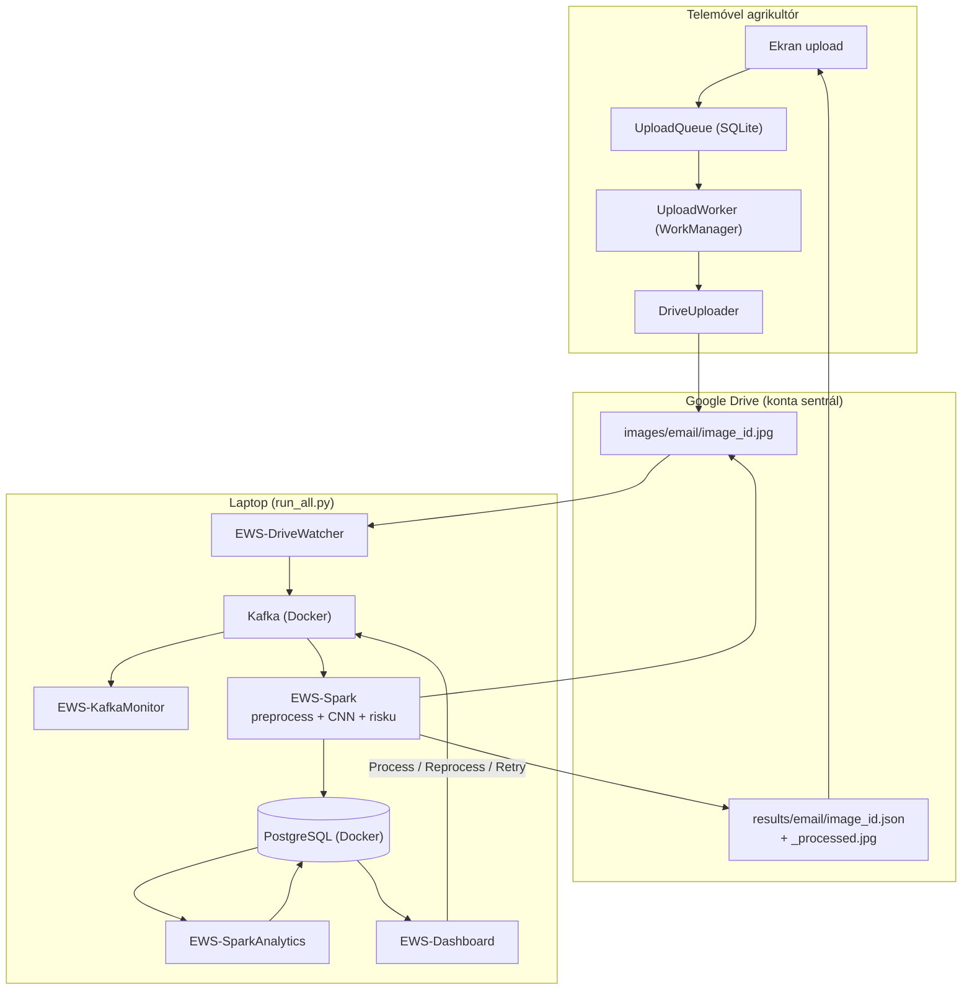
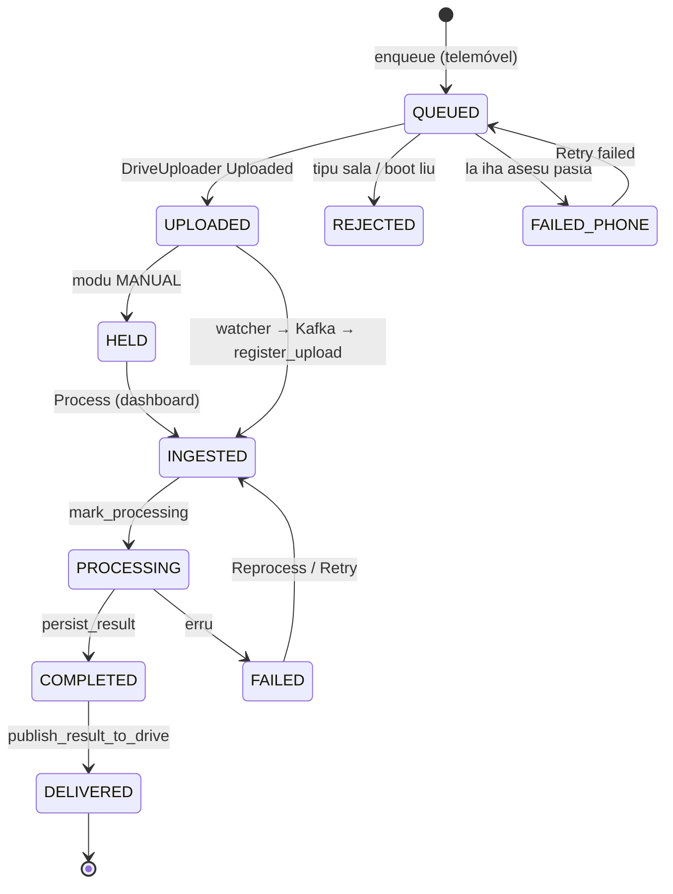
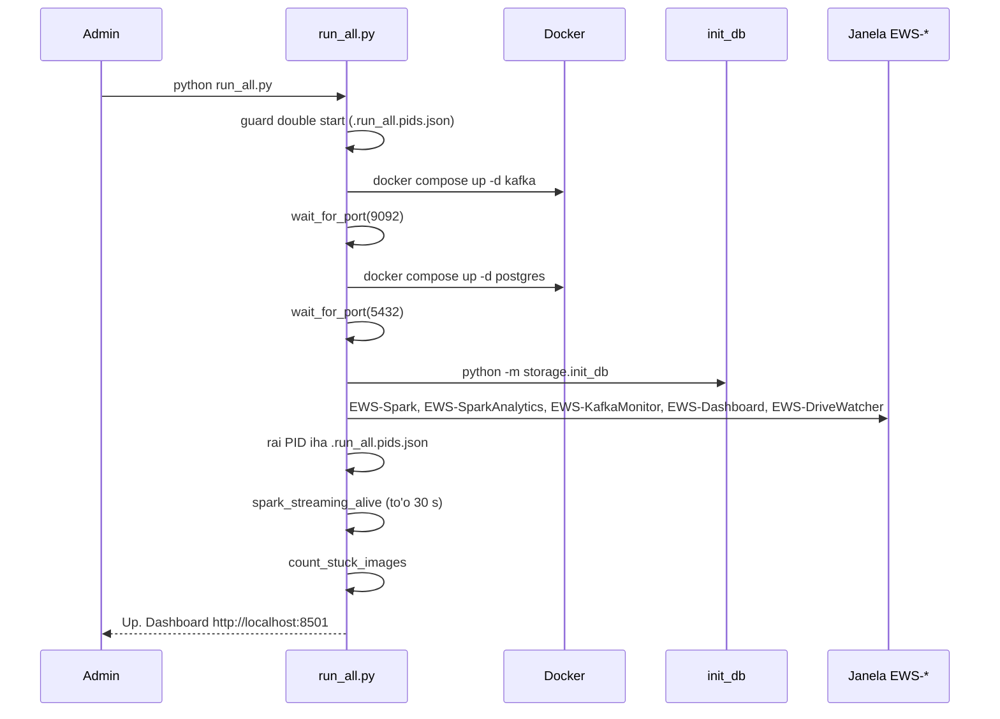
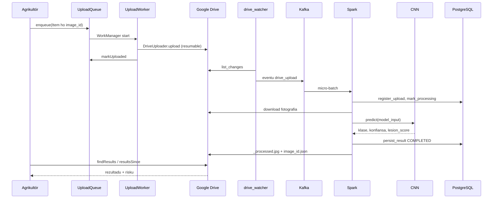
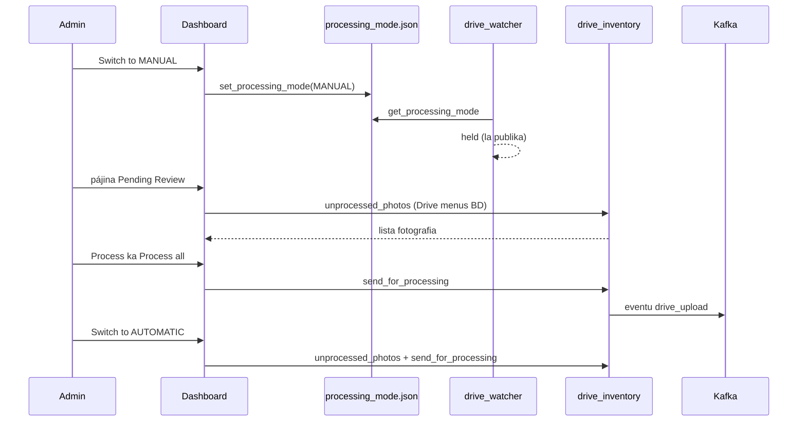

# 06 — Modulu Integrasaun Fim-ba-Fim (End-to-End)

*Sistema Crop Disease Early Warning System (EWS) — dokumentasaun téknika ba fluxu tomak: husi agrikultór foti fotografia iha telemóvel to'o rezultadu fila ba telemóvel, inklui oinsá hahú sistema (`run_all.py`), fila upload Android, dashboard admin (modu MANUAL, Process, Reprocess, Retry), no pontu entrega importante iha Spark. Ba estudante ne'ebé foin hahú programasaun. Fonte úniku: kódigu iha repozitóriu (branch `main`, commit `302818f`).*

{{coverage run_all.py 1-328}}
{{coverage android_app/app/src/main/java/com/cropdisease/app/UploadQueue.kt 1-249}}
{{coverage android_app/app/src/main/java/com/cropdisease/app/UploadWorker.kt 1-207}}
{{coverage dashboard/app.py 213-263 552-560 574-649}}
{{coverage dashboard/image_management_page.py 204-207 226-239}}
{{coverage storage/pipeline_submit.py 26-57}}
{{coverage spark/streaming_job.py 203-299}}

> **Oinsá lee.** Bloku kódigu kada ida tuir pasu 9: (1) Kódigu orijinál, (2) Objetivu, (3) Fundamentu Python (ba Kotlin: fundamentu Kotlin), (4) Esplikasaun liña-ba-liña, (5) Walkthrough ezekusaun, (6) Tipu dadus, (7) Ligasaun OOP, (8) Impaktu integrasaun, (9) Checkpoint ba principiante. Etiketa: *Implementadu*, *Inferidu*, *Teoria*, *Ezemplu ilustrativu*. Modulu 01–05 esplika kada komponente ho detallu; modulu ne'e hatudu oinsá sira liga.

## A. Introdusaun no Objetivu

### A.1 Papél modulu ne'e

Modulu ne'e hatán pergunta "saida mak akontese, tuir orden, bainhira agrikultór haruka fotografia ida?" no "oinsá sistema hahú?". Komponente sira:

| # | Komponente | Fatin | Janela / prosesu |
|---|---|---|---|
| 1 | Aplikasaun Android (fila upload + worker) | `UploadQueue.kt`, `UploadWorker.kt`, `DriveUploader.kt` | telemóvel |
| 2 | Google Drive | pasta `images/<email>`, `results/<email>` | nuvem |
| 3 | Drive watcher | `kafka/drive_watcher.py` | `EWS-DriveWatcher` |
| 4 | Kafka (Docker) | `docker-compose.yml` | container |
| 5 | Monitor Kafka | `kafka/monitor.py` | `EWS-KafkaMonitor` |
| 6 | Spark streaming + CNN | `spark/streaming_job.py`, `ml/` | `EWS-Spark` |
| 7 | Spark analítika | `spark/batch_analytics.py --watch` | `EWS-SparkAnalytics` |
| 8 | PostgreSQL (Docker) | `docker-compose.yml` | container |
| 9 | Dashboard (Streamlit) | `dashboard/app.py` | `EWS-Dashboard` (http://localhost:8501) |
| 10 | Lansadór | `run_all.py` | terminál |

### A.2 Problema ne'ebé modulu ne'e rezolve

- **Komponente barak atu hahú** → `run_all.py` hahú hotu ho orden loloos (Docker → BD → serbisu), kada ida iha janela rasik, rai PID, no hapara hotu ho `--stop`.
- **Upload rihun iha rede la estável** → `UploadQueue` (SQLite iha telemóvel) + `UploadWorker` (WorkManager, foreground, retry, paralelu 3).
- **Admin hakarak kontrola** → modu MANUAL: fotografia hein iha Drive; "Process", "Process all", "Switch to AUTOMATIC".
- **Fotografia falla** → "Reprocess"/"Retry processing" → eventu `submit` foun.

### A.3 Fundamentu Python no Kotlin (foun iha modulu ne'e)

**Lembra** (Modulu 01–05): klase, objetu, `self`, `__init__`, herança, `with`, thread, JSON, enum, Kotlin `object`/`data class`/`sealed class`/null-safety.

**Python**

1. **`subprocess.Popen(...)`** — hahú programa seluk no la hein; **`subprocess.run(...)`** — hahú no hein (fó `returncode`, `stdout`).
2. **`shutil.which("docker")`** — buka programa iha `PATH` (ka `None`).
3. **`socket.connect_ex((host, port))`** — `0` se port loke.
4. **`os.kill(pid, 0)`** — kontrola prosesu moris (Linux); `tasklist`/`taskkill` iha Windows.
5. **Streamlit (Teoria)** — dashboard web husi script Python. Script halai fali tomak kada interasaun. `st.button(...)` fó `True` iha execusaun ne'ebé ema klik; `st.rerun()` halai fali script; `st.session_state` rai valór entre execusaun; `@st.cache_data(ttl=60)` rai rezultadu funsaun 60 s; `@st.fragment(run_every=N)` halai parte ida kada N segundu.

**Kotlin**

| Kotlin | Signifika |
|---|---|
| `class A private constructor(...) : B(...)` | konstrutór privadu (labele harii husi liur) + herança |
| `companion object { ... }` | membru "estátiku" klase (hanesan atributu/métodu klase Python) |
| `@Volatile` + `synchronized(this) { }` | singleton thread-safe (double-checked locking) |
| `override fun onCreate(...)` | troka métodu klase inan |
| `SQLiteOpenHelper` | klase Android ba base de dadus SQLite lokál |
| `db.beginTransaction()/setTransactionSuccessful()/endTransaction()` | transasaun |
| `ContentValues().apply { put(...) }` | "dict" valór ba SQLite; `apply` konfigura objetu |
| `fun Cursor.toItem(): Item` | *extension function* — aumenta métodu ba klase seluk |
| `buildList { add(...) }` | harii lista |
| `Worker` / `WorkManager` / `Result.success()/retry()/failure()` | serbisu background Android ne'ebé moris liu app taka no reboot |
| `Executors.newFixedThreadPool(3)`, `Callable`, `invokeAll` | pool thread Java |
| `for ((a, b) in lista) when (b) { is X -> ... }` | destructuring + `when` ba tipu |

## B. Arkivu Fonte Loloos

| Arkivu | Liña | Klase / funsaun | Serbisu |
|---|---|---|---|
| `run_all.py` | 328 | `start_service`, `pid_alive`, `stop_pid`, `read_pid_file`, `find_service_windows`, `spark_streaming_alive`, `count_stuck_images`, `port_in_use`, `wait_for_port`, `main` | Hahú/hapara sistema tomak |
| `UploadQueue.kt` | 249 | `class UploadQueue : SQLiteOpenHelper`, `Item`, `Counts` | Fila upload permanente iha telemóvel |
| `UploadWorker.kt` | 207 | `class UploadWorker : Worker` | Upload background ho notifikasaun |
| `dashboard/app.py` | 213–263, 552–560, 574–649 | `_switch_to_automatic_and_drain`, `_pending_drive_photos`, botaun modu, Reprocess, pájina Pending Review | Kontrola admin |
| `dashboard/image_management_page.py` | 204–207, 226–239 | botaun Retry, `_retry` | Retry fotografia FAILED |
| `storage/pipeline_submit.py` | 26–57 | `UPLOAD_REJECTED_PREFIX`, `NotResubmittable`, `is_upload_rejected`, `submit_image_for_processing` | Haruka fali ba Kafka |
| `spark/streaming_job.py` | 203–299 | `process_and_persist`, `foreach_batch_sink`, `_upload_result`, `_process_one` | Pontu entrega Spark |

## C. Arkitetura no Fluxu Ezekusaun

### C.1 Arkitetura jerál

### C.2 Estadu fotografia (husi telemóvel to'o rezultadu)

(`QUEUED/UPLOADED/REJECTED/FAILED_PHONE` = estadu iha `UploadQueue` telemóvel; `HELD` = la publika iha watcher; `INGESTED...COMPLETED/FAILED` = `images.status` iha PostgreSQL; `DELIVERED` = `result_published_at` iha.)

### C.3 Sekuénsia: hahú sistema (`run_all.py`)

### C.4 Sekuénsia: fotografia ida (modu AUTOMATIC)

### C.5 Sekuénsia: modu MANUAL no Process

### C.6 Trasu ho tempu (*Ezemplu ilustrativu*)

Tempu sira iha ne'e mak ilustrativu (la mede iha sesaun ne'e); orden no funsaun loloos.

| t (s) | Fatin | Asaun |
|---|---|---|
| 0.0 | Telemóvel | `UploadQueue.enqueue` (image_id `a1b2...`) |
| 0.1 | Telemóvel | `UploadWorker.doWork` → token → `myFolders` |
| 0.3–3.0 | Telemóvel → Drive | `uploadImage` resumable (2.4 MB) |
| 3.0 | Telemóvel | `markUploaded`, notifikasaun "1 of 1" |
| 3.0–6.0 | Laptop | watcher `list_changes` (kada 1–3 s) hetan arkivu |
| 6.1 | Laptop | eventu → Kafka (offset 57); monitor hakerek liña |
| 7.0 | Laptop | Spark micro-batch (trigger 1 s) |
| 7.1 | Laptop | `register_upload` (`INGESTED`), `mark_processing` |
| 7.1–8.3 | Laptop | download Drive (paralelu ho `clean_event`) |
| 8.5 | Laptop | `prepare_image` + `model_input` |
| 8.6 | Laptop | CNN `predict` → `northern_leaf_blight` 0.95 |
| 8.9 | Laptop | Grad-CAM + `render_processed_image` |
| 9.0 | Laptop | `persist_result` → `COMPLETED` |
| 9.0–10.5 | Laptop → Drive | `_upload_result` → `_processed.jpg` + `.json` |
| ≤ 40 | Laptop | `batch_analytics.watch` (kada 30 s) atualiza `analytics_*` |
| depois | Telemóvel | `resultsSince` → rezultadu iha ekran |
