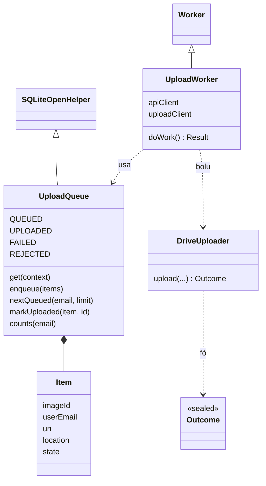

### D.4 Dashboard — kontrola admin

#### D.4.1 Modu AUTOMATIC / MANUAL (`dashboard/app.py` 213–263)

**1. Kódigu orijinál**

{{code dashboard/app.py 213-263}}

**2. Objetivu**

Hatudu modu agora iha sidebar no botaun atu troka. MANUAL → AUTOMATIC: haruka fotografia hotu ne'ebé hein (Drive menus BD). Lista fotografia hein cache 60 s.

**3. Fundamentu Python**

Streamlit (A.3.5): `st.sidebar.*`, `st.button` (`True` bainhira klik), `st.rerun()`, `st.session_state.pop(...)`, `@st.cache_data(ttl=60, show_spinner=...)`, `_pending_drive_photos.clear()` (hamoos cache).

**4. Esplikasaun liña-ba-liña**

- **Liña 213–216** — Komentáriu seksaun: modu AUTOMATIC/MANUAL (`storage/processing_mode.json`); MANUAL: fotografia hein iha Drive no Pending Review lista sira.
- **Liña 217** — `def _switch_to_automatic_and_drain():`
- **Liña 218** — Docstring: troka ba AUTOMATIC no haruka fotografia hotu ne'ebé hein; fó (released, failed).
- **Liña 219** — `set_processing_mode(ProcessingMode.AUTOMATIC)` — uluk, atu watcher kontinua.
- **Liña 220** — `with SessionLocal() as s:`
- **Liña 221** — `waiting = drive_inventory.unprocessed_photos(s)`.
- **Liña 222** — `released, failed = drive_inventory.send_for_processing(waiting, get_backend(KAFKA_TOPIC))`.
- **Liña 223** — `_pending_drive_photos.clear()` — hamoos cache.
- **Liña 224** — `return released, failed`.
- **Liña 227** — `@st.cache_data(ttl=60, show_spinner="Checking Google Drive…")`.
- **Liña 228** — `def _pending_drive_photos() -> list:`
- **Liña 229–230** — Docstring: fotografia agrikultór iha Drive ne'ebé Spark seidauk rejista (`[]` se Drive la bele asesu); cache minutu ida (lista presiza segundu).
- **Liña 231** — `if not drive_client.is_configured():`
- **Liña 232** — `return []`.
- **Liña 233** — `try:`
- **Liña 234** — `with SessionLocal() as s:`
- **Liña 235** — `return drive_inventory.unprocessed_photos(s)`.
- **Liña 236** — `except Exception:` — komentáriu: Drive problema: la hatudu buat ida volta ne'e.
- **Liña 237** — `return []`.
- **Liña 240** — `current_mode = get_processing_mode()`.
- **Liña 242** — `st.sidebar.divider()`.
- **Liña 243** — `st.sidebar.markdown(f"**Processing mode** &nbsp; `{current_mode.value}`")`.
- **Liña 245** — `_mode_msg = st.session_state.pop("_mode_switch_msg", None)` — mensajen husi execusaun anterior.
- **Liña 246** — `if _mode_msg:`
- **Liña 247** — `st.sidebar.success(_mode_msg)`.
- **Liña 249** — `if current_mode == ProcessingMode.AUTOMATIC:`
- **Liña 250** — `st.sidebar.caption("Uploads are queued for the CNN pipeline immediately.")`.
- **Liña 251** — `if st.sidebar.button("Switch to MANUAL", icon="🔀"):`
- **Liña 252** — `set_processing_mode(ProcessingMode.MANUAL)`.
- **Liña 253** — `st.rerun()`.
- **Liña 254** — `else:`
- **Liña 255–256** — `st.sidebar.caption(...)` — upload hela iha Drive no hein iha Pending Review to'o Process; troka AUTOMATIC haruka hotu.
- **Liña 257** — `if st.sidebar.button("Switch to AUTOMATIC", icon="🔀"):`
- **Liña 258** — `released, failed = _switch_to_automatic_and_drain()`.
- **Liña 259** — `msg = f"Switched to AUTOMATIC — sent {released} waiting photo(s)"`.
- **Liña 260** — `if failed:`
- **Liña 261** — `msg += f", {failed} failed to publish"`.
- **Liña 262** — `st.session_state["_mode_switch_msg"] = msg + "."` — hatudu depois rerun.
- **Liña 263** — `st.rerun()`.

**5. Walkthrough ezekusaun**

Modu MANUAL, fotografia 5 hein → admin klik "Switch to AUTOMATIC" → `set_processing_mode(AUTOMATIC)` → `send_for_processing(5)` → `(5, 0)` → rerun → "Switched to AUTOMATIC — sent 5 waiting photo(s).".

**6. Tipu dadus**

`current_mode`: `ProcessingMode`; `_switch_to_automatic_and_drain -> tuple[int, int]`; `_pending_drive_photos -> list[tuple[dict, str]]`.

**7. Ligasaun OOP**

`@st.cache_data` mak decorator ne'ebé fó objetu ho métodu `.clear()`. `ProcessingMode` enum.

**8. Impaktu integrasaun**

Watcher lee arkivu modu kada fotografia (Modulu 03 D.6.1); eventu ne'ebé haruka hanesan ho watcher (`build_drive_event`).

**9. Checkpoint ba principiante**

**P:** Tanba sá `set_processing_mode(AUTOMATIC)` molok haruka fotografia hein?
**R:** Atu fotografia foun ne'ebé mai durante haruka mós publika husi watcher (la hela iha MANUAL).

#### D.4.2 Botaun Reprocess (`dashboard/app.py` 552–560)

**1. Kódigu orijinál**

{{code dashboard/app.py 552-560}}

**2. Objetivu**

Ba fotografia `FAILED` (exetu upload rejeitadu iha rejistu), botaun "Reprocess" haruka fali ba pipeline.

**3. Fundamentu Python**

`try/except` ho `st.success`/`st.error`; `key=f"reprocess_{img.image_id}"` (chave úniku Streamlit).

**4. Esplikasaun liña-ba-liña**

- **Liña 552** — Komentáriu: Reprocess, exetu upload rejeita iha rejistu.
- **Liña 553** — `if img.status == ProcessingStatus.FAILED and not is_upload_rejected(img):`
- **Liña 554** — `if st.button("Reprocess", icon="🔄", key=f"reprocess_{img.image_id}"):`
- **Liña 555** — `try:`
- **Liña 556** — `submit_image_for_processing(session, img)` — D.5.1.
- **Liña 557** — `st.success("Re-queued.")`.
- **Liña 558** — `st.rerun()`.
- **Liña 559** — `except Exception as e:`
- **Liña 560** — `st.error(f"Couldn't re-queue: {e}")`.

**5. Walkthrough ezekusaun**

Fotografia FAILED ("Image file not found in Google Drive...") → Reprocess → `INGESTED` + eventu `submit` → Spark prosesa fali.

**6. Tipu dadus**

`img`: `Image` (ORM); `session`: `Session`.

**7. Ligasaun OOP**

Lee atributu objetu ORM (`img.status`, `img.image_id`).

**8. Impaktu integrasaun**

Eventu `submit` → Kafka → Spark (`_process_one` → `replay_state` = `None` tanba la'ós COMPLETED).

**9. Checkpoint ba principiante**

**P:** Tanba sá upload rejeitadu la iha botaun Reprocess?
**R:** Upload rejeitadu iha rejistu (ezemplu email la autoriza) — haruka fali sei falla hanesan; `submit_image_for_processing` mós hamosu `NotResubmittable`.

#### D.4.3 Pájina Pending Review (`dashboard/app.py` 574–649)

**1. Kódigu orijinál**

{{code dashboard/app.py 574-649}}

**2. Objetivu**

Lista fotografia iha pasta Drive agrikultór ne'ebé seidauk haruka (modu MANUAL), foun uluk, ho paginasaun 24, thumbnail, no botaun "Process" (ida) ka "Process all". Fotografia haruka husi pájina ne'e subar to'o Spark rejista. Kontrola mudansa kada `_REFRESH_SECONDS`.

**3. Fundamentu Python**

Funsaun lokál (closure ba `sent`); `st.session_state.setdefault(k, set())`; `@st.fragment(run_every=...)`; `-(-a // b)` (divizaun arredonda ba leten); `st.columns([4, 1])`; `with st.container(border=True):`.

**4. Esplikasaun liña-ba-liña**

- **Liña 574** — `elif page == "Pending Review":`
- **Liña 575** — `st.subheader("Photos waiting in Google Drive")`.
- **Liña 576–581** — `st.caption(...)` — iha MANUAL watcher la haruka buat ida; lista mak fotografia hotu iha pasta Drive agrikultór ne'ebé seidauk haruka; Process haruka ba Kafka — eventu hanesan modu automátiku — no Spark rejista no analiza.
- **Liña 583** — Komentáriu: haruka husi pájina ne'e maibé seidauk rejista: subar.
- **Liña 584** — `sent = st.session_state.setdefault("_sent_pending", set())`.
- **Liña 586** — `def _waiting() -> list:`
- **Liña 587–588** — `return [(m, f) for m, f in reversed(_pending_drive_photos()) if (m.get("appProperties") or {}).get("image_id") not in sent]` — foun uluk.
- **Liña 590** — `def _waiting_ids(photos) -> list:`
- **Liña 591** — `return [(m.get("appProperties") or {}).get("image_id") for m, _ in photos]`.
- **Liña 593** — `def _send(photos) -> tuple:`
- **Liña 594** — `result = drive_inventory.send_for_processing(photos, get_backend(KAFKA_TOPIC))`.
- **Liña 595** — `sent.update(_waiting_ids(photos))`.
- **Liña 596** — `_pending_drive_photos.clear()`.
- **Liña 597** — `return result`.
- **Liña 599** — Komentáriu: kontrola barata kada `_REFRESH_SECONDS`; desenha fali só bainhira lista muda.
- **Liña 600** — `if _REFRESH_SECONDS > 0:`
- **Liña 601** — `@st.fragment(run_every=_REFRESH_SECONDS)`.
- **Liña 602** — `def _watch_waiting(shown: list):`
- **Liña 603** — `if _waiting_ids(_waiting()) != shown:`
- **Liña 604** — `st.rerun(scope="app")`.
- **Liña 605** — `st.caption("🔄 Checks Google Drive for new uploads about once a minute.")`.
- **Liña 607** — `waiting = _waiting()`.
- **Liña 608** — `if _REFRESH_SECONDS > 0:`
- **Liña 609** — `_watch_waiting(_waiting_ids(waiting))`.
- **Liña 611** — `if not waiting:`
- **Liña 612** — `st.success(f"Nothing is waiting. Current mode: `{get_processing_mode().value}`.")`.
- **Liña 613** — `else:`
- **Liña 614** — `st.write(f"**{len(waiting)}** photo(s) awaiting processing.")`.
- **Liña 615** — `if st.button(f"Process all {len(waiting)}", icon="⚡", type="primary"):`
- **Liña 616** — `ok, fail = _send(waiting)`.
- **Liña 617** — `st.success(f"Sent {ok} photo(s)." + (f" {fail} failed." if fail else ""))`.
- **Liña 618** — `st.rerun()`.
- **Liña 620** — `st.divider()`.
- **Liña 621** — `per_page = 24`.
- **Liña 622** — `pages = max(1, -(-len(waiting) // per_page))` — ezemplu 50 → 3 pájina.
- **Liña 623** — `page_no = int(st.number_input("Page", 1, pages, 1, key="pending_page")) if pages > 1 else 1`.
- **Liña 624** — `if pages > 1:`
- **Liña 625** — `st.caption(f"Page {page_no} of {pages}, newest first.")`.
- **Liña 626** — `for meta, folder_email in waiting[(page_no - 1) * per_page: page_no * per_page]:`
- **Liña 627** — `props = meta.get("appProperties") or {}`.
- **Liña 628** — `image_id = props.get("image_id")`.
- **Liña 629** — `with st.container(border=True):`
- **Liña 630** — `c1, c2 = st.columns([4, 1])`.
- **Liña 631** — `with c1:`
- **Liña 632** — `st.markdown(f"`{image_id}`")`.
- **Liña 633** — `uploaded = drive_inventory.uploaded_at(meta)`.
- **Liña 634–637** — `st.caption(f"{location} · {folder_email} · uploaded {format_local(uploaded)}")`.
- **Liña 638** — `photo = _drive_thumbnail(meta["id"])`.
- **Liña 639** — `if photo is not None:`
- **Liña 640** — `st.image(photo, width=180)`.
- **Liña 641** — `else:`
- **Liña 642** — `st.caption("(image file not found in Google Drive)")`.
- **Liña 643** — `if c2.button("Process", key=f"process_{image_id}", type="primary"):`
- **Liña 644** — `ok, _ = _send([(meta, folder_email)])`.
- **Liña 645** — `if ok:`
- **Liña 646** — `st.success(f"Sent {image_id[:8]}… to the pipeline.")`.
- **Liña 647** — `st.rerun()`.
- **Liña 648** — `else:`
- **Liña 649** — `st.error("Failed to send it to Kafka — see the dashboard console.")`.

**5. Walkthrough ezekusaun**

*Ezemplu ilustrativu:* fotografia 30 hein → pájina 2 (24 + 6) → admin klik "Process" ba ida → `send_for_processing` → `(1, 0)` → subar husi lista → Spark rejista → `unprocessed_photos` la fó tan.

**6. Tipu dadus**

`sent`: `set[str]`; `waiting`: `list[tuple[dict, str]]`; `pages`, `page_no`, `per_page`: `int`.

**7. Ligasaun OOP**

Closure `_waiting`/`_send` kaer `sent` (objetu `set` iha `session_state`). Streamlit `container`/`columns` mak context manager.

**8. Impaktu integrasaun**

Kálkulu "PENDING = Drive menus BD" husi `drive_inventory` (Modulu 03 D.6.2).

**9. Checkpoint ba principiante**

**P:** Tanba sá rai `sent` iha `session_state`?
**R:** Script Streamlit halai fali kada klik; `session_state` mantein lista fotografia ne'ebé haruka ona atu sira la hatudu fali molok Spark rejista.

#### D.4.4 Retry husi Image management (`dashboard/image_management_page.py`)

**1. Kódigu orijinál**

{{code dashboard/image_management_page.py 204-207}}

{{code dashboard/image_management_page.py 226-239}}

**2. Objetivu**

Botaun "Retry processing" ba fotografia FAILED (la'ós upload rejeitadu); `_retry` kontrola fali katak fotografia sei FAILED molok haruka.

**3. Fundamentu Python**

Kondisaun ho `and` naruk iha parénteze; import lokál.

**4. Esplikasaun liña-ba-liña**

- **Liña 204** — `if (row["status"] == "FAILED"`
- **Liña 205** — `and not (row["error_message"] or "").startswith(UPLOAD_REJECTED_PREFIX)`
- **Liña 206** — `and st.button("Retry processing", icon="🔄", key="im_retry")):`
- **Liña 207** — `_retry(row["image_id"])`.
- **Liña 226** — `def _retry(image_id: str):`
- **Liña 227** — Docstring: haruka imajen FAILED ba pipeline fali (só se sei FAILED).
- **Liña 228** — `from storage.pipeline_submit import submit_image_for_processing`.
- **Liña 229** — `with SessionLocal() as s:`
- **Liña 230** — `img = s.get(Image, image_id)`.
- **Liña 231** — `if img is None or img.status != ProcessingStatus.FAILED:` — status muda ona (ezemplu Spark prosesa).
- **Liña 232** — `st.session_state["im_msg"] = "Not retried: the image is no longer FAILED."`.
- **Liña 233** — `else:`
- **Liña 234** — `try:`
- **Liña 235** — `submit_image_for_processing(s, img)`.
- **Liña 236** — `st.session_state["im_msg"] = f"Sent {image_id[:8]}… to the pipeline again."`.
- **Liña 237** — `except Exception as e:`
- **Liña 238** — `st.session_state["im_msg"] = f"Could not queue it: {e}"`.
- **Liña 239** — `st.rerun()`.

**5. Walkthrough ezekusaun**

Admin abre detallu fotografia FAILED → "Retry processing" → "Sent a1b2c3d4… to the pipeline again.".

**6. Tipu dadus**

`row`: `pandas.Series` (husi `v_admin_image_catalog`, Inferidu); `image_id`: `str`.

**7. Ligasaun OOP**

Objetu ORM `Image` husi `s.get`.

**8. Impaktu integrasaun**

Hanesan Reprocess (D.4.2) — dalan rua ba funsaun ida (`submit_image_for_processing`).

**9. Checkpoint ba principiante**

**P:** Tanba sá `_retry` kontrola fali `status != FAILED`?
**R:** Pájina bele tuan (status muda entre hatudu no klik); kontrola fali evita haruka fotografia COMPLETED.

### D.5 `storage/pipeline_submit.py` — haruka fali ba Kafka

#### D.5.1 Upload rejeitadu no `submit_image_for_processing`

**1. Kódigu orijinál**

{{code storage/pipeline_submit.py 26-57}}

**2. Objetivu**

Regra upload rejeitadu (`"Upload rejected: "`) no funsaun ne'ebé Reprocess/Retry/Process uza: marka `INGESTED` (commit uluk), publika eventu `submit`; erru publika → `FAILED`.

**3. Fundamentu Python**

Herança exception; `raise` re-raise.

**4. Esplikasaun liña-ba-liña**

- **Liña 26** — Komentáriu: prefiksu `error_message` ba upload rejeita iha rejistu.
- **Liña 27** — `UPLOAD_REJECTED_PREFIX = "Upload rejected: "`.
- **Liña 30** — `class NotResubmittable(ValueError):`
- **Liña 31** — Docstring: upload rejeitadu; labele analiza.
- **Liña 34** — `def is_upload_rejected(image) -> bool:`
- **Liña 35–36** — `return (image.status == ProcessingStatus.FAILED and (image.error_message or "").startswith(UPLOAD_REJECTED_PREFIX))`.
- **Liña 39** — `def submit_image_for_processing(session, image, backend=None) -> None:`
- **Liña 40–41** — Docstring: marka INGESTED, depois publika; erru publika → FAILED + re-raise; rejeita upload rejeitadu.
- **Liña 42** — `if is_upload_rejected(image):`
- **Liña 43** — `raise NotResubmittable(f"{image.error_message} — this upload can't be processed")`.
- **Liña 44** — `backend = backend or get_backend(KAFKA_TOPIC)`.
- **Liña 45** — Komentáriu: commit INGESTED molok publika, atu rezultadu Spark labele troka.
- **Liña 46** — `if image.status == ProcessingStatus.FAILED:`
- **Liña 47** — `image.status = ProcessingStatus.INGESTED`.
- **Liña 48** — `image.error_message = None`.
- **Liña 49** — `image.ingested_at = now_utc()`.
- **Liña 50** — `session.commit()`.
- **Liña 51** — `try:`
- **Liña 52** — `backend.send(build_upload_event(image))`.
- **Liña 53** — `except Exception as e:`
- **Liña 54** — `image.status = ProcessingStatus.FAILED`.
- **Liña 55** — `image.error_message = f"Kafka publish failed: {e}"`.
- **Liña 56** — `session.commit()`.
- **Liña 57** — `raise`.

**5. Walkthrough ezekusaun**

Haree Modulu 02 D.4.2.

**6. Tipu dadus**

`session`: `Session`; `image`: `Image`; return `None`; exception `NotResubmittable`, erru backend.

**7. Ligasaun OOP**

`NotResubmittable(ValueError)` — herança; `backend` — duck typing.

**8. Impaktu integrasaun**

Dashboard (D.4.2, D.4.4) no `requeue_stuck` bolu.

**9. Checkpoint ba principiante**

**P:** Saida mak "race" ne'ebé commit-uluk evita?
**R:** Se publika uluk, Spark bele hakerek COMPLETED molok commit `INGESTED` — commit tarde sei troka rezultadu.

### D.6 `spark/streaming_job.py` — pontu entrega Spark

#### D.6.1 `process_and_persist`, `foreach_batch_sink`, `_upload_result`

**1. Kódigu orijinál**

{{code spark/streaming_job.py 203-256}}

**2. Objetivu**

Husi perspetiva fim-ba-fim: `process_and_persist` mak fatin rezultadu tama BD (COMPLETED/FAILED); `foreach_batch_sink` mak fatin Kafka entrega batch ba Python no fatin Spark "commit" (depois upload Drive hotu); `_upload_result` mak fatin rezultadu sai ba Drive.

**3. Fundamentu Python**

Haree Modulu 01 D.2.8–D.2.9.

**4. Esplikasaun liña-ba-liña**

- **Liña 203** — `def process_and_persist(event: dict, rejected_reason: str = None, **stamps) -> tuple:` — entrega Spark → BD.
- **Liña 204–205** — Docstring: `process_event`, depois rai COMPLETED ka FAILED; nunka hamosu erru; fó `(result, status, error)`.
- **Liña 206** — `result = None`.
- **Liña 207** — `try:`
- **Liña 208** — `if rejected_reason:`
- **Liña 209** — `raise InvalidEvent(rejected_reason)`.
- **Liña 210** — `result = process_event(event)` — preprocess + CNN + risku.
- **Liña 211** — `persist_result(event, result, ProcessingStatus.COMPLETED, **stamps)` — **BD**.
- **Liña 212** — `return result, ProcessingStatus.COMPLETED, None`.
- **Liña 213** — `except Exception as e:`
- **Liña 214–215** — `print(...)` — "Invalid event, skipping" ka "Processing failed for ...".
- **Liña 216** — `try:`
- **Liña 217** — `persist_result(event, None, ProcessingStatus.FAILED, error_message=str(e), **stamps)` — **BD** FAILED.
- **Liña 218** — `except Exception as db_error:` — fotografia hela PROCESSING; `requeue_stuck` koko fali.
- **Liña 219** — `print(...)`.
- **Liña 220** — `return result, ProcessingStatus.FAILED, str(e)`.
- **Liña 223** — `def foreach_batch_sink(batch_df, batch_id):` — entrega Kafka → Python.
- **Liña 224** — `if batch_df.isEmpty():`
- **Liña 225** — `return`.
- **Liña 226** — Komentáriu: hasai duplikadu tuir `image_id`.
- **Liña 227** — `named = col("image_id").isNotNull() & (col("image_id") != "")`.
- **Liña 228** — `deduped = batch_df.filter(named).dropDuplicates(["image_id"]).unionByName(batch_df.filter(~named))`.
- **Liña 229** — `events = [row.asDict() for row in deduped.collect()]`.
- **Liña 230** — `started = time.monotonic()`.
- **Liña 231** — `live_log.batch_started(batch_id, len(events))`.
- **Liña 232** — `if len(events) <= 1 or SPARK_PARALLEL_PHOTOS <= 1:`
- **Liña 233** — `uploads = [_process_one(event) for event in events]`.
- **Liña 234** — `else:`
- **Liña 235** — `with ThreadPoolExecutor(max_workers=min(SPARK_PARALLEL_PHOTOS, len(events))) as pool:`
- **Liña 236** — `uploads = list(pool.map(_process_one, events))`.
- **Liña 237** — Komentáriu: commit batch só depois upload Drive hotu koko ona, atu crash halo replay.
- **Liña 238** — `statuses = [upload.result() if upload is not None else None for upload in uploads]`.
- **Liña 239** — `failed = [...]` — `image_id` FAILED.
- **Liña 240** — `if resent := resend_duplicates_of(failed):`
- **Liña 241** — `live_log.say(...)`.
- **Liña 242–244** — `live_log.batch_committed(batch_id, ok=..., failed=..., skipped=..., seconds=...)`.
- **Liña 247** — `_UPLOADS = ThreadPoolExecutor(max_workers=max(1, SPARK_DRIVE_UPLOAD_WORKERS), thread_name_prefix="drive-upload")`.
- **Liña 250** — `def _upload_result(event, status, error, processed_image):` — entrega Spark → Drive.
- **Liña 251** — Docstring: haruka rezultadu ida ba Drive; nunka hamosu erru; fó status fotografia.
- **Liña 252** — `started = time.monotonic()`.
- **Liña 253** — `file_id = publish_result_to_drive_safely(event, status, error, processed_image=processed_image)` — **Drive**.
- **Liña 254** — `if is_drive_path(event.get("image_path") or ""):`
- **Liña 255** — `live_log.result_delivered(event, file_id is not None, time.monotonic() - started)`.
- **Liña 256** — `return status`.

**5. Walkthrough ezekusaun**

Haree C.6 t = 7.0–10.5 s.

**6. Tipu dadus**

Haree Modulu 01 D.2.8–D.2.9.

**7. Ligasaun OOP**

Haree Modulu 01.

**8. Impaktu integrasaun**

Pontu entrega 3: Kafka → Python (`foreach_batch_sink`), Spark → BD (`persist_result`), Spark → Drive (`_upload_result`).

**9. Checkpoint ba principiante**

**P:** Iha ne'ebé mak Spark "konfirma" katak batch remata?
**R:** Bainhira `foreach_batch_sink` remata (depois upload Drive hotu hein) — Spark hakerek checkpoint offset.

#### D.6.2 `_process_one` — kada fotografia

**1. Kódigu orijinál**

{{code spark/streaming_job.py 259-299}}

**2. Objetivu**

Husi perspetiva fim-ba-fim: fatin eventu Kafka sai liña BD (`register_upload`), fatin replay salta (`replay_state`), fatin status sai `PROCESSING` (dashboard haree "iha prosesu"), no fatin upload Drive tama background.

**3. Fundamentu Python**

Haree Modulu 01 D.2.10.

**4. Esplikasaun liña-ba-liña**

- **Liña 259** — `def _process_one(event: dict):`
- **Liña 260–261** — Docstring: fotografia ida; upload Drive iha background; fó Future ka `None`; nunka hamosu erru.
- **Liña 262** — `if event.get("run_id"):` — eventu teste antigu:
- **Liña 263–264** — `print(...)`.
- **Liña 265** — `return None`.
- **Liña 266** — `rejected_reason = event.pop("rejected_reason", None)`.
- **Liña 267** — `raw_value = event.pop("raw_value", None)`.
- **Liña 268** — `if rejected_reason and not event.get("image_id"):`
- **Liña 269** — `event["raw_value"] = raw_value`.
- **Liña 270–271** — `if (event.get("kind") == DRIVE_UPLOAD and all(event.get(f) for f in ("image_id", "image_path", "owner_email"))):`
- **Liña 272** — Komentáriu: upload rejeita mós hetan liña no falla ho razaun.
- **Liña 273** — `try:`
- **Liña 274** — `outcome = register_upload(event)` — **eventu → liña `images` (INGESTED)** + agrikultór foun.
- **Liña 275** — `except InvalidEvent as e:`
- **Liña 276** — `outcome, rejected_reason = "new", str(e)`.
- **Liña 277** — `if outcome != "new":`
- **Liña 278–279** — `why = (...)`.
- **Liña 280–281** — `print(...)`.
- **Liña 282** — `return None`.
- **Liña 283** — `state = replay_state(event.get("image_id"))`.
- **Liña 284** — `if state == "completed":`
- **Liña 285** — `print(...)`.
- **Liña 286** — `return None` — replay salta.
- **Liña 287** — `if state == "result_missing":`
- **Liña 288** — `print(...)` — COMPLETED maibé la iha Drive; prosesa fali.
- **Liña 289** — `kafka_received_at = datetime.now(timezone.utc)`.
- **Liña 290** — `photo_started = time.monotonic()`.
- **Liña 291** — `image_id = event.get("image_id")`.
- **Liña 292** — `if image_id:`
- **Liña 293** — `mark_processing(image_id)` — **status PROCESSING**.
- **Liña 294** — `spark_started_at = datetime.now(timezone.utc)`.
- **Liña 295–296** — `result, status, error = process_and_persist(event, rejected_reason, kafka_received_at=..., spark_started_at=...)`.
- **Liña 297** — `live_log.photo_done(...)` — liña konsola EWS-Spark.
- **Liña 298** — `processed = result.get("processed_image_jpeg") if result else None`.
- **Liña 299** — `return _UPLOADS.submit(_upload_result, event, status, error, processed)` — upload Drive background.

**5. Walkthrough ezekusaun**

Haree C.6 t = 7.1–9.0 s.

**6. Tipu dadus**

Haree Modulu 01 D.2.10.

**7. Ligasaun OOP**

Haree Modulu 01 D.2.10.

**8. Impaktu integrasaun**

Liga Kafka (eventu), PostgreSQL (`register_upload`, `mark_processing`, `persist_result`), CNN (`process_event`), Drive (`_upload_result`).

**9. Checkpoint ba principiante**

**P:** Tanba sá status muda ba `PROCESSING` molok `process_and_persist`?
**R:** Atu dashboard hatudu fotografia "iha prosesu" durante download + CNN (segundu balun), no `requeue_stuck` hatene fotografia ne'ebé hela iha estadu ne'e.

## E. Analize OOP

### E.1 Klase iha fluxu fim-ba-fim

| Klase | Fatin | Herda | Papél |
|---|---|---|---|
| `UploadQueue` | `UploadQueue.kt` | `SQLiteOpenHelper` | Fila permanente (singleton) |
| `UploadQueue.Item`, `UploadQueue.Counts` | `UploadQueue.kt` | `data class` | Dadus fotografia / kontajen |
| `UploadWorker` | `UploadWorker.kt` | `Worker` | Serbisu background |
| `DriveUploader.Outcome` (+5) | Modulu 03 | `sealed class` | Rezultadu upload polimórfiku |
| `NotResubmittable` | `pipeline_submit.py` | `ValueError` | Erru upload rejeitadu |
| `InvalidEvent` | Modulu 01 | `Exception` | Erru eventu |
| `ProcessingMode`, `ProcessingStatus` | Modulu 03/04 | `str`, `Enum` | Estadu |
| Klase ORM `Image`... | Modulu 04 | `Base` | Liña BD |
| `run_all.py` | — | — | Not implemented in the current codebase (funsaun de'it) |

### E.2 Kolaborasaun objetu

### E.3 Prinsípiu OOP — evidénsia

| Konseitu | Iha? | Evidénsia |
|---|---|---|
| Klase no objetu | Sin | `UploadQueue.get(ctx)` (objetu ida), `Item(...)`, `UploadWorker` (WorkManager harii) |
| Konstrutór | Sin | Kotlin konstrutór primáriu; `UploadQueue` **privadu** |
| Herança | Sin | `UploadQueue : SQLiteOpenHelper`, `UploadWorker : Worker`, `NotResubmittable(ValueError)` |
| Override | Sin | `onCreate`, `onUpgrade`, `doWork` |
| Polimorfizmu | Sin | `when (outcome) { is Uploaded ... }`; `backend.send` (duck typing) iha `submit_image_for_processing`/`send_for_processing` |
| Enkapsulamentu | Sin | Kotlin `private` (`update`, `query`, `releaseSource`, `clearFinished`, `toItem`); Python `_` (`_send`, `_retry`) |
| Singleton | Sin | `UploadQueue.get` (double-checked locking); `object DriveUploader`/`DriveAuth` |
| Komposisaun | Sin | `UploadWorker` na'in cliente OkHttp; `UploadQueue` jere liña `Item` |
| Extension function | Sin (Kotlin) | `Cursor.toItem()` |
| Builder | Uza husi biblioteka | WorkManager, Notification, OkHttp |
| Padraun Command/Queue | Sin (prinsípiu) | `UploadQueue` rai "komando upload" atu ezekuta depois |
| Klase orquestradór Python (`run_all`) | Not implemented in the current codebase. | Funsaun procedural |

**Nota aprendizajen Python — orkestradór orientadu ba objetu (Teoria):** `run_all.py` bele hakerek ho `class Service: def start(self): ...; def stop(self): ...` no lista objetu `Service`. Kódigu atuál uza dict `{"name", "pid"}` no funsaun — simples ba script.

## F. Integrasaun

| Pasu | Husi → Ba | Mekanizmu | Modulu detallu |
|---|---|---|---|
| 1 | Ekran → `UploadQueue` | `enqueue` (SQLite) | 06 D.2 |
| 2 | `UploadWorker` → Drive | `DriveUploader` + `DriveRest.uploadImage` | 03 D.9 |
| 3 | Drive → watcher | `list_changes` | 02 D.3, 03 D.5 |
| 4 | Watcher → Kafka | `ResilientBackend.send` | 02 D.2 |
| 5 | Kafka → Spark | `readStream` + `parse_events` | 01 D.2 |
| 6 | Spark → BD | `register_upload`, `mark_processing`, `persist_result` | 01, 04 |
| 7 | Spark → Drive (download) | `load_image_bytes` | 03 D.3–D.4 |
| 8 | Spark → CNN | `model_input` → `predict` | 01 D.3, 05 D.10–D.12 |
| 9 | Spark → Drive (rezultadu) | `publish_result_to_drive` | 03 D.7 |
| 10 | BD → analítika | `batch_analytics.watch` | 01 D.4 |
| 11 | BD → dashboard/Tableau | `analytics_reader`, view | 01 D.6, 04 |
| 12 | Drive → telemóvel | `findResults`, `resultsSince`, `myHistory` | 03 D.9 |
| 13 | Dashboard → Kafka | Process / Reprocess / Retry / Switch AUTOMATIC | 06 D.4–D.5 |
| 14 | Dashboard → treinu → modelu | Label photos → `train.py` → `model_ops` | 05 |

## G. Tratamentu Erru no Konfiabilidade (fim-ba-fim)

| Falla | Resposta | Fatin |
|---|---|---|
| Telemóvel offline | WorkManager `CONNECTED` constraint; liña hela `QUEUED` | `UploadWorker.enqueue` |
| Upload monu iha klaran | Retry 4 + `findImage` (la duplika) | `DriveUploader` |
| Token expira | Retry ho token foun; `SignInNeeded` → notifikasaun | `DriveUploader`, `UploadWorker` |
| App taka / reboot | Fila SQLite + WorkManager | `UploadQueue`, `UploadWorker` |
| Pasta la partilla | `Result.failure()` + notifikasaun "no access" | `UploadWorker.doWork` |
| Kafka mate | Fila lokál + `drain` | Modulu 02 |
| Spark mate | Mensajen hela iha Kafka; `run_all` aviszu; `requeue_stuck` | `run_all` D.1.7 |
| Fotografia hela PROCESSING/INGESTED | `_auto_resend` kada 300 s | Modulu 01 |
| Rezultadu la to'o Drive | `result_published_at` NULL → `replay_state` "result_missing" | Modulu 01/03 |
| Fotografia FAILED | Reprocess / Retry processing | D.4.2, D.4.4 |
| Upload rejeitadu | La iha botaun; `NotResubmittable` | D.5.1 |
| Admin hakarak kontrola | Modu MANUAL + Pending Review | D.4.1, D.4.3 |
| Komponente hahú dala rua | Guarda PID | `run_all` D.1.4 |
| Docker la iha | Aviszu; PostgreSQL falla → aborta | `run_all` D.1.5 |

**Limitasaun:**

- `run_all.py` iha Windows uza janela `cmd`; reinisia automátiku komponente ne'ebé monu: Not implemented in the current codebase (aviszu de'it).
- Notifikasaun *push* husi laptop ba telemóvel bainhira rezultadu prontu: Not implemented in the current codebase — telemóvel buka rezultadu iha Drive.
- Monitorizasaun sentralizada (métrika/alerta): Not implemented in the current codebase — janela konsola + dashboard.
- Tempu fim-ba-fim depende ba polling (watcher 1–3 s, Spark trigger 1 s, analítika 30 s, telemóvel `resultsSince`).

## H. Sumáriu no Pergunta Akadémiku

### H.1 Sumáriu

`run_all.py` hahú Kafka + PostgreSQL (Docker), `init_db`, no janela 5 (Spark, analítika, monitor, dashboard, watcher), rai PID, kontrola Spark moris, no hatudu fotografia hein. Agrikultór hili fotografia → `UploadQueue` (SQLite, `image_id` fixu) → `UploadWorker` (WorkManager, paralelu 3, retry) → `DriveUploader` → Drive. Watcher (change feed) → Kafka (`drive_upload`) → Spark (`register_upload` → `mark_processing` → download → preprocess → CNN → risku → `persist_result` → `publish_result_to_drive`) → telemóvel lee rezultadu. Analítika Spark atualiza dashboard kada 30 s. Admin kontrola ho modu MANUAL (Pending Review, Process), Reprocess no Retry (eventu `submit`).

### H.2 Pergunta no resposta

**P1. Liste pasu sira fotografia ida liu husi telemóvel to'o rezultadu.**
R: `enqueue` → `UploadWorker.doWork` → `DriveUploader.upload` → Drive `images/<email>/<id>.jpg` → `scan_changes` → `publish_drive_file` → Kafka → `parse_events` → `foreach_batch_sink` → `_process_one` (`register_upload`, `replay_state`, `mark_processing`) → `process_event` (download, EXIF, `prepare_image`, `model_input`, `predict`, `compute_risk`, Grad-CAM, render) → `persist_result` → `_upload_result` → Drive `results/<email>/` → `resultsSince`/`myHistory`.

**P2. Oinsá sistema garante fotografia ida la analiza dala rua?**
R: `image_id` fixu husi telemóvel; `findImage` molok upload fali; watcher `_PUBLISHED`; `register_upload` "duplicate"; `dropDuplicates(image_id)`; `replay_state` "completed"; `persist_result` delete-then-insert; `_ResultFolderIndex` PATCH.

**P3. Saida mak akontese se laptop mate durante fotografia iha PROCESSING?**
R: Batch la commit (Spark hein upload hotu) → restart → Spark lee fali offset → `replay_state` = `None` (la'ós COMPLETED) → prosesa fali. Se eventu lakon, `_auto_resend`/`requeue_stuck` haruka fali fotografia `PROCESSING`/`INGESTED` tuan.

**P4. Diferensa modu AUTOMATIC no MANUAL iha kódigu?**
R: Watcher `publish_drive_file` kontrola `get_processing_mode()`; MANUAL → `"held"`. Dashboard Pending Review uza `drive_inventory.unprocessed_photos` (Drive menus BD) no `send_for_processing` (eventu hanesan watcher).

**P5. Tanba sá `run_all.py` hein Spark to'o 30 s?**
R: Dala uluk Spark download pakote Kafka Maven; Spark mate signifika upload hela `INGESTED` — aviszu sedu ajuda admin.

**P6. Oinsá telemóvel hatene rezultadu prontu?**
R: Telemóvel buka iha Drive (`findResults`, `resultsSince` ho `modifiedTime`) — lee appProperties sumáriu ne'ebé `publish_result_to_drive` hakerek. Push notification: Not implemented in the current codebase.

**P7. Tanba sá `UploadWorker` uza `Result.retry()` ba `Transient` maibé `Result.failure()` ba `SignInNeeded`?**
R: Rede/Drive bele di'ak fali (WorkManager koko fali ho backoff); login presiza utilizadór (koko fali la ajuda); fotografia hela `QUEUED` no `resumeIfPending` kontinua depois login.

**P8. Iha ne'ebé herança Kotlin aparese iha modulu ne'e?**
R: `UploadQueue : SQLiteOpenHelper` (override `onCreate`/`onUpgrade`), `UploadWorker : Worker` (override `doWork`); `Outcome` sealed (Modulu 03).

**P9. Saida mak funsaun `submit_image_for_processing` iha fluxu?**
R: Dalan úniku ba haruka fali fotografia ne'ebé iha BD: Reprocess, Retry, requeue — commit `INGESTED` uluk, depois eventu `submit`.

**P10. Komponente hira mak `run_all.py` hahú no saida mak sira?**
R: Container 2 (Kafka, PostgreSQL) + janela to'o 5: `EWS-Spark`, `EWS-SparkAnalytics` (PostgreSQL de'it), `EWS-KafkaMonitor`, `EWS-Dashboard` (port 8501 livre), `EWS-DriveWatcher` (Drive konfigura).
